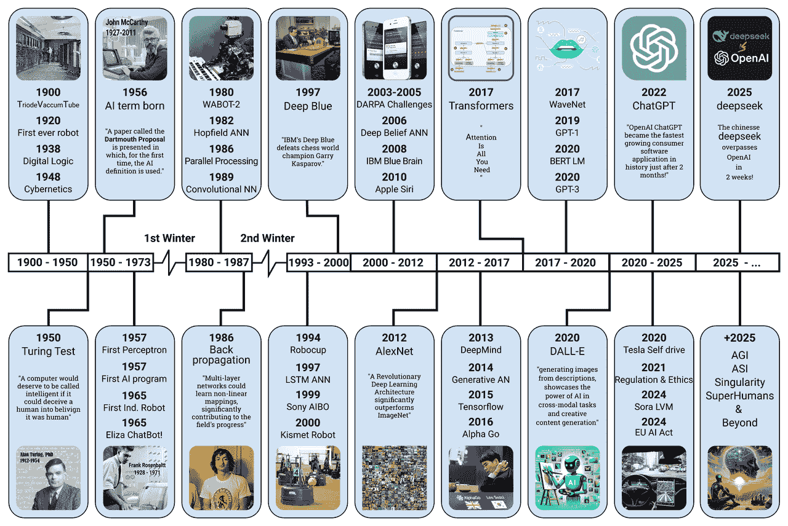
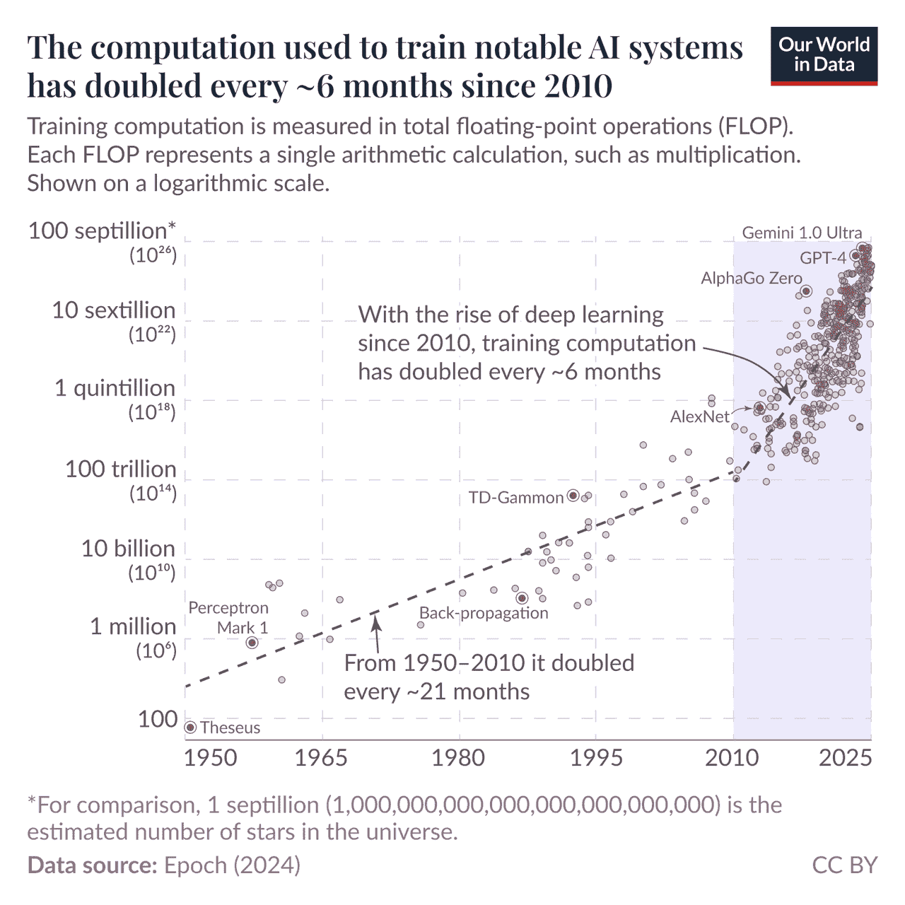
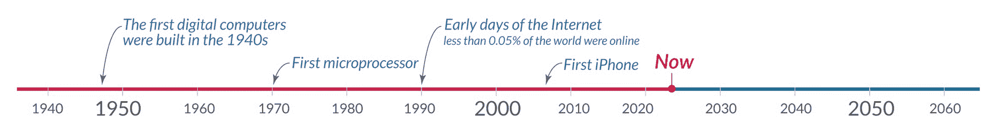
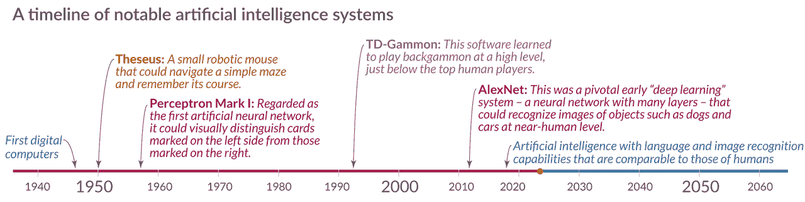
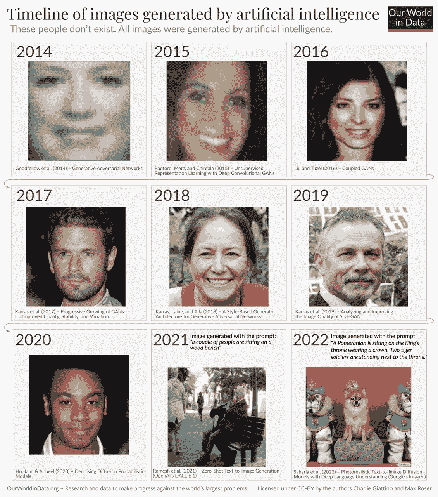
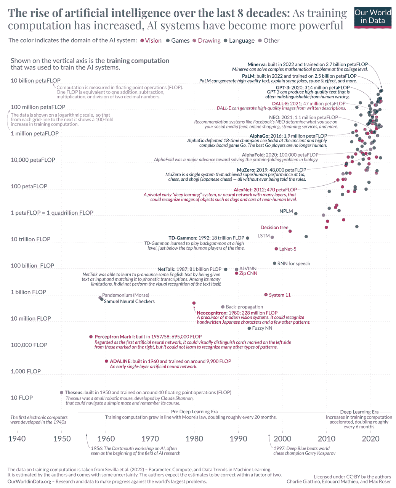

# AI-History-Timeline Picture

> 来源：[https://gotoaiworld.feishu.cn/docx/JCuydD3Z0oPwyQxZ1eZc2plUnUd](https://gotoaiworld.feishu.cn/docx/JCuydD3Z0oPwyQxZ1eZc2plUnUd)

# Wikipedia

# AI history timeline image covering the most important events from 1900 to 2025

https://upload.wikimedia.org/wikipedia/commons/f/f2/AI-History-Timeline-300dpi.jpg

# The training computation of notable AI systems trough time

# Our World in Data

https://ourworldindata.org/brief-history-of-ai

# [T](https://ourworldindata.org/grapher/test-scores-ai-capabilities-relative-human-performance?tab=table)[est scores ](https://ourworldindata.org/grapher/test-scores-ai-capabilities-relative-human-performance?tab=table)of AI systems on various capabilities relative to human performance

Within each domain, the initial performance of the AI is set to –100. Human performance is used as a baseline, set to zero. Whenthe AI’s performance crosses the zero line, it scored more points than humans.

Filter by: All (12)

Search for a capability

**Test scores of the AI relative **to human performance

**Data source:** Kiela et al. (2023) – Learn more about this data

[OurWorldinData.org/art](https://ourworldindata.org/artificial-intelligence)ifi[cial-](https://creativecommons.org/licenses/by/4.0/)intelligence | CC BY

