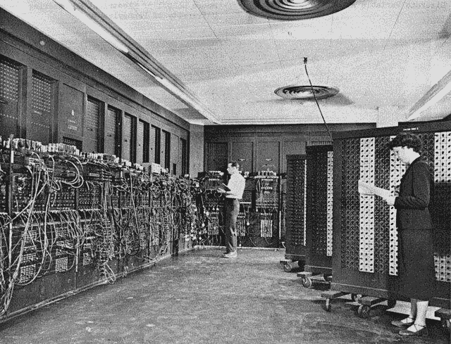
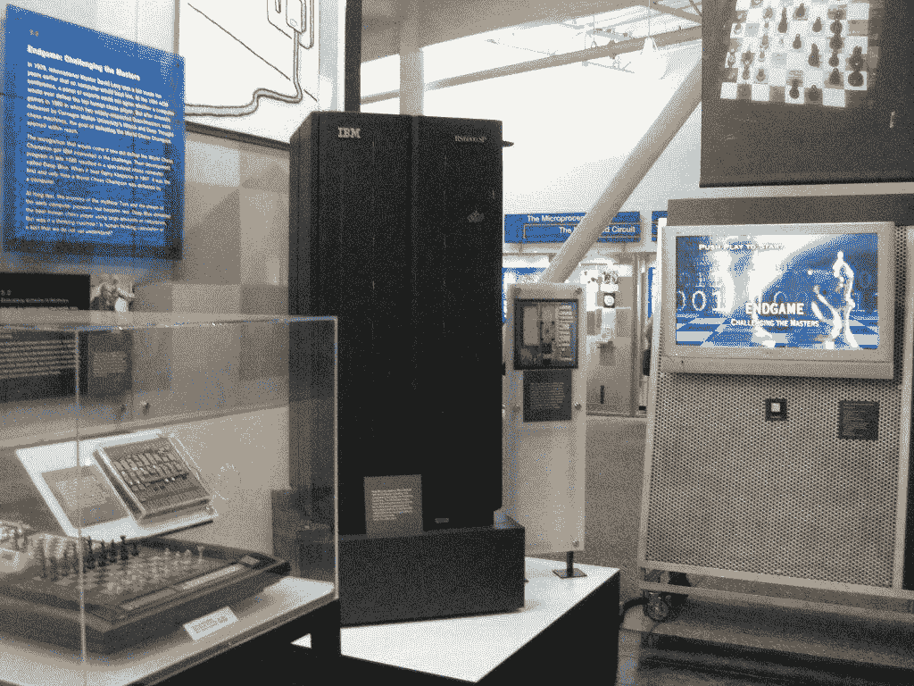
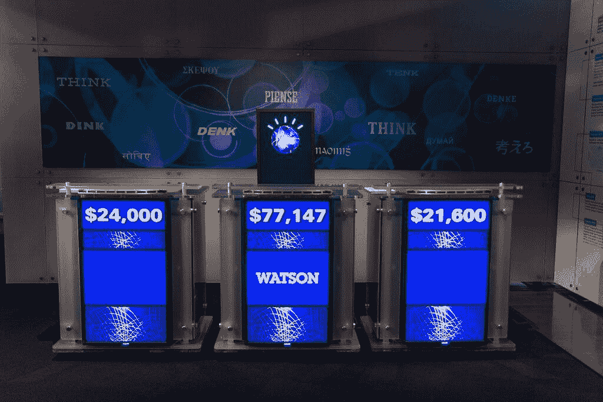

# Thehistory.Tech：Timeline of Milestones: History of Artificial Intelligence

> 来源：[https://gotoaiworld.feishu.cn/docx/G3IWdFU7Yo0DlNxPeNpcleCjncd](https://gotoaiworld.feishu.cn/docx/G3IWdFU7Yo0DlNxPeNpcleCjncd)

`https://thehistory.tech/history-of-ai-evolution/`

## Timeline of Milestones: History of Artificial Intelligence

Artificial intelligence (AI) has indeed undergone a remarkable transformation in recent years, capturing the imagination and integration into everyday business and society. This transformation represents a profound shift in how we interact with technology and how it impacts our lives and livelihoods.

At its core, AI empowers computers and systems to perform tasks that traditionally demanded human cognition. It has become an indispensable part of our lives, offering a symbiotic relationship where humans and AI complement each other’s capabilities.

In healthcare, AI has ushered in a new era of early detection and improved treatments for cancer patients.

AI algorithms can analyze vast datasets, enabling clinicians to identify potential health issues before they become critical, leading to better patient outcomes.

Across industries, AI is a powerful tool for businesses of all sizes. It optimizes operations, creates new revenue streams, and enhances decision-making processes. It enables companies to automate tasks more efficiently, reducing costs and improving productivity.

AI’s synergy with big data is particularly transformative. It acts as a great equalizer, harnessing the vast data generated daily. AI systems thrive on data, using it to train and refine themselves. This results in more accurate predictions, efficient processes, and enhanced network security.

## Table of Contents

+ When was AI first invented?
+ [Who first created artificial intelligence?](https://thehistory.tech/history-of-ai-evolution/#who-first-created-artificial-intelligence)
+ AI Through the Ages
  + [The 1950s](https://thehistory.tech/history-of-ai-evolution/#the-1950-s)
    + [1950](https://thehistory.tech/history-of-ai-evolution/#1950)
    + [1951](https://thehistory.tech/history-of-ai-evolution/#1951)
    + [1952](https://thehistory.tech/history-of-ai-evolution/#1952)
    + [1956](https://thehistory.tech/history-of-ai-evolution/#1956)
    + [1958](https://thehistory.tech/history-of-ai-evolution/#1958)
    + [1959](https://thehistory.tech/history-of-ai-evolution/#1959)
  + [The 1960s](https://thehistory.tech/history-of-ai-evolution/#the-1960-s)
    + [1964](https://thehistory.tech/history-of-ai-evolution/#1964)
    + [1965](https://thehistory.tech/history-of-ai-evolution/#1965)
    + [1966](https://thehistory.tech/history-of-ai-evolution/#1966)
    + [1968](https://thehistory.tech/history-of-ai-evolution/#1968)
    + [1969](https://thehistory.tech/history-of-ai-evolution/#1969)
  + From the 1970s to 1990s
    + [1973](https://thehistory.tech/history-of-ai-evolution/#1973)
    + [1980](https://thehistory.tech/history-of-ai-evolution/#1980)
    + [1981](https://thehistory.tech/history-of-ai-evolution/#1981)
    + [1984](https://thehistory.tech/history-of-ai-evolution/#1984)
    + [1985](https://thehistory.tech/history-of-ai-evolution/#1985)
    + [1988](https://thehistory.tech/history-of-ai-evolution/#1988)
    + [1989](https://thehistory.tech/history-of-ai-evolution/#1989)
    + [1997](https://thehistory.tech/history-of-ai-evolution/#1997)
  + [The 2000s](https://thehistory.tech/history-of-ai-evolution/#the-2000-s)
    + [2000](https://thehistory.tech/history-of-ai-evolution/#2000)
    + [2006](https://thehistory.tech/history-of-ai-evolution/#2006)
    + [2009](https://thehistory.tech/history-of-ai-evolution/#2009)
  + [The 2010s](https://thehistory.tech/history-of-ai-evolution/#the-2010-s)
    + [2011](https://thehistory.tech/history-of-ai-evolution/#2011)
    + [2012](https://thehistory.tech/history-of-ai-evolution/#2012)
    + [2013](https://thehistory.tech/history-of-ai-evolution/#2013)
    + [2014](https://thehistory.tech/history-of-ai-evolution/#2014)
    + [2016](https://thehistory.tech/history-of-ai-evolution/#2016)
    + [2017](https://thehistory.tech/history-of-ai-evolution/#2017)
    + [2018](https://thehistory.tech/history-of-ai-evolution/#2018)
    + [2019](https://thehistory.tech/history-of-ai-evolution/#2019)
  + The 2020s and Beyond
    + [2020](https://thehistory.tech/history-of-ai-evolution/#2020)
    + [2021](https://thehistory.tech/history-of-ai-evolution/#2021)
    + [2022](https://thehistory.tech/history-of-ai-evolution/#2022)
    + [2023](https://thehistory.tech/history-of-ai-evolution/#2023)

As AI advances, it promises to revolutionize how we work, live, and interact with the world. Its ability to process and understand data at an unprecedented scale reshapes industries from finance to transportation and from education to entertainment. AI’s influence is pervasive, and its boundless potential makes it a driving force shaping the future of business and society.

## When was AI first invented?

Artificial Intelligence (AI) was introduced in the mid-20th century. The term “artificial intelligence” was coined by computer scientist John McCarthy in 1956 during the Dartmouth Workshop, often considering AI’s birth as a field. However, creating machines that could simulate human intelligence dates back further.

The [foundations](https://thehistory.tech/alan-turing-computer-age/) of AI can be traced to early computer pioneers like Alan Turing, who, in the 1930s, conceived the notion of a “universal machine” capable of performing any computation that could be described algorithmically. Turing’s work laid the theoretical groundwork for AI.

Practical AI research began in the 1940s and 1950s with the development of electronic computers. The first AI programs, like the Logic Theorist developed by Allen Newell and Herbert A. Simon, in 1955, aimed to mimic human problem-solving and logical reasoning.

While AI has evolved significantly since its inception, the 1950s marked the official birth of the field and the commencement of dedicated research into creating intelligent machines.

## Who first created artificial intelligence?

Artificial intelligence (AI) does not have a single creator or originator but has evolved through the contributions of numerous researchers and scientists over several decades. The field of AI emerged as a distinct discipline in the mid-20th century.

One of the pioneers often associated with AI is Alan Turing, a British mathematician and computer scientist. Turing’s work laid the theoretical foundation for AI through his development of the “Turing Test” in 1950, which introduced the concept of a machine’s ability to exhibit intelligent behavior indistinguishable from a human.

Additionally, John McCarthy, an American computer scientist, is credited with coining the term “artificial intelligence” in 1956 and organizing the Dartmouth Workshop, which is considered the birth of AI as an organized field.

However, it’s important to note that AI’s development has been a collaborative effort involving many prominent researchers, including Marvin Minsky, Herbert A. Simon, and others, who made significant contributions to the field’s early development. AI’s evolution continues to this day through the collective efforts of scientists, engineers, and researchers worldwide.

## AI Through the Ages

Artificial intelligence (AI) has a rich history that spans several decades. Here’s a timeline of some key milestones and developments in AI:

### The 1950s

#### 1950

## 1950

In 1950, Alan Turing published “Computing Machinery and Intelligence,” a groundbreaking paper that laid the foundation for the field of artificial intelligence (AI). In this seminal work, Turing introduced the concept of the Turing test, a measure of a machine’s ability to exhibit human-like intelligence. This test became pivotal in AI, challenging researchers to create machines capable of human-like conversation and reasoning. Turing’s visionary insights and the Turing test he proposed marked the beginning of AI research, setting the stage for developing AI technologies and systems that would shape our modern world.

### 1951

In 1951, Marvin Minsky and Dean Edmonds achieved a significant milestone in the history of artificial intelligence by creating the first artificial neural network (ANN), SNARC (Stochastic Neural Analog Reinforcement Calculator). This groundbreaking achievement involved using 3,000 vacuum tubes to simulate a network of 40 artificial neurons. SNARC’s design and operation marked an early attempt to replicate the complex interactions of biological neurons in a computational system, paving the way for the development of modern neural networks and machine learning, which have since become fundamental technologies in AI, powering applications ranging from image recognition to natural language processing.

### 1952

1952 Arthur Samuel developed the “Samuel Checkers-Playing Program,” the world’s first self-learning program capable of playing games. This pioneering development marked a significant milestone in artificial intelligence and laid the foundation for further advancements in machine learning and game-playing AI systems.

### 1956

In 1956, John McCarthy, Marvin Minsky, Nathaniel Rochester, and Claude Shannon played pivotal roles in the inception of artificial intelligence (AI). They collectively coined “artificial intelligence” and proposed an influential workshop. This workshop, now widely regarded as a seminal event in the AI field, laid the foundation for the formal study and development of AI as a distinct discipline. It brought together leading minds to discuss the possibilities of creating intelligent machines, sparking a journey of exploration and innovation that has since transformed technology, science, and how we interact with machines and systems.

### 1958

In 1958, Frank Rosenblatt achieved a significant milestone in the history of artificial intelligence by developing the perceptron, an early Artificial Neural Network (ANN). The perceptron was groundbreaking because it demonstrated a machine that could learn from data, marking a crucial step toward modern neural networks. Rosenblatt’s perceptron model used a simplified model of a biological neuron and could make binary classifications based on input data. While it had limitations, such as its inability to handle complex problems, the perceptron laid the foundation for subsequent advancements in neural network design, ultimately leading to today’s deep learning revolution.

John McCarthy, a pioneering figure in artificial intelligence, is credited with developing Lisp, a groundbreaking programming language. Introduced in the late 1950s, Lisp was specifically designed for AI research and quickly gained traction within the AI community. Its unique features, such as support for symbolic processing and recursion, made it exceptionally well-suited for AI tasks. Lisp’s elegant and expressive syntax made it a favorite among developers and played a pivotal role in developing early AI applications. Its enduring influence is still evident today, with Lisp as a foundation for many modern AI and programming languages.

### 1959

In the history of machine learning, Arthur Samuel’s groundbreaking work is notable for coining the term “machine learning.” In a seminal paper, he articulated that computers could be programmed to surpass their initial programming by learning from data and improving their performance.

Another significant figure in the early development of machine learning was Oliver Selfridge, whose publication “Pandemonium: A Paradigm for Learning” was a landmark contribution. Selfridge’s work introduced a model that demonstrated the capacity to adapt and enhance itself iteratively, enabling it to discover and comprehend patterns within complex events. These pioneering contributions laid the foundation for the modern field of machine learning, which continues to evolve and transform various industries today.

## The 1960s

### 1964

In 1964, Daniel Bobrow created STUDENT, a pioneering natural language processing (NLP) program, during his doctoral studies at MIT. This innovative system was specifically engineered to tackle algebraic word problems, showcasing early strides in AI’s ability to understand and manipulate human language. STUDENT marked a significant breakthrough, demonstrating the potential for AI to interpret and respond to natural language queries. This capability would later become a cornerstone in various AI applications, from chatbots to virtual assistants and complex language understanding systems.

### 1965

In 1965, a groundbreaking achievement occurred in artificial intelligence when Edward Feigenbaum, Bruce G. Buchanan, Joshua Lederberg, and Carl Djerassi collaborated to develop Dendral. This pioneering expert system marked a significant milestone as it became the first of its kind. Dendral was designed to assist organic chemists in the complex task of identifying unknown organic molecules. By leveraging a knowledge-based approach and rule-based reasoning, Dendral demonstrated the potential of AI to provide valuable expertise in specialized domains, foreshadowing the future development of expert systems across various fields, from medicine to engineering, where intelligent computer systems could emulate human expertise.

### 1966

In 1966, Joseph Weizenbaum achieved a significant milestone in artificial intelligence by creating Eliza, a computer program renowned for its conversational abilities. Eliza had the remarkable capacity to engage in dialogues with humans, often leading them to believe that they interacted with a sentient being, thanks to its clever use of natural language processing.

During the same year, the Stanford Research Institute unveiled Shakey, an iconic achievement in robotics and AI. Shakey was the world’s first mobile intelligent robot, incorporating AI, computer vision, navigation, and natural language processing (NLP) elements. It laid the foundation for future developments in autonomous vehicles and drone technology, earning its place as the grandparent of today’s self-driving cars and drones.

### 1968

In 1968, Terry Winograd developed SHRDLU, a groundbreaking multimodal AI system. SHRDLU was a pioneering example of natural language understanding and reasoning, allowing users to communicate with it in plain English to manipulate a simulated world of blocks. Users could provide instructions and ask questions, and SHRDLU would respond by moving and arranging the virtual blocks accordingly. This marked a significant step in AI development, showcasing the potential for computers to comprehend and act upon human language, setting the stage for future advancements in natural language processing and human-computer interaction.

### 1969

In 1969, Arthur Bryson and Yu-Chi Ho introduced a significant breakthrough in artificial neural networks (ANNs) with their backpropagation learning algorithm. This innovation marked a crucial advancement over the perceptron model, enabling the development of multilayer ANNs, which would later become the foundation for deep learning.

However, around the same time, Marvin Minsky and Seymour Papert published the book “Perceptrons,” which highlighted the limitations of simple neural networks, causing a decline in neural network research. This setback led to the rise of symbolic AI research, emphasizing rule-based systems and knowledge representation as an alternative approach to solving complex problems.

## From the 1970s to 1990s

### 1973

In 1973, James Lighthill’s influential report, “Artificial Intelligence: A General Survey,” profoundly impacted AI research in the United Kingdom. The report was critical of the progress in AI at that time, highlighting the limitations and failures of existing AI projects. As a result, it led the British government to substantially reduce financial support for AI research initiatives. This event, often called the “Lighthill Report,” marked a significant setback for AI research in the UK and contributed to a period known as the “AI winter,” characterized by reduced funding and interest in the field.

### 1980

In 1980, the commercialization of Symbolics Lisp machines marked a significant milestone in artificial intelligence (AI), symbolizing the beginning of an AI renaissance. These specialized computers were designed to execute the Lisp programming language efficiently, which was widely used in AI research and development.

However, despite the initial promise and enthusiasm, the Lisp machine market eventually faced a collapse in the years that followed. This downturn was due to various factors, including increased competition from general-purpose computing platforms, changing priorities in the AI community, and the evolution of AI techniques beyond Lisp-based systems. Nevertheless, the legacy of Lisp machines continues to influence AI research and development.

### 1981

In 1981, Danny Hillis significantly contributed to artificial intelligence by designing parallel computers optimized for AI and other computational tasks. These parallel computers featured an architectural concept akin to modern Graphics Processing Units (GPUs). This innovation was pivotal in enhancing the processing capabilities of AI systems, allowing them to handle complex tasks more efficiently by breaking them down into parallel processes. Hillis’ work laid the foundation for the high-performance computing systems and GPUs that are now instrumental in powering contemporary AI advancements, making AI applications faster and more accessible across various industries.

### 1984

In 1984, Marvin Minsky and Roger Schank contributed to the history of artificial intelligence (AI) by coining the term “AI winter.” Their warning, voiced at an Association for the Advancement of Artificial Intelligence meeting, served as a proactive caution to the business community. They foresaw that the excessive hype surrounding AI could ultimately lead to disillusionment, and, unfortunately, their prediction came true just three years later. The AI industry experienced a significant downturn, marked by reduced funding and waning interest, highlighting the cyclical nature of AI’s development and the importance of managing expectations in the field.

### 1985

In 1985, Judea Pearl made a groundbreaking contribution to the field of artificial intelligence by introducing Bayesian networks causal analysis. This innovative approach offered a powerful set of statistical techniques that enabled computers to represent and manipulate uncertainty. Bayesian networks provided a structured framework for modeling complex relationships among variables, making it possible to draw causal inferences and assess probabilities in various applications. Pearl’s work has had a profound impact not only on AI but also on fields like machine learning, decision analysis, and robotics, influencing the development of more accurate and robust systems capable of handling uncertainty effectively.

### 1988

In 1988, Peter Brown and his colleagues published a seminal paper titled “A Statistical Approach to Language Translation.” This groundbreaking work laid the foundation for one of the most extensively studied methods in machine translation. By introducing statistical techniques into the translation process, it marked a pivotal shift from rule-based systems to data-driven approaches. Brown’s work demonstrated that computers could analyze vast bilingual corpora, learn patterns, and make informed translation decisions, significantly improving the accuracy and efficiency of language translation. This research paved the way for the development of modern machine translation systems, contributing significantly to natural language processing.

### 1989

In 1989, Yann LeCun, Yoshua Bengio, and Patrick Haffner achieved a significant breakthrough by demonstrating the practical application of convolutional neural networks (CNNs) for recognizing handwritten characters. This groundbreaking work showcased that neural networks, specifically CNNs, could effectively address real-world problems like character recognition. Their research laid the foundation for modern computer vision and image recognition systems, revolutionizing fields like optical character recognition and paving the way for developing AI systems capable of understanding and processing visual data in diverse applications, from facial recognition to autonomous vehicles and medical imaging.

### 1997

In 1997, significant milestones in artificial intelligence were achieved. Sepp Hochreiter and Jürgen Schmidhuber introduced the Long Short-Term Memory (LSTM) recurrent neural network, a breakthrough in AI capable of processing sequential data like speech and video, revolutionizing natural language processing and video analysis.

[Simultane](https://thehistory.tech/deep-blue-ibm-chess-computer-history/)ously, IBM’s Deep Blue made history by defeating Garry Kasparov in a highly anticipated chess rematch. This victory marked the first time a reigning world chess champion had been defeated by a computer in a tournament setting. The event showcased AI’s potential to excel in complex strategic games, foreshadowing its future impact on various domains beyond chess.

## The 2000s

### 2000

In the year 2000, researchers from the University of Montreal made a significant contribution to the field of natural language processing with their publication titled “A Neural Probabilistic Language Model.” This groundbreaking research proposed a novel approach to modeling language by utilizing feedforward neural networks. Applying neural networks to language modeling paved the way for more sophisticated and effective methods in natural language understanding and generation, which have since become foundational in various AI applications, including machine translation, speech recognition, and chatbots. This research marked a crucial step in the evolution of neural network-based language models, ultimately shaping the future of AI-driven language processing.

### 2006

In 2006, Fei-Fei Li embarked on a groundbreaking project, creating the ImageNet visual database, which was officially introduced in 2009. This monumental effort laid the foundation for the AI boom by providing a vast dataset for image recognition. ImageNet subsequently became the cornerstone of an annual competition, spurring the development of increasingly sophisticated image recognition algorithms.

Around the same time, IBM Watson emerged with the ambitious goal of challenging the human intellect. In 2011, Watson achieved a historic milestone by defeating the all-time human champion Ken Jennings in the quiz show Jeopardy! This victory showcased Watson’s ability to understand natural language and access extensive knowledge bases, marking a pivotal moment in AI history.

### 2009

In 2009, Rajat Raina, Anand Madhavan, and Andrew Ng introduced a groundbreaking concept in their paper titled “Large-Scale Deep Unsupervised Learning Using Graphics Processors.” Their pioneering work advocated for the utilization of Graphics Processing Units (GPUs) as a means to train expansive neural networks. This innovation marked a pivotal moment in artificial intelligence, as GPUs offered unprecedented computational power, significantly accelerating the training of deep learning models. This breakthrough laid the foundation for the deep learning revolution, enabling the development of complex AI systems and applications across various domains, from computer vision to natural language processing.

# The 2010s

## 2011

In 2011, a significant milestone in the field of artificial intelligence was achieved when Jürgen Schmidhuber, Dan Claudiu Cireșan, Ueli Meier, and Jonathan Masci developed the first Convolutional Neural Network (CNN) to attain “superhuman” performance. Their CNN outperformed human capabilities by winning the German Traffic Sign Recognition competition, showcasing the power of deep learning in computer vision tasks.

Furthermore, in the same year, Apple released Siri, a groundbreaking voice-powered personal assistant. Siri could understand and respond to voice commands, execute tasks, and provide information, marking a significant leap in natural language processing and human-computer interaction. Siri’s introduction paved the way for integrating AI-powered virtual assistants into everyday technology and devices.

## 2012

In 2012, Geoffrey Hinton, Ilya Sutskever, and Alex Krizhevsky introduced a groundbreaking deep Convolutional Neural Network (CNN) architecture called “AlexNet.” This innovation secured a decisive victory in the ImageNet Large Scale Visual Recognition Challenge and ignited a profound transformation in deep learning. AlexNet’s success demonstrated the immense potential of deep neural networks for computer vision tasks, leading to a surge in research and practical applications of deep learning across various domains, from image recognition to natural language processing. It marked a pivotal moment that paved the way for deep learning techniques’ rapid expansion and adoption.

## 2013

In 2013, significant computing and artificial intelligence advancements were achieved. China’s Tianhe-2 supercomputer set a remarkable milestone by doubling the world’s top supercomputing speed, reaching 33.86 petaflops, securing its position as the world’s fastest system for the third consecutive time. This marked a significant leap in computational power.

Meanwhile, DeepMind, a subsidiary of Google, introduced a groundbreaking approach to AI with deep reinforcement learning. They developed a Convolutional Neural Network (CNN) that learned tasks through rewards and repetition, ultimately surpassing human expert levels in playing games, showcasing the potential of machine learning in gaming and problem-solving.

Additionally, Google researcher Tomas Mikolov and his team introduced Word2vec, a revolutionary technique for automatically identifying semantic relationships between words. This innovation paved the way for more advanced natural language processing and understanding, contributing to the evolution of AI in language-related tasks.

## 2014

In 2014, significant advancements in artificial intelligence were made. Ian Goodfellow and his colleagues introduced Generative Adversarial Networks (GANs), a groundbreaking machine learning framework. GANs revolutionized image generation, transformation, and even led to the creation of deepfake technology, which could convincingly manipulate visual and audio content.

Diederik Kingma and Max Welling introduced Variational Autoencoders (VAEs), another pioneering innovation. VAEs were instrumental in generating images, videos, and text, expanding the capabilities of AI-generated content.

Additionally, Facebook developed DeepFace, a deep learning facial recognition system. DeepFace achieved near-human accuracy in identifying human faces within digital images, demonstrating remarkable progress in computer vision and biometric technology. These developments paved the way for numerous applications in AI, from creative content generation to enhanced facial recognition systems.

## 2016

In 2016, DeepMind’s AlphaGo made history by defeating the world-renowned Go player Lee Sedol in Seoul, South Korea. This monumental victory showcased the remarkable capabilities of artificial intelligence in mastering a complex and strategic board game, reminiscent of IBM’s Deep Blue defeating chess champion Garry Kasparov nearly two decades prior.

Simultaneously, Uber initiated a groundbreaking self-driving car pilot program in Pittsburgh, marking a significant step towards autonomous transportation. This innovative venture offered a select group of users the opportunity to experience self-driving technology firsthand, representing a major development in the pursuit of autonomous vehicles and the future of transportation.

## 2017

In 2017, significant developments and warnings in artificial intelligence (AI) emerged. Stanford researchers introduced diffusion models, a groundbreaking technique outlined in “Deep Unsupervised Learning Using Nonequilibrium Thermodynamics.” This approach allowed for reverse-engineering noise addition in final images, opening new possibilities in image processing.

Simultaneously, Google researchers introduced the concept of transformers in their influential paper “Attention Is All You Need.” This groundbreaking concept sparked research into tools capable of automatically interpreting unlabeled text, leading to the emergence of large language models (LLMs).

Amid these advancements, renowned physicist Stephen Hawking issued a stark caution, highlighting the need to prepare for and mitigate potential risks associated with AI. He warned that AI could pose a catastrophic threat to our civilization’s history without proper precautions.

## 2018

In 2018, significant advancements in robotics and artificial intelligence (AI) marked a transformative year. In collaboration with Airbus and the German Aerospace Center DLR, IBM introduced Cimon, a groundbreaking robot designed for space missions. Cimon aimed to assist astronauts in performing tasks aboard the International Space Station, showcasing the potential of AI-driven robotics in extreme environments.

OpenAI’s release of GPT (Generative Pre-trained Transformer) marked a pivotal moment in natural language processing and AI. This technology laid the foundation for subsequent Large Language Models (LLMs), revolutionizing language understanding and generation.

Additionally, Groove X introduced Lovot, a remarkable home mini-robot. Lovot was designed to sense and respond to human emotions, creating a unique and emotionally engaging human-robot interaction experience. This innovation represented a significant step toward more emotionally intelligent AI-driven devices, potentially impacting daily life.

## 2019

In 2019, significant advancements in artificial intelligence were achieved. Microsoft introduced the Turing Natural Language Generation model, a powerful language model boasting 17 billion parameters, pushing the boundaries of natural language understanding and generation.

Meanwhile, Google AI collaborated with Langone Medical Center to develop a deep learning algorithm that demonstrated remarkable potential in medical imaging. This algorithm outperformed radiologists in the crucial task of detecting potential lung cancers. Such breakthroughs highlighted AI’s capacity to enhance medical diagnosis and underscored its potential to revolutionize healthcare through improved accuracy and efficiency in disease detection and diagnosis.

# The 2020s and Beyond

# 人工智能发展年表

## 2020

In 2020, several significant developments in the field of artificial intelligence made headlines. The University of Oxford introduced the Curial AI test, designed to swiftly detect COVID-19 in emergency room patients, aiding in the fight against the global pandemic. OpenAI released GPT-3 LLM, a groundbreaking model boasting 175 billion parameters, capable of generating remarkably humanlike text. Nvidia unveiled the beta version of its Omniverse platform, revolutionizing the creation of 3D models in the physical world. Additionally, DeepMind’s AlphaFold made history by winning the Critical Assessment of Protein Structure Prediction contest, showcasing AI’s potential in solving complex scientific challenges, particularly in the field of biology and healthcare.

## 2021

In 2021, OpenAI made significant strides in AI with the introduction of Dall-E, a groundbreaking multimodal AI system capable of generating images from textual descriptions. This innovative technology demonstrated AI’s ability to understand and translate text into visual content, opening up new possibilities in various creative and practical applications.

Additionally, the University of California, San Diego, achieved a remarkable feat by creating a four-legged soft robot that operated entirely on pressurized air, eschewing traditional electronic components. This development showcased the potential for alternative, bio-inspired approaches to robotics, offering greater adaptability and potential applications in areas like healthcare and exploration.

## 2022

In 2022, notable events in technology included Google’s controversial firing of software engineer Blake Lemoine, who was let go for allegedly revealing confidential information about Lamda and asserting it possessed sentience. DeepMind, on the other hand, introduced AlphaTensor, a tool designed to discover innovative, efficient, and verifiably correct algorithms. Meanwhile, Intel made strides in combating misinformation with its FakeCatcher, a real-time deepfake detector boasting an impressive 96% accuracy rate. OpenAI expanded its AI offerings by releasing ChatGPT in November, providing users with a chat-based interface to access its advanced GPT-3.5 Language Model. These developments showcased the ongoing evolution of AI and its applications in 2022.

## 2023

OpenAI’s introduction of GPT-4, a multimodal Language Model (LLM) capable of processing both text and image prompts, has raised significant concerns. A coalition, including notable figures like Elon Musk and Steve Wozniak, along with thousands of signatories, calls for a six-month halt on training “AI systems more powerful than GPT-4.” This plea underscores the growing apprehension about the rapid advancement of AI technology and the need for ethical considerations, safety measures, and comprehensive regulations to ensure responsible development and deployment of increasingly powerful AI systems. The debate over AI’s potential risks and benefits continues to intensify within the global tech community.

The potential of AI’s ongoing technological advancements spans numerous sectors, including business, manufacturing, healthcare, finance, marketing, customer experience, workforce environments, education, agriculture, law, IT systems, cybersecurity, and transportation in both ground, air, and space domains.

In the business world, a 2023 Gartner survey revealed that 55% of organizations that have integrated AI always consider it for new use cases. By 2026, Gartner predicts that organizations prioritizing AI transparency, trust, and security will witness a 50% improvement in AI model adoption, achieving business goals and user acceptance.

Current developments, whether they are incremental or disruptive, all contribute to the overarching goal of AI – achieving artificial general intelligence. For instance, neuromorphic processing holds the potential to mimic human brain cells, enabling computers to work concurrently rather than sequentially. However, amidst these remarkable advancements, issues like trust, privacy, transparency, accountability, ethics, and the preservation of humanity are surfacing. These concerns will continue to be subjects of debate and strive for acceptance within both the business world and society at large.
