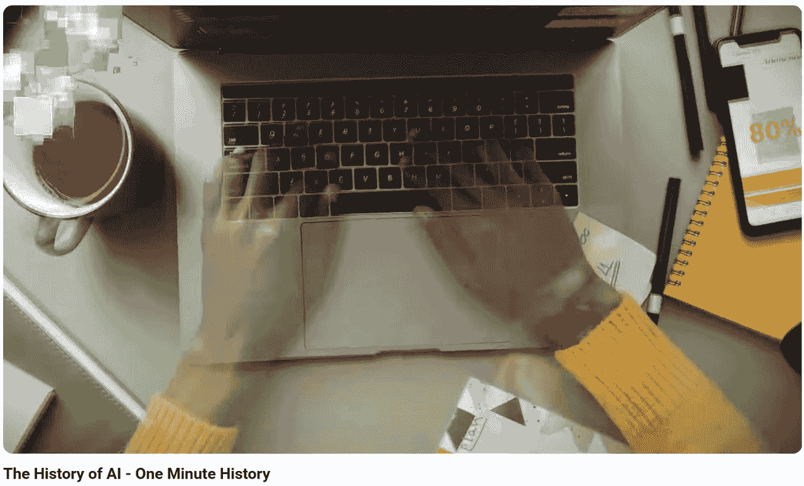

# The History of AI - One Minute History

> 来源：[https://gotoaiworld.feishu.cn/docx/LeCHdjuzBoPKduxopU0c23qOn9d](https://gotoaiworld.feishu.cn/docx/LeCHdjuzBoPKduxopU0c23qOn9d)

# The History of AI - One Minute History

[I](https://www.youtube.com/redirect?event=video_description&redir_token=QUFFLUhqbk5aRnBkbEJGYUIxRWpwYTFXcV84WDZPcEtZZ3xBQ3Jtc0ttVzhqR3BlYWJVUFAwZHNWM2RudW1jUFcwZEN3UEVRZ1I0ZlFhOS05NEZ5YndiSmZtUlFvZk10elNJRExIWXV5d0V6YlRyTC1UY2dhSzdLOXpoSUdLZkYxRHR3STlWdFZwOVBxMm41UmdrSWtESkE1TQ&q=https%3A%2F%2Fwww.instagram.com%2Festelamercado.pnessa&v=PtG9_Zbm7Jw)n a world driven by innovation, a silent revolution is underway—the birth of Artificial Intelligence.  Beginning in the 1950s, visionaries like Alan Turing dared to dream of creating machines that could think like humans.  John McCarthy coined the term ‘Artificial Intelligence’ and established AI as a formal research field.  Marvin Minsky made significant contributions to the study of perception, learning and reasoning in AI.  Allen Newell and Herbert A. Simon developed the Logic Theorist program, which allowed machines to demonstrate the potential of their problem-solving capabilities.  Arthur Samuel created the first computer program that could play checkers at a competitive level by learning from its own experiences.  The history of AI is still being written, with each passing day bringing us closer to a future where human and artificial intelligence thrive together, shaping a destiny of endless possibilities and ethical dilemmas.

Read by Estela Mercado -

https://www.youtube.com/watch?v=PtG9_Zbm7Jw

/ estelamercado.pnessa

Please feel [f](https://www.youtube.com/redirect?event=video_description&redir_token=QUFFLUhqbFdlOXcySEFwR0owa2tPOUIwZGdKUGtYcVo5d3xBQ3Jtc0tuRU42WmZ5bTRRR2w2cGRFRWpFb3VHVFZVVTZxb1h0N1cxc2VHUnVua2FnZ1FFMTZoT1I3OHlqaThVRDdkTHV2ZHFpanRnNE5MSVFkYXFIdlVjNUhIU2xNWUVlTXpTX2xBWDU0bFNqRHBVbVB5MFVXMA&q=https%3A%2F%2Fwww.patreon.com%2Foneminutehistory&v=PtG9_Zbm7Jw)ree to reach out to us at oneminutehistoryinfo@gmail.com

WEBSITE - https://www.oneminutehistory.com

PATREON -

/ oneminut[e](https://www.youtube.com/redirect?event=video_description&redir_token=QUFFLUhqa0hvTjAzLVF5VzJWSlBQYnpBYTRiVjlkV2d1d3xBQ3Jtc0tsWWZvbG5GUXlRWGhqZGdRcXlIblhLS24tclRFUUZDMGJEUGxCUWJCcTNWU25LZ0xSX3QwU0FwdjcyZmlOa0RTcEFVWjRoYlJBMlVwY05YQVFWRVVIdHNJWDBsdHRJRkJ1S2hrdm5BRHpRckRwQmpFSQ&q=https%3A%2F%2Fwww.facebook.com%2Foneminutehistory&v=PtG9_Zbm7Jw)history

FACEBOOK -

/ oneminute[h](https://www.youtube.com/redirect?event=video_description&redir_token=QUFFLUhqbXBZRlNwb2NvbEc5U0hEck9SUnp1eXRmNnNRQXxBQ3Jtc0tsZldmZTk4TG1XaUtqSmNEWE0tbkhGYi1aRXBDUmZKTkJPVXkwdkdzQjZ4S1I1bW9HajgwTW1tR3dpRlcwc2UxRjFsVEducWF3LUg1Nm1qZHdObTMwUVdYTTE5OHlVZl9manhlZkRpWXhRd3ZjQW44NA&q=https%3A%2F%2Fwww.instagram.com%2Foneminutehistory&v=PtG9_Zbm7Jw)istory

INSTAGRAM -

/ oneminu[t](https://www.youtube.com/redirect?event=video_description&redir_token=QUFFLUhqbTFCQjRNcGkycGhWeUM5d3pnODIxLTBhNVptQXxBQ3Jtc0trRWhoaDk1dXdJbi05TDgwQWxibDEzQVlMd0k3eW80bXlSX3dTN091S3E4RnhFSFA5azlYNmFOS1k4Q0NIaGhGYklvTmFQaWV3dGpFUzU2bm1ybnhWcmE0REdSQkExWEZ3N0NVZFQ5NGZlWW5CNERhRQ&q=https%3A%2F%2Fwww.twitter.com%2F1minhistory&v=PtG9_Zbm7Jw)ehistory

TWITTER -

/ 1minhistory