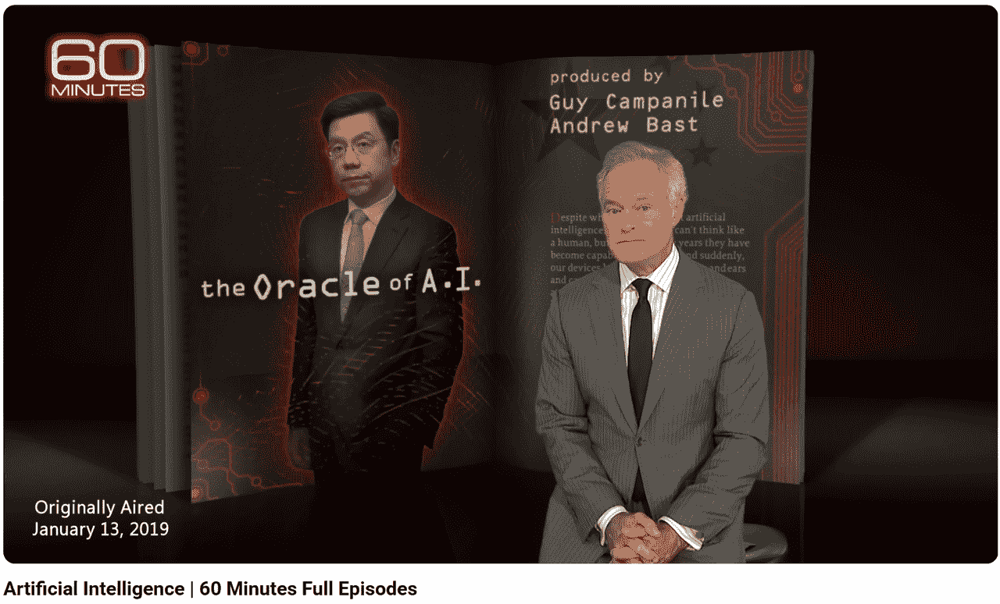

# Artificial Intelligence | 60 Minutes Full Episodes

> 来源：[https://gotoaiworld.feishu.cn/docx/VxhhderU9oxjkXxs66Hcybe8nhf](https://gotoaiworld.feishu.cn/docx/VxhhderU9oxjkXxs66Hcybe8nhf)

# Artificial Intelligence | 60 Minutes Full Episodes

https://www.youtube.com/watch?v=aZ5EsdnpLMI&t=11s

[From ](https://www.youtube.com/hashtag/news)Ja[nuary 2019,](https://www.youtube.com/hashtag/technology) Scott Pelley's interview with "the oracle of AI," Kai-Fu Lee. From this past April, Pelley's report on Google's AI efforts. And from this past March, Lesley Stahl's story on chatbots like ChatGPT and a world of unknowns.

#news #artificialintelligence #technology

"60 Minutes" is the most successful television broadcast in history. Offering hard-hitting investigative reports, interviews, feature segments and profiles of people in the news, the broadcast began in 1968 and is still a hit, over 50 seasons later, regularly making Nielsen's Top 10.

Subscribe to the “60 Minutes” YouTube channel: http://bit.ly/1S7CLRu

Watch full episodes: http://cbsn.ws/1Qkjo1F

Get more “60 Minutes” from “60 Minutes: Overtime”: http://cbsn.ws/1KG3sdr

Follow “60 Minutes” on Instagram: http://bit.ly/23Xv8Ry

Like “60 Minutes” on Facebook: http://on.fb.me/1Xb1Dao

Follow “60 Minutes” on Twitter: http://bit.ly/1KxUsqX

Subscribe to our newsletter: http://cbsn.ws/1RqHw7T

Download the CBS News app: http://cbsn.ws/1Xb1WC8

Try Paramount+ free: https://bit.ly/2OiW1kZ

For video licensing inquiries, contact: licensing@veritone.com

0:00 Introduction

0:11 The Oracle of AI

12:56 The Revolution (Part 1)

27:33 The Revolution (Part 2)

40:00 Who is minding the chatbots?