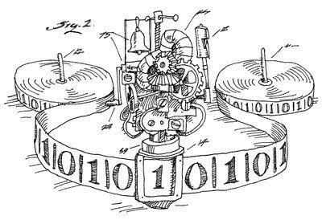
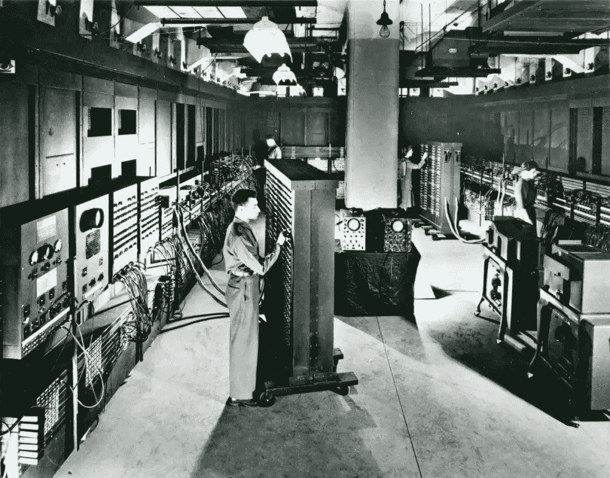
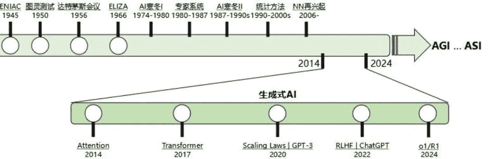
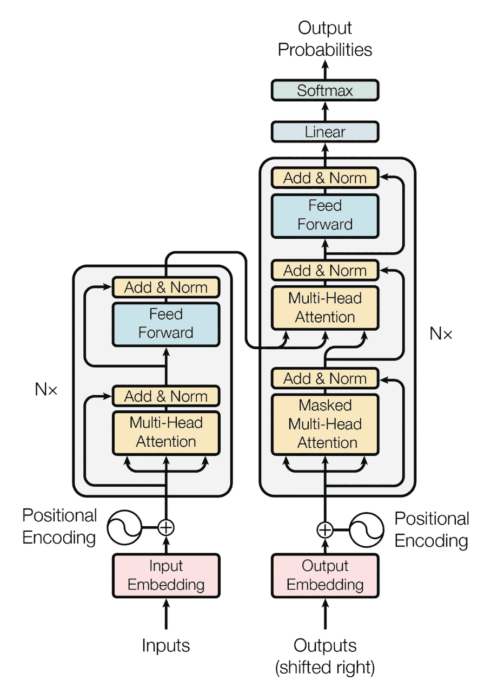
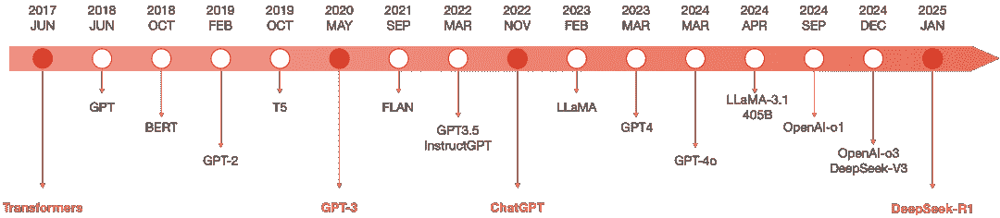

# 大模型核心技术原理

> 来源：[https://gotoaiworld.feishu.cn/docx/HsEpdHVotonUFpxdmPIcE4kYnEI](https://gotoaiworld.feishu.cn/docx/HsEpdHVotonUFpxdmPIcE4kYnEI)

# 一、大模型发展历史

> 输入 @ 插入相关文档，介绍项目成立的背景

# 大模型的发展历史

大模型的发展是一个渐进且充满突破的过程，它建立在过往数十年人工智能研究的深厚积淀之上。从最初简单的模型设想，到如今能够处理复杂任务、展现出惊人智能的超大规模模型，这一历程见证了技术的飞速进步与创新。

## 早期探索：传统神经网络模型阶段（1950 - 2005 年）

1956 年，计算机专家约翰・麦卡锡提出 “人工智能” 概念，自此 AI 发展开启征程。早期 AI 主要基于小规模专家知识构建系统，随着研究推进，逐渐向基于机器学习的方向转变。1980 年，卷积神经网络的雏形 CNN 诞生，它为后续图像识别等领域的发展奠定了基础。1998 年，现代卷积神经网络的基本结构 LeNet - 5 诞生，此时机器学习方法从早期基于浅层机器学习的模型，转变为基于深度学习的模型。LeNet - 5 能够自动学习图像中的特征，在手写数字识别等任务中取得了较好效果，为自然语言生成、计算机视觉等领域的深入研究开拓了道路，对后续深度学习框架的迭代及大模型发展具有开创性意义 。这一时期，虽然模型规模和能力有限，但为后续大模型发展积累了宝贵经验，包括神经网络架构设计、训练算法优化等方面。

## 技术沉淀：全新神经网络模型阶段（2006 - 2019 年）

2006 年，深度学习迎来重要转折点，杰弗里・辛顿等人提出的深度信念网络（DBN）引发广泛关注，开启了深度学习复兴的序幕。在自然语言处理领域，2013 年，Word2Vec 诞生，它首次提出将单词转换为向量的 “词向量模型”，使得计算机能够更好地理解和处理文本数据。通过将单词映射到低维向量空间，单词之间的语义关系能够通过向量运算体现，极大提升了自然语言处理任务的效果。2014 年，对抗式生成网络（GAN）诞生，它由生成器和判别器组成，通过两者相互对抗训练，生成器能够学习到数据的分布并生成逼真的数据样本，标志着深度学习进入了生成模型研究的新阶段，在图像生成等领域取得了令人瞩目的成果 。

2017 年，Google 提出了基于自注意力机制的神经网络结构 ——Transformer 架构，这成为大模型领域主流的算法架构基础。自注意力机制能够让模型在处理序列数据时，更好地捕捉不同位置元素之间的关系，有效解决了传统循环神经网络在处理长距离依赖时的难题。基于 Transformer 架构，2018 年，OpenAI 发布了 GPT - 1，它采用了生成式预训练的方式，先在大规模文本数据上进行无监督预训练，然后在特定任务上进行微调，为自然语言处理提供了新的思路。同年，Google 推出 BERT（Bidirectional Encoder Representations from Transformers），BERT 通过双向上下文建模，在多项自然语言处理任务中刷新了记录，证明了预训练模型在自然语言处理中的强大能力，预训练大模型开始成为自然语言处理领域的主流 。在这一阶段，以 Transformer 为代表的全新神经网络架构不断涌现，大模型的算法架构基础得以奠定，技术性能得到显著提升，为后续大模型的爆发式发展做好了铺垫。

## 爆发式增长：预训练大模型阶段（2020 年 - 至今）

2020 年，OpenAI 公司推出了 GPT - 3，这是大模型发展历程中的一个重要里程碑。GPT - 3 的模型参数规模达到了 1750 亿，成为当时最大的语言模型。它在零样本学习任务上实现了巨大性能提升，展现出惊人的语言理解和生成能力，能够完成文本生成、问答、翻译等多种自然语言处理任务，且无需针对每个任务进行大量的微调。这一成果验证了 “规模定律”，即模型性能随着参数规模和数据量的增加而显著提升 。

随后，为了进一步提高大模型的推理能力和任务泛化能力，更多策略如基于人类反馈的强化学习（RLHF）、代码预训练、指令微调等开始出现并应用到大模型训练中。2022 年 11 月，搭载了 GPT3.5 的 ChatGPT 横空出世，它凭借逼真的自然语言交互与多场景内容生成能力，迅速引爆互联网。ChatGPT 能够理解用户的各种问题，并以流畅、准确且富有逻辑的方式进行回答，还能撰写文章、故事、代码等多种类型的文本，让大众切实感受到了大模型的强大魅力 。

2023 年 3 月，OpenAI 发布超大规模多模态预训练大模型 ——GPT - 4，它不仅具备更精准的语言理解能力，还新增了图像功能，能够处理图像和文本等多种模态的数据，标志着大模型从单一模态向多模态的重要转变。在这之后，大模型领域呈现出百花齐放的态势。微软借助对 OpenAI 的投资与合作，将旗下 Office 办公产品全线整合大模型能力，推出 Copilot Office，提升办公效率。2023 年 5 月 24 日，微软宣布 Win11 接入 GPT - 4 。2023 年 5 月 10 日，谷歌推出新一代大模型 PaLM 2，已有超过 25 个 AI 产品和功能全线接入，包括原有对话机器人 Bard，AI + 办公助手 Duet AI、AI + 搜索引擎等 。Meta 发布大模型 LLaMA，加入大模型竞赛 。

国内科技龙头企业也密集发布自研大模型。百度发布大模型文心一言，在中文语言理解和生成、知识图谱应用等方面具有优势，为企业和开发者提供了一系列基于大模型的解决方案 。阿里发布首个超大规模语言模型通义千问，具备多种语言处理能力，并在电商等领域探索应用 。腾讯混元 AI 大模型团队推出了万亿级别中文 NLP 预训练模型 HunYuan - NLP - 1T 。华为发布的鹏城盘古大模型是业界首个千亿级生成和理解中文 NLP 大模型 。此外，投创界也积极入局大模型竞赛。美团联合创始人王慧文自带 5000 万美元入局 AI 大模型，搜狗前 CEO 王小川与搜狗前 COO 茹丽云共同创立百川智能，澜舟科技发布其语言生成模型 —— 孟子 MChat 可控大模型，西湖心辰也推出了心辰 Chat 大模型 。高校和科研机构也纷纷发力，复旦大学推出国内首个类 ChatGPT 大模型 MOSS，清华大学知识工程实验室与其技术成果转化公司智谱 AI 发布 ChatGLM，中科院自动化所推出多模态大模型紫东太初，IDEA 研究院 CCNL 推出开源通用大模型 “姜子牙” 。

2024 年，大模型技术继续向语音、视觉等多模态及学科交叉方向拓展。OpenAI 发布的文生视频 Sora 模型，能够根据文本描述生成高质量的视频内容，进一步丰富了大模型的应用场景 。随后推出的 GPT - 4o 能够实时处理多类型信息，显著提升了人机对话响应速度 。发布的 o1 - Preview 大模型则大幅提高了复杂推理能力 。同年末，又推出了 o1 pro、o3 等新一代推理大模型，向通用人工智能进一步迈进 。在国内，深度求索公司先后发布 DeepSeek V3 和 DeepSeek R1 大模型，并快速 “出圈”，通过打破传统的 “算力竞赛” 规则并完全开源，提升了我国在全球人工智能领域的影响力 。众多公司以及高校和科研机构持续加大投入，不断探索大模型在教育、医疗、金融、工业、政府、科研、电商、文旅、司法等各领域的创新应用，为各行业发展注入新的动力 。

# 二、项目目标

人工智能发展到今天，如火如荼如日中天，影响到人类世界的方方面面。鉴往知来，以史为鉴，不如回顾一下人工智能发展历史，这有助于我们进一步探求未来的发展前景。”

## 第1章 启蒙阶段：从图灵机到达特茅斯会议

这一阶段可以称为萌芽期，人工智能逐步从理论走向实践。1. 1936年，图灵机：奠定通用计算机的理论基础我们大家都听说过图灵奖，图灵奖是计算机领域的最高奖项。图灵一词正是来源于阿兰·图灵这个人的名字。艾伦·图灵被公认为是计算机领域的鼻祖。1936年，图灵向伦敦权威的数学杂志投一篇论文，题为《论可计算数及其在判定问题上的应用》。在这篇开创性的论文中，图灵给“可计算数”下了一个严格的数学定义，并提出著名的“图灵机”(Turing Machine)的设想。“图灵机”不是一个能造的出来的具体的机器，而是一种思想模型。

图灵所描述的图灵机如上图所示。图灵机有一条无限长的纸带，纸带分成了一个一个的小方格，每个方格有不同的颜色。有一个读写头在纸带上移来移去。读写头有一组内部状态，还有一些固定的程序。在每个时刻，读写头都要从当前纸带上读入一个方格信息，然后结合自己的内部状态查找程序表，根据程序输出信息到纸带方格上，并转换自己的内部状态，然后进行移动。图灵和导师提出了“邱奇-图灵论题(The Church-Turing thesis)。该论题最基本的观点是：所有计算或算法都可以由一台图灵机来执行。以任何常规编程语言编写的计算机程序都可以翻译成一台图灵机，反之任何一台图灵机也都可以翻译成大部分编程语言的程序。该论题被普遍假定为真，也被称为邱奇论题或邱奇猜想和图灵论题。”图灵机“的构想成为了后期计算机发明的基础理论。图灵机向人们展示这样一个过程:程序和其输入可以先保存到存储带上，图灵机就按程序一步一步运行直到给出结果，结果也保存在存储带上。更重要的是，隐约可以看到现代计算机主要构成，尤其是冯・诺依曼制造世界第一台计算机理论的主要构成。

1946年，美国数学家冯·诺依曼制造出了世界第一台现代电子数字计算机ENIAC，因此也被誉为”计算机之父“。冯·诺依曼高度评价图灵的贡献，并将存储程序概念（即程序与数据等同处理）归功于图灵。他称“可编程”这一特性本质上就是通用图灵机。冯诺依曼在普林斯顿高等研究院期间，与图灵在计算理论和人工智能领域的研究也有交集，其很多灵感均来自图灵。1950年，图灵测试：人工智能概念初步形成。 艾伦·图灵在论文《计算机器与智能》中提出了著名的“图灵测试”，通过问答测试判断机器是否具有人类智能，被视为人工智能科学的开山之作，标志着人工智能概念的初步形成。

该测试的流程是，一名测试者写下自己的问题，随后将问题以纯文本的形式（如计算机屏幕和键盘）发送给另一个房间中的一个人与一台机器。测试者根据他们的回答来判断哪一个是真人，哪一个是机器。所有参与测试的人或机器都会被分开。这个测试旨在探究机器能否模拟出与人类相似或无法区分的智能。图灵测试已成为人工智能的核心概念，通过评估机器令人信服地模仿人类对话和行为的能力，作为衡量机器智能的一种方式。1956年，达特茅斯会议第一次提出“人工智能”一词。

1955年8月31日，麦卡锡(John McCarthy)、明斯基(Marvin Lee Minsky)、香农(Claude Shannon)和罗切斯特(Nathaniel Rochester)四位学者向美国洛克菲勒基金会递交了一份题为“关于举办达特茅斯人工智能夏季研讨会的提议”的建议书，希望洛克菲勒基金会资助拟于1956年夏天在达特茅斯学院举办的人工智能研讨会。

洛克菲勒基金会的答复是：你们研究内容难以让人完全理解，但是鉴于这一研究所具有长期挑战性特点，基金会愿意资助其申请经费的一半。希望你们不会觉得我们过于谨慎。从长远来看，对思维的数学模型研究非常具有挑战性，是一场适度的赌博，因此在现阶段冒任何大风险会令人忧虑。注：《关于举办达特茅斯人工智能夏季研讨会的提议》(A Proposal for the Dartmouth Summer Research Project on Artificial Intelligence)原文可以从公众号回复关键词“达特茅斯”下载，有兴趣的读者可以看看。达特茅斯研讨会于一年后的1956年6月18日至8月17日举行（共8周时间），达特茅斯会议首次提出了“人工智能（Artificial Intelligence）”这一术语，标志着人工智能作为独立学科的诞生，因此1956年被称为“人工智能元年”。 会议共研讨了七大议题：

在美国新罕布什尔州汉诺斯小镇的达特茅斯学院，前后有40位专家参加了这一载入史册的“达特茅斯会议”，基本上以大范围的集思广益为主，这催生了后来人所共知的人工智能革命。会上讨论了关于设计智能机器的可能性，约翰·麦卡锡、马文·明斯基等人首次提出了“人工智能”这一术语，此次达特茅斯会议被视为人工智能学科的正式诞生。会议上提出了7大人工智能探索方向，这些方向直到今天也在探索之中。会议上最引人瞩目的成果，是赫伯特·西蒙Herbert Simon和艾伦·纽厄尔Alan Newell介绍的一个程序“逻辑理论家”（Logic Theorist），这个程序通过选择问题的最佳解法，证明了52条数学定理中的38条，甚至比人类的解法更聪明。后来，他们又提出了通用问题解决器 （GPS），这种方法影响深远，后来像AlphaGo打败柯洁的AI也用到了类似的思路。这个程序被许多人认为是第一款可工作的人工智能程序，同时也标志着符号主义人工智能的开始。

<https://wxa.wxs.qq.com/tmpl/mg/base_tmpl.html>

## 第2章 发展阶段：从专家系统到深度学习

从“人工智能”这个词被创造出来到20世纪80年代，是人工智能研究快速增长和斗争的时期。20世纪50年代末到60年代是创造的时期。从至今仍在使用的编程语言到探索机器人想法的书籍和电影，人工智能很快成为主流思想。

20世纪70年代也出现了类似的改进，比如日本制造了第一个拟人机器人，这是工程研究生制造自动驾驶汽车的第一个例子。然而，那也是人工智能研究的斗争时期，因为美国政府对继续资助人工智能研究几乎没有兴趣。

1957年，心理学家和计算机科学家弗兰克·罗森布拉特开发了感知器，这是一种早期的人工神经网络，能够基于两层计算机学习网络进行模式识别。感知器引入了二进制分类器的概念，该分类器可以通过学习算法来调整其输入的权重，从而从数据中学习。虽然仅限于解决线性可分离问题，但它为未来的神经网络和机器学习的发展奠定了基础。

此阶段主要是从基于符号注意的专家系统向基于连接主义的深度学习转变：

**专家系统：基于规则与符号逻辑**

专家系统采用“自上而下”的设计逻辑，依赖人工编码的规则库和推理引擎。其核心是符号主义（Symbolism），通过将领域专家的知识转化为显式的逻辑规则（如“IF-THEN”规则）进行决策例如，早期的医疗诊断系统MYCIN通过人工输入的医学规则实现疾病推理。其特点：强解释性、依赖专家经验、规则维护成本高。

深度学习：基于数据驱动的特征学习

深度学习属于联结主义（Connectionism），通过多层神经网络自动从数据中提取特征，无需人工设计规则。例如，卷积神经网络（CNN）通过逐层学习图像的边缘、纹理等抽象特征完成分类任务。其特点是：数据依赖性高、黑箱性显著、需大规模算力支持。

此阶段的主要历史事件如下：

1958年，AI编程语言LISP诞生。

John McCarthy创建了LISP（列表处理的首字母缩写），这是第一种用于AI研究的编程语言，至今仍在流行使用。

1959年，第一次提出”机器学习“。

亚瑟·塞缪尔在做一个关于教机器比编程机器的人更好下棋的演讲时创造了“机器学习”这个术语。亚瑟·塞缪尔开发了一种计算机程序，随着时间的推移提高了它在跳棋中的表现。塞缪尔展示了计算机可以被编程为遵循预设规则并从经验中“学习”，最终比程序员打得更好。他的工作标志着朝着通过经验教机器改进迈出了一大步，在此过程中创造了“机器学习”一词。

1961年，第一台工业机器人诞生。

第一台工业机器人Unimate开始在新泽西州通用汽车公司的装配线上工作，负责运输汽车上的模具外壳和焊接零件（这被认为对人类来说太危险）。

1965年，第一个”专家系统“诞生。

Edward Fegenbaum和Joshua L**e**derberg创建了第一个“专家系统”。这是一种人工智能形式，用于复制人类专家的思维和决策能力。

1966年，第一个”聊天机器人“。

Joseph Weizenbaum创造了第一个“聊天机器人”ELIZA，它是一个模拟心理治疗师，它使用自然语言处理（NLP）与人类交谈。

1968年，”深度学习“方法被提出：

苏联数学家Alexey Ivakhnenko在《Avtomatika》杂志上发表了“数据处理的群体方法”，该方法提出了一种新的人工智能方法，后来成为我们现在所知的“深度学习”。

1973年，进入人工智能第一次寒冬（1974-1980）。

1973年，一位名叫詹姆斯·莱特希尔的应用数学家向英国科学委员会提交了一份报告，强调进展并不像科学家承诺的那样令人满意，这导致英国政府对人工智能研究的支持和资助大幅减少。

第一次寒冬开始于1974年至1977年，也被称为“AI危机”，主要是由于当时作为AI研究的核心技术——知识表示认知机制表现不佳，且以此问题发展而来的研究无法解决实际的具体问题，引发财政问题，所以许多国家和研究机构对AI项目的投资被中止，导致AI发展停滞。

1979年，第一辆自动驾驶汽车。

詹姆斯·亚当斯（James L. Adams）于1961年创造了斯坦福推车，成为自动驾驶汽车的首批例子之一。1979年，它在没有人为干扰的情况下成功地在满是椅子的房间里导航。

**1979年，美国人工智能协会，现**在称为人工智能促进协会（AAAI）成立。

1980年，第一个专家系统进入商业市场。

被称为XCON（专家配置器）的专家系统进入商业市场，它旨在通过根据客户需求自动挑选组件来帮助计算机系统的订购。

1981年，日本政府拨款8.50亿美元（按今天的货币计算超过20亿美元）给第五代计算机项目。他们的目标是创造出能够在人类水平上翻译、用人类语言交谈和表达推理的计算机。

1984年，AAAI警告即将到来的“AI冬天”，资金和兴趣将减少，并使研究变得更加困难。

正如AAAI警告的那样，人工智能寒冬来临了。

1987年，进入人工智能第二次寒冬（1987-1993）。

这个人工智能寒冬的到来是因为机器市场和专家系统的一些挫折，包括第五代项目的结束、战略计算计划的削减以及专家系统部署的放缓。这次AI的“寒冬”特别之处在于，它更多的是因为AI技术被超预期而导致的公众对AI的期望性对其出现过早的膨胀。

1997年，深蓝战胜卡斯帕罗夫。

IBM的深蓝计算机”深蓝2“在国际象棋比赛中战胜了世界冠军加里·卡斯帕罗夫，展示了AI在复杂计算中的潜力。卡斯帕罗夫在赛后的采访中表示他非常生气，原因并不是因为他输给了深蓝计算机，而是因为这是他第一次输棋。

**2012年，深度学习取得突破。**

AlexNet在ImageNet竞赛中取得胜利，标志着深度学习的崛起。深度学习的突破让AI在图像识别、语音识别等领域取得了显著进展。

2013年，自然语言处理模型Word2Vec开放。

Google公司在2013年开放了用于训练词向量的软件工具Word2Vec，首次提出将单词转换为向量的”词向量模型“，以便计算机能更好地理解和处理文本数据。Word2Vec为自然语言处理（NLP）领域的应用研究提供了新的工具，成为NLP领域的基石技术。

2014年，对抗式生成网络诞生。

被誉为21世纪最强大的算法模型之一的GAN（对抗式生成网络）诞生，标志着深度学习进入了生成模型研究的新阶段，推动生成式人工智能的研究和发展。

<https://wxa.wxs.qq.com/tmpl/mg/base_tmpl.html>

2014年，自注意力机制首次被提出。

Bahdanau等人在论文 “Neural Machine Translation by Jointly Learning to Align and Translate” 中首次引入注意力机制，用于机器翻译任务。核心思想是：模型不再只依赖最后一个隐藏状态，而是动态地“关注”输入句子的不同部分，并分配不同的权重。这样，在翻译长句子时，模型可以灵活地决定哪些词更重要。

2015年，AlphaGo战胜围棋世界冠军。

谷歌DeepMind的AlphaGo击败了世界顶级围棋玩家李世石。围棋是一种复杂的棋盘游戏，比宇宙中的原子更有可能移动，长期以来一直被认为是人工智能的挑战。 AlphaGo以4比1战胜李世石是人工智能的一个开创性时刻，展示了深度学习技术处理高度复杂战略任务的力量，这些任务以前超出了人工智能的能力。

## 第3章 爆发期：从Transformer到DeepSeek

Transformer是自然语言处理（NLP）和计算机视觉（CV）等领域的革命性模型架构。其核心创新在于完全依赖自注意力（Self-Attention），摒弃了传统循环神经网络（RNN）和卷积神经网络（CNN）的局限，实现了高效的并行计算和长程依赖捕捉。Transformer凭借其并行化、全局感知和模块化设计，为后面的大语言模型的爆发式发展奠定了决定性基础，逐步成为AI领域的通用架构。

2017年，Goolge颠覆性提出Transformer架构。

Google发表论文"Attention is All You Need"，提出了著名的基于自注意力机制的神经网络架构—Transformer，奠定了大模型预训练算法架构的基础。

2018年，GPT-1和BERT模型发布。

2018年7月，OpenAI发布了首个生成式预训练模型GPT-1，开启大规模语言模型时代。

2018年10月，Google公司发布了BERT模型，显著提升了自然语言处理的性能，为后续大规模语言模型的发展奠定了基础。

这两个模型的发布，意味着预训练大模型成为了自然语言处理领域的主流。

2020年，OpenAI公司推出了GPT-3。

GPT-3的模型参数规模达到了1750亿，成为当时规模最大的语言模型，并且在零样本学习任务上实现了巨大性能提升。随后，更多策略如基于人类反馈的强化学习（RHLF）、代码预训练、指令微调等开始出现，被用于进一步提高推理能力和任务泛化。

2022年，ChatGPT 搭载GPT-3.5发布

ChatGPT 横空出世，凭借逼真的自然语言交互和多场景内容生成能力，迅速引爆互联网。人类首次体验到与AI自然流畅对话，刷新了普通人对AI的认知，引起了广泛的AI想象空间。ChatGPT的发布也被人们看作是人工智能领域的iPhone时刻，具有继往开来的深刻意义。更重要的是，它所带来的巨大冲击和市场想象空间引起了资本市场的广泛关注，为人工智能领域投资提供了强大助力。

此后，大模型发展进入加速发展和演进时期，下图是从Transformer到DeepSeek-R1时间段的重要时间节点总结，主要可以总结为以下几个阶段：

1.  Transformer：理论架构创新

+   自注意力机制：支持并行计算/全局上下文的理解能力

+   多头注意力：从多个角度捕捉复杂的语义关系

+   前馈网络/位置编码/层归一化：解决了传统模型的诸多局限

1.  从Transformer到GPT-3：预训练时代： 大力出奇迹（ “ 暴力美学” ）

+   BERT： Bidirectional Encoder Representations Transformers

+   **GPT: **Generative Pertained Transformer

+   **自监督算法：** MLM/NTP/MAE解决海量数据标注问

1.  GPT-3：语言模型的转折点

+   大语言模型：1750亿参数

+   涌现能力：随着模型规模增大而出现的新能力

1.  ChatGPT：人工智能的iPhone时刻

以自然语言为接口，将专业知识平民化，使个体创造力得到指数级释放。正如比尔·盖茨所言：“ChatGPT的诞生堪比互联网的发明，重新定义了人机协作的边界。”

1.  从ChatGPT到DeepSeek-R1：多模态，连接文本、图像等多媒体

+   开源：Meta的LLaMA系列（ 普惠学术领域）

+   GPT-4v：视觉遇见语言（ 跨模态）

+   GPT-4o：全模态前沿（ 交互能力）

1.  推理模型：从[生成]到[推理]的重心转变

+   OpenAI-o1/o3： 推理能力的一大飞跃

+   DeepSeek-V3/R1：专家模型、强化学习、开源、效率

## 第4章 现在与未来

现阶段以大语言模型为代表的人工智能技术正蓬勃发展，在全球经济不景气的大背景下，为经济发展提供了强劲活力，同时各种有利因素叠加为人工智能的进一步发展提供了更大空间，但也应注意人工智能历史上的多次”寒冬“给人们带来的警示作用。

1.  **技术突破**

AI发展遵循“螺旋上升”规律。连接主义（神经网络）在20世纪90年代低谷后，因算力与数据爆发重回主流。MoE、MLA、MCP、多模态等工程技术革新，为人工智能多场景落地提供可能。

1.  **政策与市场的双轮驱动**

在国际金融经济持续低迷的背景下，各国政府将AI纳入战略投资（如中国“十四五”规划），医疗、智能制造等领域的刚性需求为技术落地提供场景。

1.  **总结反思**

回望过去，人工智能因为多次技术革新而蓬勃发展，成为资本宠儿。也多次因为无法支撑人们的想象和预期（让市场失望），被市场无情抛弃。

展望未来，以大语言模型为代表的人工智能技术，基于现代算力支撑和模型架构的突破，达到了前所未有的发展高度，同时给予人们无限的想象空间。本次技术爆发在各行业都衍生出了各式各样的落地场景，但以语言交互（Chat）场景模式的应用单一化表现出了应用落地乏力，与人们过高的热情与期望形成一定落差，这也也不免让人担忧。

# 三、里程碑