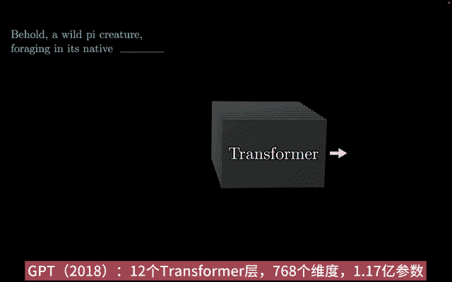
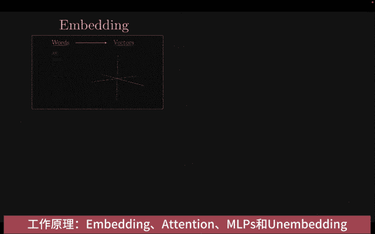
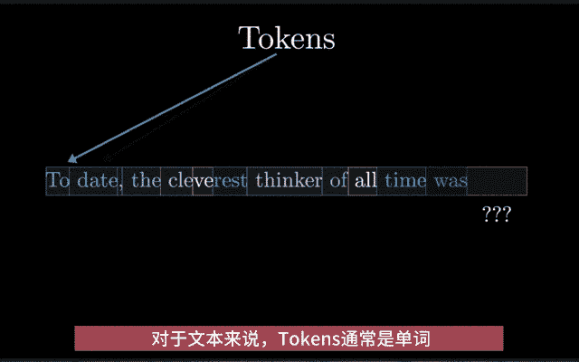
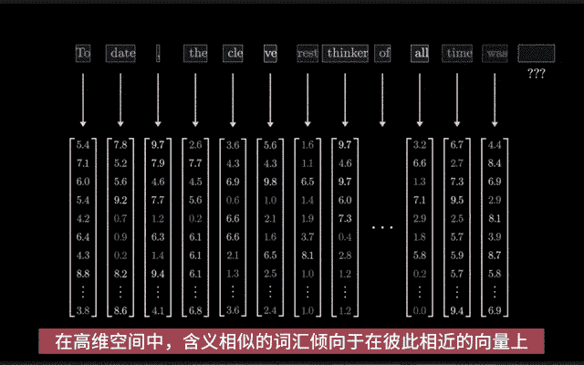
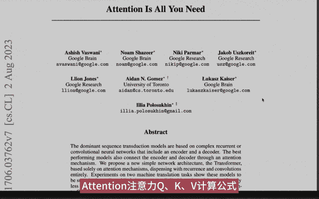
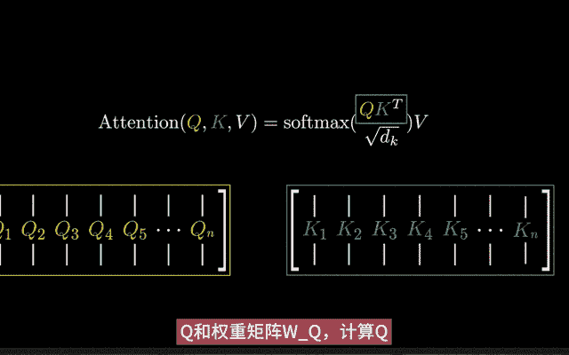
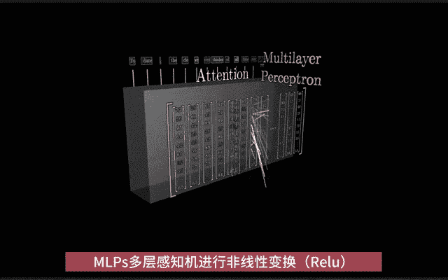
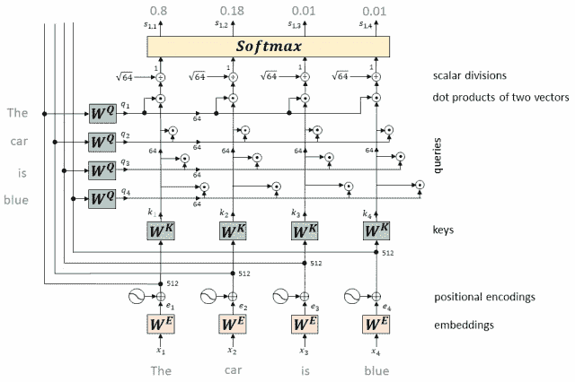
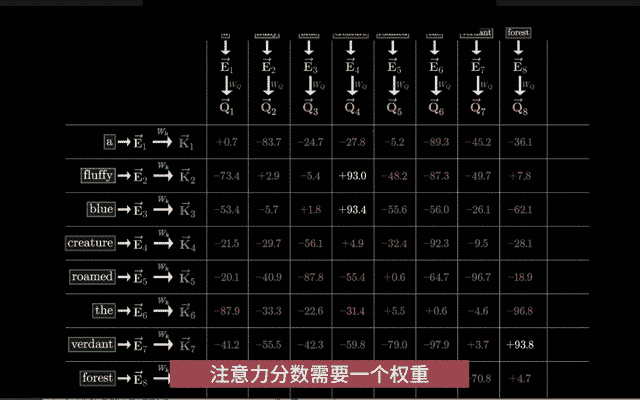

# Transformer动画讲解-工作原理

> 来源：[https://gotoaiworld.feishu.cn/docx/VA7wd8j9momuArx6s0qcsCwWn0c](https://gotoaiworld.feishu.cn/docx/VA7wd8j9momuArx6s0qcsCwWn0c)

https://mp.weixin.qq.com/s/7RBWwf4bQF31E0BySeSx9g

# Transformer动画讲解 - 工作原理

**Transformer工作原理**

一、GPT的核心是Transformer

**GPT：****GPT（Generative Pre-trained Transformer）是一种基于单向Trans**[f](http://mp.weixin.qq.com/s?__biz=MzkzMTEzMzI5Ng==&mid=2247485795&idx=1&sn=1747ffba1fd36f80b536bc6019680a86&chksm=c26eeb7cf519626a9de3c849b6e9acf67aee9793216f844d0e94a5fd29c44431767e19906c9c&scene=21#wechat_redirect)ormer解码器的预训练语言模型，它通过在大规模语料库上的无监督学习来捕捉语言的统计规律，从而具备强大的文本生成能力。神经网络算法 - 一文搞懂GPT（Generative Pre-trained Transformer）

**GPT**

**在**GPT（Generative Pre-trained Transformer）模型中，字母G、P、T各自有其特定的含义：

+   G (Generative)：

+   “Generative”意味着这个模型是生成式的。与判别式模型不同，生成式模型试图捕捉数据的分布，并能够生成新的、看似真实的数据样本。

+   P (Pre-trained)：

+   **“Pre-trained”表示GPT**模型在大量的无监督文本数据上进行了预训练，使模型学习到文本中的语言结构和语义信息。

+   T (Transformer)：

+   “Transformer”是GPT模型的核心架构。Transformer是一种基于自注意力机制的神经网络架构，包括编码器和解码器两部分。

GPT的核心是Transformer神经网络算法 - 一文搞懂Transformer

**Transformer模型在多模态数据处**理中同样扮演着重要角色，其能够高效、准确地处理包含不同类型（如图像、文本、音频、视频等）的多模态数据。

**Transformer的多模态**

Transformer动画讲解 - 多模态

二、Transformer的工作原理

**T**ransformer工作原理四部曲：Embedding（向量化）、Attention（注意力机制）、MLPs（多层感知机）和Unembedding（模型输出）。

**Embedding -> Attention ->** MLPs -> UnembeddingTransformer动画讲解 - 数据处理的四个阶段

阶段一：Embedding（向量化）

**“Embedding”在字面上的翻译是“嵌入”，但在机器学习和自**然语言处理的上下文中，我们更倾向于将其理解为一种“向量化”或“向量表示”的技术。

（1）Tokenization（词元化）：

+   **对于文本数据：**在自然语言处理（NLP）中，将输入的文本内容（如句子、段落或整个文档）拆分成更小的片段或元素，这些片段通常被称为词元（tokens）。

+   对于非文本数据（如音频、图像或视频）：在音频处理中，音频信号可以被分割成帧（frames）作为音频词元；在图像处理中，图像可以被分割成图像块（patches）作为图像词元；在视频处理中，视频可以被分割成视频块（patches）作为视频词元。

**Tokenization**

（2）Embedding（向量化）：

+   **To**kens转换为向量：Embedding层负责将输入的Tokens转换为向量，将文本中的Tokens（如单词或字符）映射为固定大小的实数向量来捕捉这些Tokens的语义信息。

**Tokens转换为向量**

+   **Embedding框架：TensorFlow、**PyTorch、Transformers

1.  TensorFlow：一个广泛使用的开源机器学习框架

1.  TensorFlow可以使用内置的Embedding层来将输入的tokens转换为向量。这个层通常接受输入词汇表的大小、嵌入向量的维度等参数。

1.  PyTorch：另一个流行的深度学习框架

1.  PyTorch同样提供了Embedding层来支持向量语义表示，与TensorFlow中的类似，也接受词汇表大小和嵌入向量维度等参数。

1.  Hugging Face's Transformers：

1.  Transformers库是由Hugging Face开发的，它基于PyTorch和TensorFlow，提供了大量预训练的Transformer模型，如BERT、GPT等。这些预训练的模型已经包含了Embedding层，可以直接用于将输入的tokens转换为向量。

+   **向量语义相似度：在训练过程中，算法学会了将含义相似的词汇映射到高维**空间中相近的向量上。这使得我们可以通过计算向量间的相似度来评估词汇间的语义关系。

**向量语义相似度**

**T**ransformer动画讲解 - 向量化阶段二：Attention（注意力机制）Attention模块帮助嵌入向量形成相关性，即确定它们如何相互关联以构建出有意义的句子或段落。

**注意力计算公式**

Transformer动画讲解 - 注意力机制

（1）Attention的目的：

+   **更新嵌入向量：通过利用查询（Q）、键（K）和值（V）来计算注意力权重，我们能够对嵌入向量进行深入**分析。这个过程使得不同的嵌入向量能够相互“交流”并基于彼此的信息来更新自身的值，从而实现嵌入向量间的有效互动和信息融合。

**更新嵌入向量**

+   **建立语义相关性：嵌入向量（Embedding Vector）作为单词或文本片段的数值化表示，主要捕捉了这些文本单元的语义信息，但在原始状态下并不直**接体现它们之间的相关性。Attention在特定的上下文环境中，识别哪些嵌入向量与当前任务最为相关，并据此调整或更新这些嵌入向量的表示，以强化它们之间的关联性。

**建立语义相关性**

（2）Attention的工作流程（注意力计算Q、K、V）：

+   **计算Q、K的点积（注意力分数）：Attention机制会计算Query向量与序列中所有单词的Key向量之间的点积（或其他相**似度度量），得到一个分数。这个分数反映了Query向量与每个Key向量之间的相似度，即每个单词与当前位置单词的关联程度。

+   **So**ftmax函数归一化（注意力权重）：这些分数会经过一个Softmax函数进行归一化，得到每个单词的注意力权重。这些权重表示了在理解当前单词时，应该给予序列中其他单词多大的关注。

+   **注意力权重加权求和（加权和向量）：这些注意力权重与对应的Value向量进行加权求和，得到一**个加权和向量。这个加权和向量会被用作当前单词的新表示，包含了更丰富的上下文信息。

**注意力计算Q、K、V**

Transformer动画讲解 - 注意力计算Q、K、V

阶段三：MLPs（多层感知机或前馈网络）

**Transformer的编码器和解码器中的每一层都包含一个全连接的前馈**神经网络。FFNN通常包含两个线性变换，中间使用ReLU激活函数进行非线性处理。

（1）MLPs在Transformer中的位置：

+   **Transformer的编码器：包含两个主要的子层，一个多头自注意力（Multi-H**ead Self-Attention）机制和一个全连接的前馈神经网络（MLP）。

+   **Transformer的解码器：包含三个主要的子层：一个Masked Multi-Head Self-Attention机制（用于编码器的输出），一个Mu**lti-Head Encoder-Decoder Attention机制（用于结合编码器的输出和解码器的当前位置信息），以及一个全连接的前馈神经网络（MLP）。

MLPs在Transformer中的位置

Transformer动画讲解 - 单头注意力和多头注意力

Transformer动画讲解 - Cross Attention

（2）MLPs在Transformer中的作用：

+   **非**线性变换：MLPs通过引入激活函数（如ReLU）提供非线性变换，这有助于模型捕获输入数据中的复杂模式。

+   **特**征提取与整合：MLPs进一步处理和转换注意力机制提取的特征，提取和整合更多有用的信息，使其能够学习更加复杂的函数关系。

MLPs在Transformer中的作用

Transformer动画讲解 - 多层感知机

阶段四：Unembedding（模型输出）

**Tr**ansformers通过Softmax在生成输出时，将原始注意力分数转换为输入标记的概率分布。这种概率分布将较高的注意力权重分配给更相关的标记，并将较低的权重分配给不太相关的标记。

### （1）Softmax在Transformer的位置：

+   **At**tention（注意力）：使用Softmax函数对这些相似度分数进行归一化，生成一个权重分布，该分布表示了在计算当前位置（query）的表示时，应赋予其他位置（keys）多大的关注程度。

+   **输出层（Output Layer）：产生一个未经归一化的分数向量（logits），其中每个元素对应**于词汇表中一个词的概率。Softmax函数被应用于这个分数向量，将其转换为概率分布，其中每个元素表示生成对应词汇的概率。

Softmax在Transformer的位置

### （2）Softmax在Transformer的作用：

+   **归一化：Softmax函数将原始分数转换为概率分布，确保所有概**率之和为1，使得输出结果可以解释为概率。

+   **可**解释性：输出的概率分布使得模型预测结果更加直观和可解释，我们可以直接查看模型为每个可能输出分配的概率。

Softmax在Transformer中的作用Transformer动画讲解 - Softmax函数