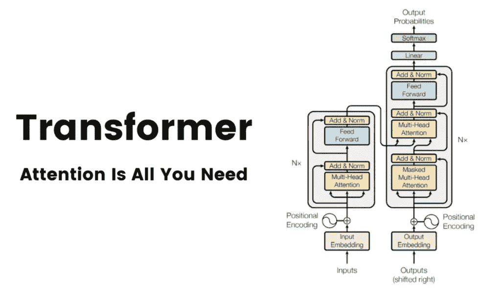
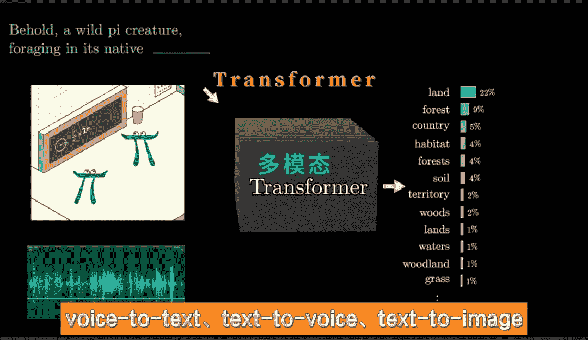
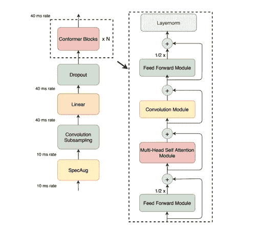
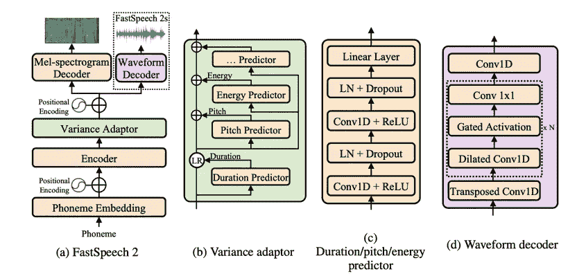
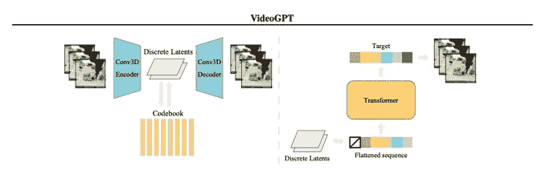

# Transformer动画讲解 - 多模态

> 来源：[https://gotoaiworld.feishu.cn/docx/NwB7d440JoHbLzxGHuxc0CohnUb](https://gotoaiworld.feishu.cn/docx/NwB7d440JoHbLzxGHuxc0CohnUb)

https://mp.weixin.qq.com/s?__biz=MzkzMTEzMzI5Ng==&mid=2247488825&idx=1&sn=1d21a62da9d16c546cd08cd36b7ed6eb&chksm=c26ef726f5197e304cbf9f1df1ae2c7d3b69b6ca06538b53ff2113be60b5050f2b5da6e78742&cur_album_id=3476803651475865601&scene=190#rd

# Transformer动画讲解 - 多模态

**Transformer多模态**

**T**ransformer模型是一种基于自注意力机制的神经网络架构，广泛应用于自然语言处理任务，如机器翻译、文本摘要等。

**Transformer**

神经网络算法 - 一文搞懂Transformer

[**神经网络算法 - 一文搞懂ViT**](http://mp.weixin.qq.com/s?__biz=MzkzMTEzMzI5Ng==&mid=2247488514&idx=1&sn=a5a1a1c0a39958e794f07383d7ed1725&chksm=c26ef61df5197f0bc9eae8b24d0b8f36d50710148fdc71a8845095609caae357e85454d975eb&scene=21#wechat_redirect)（Vision Transformer）

[**神经网络算法 - 一文搞懂DiT（Di**](http://mp.weixin.qq.com/s?__biz=MzkzMTEzMzI5Ng==&mid=2247488615&idx=1&sn=f8a80a8da207fd7a17267bad3f270f40&chksm=c26ef678f5197f6e77adc76e2dca93cc35384586c95435de1bcb67398dd2eb4279f849d74ecb&scene=21#wechat_redirect)ffusion Transformer）

**T**ransformer模型在多模态数据处理中扮演着重要角色，其能够高效、准确地处理包含不同类型数据（如图像、文本、音频等）的多模态数据。

**Transformer多模态**下面是对四种多模态任务的简要介绍：

Voice-to-Text（语音到文本）：

+   **Transformer模型在语音识别（ASR）领域的应用中，通过其自注意力机制能够捕捉语音序列中的长程依赖关系**，从而提高语音识别的准确率。此外，Transformer模型并行计算的能力也使得其在处理大规模语音数据时具有更高的效率。

+   **在实际**应用中，基于Transformer的ASR模型通常包括一个编码器和一个解码器。编码器负责将输入的语音序列转换为高层次的特征表示，而解码器则根据这些特征表示生成对应的文本序列。通过大量的训练数据，模型可以学习到语音和文本之间的映射关系，从而实现语音到文本的转换。

+   **Conformer结合了Transformer和卷积神经网络（CNN）的优势，通过引入卷积操作**来捕捉局部依赖关系，同时使用Transformer的自注意力机制来处理长程依赖。

+   **Conformer在语音识别任务中取得了显著的性**能提升，尤其是在处理长序列和复杂语音时。

**Conformer模型的架构**

https://arxiv.org/pdf/2005.08100

**神经网络算法 -  一文搞懂Co**nformer模型（还在路上，尽情期待）

Text-to-Voice（文本到语音）：

+   **在文本**到语音（TTS）任务中，Transformer模型同样发挥着重要作用。与ASR任务相反，TTS任务的目标是根据输入的文本序列生成对应的语音序列。基于Transformer的TTS模型通常采用自回归的方式，即根据已生成的语音序列预测下一个音节的输出。

+   **为了**实现高质量的语音合成，基于Transformer的TTS模型通常还需要结合一些语音生成技术，如波形生成算法、声学模型和声码器等。通过这些技术的结合，可以生成自然流畅的语音输出。

+   **F**astSpeech 2是基于Transformer的文本到语音模型，它通过非自回归的方式直接生成整个语音序列，提高了生成速度。

+   **F**astSpeech 2模型采用了自注意力机制和相对位置编码，能够捕捉文本中的长期依赖关系，并生成自然流畅的语音。

FastSpeech 2模型的架构

https://arxiv.org/pdf/2006.04558

**神经网络算法 -  一文搞懂FastS**peech 2模型（还在路上，尽情期待）

Text-to-Image（文本到图片）：

+   **在文**本到图像（T2I）任务中，Transformer模型通过学习文本和图像之间的语义对应关系，实现了根据文本描述生成对应图像的功能。这种技术在创意设计、广告制作等领域具有广泛的应用前景。

+   **为了实现T2I任务，基于Transformer的模型通常需要一个编码器来提取文本的特征表示，以及一个解码器或生成**器来根据这些特征表示生成图像。此外，为了提高生成的图像质量和多样性，还需要采用一些生成对抗网络（GAN）等技术进行优化。

+   **D**ALL-E 2是OpenAI开发的一种基于Transformer的文本到图像生成模型，它能够根据文本描述生成高质量的图像。

+   **D**ALL-E 2使用了离散的文本和图像表示，通过Transformer的自注意力机制来捕捉文本和图像之间的语义对应关系。

**DALL-E 2模型的架构**

https://arxiv.org/pdf/2204.06125

神经网络算法 -  一文搞懂DALL-E 2（还在路上，尽情期待）

Text-to-Video（文本到视频）：

+   **文本到视频（T2V）任务是一个更为复杂的多模态任务，它需要根据输入的文本描述生成一个**包含多个图像帧的视频序列。这种技术在视频创作、虚拟现实等领域具有潜在的应用价值。

+   **为了实现**T2V任务，基于Transformer的模型需要处理更为复杂的数据结构和时间依赖关系。一种可能的解决方案是先将文本转换为一系列的图像帧（即使用T2I技术），然后使用一个额外的模型（如基于LSTM或Transformer的视频生成模型）将这些图像帧组合成一个连贯的视频序列。此外，还需要考虑到视频中的音频和字幕等其他模态的信息。

+   **V**ideoGPT是一种基于Transformer的视频生成模型，它能够根据文本描述生成连续的视频帧序列。

+   **VideoGPT采用了自回归的方式生成视频帧，通过捕捉帧**之间的时间依赖关系来生成连贯的视频序列。

**VideoGPT模型的架构**

https://arxiv.org/pdf/2104.10157

神经网络算法 -  一文搞懂VideoGPT（还在路上，尽情期待）

**参考资料**

+   《Conformer: Convolution-augmented Transformer for Speech Recognition》

+   《FASTSPEECH 2: FAST AND HIGH-QUALITY END-TOEND TEXT TO SPEECH》

+   《VideoGPT: Video Generation using VQ-VAE and Transformers》

+   《Hierarchical Text-Conditional Image Generation with CLIP Latents》

+   https://www.3blue1brown.com/lessons/gpt