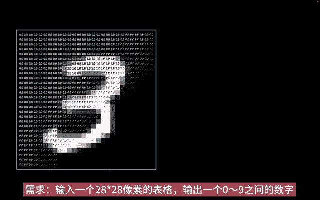
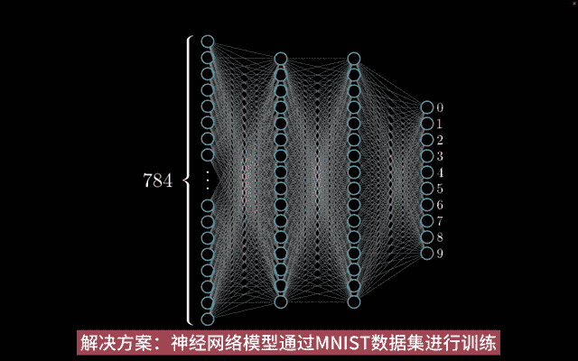
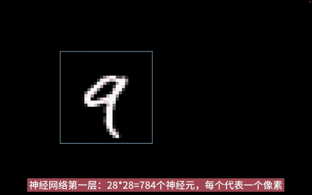
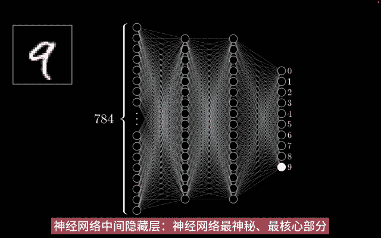
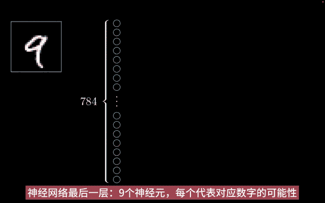

# 神经网络动画讲解 - 神经网络结构

> 来源：[https://gotoaiworld.feishu.cn/docx/K1Yld0yKtoViSBx5gihc25ZAnRg](https://gotoaiworld.feishu.cn/docx/K1Yld0yKtoViSBx5gihc25ZAnRg)

https://mp.weixin.qq.com/s?__biz=MzkzMTEzMzI5Ng==&mid=2247489114&idx=1&sn=e1009826f2ebf46ddeab661d68877063&chksm=c26ef445f5197d53eec90348fb9ca5987fc776aa48bd944b073fef11dfae04d3bbd9a4865717&cur_album_id=3476803651475865601&scene=190#rd

# 神经网络动画讲解 - 神经网络结构

**神经网络结构**

**手写数字识别：****手写数字识别是一个经典的****机器学****习问题，输入一个28*******28像素的表格，输出一个0～9之间的数字。

**手写数字识别**

**数据集：****M**NIST是一个包含大量手写数字图片的数据集，每个图片都是一个28x28像素的灰度图像，代表一个0-9之间的数字。

**MNIST数据集**

**解决方案：****手**写数字识别在直观上很简单，但用传统计算机程序解决却复杂且成功率低。然而，卷积神经网络（CNN）等神经网络模型能轻松应对，实现高准确率识别。

**CNN自动从图像学习特征，无需手动设计，能处理复杂图像变化，使用**MNIST数据集进行训练和测试，从而学习图像到数字标签的映射，实现高准确率识别。

**MNIST数据集训练神经网络**

神经网络算法 - 一文搞懂CNN（卷积神经网络）

**神经网络结构：**输入层（1）- 隐藏层（N）- 输出层（1）

**神经网络结构**

+   输入层：输入层是神经网络的第一层，负责接收原始数据。

1.  28*28=784，每张图片有784个像素。

1.  第一层有784个神经元，每个神经元代表一个像素。

1.  每个神经元有个激活值，代表每个像素的灰度值。

**神经网络输入层**

+   隐藏层：**隐**藏层是神经网络中的中间层，位于输入层和输出层之间，负责学习数据的特征表示，并将这些特征传递给输出层以进行最终的预测或分类。

1.  隐藏层的数量可以是任意的，层数越多，模型越复杂。

1.  **每个神经元都接收前一层所有神经元的输出（经过**加权和激活函数处理），并产生自己的输出。

1.  隐藏层中的神经元数量是一个超参数，需要根据具体问题进行调整。

**神经网络隐藏层**

+   输出层：输出层是神经网络的最后一层，负责产生最终的预测或分类结果。

+   每个神经元都接收前一层所有神经元的输出（经过加权和激活函数处理），并产生自己的输出。

1.  输出层的神经元接收隐藏层神经元的输出，并产生最终的预测值。

1.  输出层的预测值用于预测一个连续值或进行二分类（输出为0或1）。

1.  输出层9个神经元，对应代表0～9数字的可能性。

**神经网络输出层**

神经网络算法 - 一文搞懂ANN（人工神经网络）

**

注释**

**神经网络动画素材来源于3Blue1**Brown，想了解更多查看参考资料网址。

**3B**lue1Brown 是一个由 Grant Sanderson 创建的YouTube 频道。这个频道从独特的视觉角度解说高等数学，内容包括线性代数、微积分、人工神经网络、黎曼猜想、傅里叶变换以及四元数等。

**Grant Sanderson **毕业于斯坦福大学，并获得了数学学士学位。