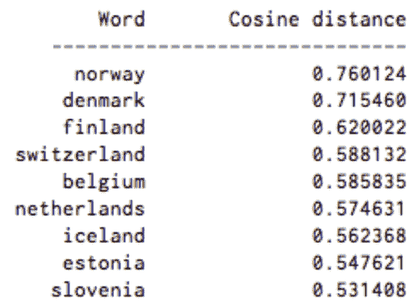
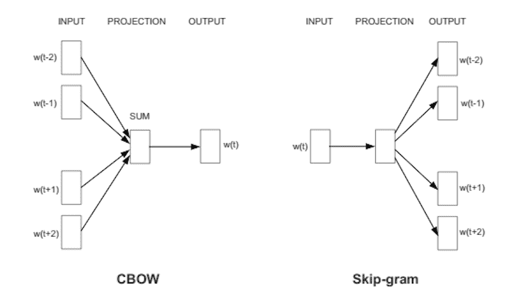
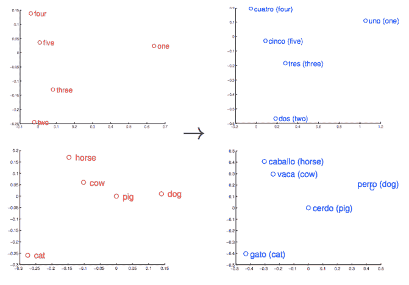
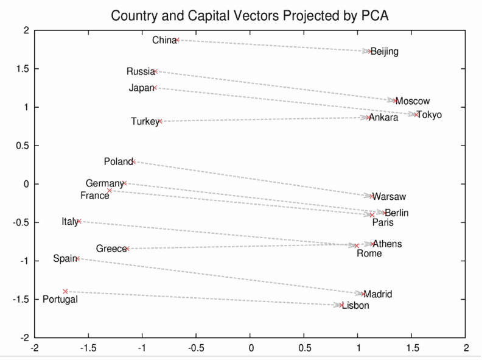

# Word2Vector

> 来源：[https://gotoaiworld.feishu.cn/docx/OZ4rd7Wx9oYPZlxRSo0c8nRBnKY](https://gotoaiworld.feishu.cn/docx/OZ4rd7Wx9oYPZlxRSo0c8nRBnKY)

# A Beginner's Guide to Word2Vec and Neural Word Embeddings

https://wiki.pathmind.com/word2vec

Contents

+   [Introduction](https://wiki.pathmind.com/word2vec#intro)

+   Neural Word Embeddings

+   Amusing Word2vec Results

+   [Advances in NLP: ](https://wiki.pathmind.com/word2vec#bert)ElMO, BERT and GPT-3

+   Word2vec Use Cases

+   Foreign Languages

+   GloVe (Global Vectors) & Doc2Vec

## Introduction to Word2Vec

Word2vec is a two-layer neural net that processes text by “vectorizing” words. Its input is a text corpus and its output is a set of vectors: feature vectors that represent words in that corpus. While Word2vec is not a deep neural network, it turns text into a numerical form that deep neural networks can understand.

Wo[rd2vec’s applications extend beyond parsing se](https://wiki.pathmind.com/word2vec#sequence)ntences in the wild. It can be applied just as well to genes, code, likes, playlists, social media graphs and other verbal or symbolic series in which patterns may be discerned.

Why? Because words are simply discrete states like the other data mentioned above, and we are simply looking for the transitional probabilities between those states: the likelihood that they will co-occur. So gene2vec, like2vec and follower2vec are all possible. With that in mind, the tutorial below will help you understand how to create neural embeddings for any group of discrete and co-occurring states.

The purpose and usefulness of Word2vec is to group the vectors of similar words together in vectorspace. That is, it detects similarities mathematically. Word2vec creates vectors that are distributed numerical representations of word features, features such as the context of individual words. It does so without human intervention.

Given enough data, usage and contexts, Word2vec can make highly accurate guesses about a word’s meaning based on past appearances. Those guesses can be used to establish a word’s association with other words (e.g. “man” is to “boy” what “woman” is to “girl”), or cluster documents and classify them by topic. Those clusters can form the basis of search, sentiment analysis and recommendations in such diverse fields as scientific research, legal discovery, e-commerce and customer relationship management.

The output of the Word2vec neural net is a vocabulary in which each item has a vector attached to it, which can be fed into a deep-learning net or simply queried to detect relationships between words.

Measuring cosine similarity, no similarity is expressed as a 90 degree angle, while total similarity of 1 is a 0 degree angle, complete overlap; i.e. Sweden equals Sweden, while Norway has a cosine distance of 0.760124 from Sweden, the highest of any other country.

Here’s a list of words associated with “Sweden” using Word2vec, in order of proximity:



The nations of Scandinavia and several wealthy, northern European, Germanic countries are among the top nine.

---

### Working on a New AI Startup?

Find Out How Page One Can Support You

---

## Neural Word Embeddings

The vectors we use to represent words are called neural word embeddings, and representations are strange. One thing describes another, even though those two things are radically different. As Elvis Costello said: “Writing about music is like dancing about architecture.” Word2vec “vectorizes” about words, and by doing so it makes natural language computer-readable – we can start to perform powerful mathematical operations on words to detect their similarities.

So a neural word embedding represents a word with numbers. It’s a simple, yet unlikely, translation.

Word2vec is similar to an autoencoder, encoding each word in a vector, but rather than training against the input words through reconstruction, as a restricted Boltzmann machine does, word2vec trains words against other words that neighbor them in the input corpus.

It does so in one of two ways, either using context to predict a target word (a method known as continuous bag of words, or CBOW), or using a word to predict a target context, which is called skip-gram. We use the latter method because it produces more accurate results on large datasets.



When the feature vector assigned to a word cannot be used to accurately predict that word’s context, the components of the vector are adjusted. Each word’s context in the corpus is the teacher sending error signals back to adjust the feature vector. The vectors of words judged similar by their context are nudged closer together by adjusting the numbers in the vector.

Just as Van Gogh’s painting of sunflowers is a two-dimensional mixture of oil on canvas that represents vegetable matter in a three-dimensional space in Paris in the late 1880s, so 500 numbers arranged in a vector can represent a word or group of words.

Those numbers locate each word as a point in 500-dimensional vectorspace. Spaces of more than three dimensions are difficult to visualize. (Geoff Hinton, teaching people to imagine 13-dimensional space, suggests that students first picture 3-dimensional space and then say to themselves: “Thirteen, thirteen, thirteen.” :)

A well trained set of word vectors will place similar words close to each other in that space. The words oak, elm and birch might cluster in one corner, while war, conflict and strife huddle together in another.

Similar things and ideas are shown to be “close”. Their relative meanings have been translated to measurable distances. Qualities become quantities, and algorithms can do their work. But similarity is just the basis of many associations that Word2vec can learn. For example, it can gauge relations between words of one language, and map them to another.



These vectors are the basis of a more comprehensive geometry of words. Not only will Rome, Paris, Berlin and Beijing cluster near each other, but they will each have similar distances in vectorspace to the countries whose capitals they are; i.e. Rome - Italy = Beijing - China. And if you only knew that Rome was the capital of Italy, and were wondering about the capital of China, then the equation Rome -Italy + China would return Beijing. No kidding.



## Amusing Word2Vec Results

Let’s look at some other associations Word2vec can produce.

Instead of the pluses, minus and equals signs, we’ll give you the results in the notation of logical analogies, where : means “is to” and :: means “as”; e.g. “Rome is to Italy as Beijing is to China” = Rome:Italy::Beijing:China. In the last spot, rather than supplying the “answer”, we’ll give you the list of words that a Word2vec model proposes, when given the first three elements:

```
king:queen::man:[woman, Attempted abduction, teenager, girl]
//Weird, but you can kind of see it

China:Taiwan::Russia:[Ukraine, Moscow, Moldova, Armenia]
//Two large countries and their small, estranged neighbors

house:roof::castle:[dome, bell_tower, spire, crenellations, turrets]

knee:leg::elbow:[forearm, arm, ulna_bone]

New York Times:Sulzberger::Fox:[Murdoch, Chernin, Bancroft, Ailes]
//The Sulzberger-Ochs family owns and runs the NYT.
//The Murdoch family owns News Corp., which owns Fox News.
//Peter Chernin was News Corp.&#x27;s COO for 13 yrs.
//Roger Ailes is president of Fox News.
//The Bancroft family sold the Wall St. Journal to News Corp.

love:indifference::fear:[apathy, callousness, timidity, helplessness, inaction]
//the poetry of this single array is simply amazing...

Donald Trump:Republican::Barack Obama:[Democratic, GOP, Democrats, McCain]
//It&#x27;s interesting to note that, just as Obama and McCain were rivals,
//so too, Word2vec thinks Trump has a rivalry with the idea Republican.

monkey:human::dinosaur:[fossil, fossilized, Ice_Age_mammals, fossilization]
//Humans are fossilized monkeys? Humans are what&#x27;s left
//over from monkeys? Humans are the species that beat monkeys
//just as Ice Age mammals beat dinosaurs? Plausible.

building:architect::software:[programmer, SecurityCenter, WinPcap]
```

T[his mo](https://wiki.pathmind.com/word2vec#import)del was trained on the Google News vocab, which you can import and play with. Contemplate, for a moment, that the Word2vec algorithm has never been taught a single rule of English syntax. It knows nothing about the world, and is unassociated with any rules-based symbolic logic or knowledge graph. And yet it learns more, in a flexible and automated fashion, than most knowledge graphs will learn after many years of human labor. It comes to the Google News documents as a blank slate, and by the end of training, it can compute complex analogies that mean something to humans.

You can also query a Word2vec model for other assocations. Not everything has to be two analogies that mirror each other.

+   Geopolitics: Iraq - Violence = Jordan

+   Distinction: Human - Animal = Ethics

+   President - Power = Prime Minister

+   Library - Books = Hall

+   Analogy: Stock Market ≈ Thermometer

By building a sense of one word’s proximity to other similar words, which do not necessarily contain the same letters, we have moved beyond hard tokens to a smoother and more general sense of meaning.

### N-grams & Skip-grams

Words are read into the vector one at a time, and scanned back and forth within a certain range. Those ranges are n-grams, and an n-gram is a contiguous sequence of n items from a given linguistic sequence; it is the nth version of unigram, bigram, trigram, four-gram or five-gram. A skip-gram simply drops items from the n-gram.

---

### Working on a New AI Startup?

Find Out How Page One Can Support You

---

The skip-gram representation popularized by Mikolov and used in the DL4J implementation has proven to be more accurate than other models, such as continuous bag of words, due to the more generalizable contexts generated.

This n-gram is then fed into a neural network to learn the significance of a given word vector; i.e. significance is defined as its usefulness as an indicator of certain larger meanings, or labels.

### Advances in NLP: ElMO, BERT and GPT-3

Word vectors form the basis of most recent advances in natural-language processing, including language models such as ElMO, ULMFit and BERT. But those language models change how they represent words; that is, that which the vectors represent changes.

Word2vec is an algorithm used to produce distributed representations of words, and by that we mean word types; i.e. any given word in a vocabulary, such as get or grab or go has its own word vector, and those vectors are effectively stored in a lookup table or dictionary. Unfortunately, this approach to word representation does not addres polysemy, or the co-existence of many possible meanings for a given word or phrase. For example, go is a verb and it is also a board game; get is a verb and it is also an animal’s offspring. The meaning of a given word type such as go or get varies according to its context; i.e. the words that surround it.

One thing that ElMO and BERT demonstrate is that by encoding the context of a given word, by including information about preceding and succeeding words in the vector that represents a given instance of a word, we can obtain much better results in natural language processing tasks. BERT owes its performance to the attention mechanism.

Tested on the SWAG benchmark, which measures commonsense reasoning, ELMo was found to produce a 5% error reduction relaitve to non-contextual word vectors, while BERT showed an additional 66% error reduction past ELMo. More recently, OpenAI’s work with GPT-2 showed surprisingly good results in generating natural language in response to a prompt.

In summer[ 2020, the season of t](https://www.technologyreview.com/2020/07/20/1005454/openai-machine-learning-language-generator-gpt-3-nlp/)he pandemic, OpenAI released its latest language model GPT-3, which demonstrated surprising strong performance on language generation tasks, and is being widely used as the basis of new applications.

### Google’s Word2vec Patent

Word2vec is [a](http://arxiv.org/pdf/1301.3781.pdf) method of computing vector represen[tations of words int](https://code.google.com/p/word2vec/)ro[duced by a team of res](http://patft.uspto.gov/netacgi/nph-Parser?Sect1=PTO2&Sect2=HITOFF&p=1&u=%2Fnetahtml%2FPTO%2Fsearch-bool.html&r=1&f=G&l=50&co1=AND&d=PTXT&s1=9037464&OS=9037464&RS=9037464)earchers at Google led by Tomas Mikolov. Google hosts an open-source version of Word2vec released under an Apache 2.0 license. In 2014, Mikolov left Google for Facebook, and in May 2015, Google was granted a patent for the method, which does not abrogate the Apache license under which it has been released.

### Foreign Languages

While words in all languages may be converted into vectors with Word2vec, and those vectors learned with [deep-learning framewor](http://nlp.stanford.edu/software/)ks, [NLP prep](http://www.atilika.org/)rocessing can be very language specific, and requires tools beyond our libraries. The Stanford Natural Language Processing Group has a number of Java-based tools for tokenization, part-of-speech tagging and named-entity recognition for languages such as Mandarin Chinese, Arabic, French, German and Spanish. For Japanese, NLP tools like Kuromoji are useful. Other foreign-language resources, including text corpora, are available here.

### GloVe: Global Vectors

Loading and saving GloVe models to word2vec can be done like so:

```
        WordVectors wordVectors = WordVectorSerializer.loadTxtVectors(new File(&quot;glove.6B.50d.txt&quot;));
```

### Further Reading on Word2vec and NLP

+   [C](https://arxiv.org/abs/1902.06006)ontextual Word Representations: A Contextual Introduction

+   [Deep contextualized ](https://arxiv.org/abs/1802.05365)word representations

+   [T](https://wiki.pathmind.com/thought-vectors)hought Vectors, Natural Language Processing & the Future of AI

+   Quora: How Does Word2vec Work?

+   [Quora: What Are Some Interesti](https://www.quora.com/Word2vec/What-are-some-interesting-Word2Vec-results/answer/Omer-Levy)ng Word2Vec Results?

+   Word2Vec: an introduction; Folgert Karsdorp

+   [Mikolov’s Original W](https://code.google.com/p/word2vec/)ord2vec Code @Google

+   [word2vec Explained: Deriving Mikolov et al.’s](http://arxiv.org/pdf/1402.3722v1.pdf) Negative-Sampling Word-Embedding Method; Yoav Goldberg and Omer Levy

+   [B](https://wiki.pathmind.com/bagofwords-tf-idf)ag of Words & Term Frequency-Inverse Document Frequency (TF-IDF)

+   [Advances in Pre-Training Distributed](https://arxiv.org/abs/1712.09405) Word Representations - by Mikolov et al

+   [Word galaxies: Exploring word2vec em](https://github.com/anvaka/word2vec-graph)beddings as a graph of nearest neighbors

### Other Pathmind Wiki Posts

+   [Recurrent Neural Netwo](https://wiki.pathmind.com/lstm)rks (RNNs) and LSTMs

+   Neural Networks and Deep Learning

+   [C](https://wiki.pathmind.com/convolutional-network)onvolutional Neural Networks (CNNs) and Image Processing

+   Accuracy, Precision and Recall

+   [Attention Mechani](https://wiki.pathmind.com/attention-mechanism-memory-network)sms and Transformers

+   [E](https://wiki.pathmind.com/eigenvector)igenvectors, Eigenvalues, PCA, Covariance and Entropy

+   Graph Analytics and Deep Learning

+   [Symbolic Reasoning ](https://wiki.pathmind.com/symbolic-reasoning)and Machine Learning

+   [Markov Chain Monte Carlo, AI](https://wiki.pathmind.com/markov-chain-monte-carlo) and Markov Blankets

+   Deep Reinforcement Learning

+   [Generative Adversa](https://wiki.pathmind.com/generative-adversarial-network-gan)rial Networks (GANs)

+   [AI vs Machine Learn](https://wiki.pathmind.com/ai-vs-machine-learning-vs-deep-learning)ing vs Deep Learning

+   Multilayer Perceptrons (MLPs)

### Word2Vec in Literature

> It’s like numbers are language, like all the letters in the language are turned into numbers, and so it’s something that everyone understands the same way. You lose the sounds of the letters and whether they click or pop or touch the palate, or go ooh or aah, and anything that can be misread or con you with its music or the pictures it puts in your mind, all of that is gone, along with the accent, and you have a new understanding entirely, a language of numbers, and everything becomes as clear to everyone as the writing on the wall. So as I say there comes a certain time for the reading of the numbers. – E.L. Doctorow, Billy Bathgate