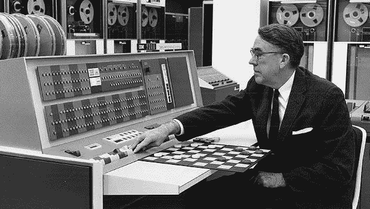

# Artificial Intelligence (AI) vs. Machine Learning vs. Deep Learning

> 来源：[https://gotoaiworld.feishu.cn/docx/L4wxdKXMvohFTaxUKOBcFAf0nhc](https://gotoaiworld.feishu.cn/docx/L4wxdKXMvohFTaxUKOBcFAf0nhc)

`https://wiki.pathmind.com/ai-vs-machine-learning-vs-deep-learning`

Artificial intelligence (AI), machine learning and deep learning are three terms often used interchangeably to describe software that behaves intelligently. However, it is useful to understand the key distinctions among them.

You can think of deep learning, machine learning and artificial intelligence as a set of Russian dolls nested within each other, beginning with the smallest and working out. Deep learning is a subset of machine learning, and machine learning is a subset of AI, which is an umbrella term for any computer program that does something smart. In other words, all machine learning is AI, but not all AI is machine learning, and so forth.

[Learn How to Apply](https://pathmind.com/) AI to Simulations »

## Artificial Intelligence, Symbolic AI and GOFAI

[John McCarthy](https://en.wikipedia.org/wiki/John_McCarthy_(computer_scientist)) widely recognized as one of the godfathers of AI, defined it as “the science and engineering of making intelligent machines.”

Here are a few other definitions of artificial intelligence:

+ A branch of computer science dealing with the simulation of intelligent behavior in computers.
+ The capability of a machine to imitate intelligent human behavior.
+ A computer system able to perform tasks that normally require human intelligence, such as visual perception, speech recognition, decision-making, and translation between languages.

There are a lot of ways to simulate human intelligence, and some methods are more intelligent than others.

AI can be a pile of if-then statements, or a complex statistical model mapping raw sensory data to symbolic categories. [The](https://wiki.pathmind.com/symbolic-reasoning) if-then statements are simply rules explicitly programmed by a human hand. Taken together, these if-then statements are sometimes called rules engines, expert systems, knowledge graphs or symbolic AI. Collectively, these are known as Good, Old-Fashioned AI (GOFAI).

The intelligence that rules engines mimic could be that of an accountant with knowledge of the tax code, who takes information you feed it, runs the information through a set of static rules, and gives your the amount of taxes you owe as a result. In the US, we call that TurboTax.

Usually, when a computer program designed by AI researchers actually succeeds at something – like winning at chess – many people say it’s “not really intelligent”, because the algorithm’s internals are well understood. The critics think intelligence must be something intangible, and exclusively human. A wag would say that true AI is whatever computers can’t do yet.

## Machine Learning: Programs That Alter Themselves

Machine learning is a subset of AI. That is, all machine learning counts as AI, but not all AI counts as machine learning. For example, symbolic logic – rules engines, expert systems and knowledge graphs – could all be described as AI, and none of them are machine learning.

---

### Working on a New AI Startup?

Find Out How Page One Can Support You

---

One aspect that separates machine learning from the knowledge graphs and expert systems is its ability to modify itself when exposed to more data; i.e. machine learning is dynamic and does not require human intervention to make certain changes. That makes it less brittle, and less reliant on human experts.

> A computer program is said to learn from experience `E` with respect to some class of tasks `T` and performance measure `P` if its performance at tasks in `T`, as measured by `P`, improves with experience `E`. –Tom Mitchell

In 1959, Arthur Samuel, one of the pioneers of machine learning, defined machine learning as a “field of study that gives computers the ability to learn without being explicitly programmed.” That is, machine-learning programs have not been explicitly entered into a computer, like the if-then statements above. Machine-learning programs, in a sense, adjust themselves in response to the data they’re exposed to (like a child that is born knowing nothing adjusts its understanding of the world in response to experience).

Samuel taught a computer program to play checkers. His goal was to teach it to play checkers better than himself, which is obviously not something he could program explicitly. He succeeded, and in 1962 his program beat the checkers champion of the state of Connecticut.

The “learning” part of machine learning means that ML algorithms attempt to optimize along a certain dimension; i.e. they usually try to minimize error or maximize the likelihood of their predictions being true. This has three names: an error function, a loss function, or an objective function, because the algorithm has an objective… When someone says they are working with a machine-learning algorithm, you can get to the gist of its value by asking: What’s the objective function?

How does one [minimize error?](https://wiki.pathmind.com/neural-network) Well, one way is to build a framework that multiplies inputs in order to make guesses as to the inputs’ nature. Different outputs/guesses are the product of the inputs and the algorithm. Usually, the initial guesses are quite wrong, and if you are lucky enough to have ground-truth labels pertaining to the input, you can measure how wrong your guesses are by contrasting them with the truth, and then use that error to modify your algorithm. That’s what neural networks do. They keep on measuring the error and modifying their parameters until they can’t achieve any less error.

They are, in short, an optimization algorithm. If you tune them right, they minimize their error by guessing and guessing and guessing again.

## Deep Learning: More Accuracy, More Math & More Compute

Deep learning is a subset of machine learning. Usually, when people use the term deep learning, they are referring to deep artificial neural networks.

Deep artificial neural networks are a set of algorithms that have set new records in accuracy for many important problems, such as image [recognition](https://wiki.pathmind.com/neural-network), sound recognition, recommender systems, natural language processing etc. For example, deep learning is part of DeepMind’s well-known AlphaGo algorithm, which beat the former world champion Lee Sedol at Go in early 2016, and the current world champion Ke Jie in early 2017. A more complete explanation of neural works is here.

Deep is a technical term. It refers to the number of layers in a neural network. A shallow network has one so-called hidden layer, and a deep network has more than one. Multiple hidden layers allow deep neural networks to learn features of the data in a so-called feature hierarchy, because simple features (e.g. two pixels) recombine from one layer to the next, to form more complex features (e.g. a line). Nets with many layers pass input data (features) through more mathematical operations than nets with few layers, and are therefore more computationally intensive to train. Computational intensivity is one of the hallmarks of deep learning, and it is one reason why a new kind of chip call GPUs are in demand to train deep-learning models.

# Deep Learning

So you could apply the same definition to deep learning that Arthur Samuel did to machine learning – a “field of study that gives computers the ability to learn without being explicitly programmed” – while adding that it tends to result in higher accuracy, require more hardware or training time, and perform exceptionally well on machine perception tasks that involved unstructured data such as blobs of pixels or text.

## Reinforcement Learning: A Framework in which DL is Embedded

[Reinforcement learning is go](https://wiki.pathmind.com/deep-reinforcement-learning)al-oriented learning. That is, rather than trying to classify or cluster data, you define what you want to achieve, which metrics you want to maximize or minimize, and RL agents learn how to do that. It is not mutually exclusive with deep learning, but rather a framework in which neural networks can be used to learn the relationship between actions and their rewards. Combined, this is called deep reinforcement learning, which DeepMind trained successfully on the game of Go, numerous video games, and harder problems in real life.

## What’s Next for AI?

The advances made by researchers at DeepMind, Google Brain, OpenAI and various universities are accelerating. AI is capable of solving harder and harder problems better than humans can.

This means that AI is changing faster than its history can be written, so predictions about its future quickly become obsolete as well. Are we chasing a breakthrough like nuclear fission (possible), or are attempts to wring intelligence from silicon more like trying to turn lead into gold?(1)

There are four main schools of thought, or churches of belief if you will, that group together how people talk about AI.

Those who believe that AI progress will c[ontinue a](https://wiki.pathmind.com/strong-ai-general-ai)pace tend to think a lot about strong AI, and whether or not it is good for humanity. Among those who forecast continued progress, one camp emphasizes the benefits of more intelligent software, which may save humanity from its current stupidities; the other camp worries about the existential risk of a superintelligence.

Given that the power of AI pr[ogresses han](https://wiki.pathmind.com/evolutionary-genetic-algorithm)d in hand with the power of computational hardware, advances in computational capacity, such as better chips or quantum computing, will set the stage for advances in AI. On a purely algorithmic level, most of the astonishing results produced by labs such as DeepMind come from combining different approaches to AI, much as AlphaGo combines deep learning and reinforcement learning. Combining deep learning with symbolic reasoning, analogical reasoning, Bayesian and evolutionary methods all show promise.

Those who do not believe that AI is making that much prog[ress rela](https://wiki.pathmind.com/ai-winter)tive to human intelligence are forecasting another AI winter, during which funding will dry up due to generally disappointing results, as has happened in the past. Many of those people have a pet algorithm or approach that competes with deep learning.

Finally, there are the pragmatists, plugging along at the math, struggling with messy data, scarce AI talent and user acceptance. They are the least religious of the groups making prophesies about AI – they just know that it’s hard.

### Footnotes

1) It’s interesting to note that even when certain technologies are physically impossible, they can still be regulated. In 1404, during the reign of Henry IV, the English parliament passed a law called the “Act against multiplication”, outlawing the creation of gold and silver from other materials, since that was seen as a threat to the throne’s control over the currency. The law was later modified to allow only certain people to create gold and silver through alchemical processes, until it was finally repealed in the 17th century. Regulations outlawing strong AI, a technology that may or may not be possible, and for which there exists no strong theoretical foundation, would be similarly absurd.

### Further Reading

+ Deep Learning and Neural Networks
+ [Recurrent Neural Netwo](https://wiki.pathmind.com/lstm)rks (RNNs) and LSTMs
+ Word2vec and Neural Word Embeddings
+ [C](https://wiki.pathmind.com/convolutional-network)onvolutional Neural Networks (CNNs) and Image Processing
+ Accuracy, Precision and Recall
+ [Attention Mechani](https://wiki.pathmind.com/attention-mechanism-memory-network)sms and Transformers
+ [E](https://wiki.pathmind.com/eigenvector)igenvectors, Eigenvalues, PCA, Covariance and Entropy
+ Graph Analytics and Deep Learning
+ [Symbolic Reasoning ](https://wiki.pathmind.com/symbolic-reasoning)and Machine Learning
+ [Markov Chain Monte Carlo, AI](https://wiki.pathmind.com/markov-chain-monte-carlo) and Markov Blankets
+ Deep Reinforcement Learning
+ [Generative Adversa](https://wiki.pathmind.com/generative-adversarial-network-gan)rial Networks (GANs)
+ Multilayer Perceptrons (MLPs)
