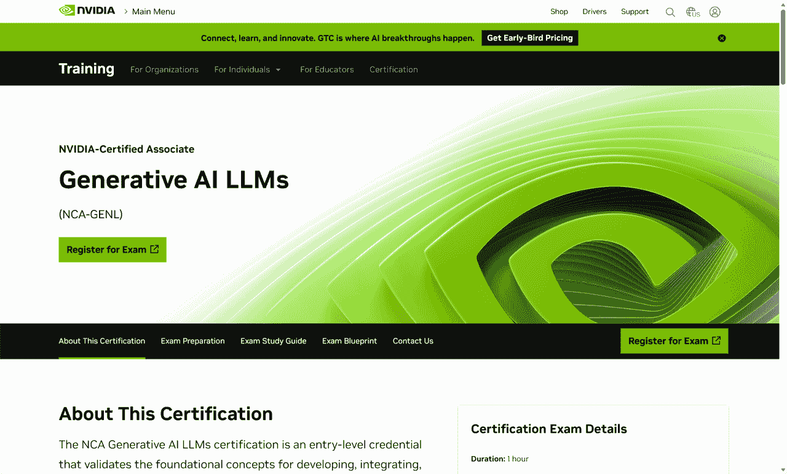

# NVIDIA -Generative AI LLMs

> 来源：[https://gotoaiworld.feishu.cn/docx/JYdldMgHjo0zCuxv9U1coln9n6c](https://gotoaiworld.feishu.cn/docx/JYdldMgHjo0zCuxv9U1coln9n6c)

https://www.nvidia.com/en-us/learn/certification/generative-ai-llm-associate/

The NCA Generative AI LLMs certification is an entry-level credential that validates the foundational concepts for developing, integrating, and maintaining AI-driven applications using generative AI and large language models (LLMs) with NVIDIA solutions. The exam is online and proctored remotely, includes 50 questions, and has a 60-minute time limit.

Please carefully review NVIDIA's examination policy before scheduling your exam.

If you have any questions[, pl](mailto:educert@nvidia.com)ease contact us here.

https://www.nvidia.com/en-us/learn/certification/generative-ai-llm-associate/

#### Certification Exam Details

**Duration:** 1 hour

**Price: **$125

Certification level: Associate

**Subject:** Generative AI and large language models

Number of questions: 50-60 multiple-choice

**Prerequisites:** A basic understanding of generative AI and large language models

**Language: **English

**Validity: **This certification is valid for two years from issuance. Recertification may be achieved by retaking the exam.

**Credentials:** Upon passing the exam, participants will receive a digital badge and optional certificate indicating the certification level and topic.

### Topics Covered in the Exam

Topics covered in the exam include:

+   Fundamentals of machine learning and neural networks

+   Prompt engineering

+   Alignment

+   Data analysis and visualization

+   Experimentation

+   Data preprocessing and feature engineering

+   Experiment design

+   Software development

+   Python libraries for LLMs

+   LLM integration and deployment

### Candidate Audiences

+   AI DevOps engineers

+   AI strategists

+   Applied data scientists

+   Applied data research engineers

+   Applied deep learning research scientists

+   Cloud solution architects

+   Data scientists

+   Deep learning performance engineers

+   Generative AI specialists

+   LLM specialists and researchers

+   Machine learning engineers

+   Senior researchers

+   Software engineers

+   Solutions architects