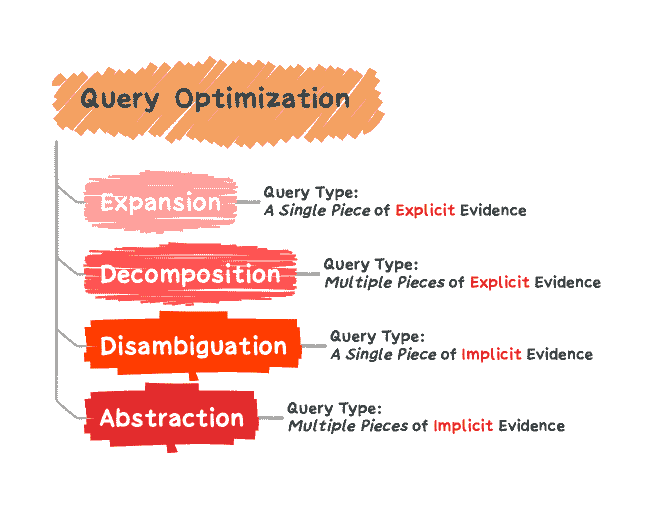
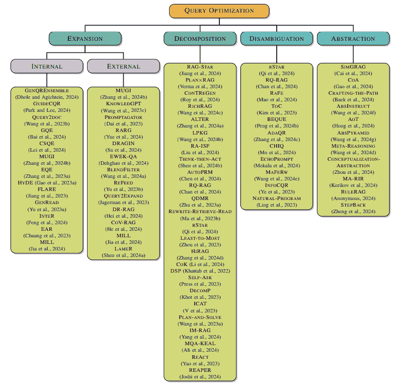
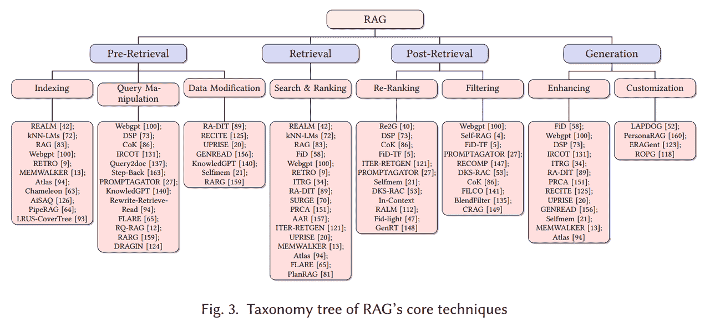
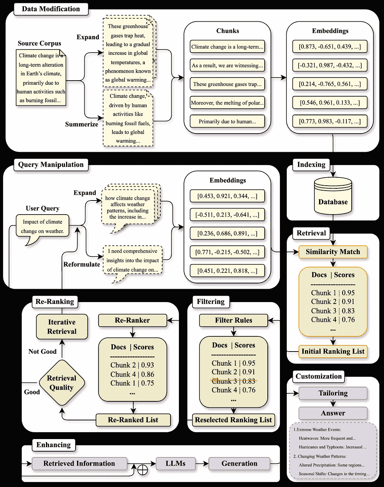
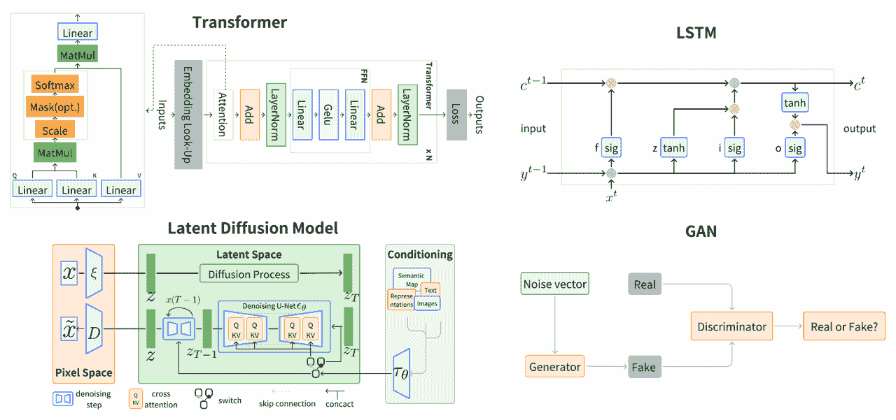
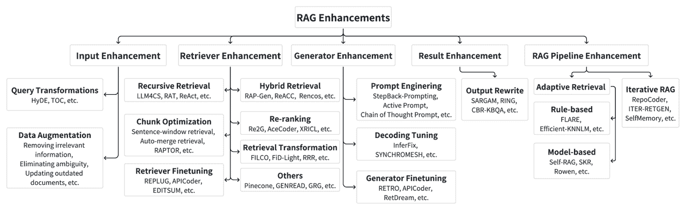
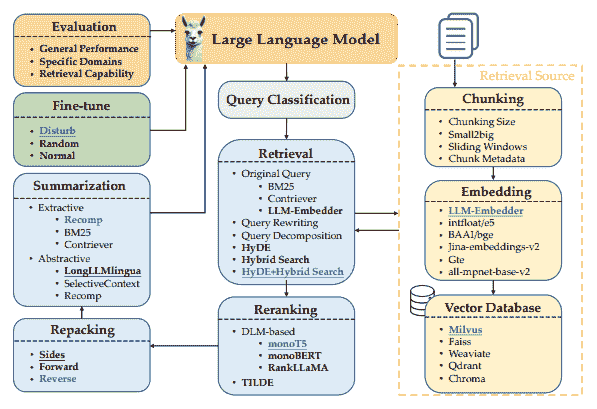
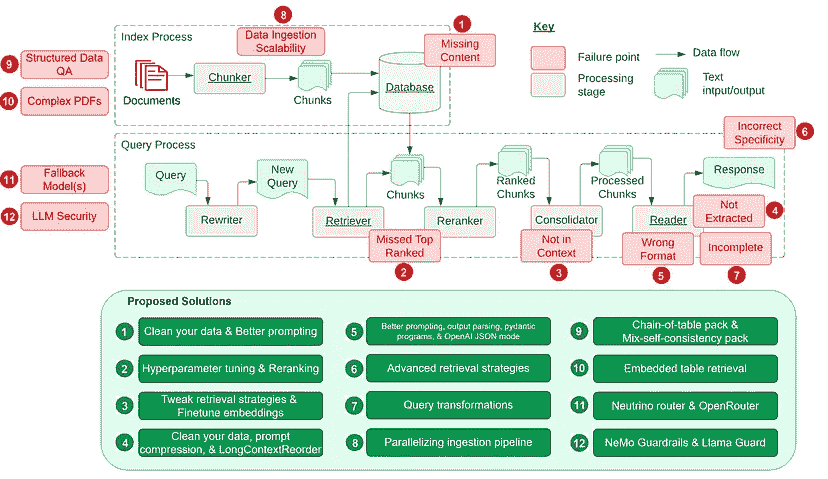
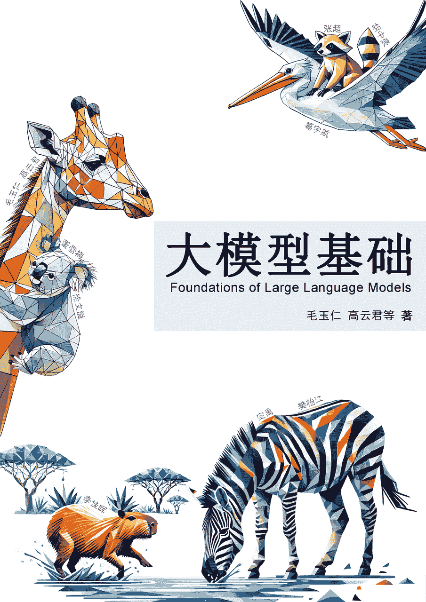

# Awesome LLM RAG Application

> 来源：[https://gotoaiworld.feishu.cn/docx/N0oidzvKLoa5FQxaxTjc7xMNnyg](https://gotoaiworld.feishu.cn/docx/N0oidzvKLoa5FQxaxTjc7xMNnyg)

> https://github.com/lizhe2004/Awesome-LLM-RAG-Application

+ [综述](https://github.com/lizhe2004/Awesome-LLM-RAG-Application#%E7%BB%BC%E8%BF%B0)
+ [论文](https://github.com/lizhe2004/Awesome-LLM-RAG-Application#%E8%AE%BA%E6%96%87)
+ [其他资料](https://github.com/lizhe2004/Awesome-LLM-RAG-Application#%E5%85%B6%E4%BB%96%E8%B5%84%E6%96%99)
+ [介绍](https://github.com/lizhe2004/Awesome-LLM-RAG-Application#%E4%BB%8B%E7%BB%8D)
+ [比较](https://github.com/lizhe2004/Awesome-LLM-RAG-Application#%E6%AF%94%E8%BE%83)
+ [开源工具](https://github.com/lizhe2004/Awesome-LLM-RAG-Application#%E5%BC%80%E6%BA%90%E5%B7%A5%E5%85%B7)
+ [RAG框架](https://github.com/lizhe2004/Awesome-LLM-RAG-Application#rag%E6%A1%86%E6%9E%B6)
+ [预处理](https://github.com/lizhe2004/Awesome-LLM-RAG-Application#%E9%A2%84%E5%A4%84%E7%90%86)
+ [路由](https://github.com/lizhe2004/Awesome-LLM-RAG-Application#%E8%B7%AF%E7%94%B1)
+ [评测框架](https://github.com/lizhe2004/Awesome-LLM-RAG-Application#%E8%AF%84%E6%B5%8B%E6%A1%86%E6%9E%B6)
+ [Embedding](https://github.com/lizhe2004/Awesome-LLM-RAG-Application#embedding)
+ [爬虫](https://github.com/lizhe2004/Awesome-LLM-RAG-Application#%E7%88%AC%E8%99%AB)
+ [安全护栏](https://github.com/lizhe2004/Awesome-LLM-RAG-Application#%E5%AE%89%E5%85%A8%E6%8A%A4%E6%A0%8F)
+ [Prompting](https://github.com/lizhe2004/Awesome-LLM-RAG-Application#prompting)
+ [SQL增强](https://github.com/lizhe2004/Awesome-LLM-RAG-Application#sql%E5%A2%9E%E5%BC%BA)
+ [LLM部署和serving](https://github.com/lizhe2004/Awesome-LLM-RAG-Application#llm%E9%83%A8%E7%BD%B2%E5%92%8Cserving)
+ [可观测性](https://github.com/lizhe2004/Awesome-LLM-RAG-Application#%E5%8F%AF%E8%A7%82%E6%B5%8B%E6%80%A7)
+ [其他](https://github.com/lizhe2004/Awesome-LLM-RAG-Application#%E5%85%B6%E4%BB%96)
+ [AI搜索类项目](https://github.com/lizhe2004/Awesome-LLM-RAG-Application#ai%E6%90%9C%E7%B4%A2%E7%B1%BB%E9%A1%B9%E7%9B%AE)
+ [应用参考](https://github.com/lizhe2004/Awesome-LLM-RAG-Application#%E5%BA%94%E7%94%A8%E5%8F%82%E8%80%83)
+ [企业级实践](https://github.com/lizhe2004/Awesome-LLM-RAG-Application#%E4%BC%81%E4%B8%9A%E7%BA%A7%E5%AE%9E%E8%B7%B5)
+ [知识库建设](https://github.com/lizhe2004/Awesome-LLM-RAG-Application#%E7%9F%A5%E8%AF%86%E5%BA%93%E5%BB%BA%E8%AE%BE)
+ [论文](https://github.com/lizhe2004/Awesome-LLM-RAG-Application#%E8%AE%BA%E6%96%87-1)
+ [RAG构建策略](https://github.com/lizhe2004/Awesome-LLM-RAG-Application#rag%E6%9E%84%E5%BB%BA%E7%AD%96%E7%95%A5)
+ [总览](https://github.com/lizhe2004/Awesome-LLM-RAG-Application#%E6%80%BB%E8%A7%88)
+ [预处理](https://github.com/lizhe2004/Awesome-LLM-RAG-Application#%E9%A2%84%E5%A4%84%E7%90%86-1)
+ [查询问句分类和微调](https://github.com/lizhe2004/Awesome-LLM-RAG-Application#%E6%9F%A5%E8%AF%A2%E9%97%AE%E5%8F%A5%E5%88%86%E7%B1%BB%E5%92%8C%E5%BE%AE%E8%B0%83)
+ [检索](https://github.com/lizhe2004/Awesome-LLM-RAG-Application#%E6%A3%80%E7%B4%A2)
+ [查询语句改写](https://github.com/lizhe2004/Awesome-LLM-RAG-Application#%E6%9F%A5%E8%AF%A2%E8%AF%AD%E5%8F%A5%E6%94%B9%E5%86%99)
+ [检索策略](https://github.com/lizhe2004/Awesome-LLM-RAG-Application#%E6%A3%80%E7%B4%A2%E7%AD%96%E7%95%A5)
+ [GraphRAG](https://github.com/lizhe2004/Awesome-LLM-RAG-Application#graphrag)
+ [检索后处理](https://github.com/lizhe2004/Awesome-LLM-RAG-Application#%E6%A3%80%E7%B4%A2%E5%90%8E%E5%A4%84%E7%90%86)
+ [重排序](https://github.com/lizhe2004/Awesome-LLM-RAG-Application#%E9%87%8D%E6%8E%92%E5%BA%8F)
+ Contextual（Prompt） Compression
+ [其他](https://github.com/lizhe2004/Awesome-LLM-RAG-Application#%E5%85%B6%E4%BB%96-1)
+ [评估](https://github.com/lizhe2004/Awesome-LLM-RAG-Application#%E8%AF%84%E4%BC%B0)
+ [幻觉](https://github.com/lizhe2004/Awesome-LLM-RAG-Application#%E5%B9%BB%E8%A7%89)
+ [课程](https://github.com/lizhe2004/Awesome-LLM-RAG-Application#%E8%AF%BE%E7%A8%8B)
+ [视频](https://github.com/lizhe2004/Awesome-LLM-RAG-Application#%E8%A7%86%E9%A2%91)
+ [图书](https://github.com/lizhe2004/Awesome-LLM-RAG-Application#%E5%9B%BE%E4%B9%A6)
+ [编码实践](https://github.com/lizhe2004/Awesome-LLM-RAG-Application#%E7%BC%96%E7%A0%81%E5%AE%9E%E8%B7%B5)
+ [其他](https://github.com/lizhe2004/Awesome-LLM-RAG-Application#%E5%85%B6%E4%BB%96-2)

---

## 综述

### 论文

论文顺序由近及远

+ 2024.12.23 RAG中的查询优化技术总结
+ [《](https://arxiv.org/abs/2412.17558)A Survey of Query Optimization in Large Language Models》
+ 详情
+ 
+ 

+ 2024.10.23 RAG技术演进的回顾总结
+ [《A Comprehensive Survey of Retrieval-Augmented Generati](https://arxiv.org/abs/2410.12837)on (RAG: Evolution, Current Landscape and Future Directions》
+ 详情

+ 2024.09.23 综述RAG数据利用方案
+ [《Re](https://arxiv.org/abs/2409.14924)trieval Augmented Generation (RAG and Beyond: A Comprehensive Survey on How to Make your LLMs use External Data More Wisely)》详情

+ 2024.08.15 综述GraphRAG方案
+ [《Graph Retrieval-Augmented G](https://arxiv.org/abs/2408.08921)eneration: A Survey》
+ 详情

+ 2024.07.18 综述RAG用于NLP自然语言处理
+ [《Retrieval-Augmented Generation fo](https://arxiv.org/abs/2407.13193)r Natural Language Processing: A Survey》
+ 详情- https://arxiv.org/abs/2407.13193

+ 2024.05.13 综述RAG的评估
+ [《](https://arxiv.org/abs/2405.07437)Evaluation of Retrieval-Augmented Generation: A Survey》
+ 详情

+ 2024.05.10 综述RAG与LLM的结合范式
+ [《A Survey on RAG Meeting LLMs: Towards Re](https://arxiv.org/abs/2405.06211)trieval-Augmented Large Language Models》
+ 详情

+ 2024.04.30 综述检索增强语言模型（RALMs）
+ [《R](https://arxiv.org/abs/2404.19543)AG and RAU: A Survey on Retrieval-Augmented Language Model in Natural Language Processing》
+ 详情

+ 2024.04.17 综述面向检索的核心技术
+ [《A Survey on Retrieval-Augmented Te](https://arxiv.org/abs/2404.10981)xt Generation for Large Language Models》
+ 详情
+ 
+ 

+ 2024.02.29 面向AIGC生成做全面综述
+ [《](https://arxiv.org/abs/2402.19473)Retrieval-Augmented Generation for AI-Generated Content: A Survey》
+ 详情
+ 
+ 

+ 2023.11.18 首个全面RAG综述
+ [R](https://arxiv.org/abs/2312.10997)etrieval-Augmented Generation for Large Language Models: A Survey
+ 详情

+ 2023.03.20 多模态RAG综述
+ [2023.03.20 《Retrieving Multimodal Informa](https://arxiv.org/abs/2303.10868)tion for Augmented Generation: A Survey》
+ 详情

+ 2022.02.02近三年首个综述
+ [《A Survey on Retrieval-Augmen](https://arxiv.org/abs/2202.01110)ted Text Generation》
+ 详情

### 其他资料

+ 大语言模型的检索增强生成 (RAG) 方法
+ [Advaned RAG Techniques: an ](https://pub.towardsai.net/advanced-rag-techniques-an-illustrated-overview-04d193d8fec6)Illustrated Overview
+ 中译版 高级 RAG 技术：图解概览
+ [高级RAG应用构建指南和总结](https://blog.llamaindex.ai/a-cheat-sheet-and-some-recipes-for-building-advanced-rag-803a9d94c41b)
+ [Patterns for Building LLM-base](https://eugeneyan.com/writing/llm-patterns/)d Systems & Products
+ [构建LLM系统和应用的模式](https://tczjw7bsp1.feishu.cn/docx/Z6vvdyAdXou7XmxuXt2cigZUnTb?from=from_copylink)
+ [RAG大全](https://aman.ai/primers/ai/RAG/)
+ [中译版](https://tczjw7bsp1.feishu.cn/docx/GfwOd3rASo6lI4xoFsycUiz8nhg)
+ [Open RAG Base](https://openrag.notion.site/Open-RAG-c41b2a4dcdea4527a7c1cd998e763595)
+ Open RAG Base 是一个基于公开资料收集整理汇总的RAG知识库。它基于Notion构建，是目前最全面RAG的资料汇总仓库。目的是为读者提提供前沿和全面的RAG知识，提供多维度的分析汇总，涵盖RAG的方方面，包括：学术论文、前沿阅读资料、RAG评估与基准、下游任务与数据集、工具与技术栈
+ [一个繁体的RAG资料集](https://ihower.tw/notes/AI-Engineer/RAG/Adaptive+RAG)
+ 关于RAG技术的综合合集`RAG_Techniques`

## 介绍

+ [M](https://learn.microsoft.com/en-us/azure/search/retrieval-augmented-generation-overview)icrosoft-Retrieval Augmented Generation (RAG) in Azure AI Search
+ 微软-Azure AI 搜索之检索增强生成（RAG）
+ azure openai design patterns- RAG

# RAG 相关资源与开源工具

## 背景资料与阅读清单

+ [IBM-What is retrieval-augm](https://research.ibm.com/blog/retrieval-augmented-generation-RAG)ented generation-IBM

+ [IBM-什么是检索增强生成](https://tczjw7bsp1.feishu.cn/wiki/OMUVwsxlSiqjj4k4YkicUQbcnDg?from=from_copylink)

+ [Amazon-Retrieval Augmen](https://docs.aws.amazon.com/sagemaker/latest/dg/jumpstart-foundation-models-customize-rag.html)ted Generation (RAG)

+ [Nvidia-What Is Retrieval-A](https://blogs.nvidia.com/blog/what-is-retrieval-augmented-generation/?ncid=so-twit-174237&=&linkId=100000226744098)ugmented Generation?

+ [英伟达-什么是检索增强生成](https://tczjw7bsp1.feishu.cn/docx/V6ysdAewzoflhmxJDwTcahZCnYI?from=from_copylink)

+ [Meta-Retrieval Augmented Generation: Streamlining th](https://ai.meta.com/blog/retrieval-augmented-generation-streamlining-the-creation-of-intelligent-natural-language-processing-models/)e creation of intelligent natural language processing models

+ Meta-检索增强生成：简化智能自然语言处理模型的创建

+ [C](https://txt.cohere.com/chat-with-rag/)ohere-Introducing Chat with Retrieval-Augmented Generation (RAG)

+ [Pinecone-Retrieval ](https://www.pinecone.io/learn/series/rag/)Augmented Generation

+ [M](https://zilliz.com/learn/Retrieval-Augmented-Generation?utm_source=twitter&utm_medium=social&utm_term=zilliz)ilvus-Build AI Apps with Retrieval Augmented Generation (RAG)

+ [Knowledge Retrieva](https://towardsdatascience.com/knowledge-retrieval-takes-center-stage-183be733c6e8)l Takes Center Stage

+ [知识检索成为焦点](https://tczjw7bsp1.feishu.cn/docx/VELQdaizVoknrrxND3jcLkZZn8d?from=from_copylink)

+ Disadvantages of RAG

+ [RAG的缺点](https://tczjw7bsp1.feishu.cn/docx/UZCCdKmLEo7VHQxWPdNcGzICnEd?from=from_copylink)

## 比较

+ [Re](https://www.linkedin.com/pulse/retrieval-augmented-generation-rag-fine-tuning-which-best-victoria-s-)trieval-Augmented Generation (RAG) or Fine-tuning — Which Is the Best Tool to Boost Your LLM Application?

+ RAG还是微调，优化LLM应用的最佳工具是哪个？

+ 提示工程、RAGs 与微调的对比

+ [RAG vs Finetuning — Which Is the ](https://readmedium.com/https://towardsdatascience.com/rag-vs-finetuning-which-is-the-best-tool-to-boost-your-llm-application-94654b1eaba7)Best Tool to Boost Your LLM Application?

+ RAG 与微调 — 哪个是提升优化 LLM 应用的最佳工具？

+ A Survey on In-context Learning

## 开源工具

### RAG框架

+ [LangChain](https://github.com/langchain-ai/langchain/)

+ [langchain4j](https://github.com/langchain4j/langchain4j)

+ [LlamaIndex](https://github.com/run-llama/llama_index/)

+ [GPT-RAG](https://github.com/Azure/GPT-RAG)

+ GPT-RAG提供了一个强大的架构，专为RAG模式的企业级部署量身定制。它确保了扎实的回应，并建立在零信任安全和负责任的人工智能基础上，确保可用性、可扩展性和可审计性。非常适合正在从探索和PoC阶段过渡到全面生产和MVP的组织。

+ [QAnything](https://github.com/netease-youdao/QAnything/tree/master)

+ 致力于支持任意格式文件或数据库的本地知识库问答系统，可断网安装使用。任何格式的本地文件都可以往里扔，即可获得准确、快速、靠谱的问答体验。目前已支持格式: PDF，Word(doc/docx)，PPT，Markdown，Eml，TXT，图片（jpg，png等），网页链接

+ [Quivr](https://github.com/StanGirard/quivr)

+ 您的第二大脑，利用 GenerativeAI 的力量成为您的私人助理！但增强了人工智能功能。

+ [Quivr](https://www.quivr.app/chat)

+ [Dify](https://github.com/langgenius/dify)

+ 融合了 Backend as Service 和 LLMOps 的理念，涵盖了构建生成式 AI 原生应用所需的核心技术栈，包括一个内置 RAG 引擎。使用 Dify，你可以基于任何模型自部署类似 Assistants API 和 GPTs 的能力。

+ [Verba](https://github.com/weaviate/Verba)

+ 这是向量数据库weaviate开源的一款RAG应用，旨在为开箱即用的检索增强生成 (RAG) 提供端到端、简化且用户友好的界面。只需几个简单的步骤，即可在本地或通过 OpenAI、Cohere 和 HuggingFace 等 LLM 提供商轻松探索数据集并提取见解。

+ [danswer](https://github.com/danswer-ai/danswer)

+ 允许您针对内部文档提出自然语言问题，并获得由源材料中的引用和参考文献支持的可靠答案，以便您始终可以信任您得到的结果。您可以连接到许多常用工具，例如 Slack、GitHub、Confluence 等。

+ [RAGFlow](https://github.com/infiniflow/ragflow)

+ RAGFlow：基于OCR和文档解析的下一代 RAG 引擎。在文档解析上做了增强，2024年4月1日开源，在数据处理上支持文档结构、图片、表格的深度解析，支持可控分片，可对查询进行深入分析识别关键信息，在检索上提供多路找回/重排能力，界面提供友好的引用参考查看功能。

+ [Cognita](https://github.com/truefoundry/cognita)

+ Cognita 在底层使用了`Langchain`/`Llamaindex`，并对代码进行了结构化组织，其中每个 RAG 组件都是模块化的、API 驱动的、易于扩展的。Cognita 可在本地设置中轻松使用，同时还能为您提供无代码用户界面支持的生产就绪环境。Cognita 默认还支持增量索引。

+ [LazyLLM](https://github.com/LazyAGI/LazyLLM)

+ 详情

+ [GraphRAG](https://github.com/microsoft/GraphRAG)

+ 详情

+ [LightRAG](https://github.com/HKUDS/LightRAG)

+ 详情

+ [kotaemon](https://github.com/Cinnamon/kotaemon)

+ 详情

### 预处理

+ [Unstructured](https://github.com/Unstructured-IO/unstructured)

+ 详情

+ [Open Parse](https://github.com/Filimoa/open-parse)

+ 对文档进行分块是一项具有挑战性的任务，它支撑着任何 RAG 系统。高质量的结果对于人工智能应用的成功至关重要，但大多数开源库处理复杂文档的能力都受到限制。

+ Open Parse 旨在通过提供灵活、易于使用的库来填补这一空白，该库能够直观地识别文档布局并有效地对其进行分块。

+ [ExtractThinker](https://github.com/enoch3712/ExtractThinker)

+ 使用 LLMs 从文件和文档中提取数据的库。`extract_thinker` 在文件和 LLMs 之间提供 ORM 风格的交互，从而实现灵活且强大的文档提取工作流程。

+ [OmniParser](https://github.com/AlibabaResearch/AdvancedLiterateMachinery/tree/main/OCR/OmniParser)

+ OmniParser 是一个统一的框架，无缝地结合了三个基本的 OCR 任务：文本识别、关键信息提取和表格识别。

+ python-readability

+ 给定一个 HTML 文档，提取并清理主体文本和标题。

+ [nougat](https://github.com/facebookresearch/nougat)

+ Neural Optical Understanding for Academic Documents.这是学术文档 PDF 解析器，它能理解 `LaTeX` 数学和表格。但对中文支持不好,需要单独微调。

+ [Pix2Struct](https://github.com/google-research/pix2struct)

+ Pix2Struct 是一种预训练的图像到文本模型，专为纯视觉语言理解而设计。

+ [Indexify](https://github.com/tensorlakeai/indexify)

+ Indexify 是一个开源引擎，用于使用可重复使用的提取器进行嵌入、转换和特征提取，为非结构化数据（视频、音频、图像和文档）快速构建数据流水线。当；流水线生成嵌入或结构化数据时，Indexify 会自动更新向量数据库、结构化数据库 (`Postgres`)。

+ [MegaParse](https://github.com/QuivrHQ/MegaParse)

+ MegaParse 是一个强大且通用的解析器,可以轻松处理各种类型的文档,包括文本、PDF、PowerPoint 演示文稿、Word 文档等。它旨在在解析过程中尽可能减少信息丢失。

+ 解析内容包括: ✅ Tables ✅ TOC ✅ Headers ✅ Footers ✅ Images

### 路由

+ [semantic-router](https://github.com/aurelio-labs/semantic-router)

### 评测框架

+ [ragas](https://github.com/explodinggradients/ragas?tab=readme-ov-file)

+ Ragas是一个用于评估RAG应用的框架，包括忠诚度（Faithfulness）、答案相关度（Answer Relevance）、上下文精确度（Context Precision）、上下文相关度（Context Relevancy）、上下文召回（Context Recall）

+ [tonic_validate](https://github.com/TonicAI/tonic_validate)

+ 一个用于 RAG 开发和实验跟踪的平台,用于评估检索增强生成 (RAG) 应用程序响应质量的指标。

+ [deepeval](https://github.com/confident-ai/deepeval)

+ 一个简单易用的开源LLM评估框架，适用于LLM应用程序。它与 `Pytest` 类似，但专门用于单元测试 LLM 应用程序。 DeepEval 使用 LLMs 以及在您的计算机上本地运行的各种其他 NLP 模型，根据幻觉、答案相关性、`RAGAS` 等指标来评估性能。

+ [trulens](https://github.com/truera/trulens)

+ TruLens 提供了一套用于开发和监控神经网络的工具，包括大型语言模型。这包括使用 `TruLens-Eval` 评估基于 LLMs 和 LLM 的应用程序的工具以及使用 `TruLens-Explain` 进行深度学习可解释性的工具。 TruLens-Eval 和 TruLens-Explain 位于单独的软件包中，可以独立使用。

+ [uptrain](https://github.com/uptrain-ai/uptrain)

+ 用于评估和改进生成式人工智能应用的开源统一平台。提供了20多项预配置检查（涵盖语言、代码、嵌入用例）评分，对失败案例进行根本原因分析，并就如何解决这些问题提出见解。

+ 比如prompt注入、越狱检测、整通对话的用户满意度等

+ langchain-evaluation

+ Llamaindex-evaluation

### Embedding

+ [BCEmbedding](https://github.com/netease-youdao/BCEmbedding/tree/master)

+ 网易有道开发的双语和跨语种语义表征算法模型库，其中包含 `EmbeddingModel`和 `RerankerModel`两类基础模型。`EmbeddingModel`专门用于生成语义向量，在语义搜索和问答中起着关键作用，而 `RerankerModel`擅长优化语义搜索结果和语义相关顺序精排。

+ [BGE-Embedding](https://github.com/FlagOpen/FlagEmbedding/tree/master/FlagEmbedding/baai_general_embedding)

+ 北京智源人工智能研究院开源的embeeding通用向量模型,使用`retromae` 对模型进行预训练，再用对比学习在大规模成对数据上训练模型。

+ bge-reranker-large

+ 北京智源人工智能研究院开源，交叉编码器将对查询和答案实时计算相关性分数，这比向量模型(即双编码器)更准确，但比向量模型更耗时。 因此，它可以用来对嵌入模型返回的前`k`个文档重新排序

+ [gte-base-zh](https://modelscope.cn/models/iic/nlp_gte_sentence-embedding_chinese-base/summary)

+ GTE text embedding GTE中文通用文本表示模型 通义实验室提供

### 爬虫

+ [Crawl4AI](https://github.com/unclecode/crawl4ai)

+ 详情

+ [firecrawl](https://github.com/mendableai/firecrawl)

+ 详情

+ [jina-reader](https://github.com/jina-ai/reader)

+ 它将任何 URL 转换为LLM 友好的输入，

### 安全护栏

+ [NeMo-Guardrails](https://github.com/NVIDIA/NeMo-Guardrails)

+ 详情

+ [Guardrails](https://github.com/guardrails-ai/guardrails)

+ 详情

+ [LLM-Guard](https://github.com/protectai/llm-guard)

+ 详情

+ [Llama-Guard](https://github.com/meta-llama/PurpleLlama/tree/main/Llama-Guard)

+ 详情

+ [RefChecker](https://github.com/amazon-science/RefChecker)

+ RefChecker 提供了一个标准化的评估框架来识别大型语言模型输出中存在的微妙幻觉。

+ [vigil-llm](https://github.com/deadbits/vigil-llm/)

# LLM 工具与资源集合

## LLM 安全与评估

+ `Vigil` 是一个 `Python` 库和 `REST API`，可以根据一组扫描器评估大型语言模型提示和响应，以检测提示注入、越狱和其他潜在威胁。该存储库还提供了必要的检测特征（签名）和数据集，支持用户自行部署和使用。该应用程序目前处于 alpha 状态，应被视为实验/用于研究目的。

### Prompting

+ [`DSPy`](https://github.com/stanfordnlp/dspy)

+ `DSPy` 是一款功能强大的框架。它可以用来自动优化大型语言模型（`LLM`）的提示词和响应。还能让我们的 `LLM` 应用即使在 `OpenAI`/`Gemini`/`Claude` 版本升级也能正常使用。无论你有多少数据，它都能帮助你优化模型，获得更高的准确度和性能。通过选择合适的优化器，并根据具体需求进行调优，你可以在各种任务中获得出色的结果。

+ [`YiVal`](https://github.com/YiVal/YiVal)

+ `GenAI` 应用程序的自动提示工程助手 `YiVal` 是一款最先进的工具，旨在简化 `GenAI` 应用程序提示和循环中任何配置的调整过程。有了 `YiVal`，手动调整已成为过去。这种以数据驱动和以评估为中心的方法可确保最佳提示、精确的 `RAG` 配置和微调的模型参数。使用 `YiVal` 使您的应用程序能够轻松实现增强的结果、减少延迟并最大限度地降低推理成本！

### SQL增强

+ [`vanna`](https://github.com/vanna-ai/vanna)

+ `Vanna` 是一个 MIT 许可的开源 `Python` `RAG`（检索增强生成）框架，用于 SQL 生成和相关功能。

+ `Vanna` 的工作过程分为两个简单步骤 - 在您的数据上训练 `RAG`“模型”，然后提出问题，这些问题将返回 SQL 查询。训练的数据主要是一些 DDL schema、业务说明文档以及示例 sql 等，所谓训练主要是将这些数据 `embedding` 化，用于向量检索。

+ [`Chat2DB`](https://github.com/chat2db/Chat2DB)

+ 由前阿里巴巴成员创建并开源，一个智能和多功能的通用 SQL 客户端和报表工具，集成了 `ChatGPT` 功能，，14.3k

+ [`SQLChat`](https://github.com/sqlchat/sqlchat)

+ 一个可以将自然语言转换为 SQL 查询的工具，4.1k

+ [`Dataherald`](https://github.com/dataherald/dataherald)

+ 使用 AI 驱动的数据管理平台，帮助用户将自然语言查询转换为 SQL。，3.2k

+ [`WrenAI`](https://github.com/Canner/WrenAI)

+ 一个高效的自然语言到 SQL 转换工具，支持多种数据库。，1.4k

+ [`SuperSonic`](https://github.com/tencentmusic/supersonic)

+ 由腾讯音乐开源，高性能的 SQL 生成工具，支持复杂查询的自动生成。1.6k

### LLM部署和serving

+ `vllm`

+ [`OpenLLM`](https://github.com/bentoml/OpenLLM)

### 可观测性

+ [`llamaindex-可观测性`](https://docs.llamaindex.ai/en/stable/module_guides/observability/observability.html)

+ [`langfuse`](https://github.com/langfuse/langfuse)

+ [`phoenix`](https://github.com/Arize-ai/phoenix)

+ [`openllmetry`](https://github.com/traceloop/openllmetry)

+ [`lunary`](https://lunary.ai/)

### 其他

+ [`RAGxplorer`](https://github.com/gabrielchua/RAGxplorer)

+ `RAGxplorer` 是一种交互式 `Streamlit` 工具，通过将文档块和的查询问句展示为 `embedding` 向量空间中可的视化内容来支持检索增强生成（`RAG`）应用程序的构建。

+ `Rule-Based-Retrieval`

+ `rule-based-retrieval` 是一个 `Python` 包，使您能够创建和管理具有高级筛选功能的检索增强生成（`RAG`）应用程序。它与用于文本生成的 `OpenAI` 和用于高效矢量数据库管理的 `Pinecone` 无缝集成。

+ [`instructor`](https://github.com/jxnl/instructor)

+ 借助大模型从一段文本中提取为结构化数据的库

+ [`RAGLAB`](https://github.com/fate-ubw/raglab)

+ `RAGLAB` 是一个模块化、面向研究的开源框架，用于检索增强型生成（`Retrieval-Augmented Generation`, `RAG`）算法。它提供了 6 种现有 `RAG` 算法的复制，以及一个全面的评估系统，包括 10 个基准数据集，使得 `RAG` 算法之间的公平比较和新算法、数据集和评估指标的高效开发成为可能。

### AI搜索类项目

+ [`search_with_lepton`](https://github.com/leptonai/search_with_lepton)

+ [`khoj`](https://github.com/khoj-ai/khoj)

+ [`openperplex_front`](https://github.com/YassKhazzan/openperplex_front)

+ [`opensearch-ai`](https://github.com/supermemoryai/opensearch-ai)

+ [`MindSearch`](https://github.com/InternLM/MindSearch)

+ [`BrainyAI`](https://github.com/luyu0279/BrainyAI)

+ [`memfree`](https://github.com/memfreeme/memfree)

+ [`Fyin`](https://github.com/shadowfax92/Fyin)

+ [`turboseek`](https://github.com/Nutlope/turboseek)

+ [`Perplexica`](https://github.com/ItzCrazyKns/Perplexica)

+ [`farfalle`](https://github.com/rashadphz/farfalle)

+ [`search_with_ai`](https://github.com/yokingma/search_with_ai)

+ [`FreeAskInternet`](https://github.com/nashsu/FreeAskInternet)

+ [`sensei`](https://github.com/jjleng/sensei)

+ [`morphic`](https://github.com/miurla/morphic)

+ [`LLocalSearch`](https://github.com/nilsherzig/LLocalSearch)

+ [`ocular`](https://github.com/OcularEngineering/ocular)

+ [`Qmedia`](https://github.com/QmiAI/Qmedia?tab=readme-ov-file)

+ [`Azure-search-openai-demo`](https://github.com/Azure-Samples/azure-search-openai-demo)

+ [`gerev`](https://github.com/GerevAI/gerev)

+ [`OpenPerPlex`](https://github.com/YassKhazzan/openperplex_backend_os)

+ [`llm-answer-engine`](https://github.com/developersdigest/llm-answer-engine)

+ [`search4all`](https://github.com/fatwang2/search4all)

+ [`scira`](https://github.com/zaidmukaddam/scira)

+ 详情

  + [`Gemini-Search`](https://github.com/ammaarreshi/Gemini-Search)

  + 一个基于 Google 的 `Gemini` `2.0 Flash` 模型和 Google 搜索的 Perplexity 风格的搜索引擎。它提供 AI 驱动的问答功能，可以实时获取网络资源并提供引用。

## 应用参考

+ [`Kimi Chat`](https://kimi.moonshot.cn/)

+ 支持发送网页链接和上传文件进行回答

+ [`GPTs`](https://chat.openai.com/gpts/mine)

+ 支持上传文档进行类似 `RAG` 应用

+ [百川知识库](https://platform.baichuan-ai.com/knowledge)

  1. 新建知识库后得到知识库 ID；

  2. 上传文件，获取文件 ID；

  3. 通过文件 ID 与知识库 ID 进行知识库文件关联，知识库中可以关联多个文档。

  4. 调用对话接口时通过 `knowledge_base` 字段传入知识库 ID 列表，大模型使用检索到的知识信息回答问题。

+ [`COZE`](https://www.coze.com/)

+ 应用编辑平台，旨在开发下一代人工智能聊天机器人。无论您是否有编程经验，该平台都可以让您快速创建各种类型的聊天机器人并将其部署在不同的社交平台和消息应用程序上。

+ [`Devv-ai`](https://devv.ai/zh)

+ 最懂程序员的新一代 AI 搜索引擎，底层采用了 `RAG` 的大模型应用模式，`LLM` 模型为其微调的模型。

## 企业级实践

+ B 站大模型 × 领域 `RAG`：打造高效、智能化的用户服务体验 PPT

+ 哈啰出行从 Copilot 到 Agent 模式的探索-贾立 PPT

+ 51Talk-AI+Agent+在业务增长中的落地实践 PPT

+ [万科物业科技 PPT](https://www.alipan.com/s/95dev73WiRM)

+ [京东商家助手 PPT](https://www.alipan.com/s/xCFX3Sf9zjn)

+ [58同城-灵犀大模型 PPT](https://www.alipan.com/s/TevoFZfweHH)

+ 阿里云 AI 搜索 RAG 大模型优化实践 PPT

+ 向量化与文档解析技术加速大模型 `RAG` 应用落地 PPT

+ `RAG` 应用在得物开放平台的智能答疑的探索

+ 用户案例｜`Milvus` 向量引擎在携程酒店搜索中的应用场景和探索

+ OpenAI 如何优化 `LLM` 的效果

+ [What We Learned from a Year of Building with `LLM` 系列](https://github.com/lizhe2004/Awesome-LLM-RAG-Application#)

+ [(Part I)](https://www.oreilly.com/radar/what-we-learned-from-a-year-of-building-with-llms-part-i/)

+ [(Part II)](https://www.oreilly.com/radar/what-we-learned-from-a-year-of-building-with-llms-part-ii/)

+ (Part III): Strategy

+ [构建企业级 AI 助手的经验教训](https://tczjw7bsp1.feishu.cn/docx/Hq4Hd7JXEoHdGZxomkecEDs3n6b?from=from_copylink)

+ [How to build an AI assistant for the enterprise](https://www.glean.com/blog/lessons-and-learnings-from-building-an-enterprise-ready-ai-assistant)

### 知识库建设

+ Aily 知识问答中的友好文档格式

+ [蔚来知识平台的建设与应用](https://mp.weixin.qq.com/s/yUhIBCHWO-fM08qMeikoDQ)

## 论文

+ [`RAG`](https://arxiv.org/pdf/2407.01219) 最佳实践《Searching for Best Practices in Retrieval-Augmented Generation》

+ 图片

+ [`Retrieval Augmented Generation: Streamlining the creation of intelligent natural language processing models`](https://ai.meta.com/blog/retrieval-augmented-generation-streamlining-the-creation-of-intelligent-natural-language-processing-models/)

+ [`Lost in the Middle: How Language Models Use Long Contexts`](https://arxiv.org/abs/2307.03172)

+ 论文-设计检索增强生成系统时的七个故障点

+ Seven Failure Points When Engineering a Retrieval Augmented Generation System

+ [`Is ChatGPT Good at Search? Investigating Large Language Models as Re-Ranking Agents`](https://arxiv.org/abs/2304.09542)

+ [`RankGPT Reranker Demonstration (Van Gogh Wiki)`](https://github.com/run-llama/llama_index/blob/main/docs/examples/node_postprocessor/rankGPT.ipynb)

+ [`Bridging the Preference Gap between Retrievers and LLMs`](https://arxiv.org/abs/2401.06954)

+ Tuning Language Models by Proxy

+ [`Zero-Shot Listwise Document Reranking with a Large Language Model`](https://arxiv.org/pdf/2305.02156.pdf)

+ 两种重新排序方法：逐点重新排名、列表重新排名。

+ 逐点重新排名是给定文档列表，我们将查询 + 每个文档单独提供给 `LLM` 并要求它产生相关性分数。

+ 列表重新排名是给定文档列表，我们同时向 `LLM` 提供查询 + 文档列表，并要求它按相关性对文档进行重新排序。

+ 建议对 `RAG` 检索到的文档按列表重新排序，列表重排优于逐点重排。

+ [`Self-RAG: Learning to Retrieve, Generate, and Critique through Self-Reflection`](https://arxiv.org/abs/2310.11511)

+ 高级 `RAG` 之 `Self-RAG` 框架的原理和内部实现

+ [Adaptive-RAG: Learning to Adapt Retrieval-Augmented Large Language Models through Question Complexity](https://arxiv.org/abs/2403.14403)

+ 高级RAG之Adaptive-RAG框架的原理和内部实现

+ [Corrective Retrieval Augmented Generation](https://arxiv.org/abs/2401.15884)

+ 高级RAG之Corrective-RAG框架的原理和内部实现

这里列出了一些重要的研究论文，它们揭示了 RAG 领域的关键洞察和最新进展。

## RAG构建策略

架构图片参考

### 总览 - [Weaviate Advanced RAG Techniques电子书 - 中文解读](https://mp.weixin.qq.com/s/62EJx_JAkAiStmoL_p_yjQ)

### 预处理

+ [From Good to Great: How Pre-processing Documents Supercharges AI’s Output](https://readmedium.com/https://medium.com/mlearning-ai/from-good-to-great-how-pre-processing-documents-supercharges-ais-output-cf9ecf1bd18c)

+ 从好到优秀：如何预处理文件来加速人工智能的输出

+ [Advanced RAG 02: Unveiling PDF Parsing](https://readmedium.com/https://Fpub.towardsai.net/advanced-rag-02-unveiling-pdf-parsing-b84ae866344e)

+ [Advanced RAG 07: Exploring RAG for Tables](https://readmedium.com/https://ai.plainenglish.io/advanced-rag-07-exploring-rag-for-tables-5c3fc0de7af6)

+ 5 Levels Of Text Splitting

+ Semantic Chunker

+ [Advanced RAG 05: Exploring Semantic Chunking](https://readmedium.com/https://Fpub.towardsai.net/advanced-rag-05-exploring-semantic-chunking-97c12af20a4d)

+ Advanced RAG series: Indexing

### 查询问句分类和微调

### 检索

#### 查询语句改写

+ [Advanced RAG 06: Exploring Query Rewriting](https://readmedium.com/https://medium.com/@florian_algo/advanced-rag-06-exploring-query-rewriting-23997297f2d1)

+ [Advanced RAG 11: Query Classification and Refinement](https://readmedium.com/https://ai.gopubby.com/dvanced-rag-11-query-classification-and-refinement-2aec79f4140b)

+ [Advanced RAG Series: Routing and Query Construction](https://div.beehiiv.com/p/routing-query-construction)

+ Query Transformations

+ 基于LLM的RAG应用的问句转换的技巧（译）

+ Query Construction

+ [查询构造](https://tczjw7bsp1.feishu.cn/docx/Wo0Sdn23voh0Wqx245zcu1Kpnuf?from=from_copylink)

+ [Advanced RAG Series - Query Translation](https://div.beehiiv.com/p/rag-say)

#### 检索策略

+ Foundations of Vector Retrieval

+ 这本200多页的专题论文提供了向量检索文献中主要算法里程碑的总结，目的是作为新老研究者可以独立参考的资料。

+ [Improving Retrieval Performance in RAG Pipelines with Hybrid Search](https://towardsdatascience.com/improving-retrieval-performance-in-rag-pipelines-with-hybrid-search-c75203c2f2f5)

+ [在 RAG 流程中提高检索效果：融合传统关键词与现代向量搜索的混合式搜索技术](https://baoyu.io/translations/rag/improving-retrieval-performance-in-rag-pipelines-with-hybrid-search)

+ [Multi-Vector Retriever for RAG on tables, text, and images](https://blog.langchain.dev/semi-structured-multi-modal-rag/)

+ 针对表格、文本和图片的RAG多向量检索器

+ [Relevance and ranking in vector search](https://learn.microsoft.com/en-us/azure/search/vector-search-ranking#hybrid-search)

+ [向量查询中的相关性和排序](https://tczjw7bsp1.feishu.cn/docx/VJIWd90fUohXLlxY243cQhKCnXf?from=from_copylink)

+ [Boosting RAG: Picking the Best Embedding & Reranker models](https://blog.llamaindex.ai/boosting-rag-picking-the-best-embedding-reranker-models-42d079022e83)

+ 提升优化 RAG：挑选最好的嵌入和重排模型

+ [Azure Cognitive Search: Outperforming vector search with hybrid retrieval and ranking capabilities](https://techcommunity.microsoft.com/t5/ai-azure-ai-services-blog/azure-cognitive-search-outperforming-vector-search-with-hybrid/ba-p/3929167)

+ Azure认知搜索:通过混合检索和排序功能优于向量搜索

+ [Optimizing Retrieval Augmentation with Dynamic Top-K Tuning for Efficient Question Answering](https://medium.com/@sauravjoshi23/optimizing-retrieval-augmentation-with-dynamic-top-k-tuning-for-efficient-question-answering-11961503d4ae)

+ 动态 Top-K 调优优化检索增强功能实现高效的问答

+ [Building Production-Ready LLM Apps with LlamaIndex: Document Metadata for Higher Accuracy Retrieval](https://readmedium.com/https://betterprogramming.pub/building-production-ready-llm-apps-with-llamaindex-document-metadata-for-higher-accuracy-retrieval-a8ceca641fb5)

+ [使用 LlamaIndex 构建生产就绪型 LLM 应用程序：用于更高精度检索的文档元数据](https://tczjw7bsp1.feishu.cn/wiki/St29wfD5QiMcThk8ElncSe90nZe?from=from_copylink)

+ Advanced RAG Series: Retrieval

### GraphRAG

+ 微软GraphRAG框架演进之路及带来的一些思考

+ [LazyGraphRAG](https://www.microsoft.com/en-us/research/blog/lazygraphrag-setting-a-new-standard-for-quality-and-cost)

### 检索后处理

#### 重排序

+ Advanced RAG 04: Re-ranking

+ RankGPT Reranker Demonstration

#### Contextual（Prompt） Compression

+ [How to Cut RAG Costs by 80% Using Prompt Compression](https://readmedium.com/https://towardsdatascience.com/how-to-cut-rag-costs-by-80-using-prompt-compression-877a07c6bedb)

+ 第一种压缩方法是 `AutoCompressors`。它的工作原理是将长文本汇总为短向量表示，称为汇总向量。然后，这些压缩的摘要向量充当模型的软提示。

+ LangChain Contextual Compression

+ Advanced RAG 09: Prompt Compression

#### 其他

+ [Bridging the rift in Retrieval Augmented Generation](https://readmedium.com/https://medium.com/@alcarazanthony1/bridging-the-rift-in-retrieval-augmented-generation-3e12f379f66c)

+ 不是直接微调检索器和语言模型等效果不佳的基础模块，而是引入了第三个参与者——位于现有组件之间的中间桥接模块。涉及技术包括排序、压缩、上下文框架、条件推理脚手架、互动询问等 （可参考后续论文）

### 评估

+ [Evaluating RAG Applications with RAGAs](https://towardsdatascience.com/evaluating-rag-applications-with-ragas-81d67b0ee31a)

+ 用 RAGAs（检索增强生成评估）评估 RAG（检索增强型生成）应用

+ [Best Practices for LLM Evaluation of RAG Applications](https://www.databricks.com/blog/LLM-auto-eval-best-practices-RAG)

+ RAG应用的LLM评估最佳实践（译）

+ [Advanced RAG 03: Using RAGAs + LlamaIndex for RAG evaluation](https://readmedium.com/https://ai.plainenglish.io/advanced-rag-03-using-ragas-llamaindex-for-rag-evaluation-84756b82dca7)

+ [Exploring End-to-End Evaluation of RAG Pipelines](https://readmedium.com/https://betterprogramming.pub/exploring-end-to-end-evaluation-of-rag-pipelines-e4c03221429)

+ 探索 RAG 流水线的端到端评估

+ [Evaluating Multi-Modal Retrieval-Augmented Generation](https://blog.llamaindex.ai/evaluating-multi-modal-retrieval-augmented-generation-db3ca824d428)

+ [评估多模态检索增强生成](https://tczjw7bsp1.feishu.cn/docx/DrDQdj29DoDhahx9439cjb30nrd?from=from_copylink)

+ [RAG Evaluation](https://cobusgreyling.medium.com/rag-evaluation-9813a931b3d4)

+ [RAG评估](https://tczjw7bsp1.feishu.cn/wiki/WzPnwFMgbisICCk9BFrc9XYanme?from=from_copylink)

+ Evaluation - LlamaIndex

+ [评估-LlamaIndex](https://tczjw7bsp1.feishu.cn/wiki/KiSow8rXviiHDWki4kycULRWnqg?from=from_copylink)

+ [Pinecone的RAG评测](https://www.pinecone.io/blog/rag-study/)

+ 不同数据规模下不同模型的RAG忠实度效果

+ 不同模型下使用RAG与不是用RAG(仅依靠内部知识）的忠实度效果

+ 不同模型下结合内部和外部知识后的RAG忠实度效果

+ 不同模型下的RAG的答案相关度效果

+ [zilliz: Optimizing RAG Applications: A Guide to Methodologies, Metrics, and Evaluation Tools for Enhanced Reliability](https://zilliz.com/blog/how-to-evaluate-retrieval-augmented-generation-rag-applications?utm_source=twitter&utm_medium=social&utm_term=zilliz)

+ [Advanced RAG Series: Generation and Evaluation](https://div.beehiiv.com/p/advanced-rag-series-generation-evaluation)

## 幻觉

+ 大模型评测幻觉检测+-+AICon PPT

+ Let’s Talk About LLM Hallucinations

+ [谈一谈LLM幻觉](https://tczjw7bsp1.feishu.cn/docx/G7KJdjENqoMYyhxw05rc8vrgn1c?from=from_copylink)

+ [大型语言模型中的幻觉前沿](https://readmedium.com/zh/the-frontiers-of-hallucination-in-large-language-models-b4e5d666737a)

## 课程

+ [短课程 Building and Evaluating Advanced RAG Applications](https://www.deeplearning.ai/short-courses/building-evaluating-advanced-rag/)

+ [Retrieval Augmented Generation for Production with LangChain & LlamaIndex](https://learn.activeloop.ai/courses/rag?utm_source=Twitter&utm_medium=social&utm_campaign=student-social-share)

## 视频

+ [A Survey of Techniques for Maximizing LLM Performance](https://www.youtube.com/watch?v=ahnGLM-RC1Y&ab_channel=OpenAI)

+ [How do domain-specific chatbots work? An overview of retrieval augmented generation (RAG)](https://www.youtube.com/watch?v=1ifymr7SiH8&ab_channel=CoryZue)

+ [文字版](https://scriv.ai/guides/retrieval-augmented-generation-overview/)

+ [Nvidia: Augmenting LLMs Using Retrieval Augmented Generation](https://courses.nvidia.com/courses/course-v1:NVIDIA+S-FX-16+v1/course/)

# How to Choose a Vector Database

## 图书

### [大语言模型](https://llmbook-zh.github.io/)

大模型技术的中文参考资料，由中国人民大学师生联手打造，由赵鑫教授和文继荣教授领衔。书籍注重为大模型技术的入门读者提供讲解，力图展现一个整体的大模型技术框架和路线图。本书适用于具有深度学习基础的高年级本科生以及低年级研究生使用，可以作为一本入门级的技术书籍。

下载地址: [http://aibox.ruc.edu.cn/docs//2024](http://aibox.ruc.edu.cn/docs//2024-04/da308db79a5d4c5697da99e012d46c76.pdf)

### [大模型基础](https://github.com/ZJU-LLMs/Foundations-of-LLMs/tree/main)

浙江大学DAILY实验室毛玉仁研究员、高云君教授领衔撰写的《大模型基础》教材！本书包括传统语言模型、大语言模型架构、提示工程、高效参数、模型编辑、搜索增强增加生成等六章内容。为增加本书的易读性，每章分别以一种动物为背景，对具体技术进行举例说明，故此本书以六种动物作为封面。

因为大模型的技术这几年发展太快了，本书的一个目标也是“月度更新”，自半年前发布后就在不断update，致力打造易读、严谨、有深度的大模型教材。

### 《大规模语言模型：从理论到实践》

本书围绕大语言模型构建的四个主要阶段：预训练、有监督微调、奖励建模和强化学习，详细介绍各阶段使用的算法、数据、难点以及实践经验。

下载地址： [https://intro-llm.github.io](https://intro-llm.github.io/chapter/LLM-TAP.pdf)
