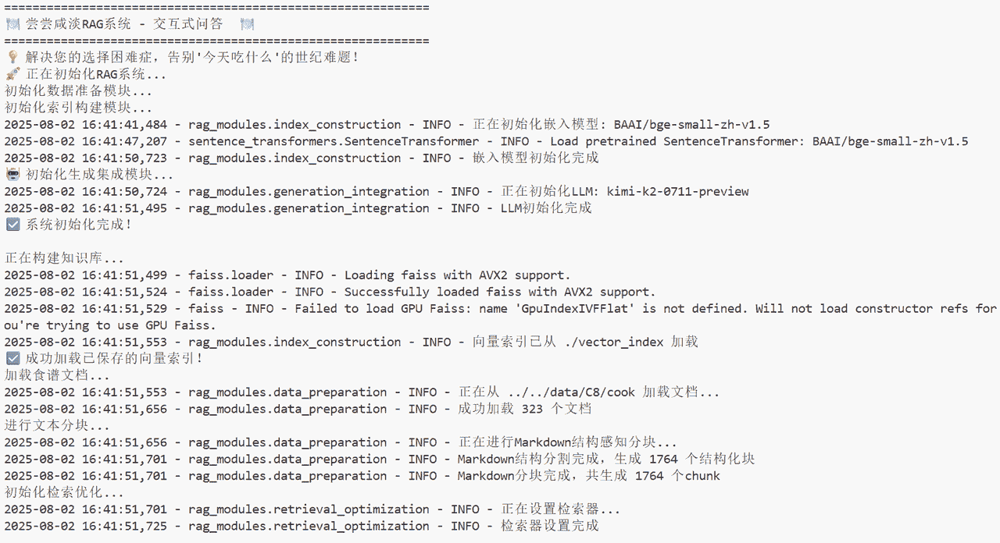

# All-in-RAG | 大模型应用开发实战一：RAG技术全栈指南

> 来源：[https://gotoaiworld.feishu.cn/docx/MPyZdBlCWo0Q0fxQmUUcgwKfnhe](https://gotoaiworld.feishu.cn/docx/MPyZdBlCWo0Q0fxQmUUcgwKfnhe)


## 🔍 检索增强生成 (RAG) 技术全栈指南

从理论到实践，从基础到进阶，构建你的RAG技术体系

## [项目简介（中文 |](https://datawhalechina.github.io/all-in-rag/#/?id=%e9%a1%b9%e7%9b%ae%e7%ae%80%e4%bb%8b%ef%bc%88%e4%b8%ad%e6%96%87-english%ef%bc%89)[English](https://datawhalechina.github.io/all-in-rag/#/en/)）

本项目是一个面向大模型应用开发者的RAG（检索增强生成）技术全栈教程，旨在通过体系化的学习路径和动手实践项目，帮助开发者掌握基于大语言模型的RAG应用开发技能，构建生产级的智能问答和知识检索系统。

主要内容包括：

1.  RAG技术基础：深入浅出地介绍RAG的核心概念、技术原理和应用场景

1.  数据处理全流程：从数据加载、清洗到文本分块的完整数据准备流程

1.  索引构建与优化：向量嵌入、多模态嵌入、向量数据库构建及索引优化技术

1.  检索技术进阶：混合检索、查询构建、Text2SQL等高级检索技术

1.  生成集成与评估：格式化生成、系统评估与优化方法

1.  项目实战：从基础到进阶的完整RAG应用开发实践

## [项目意义](https://datawhalechina.github.io/all-in-rag/#/?id=%e9%a1%b9%e7%9b%ae%e6%84%8f%e4%b9%89)

随着大语言模型的快速发展，RAG技术已成为构建智能问答系统、知识检索应用的核心技术。然而，现有的RAG教程往往零散且缺乏系统性，初学者难以形成完整的技术体系认知。

本项目从实践出发，结合最新的RAG技术发展趋势，构建了一套完整的RAG学习体系，帮助开发者：

+   系统掌握RAG技术的理论基础和实践技能

+   理解RAG系统的完整架构和各组件的作用

+   具备独立开发RAG应用的能力

+   掌握RAG系统的评估和优化方法

## [项目受众](https://datawhalechina.github.io/all-in-rag/#/?id=%e9%a1%b9%e7%9b%ae%e5%8f%97%e4%bc%97)

本项目适合以下人群学习：

+   具备Python编程基础，对RAG技术感兴趣的开发者

+   希望系统学习RAG技术的AI工程师

+   想要构建智能问答系统的产品开发者

+   对检索增强生成技术有学习需求的研究人员

前置要求：

+   掌握Python基础语法和常用库的使用

+   能够简单使用docker

+   了解基本的LLM概念（推荐但非必需）

+   具备基础的Linux命令行操作能力

## [项目亮点](https://datawhalechina.github.io/all-in-rag/#/?id=%e9%a1%b9%e7%9b%ae%e4%ba%ae%e7%82%b9)

1.  体系化学习路径：从基础概念到高级应用，构建完整的RAG技术学习体系

1.  理论与实践并重：每个章节都包含理论讲解和代码实践，确保学以致用

1.  多模态支持：不仅涵盖文本RAG，还包括多模态嵌入和检索技术

1.  工程化导向：注重实际应用中的工程化问题，包括性能优化、系统评估等

1.  丰富的实战项目：提供从基础到进阶的多个实战项目，帮助巩固学习成果

## [内容大纲](https://datawhalechina.github.io/all-in-rag/#/?id=%e5%86%85%e5%ae%b9%e5%a4%a7%e7%ba%b2)

### [第一部分：RAG基础入门](https://datawhalechina.github.io/all-in-rag/#/?id=%e7%ac%ac%e4%b8%80%e9%83%a8%e5%88%86%ef%bc%9arag%e5%9f%ba%e7%a1%80%e5%85%a5%e9%97%a8)

第一章 解锁RAG [📖 查看章节](https://datawhalechina.github.io/all-in-rag/#/chapter1)

1.   [RAG简介](https://datawhalechina.github.io/all-in-rag/#/chapter1/01_RAG_intro) - RAG技术概述与应用场景

1.   [准备工作](https://datawhalechina.github.io/all-in-rag/#/chapter1/02_preparation) - 环境配置与工具准备

1.   [四步构建RAG](https://datawhalechina.github.io/all-in-rag/#/chapter1/03_get_start_rag) - 快速上手RAG开发

1.   [附：环境部署](https://datawhalechina.github.io/all-in-rag/#/chapter1/virtualenv)[ - Python虚拟环境](https://github.com/anarchysaiko)部署方案补充 (贡献者: @anarchysaiko)

第二章 数据准备 [📖 查看章节](https://datawhalechina.github.io/all-in-rag/#/chapter2)

1.   [数据加载](https://datawhalechina.github.io/all-in-rag/#/chapter2/04_data_load) - 多格式文档处理与加载

1.   [文本分块](https://datawhalechina.github.io/all-in-rag/#/chapter2/05_text_chunking) - 文本切分策略与优化

### [第二部分：索引构建与优化](https://datawhalechina.github.io/all-in-rag/#/?id=%e7%ac%ac%e4%ba%8c%e9%83%a8%e5%88%86%ef%bc%9a%e7%b4%a2%e5%bc%95%e6%9e%84%e5%bb%ba%e4%b8%8e%e4%bc%98%e5%8c%96)

第三章 索引构建 [📖 查看章节](https://datawhalechina.github.io/all-in-rag/#/chapter3)

1.   [向量嵌入](https://datawhalechina.github.io/all-in-rag/#/chapter3/06_vector_embedding) - 文本向量化技术详解

1.   [多模态嵌入](https://datawhalechina.github.io/all-in-rag/#/chapter3/07_multimodal_embedding) - 图文多模态向量化

1.   [向量数据库](https://datawhalechina.github.io/all-in-rag/#/chapter3/08_vector_db) - 向量存储与检索系统

1.   [Milvus实践](https://datawhalechina.github.io/all-in-rag/#/chapter3/09_milvus) - Milvus多模态检索实战

1.   [索引优化](https://datawhalechina.github.io/all-in-rag/#/chapter3/10_index_optimization) - 索引性能调优技巧

### [第三部分：检索技术进阶](https://datawhalechina.github.io/all-in-rag/#/?id=%e7%ac%ac%e4%b8%89%e9%83%a8%e5%88%86%ef%bc%9a%e6%a3%80%e7%b4%a2%e6%8a%80%e6%9c%af%e8%bf%9b%e9%98%b6)

第四章 检索优化 [📖 查看章节](https://datawhalechina.github.io/all-in-rag/#/chapter4)

1.   [混合检索](https://datawhalechina.github.io/all-in-rag/#/chapter4/11_hybrid_search) - 稠密+稀疏检索融合

1.   [查询构建](https://datawhalechina.github.io/all-in-rag/#/chapter4/12_query_construction) - 智能查询理解与构建

1.   [Text2SQL](https://datawhalechina.github.io/all-in-rag/#/chapter4/13_text2sql) - 自然语言转SQL查询

1.   [查询重构与分发](https://datawhalechina.github.io/all-in-rag/#/chapter4/14_query_rewriting) - 查询优化策略

1.   [检索进阶技术](https://datawhalechina.github.io/all-in-rag/#/chapter4/15_advanced_retrieval_techniques) - 高级检索算法

### [第四部分：生成与评估](https://datawhalechina.github.io/all-in-rag/#/?id=%e7%ac%ac%e5%9b%9b%e9%83%a8%e5%88%86%ef%bc%9a%e7%94%9f%e6%88%90%e4%b8%8e%e8%af%84%e4%bc%b0)

第五章 生成集成 [📖 查看章节](https://datawhalechina.github.io/all-in-rag/#/chapter5)

1.   [格式化生成](https://datawhalechina.github.io/all-in-rag/#/chapter5/16_formatted_generation) - 结构化输出与格式控制

第六章 RAG系统评估 [📖 查看章节](https://datawhalechina.github.io/all-in-rag/#/chapter6)

1.   [评估介绍](https://datawhalechina.github.io/all-in-rag/#/chapter6/18_system_evaluation) - RAG系统评估方法论

1.   [评估工具](https://datawhalechina.github.io/all-in-rag/#/chapter6/19_common_tools) - 常用评估工具与指标

### [第五部分：高级应用与实战](https://datawhalechina.github.io/all-in-rag/#/?id=%e7%ac%ac%e4%ba%94%e9%83%a8%e5%88%86%ef%bc%9a%e9%ab%98%e7%ba%a7%e5%ba%94%e7%94%a8%e4%b8%8e%e5%ae%9e%e6%88%98)

[第七章 高级R](https://datawhalechina.github.io/all-in-rag/#/chapter7)AG架构（拓展部分） 📖 查看章节

1.   [基于知识图谱的RAG](https://datawhalechina.github.io/all-in-rag/#/chapter7/20_kg_rag)

第八章 项目实战一 [📖 查看章节](https://datawhalechina.github.io/all-in-rag/#/chapter8)

1.   [环境配置与项目架构](https://datawhalechina.github.io/all-in-rag/#/chapter8/01_env_architecture)

1.   [数据准备模块实现](https://datawhalechina.github.io/all-in-rag/#/chapter8/02_data_preparation)

1.   [索引构建与检索优化](https://datawhalechina.github.io/all-in-rag/#/chapter8/03_index_retrieval)

1.   [生成集成与系统整合](https://datawhalechina.github.io/all-in-rag/#/chapter8/04_generation_sys)

[第九章 项目实](https://datawhalechina.github.io/all-in-rag/#/chapter9)战一优化（选修篇） 📖 查看章节

[🍽️ 项目展示](https://github.com/FutureUnreal/What-to-eat-today)

1.   [图RAG架构设计](https://datawhalechina.github.io/all-in-rag/#/chapter9/01_graph_rag_architecture)

1.   [图数据建模与准备](https://datawhalechina.github.io/all-in-rag/#/chapter9/02_graph_data_modeling)

1.   [Milvus索引构建](https://datawhalechina.github.io/all-in-rag/#/chapter9/03_index_construction)

1.   [智能查询路由与检索策略](https://datawhalechina.github.io/all-in-rag/#/chapter9/04_intelligent_query_routing)

第十章 项目实战二（选修篇） [📖 查看章节 ](https://datawhalechina.github.io/all-in-rag/#/chapter10)规划中

### [第六部分：知识拓展](https://datawhalechina.github.io/all-in-rag/#/?id=%e7%ac%ac%e5%85%ad%e9%83%a8%e5%88%86%ef%bc%9a%e7%9f%a5%e8%af%86%e6%8b%93%e5%b1%95)

[第十一章 Ne](https://datawhalechina.github.io/all-in-rag/#/chapter11)o4J 简单应用 📖 查看章节

1.   [知识图谱与 Neo4j 安装](https://datawhalechina.github.io/all-in-rag/#/chapter11/01_knowledge_graph)

1.   [Neo4j 基本使用](https://datawhalechina.github.io/all-in-rag/#/chapter11/02_neo4j)

## [目录结构说明](https://datawhalechina.github.io/all-in-rag/#/?id=%e7%9b%ae%e5%bd%95%e7%bb%93%e6%9e%84%e8%af%b4%e6%98%8e)

```
all-in-rag/
├── docs/           # 教程文档
├── code/           # 代码示例
├── data/           # 示例数据
├── models/         # 预训练模型
└── README.md       # 项目说明Copy to clipboardErrorCopied
```

## [实战项目展示](https://datawhalechina.github.io/all-in-rag/#/?id=%e5%ae%9e%e6%88%98%e9%a1%b9%e7%9b%ae%e5%b1%95%e7%a4%ba)

### [第八章 项目一：](https://datawhalechina.github.io/all-in-rag/#/?id=%e7%ac%ac%e5%85%ab%e7%ab%a0-%e9%a1%b9%e7%9b%ae%e4%b8%80%ef%bc%9a)



### 第九章 项目一（Graph RAG优化）：


### [第十章 项目二：](https://datawhalechina.github.io/all-in-rag/#/?id=%e7%ac%ac%e5%8d%81%e7%ab%a0-%e9%a1%b9%e7%9b%ae%e4%ba%8c%ef%bc%9a)