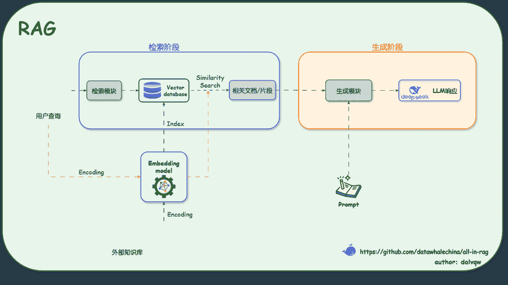
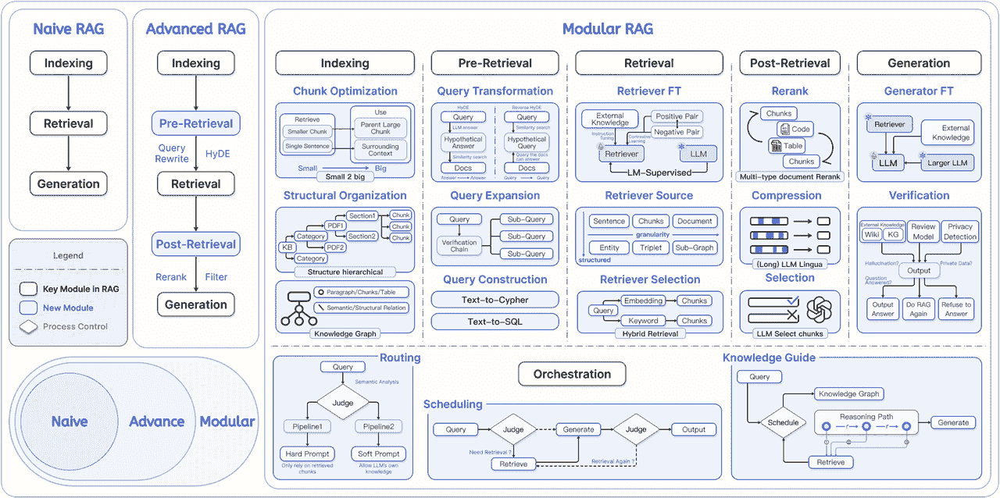
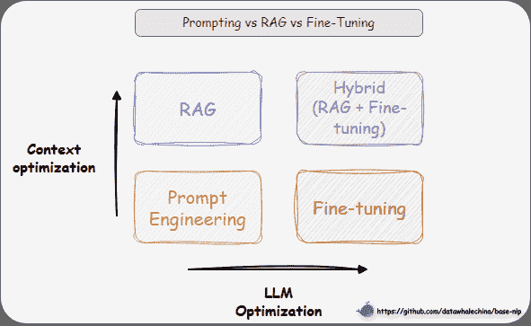

# 第一节 RAG 简介

> 来源：[https://gotoaiworld.feishu.cn/docx/DXdxd05mooUY4ixpZDbcRPrYn6b](https://gotoaiworld.feishu.cn/docx/DXdxd05mooUY4ixpZDbcRPrYn6b)

## [一、什么是 RAG？](https://datawhalechina.github.io/all-in-rag/#/chapter1/01_RAG_intro?id=%e4%b8%80%e3%80%81%e4%bb%80%e4%b9%88%e6%98%af-rag%ef%bc%9f)

### [1.1 核心定义](https://datawhalechina.github.io/all-in-rag/#/chapter1/01_RAG_intro?id=_11-%e6%a0%b8%e5%bf%83%e5%ae%9a%e4%b9%89)

从本质上讲，RAG（Retrieval-Augmented Generation）是一种旨在解决大语言模型（LLM）“知其然不知其所以然”问题的技术范式。它的核心是将模型内部学到的“参数化知识”（模型权重中固化的、模糊的“记忆”），与来自外部知识库的“非参数化知识”（精准、可随时更新的外部数据）相结合。

其运作逻辑就是在 LLM 生成文本前，先通过检索机制从外部知识库中动态获取相关信息，并将这些“参考资料”融入生成过程，从而提升输出的准确性和时效性 (1) (2) (3)。

> 💡 一句话总结：RAG 就是让 LLM 学会了“开卷考试”，它既能利用自己学到的知识，也能随时查阅外部资料。

### [1.2 技术原理](https://datawhalechina.github.io/all-in-rag/#/chapter1/01_RAG_intro?id=_12-%e6%8a%80%e6%9c%af%e5%8e%9f%e7%90%86)

那么，RAG 系统是如何实现“参数化知识”与“非参数化知识”的结合呢？如图 1-1 所示，其架构主要通过两个阶段来完成这一过程：

1.  检索阶段：寻找“非参数化知识”

+   知识向量化：嵌入模型（Embedding Model） 充当了“连接器”的角色。它将外部知识库编码为向量索引（Index），存入向量数据库。

+   语义召回：当用户发起查询时，检索模块利用同样的嵌入模型将问题向量化，并通过相似度搜索（Similarity Search），从海量数据中精准锁定与问题最相关的文档片段。

1.  生成阶段：融合两种知识

+   上下文整合：生成模块接收检索阶段送来的相关文档片段以及用户的原始问题。

+   指令引导生成：该模块会遵循预设的 Prompt 指令，将上下文与问题有效整合，并引导 LLM（如 DeepSeek）进行可控的、有理有据的文本生成。

图 1-1 RAG 双阶段架构示意图

### [1.3 技术演进分类](https://datawhalechina.github.io/all-in-rag/#/chapter1/01_RAG_intro?id=_13-%e6%8a%80%e6%9c%af%e6%bc%94%e8%bf%9b%e5%88%86%e7%b1%bb)

RAG 的技术架构经历了从简单到复杂的演进，如图 1-2 大致可分为三个阶段 (4)。

图 1-2 RAG 技术演进分类

这三个阶段的具体对比如表 1-1 所示。

表 1-1 RAG 技术演进分类对比

> “离线”指提前完成的数据预处理工作（如索引构建）；“在线”指用户发起请求后的实时处理流程。

## [二、为什么要使用 RAG？](https://datawhalechina.github.io/all-in-rag/#/chapter1/01_RAG_intro?id=%e4%ba%8c%e3%80%81%e4%b8%ba%e4%bb%80%e4%b9%88%e8%a6%81%e4%bd%bf%e7%94%a8-rag%ef%bc%9f)

### 2.1 技术选型：RAG vs. 微调

在选择具体的技术路径时，一个重要的考量是成本与效益的平衡。通常，我们应优先选择对模型改动最小、成本最低的方案，所以技术选型路径往往遵循的顺序是提示词工程（Prompt Engineering） -> 检索增强生成 -> 微调（Fine-tuning）。

我们可以从两个维度来理解这些技术的区别。如图 1-3 所示，横轴代表“LLM 优化”，即对模型本身进行多大程度的修改。从左到右，优化的程度越来越深，其中提示工程和 RAG 完全不改变模型权重，而微调则直接修改模型参数。纵轴代表“上下文优化”，是对输入给模型的信息进行多大程度的增强。从下到上，增强的程度越来越高，其中提示工程只是优化提问方式，而 RAG 则通过引入外部知识库，极大地丰富了上下文信息。

图 1-3 选型路径图

基于此，我们的选择路径就清晰了：

+   先尝试提示工程：通过精心设计提示词来引导模型，适用于任务简单、模型已有相关知识的场景。

+   再选择 RAG：如果模型缺乏特定或实时知识而无法回答，则使用 RAG，通过外挂知识库为其提供上下文信息。

+   最后考虑微调：当目标是改变模型“如何做”（行为/风格/格式）而不是“知道什么”（知识）时，微调是最终且最合适的选择。例如，让模型学会严格遵循某种独特的输出格式、模仿特定人物的对话风格，或者将极其复杂的指令“蒸馏”进模型权重中。

RAG 的出现填补了通用模型与专业领域之间的鸿沟，它在解决如表 1-2 所示 LLM 局限时尤其有效：

表 1-2 RAG 对 LLM 局限的解决方案

### [2.2 关键优势](https://datawhalechina.github.io/all-in-rag/#/chapter1/01_RAG_intro?id=_22-%e5%85%b3%e9%94%ae%e4%bc%98%e5%8a%bf)

1.  准确性与可信度的双重提升

RAG 最核心的价值在于突破了模型预训练知识的限制。它不仅能补充专业领域的知识盲区，还能通过提供具体的参考材料，有效抑制“一本正经胡说八道”的幻觉现象。论文研究还表明，RAG 生成的内容在具体性和多样性上也显著优于纯 LLM。更重要的是，RAG 具备可溯源性——每一条回答都能找到对应的原始文档出处，这种“有据可查”的特性极大提高了内容在法律、医疗等严肃场景下的可信度。

1.  时效性保障

在知识更新方面，RAG 解决了 LLM 固有的知识时滞问题（即模型不知道训练截止日期之后发生的事）。RAG 允许知识库独立于模型进行动态更新——新政策或新数据一旦入库，立刻就能被检索到。这种能力在论文中被称为“索引热拔插”（Index Hot-swapping）——就像给机器人换一张存储卡一样，瞬间切换其世界知识库，而无需重新训练模型，实现了知识的实时在线。

1.  显著的综合成本效益

从经济角度看，RAG 是一种高性价比的方案。首先，它避免了高频微调带来的巨额算力成本；其次，由于有了外部知识的强力辅助，我们在处理特定领域问题时，往往可以使用参数量更小的基础模型来达到类似的效果，从而直接降低了推理成本。这种架构也减少了试图将海量知识强行“塞入”模型权重中所需的计算资源消耗。

1.  灵活的模块化可扩展性

RAG 的架构具备极强的包容性，支持多源集成，无论是 PDF、Word 还是网页数据，都能统一构建进知识库中。同时，其模块化设计实现了检索与生成的解耦，这意味着我们可以独立优化检索组件（比如更换更好的 Embedding 模型），而不会影响到生成组件的稳定性，便于系统的长期迭代。

### [2.3 适用场景风险分级](https://datawhalechina.github.io/all-in-rag/#/chapter1/01_RAG_intro?id=_23-%e9%80%82%e7%94%a8%e5%9c%ba%e6%99%af%e9%a3%8e%e9%99%a9%e5%88%86%e7%ba%a7)

表 1-3 是RAG技术在不同风险等级场景中的适用性。

表 1-3 RAG 适用场景风险分级

## [三、如何上手RAG？](https://datawhalechina.github.io/all-in-rag/#/chapter1/01_RAG_intro?id=%e4%b8%89%e3%80%81%e5%a6%82%e4%bd%95%e4%b8%8a%e6%89%8brag%ef%bc%9f)

### [3.1 基础工具链选择](https://datawhalechina.github.io/all-in-rag/#/chapter1/01_RAG_intro?id=_31-%e5%9f%ba%e7%a1%80%e5%b7%a5%e5%85%b7%e9%93%be%e9%80%89%e6%8b%a9)

构建 RAG 系统通常涉及几个关键环节的选型。在开发模式上，我们可以利用 LangChain 或 LlamaIndex 等成熟框架快速集成，也可以选择不依赖框架的原生开发，以获得对系统流程更精细的控制力（在 AI 编程辅助下这并非难事）。而在记忆载体（向量数据库）方面，既有 Milvus、Pinecone 等适合大规模数据的方案，也有 FAISS、Chroma 等轻量级或本地化的选择，需根据具体业务规模灵活决定。后期为了量化效果，还可以引入 RAGAS 或 TruLens 等自动化评估工具。

### 3.2 四步构建最小可行系统（MVP）

1.  数据准备与清洗 这是系统的地基。我们需要将 PDF、Word 等多源异构数据标准化，并采用合理的分块策略（如按语义段落切分而非固定字符数），避免信息在切割中支离破碎。

1.  索引构建 将切分好的文本通过嵌入模型转化为向量，并存入数据库。可以在此阶段关联元数据（如来源、页码），这对后续的精确引用很有帮助。

1.  检索策略优化 不要依赖单一的向量搜索。可以采用混合检索（向量+关键词）等方式来提升召回率，并引入重排序模型对检索结果进行二次精选，确保 LLM 看到的都是精华。

1.  生成与提示工程 最后，设计一套清晰的 Prompt 模板，引导 LLM 基于检索到的上下文回答用户问题，并明确要求模型“不知道就说不知道”，防止幻觉。

### [3.3 新手友好方案](https://datawhalechina.github.io/all-in-rag/#/chapter1/01_RAG_intro?id=_33-%e6%96%b0%e6%89%8b%e5%8f%8b%e5%a5%bd%e6%96%b9%e6%a1%88)

如果你希望快速验证想法而非深耕代码，可以尝试 FastGPT 或 Dify 这样的可视化知识库平台，它们封装了复杂的 RAG 流程，仅需上传文档即可使用。对于开发者，利用 LangChain4j Easy RAG 或 GitHub 上的 TinyRAG (6)等开源模板，也是高效的起手方式。

### [3.4 进阶与挑战](https://datawhalechina.github.io/all-in-rag/#/chapter1/01_RAG_intro?id=_34-%e8%bf%9b%e9%98%b6%e4%b8%8e%e6%8c%91%e6%88%98)

当基础的 RAG 系统搭建完成后，下一步的进阶之路便聚焦于如何评估、诊断并突破其固有的瓶颈。

1.  评估维度与挑战

一套 RAG 系统的好坏，并不能仅凭感觉。业界通常会从几个维度进行量化评估，首先是检索相关性（找到的内容是否包含答案），其次是生成质量，这又可以细分为语义准确性（回答的意思是否正确）和词汇匹配度（专业术语是否使用得当）。

这些评估维度也直接对应了 RAG 当前面临的主要挑战。比如，检索依赖性问题——如果检索系统召回了错误信息，再强的 LLM 也会“一本正经地胡说八道”。此外，对于需要跨多个文档进行综合分析的多跳推理问题，常见的 RAG 架构也普遍感到吃力。

1.  优化方向与架构演进

针对上述挑战，社区探索出了多种优化路径。在性能层面，可以通过索引分层（对高频数据启用缓存）和多模态扩展（支持图像/表格检索）来提升效率和能力边界。而在架构层面，简单的线性流程正在被更复杂的设计模式所取代。例如，系统可以通过分支模式并行处理多路检索，或通过循环模式进行自我修正，这些灵活的架构是通往更智能 RAG 的必由之路。

## [四、RAG 已死？](https://datawhalechina.github.io/all-in-rag/#/chapter1/01_RAG_intro?id=%e5%9b%9b%e3%80%81rag-%e5%b7%b2%e6%ad%bb%ef%bc%9f)

随着大模型长上下文窗口能力的提升，社区中开始出现“RAG 已死”的声音。这一论调主要来自两个方面，一是认为长上下文已经能暴力“消化”海量文本，不再需要复杂的检索系统；二是批评 RAG 这个术语本身就过于宽泛，模糊了太多技术细节，反而阻碍了理解与优化。

这些观点忽略了一个技术概念在演进过程中的普遍规律。正如我们可以轻易地为现代复杂的 RAG 系统起一个更精确、更唬人的名字，比如 “大模型知识管理专家系统”（Large Language Model Knowledge Management Expert System，LKE）。因为它早已超出了最初“检索-增强-生成”的简单范畴。但这种“换名游戏”，恰恰说明了“RAG 已死”论的表面化——这无异于在用一个新瓶子去装 RAG 这个不断陈化的老酒。

> 笔者在此并非要创造一个新词，不过为什么要起 LKE 这个名字？它代表了三个核心要素：

+   L（Large Language Model）：强调系统的驱动力是大语言模型。

+   K（Knowledge Management）：寓意着系统就像一个知识管理员，精准地为我们找到（检索）所需要的知识，辅助我们后续利用大模型进行更高阶应用。

+   E（Expert）：说明系统能像专家一样，通过路由、分析、融合、修正等一系列步骤，最终给出答案（生成）、解决问题。

可以类比 Transformer。今天无论是以 GPT 为代表的 Decoder-only 还是以 BERT 为代表的 Encoder-only，我们都习惯称之为“基于 Transformer 架构”，尽管它们与最初论文中的完整形态差异巨大。但是 Transformer 这个标签抓住了一次技术范式的核心飞跃，并成为了一个技术时代的象征。同理，RAG 的核心在于“将 LLM 的内在参数化知识与外部非参数化知识相结合”。只要这个思想或需求不变，无论我们为其增加多少模块——查询转换、多路召回或者自我修正等等，它本质上依然是在这个框架下的演进。

所以，“RAG 已死”是一个伪命题。相反，RAG 作为一个概念活得很好，它正在像 Transformer 一样，成为一个不断吸收新技术、不断进化的基础架构范式。它的生命力，正在于它的“面目全非”和“包罗万象”。而本教程的目标，就是绘制出这张描绘 RAG 全貌的清晰地图，当我们可以解构它的每一个模块、理解它的每一种可能性时，RAG 也好，LKE 也罢，这些都无关紧要。因为我们已经掌握了其背后包含的各种技术原理。

> RAG技术仍在快速发展中，可以持续关注学术和工业界的最新进展！

## [参考文献](https://datawhalechina.github.io/all-in-rag/#/chapter1/01_RAG_intro?id=%e5%8f%82%e8%80%83%e6%96%87%e7%8c%ae)

[Genesis, J. (2025). Retrieval-Augm](https://www.researchgate.net/publication/391141346_Retrieval-Augmented_Generation_Methods_Applications_and_Challenges)en[t](https://datawhalechina.github.io/all-in-rag/#fnref-1)ed Text Generation: Methods, Challenges, and Applications. ↩

[G](https://arxiv.org/abs/2312.10997)aoet al. (2023). Retrieval-Augmented Generation for Large Language Models: A Survey. ↩

[L](https://arxiv.org/abs/2005.11401)ew[i](https://datawhalechina.github.io/all-in-rag/#fnref-3)s et al. (2020). Retrieval-Augmented Generation for Knowledge-Intensive NLP Tasks. ↩

[Gao et al. (2024). Modular RAG: Transf](https://arxiv.org/abs/2407.21059)or[m](https://datawhalechina.github.io/all-in-rag/#fnref-4)ing RAG Systems into LEGO-like Reconfigurable Frameworks. ↩

Ti[n](https://datawhalechina.github.io/all-in-rag/#fnref-6)yRAG: GitHub项目. ↩