# 第二节 准备工作

> 来源：[https://gotoaiworld.feishu.cn/docx/P8Qldgwqko08MWxKFd8cF4JdnEh](https://gotoaiworld.feishu.cn/docx/P8Qldgwqko08MWxKFd8cF4JdnEh)

> 本节环境配置方面主推两种基于浏览器的集成开发环境。不管是手机、平板还是电脑，随时都可以上号运行代码。虽然手机平板可能体验不佳，但胜在能用。

## 一、Deepseek API配置

### [1.1 API申请](https://datawhalechina.github.io/all-in-rag/#/chapter1/02_preparation?id=_11-api%e7%94%b3%e8%af%b7)

要使用 Deepseek 提供的大语言模型服务，你首先需要一个 API Key。下面是申请步骤：

1.  [访问 Deepseek 开](https://platform.deepseek.com/)放平台 打开浏览器，访问 Deepseek 开放平台。

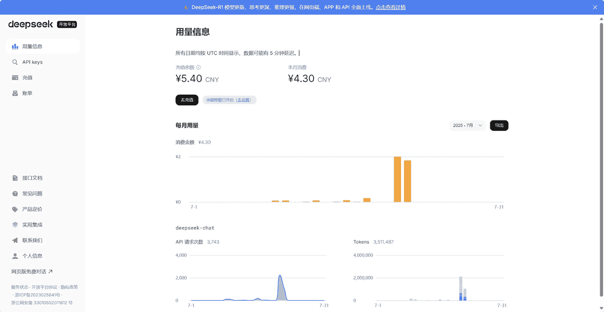

1.  登录或注册账号 如果你已有账号，请直接登录。如果没有，请点击页面上的注册按钮，使用邮箱或手机号完成注册。

1.  创建新的 API 密钥 登录成功后，在页面左侧的导航栏中找到并点击 API Keys。在 API 管理页面，点击 创建 API key 按钮。输入一个跟其他api key不重复的名称后点击创建

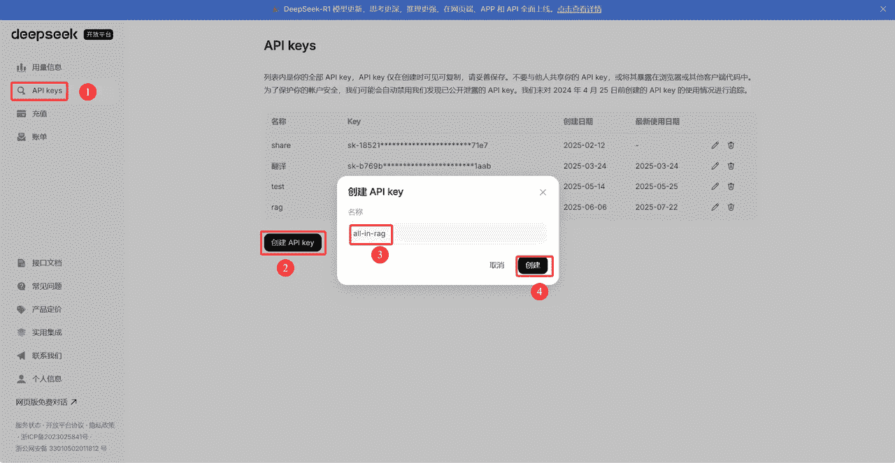

1.  保存 API Key 系统会为你生成一个新的 API 密钥。请立即复制并将其保存在一个安全的地方。

1.  注意：出于安全原因，这个密钥只会完整显示一次，关闭弹窗后就没法再看到了。

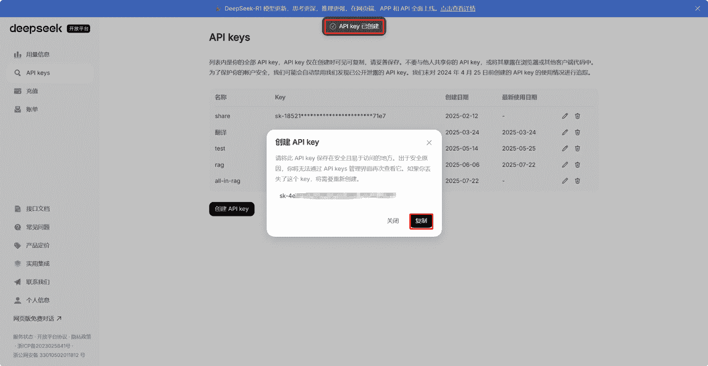

## 二、GitHub Codespaces 环境配置（推荐）

> 首先确定是否具有可以流畅访问 GitHub 的网络环境，若无法流畅访问请使用下面的Cloud Studio

GitHub Codespaces 是 GitHub 提供的一项服务，允许开发者在云端创建、编辑和运行代码。它提供了一个预配置的开发环境，包括代码编辑器、终端、调试工具等，可以直接在浏览器中使用。

### 2.1 创建Codespaces

1.  访问项目地址

1.  打开浏览器，访问 [all-in-rag](https://github.com/datawhalechina/all-in-rag)

1.  创建新分支 在项目页面的右上角，点击 Fork 按钮，创建一个新的分支。稍等一会儿即可创建成功。

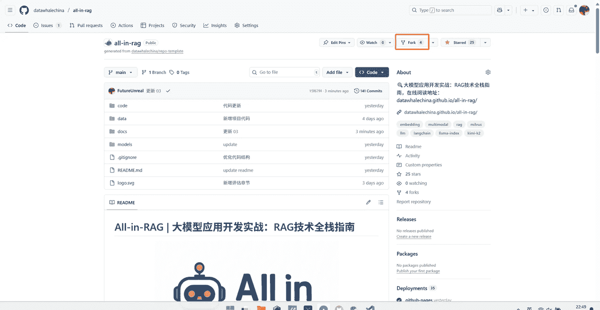

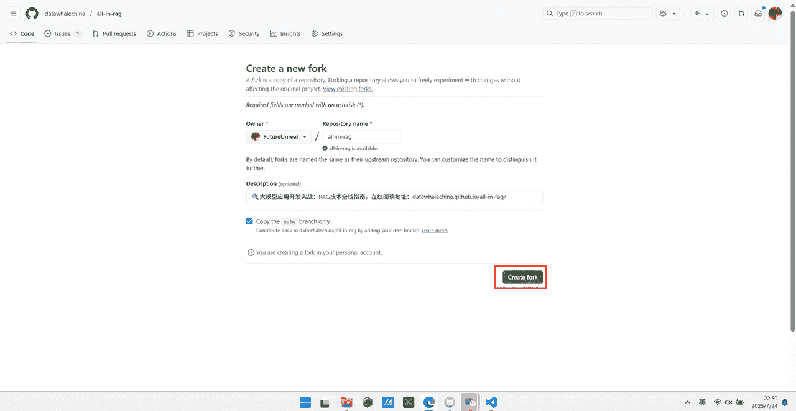

1.  创建Codespaces 在项目页面的右上角，点击 Code 按钮，然后选择 Codespaces 选项卡。点击 New codespace 按钮，等待新的 Codespaces 环境创建成功。

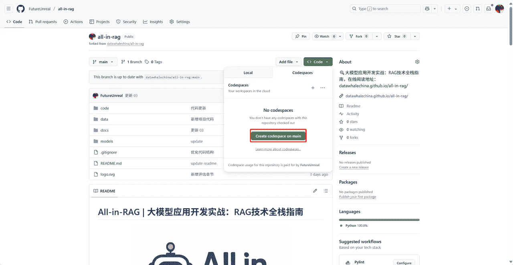

1.  再次进入Codespaces 网页关闭后，找到刚才新建的存储库，点击红框框选内容即可重新进入 codespace 环境。

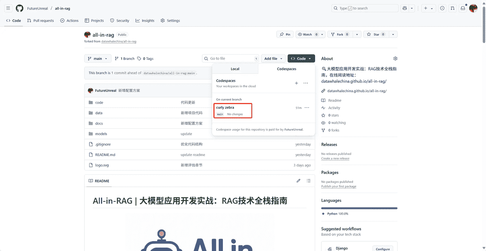

1.  额度设置 找到 GitHub 的账户设置中的 codespace 设置，挂起时间建议根据自己情况调整（时间过长会浪费额度，免费账号提供了单核120小时的额度）

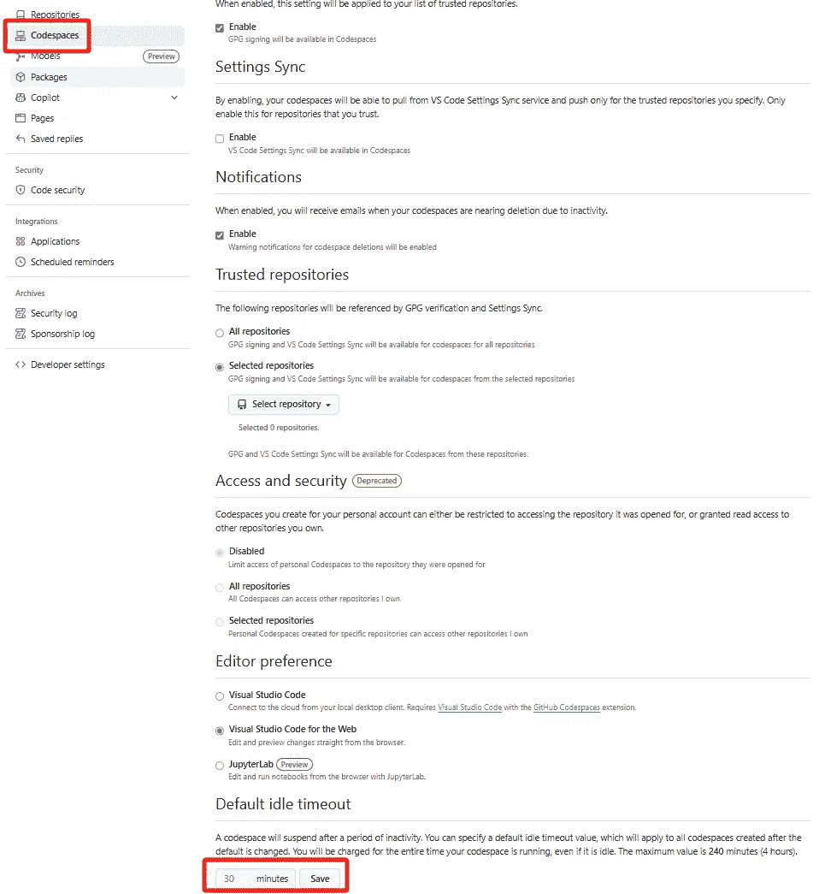

### [2.2 python环境配置](https://datawhalechina.github.io/all-in-rag/#/chapter1/02_preparation?id=_22-python%e7%8e%af%e5%a2%83%e9%85%8d%e7%bd%ae)

进入 IDE 后先选择下方终端

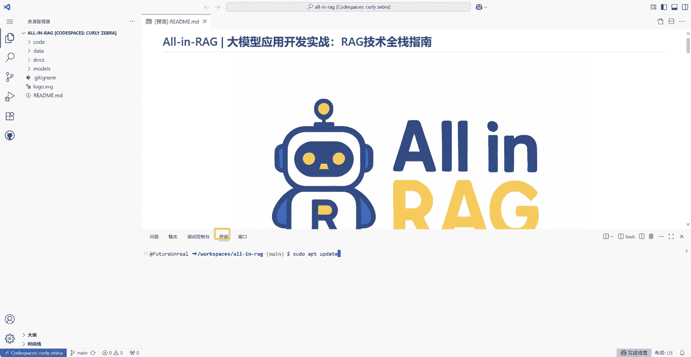

1.  更新系统软件包

1.  在终端输入下面指令：

```
sudo apt update
sudo apt upgrade -yCopy to clipboardErrorCopied
```

1.  安装Miniconda

```
wget https://repo.anaconda.com/miniconda/Miniconda3-latest-Linux-x86_64.sh -O ~/miniconda.sh
bash ~/miniconda.shCopy to clipboardErrorCopied
```

+   按 Enter 阅读许可协议

+   输入 yes 同意协议

+   安装路径提示时直接按 Enter（使用默认路径 /home/ubuntu/miniconda3）

+   是否初始化Miniconda：输入 yes 将Miniconda添加到您的PATH环境变量中。

```
source ~/.bashrc
conda --versionCopy to clipboardErrorCopied
```

1.  如果显示版本号，说明安装成功。

### [2.3 API配置](https://datawhalechina.github.io/all-in-rag/#/chapter1/02_preparation?id=_23-api%e9%85%8d%e7%bd%ae)

1.  使用 vim 编辑器打开你的 shell 配置文件。

```
vim ~/.bashrcCopy to clipboardErrorCopied
```

1.  输入 i 进入编辑模式，在文件末尾添加以下行，将 [你的 Deepseek API 密钥] 替换为你自己的密钥：

```
export DEEPSEEK_API_KEY=[你的 Deepseek API 密钥]Copy to clipboardErrorCopied
```

1.  保存并退出 在 vim 中，按 Esc 键进入命令模式，然后输入 :wq 并按 Enter 键保存文件并退出。

1.  使配置生效 执行以下命令来立即加载更新后的配置，让环境变量生效：

```
source ~/.bashrcCopy to clipboardErrorCopied
```

### [2.4 创建并激活虚拟环境](https://datawhalechina.github.io/all-in-rag/#/chapter1/02_preparation?id=_24-%e5%88%9b%e5%bb%ba%e5%b9%b6%e6%bf%80%e6%b4%bb%e8%99%9a%e6%8b%9f%e7%8e%af%e5%a2%83)

1.  创建虚拟环境

```
conda create --name all-in-rag python=3.12.7Copy to clipboardErrorCopied
```

1.  出现选项直接回车即可。

1.  激活虚拟环境

1.  使用以下命令激活虚拟环境：

```
conda activate all-in-ragCopy to clipboardErrorCopied
```

1.  依赖安装 如果严格安装上述流程当前应该在项目根目录，进入code目录安装依赖库

```
cd code
pip install -r requirements.txtCopy to clipboardErrorCopied
```

1.  如果出现关于grpcio的版本错误无需在意。

## 三、Cloud Studio 环境配置（国内环境推荐）

Cloud Studio 是腾讯云推出的一款基于浏览器的集成开发环境（IDE）。支持CPU与GPU的访问。

> 听说一个月是50个小时的免费额度🤔

### [3.1 应用创建](https://datawhalechina.github.io/all-in-rag/#/chapter1/02_preparation?id=_31-%e5%ba%94%e7%94%a8%e5%88%9b%e5%bb%ba)

1.  [访问 Cloud Stu](https://cloudstudio.net/)dio 打开浏览器，访问 Cloud Studio。

1.  登录或注册账号 点击页面右上角的 注册登录 按钮，使用🛰️等方式完成登录。

1.  创建应用 在页面上方的导航栏中找到并点击 创建应用。选择 从 Git 仓库导入 ，在项目地址栏输入 https://github.com/datawhalechina/all-in-rag.git 后回车，将会自动为你创建标题和描述。


1.  再次进入 后续在[应用管理页面](https://cloudstudio.net/my-app)找到之前创建的应用，点击后选择右上角编写代码即可再次进入。


### [3.2 python环境配置](https://datawhalechina.github.io/all-in-rag/#/chapter1/02_preparation?id=_32-python%e7%8e%af%e5%a2%83%e9%85%8d%e7%bd%ae)

进入 IDE 后先选择右侧终端

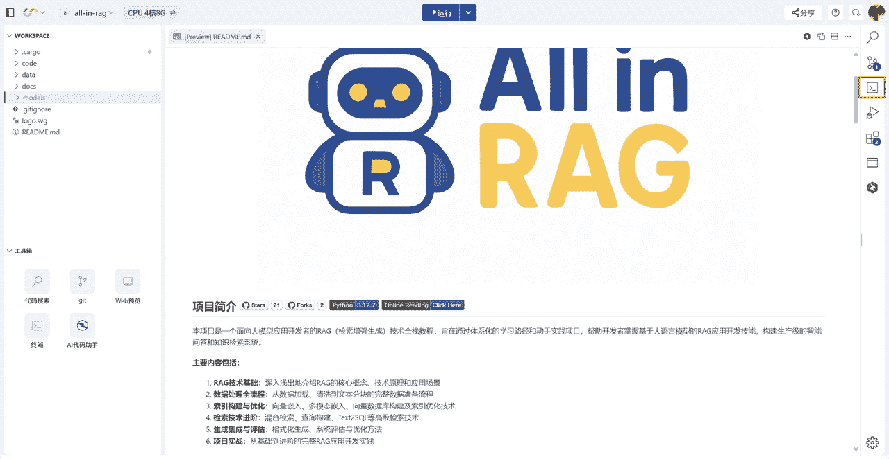

1.  更新系统软件包

1.  在终端输入下面指令：

```
sudo apt update
sudo apt upgrade -yCopy to clipboardErrorCopied
```

1.  切换普通用户

```
su ubuntuCopy to clipboardErrorCopied
```

1.  安装Miniconda

```
wget https://repo.anaconda.com/miniconda/Miniconda3-latest-Linux-x86_64.sh -O ~/miniconda.sh
bash ~/miniconda.shCopy to clipboardErrorCopied
```

+   按 Enter 阅读许可协议

+   输入 yes 同意协议

+   安装路径提示时直接按 Enter（使用默认路径 /home/ubuntu/miniconda3）

+   是否初始化Miniconda：输入 yes 将Miniconda添加到您的PATH环境变量中。

```
source ~/.bashrc
conda --versionCopy to clipboardErrorCopied
```

1.  如果显示版本号，说明安装成功。

### [3.3 API配置](https://datawhalechina.github.io/all-in-rag/#/chapter1/02_preparation?id=_33-api%e9%85%8d%e7%bd%ae)

1.  使用 vim 编辑器打开你的 shell 配置文件。

```
vim ~/.bashrcCopy to clipboardErrorCopied
```

1.  输入 i 进入编辑模式，在文件末尾添加以下行，将 [你的 Deepseek API 密钥] 替换为你自己的密钥：

```
export DEEPSEEK_API_KEY=[你的 Deepseek API 密钥]Copy to clipboardErrorCopied
```

1.  保存并退出 在 vim 中，按 Esc 键进入命令模式，然后输入 :wq 并按 Enter 键保存文件并退出。

1.  使配置生效 执行以下命令来立即加载更新后的配置，让环境变量生效：

```
source ~/.bashrcCopy to clipboardErrorCopied
```

### [3.4 创建并激活虚拟环境](https://datawhalechina.github.io/all-in-rag/#/chapter1/02_preparation?id=_34-%e5%88%9b%e5%bb%ba%e5%b9%b6%e6%bf%80%e6%b4%bb%e8%99%9a%e6%8b%9f%e7%8e%af%e5%a2%83)

1.  创建虚拟环境

```
conda create --name all-in-rag python=3.12.7Copy to clipboardErrorCopied
```

1.  出现选项直接回车即可。

1.  配置文件权限

```
sudo chown -R ubuntu:ubuntu code modelsCopy to clipboardErrorCopied
```

1.  激活虚拟环境

1.  使用以下命令激活虚拟环境：

```
conda activate all-in-ragCopy to clipboardErrorCopied
```

1.  依赖安装 如果严格安装上述流程当前应该在项目根目录，进入code目录安装依赖库

```
cd code
pip install -r requirements.txtCopy to clipboardErrorCopied
```

1.  如果出现关于grpcio的版本错误无需在意。

## [四、windows环境配置（使用Cloud Studio ](https://datawhalechina.github.io/all-in-rag/#/chapter1/02_preparation?id=%e5%9b%9b%e3%80%81windows%e7%8e%af%e5%a2%83%e9%85%8d%e7%bd%ae%ef%bc%88%e4%bd%bf%e7%94%a8cloud-studio-%e6%88%96-codespaces-%e5%8f%af%e8%b7%b3%e8%bf%87%e6%ad%a4%e6%ad%a5%e9%aa%a4%ef%bc%89)或 Codespaces 可跳过此步骤）

### [4.1 API配置](https://datawhalechina.github.io/all-in-rag/#/chapter1/02_preparation?id=_41-api%e9%85%8d%e7%bd%ae)

1.  右键点击 “计算机” 或 “此电脑”，然后点击 “属性”。

1.  在左侧菜单中，点击 “高级系统设置”。

1.  在 “系统属性” 对话框中，点击 “高级” 选项卡，然后点击下方的 “环境变量” 按钮。

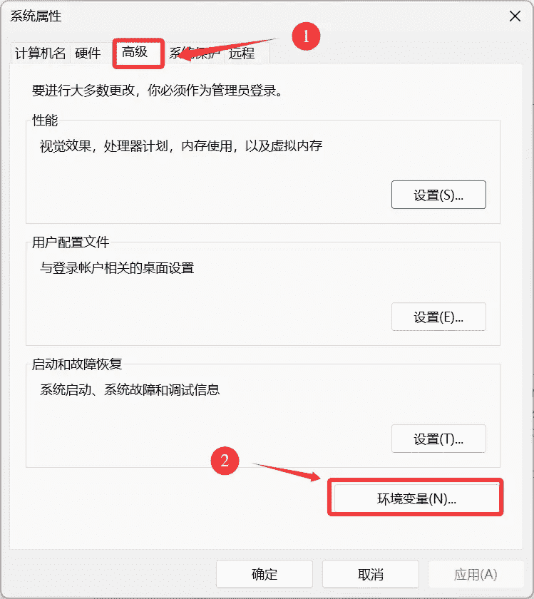

1.  在 “环境变量” 对话框中，点击 “新建”（在 “用户变量” 部分下），然后输入以下信息：

+   变量名：DEEPSEEK_API_KEY

+   变量值：[你的 Deepseek API 密钥]

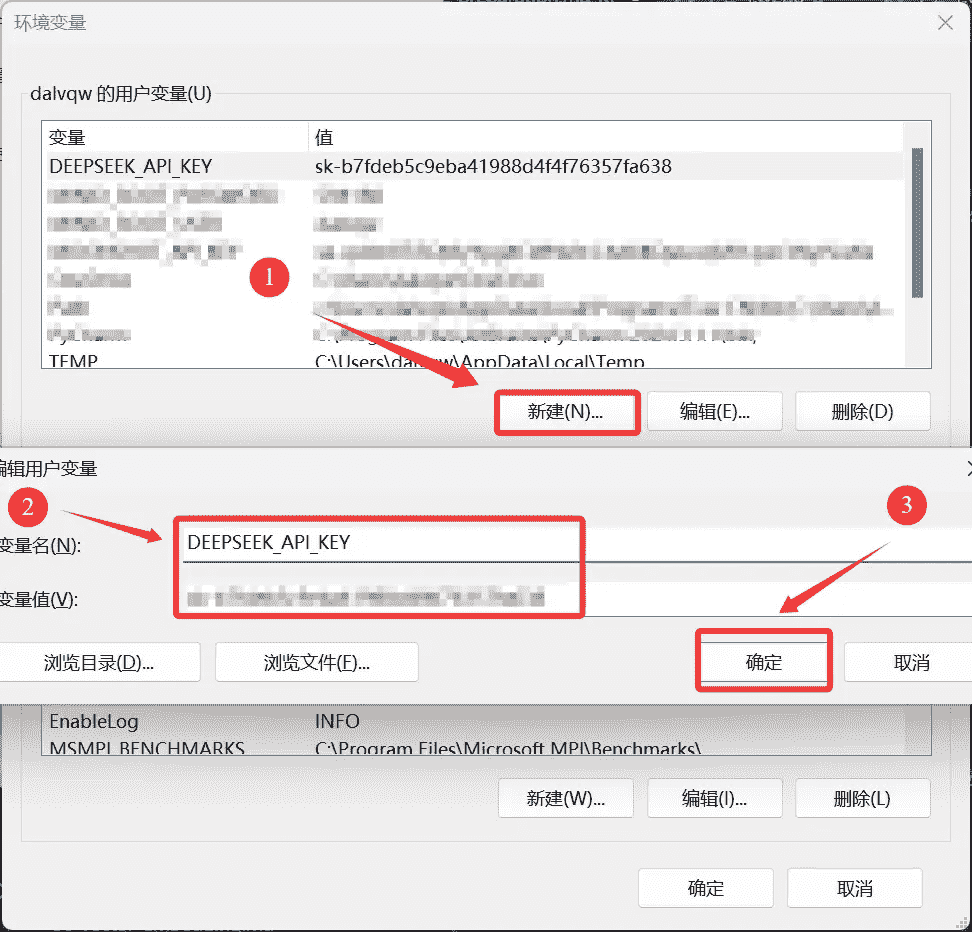

### [4.2 安装Miniconda](https://datawhalechina.github.io/all-in-rag/#/chapter1/02_preparation?id=_42-%e5%ae%89%e8%a3%85miniconda)

1.  下载安装程序

1.  优先推荐访问[清华大学开源软件镜像站](https://mirrors.tuna.tsinghua.edu.cn/anaconda/miniconda/)，以获得更快的下载速度。根据你的系统选择最新的 .exe 版本下载。

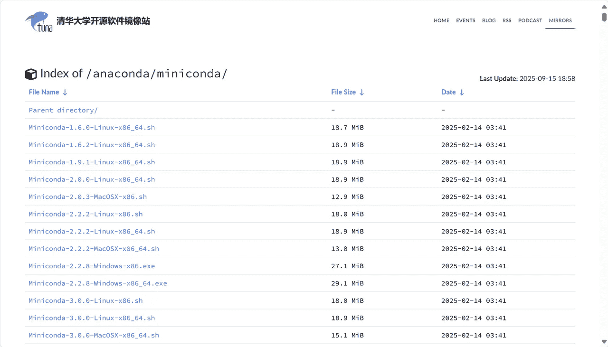

1.  你也可以从 [Miniconda 官方网站](https://docs.conda.io/en/latest/miniconda.html)下载。

1.  运行安装向导

1.  下载完成后，双击 .exe 文件启动安装。按照向导提示操作：

+   Welcome: 点击 Next。

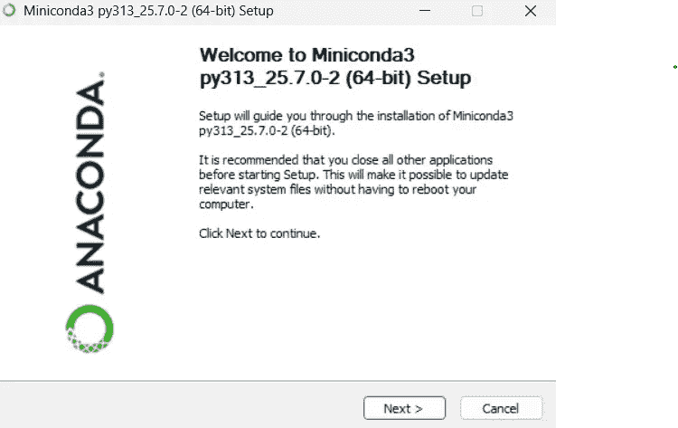

+   License Agreement: 点击 I Agree。

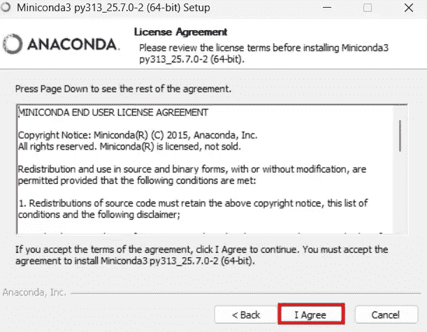

+   Installation Type: 选择 Just Me，点击 Next。

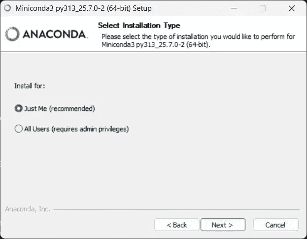

+   Choose Install Location: 建议保持默认路径，或选择一个不含中文和空格的路径。点击 Next。

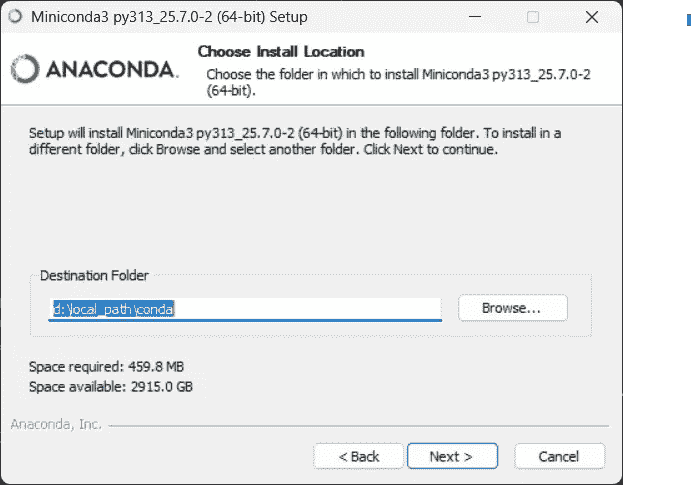

+   Advanced Installation Options: 请不要勾选 “Add Miniconda3 to my PATH environment variable”。我们将稍后手动配置环境变量。点击 Install。

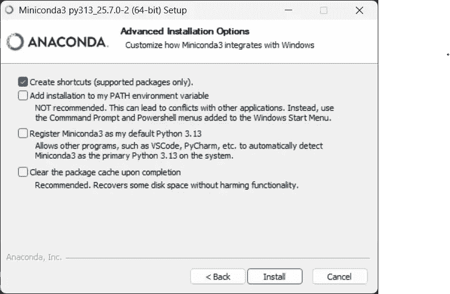

+   Installation Complete: 安装完成后，点击 Next，然后取消勾选 “Learn more” 并点击 Finish 完成安装。

1.  手动配置环境变量

1.  为了能在任意终端窗口使用 conda 命令，需要手动配置环境变量。

+   在Windows搜索栏中搜索“编辑系统环境变量”并打开。

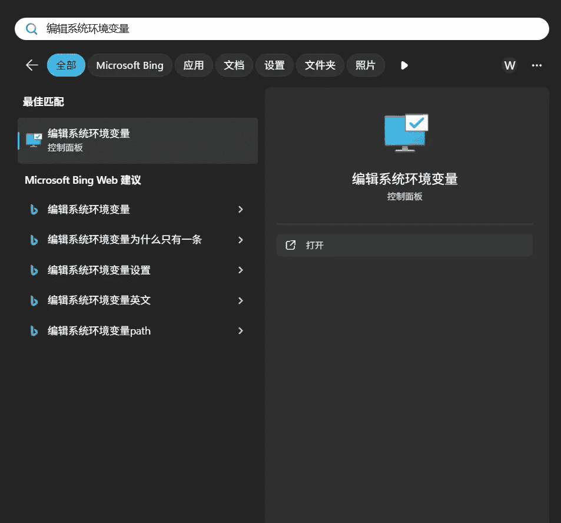

+   在“系统属性”窗口中，点击“环境变量”。

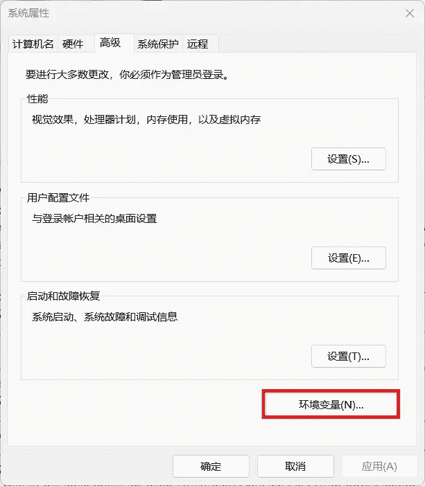

+   在“环境变量”窗口中，找到“系统变量”下的 Path 变量，选中并点击“编辑”。

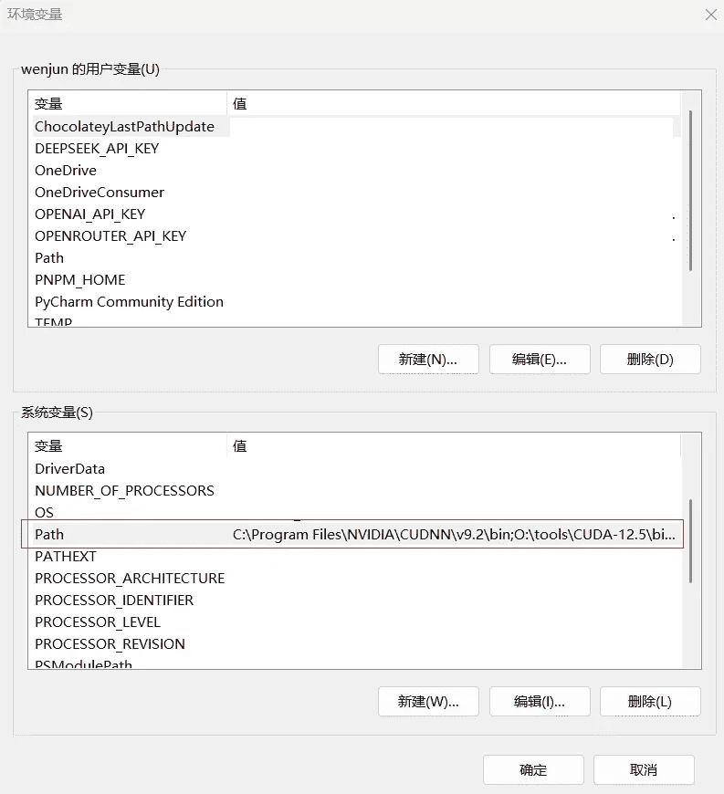

+   在“编辑环境变量”窗口中，新建三个路径，将它们指向你 Miniconda 的安装目录下的相应文件夹。如果你的安装路径是 D:\Miniconda3，则需要添加：

```
D:\Miniconda3
D:\Miniconda3\Scripts
D:\Miniconda3\Library\binCopy to clipboardErrorCopied
```

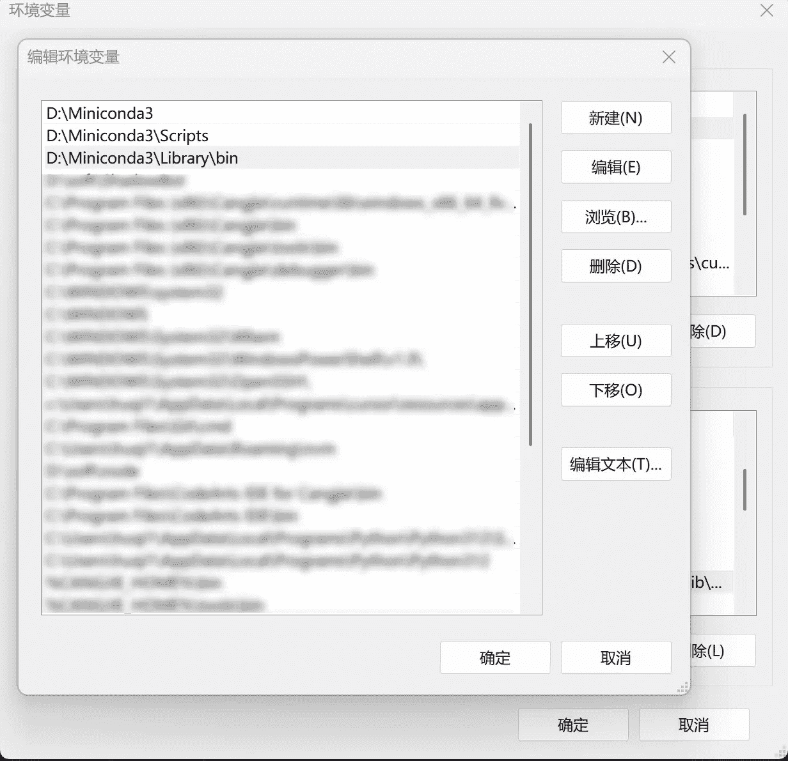

+   完成后，一路点击“确定”保存更改。

### 4.3 配置 Conda 镜像源

为了加快后续使用 conda 安装包的速度，强烈建议配置国内镜像源。打开一个新的终端或 Anaconda Prompt，运行以下命令：

```
conda config --add channels https://mirrors.tuna.tsinghua.edu.cn/anaconda/pkgs/main/
conda config --add channels https://mirrors.tuna.tsinghua.edu.cn/anaconda/pkgs/free/
conda config --set show_channel_urls yesCopy to clipboardErrorCopied
```

配置完成后，可以通过 conda config --show channels 命令查看已添加的源。

## [五、项目代码拉取（使用Cloud Studio ](https://datawhalechina.github.io/all-in-rag/#/chapter1/02_preparation?id=%e4%ba%94%e3%80%81%e9%a1%b9%e7%9b%ae%e4%bb%a3%e7%a0%81%e6%8b%89%e5%8f%96%ef%bc%88%e4%bd%bf%e7%94%a8cloud-studio-%e6%88%96-codespaces-%e5%8f%af%e8%b7%b3%e8%bf%87%e6%ad%a4%e6%ad%a5%e9%aa%a4%ef%bc%89)或 Codespaces 可跳过此步骤）

### [5.1 安装 Git](https://datawhalechina.github.io/all-in-rag/#/chapter1/02_preparation?id=_51-%e5%ae%89%e8%a3%85-git)

如果你尚未安装 Git，请按照以下步骤安装。

+   Windows 系统：访问[Git 官方网站](https://git-scm.com/download/win)，下载并运行安装程序，按照默认设置完成安装。

+   macOS 系统：打开终端，输入以下命令安装 Git：

```
brew install gitCopy to clipboardErrorCopied
```

+   Linux 系统（以 Ubuntu 为例）：打开终端，输入以下命令安装 Git：

```
sudo apt-get update
sudo apt-get install gitCopy to clipboardErrorCopied
```

安装完成后，验证 Git 是否安装成功，输入以下命令：

```
git --versionCopy to clipboardErrorCopied
```

如果成功，会显示 Git 的版本号。

### [5.2 克隆项目代码](https://datawhalechina.github.io/all-in-rag/#/chapter1/02_preparation?id=_52-%e5%85%8b%e9%9a%86%e9%a1%b9%e7%9b%ae%e4%bb%a3%e7%a0%81)

1.  选择存放项目的目录 打开终端（或 Windows 中的 Git Bash），导航到你想存放项目的目录：

```
cd [你希望存放项目的路径]Copy to clipboardErrorCopied
```

1.  克隆仓库 使用以下命令拉取 all-in-rag 仓库：

```
git clone https://github.com/datawhalechina/all-in-rag.gitCopy to clipboardErrorCopied
```

1.  等待下载完成，项目代码将存放在当前目录下的 all-in-rag 文件夹中。

1.  进入项目目录 拉取代码后，进入项目目录：

```
cd all-in-ragCopy to clipboardErrorCopied
```

### [5.3 创建并激活虚拟环境](https://datawhalechina.github.io/all-in-rag/#/chapter1/02_preparation?id=_53-%e5%88%9b%e5%bb%ba%e5%b9%b6%e6%bf%80%e6%b4%bb%e8%99%9a%e6%8b%9f%e7%8e%af%e5%a2%83)

在项目目录下，推荐使用前面配置好的 Miniconda 来创建 Python 虚拟环境。

1.  创建虚拟环境

```
conda create --name all-in-rag python=3.12.7Copy to clipboardErrorCopied
```

1.  激活虚拟环境

1.  所有系统统一使用以下命令激活虚拟环境：

```
conda activate all-in-ragCopy to clipboardErrorCopied
```

1.  依赖安装 如果严格安装上述流程当前应该在项目根目录，进入code目录安装依赖库

```
cd code
pip install -r requirements.txt
```