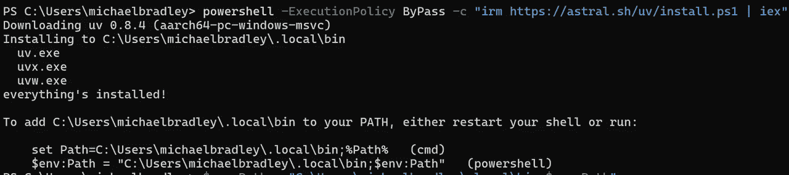
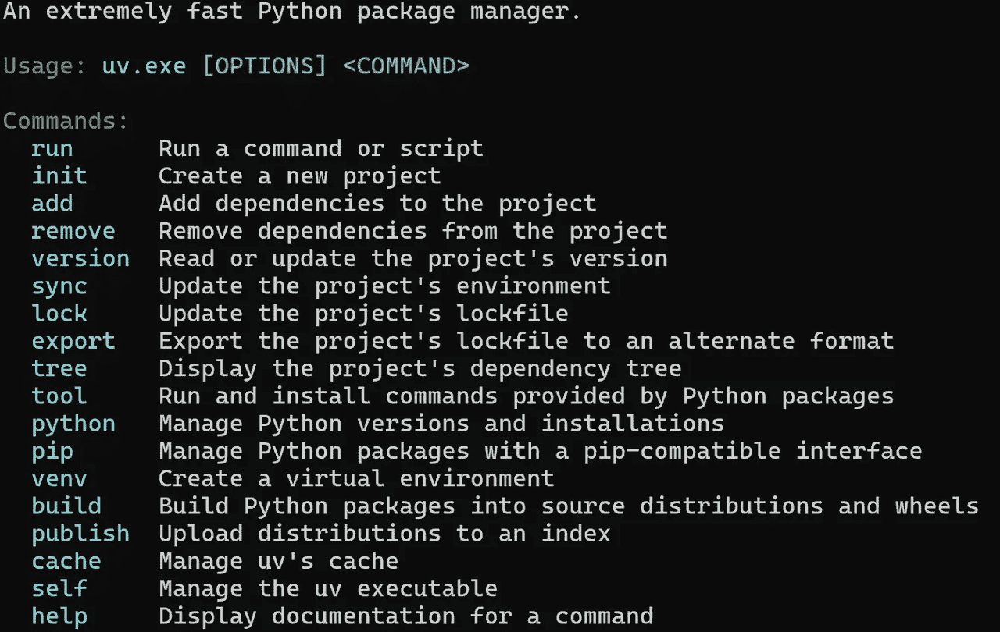
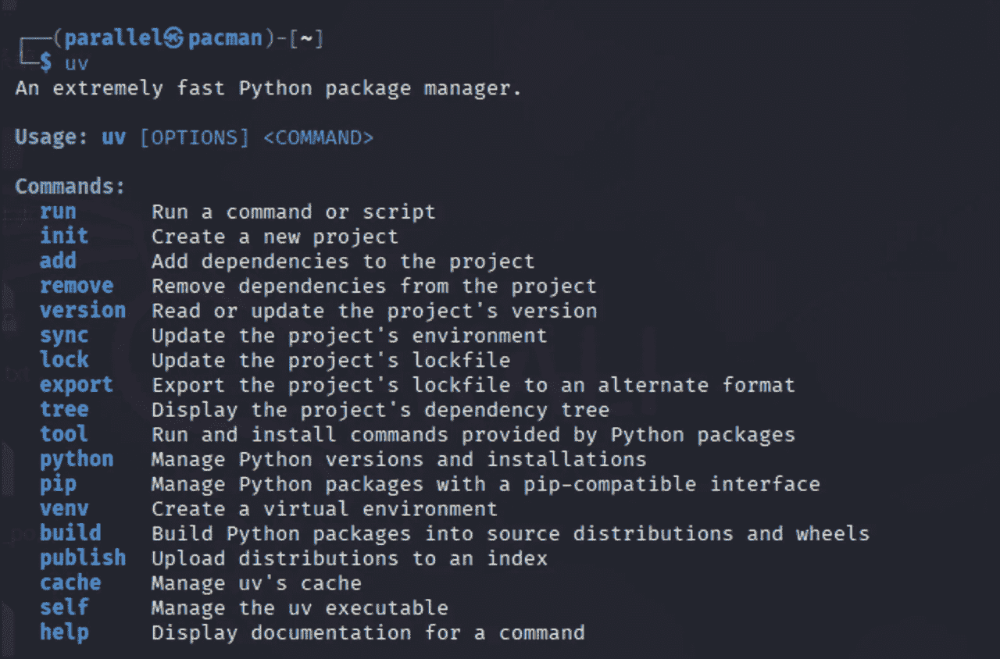

# 附：Python虚拟环境部署方案补充

> 来源：[https://gotoaiworld.feishu.cn/docx/HMHid8hRYoqhm6xMXP7cm5KenQe](https://gotoaiworld.feishu.cn/docx/HMHid8hRYoqhm6xMXP7cm5KenQe)

# 附：Python虚拟环境部署方案补充

本项目由于涉及到的包过多，并且依赖问题自始至终都是Python的老大难问题，这就造成了 Python 工程化方面生态非常割裂。

对于这种问题，uv提供了统一的虚拟环境管理入口，同时吸收了 Rust 语言先进的包管理经验，使用它可以减少我们在 Python 工程方面折腾的时间，下面我们使用uv来安装项目的虚拟环境。

## [1.1 uv 环境管理](https://datawhalechina.github.io/all-in-rag/#/chapter1/virtualenv?id=_11-uv-%e7%8e%af%e5%a2%83%e7%ae%a1%e7%90%86)

### 1.1.1 Windows 系统

使用powershell 安装 uv

```
powershell -ExecutionPolicy ByPass -c &quot;irm https://astral.sh/uv/install.ps1 | iex&quot;Copy to clipboardErrorCopied
```

安装成功后，按照提示输入以下命令添加环境变量。这里注意，不同的人的安装路径不同，请按照提示自行复制粘贴命令。

```
$env:Path = &quot;C:\Users\michaelbradley\.local\bin;$env:Path&quot; Copy to clipboardErrorCopied
```



输入 uv 命令，如果出现以下提示，说明安装成功



### 1.1.2 Linux / MacOS 系统

使用 curl 安装 uv

```
curl -LsSf https://astral.sh/uv/install.sh | shCopy to clipboardErrorCopied
```

如果无法使用 curl 命令，使用 wget 命令安装 uv

```
wget -qO- https://astral.sh/uv/install.sh | shCopy to clipboardErrorCopied
```

输入 uv 命令，如果出现以下提示，说明安装成功



## [1.2 创建并激活虚拟环境](https://datawhalechina.github.io/all-in-rag/#/chapter1/virtualenv?id=_12-%e5%88%9b%e5%bb%ba%e5%b9%b6%e6%bf%80%e6%b4%bb%e8%99%9a%e6%8b%9f%e7%8e%af%e5%a2%83)

### [1.2.1 创建虚拟环境](https://datawhalechina.github.io/all-in-rag/#/chapter1/virtualenv?id=_121-%e5%88%9b%e5%bb%ba%e8%99%9a%e6%8b%9f%e7%8e%af%e5%a2%83)

```
uv venv rag --python 3.12.7Copy to clipboardErrorCopied
```

代码创建的虚拟环境名称为 rag ，使用Python版本为 3.12.7

Windows 系统创建成功后显示如下信息：

```
PS C:\Users\parallel&gt; uv venv rag --python 3.12.7
Using CPython 3.12.7
Creating virtual environment at: rag
Activate with: rag\Scripts\activateCopy to clipboardErrorCopied
```

Linux / MacOS 系统创建成功后显示如下信息：

```
┌──(parallel㉿pacman)-[~/桌面]
└─$ uv venv rag -p 3.12.7
Using CPython 3.12.7
Creating virtual environment at: rag
Activate with: source rag/bin/activateCopy to clipboardErrorCopied
```

### [1.2.2 激活虚拟环境](https://datawhalechina.github.io/all-in-rag/#/chapter1/virtualenv?id=_122-%e6%bf%80%e6%b4%bb%e8%99%9a%e6%8b%9f%e7%8e%af%e5%a2%83)

Windows 系统激活虚拟环境命令为：

```
rag\Scripts\activateCopy to clipboardErrorCopied
```

Linux / MacOS 系统激活虚拟环境命令为：

```
source rag/bin/activateCopy to clipboardErrorCopied
```

[ 上一章节](https://datawhalechina.github.io/all-in-rag/#/chapter1/03_get_start_rag)