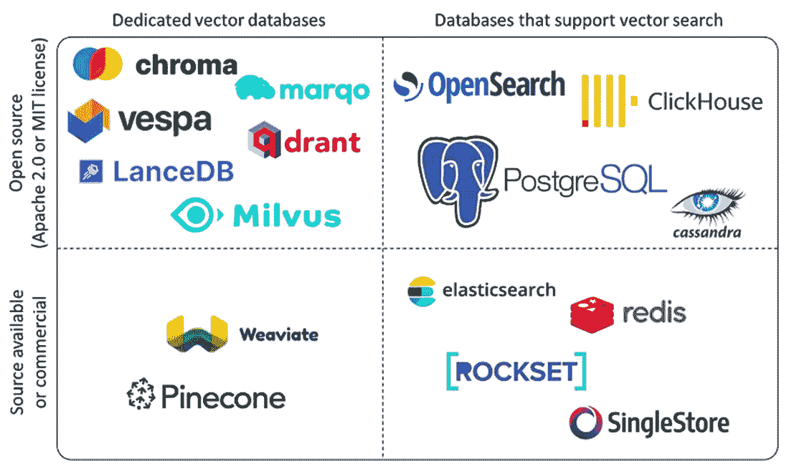

# 第三节 向量数据库

> 来源：[https://gotoaiworld.feishu.cn/docx/FRJ5dgBUzoP4noxfLN2cav2Bnug](https://gotoaiworld.feishu.cn/docx/FRJ5dgBUzoP4noxfLN2cav2Bnug)

## [一、向量数据库的作用](https://datawhalechina.github.io/all-in-rag/#/chapter3/08_vector_db?id=%e4%b8%80%e3%80%81%e5%90%91%e9%87%8f%e6%95%b0%e6%8d%ae%e5%ba%93%e7%9a%84%e4%bd%9c%e7%94%a8)

在前面我们学习了如何使用嵌入模型将文本、图像等非结构化数据转换为高维向量。这些向量是 RAG 系统能够进行语义理解的基础。然而，当向量数量从几百个增长到数百万甚至数十亿时，一个核心问题随之而来：如何快速、准确地从海量向量中找到与用户查询最相似的那几个？

### [1.1 向量数据库主要功能](https://datawhalechina.github.io/all-in-rag/#/chapter3/08_vector_db?id=_11-%e5%90%91%e9%87%8f%e6%95%b0%e6%8d%ae%e5%ba%93%e4%b8%bb%e8%a6%81%e5%8a%9f%e8%83%bd)

向量数据库的核心价值在于其高效处理海量高维向量的能力。其主要功能可以概括为以下几点：

1.  高效的相似性搜索：这是向量数据库最重要的功能。它利用专门的索引技术（如 HNSW, IVF），能够在数十亿级别的向量中实现毫秒级的近似最近邻（ANN）查询，快速找到与给定查询最相似的数据。

1.  高维数据存储与管理：专门为存储高维向量（通常维度成百上千）而优化，支持对向量数据进行增、删、改、查等基本操作。

1.  丰富的查询能力：除了基本的相似性搜索，还支持按标量字段过滤查询（例如，在搜索相似图片的同时，指定年份 > 2023）、范围查询和聚类分析等，满足复杂业务需求。

1.  可扩展与高可用：现代向量数据库通常采用分布式架构，具备良好的水平扩展能力和容错性，能够通过增加节点来应对数据量的增长，并确保服务的稳定可靠。

1.  数据与模型生态集成：与主流的 AI 框架（如 LangChain, LlamaIndex）和机器学习工作流无缝集成，简化了从模型训练到向量检索的应用开发流程。

### 1.2 向量数据库 vs 传统数据库

传统的数据库（如 MySQL）擅长处理结构化数据的精确匹配查询（例如，WHERE age = 25），但它们并非为处理高维向量的相似性搜索而设计的。在庞大的向量集合中进行暴力、线性的相似度计算，其计算成本和时间延迟无法接受。向量数据库 (Vector Database) 很好的解决了这一问题，它是一种专门设计用于高效存储、管理和查询高维向量的数据库系统。在 RAG 流程中，它扮演着“知识库”的角色，是连接数据与大语言模型的关键桥梁。

向量数据库与传统数据库的主要差异如下：

向量数据库和传统数据库并非相互替代的关系，而是互补关系。在构建现代 AI 应用时，通常会将两者结合使用：利用传统数据库存储业务元数据和结构化信息，而向量数据库则专门负责处理和检索由 AI 模型产生的海量向量数据。

## [二、工作原理](https://datawhalechina.github.io/all-in-rag/#/chapter3/08_vector_db?id=%e4%ba%8c%e3%80%81%e5%b7%a5%e4%bd%9c%e5%8e%9f%e7%90%86)

向量数据库的核心是高效处理高维向量的相似性搜索。向量是一组有序的数值，可以表示文本、图像、音频等复杂数据的特征或属性。在 RAG 系统中，向量一般通过嵌入模型将原始数据转换为高维向量表示，比如上一节的图文示例。

向量数据库通常采用四层架构，通过以下技术手段实现高效相似性搜索：

1.  存储层：存储向量数据和元数据，优化存储效率，支持分布式存储

1.  索引层：维护索引算法（HNSW、LSH、PQ等），创建和优化索引，支持索引调整

1.  查询层：处理查询请求，支持混合查询，实现查询优化

1.  服务层：管理客户端连接，提供监控和日志，实现安全管理

主要技术手段包括：

+   基于树的方法：如 Annoy 使用的随机投影树，通过树形结构实现对数复杂度的搜索

+   基于哈希的方法：如 LSH（局部敏感哈希），通过哈希函数将相似向量映射到同一“桶”

+   基于图的方法：如 HNSW（分层可导航小世界图），通过多层邻近图结构实现快速搜索

+   基于量化的方法：如 Faiss 的 IVF 和 PQ，通过聚类和量化压缩向量

## [三、主流向量数据库介绍](https://datawhalechina.github.io/all-in-rag/#/chapter3/08_vector_db?id=%e4%b8%89%e3%80%81%e4%b8%bb%e6%b5%81%e5%90%91%e9%87%8f%e6%95%b0%e6%8d%ae%e5%ba%93%e4%bb%8b%e7%bb%8d)



当前主流的向量数据库产品包括：

[Pinecone ](https://www.pinecone.io/)是一款完全托管的向量数据库服务，采用Serverless架构设计。它提供存储计算分离、自动扩展和负载均衡等企业级特性，并保证99.95%的SLA。Pinecone支持多种语言SDK，提供极高可用性和低延迟搜索（<100ms），特别适合企业级生产环境、高并发场景和大规模部署。

[Milvus ](https://github.com/milvus-io/milvus)是一款开源的分布式向量数据库，采用分布式架构设计，支持GPU加速和多种索引算法。它能够处理亿级向量检索，提供高性能GPU加速和完善的生态系统。Milvus特别适合大规模部署、高性能要求的场景，以及需要自定义开发的开源项目。

[Qdrant ](https://github.com/qdrant/qdrant)是一款高性能的开源向量数据库，采用Rust开发，支持二进制量化技术。它提供多种索引策略和向量混合搜索功能，能够实现极高的性能（RPS>4000）和低延迟搜索。Qdrant特别适合性能敏感应用、高并发场景以及中小规模部署。

[Weaviate ](https://github.com/weaviate/weaviate)是一款支持GraphQL的AI集成向量数据库，提供20+AI模块和多模态支持。它采用GraphQL API设计，支持RAG优化，特别适合AI开发、多模态处理和快速开发场景。Weaviate具有活跃的社区支持和易于集成的特点。

[Chroma ](https://github.com/chroma-core/chroma)是一款轻量级的开源向量数据库，采用本地优先设计，无依赖。它提供零配置安装、本地运行和低资源消耗等特性，特别适合原型开发、教育培训和小规模应用。Chroma的部署简单，适合快速原型开发。

选择建议：

+   新手入门/小型项目：从 ChromaDB 或 FAISS 开始是最佳选择。它们与 LangChain/LlamaIndex 紧密集成，几行代码就能运行，且能满足基本的存储和检索需求。

+   生产环境/大规模应用：当数据量超过百万级，或需要高并发、实时更新、复杂元数据过滤时，应考虑更专业的解决方案，如 Milvus、Weaviate 或云服务 Pinecone。

## 四、本地向量存储：以 FAISS 为例

FAISS (Facebook AI Similarity Search) 是一个由 Facebook AI Research 开发的高性能库，专门用于高效的相似性搜索和密集向量聚类。当与 LangChain 结合使用时，它可以作为一个强大的本地向量存储方案，非常适合快速原型设计和中小型应用。

与 ChromaDB 等数据库不同，FAISS 本质上是一个算法库，它将索引直接保存为本地文件（一个 .faiss 索引文件和一个 .pkl 映射文件），而非运行一个数据库服务。这种方式轻量且高效。

### [4.1 环境准备](https://datawhalechina.github.io/all-in-rag/#/chapter3/08_vector_db?id=_41-%e7%8e%af%e5%a2%83%e5%87%86%e5%a4%87)

在开始之前，请确保已安装所有必需的库：

> 当前requirements.txt安装的 faiss-cpu 是 CPU 版本。如果你的机器有 GPU，可以安装 faiss-gpu 以获得更好的性能。

### [4.2 基础示例(FAISS)](https://datawhalechina.github.io/all-in-rag/#/chapter3/08_vector_db?id=_42-%e5%9f%ba%e7%a1%80%e7%a4%ba%e4%be%8bfaiss)

下面的代码演示了使用 LangChain 和 FAISS 完成一个完整的“创建 -> 保存 -> 加载 -> 查询”流程。

```
from langchain_community.vectorstores import FAISS
from langchain_community.embeddings import HuggingFaceEmbeddings
from langchain_core.documents import Document

# 1. 示例文本和嵌入模型
texts = [&quot;张三是法外狂徒&quot;,&quot;FAISS是一个用于高效相似性搜索和密集向量聚类的库。&quot;,&quot;LangChain是一个用于开发由语言模型驱动的应用程序的框架。&quot;]
docs = [Document(page_content=t) for t in texts]
embeddings = HuggingFaceEmbeddings(model_name=&quot;BAAI/bge-small-zh-v1.5&quot;)# 2. 创建向量存储并保存到本地
vectorstore = FAISS.from_documents(docs, embeddings)

local_faiss_path = &quot;./faiss_index_store&quot;
vectorstore.save_local(local_faiss_path)print(f&quot;FAISS index has been saved to {local_faiss_path}&quot;)# 3. 加载索引并执行查询# 加载时需指定相同的嵌入模型，并允许反序列化
loaded_vectorstore = FAISS.load_local(
    local_faiss_path,
    embeddings,
    allow_dangerous_deserialization=True)# 相似性搜索
query = &quot;FAISS是做什么的？&quot;
results = loaded_vectorstore.similarity_search(query, k=1)print(f&quot;\n查询: &#x27;{query}&#x27;&quot;)print(&quot;相似度最高的文档:&quot;)for doc in results:print(f&quot;- {doc.page_content}&quot;)Copy to clipboardErrorCopied
```

运行结果与解读：

当你运行上述脚本时，会看到类似以下的输出：

```
FAISS index has been saved to ./faiss_index_store

查询: &#x27;FAISS是做什么的？&#x27;
相似度最高的文档:
- FAISS是一个用于高效相似性搜索和密集向量聚类的库。Copy to clipboardErrorCopied
```

索引创建实现细节： 通过深入 LangChain 源码，可以发现索引创建是一个分层、解耦的过程，主要涉及以下几个方法的嵌套调用：

1.  from_documents (封装层):

+   这是我们直接调用的方法。它的职责很简单：从输入的 Document 对象列表中提取出纯文本内容 (page_content) 和元数据 (metadata)。

+   然后，它将这些提取出的信息传递给核心的 from_texts 方法。

1.  from_texts (向量化入口):

+   这个方法是面向用户的入口。它接收文本列表，并执行关键的第一步：调用 embedding.embed_documents(texts)，将所有文本批量转换为向量。

+   完成向量化后，它并不直接处理索引构建，而是将生成的向量和其他所有信息（文本、元数据等）传递给一个内部的辅助方法 __from。

1.  __from (构建索引框架):

+   一个内部方法，负责搭建 FAISS 向量存储的“空框架”。

+   它会根据指定的距离策略（默认为 L2 欧氏距离）初始化一个空的 FAISS 索引结构（如 faiss.IndexFlatL2）。

+   同时，它也准备好了用于存储文档原文的 docstore 和用于连接 FAISS 索引与文档的 index_to_docstore_id 映射。

+   最后，它调用另一个内部方法 __add 来完成数据的填充。

1.  __add (填充数据):

+   真正执行数据添加操作的核心。它接收到向量、文本和元数据后，执行以下关键操作：

+   添加向量: 将向量列表转换为 FAISS 需要的 numpy 数组，并调用 self.index.add(vector) 将其批量添加到 FAISS 索引中。

+   存储文档: 将文本和元数据打包成 Document 对象，存入 docstore。

+   建立映射: 更新 index_to_docstore_id 字典，建立起 FAISS 内部的整数 ID（如 0, 1, 2...）到我们文档唯一 ID 的映射关系。

## [练习](https://datawhalechina.github.io/all-in-rag/#/chapter3/08_vector_db?id=%e7%bb%83%e4%b9%a0)

1.  LlamaIndex默认会将数据存储为透明可读的JSON格式，运行03_llamaindex_vector.py文件，查看保存的json文件内容。

1.  新建一个代码文件实现对LlamaIndex存储数据的加载和相似性搜索。