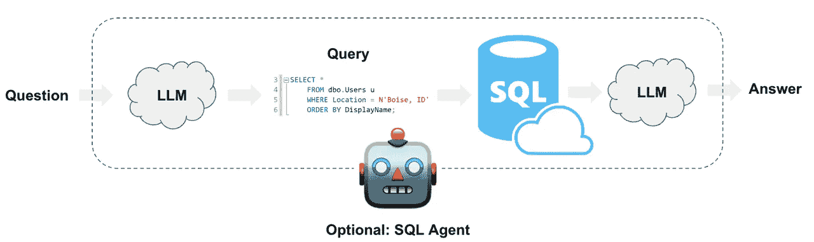
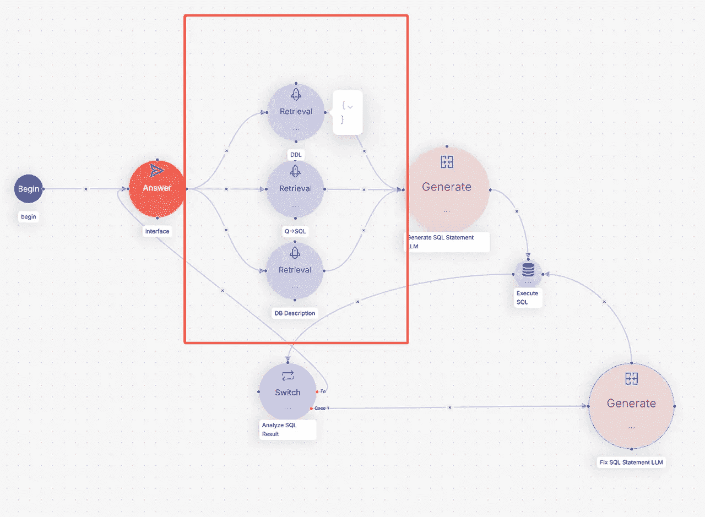

# 第三节：文本到SQL

> 来源：[https://gotoaiworld.feishu.cn/docx/Az2DdREhyoNoocxNbT5cPjP4ncg](https://gotoaiworld.feishu.cn/docx/Az2DdREhyoNoocxNbT5cPjP4ncg)

继上一节探讨了如何为元数据和图数据构建查询后，本节将聚焦于结构化数据领域中一个常见的应用。在数据世界中，除了向量数据库能够处理的非结构化数据，关系型数据库（如 MySQL, PostgreSQL, SQLite）同样是存储和管理结构化数据的重点。文本到SQL（Text-to-SQL）(1) 正是为了打破人与结构化数据之间的语言障碍而生。它利用大语言模型（LLM）将用户的自然语言问题，直接翻译成可以在数据库上执行的SQL查询语句。



## [一、业务挑战](https://datawhalechina.github.io/all-in-rag/#/chapter4/13_text2sql?id=%e4%b8%80%e3%80%81%e4%b8%9a%e5%8a%a1%e6%8c%91%e6%88%98)

+   “幻觉”问题：LLM 可能会“想象”出数据库中不存在的表或字段，导致生成的SQL语句无效。

+   对数据库结构理解不足：LLM 需要准确理解表的结构、字段的含义以及表与表之间的关联关系，才能生成正确的 JOIN 和 WHERE 子句。

+   处理用户输入的模糊性：用户的提问可能存在拼写错误或不规范的表达（例如，“上个月的销售冠军是谁？”），模型需要具备一定的容错和推理能力。

## [二、优化策略](https://datawhalechina.github.io/all-in-rag/#/chapter4/13_text2sql?id=%e4%ba%8c%e3%80%81%e4%bc%98%e5%8c%96%e7%ad%96%e7%95%a5)

1.  提供精确的数据库模式：这是最基础也是最关键的一步。我们需要向LLM提供数据库中相关表的 CREATE TABLE 语句。这就像是给了LLM一张地图，让它了解数据库的结构，包括表名、列名、数据类型和外键关系。

1.  提供少量高质量的示例：在提示（Prompt）中加入一些“问题-SQL”的示例对，可以极大地提升LLM生成查询的准确性。这相当于给了LLM几个范例，让它学习如何根据相似的问题构建查询。

1.  利用RAG增强上下文：这是更进一步的策略。我们可以像RAGFlow一样，为数据库构建一个专门的“知识库”(2)，其中不仅包含表的DDL（数据定义语言），还可以包含：

+   表和字段的详细描述：用自然语言解释每个表是做什么的，每个字段代表什么业务含义。

+   同义词和业务术语：例如，将用户的“花费”映射到数据库的 cost 字段。

+   复杂的查询示例：提供一些包含 JOIN、GROUP BY 或子查询的复杂问答对。 当用户提问时，系统首先从这个知识库中检索最相关的信息（如相关的表结构、字段描述、相似的Q&A），然后将这些信息和用户的问题一起组合成一个内容更丰富的提示，交给LLM生成最终的SQL查询。这种方式极大地降低了“幻觉”的风险，提高了查询的准确度。

1.  错误修正与反思 (Error Correction and Reflection)：在生成SQL后，系统会尝试执行它。如果数据库返回错误，可以将错误信息反馈给LLM，让它“反思”并修正SQL语句，然后重试。这个迭代过程可以显著提高查询的成功率。

## 三、实现一个简单的Text2SQL框架

本节基于RAGFlow方案实现了一个简单的Text2SQL框架。该框架使用Milvus向量数据库作为知识库，BGE-M3模型进行语义检索，DeepSeek作为大语言模型，专门针对SQLite数据库进行了优化。



### [3.1 知识库模块 (](https://datawhalechina.github.io/all-in-rag/#/chapter4/13_text2sql?id=_31-%e7%9f%a5%e8%af%86%e5%ba%93%e6%a8%a1%e5%9d%97-knowledge_basepy)[k](https://datawhalechina.github.io/all-in-rag/#/chapter4/13_text2sql?id=_31-%e7%9f%a5%e8%af%86%e5%ba%93%e6%a8%a1%e5%9d%97-knowledge_basepy)nowledge_base.py)

知识库模块是整个框架的核心，负责存储和检索SQL相关的知识信息。

```
class SimpleKnowledgeBase:&quot;&quot;&quot;知识库&quot;&quot;&quot;def __init__(self, milvus_uri: str = &quot;http://localhost:19530&quot;):
        self.milvus_uri = milvus_uri
        self.client = MilvusClient(uri=milvus_uri)
        self.embedding_function = BGEM3EmbeddingFunction(use_fp16=False, device=&quot;cpu&quot;)
        self.collection_name = &quot;text2sql_kb&quot;
        self._setup_collection()Copy to clipboardErrorCopied
```

设计思想：

1.  统一知识管理：将DDL定义、Q-SQL示例和表描述三种类型的知识统一存储在一个Milvus集合中，通过 type 字段区分。

1.  语义检索能力：使用BGE-M3模型进行向量化，支持中英文混合的语义相似度搜索。

```
def _setup_collection(self):&quot;&quot;&quot;设置集合&quot;&quot;&quot;# 定义字段
    fields = [
        FieldSchema(name=&quot;pk&quot;, dtype=DataType.VARCHAR, is_primary=True, auto_id=True, max_length=100),
        FieldSchema(name=&quot;content&quot;, dtype=DataType.VARCHAR, max_length=4096),
        FieldSchema(name=&quot;type&quot;, dtype=DataType.VARCHAR, max_length=32),  # ddl, qsql, description
        FieldSchema(name=&quot;dense_vector&quot;, dtype=DataType.FLOAT_VECTOR, dim=self.embedding_function.dim[&quot;dense&quot;])]Copy to clipboardErrorCopied
```

数据加载策略：

```
def load_data(self):&quot;&quot;&quot;加载所有知识库数据&quot;&quot;&quot;# 加载DDL数据 - 表结构定义# 加载Q-&gt;SQL数据 - 问答示例# 加载描述数据 - 表和字段的业务描述Copy to clipboardErrorCopied
```

框架支持三种类型的知识：

+   DDL知识(3)：表的结构定义，包括字段类型、约束等

+   Q-SQL知识(4)：历史问答对，为新问题提供参考模式

+   描述知识(5)：表和字段的业务含义，帮助理解数据语义

检索机制：

```
def search(self, query: str, top_k: int = 5) -&gt; List[Dict[str, Any]]:&quot;&quot;&quot;搜索相关内容&quot;&quot;&quot;
    query_embeddings = self.embedding_function([query])
    
    search_results = self.client.search(
        collection_name=self.collection_name,
        data=query_embeddings[&quot;dense&quot;],
        anns_field=&quot;dense_vector&quot;,
        search_params={&quot;metric_type&quot;: &quot;IP&quot;},  # 内积相似度
        limit=top_k,
        output_fields=[&quot;content&quot;, &quot;type&quot;])Copy to clipboardErrorCopied
```

### [3.2 SQL生成模块 (](https://datawhalechina.github.io/all-in-rag/#/chapter4/13_text2sql?id=_32-sql%e7%94%9f%e6%88%90%e6%a8%a1%e5%9d%97-sql_generatorpy)[s](https://datawhalechina.github.io/all-in-rag/#/chapter4/13_text2sql?id=_32-sql%e7%94%9f%e6%88%90%e6%a8%a1%e5%9d%97-sql_generatorpy)ql_generator.py)

SQL生成模块负责将自然语言问题转换为SQL查询语句，并具备错误修复能力。

```
class SimpleSQLGenerator:&quot;&quot;&quot;简化的SQL生成器&quot;&quot;&quot;def __init__(self, api_key: str = None):
        self.llm = ChatDeepSeek(
            model=&quot;deepseek-chat&quot;,
            temperature=0,  # 确保结果的确定性
            api_key=api_key or os.getenv(&quot;DEEPSEEK_API_KEY&quot;))Copy to clipboardErrorCopied
```

SQL生成策略：

```
def generate_sql(self, user_query: str, knowledge_results: List[Dict[str, Any]]) -&gt; str:&quot;&quot;&quot;生成SQL语句&quot;&quot;&quot;# 构建上下文
    context = self._build_context(knowledge_results)# 构建提示
    prompt = f&quot;&quot;&quot;你是一个SQL专家。请根据以下信息将用户问题转换为SQL查询语句。

数据库信息：
{context}

用户问题：{user_query}

要求：
1. 只返回SQL语句，不要包含任何解释
2. 确保SQL语法正确
3. 使用上下文中提供的表名和字段名
4. 如果需要JOIN，请根据表结构进行合理关联

SQL语句：&quot;&quot;&quot;Copy to clipboardErrorCopied
```

关键设计原则：

1.  上下文驱动：通过知识库检索结果构建丰富的上下文信息

1.  结构化提示：明确的任务要求和格式约束

1.  确定性输出：设置temperature=0确保相同输入产生相同输出

错误修复机制：

```
def fix_sql(self, original_sql: str, error_message: str, knowledge_results: List[Dict[str, Any]]) -&gt; str:&quot;&quot;&quot;修复SQL语句&quot;&quot;&quot;
    context = self._build_context(knowledge_results)
    
    prompt = f&quot;&quot;&quot;请修复以下SQL语句的错误。

数据库信息：
{context}

原始SQL：
{original_sql}

错误信息：
{error_message}

请返回修复后的SQL语句（只返回SQL，不要解释）：&quot;&quot;&quot;Copy to clipboardErrorCopied
```

上下文构建策略：

```
def _build_context(self, knowledge_results: List[Dict[str, Any]]) -&gt; str:&quot;&quot;&quot;构建上下文信息&quot;&quot;&quot;# 按类型分组
    ddl_info = []        # 表结构信息
    qsql_examples = []   # 查询示例
    descriptions = []    # 表描述信息# 分层次组织信息：结构 → 描述 → 示例if ddl_info:
        context += &quot;=== 表结构信息 ===\n&quot;if descriptions:
        context += &quot;=== 表和字段描述 ===\n&quot;if qsql_examples:
        context += &quot;=== 查询示例 ===\n&quot;Copy to clipboardErrorCopied
```

### [3.3 代理模块 (](https://datawhalechina.github.io/all-in-rag/#/chapter4/13_text2sql?id=_33-%e4%bb%a3%e7%90%86%e6%a8%a1%e5%9d%97-text2sql_agentpy)[t](https://datawhalechina.github.io/all-in-rag/#/chapter4/13_text2sql?id=_33-%e4%bb%a3%e7%90%86%e6%a8%a1%e5%9d%97-text2sql_agentpy)ext2sql_agent.py)

代理模块是整个框架的控制中心，协调知识库检索、SQL生成和执行的完整流程。

```
class SimpleText2SQLAgent:&quot;&quot;&quot;Text2SQL代理&quot;&quot;&quot;def __init__(self, milvus_uri: str = &quot;http://localhost:19530&quot;, api_key: str = None):
        self.knowledge_base = SimpleKnowledgeBase(milvus_uri)
        self.sql_generator = SimpleSQLGenerator(api_key)# 配置参数
        self.max_retry_count = 3      # 最大重试次数
        self.top_k_retrieval = 5      # 检索数量
        self.max_result_rows = 100    # 结果行数限制Copy to clipboardErrorCopied
```

主要查询流程：

```
def query(self, user_question: str) -&gt; Dict[str, Any]:&quot;&quot;&quot;执行Text2SQL查询&quot;&quot;&quot;# 1. 从知识库检索相关信息
    knowledge_results = self.knowledge_base.search(user_question, self.top_k_retrieval)# 2. 生成SQL语句
    sql = self.sql_generator.generate_sql(user_question, knowledge_results)# 3. 执行SQL（带重试机制）
    retry_count = 0while retry_count &lt; self.max_retry_count:
        success, result = self._execute_sql(sql)if success:return {&quot;success&quot;: True, &quot;sql&quot;: sql, &quot;results&quot;: result}else:# 尝试修复SQL
            sql = self.sql_generator.fix_sql(sql, result, knowledge_results)
            retry_count += 1Copy to clipboardErrorCopied
```

安全执行策略：

```
def _execute_sql(self, sql: str) -&gt; Tuple[bool, Any]:&quot;&quot;&quot;执行SQL语句&quot;&quot;&quot;# 添加LIMIT限制，防止大量数据返回if sql.strip().upper().startswith(&#x27;SELECT&#x27;) and &#x27;LIMIT&#x27; not in sql.upper():
        sql = f&quot;{sql.rstrip(&#x27;;&#x27;)} LIMIT {self.max_result_rows}&quot;# 结构化结果返回if sql.strip().upper().startswith(&#x27;SELECT&#x27;):
        columns = [desc[0] for desc in cursor.description]
        rows = cursor.fetchall()
        
        results = []for row in rows:
            result_row = {}for i, value in enumerate(row):
                result_row[columns[i]] = value
            results.append(result_row)return True, {&quot;columns&quot;: columns, &quot;rows&quot;: results, &quot;count&quot;: len(results)}Copy to clipboardErrorCopied
```

### [3.4 完整流程模拟](https://datawhalechina.github.io/all-in-rag/#/chapter4/13_text2sql?id=_34-%e5%ae%8c%e6%95%b4%e6%b5%81%e7%a8%8b%e6%a8%a1%e6%8b%9f)

以查询"年龄大于30的用户有哪些"为例，演示框架三个核心模块的完整协作过程：

#### [3.4.1 模拟数据](https://datawhalechina.github.io/all-in-rag/#/chapter4/13_text2sql?id=_341-%e6%a8%a1%e6%8b%9f%e6%95%b0%e6%8d%ae)

假设数据库中的users表包含以下用户数据：

#### 3.4.2 Step 1: 知识库检索

用户输入："年龄大于30的用户有哪些"

检索过程：

1.  BGE-M3模型将查询文本转换为768维向量

1.  Milvus在知识库中进行语义相似度搜索

1.  返回最相关的5条知识，按相似度排序

检索结果：

DDL知识 (相似度: 0.85)

+   表名：users

+   结构：包含id、name、email、age、city字段

+   约束：id为主键，email唯一

Q-SQL示例 (相似度: 0.82)

+   问题："查询年龄超过25岁的用户"

+   SQL：SELECT * FROM users WHERE age > 25

+   这是检索到的相似示例，最终SQL会基于用户实际问题调整为age > 30

表描述 (相似度: 0.78)

+   age字段：用户年龄，整数类型

+   name字段：用户姓名，文本类型

#### 3.4.3 Step 2: SQL生成

上下文构建： 系统将检索到的知识整理成结构化的上下文信息：

表结构信息

+   表名：users

+   DDL定义：完整的CREATE TABLE语句

+   字段约束：主键、唯一性等

表和字段描述

+   age字段：用户年龄，INTEGER类型

+   name字段：用户姓名，TEXT类型

查询示例

+   相似问题：查询年龄超过25岁的用户

+   参考SQL：SELECT * FROM users WHERE age > 25

SQL生成过程：

1.  DeepSeek分析用户问题的意图：查询满足年龄条件的用户

1.  识别关键信息：年龄字段（age）、比较操作（大于）、阈值（30）

1.  参考示例模式：从WHERE age > 25学习到WHERE age > 数值的模式

1.  模式应用：将用户的实际数值30替换示例中的25

1.  生成目标SQL：SELECT * FROM users WHERE age > 30

#### 3.4.4 Step 3: SQL执行与结果处理

安全处理：

+   原始SQL：SELECT * FROM users WHERE age > 30

+   自动添加限制：SELECT * FROM users WHERE age > 30 LIMIT 100

数据库执行： SQLite引擎逐行检查users表中的数据：

结果处理：

+   筛选出2条符合条件的记录

+   转换为结构化JSON格式

+   包含字段名称和数据类型信息

最终输出：

```
{
    &quot;success&quot;: true,
    &quot;error&quot;: null,
    &quot;sql&quot;: &quot;SELECT * FROM users WHERE age &gt; 30 LIMIT 100&quot;,
    &quot;results&quot;: {
        &quot;columns&quot;: [&quot;id&quot;, &quot;name&quot;, &quot;email&quot;, &quot;age&quot;, &quot;city&quot;],
        &quot;rows&quot;: [
            {&quot;id&quot;: 2, &quot;name&quot;: &quot;李四&quot;, &quot;email&quot;: &quot;lisi@email.com&quot;, &quot;age&quot;: 32, &quot;city&quot;: &quot;上海&quot;},
            {&quot;id&quot;: 4, &quot;name&quot;: &quot;赵六&quot;, &quot;email&quot;: &quot;zhaoliu@email.com&quot;, &quot;age&quot;: 35, &quot;city&quot;: &quot;深圳&quot;}
        ],
        &quot;count&quot;: 2
    },
    &quot;retry_count&quot;: 0
}Copy to clipboardErrorCopied
```

通过这个语义理解 → 结构化查询 → 数据过滤 → 结果输出的完整流程，框架成功将用户的自然语言问题转换为精确的数据库查询结果。

### [3.5 代码运行](https://datawhalechina.github.io/all-in-rag/#/chapter4/13_text2sql?id=_35-%e4%bb%a3%e7%a0%81%e8%bf%90%e8%a1%8c)

如果你想测试这个Text2SQL框架，可以通过以下方式进行：

快速体验：运行演示程序

```
python code/C4/03_text2sql_demo.pyCopy to clipboardErrorCopied
```

> 完整演示代码：03_text2sql_demo.py

核心代码获取：三个核心模块的完整实现

+   knowledge_base.py - 知识库模块

+   sql_generator.py - SQL生成模块

+   text2sql_agent.py - 代理协调模块

> 源码地址：code/C4/text2sql/

数据资源：框架使用的JSON知识数据

+   ddl_examples.json - DDL结构示例

+   qsql_examples.json - 问题-SQL对示例

+   db_descriptions.json - 表和字段描述

> 数据文件：code/C4/text2sql/data/

### 3.6 为什么不直接使用封装好的框架？

> 因为淋过雨，所以想为你撑把伞🤪

市面上确实有很多成熟的Text2SQL框架，但这些高度封装的工具往往存在黑盒问题——当查询结果不符合预期时，很难定位是检索环节、SQL生成环节还是执行环节出了问题。正如上一节LangChain示例中遇到的查询异常，我们很难深入到框架内部进行精确调试和优化。这一点在索引优化那节中也提到过。

## [参考文献](https://datawhalechina.github.io/all-in-rag/#/chapter4/13_text2sql?id=%e5%8f%82%e8%80%83%e6%96%87%e7%8c%ae)

L[a](https://datawhalechina.github.io/all-in-rag/#fnref-1)ngChain Docs: Text to SQL ↩

[RAGFlow Blog: Implementing T](https://ragflow.io/blog/implementing-text2sql-with-ragflow)e[x](https://datawhalechina.github.io/all-in-rag/#fnref-2)t2SQL with RAGFlow ↩

D[D](https://datawhalechina.github.io/all-in-rag/#fnref-3)L（Data Definition Language）是数据定义语言，用于定义数据库结构，如CREATE TABLE语句。 ↩