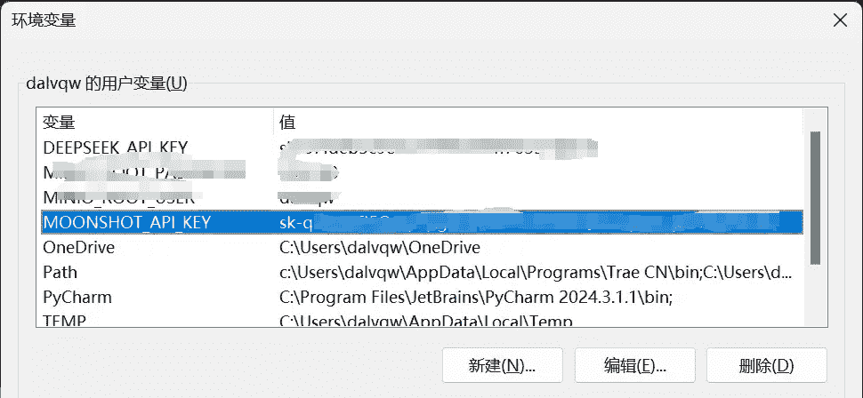

# 第一节 环境配置与项目架构

> 来源：[https://gotoaiworld.feishu.cn/docx/A2C8dcTtVo3QU6xjSpLc7DTYnuc](https://gotoaiworld.feishu.cn/docx/A2C8dcTtVo3QU6xjSpLc7DTYnuc)

> 经过前面十几天的鏖战也是终于来到了项目实战环节。接下来，通过一个完整的实战项目来把前面学到的知识串联起来，构建一个真正可用的RAG系统。

## [一、项目背景](https://datawhalechina.github.io/all-in-rag/#/chapter8/01_env_architecture?id=%e4%b8%80%e3%80%81%e9%a1%b9%e7%9b%ae%e8%83%8c%e6%99%af)

这个项目的灵感来自于笔者前段时间刷视频[时，偶然看到了](https://github.com/Anduin2017/HowToCook)一个有趣的开源项目介绍——程序员做饭指南。这是一个菜谱项目，用Markdown格式记录了各种菜品的制作方法，从简单的家常菜到复杂的宴客菜，应有尽有。更完美的是，这个项目中每道菜的Markdown文件都严格使用统一的小标题。

看到这个项目，笔者立刻想到：能不能构建一个智能问答系统来解决我的选择困难症？每天面对"今天吃什么"这个世纪难题，如果有个AI助手能根据我的需求推荐菜品、告诉我怎么做，那该多好！于是就有了搭建这个尝尝咸淡RAG系统的想法。

## [二、环境配置](https://datawhalechina.github.io/all-in-rag/#/chapter8/01_env_architecture?id=%e4%ba%8c%e3%80%81%e7%8e%af%e5%a2%83%e9%85%8d%e7%bd%ae)

### [2.1 创建虚拟环境](https://datawhalechina.github.io/all-in-rag/#/chapter8/01_env_architecture?id=_21-%e5%88%9b%e5%bb%ba%e8%99%9a%e6%8b%9f%e7%8e%af%e5%a2%83)

```
# 使用conda创建环境
conda create -n cook-rag-1 python=3.12.7
conda activate cook-rag-1Copy to clipboardErrorCopied
```

### [2.2 安装核心依赖](https://datawhalechina.github.io/all-in-rag/#/chapter8/01_env_architecture?id=_22-%e5%ae%89%e8%a3%85%e6%a0%b8%e5%bf%83%e4%be%9d%e8%b5%96)

老规矩，进入本章对应项目目录安装依赖包

```
cd code/C8
pip install -r requirements.txtCopy to clipboardErrorCopied
```

如果 API Key 已经配置好了，可以直接使用下面命令运行项目

```
python main.pyCopy to clipboardErrorCopied
```

### 2.3 申请Kimi API Key

[Kimi2 发布第八](https://platform.moonshot.cn/console/api-keys)天来尝尝咸淡，申请地址：Kimi API官网。目前注册会送15元的额度，绰绰有余了。

### [2.4 API配置](https://datawhalechina.github.io/all-in-rag/#/chapter8/01_env_architecture?id=_24-api%e9%85%8d%e7%bd%ae)

参考前面章节 [环境准备](https://datawhalechina.github.io/all-in-rag/#/../chapter1/02_preparation) 中关于api_key的配置方法。在windows下，配置完成后应该如下图所示：



## [三、项目架构](https://datawhalechina.github.io/all-in-rag/#/chapter8/01_env_architecture?id=%e4%b8%89%e3%80%81%e9%a1%b9%e7%9b%ae%e6%9e%b6%e6%9e%84)

### [3.1 项目目标](https://datawhalechina.github.io/all-in-rag/#/chapter8/01_env_architecture?id=_31-%e9%a1%b9%e7%9b%ae%e7%9b%ae%e6%a0%87)

我们将基于HowToCook项目的菜谱数据，构建一个智能的食谱问答系统。用户可以：

+   询问具体菜品的制作方法："宫保鸡丁怎么做？"

+   寻求菜品推荐："推荐几个简单的素菜"

+   获取食材信息："红烧肉需要什么食材？"

### [3.2 数据分析](https://datawhalechina.github.io/all-in-rag/#/chapter8/01_env_architecture?id=_32-%e6%95%b0%e6%8d%ae%e5%88%86%e6%9e%90)

#### [3.2.1 文档分析](https://datawhalechina.github.io/all-in-rag/#/chapter8/01_env_architecture?id=_321-%e6%96%87%e6%a1%a3%e5%88%86%e6%9e%90)

HowToCook项目包含了大约300多个Markdown格式的菜谱文件。这些菜谱有两个关键特点：一是结构高度规整，每个文件都严格按照统一的格式来组织内容；二是内容篇幅较短，单个菜谱通常在700字左右。

打开任意一个菜谱文件，可以发现它们都遵循着相似的结构模式。通常以菜品做法作为一级标题，开头会有一段简介和难度评级，然后分为"必备原料和工具"、"计算"、"操作"、"附加内容"等几个主要部分。比如西红柿炒鸡蛋这道菜：

```
# 西红柿炒鸡蛋的做法

西红柿炒蛋是中国家常几乎最常见的一道菜肴...
预估烹饪难度：★★

## 必备原料和工具
* 西红柿
* 鸡蛋
* 食用油...

## 计算
每次制作前需要确定计划做几份...
* 西红柿 = 1 个（约 180g） * 份数
* 鸡蛋 = 1.5 个 * 份数，向上取整...

## 操作
- 西红柿洗净
- 可选：去掉西红柿的外表皮...

## 附加内容
这道菜根据不同的口味偏好，存在诸多版本...Copy to clipboardErrorCopied
```

从数据上来看，这种高度结构化的数据不需要过多处理就可以直接用于[RAG系统构建。还记得我](https://datawhalechina.github.io/all-in-rag/#/../chapter2/05_text_chunking?id=34-%e5%9f%ba%e4%ba%8e%e6%96%87%e6%a1%a3%e7%bb%93%e6%9e%84%e7%9a%84%e5%88%86%e5%9d%97)们在第2章学过的Markdown结构分块吗？这个数据完全契合那种按标题层级分块的思路。更重要的是，每个菜谱文件的内容都不算太长，单个章节的内容通常在几百字左右，这意味着可以直接按照标题进行分块，而不用担心第2章提到的那个问题——某个章节内容过长超出模型上下文窗口，需要与常规分块方法（如RecursiveCharacterTextSplitter）组合使用。

#### [3.2.2 结构分块局限](https://datawhalechina.github.io/all-in-rag/#/chapter8/01_env_architecture?id=_322-%e7%bb%93%e6%9e%84%e5%88%86%e5%9d%97%e5%b1%80%e9%99%90)

虽然Markdown结构分块看起来很理想，但在实际使用中可能会遇到一个问题：按照标题严格分块会把内容切得太细，导致上下文信息不完整。比如用户问"宫保鸡丁怎么做"，如果严格按标题分块，可能只检索到"操作"这一个章节，但缺少了"必备原料和工具"的信息，LLM就无法给出完整的制作指导。甚至有时候检索到的是"附加内容"中的某个变化做法，没有基础制作步骤，回答就会显得莫名其妙。如果你尝试直接把整个菜谱文档作为一个块，可以发现效果反而比结构分块要好，因为上下文信息是完整的。

为了解决这个矛盾，可以采用父子文本块的策略：用小的子块进行精确检索，但在生成时传递完整的父文档给LLM。这种方法在第3章的索引优化中虽然没有专门介绍，但本质上也属于上下文拓展的一种应用。通过这种方式，我们既保证了检索的精确性，又确保了生成时上下文的完整性。

> 反正都是把整个文档传给LLM，我为什么不直接用整个文档分块呢？

这个问题问得很好！关键在于当用户问"宫保鸡丁需要什么调料"时，如果直接用整个文档做向量检索，这个具体问题在整个文档中的占比很小，很可能检索不到或者排名很靠后。但如果用小块检索，"必备原料和工具"这个章节就能精确匹配用户的需求。

简单来说，这种设计是"小块检索，大块生成"——用小块的精确性找到相关内容，用大块的完整性保证回答质量。如果直接用整个文档分块，就失去了检索的精确性优势。

### [3.3 整体架构](https://datawhalechina.github.io/all-in-rag/#/chapter8/01_env_architecture?id=_33-%e6%95%b4%e4%bd%93%e6%9e%b6%e6%9e%84)

数据处理好之后，剩余的部分就是四个主要流程的组合，每个流程对工具进行筛选和优化后就可以构建出一个简单的rag系统。当前项目的架构如下图所示：

### [3.4 项目结构](https://datawhalechina.github.io/all-in-rag/#/chapter8/01_env_architecture?id=_34-%e9%a1%b9%e7%9b%ae%e7%bb%93%e6%9e%84)

基于上面的架构，可以构建出如下项目结构：

```
code/C8/
├── config.py                   # 配置管理
├── main.py                     # 主程序入口
├── requirements.txt            # 依赖列表
├── rag_modules/               # 核心模块
│   ├── __init__.py
│   ├── data_preparation.py    # 数据准备模块
│   ├── index_construction.py  # 索引构建模块
│   ├── retrieval_optimization.py # 检索优化模块
│   └── generation_integration.py # 生成集成模块
└── vector_index/              # 向量索引缓存（自动生成）Copy to clipboardErrorCopied
```

## [小结](https://datawhalechina.github.io/all-in-rag/#/chapter8/01_env_architecture?id=%e5%b0%8f%e7%bb%93)

本节从项目背景出发，完成了RAG系统的环境配置和整体架构设计。从下一节开始，我们将深入学习各个模块的具体实现，看看如何将这些设计思路转化为可运行的代码。