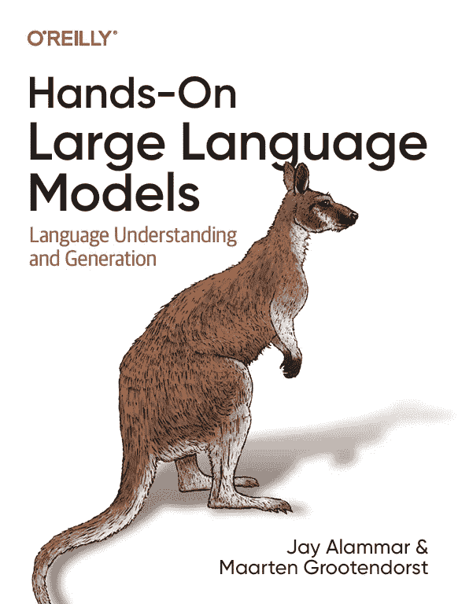
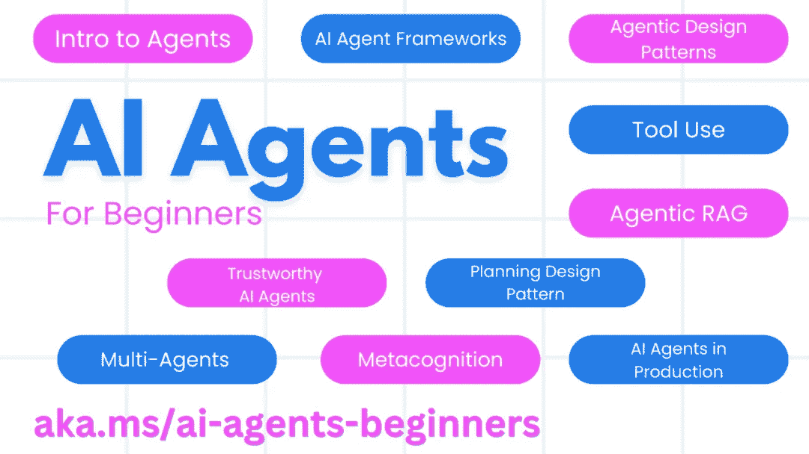
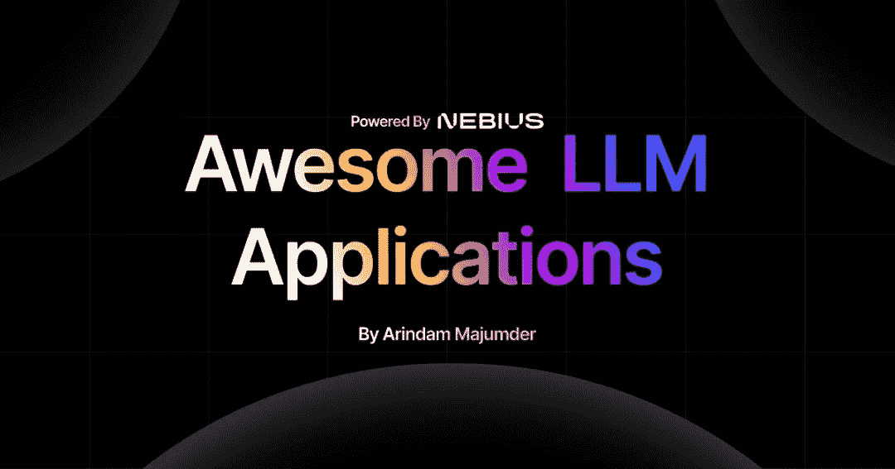
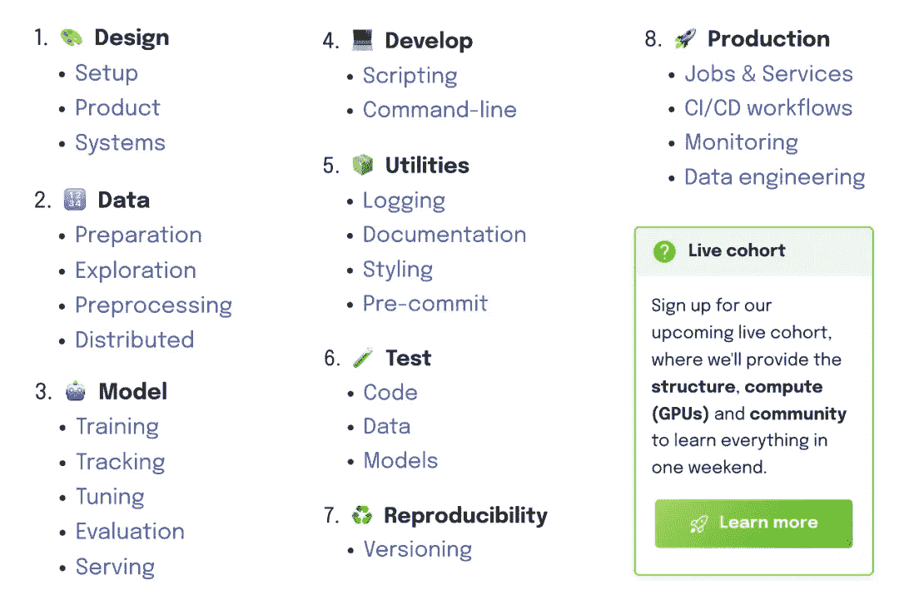
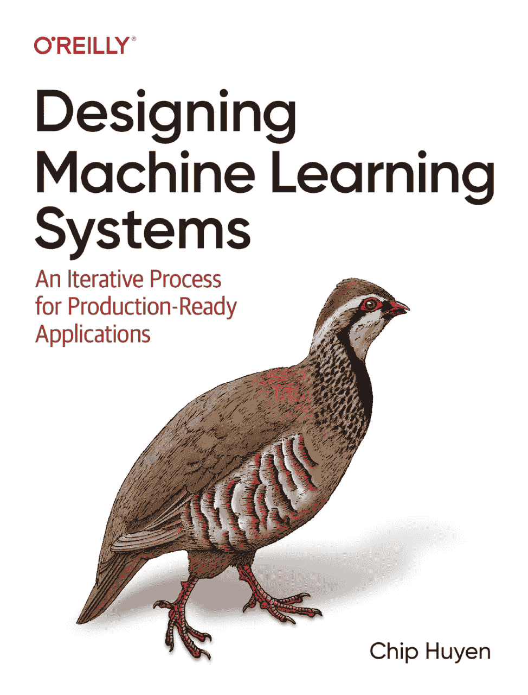
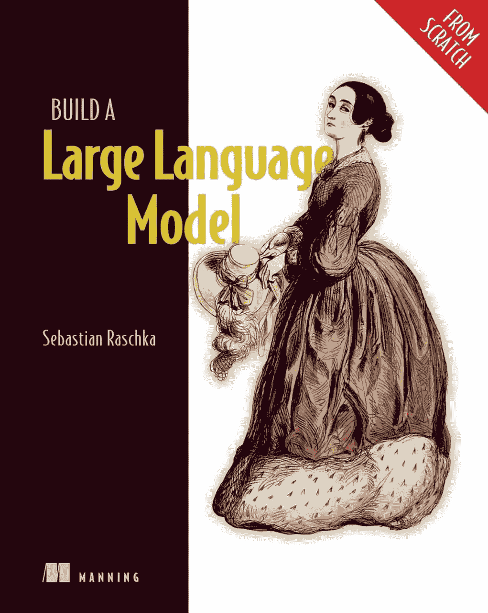
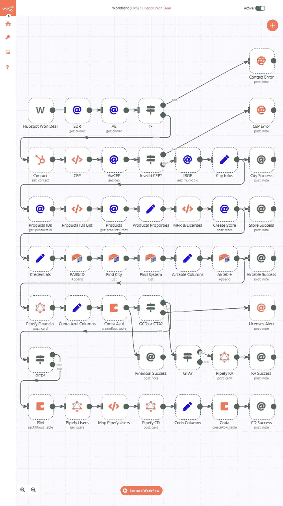
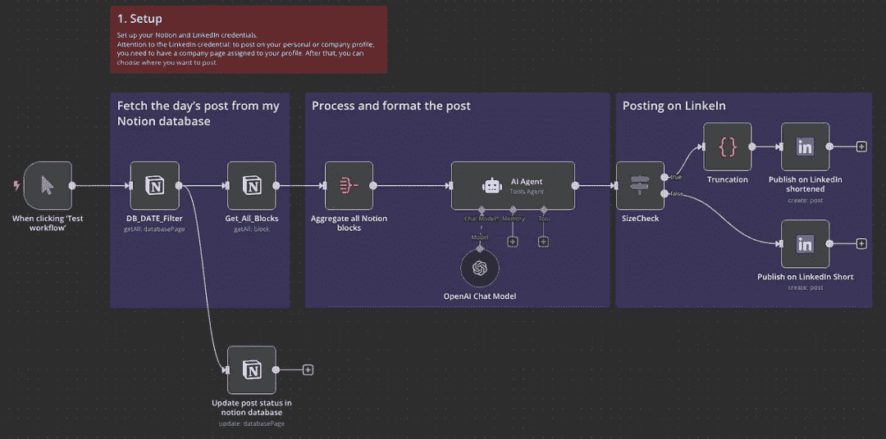

# 2025年AI智能体开发完全指南

> 来源：[https://gotoaiworld.feishu.cn/docx/B7uRdhcqjoGmgmxNlFtcEyc1nBc](https://gotoaiworld.feishu.cn/docx/B7uRdhcqjoGmgmxNlFtcEyc1nBc)

> 人工智能智能体（AI Agents）作为当前AI领域最具前沿性的技术方向，正在推动着自动化决策、多模态交互和复杂任务执行的革命性发展。本文精选了十个高质量的GitHub开源项目，涵盖从基础理论到实践应用的全方位学习路径，为AI开发者提供系统性的技术资源。

## 1、Hands-On Large Language Models - 大型语言模型实战指南

**仓库地址：**`https://github.com/HandsOnLLM/Hands-On-Large-Language-Models`

**⭐ Stars：** 16.7k+ | **📈 活跃度：** 高 | **🏷 主要语言：** Python

这是Jay Alammar和Maarten Grootendorst合著的《Hands-On Large Language Models》官方配套代码仓库，被誉为"图解版LLM教程"。项目提供了11个章节的完整学习体系，包含近300个定制图表和丰富的Jupyter Notebook实践案例。

### 技术特色

+ **可视化教学体系**：通过近300个定制图表深入浅出地解释LLM核心概念

+ **完整章节覆盖**：从语言模型介绍、Token处理到高级微调技术的全栈学习路径

+ **Google Colab集成**：所有示例均可在Google Colab上运行，支持T4 GPU免费使用

+ **多种微调技术**：涵盖BERT微调、提示工程、语义搜索等前沿技术

+ **生产级实践**：提供从模型训练到部署的完整工程化流程

### 核心章节

1. **语言模型基础** - Pipeline创建和文本生成

1. **Token与嵌入** - 分词器工作原理和向量表示

1. **文本分类** - 情感分析和分类任务实现

1. **聚类与主题建模** - 无监督学习应用

1. **提示工程** - 高级提示技巧和策略

1. **语义搜索** - 向量数据库和相似性检索

1. **BERT微调** - 命名实体识别等下游任务

### 适用场景

+ LLM算法工程师技能提升

+ 企业级LLM应用开发

+ 学术研究中的模型微调实验

+ AI产品经理技术理解需求

## 2、AI Agents for Beginners - 微软官方AI智能体入门课程

**仓库地址：**`https://github.com/microsoft/ai-agents-for-beginners`

**⭐ Stars：** 5.2k+ | **📈 活跃度：** 高 | **🏷 主要语言：** Python

微软官方推出的完整AI智能体学习课程，从零开始到实际部署的11章渐进式教程。该项目不仅提供理论基础，还包含丰富的实践项目和多语言支持。

### 课程结构

+ **智能体概念理解**：定义AI智能体的核心组件（环境、传感器、执行器）

+ **智能体类型分类**：简单反射、基于模型、目标导向、效用型、学习型和多智能体系统

+ **Azure AI服务集成**：使用`Azure AI Agent Service`构建生产级智能体

+ **智能体设计模式**：多步骤提示、协作模式和分布式智能体架构

+ **可信AI智能体**：安全性、可控性和人机协作最佳实践

### 技术栈特色

+ `Azure Cognitive Services`：企业级AI服务集成

+ OpenAI API：GPT模型集成和应用

+ 多框架支持：AutoGen、Semantic Kernel等主流框架

+ 实时学习能力：支持环境反馈和用户交互的持续改进

### 实践应用场景

+ **开放式问题解决**：LLM动态确定任务步骤

+ **多步骤复杂流程**：需要多轮工具调用和信息处理

+ **智能体协作**：多个智能体合作完成复杂任务

### 教学特色

+ 11个完整章节的渐进式学习

+ 支持多种语言（中文、英文、德语等）

+ 包含视频教程和交互式示例

+ Discord社区支持和答疑

## 3、Agents Engineering Mastery - 企业级AI智能体工程实践

**仓库地址：**`https://github.com/ed-donner/agents`

**⭐ Stars：** 1.8k+ | **📈 活跃度：** 极高 | **🏷 主要语言：** Python

这是一个为期6周的深度AI智能体工程课程，涵盖OpenAI Agents SDK、CrewAI、LangGraph、AutoGen和MCP等主流框架。专注于从原型到生产部署的完整工程化实践。

### 核心技术框架

+ OpenAI Agents SDK：企业级智能体开发的官方工具

+ CrewAI：多智能体协作和团队化工作流

+ LangGraph：复杂智能体工作流的图形化编排

+ AutoGen：微软的多智能体对话框架

+ MCP (Model Context Protocol)：模型上下文协议集成

### 工程实践特色

+ **多云提供商支持**：OpenAI、Groq、DeepSeek、Anthropic等多种API集成

+ **本地化部署**：Ollama本地模型运行和GPU优化

+ **生产级架构**：容器化部署、监控和日志管理

+ **成本优化策略**：API使用监控和预算控制

### 实战项目案例

+ **工程团队协作**：包含设计师、开发者、测试工程师的多智能体团队

+ **金融分析师**：股票数据分析和投资建议生成

+ **深度研究智能体**：多阶段研究流程自动化

+ **项目规划助手**：需求分析到技术实现的完整项目管理

### 技术架构亮点

+ **分布式智能体运行时**：支持`SingleThreaded`和分布式部署

+ **工具集成生态**：文件管理、网络搜索、数据库操作等丰富工具

+ **多模态支持**：文本、图像、音频的综合处理能力

+ **人机协作模式**：Human-in-the-Loop工作流设计

## 4、Awesome AI Applications - AI应用开发宝典

**仓库地址：**`https://github.com/Arindam200/awesome-ai-apps`

**⭐ Stars：** 2.5k+ | **📈 活跃度：** 极高 | **🏷 主要语言：** Python

一个全面的AI应用程序集合，涵盖从简单聊天机器人到复杂企业级智能体的完整开发教程。由Nebius AI Studio支持，提供100多个实用的AI应用示例。

### 项目分类体系

#### 🧩 入门级智能体

+ Agno HackerNews分析器：基于Agno框架的科技新闻趋势分析

+ OpenAI SDK助手：邮件处理和俳句创作智能体

+ LlamaIndex任务管理器：任务调度和项目管理助手

+ CrewAI研究团队：多智能体协作研究系统

#### 🪶 实用型智能体

+ 金融数据智能体：实时股票数据追踪和市场分析

+ 人机协作智能体：安全任务执行的HITL模式

+ 新闻通讯生成器：基于Firecrawl的AI新闻编辑器

+ 日历调度助手：与Cal.com集成的智能日程管理

#### 🔬 高级智能体系统

+ 深度研究智能体：多阶段研究工作流，集成Agno和Scrapegraph AI

+ 候选人分析器：GitHub和LinkedIn档案的智能化评估

+ 职位搜索智能体：基于Bright Data的LinkedIn职位匹配

+ AI趋势分析器：使用Google ADK的趋势挖掘系统

### 技术生态集成

+ AI框架支持：Google ADK、OpenAI Agents SDK、LangChain、LlamaIndex等

+ 企业服务集成：Nebius AI Studio、Bright Data、Cal.com等

+ 多模态能力：文本生成、图像创作、数据可视化

+ 云原生架构：Docker容器化、API服务化部署

### 工程化特色

+ 一键部署脚本：`uvscript`快速环境搭建

+ 详细文档支持：每个项目都有完整的README和使用说明

+ 视频教程配套：YouTube教程播放列表支持

+ 社区驱动开发：持续更新和社区贡献

## 5、Made With ML - 生产级机器学习系统工程

**仓库地址：**`https://github.com/GokuMohandas/Made-With-ML`

**⭐ Stars：** 16.7k+ | **📈 活跃度：** 高 | **🏷 主要语言：** Python

GitHub上顶级ML代码仓库之一，致力于教授如何设计、开发、部署和迭代生产级ML应用程序。40K+开发者参与学习，结合机器学习与软件工程最佳实践的综合平台。

### 核心工程架构

#### 🚀 完整MLOps工作流

+ **分布式训练框架**：基于Ray的可扩展机器学习工作负载

+ **实验跟踪系统**：MLflow集成的模型版本管理和性能监控

+ **自动化调优**：超参数优化和模型选择自动化

+ **CI/CD集成**：GitHub Actions驱动的持续集成和部署流水线

#### 🏗️ 生产级系统设计

+ **微服务架构**：RESTful API和容器化模型服务

+ **在线推理优化**：低延迟预测服务和批量处理支持

+ **监控与告警**：实时性能监控和数据漂移检测

+ **A/B测试框架**：模型效果评估和渐进式部署

### 技术栈与工具链

#### 🔧 核心技术组件

+ **Ray生态系统**：分布式计算、并行训练和超参数调优

+ **深度学习框架**：PyTorch模型开发和微调

+ **特征工程**：预处理管道和特征存储

+ **模型评估**：多指标评估和基准测试

#### 📊 LLM基准测试

+ **零样本学习评估**：GPT-3.5、GPT-4在监督学习任务上的性能对比

+ **少样本学习优化**：上下文学习策略和提示工程

+ **开源模型对比**：Falcon 40B、Llama 2等开源LLM性能分析

+ **微调vs提示学习**：不同学习策略的成本效益分析

### 实践应用价值

#### 💼 企业级部署

+ **可扩展基础设施**：Anyscale云平台集成和本地部署支持

+ **成本优化策略**：计算资源管理和自动伸缩

+ **安全合规**：数据隐私保护和模型安全部署

+ **团队协作**：多角色协作和权限管理

#### 🎯 学习路径设计

+ **理论与实践结合**：从原理到生产的完整学习路径

+ **渐进式复杂度**：从简单分类到复杂NLP任务

+ **工业标准流程**：符合企业级ML开发标准

+ **社区驱动学习**：活跃的技术社区和知识分享

**最佳应用场景：**适合希望掌握端到端ML系统开发的工程师、数据科学家和技术团队。特别适用于需要将ML模型从实验阶段快速可靠地推向生产环境的企业项目。

## 6、Designing Machine Learning Systems - ML系统设计权威指南

**仓库地址：**`https://github.com/chiphuyen/dmls-book`

**⭐ Stars：** 8.6k+ | **📈 活跃度：** 稳定更新 | **🏷 主要语言：** Markdown/Python

Chip Huyen所著《Designing Machine Learning Systems》的官方配套资源库，提供机器学习系统设计的系统性方法论。该书已被翻译成西班牙语、日语、韩语、波兰语和泰语等多种语言，是ML系统设计领域的权威参考。

### 核心设计理念

#### 🏛️ 系统设计四大支柱

+ **可靠性**：容错机制、故障恢复和服务可用性保证

+ **可扩展性**：水平扩展、负载均衡和分布式架构设计

+ **可维护性**：模块化设计、代码质量和技术债务管理

+ **适应性**：数据分布变化适应和业务需求演进支持

#### 📚 全生命周期覆盖

+ **第1-2章**：ML系统概述和设计原则

+ **第3-5章**：数据工程基础、训练数据和特征工程

+ **第6-7章**：模型开发、评估和部署服务

+ **第8-9章**：数据分布漂移、监控和持续学习

+ **第10-11章**：MLOps基础设施和人文考量

### 技术深度解析

#### 🔄 数据工程基础

+ **存储模式选择**：行式vs列式存储，文本vs二进制格式对比

+ **数据模型设计**：关系型、文档型、图形数据库的适用场景

+ **流式处理架构**：实时数据处理和批处理系统集成

+ **数据质量保证**：数据验证、清洗和血缘关系追踪

#### 🧠 模型开发与评估

+ **算法选择策略**：基于约束条件的模型选择框架

+ **分布式训练**：数据并行、模型并行和流水线并行技术

+ **模型集成方法**：Bagging、Boosting和Stacking策略

+ **评估指标体系**：业务指标vs技术指标的权衡

#### 🚀 部署与监控

+ **部署模式对比**：在线预测vs批量预测，云端vs边缘部署

+ **推理优化**：模型压缩、量化和硬件加速

+ **监控体系**：运维指标、ML特定指标和性能监控

+ **数据漂移检测**：协变量漂移、标签漂移和概念漂移

### 资源生态系统

#### 📖 学习资源

+ **章节总结**：每章核心概念和关键要点梳理

+ **MLOps工具清单**：开源工具分类和选型指南

+ **扩展阅读**：相关论文、博客和技术资源推荐

+ **基础概念回顾**：ML基础概念的快速参考指南

#### 🛠️ 实践工具

+ **工具分类体系**：数据工程、模型开发、部署监控工具

+ **开源方案对比**：各类MLOps工具的功能特性分析

+ **企业级选型**：Build vs Buy决策框架

+ **技术栈集成**：工具链整合和最佳实践

### 产业影响价值

#### 🎯 目标受众

+ **ML工程师**：系统设计能力提升和最佳实践学习

+ **数据科学家**：从实验到生产的完整技能栈

+ **技术领导者**：ML项目决策和团队建设指导

+ **产品经理**：ML产品规划和技术理解

#### 🌟 独特价值

+ **第一性原理**：深入理解ML系统设计的底层逻辑

+ **工程实践导向**：软件工程最佳实践在ML领域的应用

+ **全局视角**：端到端系统思维而非单点算法优化

+ **负责任AI**：伦理考量和公平性设计的系统性方法

**最佳应用场景：**适合构建中大型ML系统的技术团队，特别是需要处理复杂业务需求、高并发场景和企业级部署要求的项目。是ML系统架构师和技术领导者的必备参考。

+ 模型服务和推理引擎

+ 监控和告警系统

## 7、LLMs from Scratch - 从零构建大语言模型

**仓库地址：**`https://github.com/rasbt/LLMs-from-scratch`

**⭐ Stars：** 21.5k+ | **📈 活跃度：** 极高 | **🏷 主要语言：** Python

Sebastian Raschka所著《Build a Large Language Model (From Scratch)》的官方代码仓库，通过从头编写代码的方式深入理解大语言模型的工作原理。该项目提供了完整的LLM开发、预训练和微调流程，是学习LLM内部机制的权威教程。

### 核心技术架构

#### 🧠 Transformer核心实现

+ **注意力机制**：多头自注意力、位置编码和掩码机制的完整实现

+ **前馈网络**：GELU激活函数和层归一化优化

+ **模型架构**：完整GPT架构实现，支持124M到更大规模配置

+ **文本生成**：采样策略、温度控制和top-k过滤技术

#### ⚡ 高性能训练优化

+ **分布式训练**：支持多GPU并行训练和梯度累积

+ **内存优化**：KV缓存、梯度检查点和混合精度训练

+ **训练加速**：优化的数据加载器和批处理策略

+ **性能监控**：tokens/sec指标和GPU内存使用追踪

### 完整学习路径

#### 📚 分章节构建体系

+ **第1-2章**：数据处理和分词器实现（`GPTDatasetV1`、`create_dataloader_v1`）

+ **第3章**：注意力机制和多头注意力（`MultiHeadAttention`）

## LLM 模型架构与文本生成（第4-7章）

+   第4章：GPT模型架构和文本生成（`GPTModel`、`generate_text_simple`）
+   第5章：预训练流程和优化策略（`train_model_simple`）
+   第6章：分类任务微调和LoRA技术（`LinearWithLoRA`）
+   第7章：指令跟随微调和模型评估（`InstructionDataset`）

### 🔬 高级技术特性

+   **LoRA微调**：参数高效的模型适配技术，显著减少训练参数
+   **指令微调**：对话和任务执行能力训练的完整流程
+   **模型评估**：多维度性能评估和基准测试框架
+   **Llama3集成**：现代LLM架构的实现和KV缓存优化

### 工程实践亮点

#### 🛠️ 开发工具链

+   **模块化设计**：可复用的组件库（`ch02-ch07`模块）和完整测试框架
+   **配置管理**：灵活的模型配置和超参数设置（`GPT_CONFIG_124M`）
+   **实验追踪**：损失曲线和训练指标可视化
+   **代码质量**：完整的单元测试和Apache 2.0许可证

#### 📊 性能基准

+   **GPT-124M配置**：完整的小规模模型训练（768维嵌入，12层，12头）
+   **训练效率**：优化的训练速度和资源利用率监控
+   **模型质量**：可比肩商业模型的生成质量
+   **硬件适配**：笔记本到服务器环境的完整兼容性

### 教育价值与应用

#### 🎓 学习资源生态

+   **配套课程**：17小时视频教程深度讲解每章内容
+   **实践项目**：从基础到高级的渐进式项目体系
+   **社区支持**：活跃的GitHub Discussions和问题解答
+   **工具推荐**：`axolotl`、`LitGPT`等生产级工具链集成

#### 💡 技术深度

+   **算法原理**：深入理解Transformer架构的数学原理
+   **实现细节**：每行代码的详细解释和设计思路
+   **最佳实践**：业界标准的模型开发流程和优化策略
+   **前沿技术**：最新LLM技术的实现和实际应用

**最佳应用场景：**适合希望深度理解LLM工作原理的开发者、研究人员和AI从业者。特别适用于需要定制化LLM解决方案的团队，以及希望在AI领域建立扎实技术基础的学习者。

## 8、LLM Engineering - 大型语言模型工程实践

**仓库地址：**https://github.com/ed-donner/llm_engineering

**⭐ Stars：** 2.3k+ | **📈 活跃度：极高** | 🏷 主要语言：Jupyter Notebook

### 项目概述

Edward Donner开发的8周LLM工程师训练营，面向工程实践的大语言模型开发指南。涵盖从开发环境配置到部署的完整工程化流程，注重实战技能培养和最佳实践传授。

### 完整课程体系

#### 📚 8周渐进式学习路径

+   **第1周**：LLM基础和Ollama本地部署（Llama 3.2）
+   **第2周**：API集成和多模型对比（OpenAI、Anthropic、Google）
+   **第3周**：Google Colab GPU训练和向量数据库
+   **第4-5周**：RAG系统构建和知识检索优化
+   **第6-7周**：模型微调和Weights & Biases监控
+   **第8周**：自主AI智能体解决方案

#### 🛠️ 工程实践重点

+   **环境配置**：跨平台开发环境搭建（Windows、Mac、Linux）
+   **API成本管理**：多厂商API使用和成本优化策略
+   **数据工程**：大规模文本数据处理和质量控制
+   **生产部署**：从原型到生产的完整部署流程

### 技术栈与工具

#### 🔧 核心开发工具

+   **Anaconda环境**：隔离的Python开发环境和依赖管理
+   **Jupyter Lab**：交互式开发和数据科学工作流
+   **Google Colab**：云端GPU训练和协作开发
+   **Ollama本地部署**：本地LLM运行和测试环境

#### 🌐 多模型API集成

+   **OpenAI集成**：GPT-4o、GPT-4o-mini的API调用和优化
+   Anthropic Claude：Claude-3模型家族的使用和对比
+   **Google Gemini**：Gemini API的集成和应用
+   **DeepSeek API**：新兴模型的测试和评估

### 实践项目与应用

#### 📋 渐进式项目构建

+   **会议纪要生成器**：音频转录和智能总结
+   **RAG知识问答系统**：文档检索和智能回答
+   **多智能体对话系统**：智能体协作和角色扮演
+   **自主AI助手**：端到端的智能体解决方案

#### 💡 工程化特色

+   **错误处理和调试**：完整的troubleshooting指南
+   **成本监控**：API使用量监控和成本控制
+   **环境兼容性**：跨平台部署和环境一致性
+   **社区贡献**：Pull Request流程和代码分享

### 学习价值与职业发展

#### 🎯 技能提升维度

+   **数据工程师**：LLM集成和数据管道优化
+   **软件工程师**：AI能力集成和产品开发
+   **产品经理**：AI产品规划和技术理解
+   **研究人员**：快速原型开发和实验验证

#### 📈 职业发展路径

+   **AI开发岗位**：自然语言处理和内容生成
+   **工程效率提升**：自动化文档、邮件和报告生成
+   **决策支持系统**：大数据洞察和智能分析
+   **创新产品开发**：AI驱动的新产品和服务

### 实战导向特色

#### 🚀 项目实施方法

+   **边学边做**：每周实战项目和挑战任务
+   **代码分享**：GitHub Pull Request和社区贡献
+   **成本控制**：免费替代方案和预算管理
+   **持续学习**：资源链接和扩展阅读

#### 🔬 技术深度

+   **伦理考量**：AI偏见识别和公平性设计
+   **性能优化**：推理延迟和吞吐量优化
+   **扩展性设计**：从原型到企业级部署
+   **监控运维**：生产环境监控和故障排除

**最佳应用场景：**适合希望快速掌握LLM工程实践的开发者和技术团队。特别适用于需要将LLM技术快速集成到现有产品的企业，以及希望建立AI技术栈的初创公司。

## 9、N8N Workflows Collection - 高性能工作流文档系统

**仓库地址：**https://github.com/Zie619/n8n-workflows

**⭐ Stars：** 约100+ | **📈 活跃度：高** | 🏷 主要语言：Python/JavaScript

N8N工作流集合，收录2,053个专业工作流，覆盖365种服务集成，配备高性能文档系统。基于先进的SQLite FTS5全文检索技术，响应时间<100ms，为工作流自动化提供企业级的发现和管理平台。

### 🚀 核心功能特性

#### 📊 收录规模

+   **工作流总数**：2,053个专业分类工作流
+   **节点总数**：29,445个（平均每个工作流14.3个节点）
+   **服务集成**：365种独特服务和API集成
+   **触发类型**：Webhook、定时、手动、复杂触发系统

#### ⚡ 高性能技术架构

+   SQLite + FTS5全文检索：sub-100ms响应时间，比传统系统快700倍
+   **智能分类系统**：12个服务类别自动识别（消息、AI/ML、数据库等）
+   **响应式界面**：完美支持移动端，深色/浅色主题切换
+   **RESTful API**：完整API支持工作流搜索、下载、图表生成

### 🔍 智能搜索与分类

#### 📂 服务类别覆盖

+   **消息通信**：Telegram、Discord、Slack、WhatsApp、Teams
+   **AI/ML集成**：OpenAI、Anthropic、Hugging Face AI服务
+   **数据库连接**：PostgreSQL、MySQL、MongoDB、Redis、Airtable
+   **云存储管理**：Google Drive、Dropbox、OneDrive文件同步
+   **项目管理**：Jira、GitHub、GitLab、Trello、Asana协作

#### 🎯 复杂度分析

+   **低复杂度(≤5节点)**：35% - 简单自动化任务
+   **中等复杂度(6-15节点)**：45% - 标准业务流程
+   **高复杂度(16+节点)**：20% - 企业级系统集成

### 💡 技术创新亮点

#### 🛠️ 智能命名系统

自动转换技术文件名为可读标题

前：`2051_Telegram_Webhook_Automation_Webhook.json`

后：`Telegram Webhook Automation`

#### 📱 现代化界面特性

+   **实时统计仪表板**：工作流活跃度和使用统计
+   **Mermaid图表生成**：可视化工作流程图
+   **即时搜索**：键入即搜索，防抖优化
+   **筛选器组合**：触发类型、复杂度、服务类别多维筛选

### 🏗️ 企业级特性

#### 🔐 部署与管理

+   **多环境支持**：Python/Node.js双技术栈实现
+   **Docker容器化**：一键部署和扩展
+   **API文档**：OpenAPI标准，自动文档生成
+   **变更检测**：MD5哈希算法，高效重建索引

#### 📈 性能指标

+   **数据库大小**：<50MB（比传统HTML系统小700倍）
+   **内存占用**：<50MB RAM（比旧系统少40倍）
+   **加载时间**：<1秒（比传统系统快10倍）
+   **搜索响应**：即时FTS5全文检索

## 10、Build AI Agents with N8N - LinkedIn Learning企业级课程

**仓库地址：**https://github.com/LinkedInLearning/build-ai-agents-and-automate-workflows-with-n8n-5437042

**⭐ Stars：** 新项目 | **📈 活跃度：官方维护** | 🏷 主要语言：JSON配置

LinkedIn Learning平台官方推出的企业级AI智能体课程资料，由专业讲师Morten Rand-Hendriksen授课。提供完整的N8N智能体开发教程，从零基础到高级应用的系统性学习路径，专注于业务流程自动化和AI智能体构建。

### 🎯 课程核心内容

#### 📚 学习模块体系

+   **N8N平台基础**：云端/本地部署选择、架构理解、核心概念掌握
+   **多服务集成**：Google Sheets、OpenAI、Slack三大核心服务连接
+   **AI智能体设计**：自然语言处理、数据查询、多步骤决策流程
+   **MCP协议应用**：Model Context Protocol深度集成和自定义服务器开发

#### 🛠️ 实战工作流项目

+   **主要智能体**：`Volunteer_Lookup.json` - 志愿者查询AI智能体
+   Google Sheets MCP：`Google_Sheets_MCP.json` - 自定义MCP服务器集成
+   **数据查询工具**：`Row_lookup.json` - 智能数据筛选和检索
+   **综合自动化流**：`Built_Out_Automation_Flow.json` - 多智能体协作系统

### 🚀 技术特色与创新

#### 🔧 企业级架构设计

+   **依赖管理**：工作流导入顺序优化（`Row_lookup` → `Google_Sheets_MCP` → `Volunteer_Lookup`）
+   **API集成**：OpenAI GPT模型调用和响应处理
+   **数据管理**：111条完整志愿者数据集 + 9条测试数据集
+   **安全配置**：凭证管理和API密钥保护机制

#### 💡 教学方法优势

+   **循序渐进**：从简单概念到复杂系统的阶梯式学习
+   **实战导向**：真实业务场景（志愿者管理系统）案例
+   **多平台支持**：云端N8N和自托管环境双重选择
+   **详细文档**：完整的设置说明和导入指南

### 📊 实际应用价值

#### 🎯 目标用户群体

+   **业务分析师**：学习无代码AI智能体开发
+   **自动化工程师**：掌握企业级工作流设计
+   **产品经理**：理解AI智能体产品开发流程
+   **技术团队负责人**：评估N8N在企业中的应用潜力

#### 🔄 业务场景覆盖

+   **客户服务自动化**：智能客服和查询响应系统
+   **数据处理流程**：表格数据查询和报告生成
+   **团队协作优化**：Slack集成的智能通知和任务分发
+   **业务流程智能化**：复杂多步骤业务逻辑自动执行

### 🏗️ 工程实践特色

#### 📋 项目设置步骤

1. Google账户设置（推荐专用测试账户）
2. OpenAI API密钥申请和项目创建
3. Slack工作区配置（推荐专用测试环境）
4. N8N实例部署（云端或本地环境）

#### 🔍 数据结构设计

+   **志愿者信息模型**：ID、姓名、联系方式、活动记录、管理者、状态
+   **CSV格式支持**：标准化数据导入和Google Sheets集成
+   **虚构数据保护**：完全AI生成的测试数据，无真实个人信息

#### 🎨 用户体验优化

+   **自然语言查询**：支持复杂的人类语言指令
+   **智能响应格式**：结构化的查询结果和友好的用户交互
+   **错误处理机制**：完善的异常情况处理和用户提示

## 总结

这十个GitHub仓库构成了AI智能体技术栈的完整生态系统，从理论基础到工程实践，从开发工具到部署运维，为不同背景的开发者提供了系统性的学习路径。

### 技术发展趋势

1.  **多模态智能体**：集成视觉、语言和行为的综合智能系统
1.  **自主学习能力**：具备持续学习和自我优化的智能体架构
1.  **企业级应用**：面向垂直行业的专业化智能体解决方案
1.  **安全与可控**：可解释、可控制的负责任AI智能体设计

### 学习建议

+   **基础阶段**：从Microsoft的入门教程开始，建立智能体的基础概念
+   **深入阶段**：通过LLM相关项目掌握核心技术原理
+   **实践阶段**：使用N8N等工具快速构建原型和应用
+   **进阶阶段**：学习生产级系统设计和工程最佳实践

通过系统学习这些开源项目，开发者可以全面掌握AI智能体的设计思维、技术实现和工程化部署，为构建下一代智能化应用奠定坚实基础。
