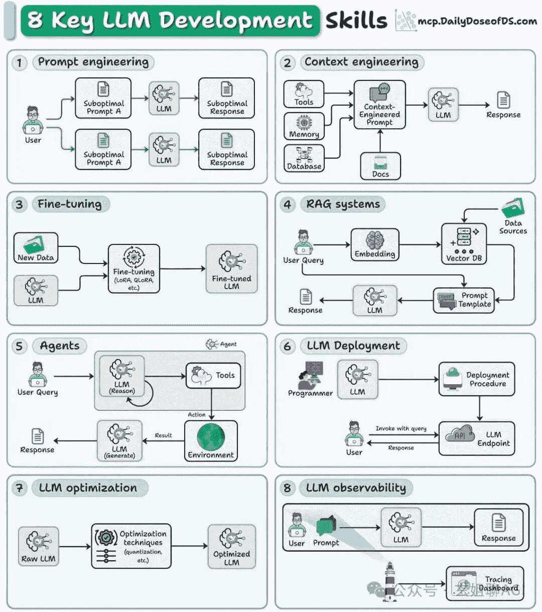
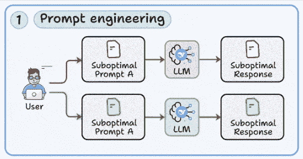
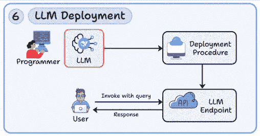
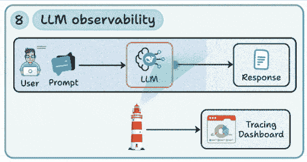

# 生产级 AI 智能体落地的8个核心技能

> 来源：[https://gotoaiworld.feishu.cn/docx/A0PXdXM7lobPTFxmLgmc1m0xnjg](https://gotoaiworld.feishu.cn/docx/A0PXdXM7lobPTFxmLgmc1m0xnjg)

与大语言模型（LLM）打交道，远不止 “写提示词” 这么简单。

生产级别的 AI 智能体系统，要求开发者深入理解模型的工程构建、部署流程与优化方法。

以下是支撑生产级 AI 大模型应用落地的 8 大核心技能：

我们来逐一拆解这些技能。

AI 智能体企业落地的8个核心技能

## 1、核心技能一：提示词工程()（Prompt Engineering）

最基础的技能，是设计结构化的提示词（Prompt）-- 既要减少歧义，又要引导大模型输出可预期的结果。

这需要快速尝试不同的提示词变体，运用 “思维链”（chain-of-thought）等模式，还可以通过 “少样本示例”（few-shot examples）让大模型的响应更稳定。

关键是要把提示词设计当成一项可复现的工程任务，而非靠运气试错的文案写作。

## **2、核心技能二：**上下文工程()（Context Engineering）

简单说，就是把外部相关数据（比如：数据库内容、记忆信息、工具输出结果、文档资料）动态注入到提示词中。

设计上下文窗口时，要在 “信息完整性” 和 “ tokens 效率” 之间找到平衡（tokens 是 LLM 处理文本的基本单位，过多会增加成本和延迟）。

此外，还要处理 “检索噪声”（无关信息混入）和 “上下文坍缩()”（信息过载导致模型抓不住重点）的问题 -- 这在长上下文场景中尤为关键。

## 3、核心技能三：模型微调（Fine-tuning）

很多场景下，你需要根据具体需求调整 LLM 的行为。这项技能的核心，是运用 LoRA（低秩适应）、QLoRA()（量化低秩适应）等方法，用特定领域的数据去适配基础大模型，同时控制算力成本。

还要管理数据整理流程，比如：去重、调整指令格式、筛选高质量数据。

在让大模型突破 “零样本 / 少样本” 能力边界时，要监控 “过拟合”（大模型只懂训练数据，不会泛化）和 “泛化能力”（大模型能应对新数据）之间的平衡。

## 4、核心技能四：检索增强生成系统（RAG Systems）

掌握这项技能，你能搭建这样的系统：通过 “嵌入向量()（embeddings）+ 向量数据库（vector DBs）” 给 LLM 补充外部知识，从而减少大模型 “胡编乱造”（幻觉）的情况。

要设计检索流程（包括索引建立、文本分块、查询重写），确保检索结果的 “召回率”（能找到相关信息）和 “精准度”（找到的都是有用信息）。

还要用提示词模板，把检索到的上下文和用户的查询以结构化的方式融合起来。

## 5、核心技能五：AI 智能体开发（Agents）

有了这项技能，你就能跳出 “静态问答” 的局限，搭建出能 “调用工具、完成多步推理” 的 AI 智能体（Agent）。

要处理 AI 智能体与外部环境的交互、状态管理，以及自主工作流中的错误恢复（比如：工具调用失败时该怎么办）。

还要设计 “备用方案” -- 当推理路径走不通，或外部 API 返回不完整结果时，AI 智能体能切换策略。

## 6、核心技能六：LLM 部署（LLM Deployment）

当你大致完成 LLM 应用开发后，就需要这项技能：把大模型打包成生产级别的 API，并搭建可扩展的部署流程。

要管理延迟（大模型响应速度）、并发量（同时处理多少请求）和故障隔离（比如：用自动扩缩容 + 容器编排，避免一个故障影响整体）。

还要搭建访问管控机制、监控每次请求的成本，以及防止模型被滥用。

## 7、核心技能七：LLM 优化（LLM Optimization）

为了降低成本，你需要学习如何用 “量化”（减少大模型参数精度，降低内存占用）、“剪枝”（去掉大模型中不重要的参数）、“蒸馏”（把大模型的知识转移到小模型上）等技术，减少大模型的内存消耗和推理成本。

还要能评估 “速度、精度、硬件利用率（GPU/CPU 卸载）” 三者之间的权衡（比如：量化能提速，但可能损失一点精度）。

要持续分析大模型性能，确保优化不会影响核心功能。

## 8、核心技能八：LLM 可观测性（LLM Observability）

无论你的 LLM 应用简单还是复杂，都必须学会搭建 “追踪、日志、仪表盘” 系统，用来监控提示词、响应结果和故障情况。

要实时跟踪 tokens 使用量、延迟峰值（突然变慢）和 “提示词漂移”（实际使用的提示词偏离设计初衷）。

还要把可观测性数据反馈到迭代流程中，推动应用持续改进。