# 谷歌AI Agent白皮书：2025年AI智能体时代来临

> 来源：[https://gotoaiworld.feishu.cn/docx/Fe8YdgJFlorNkpxhxtVcHFYdnme](https://gotoaiworld.feishu.cn/docx/Fe8YdgJFlorNkpxhxtVcHFYdnme)

# Agents Companion


https://www.kaggle.com/whitepaper-agent-companion

Authors: Antonio Gulli, Lavi Nigam, Julia Wiesinger, Vladimir Vuskovic, Irina Sigler, Ivan Nardini, Nicolas Stroppa, Sokratis Kartakis, Narek Saribekyan, Anant Nawalgaria and Alan Bount

Introduction

Generative AI agents mark a leap forward from traditional, standalone language models, offering a dynamic approach to problem-solving and interaction. As defined in the original Agents paper, an agent is an application engineered to achieve specific objectives by perceiving its environment and strategically acting upon it using the tools at its disposal.

The fundamental principle of an agent lies in its synthesis of reasoning, logic, and access to external information, enabling it to perform tasks and make decisions beyond the inherent capabilities of the underlying model. These agents possess the capacity for autonomous operation, independently pursuing their goals and proactively determining subsequent actions, often without explicit instructions.

The architecture of an agent is composed of three essential elements that drive its behavior and decision-making:

+   **Model **: Within the agent's framework, the term "model" pertains to the language model (LM) that functions as the central decision-making unit, employing instruction- based reasoning and logical frameworks. The model can vary from general-purpose to multimodal or fine-tuned, depending on the agent's specific requirements.

+   **Tools **: Tools are critical for bridging the divide between the agent's internal capabilities and the external world, facilitating interaction with external data and services. These tools empower agents to access and process real-world information. Tools can include extensions, functions, and data stores. Extensions bridge the gap between an API and an agent, enabling agents to seamlessly execute APIs. Functions are self-contained modules of code that accomplish specific tasks. Data stores provide access to dynamic and up-to-date information, ensuring a model’s responses remain grounded in factuality and relevance.

+   Orchestration layer: The orchestration layer is a cyclical process that dictates how the agent assimilates information, engages in internal reasoning, and leverages that reasoning to inform its subsequent action or decision. This layer is responsible for maintaining memory, state, reasoning, and planning. It employs prompt engineering frameworks to steer reasoning and planning, facilitating more effective interaction with the environment and task completion. Reasoning techniques such as ReAct, Chain-of-Thought (CoT), and Tree-of-Thoughts (ToT) can be applied within this layer.

Building on these foundational concepts, this companion paper is designed for developers and serves as a "102" guide to more advanced topics. It offers in-depth explorations of agent evaluation methodologies and practical applications of Google agent products for enhancing agent capabilities in solving complex, real-world problems.

While exploring these theoretical concepts, we'll examine how they manifest in real-world implementations, with a particular focus on automotive AI as a compelling case study. The automotive domain exemplifies the challenges and opportunities of multi-agent architectures in production environments. Modern vehicles demand conversational interfaces that function with or without connectivity, balance between on-device and cloud processing for both safety and user experience, and seamlessly coordinate specialized capabilities across navigation, media control, messaging, and vehicle systems. Through this automotive lens, we'll see how different coordination patterns -- hierarchical, collaborative, and peer-to- peer -- come together to create robust, responsive user experiences in environments with significant constraints. This case study illustrates the practical application of multi-agent systems that businesses across industries can adapt to their specific domains.

Anyone who has built with gen AI quickly realizes it’s easy to get from an idea to a proof of concept, but it can be quite difficult to ensure high quality results and get to production - gen AI agents are no exception. Quality and Reliability are the most cited concerns for deploying to production, and the “Agent Ops” process is a solution to optimize agent building.

## 1.引言 [#](https://blog.frognew.com/2025/01/agents-whitepaper-by-google.html#1%e5%bc%95%e8%a8%80)

人类擅长复杂的模式识别，但常借助书籍、谷歌搜索或计算器等工具补充知识再做判断。类似地，生成式AI模型也能通过训练使用工具，访问实时信息或提供实际操作建议。例如，模型可利用数据库检索工具访问客户购买历史等信息，生成定制化推荐；或根据用户查询，通过API调用发送邮件或完成金融交易。为此，模型不仅需访问外部工具，还需自主规划和执行任务。推理、逻辑和与生成式AI模型相关的外部信息访问共同构成了智能体的概念，即超越生成式AI模型独立能力的程序。本文将详述这些及相关方面。

> **📝 推理、逻辑和与生成式AI模型相**关的外部信息访问共同构成了智能体的概念

## 2.什么是智能体？ [#](https://blog.frognew.com/2025/01/agents-whitepaper-by-google.html#2%e4%bb%80%e4%b9%88%e6%98%af%e6%99%ba%e8%83%bd%e4%bd%93)

广义上，生成式AI智能体是一种通过观察世界并利用可用工具采取行动以达成目标的应用程序。智能体是自主的，尤其在拥有明确目标时，可独立于人为干预行动，甚至能在无明确指令下自主推理下一步行动。AI中的智能体概念应用广泛且强大，但本文仅关注在本文发布时，生成式AI模型可构建的特定类型智能体。

**为理解智能体运作方式，先**介**绍驱动其行为(beha**vi**or)、行动(actio**ns) 和决策(decision) 的基本组成部分。这些组成部分的组合构成认知架构，通过不同组合可实现多种架构。如图1所示，从核心功能看，智能体的认知架构(cognitive architecture)包含三个基本组成部分。

**图1: 通用智能体架构及其组件**

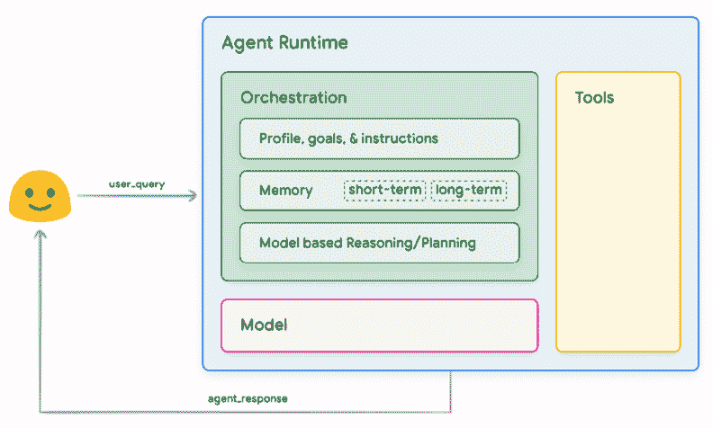

> **📝 通用智能体架构及其组件**

+   模型(model)

+   工具(tool)

+   编排层(orchestration layer)

### 2.1 模型 [#](https://blog.frognew.com/2025/01/agents-whitepaper-by-google.html#21-%e6%a8%a1%e5%9e%8b)

智能体中的“模型”是指用作智能体流程中心决策者的语言模型（LM）。智能体可使用**任何规模（**小型/大型）的一个或多个LM，它们需能遵循基于指令的推理和逻辑框架，如ReAct、Chain-of-Thought或Tree-of-Thoughts。模型可通用、多模态或按特定智能体架构需求微调。

为获最佳生产效果，你应该用最适合你的最终应用的模型，最好是已经用跟你计划在认知架构里使用的工具相关的数据特征训练过的模型。

需要注意的是，模型通常没有使用智能体的特定配置设置（即工具选择、编排/推理设置）进行训练。但是，可以通过向模型提供展示智能体能力的示例来进一步改进模型以适应智能体的任务，包括智能体在各种上下文中使用特定工具或推理步骤的实例。

### 2.2 工具 [#](https://blog.frognew.com/2025/01/agents-whitepaper-by-google.html#22-%e5%b7%a5%e5%85%b7)

基础模型虽然在文本和图像生成方面表现出色，但仍然受限于其与外部世界交互的能力。工具弥合了这一差距，使智能体能够与外部数据和服务进行交互，同时释放了超出底层模型自身能力的更广泛的操作范围。工具可以采取多种形式，并具有不同的复杂程度，但通常与常见的Web API方法（如GET、POST、PATCH和DELETE）保持一致。例如，一个工具可以更新数据库中的客户信息，或者获取天气数据以影响智能体向用户提供的旅行推荐。

借助工具，智能体可以访问和处理真实世界的信息。这使它们能够支持更专业的系统，例如检索增强生成（RAG），这大大扩展了智能体的能力，超出了基础模型自身的能力范围。我们将在下文更详细地讨论工具，但最重要的是要理解，工具弥合了智能体的内部能力和外部世界之间的差距，从而释放了更广阔的可能性。

### 2.3 编排层 [#](https://blog.frognew.com/2025/01/agents-whitepaper-by-google.html#23-%e7%bc%96%e6%8e%92%e5%b1%82)

编排层描述了一个循环过程，该过程控制智能体如何接收信息、执行一些内部推理，并使用该推理来指导其下一个行动或决策。一般来说，此循环将持续进行，直到智能体达到其目标或到达停止点。编排层的复杂性可能因智能体及其执行的任务而异。一些循环可以是带有决策规则的简单计算，而另一些循环可能包含链式逻辑，涉及额外的机器学习算法，或实现其他概率推理技术。我们将在认知架构部分详细讨论智能体编排层的具体实现。

### 2.4 智能体与模型的区别 [#](https://blog.frognew.com/2025/01/agents-whitepaper-by-google.html#24-%e6%99%ba%e8%83%bd%e4%bd%93%e4%b8%8e%e6%a8%a1%e5%9e%8b%e7%9a%84%e5%8c%ba%e5%88%ab)

为了更清楚地理解智能体和模型之间的区别，请参考下表：

### [2](https://blog.frognew.com/2025/01/agents-whitepaper-by-google.html#25-%e8%ae%a4%e7%9f%a5%e6%9e%b6%e6%9e%84%e6%99%ba%e8%83%bd%e4%bd%93%e5%a6%82%e4%bd%95%e5%b7%a5%e4%bd%9c).5 认知架构：智能体如何工作 #

想象一下厨房中一群忙碌的厨师。他**们的**目**标是**为**餐厅**顾客烹制美味佳肴，这涉及计划、执行和调整的循环过程。

+   他们收集信息，例如顾客的订单以及食品储藏室和冰箱中现有的食材。

+   他们根据刚刚收集的信息，对可以制作的菜肴和口味进行一些内部推理。

+   他们采取行动来制作菜肴：切菜、混合香料、煎肉。

在这个过程的每个阶段，厨师都会根据需要进行调整，随着食材的消耗或收到顾客的反馈而改进他们的计划，并使用先前的一系列结果来决定下一步的行动方案。这种信息摄取、计划、执行和调整的循环描述了厨师为实现其目标而采用的独特的认知架构。

就像厨师一样，智能体可以通过迭代地处理信息、做出明智的决策以及根据先前的输出改进后续行动，来使用认知架构以达到其最终目标。智能体认知架构的核心是编排层，它负责维护记忆、状态、推理和计划。它利用快速发展的提示工程领域和相关框架来指导推理和计划，使智能体能够更有效地与其环境交互并完成任务。针对语言模型的提示工程框架和任务规划领域的研究正在迅速发展，产生了各种有前景的方法。

以下列举本文发布时部分最流行的框架和推理技术：

+   **ReAct** 是一种提示工程框架，它为语言模型提供了一种思维过程策略，使其能够针对用户查询进行推理并采取行动，无论是否提供上下文示例。ReAct 提示已经被证明比一些最先进的方法(several SOTA baselines)要好，并且提高了大型语言模型与人类的互动性和可信度。

+   Chain-of-Thought(CoT) 是一种提示工程框架，它通过中间步骤实现推理能力。CoT有多种子技术，包括自洽性、主动提示和多模态CoT，它们各自具有优缺点，具体取决于特定的应用。

+   Tree-of-thoughts(ToT) 是一种提示工程框架，特别适合用来做探索或者战略性的前瞻性任务。它是对Chain-of-Thought提示的扩展，可以让模型探索不同的思考路径，这些路径可以作为语言模型解决一般性问题的中间步骤。

智能体可以利用上述推理技术之一，或许多其他技术，来为给定的用户请求选择最佳的后续行动。例如，假设有个智能体，它被设计成用ReAct框架来为用户的提问选择正确的行动和工具。整个流程大概是这样的：

1.  用户向智能体发送查询。

1.  智能体开始执行ReAct流程。

1.  智能体向模型提供一个提示，要求其生成下一个ReAct步骤及其相应的输出：

1.  a. 问题：来自用户查询的输入问题，随提示一起提供

1.  b. 思考：模型关于下一步应该做什么的想法

1.  c. 行动：模型关于下一步要采取什么行动的决定

```
i. 这是工具选择可能发生的地方

ii. 例如，一个行动可以是[Flights, Search, Code, None]之一，其中前3个代表模型可以选择的已知工具，最后一个代表“不选择工具” 
```

1.  d. 行动输入：模型关于要提供给工具的输入（如果有）的决定

1.  e. 观察：行动/行动输入序列的结果

1.  i. 根据需要，此思考/行动/行动输入/观察可以重复N次

1.  f. 最终答案：模型提供给原始用户查询的最终答案。

1.  ReAct循环结束，并将最终答案返回给用户。

图2: 在编排层中使用ReAct推理的智能体示例

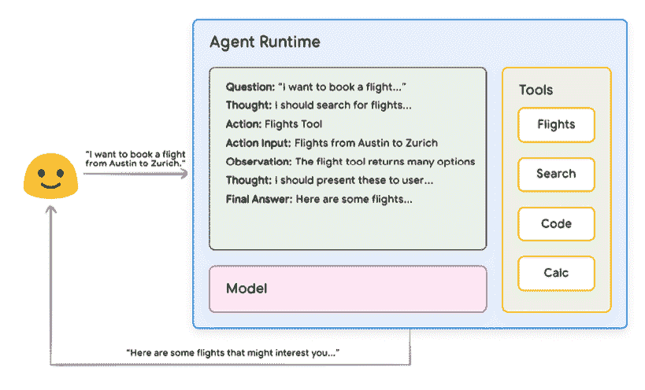

如图2所示，模型、工具和智能体配置协同工作，根据用户的原始查询向用户提供基于事实、简洁的回复。虽然模型可能根据其先验知识猜测答案（产生幻觉），但它转而使用了一个工具（Flights）来搜索实时的外部信息。该附加信息被提供给模型，使其能够基于真实的实际数据做出更明智的决策，并将此信息总结后返回给用户。

总而言之，智能体回复的质量可以直接与其模型推理和执行这些各种任务的能力相关联，包括选择正确工具的能力以及工具的定义完善程度。就像厨师用新鲜食材精心烹制菜肴并关注顾客反馈一样，智能体依靠合理的推理和可靠的信息来提供最佳结果。在下一节中，我们将深入探讨智能体连接新数据的各种方式。

## [3](https://blog.frognew.com/2025/01/agents-whitepaper-by-google.html#3%e5%b7%a5%e5%85%b7-%e8%bf%9e%e6%8e%a5%e5%a4%96%e9%83%a8%e4%b8%96%e7%95%8c%e7%9a%84%e5%85%b3%e9%94%ae).工具: 连接外部世界的关键 #

> **📝 如何才能使我们的模型能够与外**部系统进行实时的、上下文感知的交互呢？

> 函数(Functions)、扩展(Extensions)、数据存储(Data Stores)和插件(Plugins)都是向模型提供这种关键能力的方式。

虽然语言模型擅长处理信息，但它们缺乏直接感知和影响现实世界的能力。这限制了它们在需要与外部系统或数据交互的情况下的作用。这意味着，在某种意义上，语言模型的好坏仅取决于它从训练数据中学到的东西。但是，无论我们向模型投入多少数据，它们仍然缺乏与外部世界交互的基本能力。那么，我们如何才能使我们的模型能够与外部系统进行实时的、上下文感知的交互呢？函数(Functions)、扩展(Extensions)、数据存储(Data Stores)和插件(Plugins)都是向模型提供这种关键能力的方式。

虽然它们有许多不同的名称，但工具是连接我们的基础模型和外部世界的纽带。这种与外部系统和数据的连接使我们的智能体能够执行更广泛的任务，并以更高的准确性和可靠性执行这些任务。例如，工具可以使智能体能够调整智能家居设置、更新日历、从数据库中获取用户信息或根据一组特定的指令发送电子邮件。

截至本文发布之日，谷歌模型能够交互的主要工具类型有三种：函数(Functions)、扩展(Extensions)和数据存储(Data Stores)。通过为智能体配备工具，我们释放了它们不仅理解世界而且作用于世界的巨大潜力，从而为无数新的应用和可能性打开了大门。

### [3](https://blog.frognew.com/2025/01/agents-whitepaper-by-google.html#31-%e6%89%a9%e5%b1%95extensions).1 扩展(Extensions) #

理解扩展的最简单方法是将其视为以标准化方式弥合API和智能体之间差距的桥梁，从而使智能体能够无缝执行API，而无需考虑其底层实现。假设你构建了一个智能体，其目标是帮助用户预订航班。你知道你想使用Google Flights API来检索航班信息，但不确定如何让你的智能体调用此API端点。

图3: 智能体如何与外部 API 交互？


一种方法是实现自定义代码，该代码将接收传入的用户查询，解析查询以获取相关信息，然后进行 API 调用。例如，在航班预订用例中，用户可能会说“我想预订从奥斯汀到苏黎世的航班。”在这种情况下，我们的自定义代码解决方案需要从用户查询中提取“奥斯汀”和“苏黎世”作为相关实体，然后才能尝试进行 API 调用。但是，如果用户说“我想预订到苏黎世的航班”，而没有提供出发城市，该怎么办？如果没有所需的数据，API 调用将失败，并且需要实现更多代码以捕获此类边缘和极端情况。这种方法不具有可扩展性，并且在任何超出已实现自定义代码范围的情况下都可能容易出错。

一种更具弹性的方法是使用扩展。扩展通过以下方式弥合了智能体和API之间的差距：

1.  使用示例教导智能体如何使用API端点。

1.  教导智能体成功调用API端点所需的参数。

图4: 扩展将智能体连接到外部 API

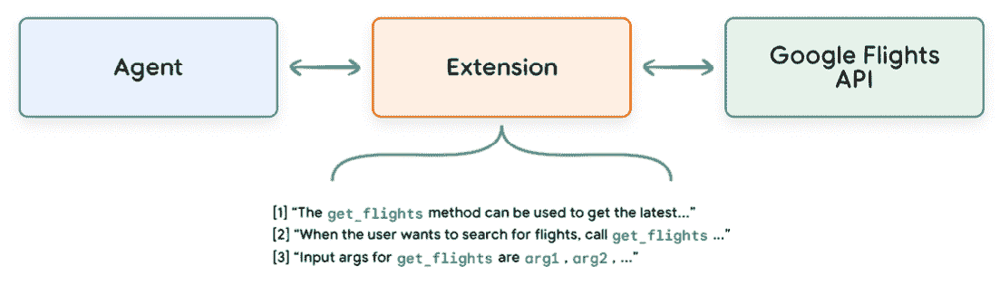

扩展可以独立于智能体进行创建，但应作为智能体配置的一部分提供。智能体在运行时使用模型和示例来决定哪个（如果有）扩展适合解决用户查询。这突显了扩展的一个关键优势，即其内置的示例类型，这些类型允许智能体动态选择最适合任务的扩展。

图5: 智能体与扩展、API之间的一对多关系

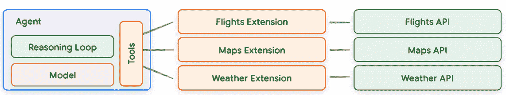

可以将其类比为软件开发人员在为用户的问题进行解决和方案设计时决定使用哪些 API 端点。如果用户想要预订航班，开发人员可能会使用Google Flights API。如果用户想知道离他们所在位置最近的咖啡店在哪里，开发人员可能会使用Google Maps API。以同样的方式，智能体/模型堆栈使用一组已知的扩展来决定哪个最适合用户的查询。如果您想了解扩展的实际应用，可以通过访问 Gemini 应用程序中的“设置”>“扩展”，然后启用任何您想测试的扩展来进行尝试。例如，您可以启用 Google Flights扩展，然后询问 Gemini“显示下周五从奥斯汀到苏黎世的航班”。

#### 3[**.**](https://blog.frognew.com/2025/01/agents-whitepaper-by-google.html#311-%e6%89%a9%e5%b1%95extensions%e7%a4%ba%e4%be%8b)1.1 扩展(Extensions)示例 #

为了简化扩展的使用，谷歌提供了一些开箱即用的扩展，可以快速导入到您的项目并以最少的配置使用。例如，代码解释器扩展（如代码片段1所示）允许您从自然语言描述生成并运行Python代码。

代码片段1 代码解释器扩展可以生成并运行Python代码

```
import vertexai
import pprint

PROJECT_ID = &quot;YOUR_PROJECT_ID&quot;REGION = &quot;us-central1&quot;
vertexai.init(project=PROJECT_ID, location=REGION)

from vertexai.preview.extensions import Extension

extension_code_interpreter = Extension.from_hub(&quot;code_interpreter&quot;)

CODE_QUERY = &quot;&quot;&quot;Write a python method to invert a binary tree in O(n) time.&quot;&quot;&quot;
response = extension_code_interpreter.execute(
    operation_id=&quot;generate_and_execute&quot;,
    operation_params={&quot;query&quot;: CODE_QUERY}
)

print(&quot;Generated Code:&quot;)
pprint.pprint({response[&#x27;generated_code&#x27;]})
```

上述代码片段将生成以下代码：

```
# Generated Code:class TreeNode:
    def __init__(self, val=0, left=None, right=None):
        self.val = val
        self.left = left
        self.right = right

def invert_binary_tree(root):
    &quot;&quot;&quot;
    Inverts a binary tree.

    Args:
        root: The root of the binary tree.

    Returns:
        The root of the inverted binary tree.
    &quot;&quot;&quot;    if not root:
        return None
    # Swap the left and right children recursively    root.left, root.right = invert_binary_tree(root.right), invert_binary_tree(root.left)
    return root

# Example usage:# Construct a sample binary treeroot = TreeNode(4)
root.left = TreeNode(2)
root.right = TreeNode(7)
root.left.left = TreeNode(1)
root.left.right = TreeNode(3)
root.right.left = TreeNode(6)
root.right.right = TreeNode(9)

# Invert the binary treeinverted_root = invert_binary_tree(root)
```

总而言之，扩展为智能体提供了一种以多种方式感知、交互和影响外部世界的方法。这些扩展的选择和调用由示例指导，所有示例都定义为扩展配置的一部分。

### [3](https://blog.frognew.com/2025/01/agents-whitepaper-by-google.html#32-%e5%87%bd%e6%95%b0functions).2 函数(Functions) #

在软件工程领域，函数被定义为完成特定任务并可根据需要重复使用的自包含代码模块。当软件开发人员编写程序时，他们通常会创建许多函数来执行各种任务。他们还将定义何时调用函数a与函数b的逻辑，以及预期的输入和输出。

函数在智能体领域的工作方式非常相似，但我们可以用模型代替软件开发人员。模型可以采用一组已知的函数，并根据其规范决定何时使用每个函数以及该函数需要的参数。函数与扩展有几种不同之处，最显著的是：

1.  模型输出一个函数及其参数，但不进行实时的API调用。

1.  函数在客户端执行，而扩展在智能体端执行。

再次使用我们的Google Flights示例，一个简单的函数设置可能类似于图7中的示例。

图7: 函数如何与外部 API 交互？

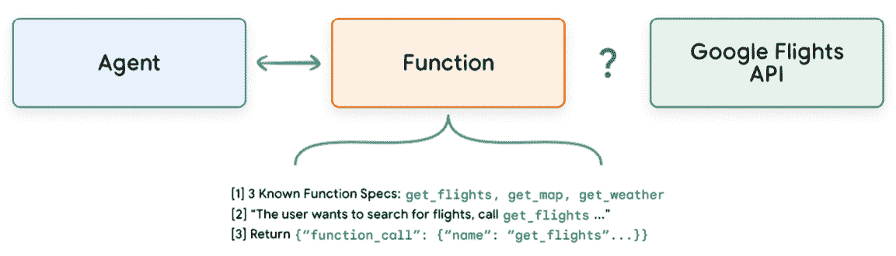

请注意，这里的主要区别是函数和智能体都不直接与Google Flights API交互。那么，API调用实际上是如何发生的呢？

对于函数来说，调用API接口的逻辑和实际执行都从智能体那里转移到了客户端应用，就像下面图8和图9展示的那样。这样做可以让开发人员更细致地控制应用里的数据流。开发人员有很多理由会选择用函数而不是扩展，下面是一些常见的用例：

+   需要在应用程序堆栈的另一层（在直接智能体架构流程之外）进行API调用（例如，中间件系统、前端框架等）。

+   存在安全或身份验证限制，阻止智能体直接调用API（例如，API未暴露于互联网，或智能体基础设施无法访问）。

+   存在时序或操作顺序约束，阻止智能体实时进行API调用（例如，批量操作、人工审核等）。

+   需要对API响应应用额外的据转换逻辑，而智能体无法执行此操作。例如，有些API接口不提供过滤机制来限制返回结果数量的。在客户端使用函数就能让开发人员有更多机会来进行这些处理。

+   开发人员可能想在不为API接口部署额外基础设施的情况下进行智能体开发迭代（也就是说，函数调用可以起到“桩代码”的作用）。

虽然如图8所示，这两种方法在内部架构上差别不大，但因为函数调用提供了额外的控制，并且不用那么依赖外部的基础设施，所以对开发人员来说，它还是挺有吸引力的。

图8: 说明扩展和函数调用中，哪些是客户端控制的，哪些是智能体控制的

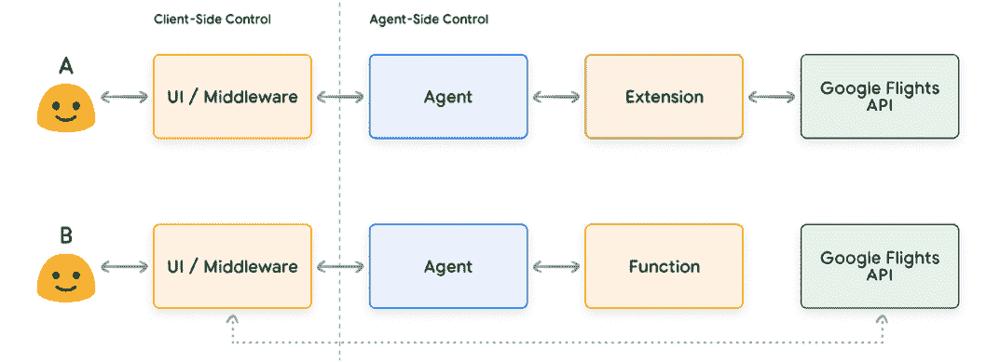

#### **3.2.1 用例** [**#**](https://blog.frognew.com/2025/01/agents-whitepaper-by-google.html#321-%e7%94%a8%e4%be%8b)

可以使用模型来调用函数，以便为最终用户处理复杂的客户端执行流程，在这种情况下，智能体开发人员可能不希望语言模型管理API执行（就像使用扩展的情况一样）。让我们考虑以下示例，其中一个智能体正在接受培训，作为旅行管家与想要预订度假旅行的用户互动。目标是让智能体生成一个城市列表，我们可以在中间件应用程序中使用该列表来为用户的旅行计划下载图像、数据等。用户可能会说这样的话：

我想和家人一起去滑雪旅行，但我不知道去哪里。

在一般情况下，给模型的提示可能会得到这样的输出：

没问题，这里有一些你可以考虑的适合家庭滑雪旅行的城市：

+   Crested Butte, Colorado, USA

+   Whistler, BC, Canada

+   Zermatt, Switzerland

虽然上面的输出包含了我们需要的数据（城市名），但格式不太好解析。有了函数调用，我们可以教模型把输出弄成结构化的格式（例如JSON），这样其他系统解析起来就方便多了。用户还是给出同样的提问，用函数得到的JSON输出可能就像代码片段5那样。

代码片段5 展示城市列表和用户爱好的函数调用数据示例

```
function_call {
  name: &quot;display_cities&quot;
  args: {
    &quot;cities&quot;: [&quot;Crested Butte&quot;, &quot;Whistler&quot;, &quot;Zermatt&quot;],
    &quot;preferences&quot;: &quot;skiing&quot;
  }
}
```

这个JSON数据是模型生成的，然后会发送到我们的客户端服务器，我们想怎么用就怎么用。在这个例子里，我们会调用Google Places API，拿到模型给出的城市，然后查出图片，再把这些图片弄成格式好看的富文本内容返回给用户。具体的过程可以看下面的图9，里面一步一步地画得很清楚。

**图9: 函数调用时序图**

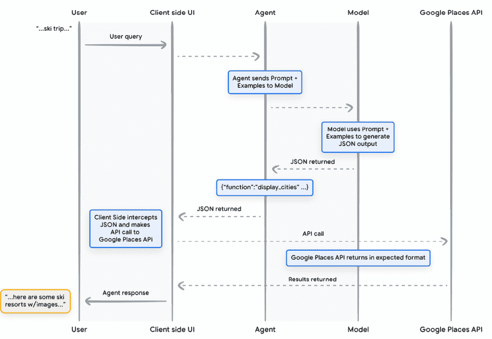

图9中的例子说明，模型的作用是“填空”，把客户端UI调用Google Places API需要的参数都填上。然后客户端UI就用模型在返回的函数里提供的参数来真正地调用API。这只是函数调用的一个用法，还有很多其他的情况也需要考虑，例如：

+   你希望语言模型给你推荐一些可以在代码里用的函数，但你又不想把凭据(credentials)写到代码里。因为函数调用并不会真的去执行函数，所以你就不需要在代码里连同函数信息一起写上凭据了。

+   如果你在运行一些需要好几秒甚至更长时间的异步操作，那就很适合用函数调用，因为它自己就是异步的。

+   你希望在与生成函数调用和参数的那个系统不同的设备上运行函数。

说到函数，得记住很重要的一点，就是它们让开发者能更好地控制API调用怎么执行，还有整个应用的数据是怎么流动的。就像图9那个例子，开发者没把API信息返回给智能体，因为觉得对它后面的行动没啥用。不过，要是从应用的架构来看，把外部API调用的数据返回给智能体，来影响它后面的推理、逻辑和行动，也是可以的。总之，怎么做还得看具体的应用，开发者自己说了算。

#### 3[**.**](https://blog.frognew.com/2025/01/agents-whitepaper-by-google.html#322-function%e7%a4%ba%e4%be%8b%e4%bb%a3%e7%a0%81)2.2 Function示例代码 #

为了从我们的滑雪度假场景中获得上述输出，让我们构建各个组成部分，以使其能够与我们的gemini-1.5-flash-001模型协同工作。首先，我们将display_cities函数定义为一个简单的Python函数。

代码片段6 一个用于显示城市列表功能的Python函数

```
from typing import Optional

def display_cities(cities: list[str], preferences: Optional[str] = None):
    &quot;&quot;&quot;Provides a list of cities based on the user&#x27;s search query and preferences.

    Args:
        preferences: The user&#x27;s preferences for the search, like skiing,
            beach, restaurants, bbq, etc.
        cities: The list of cities being recommended to the user.

    Returns:
        The list of cities being recommended to the user.
    &quot;&quot;&quot;    return cities
```

接下来，我们将实例化我们的模型，构建工具，然后将用户的查询和工具传递给模型。执行以下代码将产生代码片段底部所示的输出。

**代码片段7 构建一个工具，然后将其与用户查**询一同发送给模型，并允许函数调用得以执行

```
from vertexai.generative_models import GenerativeModel, Tool, FunctionDeclaration
model = GenerativeModel(&quot;gemini-1.5-flash-001&quot;)
display_cities_function = FunctionDeclaration.from_func(display_cities)
tool = Tool(function_declarations=[display_cities_function])
message = &quot;I’d like to take a ski trip with my family but I’m not sure whereto go.&quot;res = model.generate_content(message, tools=[tool])
print(f&quot;Function Name: {res.candidates[0].content.parts[0].function_call.name}&quot;)
print(f&quot;Function Args: {res.candidates[0].content.parts[0].function_call.args}&quot;)
```

```
&gt; Function Name: display_cities
&gt; Function Args: {&#x27;preferences&#x27;: &#x27;skiing&#x27;, &#x27;cities&#x27;: [&#x27;Aspen&#x27;, &#x27;Vail&#x27;, &#x27;Park City&#x27;]}
```

总之，函数提供了一个简单的框架，让应用程序开发者可以非常精细地控制数据怎么流动、系统怎么运行，同时还能有效地利用智能体/模型来生成重要的输入。开发者可以根据具体的应用架构来选择，是把外部数据返回给智能体让它“参与其中”，还是不返回。

### [3](https://blog.frognew.com/2025/01/agents-whitepaper-by-google.html#33-%e6%95%b0%e6%8d%ae%e5%ad%98%e5%82%a8data-stores).3 数据存储(Data Stores) #

将语言模型想象成一座藏书丰富的巨型图书馆，其馆藏即为其训练数据。然而，与不断购入新书的图书馆不同，这座图书馆是静态的，仅保存其最初训练时所获得的知识。这便带来了一个挑战，因为现实世界的知识是不断发展的。数据存储就是为了解决这个问题而生的，它可以让模型访问更动态、更新的信息，保证模型说出来的话都是有根据、有用的。

考虑一种常见的情形，即开发者可能需要向模型提供少量额外数据，例如以电子表格或PDF的形式。

图10: 智能体如何与结构化和非结构化数据进行交互？

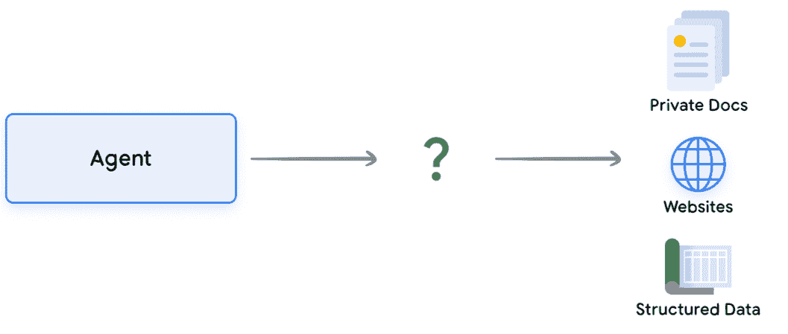

数据存储让开发者可以直接用原始格式给智能体提供额外的数据，就不用花时间去做数据转换、重新训练模型或者微调了。数据存储会把收到的文档转换成一组向量数据库的嵌入(embeddings)，智能体可以用这些嵌入来提取它需要的信息，补充它接下来的行动或者回复用户。

图11: 数据存储让智能体能够连接到各种新的实时数据源

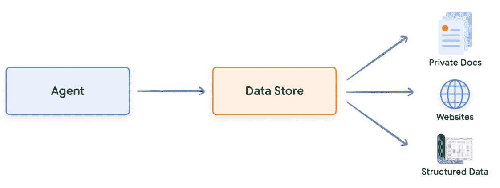

#### **3.3.1 实现与应用** [**#**](https://blog.frognew.com/2025/01/agents-whitepaper-by-google.html#331-%e5%ae%9e%e7%8e%b0%e4%b8%8e%e5%ba%94%e7%94%a8)

在生成式AI智能体领域，数据存储通常以向量数据库的形式实现，开发者希望智能体在运行时能够访问该数据库。虽然本文不深入探讨向量数据库，但需要理解的关键点是，它们以向量嵌入的形式存储数据，向量嵌入是一种高维向量或所提供数据的数学表示。近期，语言模型中使用数据存储最显著的例子之一是基于检索增强生成 (RAG) 的应用程序的实现。这些应用程序旨在通过使模型能够访问各种格式的数据:

+   网站内容

+   结构化数据，格式包括PDF、Word 文档、CSV、电子表格等。

+   非结构化数据，格式包括HTML、PDF、TXT等。

**图12: 智能体和数据存储之间是一对多的关系，表示**一个智能体可以对应多个预先建好索引的数据

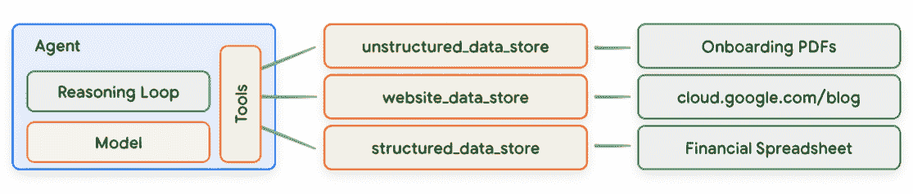

每个用户请求和智能体响应循环的基本过程通常如图13所示。

1.  用户查询被发送到嵌入模型以生成查询的嵌入。

1.  然后使用诸如 SCaNN 之类的匹配算法将查询嵌入与向量数据库的内容进行匹配。

1.  匹配的内容以文本格式从向量数据库中检索并发送回智能体。

1.  智能体接收用户查询和检索到的内容，然后形成响应或采取行动。

1.  最终响应被发送给用户。

图13: RAG应用中用户请求和智能体响应应的整个流程

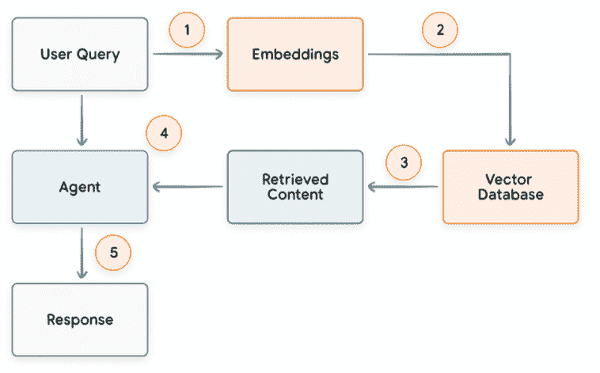

最终结果是一个应用程序，该应用程序允许智能体通过向量搜索将用户查询与已知数据存储进行匹配，检索原始内容，并将其提供给编排层和模型以进行进一步处理。下一步操作可能是向用户提供最终答案，或者执行额外的向量搜索以进一步优化结果。

图14展示了一个使用ReAct推理/行动实现RAG的智能体的交互示例。

图14: ReAct推理/行动 RAG 应用示例

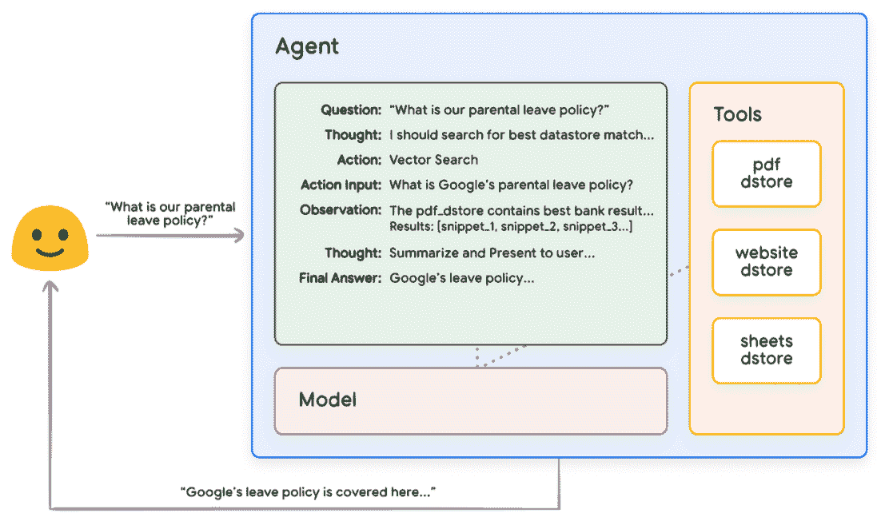

### 3.3 工具总结 [#](https://blog.frognew.com/2025/01/agents-whitepaper-by-google.html#33-%e5%b7%a5%e5%85%b7%e6%80%bb%e7%bb%93)

总的来说，扩展、函数和数据存储是智能体在运行时可用的几种不同工具类型。它们各有用途，智能体开发者可以根据需要单独或组合使用它们。

## [4](https://blog.frognew.com/2025/01/agents-whitepaper-by-google.html#4%e9%80%9a%e8%bf%87%e9%92%88%e5%af%b9%e6%80%a7%e5%ad%a6%e4%b9%a0%e6%8f%90%e5%8d%87%e6%a8%a1%e5%9e%8b%e6%80%a7%e8%83%bd).通过针对性学习提升模型性能 #

有效使用模型的关键方面之一是其在生成输出时选择正确工具的能力，尤其是在生产环境中大规模使用工具时。虽然一般训练有助于模型培养这项技能，但实际场景通常需要超出训练数据的知识。可以将此比作基本烹饪技巧与精通特定菜系之间的差异。两者都需要基础烹饪知识，但后者需要有针对性的学习才能获得更精细的结果。

为了帮助模型获得此类特定知识，存在几种方法：

+   In-context learning(上下文学习)：此方法在推理时为通用模型提供提示、工具和少量示例，使其能够“即时”学习如何以及何时针对特定任务使用这些工具。ReAct 框架是自然语言中此方法的一个示例。

+   **Retrieval-based in-context **learning(基于检索的上下文学习)：此技术通过从外部记忆中检索最相关的信息、工具和相关示例，动态填充模型提示。Vertex AI 扩展中的“示例存储”或先前所述的基于 RAG 架构的数据存储是这方面的一个例子。

+   Fine-tuning based learning(基于微调的学习)：此方法包括在推理之前使用更大的特定示例数据集训练模型。这有助于模型在接收任何用户查询之前了解何时以及如何应用某些工具。

为了更深入地了解每种方法，再来看看我们之前关于烹饪的例子。

+   想象一下，一位厨师收到了一份特定的食谱（提示）、一些关键食材（相关工具）以及一些菜肴示例（少量示例），均来自顾客。基于这些有限的信息以及厨师的一般烹饪知识，他们需要“即时”弄清楚如何烹制最符合食谱和顾客偏好的菜肴。这就是上下文学习。

+   现在，让我们设想这位厨师在一个储备充足的食品储藏室（外部数据存储）的厨房里，那里摆放着各种食材和食谱（示例和工具）。厨师现在能够从储藏室中动态选择食材和食谱，并更好地符合顾客的食谱和偏好。这使得厨师能够利用现有知识和新知识，创造出更丰富、更精致的菜肴。这就是基于检索的上下文学习。

+   最后，让我们设想我们将这位厨师送回学校学习新的菜系或一系列菜系（使用更大的特定示例数据集进行预训练）。这使得厨师能够以更深入的理解来处理未来未见过的顾客食谱。如果我们希望厨师在特定菜系（知识领域）中表现出色，这种方法是完美的。这就是基于微调的学习。

就速度、成本和延迟而言，这些方法各有优缺点。然而，通过在智能体框架中结合这些技术，我们可以利用各种优势并最大限度地减少其缺点，从而实现更强大、更具适应性的解决方案。

## [5](https://blog.frognew.com/2025/01/agents-whitepaper-by-google.html#5%e4%bd%bf%e7%94%a8langchain%e5%bf%ab%e9%80%9f%e4%b8%8a%e6%89%8b%e6%99%ba%e8%83%bd%e4%bd%93).使用LangChain快速上手智能体 #

为了提供一个实际可执行的智能体应用示例，我们将使用LangChain和LangGraph库构建一个快速原型。这些流行的开源库允许用户通过“链接(chaining)”一系列逻辑、推理和工具调用来构建自定义智能体，以回答用户查询。我们将使用gemini-1.5-flash-001模型和一些简单的工具来回答用户在代码片段8中所展示的多阶段查询。

我们使用的工具是SerpAPI（用于Google搜索）和 Google Places API。执行代码片段8中的程序后，您可以在代码片段9中看到示例输出。

**代码片段8 带有工具的基于 LangChai**n 和 LangGraph 的智能体示例

```
from langgraph.prebuilt import create_react_agent
from langchain_core.tools import tool
from langchain_community.utilities import SerpAPIWrapper
from langchain_community.tools import GooglePlacesTool

# Set API Keys (replace with your actual keys)os.environ[&quot;SERPAPI_API_KEY&quot;] = &quot;YOUR_SERPAPI_API_KEY&quot;os.environ[&quot;GPLACES_API_KEY&quot;] = &quot;YOUR_GPLACES_API_KEY&quot;

@tooldef search(query: str) -&gt; dict:
    &quot;&quot;&quot;
    Use the SerpAPI to run a Google Search and return the results as a dictionary.
    &quot;&quot;&quot;    search_tool = SerpAPIWrapper()
    return search_tool.run(query)


@tooldef places(query: str) -&gt; dict:
    &quot;&quot;&quot;
    Use the Google Places API to run a Google Places Query and return the results as a dictionary.
    &quot;&quot;&quot;    places_tool = GooglePlacesTool()
    return places_tool.run(query)


model = ChatVertexAI(model=&quot;gemini-1.5-flash-001&quot;)
tools = [search, places]

query = &quot;&quot;&quot;Who did the Texas Longhorns play in football last week? 
What is the address of the other team&#x27;s stadium?&quot;&quot;&quot;  # Improved readability with triple quotes
agent = create_react_agent(model, tools)

input_data = {&quot;messages&quot;: [(&quot;human&quot;, query)]}

for response in agent.stream(input_data, stream_mode=&quot;values&quot;):
    message = response[&quot;messages&quot;][-1]
    if isinstance(message, tuple):
        print(message)
    else:
        message.pretty_print()
```

代码片段9 代码片段8中程序的输出

```
=============================== Human Message ================================
Who did the Texas Longhorns play in football last week? What is the address
of the other team&#x27;s stadium?
================================= Ai Message =================================
Tool Calls: search
Args:
query: Texas Longhorns football schedule
================================ Tool Message ================================
Name: search
{...Results: &quot;NCAA Division I Football, Georgia, Date...&quot;}
================================= Ai Message =================================
The Texas Longhorns played the Georgia Bulldogs last week.
Tool Calls: places
Args:
query: Georgia Bulldogs stadium
================================ Tool Message ================================
Name: places
{...Sanford Stadium Address: 100 Sanford...}
================================= Ai Message =================================
The address of the Georgia Bulldogs stadium is 100 Sanford Dr, Athens, GA
30602, USA.
```

虽然这是一个相当简单的智能体示例，但它展示了模型、编排和工具等基本组件如何协同工作以实现特定目标。在最后一节中，我们将探讨这些组件如何在 Google 规模的托管产品（例如 Vertex AI 智能体和 Generative Playbooks）中结合使用。

## [6](https://blog.frognew.com/2025/01/agents-whitepaper-by-google.html#6%e4%bd%bf%e7%94%a8google-vertex-ai-agent%e5%88%9b%e5%bb%ba%e7%94%9f%e4%ba%a7%e5%ba%94%e7%94%a8).使用Google Vertex AI Agent创建生产应用 #

虽然本白皮书探讨了智能体的核心组件，但构建生产级应用程序需要将它们与用户界面、评估框架和持续改进机制等其他工具集成。Google 的 Vertex AI 平台通过提供一个完全托管的环境（包含前面所述的所有基本要素）简化了这一过程。使用自然语言界面，开发人员可以快速定义其智能体的关键要素——目标、任务指令、工具、用于任务委派的子智能体以及示例——以轻松构建所需的系统行为。此外，该平台还提供了一组开发工具，用于测试、评估、衡量智能体性能、调试以及提高已开发智能体的整体质量。这使开发人员能够专注于构建和改进他们的智能体，而基础设施、部署和维护的复杂性则由平台自身管理。

图15展示了一个使用 Vertex AI 平台上的各种功能（例如 Vertex Agent Builder、Vertex Extensions、Vertex Function Calling 和 Vertex Example Store 等）构建的智能体的示例架构。该架构包含生产就绪应用程序所需的许多不同组件。

图15: Vertex AI平台端到端智能体架构示例

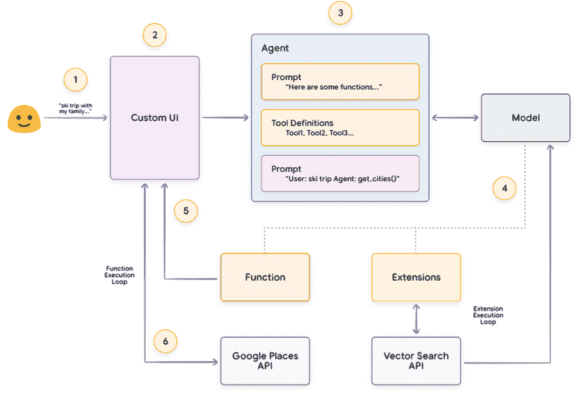

## 7.总结 [#](https://blog.frognew.com/2025/01/agents-whitepaper-by-google.html#7%e6%80%bb%e7%bb%93)

在本白皮书中，我们探讨了生成式 AI 智能体的基本构建模块、它们的组成以及以认知架构形式有效实施它们的方法。本白皮书的一些主要结论包括：

1.  智能体通过利用工具访问实时信息、提出实际操作建议以及自主规划和执行复杂任务，扩展了语言模型的功能。智能体可以利用一个或多个语言模型来决定何时以及如何转换状态，并使用外部工具来完成模型自身难以或无法完成的任意数量的复杂任务。

1.  智能体运行的核心是编排层，这是一种认知架构，用于构建推理、规划、决策并指导其行动。诸如 ReAct、思维链(CoT)和思维树(ToT)等各种推理技术为编排层提供了框架，使其能够接收信息、执行内部推理并生成明智的决策或响应。

1.  扩展、函数和数据存储等工具是智能体通往外部世界的关键，使它们能够与外部系统交互并访问超出其训练数据的知识。扩展提供了智能体和外部API之间的桥梁，从而能够执行API调用并检索实时信息。函数通过分工为开发人员提供了更精细的控制，允许智能体生成可在客户端执行的函数参数。数据存储为智能体提供了对结构化或非结构化数据的访问，从而支持数据驱动的应用程序。

智能体的未来充满令人兴奋的进步，我们才刚刚开始探索其可能性。随着工具变得更加复杂且推理能力得到增强，智能体将能够解决日益复杂的问题。此外，“智能体链接(agent chaining)”的战略方法将继续获得发展势头。通过结合专门的智能体——每个智能体都擅长特定的领域或任务——我们可以创建一种“智能体专家混合”方法，能够在各个行业和问题领域提供卓越的成果。

重要的是要记住，构建复杂的智能体架构需要迭代方法。实验和改进是为特定业务案例和组织需求找到解决方案的关键。由于构成其架构基础的基础模型的生成性质，没有两个智能体是完全相同的。然而，通过利用这些基本组件的优势，我们可以创建影响深远的应用，扩展语言模型的功能并驱动实际价值。

## 参考资料 [#](https://blog.frognew.com/2025/01/agents-whitepaper-by-google.html#%e5%8f%82%e8%80%83%e8%b5%84%e6%96%99)

1.  Shafran, I., Cao, Y. et al. (2022). ReAct: Synergizing Reasoning and Acting in Language Models. https://arxiv.org/abs/2210.03629

1.  We[i, J., Wang, X. ](https://arxiv.org/pdf/2201.11903.pdf)et al. (2023). Chain-of-Thought Prompting Elicits Reasoning in Large Language Models. https://arxiv.org/pdf/2201.11903.pdf

1.  Wang, X. et al. (2022). Self-Consistency Improves Chain of Thought Reasoning in Language Models. https://arxiv.org/abs/2203.11171

1.  Di[ao, S. et al. (2](https://arxiv.org/pdf/2302.12246.pdf)023). Active Prompting with Chain-of-Thought for Large Language Models. https://arxiv.org/pdf/2302.12246.pdf

1.  Zhang, H. et al. (2023). Multimodal Chain-of-Thought Reasoning in Language Models. https://arxiv.org/abs/2302.00923

1.  Yao, S. et al. (2023). Tree of Thoughts: Deliberate Problem Solving with Large Language Models. https://arxiv.org/abs/2305.10601

1.  Long, X. (2023). Large Language Model Guided Tree-of-Thought. https://arxiv.org/abs/2305.08291

1.  Google. Google Gemini Application. http://gemini.google.com

1.  Swagger. OpenAPI Specification. https://swagger.io/specification/

1.  Xie[,](https://ai.stanford.edu/blog/understanding-incontext/) M. (2022). How does in-context learning work? A framework for understanding the differences from traditional supervised learning. https://ai.stanford.edu/blog/understanding-incontext/

1.  G[o](https://github.com/google-research/google-research/tree/master/scann)ogle Research. ScaNN (Scalable Nearest Neighbors). https://github.com/google-research/google-research/tree/master/scann

1.  [L](https://python.langchain.com/v0.2/docs/introduction/)angChain. LangChain. https://python.langchain.com/v0.2/docs/introduction/

https://www.kaggle.com/whitepaper-agent-companion