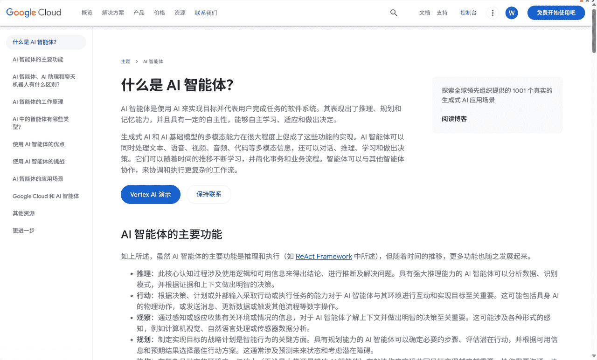

# Google AI Agent Guide

> 来源：[https://gotoaiworld.feishu.cn/docx/K2w2dhbMxoehHYxfHORc6s3In1e](https://gotoaiworld.feishu.cn/docx/K2w2dhbMxoehHYxfHORc6s3In1e)

# 什么是 AI 智能体？

AI 智能体是使用 AI 来实现目标并代表用户完成任务的软件系统。其表现出了推理、规划和记忆能力，并且具有一定的自主性，能够自主学习、适应和做出决定。

生成式 AI 和 AI 基础模型的多模态能力在很大程度上促成了这些功能的实现。AI 智能体可以同时处理文本、语音、视频、音频、代码等多模态信息，还可以对话、推理、学习和做出决策。它们可以随着时间的推移不断学习，并简化事务和业务流程。智能体可以与其他智能体协作，来协调和执行更复杂的工作流。

https://cloud.google.com/discover/what-are-ai-agents?hl=zh-CN

## AI 智能体的主要功能

[如上所述，虽然 AI 智能体的](https://arxiv.org/pdf/2210.03629)主要功能是推理和执行（如 ReAct Framework 中所述），但随着时间的推移，更多功能也随之发展起来。

+   **推理**：此核心认知过程涉及使用逻辑和可用信息来得出结论、进行推断及解决问题。具有强大推理能力的 AI 智能体可以分析数据、识别模式，并根据证据和上下文做出明智的决策。

+   **行动**：根据决策、计划或外部输入采取行动或执行任务的能力对于 AI 智能体与其环境进行互动和实现目标至关重要。这可能包括具身 AI 的物理动作，或发送消息、更新数据或触发其他流程等数字操作。

+   **观察**：通过感知或感应收集有关环境或情况的信息，对于 AI 智能体了解上下文并做出明智的决策至关重要。这可能涉及各种形式的感知，例如计算机视觉、自然语言处理或传感器数据分析。

+   **规划**：制定实现目标的战略计划是智能行为的关键方面。具有规划能力的 AI 智能体可以确定必要的步骤、评估潜在行动，并根据可用信息和预期结果选择最佳行动方案。这通常涉及预测未来状态和考虑潜在障碍。

+   **协作**：在复杂且动态的环境中，与他人（无论是人类还是其他 AI 智能体）有效协作来实现共同目标变得越来越重要。协作需要沟通、协调以及理解和尊重他人观点的能力。

+   **自我完善**：自我改进和自适应能力是高级 AI 系统的标志。具有自我完善能力的 AI 智能体可以从经验中学习，根据反馈调整行为，并随着时间的推移不断提升性能和能力。这可能涉及机器学习技术、优化算法或其他形式的自行修改。

## AI 智能体、AI 助理和聊天机器人有什么区别？

**AI 助理**是作为应用或产品而设计的 AI 智能体，可通过理解和响应自然人类语言和输入内容，与用户直接协作并执行任务。其可以在用户的监督下进行推理并代表用户采取行动。

AI 助理通常嵌入在所使用的产品中。一个关键特征是，助理和用户在任务的不同步骤中进行互动。助理会响应用户的请求或提示，且可以推荐操作，但决策由用户做出。

### 主要区别

+   **自主性**：AI 智能体具有最高程度的自主性，能够独立操作并做出决策来实现目标。AI 助理不太自主，需要用户输入和指示。聊天机器人自主性最低，通常遵循预先编写的规则。

+   **复杂性**：AI 智能体旨在处理复杂的任务和工作流，而 AI 助理和聊天机器人则更适合处理简单的任务和互动。

+   **学习**：AI 智能体通常会利用机器学习来不断适应并提高性能。AI 助理可能具有一定的学习能力，而聊天机器人通常只有有限的学习能力或没有学习能力。

## AI 智能体的工作原理

每个智能体都定义了角色、个性和沟通风格，包括具体指令和可用工具的说明。

+   **角色**：定义良好的角色可让智能体保持一致的性格，并以适合其分配角色的方式行事，随着智能体获得经验并与环境互动而不断发展。

+   **记忆**：智能体通常配备短期记忆、长期记忆、共识记忆及情景记忆。短期记忆用于即时互动，长期记忆用于历史数据和对话，情景记忆用于过去的互动，共识记忆用于智能体之间的共享信息。智能体可以回忆过去的互动并适应新情况，从而保持上下文、从经验中学习并提高性能。

+   **工具**：工具是智能体可以利用的函数或外部资源，用于与环境互动并增强功能。工具可让智能体访问信息、处理数据或控制外部系统来执行复杂的任务，并且可以根据界面进行分类，包括物理界面、图形界面和基于程序的界面。工具学习包括教智能体如何通过了解工具的功能及其应用场景，来有效地使用这些工具。

+   **模型**：大语言模型 (LLM) 是构建 AI 智能体的基础，为智能体提供理解、推理和行动的能力。LLM 充当智能体的“大脑”，使其能够处理和生成语言，而其他组件则促进推理和行动。

## AI 中的智能体有哪些类型？

可以根据 AI 智能体的功能、角色和环境，以多种方式对其进行分类。以下是一些主要的智能体类别：

智能体类型和智能体类别具有不同的定义。

### 基于互动

一种对智能体进行分类的方法是根据它们与用户的互动方式。有些智能体会直接与用户对话，而有些智能体则在后台运行，无需用户直接输入即可执行任务：

+   **互动式合作伙伴**（也称为表面智能体）- 协助我们执行客户服务、医疗保健、教育和科学发现等任务，提供个性化和智能支持。对话智能体包括与人类进行问答、闲聊和世界知识互动。它们通常由用户查询触发，并执行用户查询或事务。

+   **自主后台处理**（也称为后台智能体）- 在后台运行以自动执行常规任务、分析数据以获取数据洞见、优化流程以提高效率，并主动识别和解决潜在问题。其中包括工作流智能体。它们与人类的互动有限或没有互动，通常由事件驱动，并执行排队的任务或任务链。

### 根据智能体数量

+   **单个智能体**：独立运作来实现特定目标。其利用外部工具和资源来完成任务，从而增强在不同环境中的功能。最适合用于不需要与其他 AI 智能体协作的明确具体的任务。只能处理一个基础模型进行其处理。

+   **多智能体**：通过协作或竞争来实现共同目标或各自目标的多个 AI 智能体。这些系统利用各个智能体的不同能力和角色，来处理复杂的任务。多智能体系统可以在互动场景中模拟人类行为，例如人际沟通。每个智能体都可以拥有最适合其需求的基础模型。

### 使用 AI 智能体的优点

AI 智能体可以通过提供自主性、任务自动化，以及借助工具和具身化与现实世界交互的能力，来增强语言模型的能力。