# Awesome AI Agents

> 来源：[https://gotoaiworld.feishu.cn/docx/UrSRdfqI6oafgHxTQpscbRsynpc](https://gotoaiworld.feishu.cn/docx/UrSRdfqI6oafgHxTQpscbRsynpc)

https://github.com/e2b-dev/awesome-ai-agents

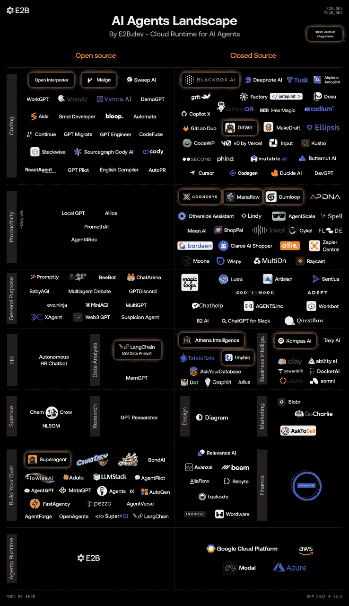

## Add Code Interpreter to your AI App

### 🌟 See this list in web UI

### 👉 Submit new product here

Welcome to our list of AI agents. We structured the list into two parts:

+ Open source projects
+ [Closed-source projects and companies](https://github.com/e2b-dev/awesome-ai-agents#closed-source-projects-and-companies)

To filter the products by categories and use-cases, see the 🌟 web version of this list. 🌟

The list is done according to our best knowledge, although definitely not comprehensive. Check out also the [Awesome List of SDKs for AI Agents](https://github.com/e2b-dev/awesome-sdks-for-ai-agents). Discussion and feedback appreciated! ❤️

## Have anything to add?

Create a pull request or fill in [this form](https://forms.gle/UXQFCogLYrPFvfoUA). Please keep the alphabetical order and in the correct category.

For adding AI agents'-related SDKs, frameworks and tools, please visit Awesome SDKs for AI Agents. This list is only for AI assistants and agents.

## Check out E2B - Code Interpreting for AI apps

+ Check out Code Interpreter SDK
+ [Explore examples in E2B Cookbook](https://github.com/e2b-dev/e2b-cookbook)
+ Read our [docs](https://e2b.dev/docs?ref=awesome-sdks)
+ Contact us at [hello@e2b.dev](mailto:hello@e2b.dev) or [on Discord](https://discord.gg/35NF4Y8WSE). Follow us on [X (Twitter)](https://twitter.com/e2b)

## Open-source projects

### [Adala](https://github.com/HumanSignal/Adala)

Adala: Autonomous Data (Labeling) Agent framework

#### Category

General purpose, Build your own, Multi-agent

#### Description

+ Reliable agents: Built on ground truth data for consistent, trustworthy results.
+ Controllable output: Tailor output with flexible constraints to fit your needs.
+ Specialized in data processing: Agents excel in custom data labeling and processing tasks.
+ Autonomous learning: Agents evolve through observations and reflections, not just automation.
+ Flexible and extensible runtime: Adaptable framework with community-driven evolution for diverse needs.
+ Easily customizable: Develop agents swiftly for unique challenges, no steep learning curve.

#### Links

+ [Documentation](https://humansignal.github.io/Adala/)
+ [Discord](https://discord.gg/QBtgTbXTgU)
+ [GitHub](https://github.com/HumanSignal/Adala)

### [Agent4Rec](https://github.com/LehengTHU/Agent4Rec)

Recommender system simulator with 1,000 agents

### [AgentForge](https://github.com/DataBassGit/AgentForge)

LLM-agnostic platform for agent building & testing

### [AgentGPT](https://agentgpt.reworkd.ai/)

Browser-based no-code version of AutoGPT

### [AgentPilot](https://github.com/jbexta/AgentPilot)

Build, manage, and chat with agents in desktop app

### [Agents](https://github.com/aiwaves-cn/agents)

Library/framework for building language agents

### [AgentVerse](https://github.com/OpenBMB/AgentVerse)

Platform for task-solving & simulation agents

### [AI Legion](https://github.com/eumemic/ai-legion)

Multi-agent TS platform, similar to AutoGPT

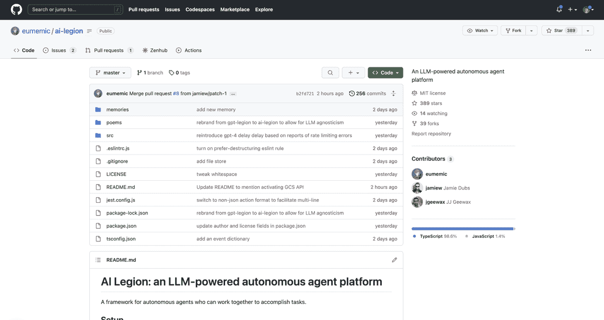

### [Aider](https://github.com/paul-gauthier/aider)

Use command line to edit code in your local repo

### [AIlice](https://github.com/myshell-ai/AIlice)

Create agents-calling tree to execute your tasks

### [AutoGen](https://github.com/microsoft/autogen)

Multi-agent framework with diversity of agents

### [AutoGPT](https://agpt.co/?utm_source=awesome-ai-agents)

Experimental attempt to make GPT4 fully autonomous

### [Automata](https://github.com/emrgnt-cmplxty/automata)

Generate code based on your project context

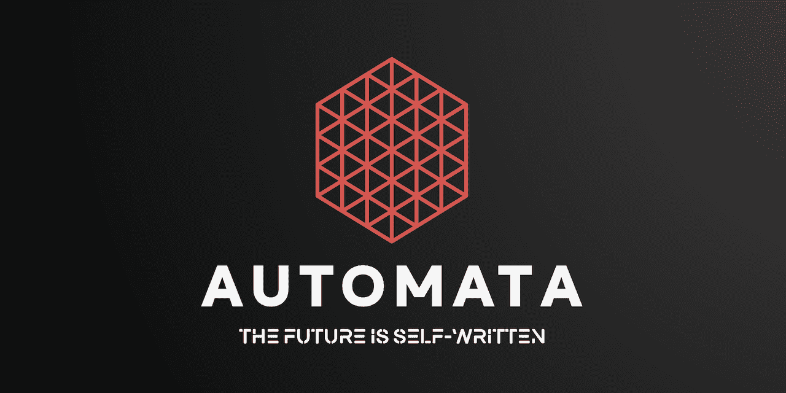

### [AutoPR](https://github.com/irgolic/AutoPR)

AI-generated pull requests agent that fixes issues

### Autonomous HR Chatbot

Agent that answers HR-related queries using tools

### [BabyAGI](https://github.com/yoheinakajima/babyagi)

A simple framework for managing tasks using AI

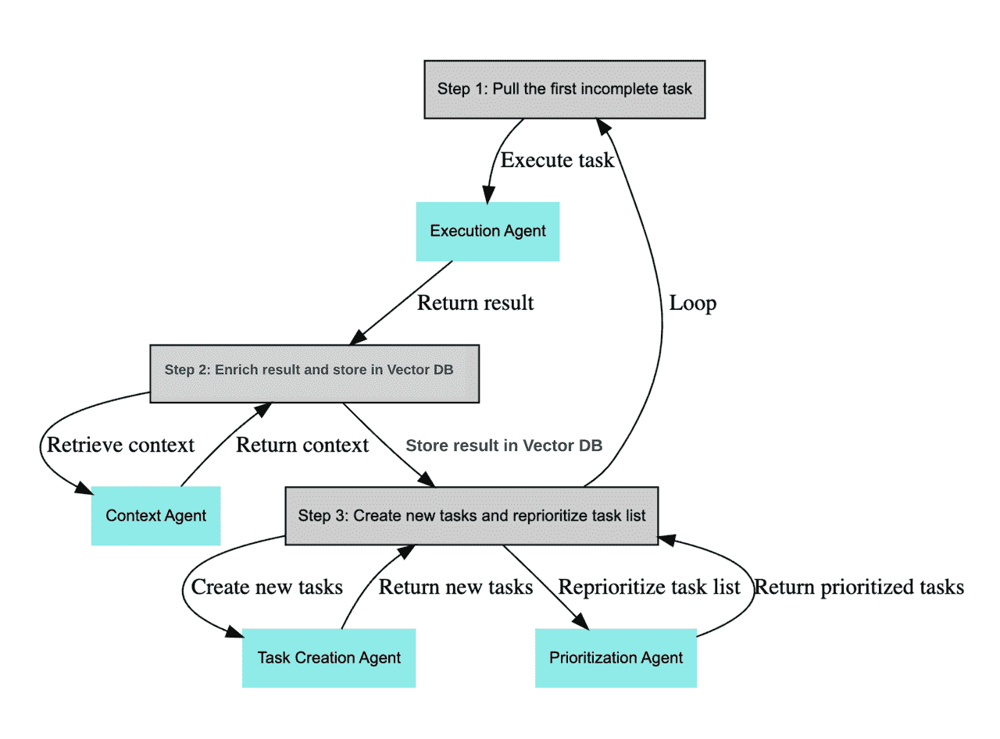

### [BabyBeeAGI](https://yoheinakajima.com/babybeeagi-task-management-and-functionality-expansion-on-top-of-babyagi/)

Task management & functionality BabyAGI expansion

### [BabyCatAGI](https://replit.com/@YoheiNakajima/BabyCatAGI)

BabyCatAGI is a mod of BabyBeeAGI

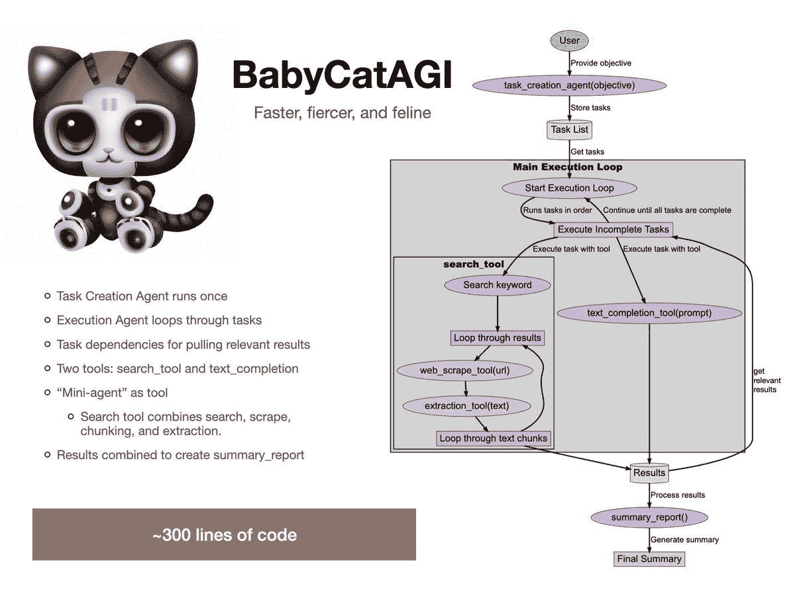

### [BabyDeerAGI](https://twitter.com/yoheinakajima/status/1666313838868992001)

Mod of BabyAGI with only ~350 lines of code

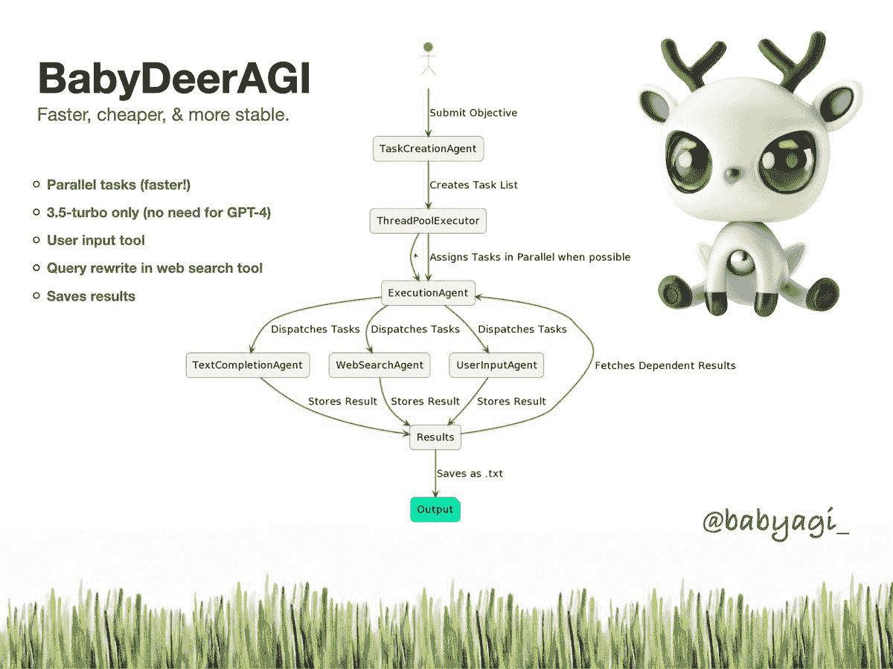

### [BabyElfAGI](https://twitter.com/yoheinakajima/status/1678443482866933760)

Mod of BabyDeerAGI, with ~895 lines of code

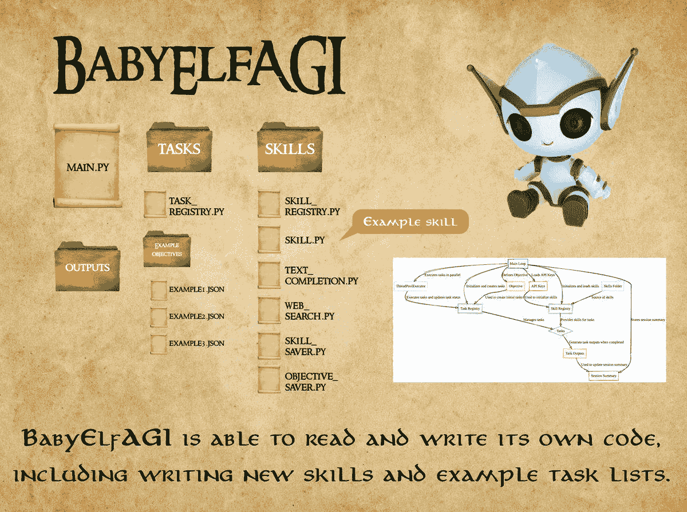

### [BabyCommandAGI](https://github.com/saten-private/BabyCommandAGI)

Test what happens when you combine CLI and LLM

## [BabyFoxAGI](https://github.com/yoheinakajima/babyagi/tree/main/classic/babyfoxagi)

Mod of BabyAGI with a new parallel UI panel

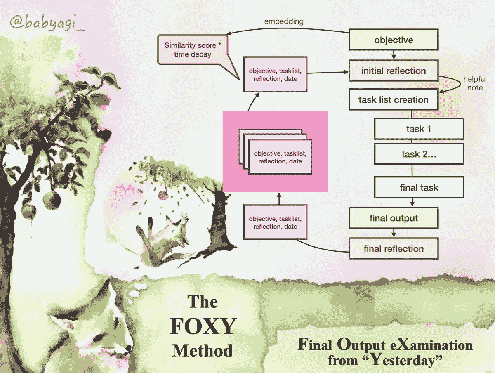

## [BambooAI](https://github.com/pgalko/BambooAI)

Data exploration and analysis for non-programmers

## [BeeBot](https://github.com/AutoPackAI/beebot)

Early-stage project for wide range of tasks

## [Blinky](https://github.com/seahyinghang8/blinky)

An open-source AI debugging agent for VSCode

## [Bloop](https://bloop.ai/)

AI code search, works for Rust and Typescript

## [BondAI](https://bondai.dev/)

Code interpreter with CLI & RESTful/WebSocket API

## [bumpgen](https://github.com/xeol-io/bumpgen)

AI agent that keeps npm dependencies up-to-date

## [Cal.ai](https://cal.ai/)

Open-source scheduling assistant built on Cal.com

## [CAMEL](https://github.com/camel-ai/camel)

Architecture for “Mind” Exploration of agents

## [ChatArena](https://www.chatarena.org/)

A chat tool for multi agent interaction

## [ChatDev](https://github.com/OpenBMB/ChatDev)

Communicative agents for software development

## [ChemCrow](https://github.com/ur-whitelab/chemcrow-public)

LangChain agent for chemistry-related tasks

## [Clippy](https://github.com/ennucore/clippy/)

Agent that can plan, write, debug, and test code

## CodeFuse-ChatBot

Agent serving entire SW development lifecycle

## Cody by ajhous44

Query and navigate your codebase

## Cody by Sourcegraph

Agent that writes code and answers your questions

## [Continue](https://continue.dev/)

Open-source autopilot for software development

## [CrewAI](https://github.com/joaomdmoura/crewai)

Framework for orchestrating role-playing agents

## [data-to-paper](https://github.com/Technion-Kishony-lab/data-to-paper)

AI-driven research from data to human-verifiable research papers

## [Databerry](https://www.databerry.ai/)

(Pivoted to Chaindesk) No-code chatbot building

## [DemoGPT](https://github.com/melih-unsal/DemoGPT)

Generates demo of a new app (of any purpose)

## [DevGPT](https://github.com/jina-ai/dev-gpt)

Team of virtual developers

## [Devika](https://github.com/stitionai/devika)

Agentic AI Software Engineer

## [Devon](https://github.com/entropy-research/Devon)

Open-source Devin alternative

## [DevOpsGPT](https://github.com/kuafuai/DevOpsGPT)

AI-Driven SW Development Automation Solution

## [dotagent](https://github.com/dot-agent/dotagent)

Deploy agents on cloud, PCs, or mobile devices

## [Eidolon](https://eidolonai.com/)

Multi Agent SDK with pluggable, modular components

## English Compiler

Converting markdown specs into functional code

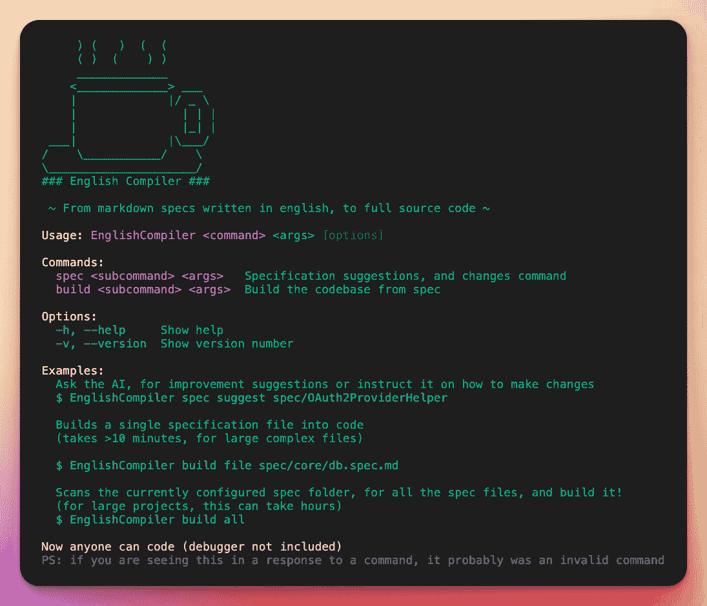

## [evo.ninja](https://evo.ninja/)

AI agent that adapts its persona to achive tasks

## [FastAgency](https://fastagency.ai/latest/)

The fastest way to deploy multi-agent workflows

## [Flowise](https://flowiseai.com/)

Low code Agent builder

## [Friday](https://github.com/amirrezasalimi/friday/)

AI developer assistant for Node.js

## [GeniA](https://github.com/genia-dev/GeniA)

Engineering platform engineering AI team member

## [Godmode](https://godmode.space/)

Inspired by AutoGPT and BabyAGI, with nice UI

## [GPT Discord](https://github.com/Kav-K/GPTDiscord)

The ultimate AI agent integration for Discord

## [GPT Engineer](https://gptengineer.app/)

Generates entire codebase based on a prompt

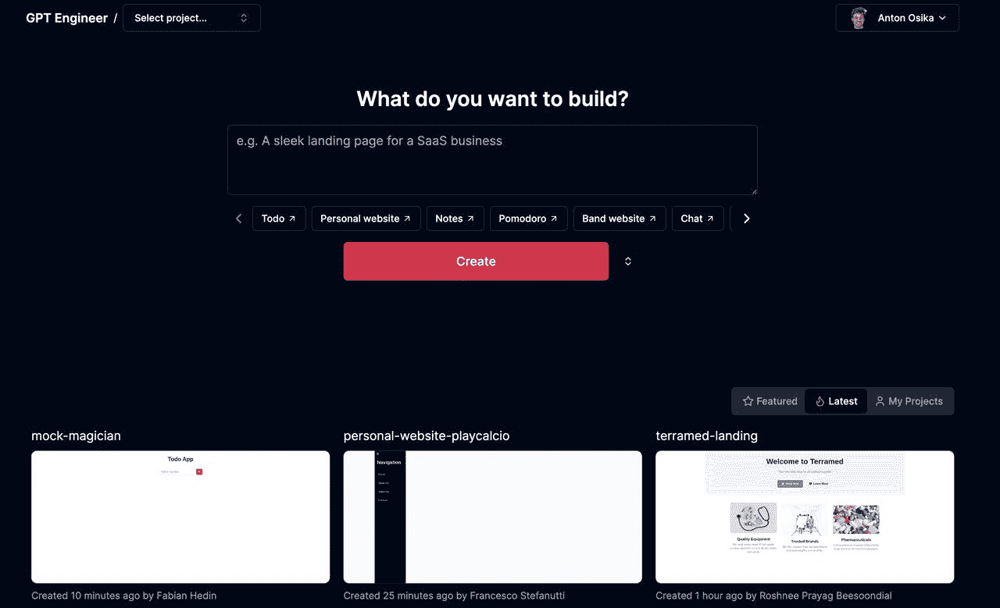

## [GPT Migrate](https://github.com/0xpayne/gpt-migrate)

Migrate codebase between frameworks/languages

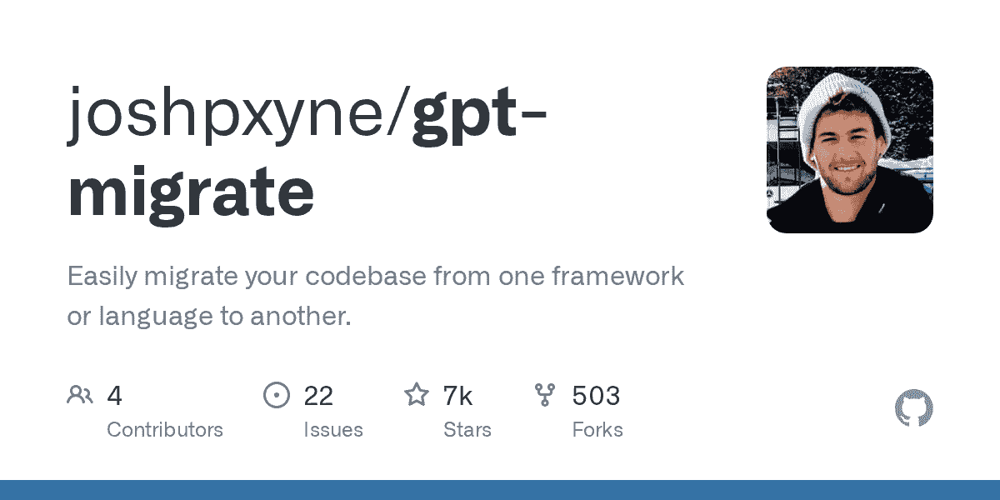

## [GPT Pilot](https://github.com/Pythagora-io/gpt-pilot)

Code the entire scalable app from scratch

## [GPT Researcher](https://github.com/assafelovic/gpt-researcher)

Agent that researches entire internet on any topic

## [GPT Runner](https://github.com/nicepkg/gpt-runner)

Agent that converses with your files

## [GPTSwarm](https://gptswarm.org/)

Language Agents as Optimizable Graphs

## [IX](https://github.com/kreneskyp/ix)

Agents building, debugging, and deploying platform

## [JARVIS](https://github.com/microsoft/JARVIS)

System that connects LLMs with the ML community

## [Langroid](https://github.com/langroid/langroid)

Multi-agent framework for building LLM apps

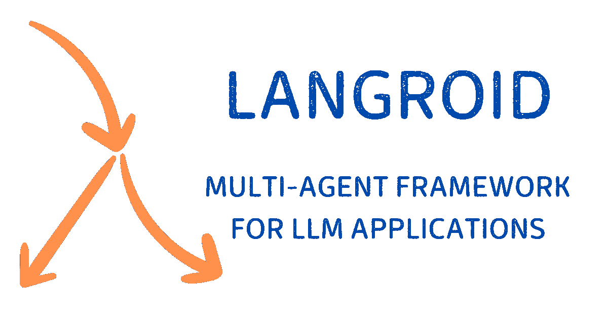

## [Lemon Agent](https://github.com/felixbrock/lemon-agent)

Plan-Validate-Solve agent for workflow automation

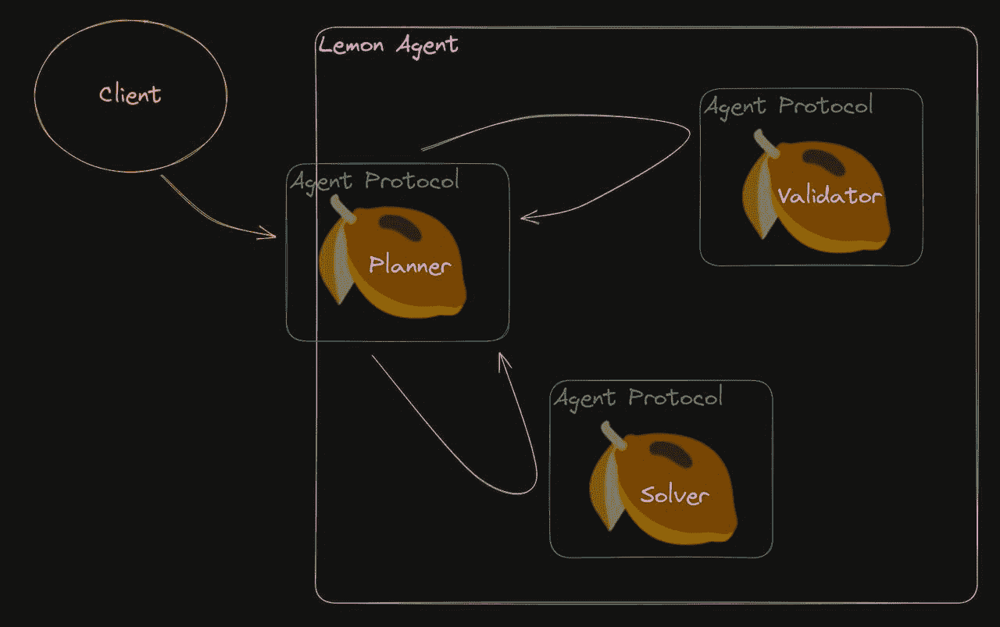

## [LLM Agents](https://github.com/mpaepper/llm_agents)

Library for building agents, using tools, planning

## [LLM Stack](https://llmstack.ai/)

No-code platform to build LLM Agents

## [Local GPT](https://github.com/PromtEngineer/localGPT)

Chat with documents without compromising privacy

## [Loop GPT](https://github.com/farizrahman4u/loopgpt/tree/main)

# Re-implementation of AutoGPT as a Python package

## [L2MAC](https://github.com/samholt/l2mac)

Agent framework able to produce large complex codebases and entire books

## [Maige](https://maige.app/)

Natural-language workflows for your GitHub repo.

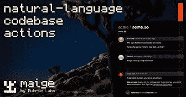

## [Magick](https://www.magickml.com/)

AIDE for creating, deploying, monetizing agents

## [MemFree](https://github.com/memfreeme/memfree)

Open Source Hybrid AI Search Engine

## [MemGPT](https://github.com/cpacker/MemGPT)

Memory management system, providing context to LLM

## [Mentat](https://github.com/biobootloader/mentat)

Assists you with coding task from command line

## [MetaGPT](https://github.com/geekan/MetaGPT)

Agent framework returning Design, Tasks, or Repo

## [Mini AGI](https://github.com/muellerberndt/mini-agi)

General-purpose agent based on GPT-3.5 / GPT-4

## Multiagent Debate

Implementation of a paper on Multiagent Debate

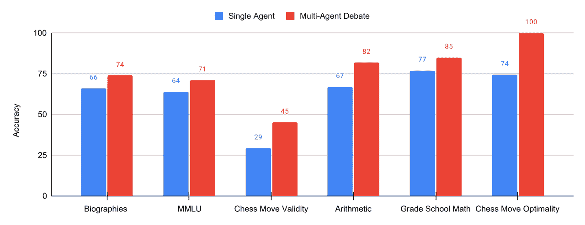

## [Multi GPT](https://github.com/rumpfmax/Multi-GPT)

Experimental multi-agent system

## [MutahunterAI](https://github.com/codeintegrity-ai/mutahunter)

MutahunterAI: Accelerate developer productivity and code security with our open-source AI

## [NLSOM](https://github.com/mczhuge/NLSOM)

Natural Language-Based Societies of Mind

## [OpenAgents](https://github.com/xlang-ai/OpenAgents)

Multi-agent general purpose platform

## [OpenAGI](https://github.com/agiresearch/OpenAGI)

R&D agents platform

## [OpenDevin](https://github.com/OpenDevin/OpenDevin)

OpenDevin: Code Less, Make More

## Open Interpreter

Code interpreter that lets LLMs execute code

## [Pezzo](https://www.pezzo.ai/)

Development toolkit for prompt management & more

## [Private GPT](https://www.privategpt.io/)

Tool for private interaction with your documents

## [PromethAI](https://github.com/topoteretes/PromethAI-Backend)

AI agent that helps with nutrition and other goals

## [React Agent](https://reactagent.io/)

Open-source React.js Autonomous LLM Agent

## Self-operating computer

Let multimodal models operate a computer

## [Smol developer](https://github.com/smol-ai/developer)

Your own junior AI developer, deployed via E2B UI

## [Stackwise](https://github.com/stackwiseai/stackwise)

VSCode extension that writes nodejs functions

## [Superagent](https://www.superagent.sh/)

Tool that allows creating agents without coding

## [SuperAGI](https://superagi.com/)

Framework to develop and deploy AI agents

## [Suspicion Agent](https://github.com/CR-Gjx/Suspicion-Agent)

Paper on imperfect information games

## [SWE Agent](https://github.com/princeton-nlp/SWE-agent)

Open-source Devin alternative

## [Sweep](https://sweep.dev/)

Github assistant that fixes issues & writes code

## [Taxy AI](https://github.com/TaxyAI/browser-extension)

Taxy AI is a full browser automation

## [Teenage AGI](https://github.com/seanpixel/Teenage-AGI/blob/main/README.md#experiments)

BabyAGI-inspired agent, can recall infinite memory

## [UFO](https://github.com/microsoft/UFO)

A UI-Focused agent on Windows OS

## [Vanna.AI](https://vanna.ai/)

Python-based AI SQL agent trained on your schema

## [Voyager](https://voyager.minedojo.org/)

LLM-powered lifelong learning agent in Minecraft

## [Web3 GPT](https://w3gpt.ai/)

Write & deploy smart contracts to EVM blockchains

## “Westworld” simulation

A multi-agent environment simulation library

## [WorkGPT](https://github.com/team-openpm/workgpt)

GPT agent framework for invoking APIs

## [Wren](https://www.getwren.ai/)

Natural Language Interface to Your Databases

## [XAgent](https://github.com/OpenBMB/XAgent)

Experimental LLM agent that solves various tasks

## [yAgents](https://github.com/yeagerai/yeagerai-agent)

Capable of designing, coding and debugging tools

## [Yourgoal](https://github.com/pj4533/yourgoal/?utm_source=awesome-ai-agents)

Swift implementation of BabyAGI

# Closed-source projects and companies

## [Ability AI](https://ability.ai/)

Secure, People-Centric Autonomous AI Agents

## [Adept AI](https://www.adept.ai/?utm_source=awesome-ai-agents)

ML research and product lab building intelligence

## [AGENTS.inc](https://www.agents.inc/)

Agents for company/regulations, search&monitoring

## [AgentScale](https://agentscale.ai/)

Your assistant, email writer, calendar scheduler

## Aide by Codestory

AI code interpreter, AI-powered mod of VSCode

## [AilaFlow](https://ailaflow.com/)

No-code platform for building AI agents

## [Airkit.ai](https://www.airkit.ai/)

Platform for building, testing, deploying Agents

## Airplane Autopilot

Autopilot AI assistant of the Airplane company

## [Aomni](https://www.aomni.com/?utm_source=awesome-ai-agents)

AI agent designed for business intelligence

## [APIDNA](https://apidna.ai/)

Multiple AI Agents for the integration of APIs.

## [Artisian AI](https://github.com/Artisan-AI)

Agents for sales, e-mails, book keeping & more

## [Ask Pandi](https://askpandi.com/ask)

Answer engine to search and generate knowledge

## [AskToSell](https://asktosell.com/)

# Meet autonomous AI sales agents that close deals

## [AskYourDatabase](https://www.askyourdatabase.com/)

Chat with SQL database, explore and visualize data

## Athena Intelligence

24/7 Enterprise AI Data Analyst

## [Avanzai](https://avanz.ai/)

AI agents for portfolio risk and asset allocation

## [Bardeen](https://www.bardeen.ai/)

AI Agent for automating repetitive tasks

## [Beam](https://beam.ai/)

A wide selection of AI agents automating workflows

## [Blackbox AI](https://www.blackbox.ai/)

Software That Builds Software

## [Blobr](https://www.blobr.io/)

AI business assistant connected to all your tools

## [BrainSoup](https://www.nurgo-software.com/products/brainsoup)

Build an AI team that works for you, on your PC

## [broadn](https://www.broadn.io/?utm_source=awesome-ai-agents)

No-code copilot that allows users to build AI apps

## [Butternut AI](https://butternut.ai/)

Build fully-functioning, ready-to-launch website

## [B2 AI](https://www.b2.work/)

Autocomplete AI assistant for work

## [ChatHelp](https://chathelp.ai/)

AI-powered Business, Work, Study Assistant

## Claros AI Shopper

AI shopper that finds products for your taste

## [Claygent](https://www.clay.com/learn/claygent)

Agent that scrapes and summarize data from the web

## [Code Autopilot](https://www.codeautopilot.com/)

AI Assistant for your project

## [Codegen](https://www.codegen.com/)

Solve tickets, write tests, level up your workflow

## [CodeWP](https://codewp.ai/)

AI Agent for WordPress websites

## [Codium AI](https://www.codium.ai/)

Coding multipurpose AI assistant for developers

## [Commit](https://commit.dev/)

Career Copilot and AI Agent for SW Developers

## [Cognosys](https://cognosys.ai/)

Web-based version of AutoGPT or BabyAGI

## [ContextQA](https://contextqa.com/)

AI Agents for Software Testing

## [Cursor](https://www.cursor.so/)

AI-powered Code Editor with VSCode-like UI

## [Cykel](https://www.cykel.ai/)

Interact with any UI, website or API

## [Devin](https://www.cognition-labs.com/introducing-devin)

The first AI software engineer

## [Diagram](https://diagram.com/)

AI design tools for everyone, acquired by Figma

## [Docket AI](https://docketai.net/)

AI Sales Engineer for somplex B2B sales

## [Dosu](https://dosu.dev/)

GitHub repo AI teammate helping also with docs

## [Dot](https://www.getdot.ai/)

Virtual assistant that help with data analytics

## [Duckie AI](https://duckie.ai/)

Team of AI SW development companions (Ducklings)

## [Ellipsis](https://ellipsis.dev/?utm_source=awesome-ai-agents)

(Previously BitBuilder) "Automated code reviews and bug fixes"

## [encode](https://encode.software/)

Fully autonomous AI SW engineer in early stage

## [Factory](https://www.factory.ai/)

Coding Droids for building software end-to-end

## [Fine](https://www.fine.dev/)

Build Software with AI Agents

## [Fine Tuner](https://fine-tuner.ai/)

(Pivoted to Synthflow) No-code platform for agents

## [Fixie](https://www.fixie.ai/)

Platform for creating LLM-powered AI apps

## [Floode](https://floodehq.com/)

Executive agent automating communication busywork

## GitHub Copilot X

AI-powered software developer

## [GitLab Duo](https://about.gitlab.com/gitlab-duo/)

AI for every step of SW development lifecycle

## [GitWit](https://www.gitwit.dev/)

Automate code generation with AI. In beta version

## [GoCharlie](https://gocharlie.ai/)

Multimodal content creation autonomous agent

## [Graphlit](https://www.graphlit.com/)

API-first data platform for building apps with AI

## [Grit](https://www.grit.io/)

Automating code migrations and dependency upgrades

## [Gumloop](https://www.gumloop.com/)

Automate any workflow with AI

## Heights Platform

For course creators, community builders & coaches

## [Hex Magic](https://hex.tech/product/magic-ai/)

AI tools for doing amazing things with data

## [Heymoon.ai](https://heymoon.ai/)

Keep you on top of your calendar, tasks and info

## [iMean.AI](https://www.imean.ai/)

AI personal assistant that automates browser task

## [Input](https://useinput.com/)

AI-powered teammate that can collaborate on code

## [Instrukt](https://github.com/blob42/Instrukt)

Terminal env for interacting with with AI agents

## [Invicta](https://invictai.io/)

Build your first team of Autonomous AI Agents

## [Julius](https://julius.ai/)

AI data processing, analysis, and visualization

## [Kadoa](https://www.kadoa.com/)

Web Scraping on Autopilot with AI

## [Juno](https://heyjuno.co/)

AI-led user interviews for rich human insights

## [Kompas AI](https://kompas.ai/)

Pick your LLM & build custom conversational agent

## [Kusho](https://kusho.ai/)

AI agent for API testing

## [Kwal](https://www.kwal.ai/)

Voice Agents for Recruiting

## [Lindy](https://www.lindy.ai/)

AI assistant that can help with daily tasks

## [Lutra AI](https://lutra.ai/)

Platform for creating AI workflows and apps

## [Magic Loops](https://magicloops.dev/)

Personal automations made easy

## [Makedraft](https://makedraft.com/)

Generate + edit HTML components with text prompts

## [Manaflow](https://manaflow.ai/)

Automate technical business workflows

## [Minion AI](https://minion.ai/)

By creator of GitHub Copilot, in waitlist stage

## [MultiOn](https://multion.ai/)

Book a flight or order a burger with MultiOn

## [Mutable AI](https://mutable.ai/)

AI-Accelerated Software Development

## [Naut](https://www.naut.ai/)

Build your own agents. In early stage

## [NexusGPT](https://gpt.nexus/)

Build AI agents in minutes, without coding

## [Otherside's AI As](https://www.hyperwriteai.com/)sistant - Hyperwrite

Chrome extension - general purpose AI agent

## [Phind](https://www.phind.com/)

Personal programming and research AI assistant

## [Powerdrill AI](https://powerdrill.ai/)

AI agent that completes your data job 10x faster

## [Proficient AI](https://proficientai.com/)

Interaction APIs and SDKs for building AI agents

## [Promptly](https://www.trypromptly.com/)

Generative AI for Your Enterprise

## Q, ChatGPT for Slack

AI workforce on Slack for under-resourced SMEs

## [Questflow](https://questflow.ai/)

Marketplace for autonomous AI workers with no-code

## [Rebyte](https://rebyte.ai/)

A Multi ai agents builder platform

## [Relevance AI](https://relevanceai.com/)

Build your AI Workforce

## [Saga](https://saga.so/ai)

Digital AI assistant for notes, tasks, and tools

## [Second](https://www.second.dev/)

Automated migrations and upgrades for your code

## [Sentius](https://www.sentius.ai/)

AI Agent operates browser to do your tasks for you

## [ShopPal](https://shoppal.ai/)

AI assistant, enhance shopping experience.

## [Spell](https://spell.so/)

AutoGPT agents with plugins

## [Superluminal](https://superluminal.dev/)

AI copilot to your product's data dashboard

## [TalktoData](https://talktodata.ai/)

Data discovery, cleaing, analysis & visualization

## [Taskade](https://www.taskade.com/)

Create, train, and run custom AI agents

## [ThinkChain AI](https://www.thinkchain.ai/)

Financial AI agent platform

## [Test Driver](https://testdriver.ai/)

AI Agent for QA in GitHub

## [Tusk](https://usetusk.ai/)

AI engineer that pushes and tests code

## [Vortic](https://www.vortic.ai/)

AI agent helping Insurance Sales and Claims

## [v0 by Vercel](https://v0.dev/)

Get React code based on Shadcn UI & Tailwind CSS

## [Wispy](https://wispy.technicalmagic.ai/)

Summarize content, compose content, create quizzes

## [Wordware](https://www.wordware.ai/)

Build better language model apps, fast.

## [WorkBot](https://workhub.ai/)

The Only AI Platform you will ever need!

## [Zapier Central](https://zapier.com/central)

Work hand in hand with AI bots

## ✴️ AI apps & agents with sandbox integration or native support

### ✴️ [Superagent](https://www.superagent.sh/)

### ✴️ OpenAI's Assistants

### ✴️ Langchain Data Analyst

## Want to use E2B with your AI product?

Contact us at [hello@e2b.dev](mailto:hello@e2b.dev) or [on discord](https://discord.gg/35NF4Y8WSE).

W[e ar](https://e2b.dev/docs?ref=awesome-sdks)e open-source and you can get started with E2B here.

## Join the community

+ Follow us on [X](https://twitter.com/e2b)

+ Hit us up on discord

+ [Feel free to ](mailto:hello@e2b.dev)reach out to us at hello@e2b.dev.
