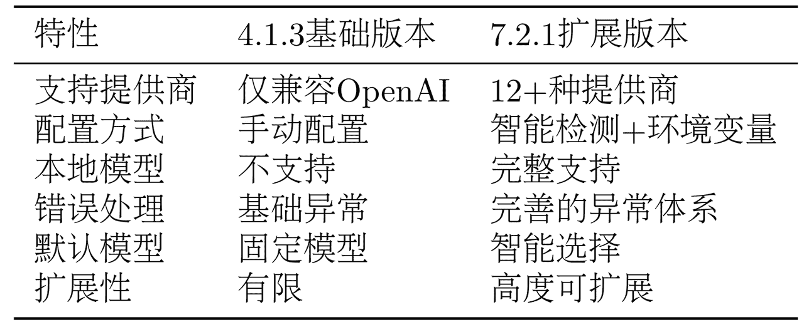
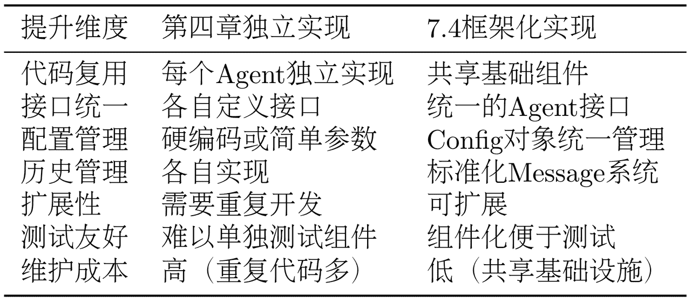
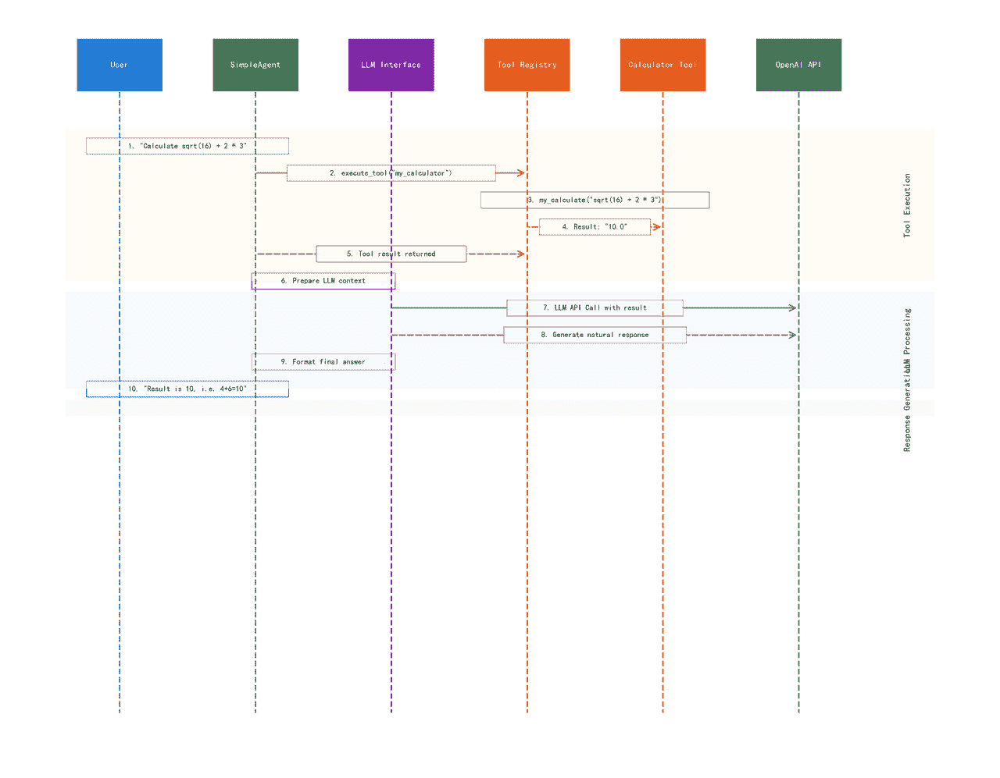

# 第七章 构建你的智能体框架

> 来源：[https://gotoaiworld.feishu.cn/docx/WSg4daV7Ko6Hs3xXqClc4fP2ncn](https://gotoaiworld.feishu.cn/docx/WSg4daV7Ko6Hs3xXqClc4fP2ncn)

在前面的章节中，我们讲解了智能体的基础知识，并体验了主流框架带来的开发便利。从本章开始，我们将进入一个更具挑战也更有价值的阶段：从零开始，逐步构建一个智能体框架——HelloAgents。

为确保学习过程的连贯性与可复现性，HelloAgents 将以版本迭代的方式推进开发。每一章都会在前一章的基础上增加新的功能模块，并将智能体相关的知识点进行串讲与实现。最终，我们将利用这个自建框架，来高效地实现本书后续章节中的高级应用案例。

## [7.1 框架整体架构设计](https://datawhalechina.github.io/hello-agents/#/./chapter7/%E7%AC%AC%E4%B8%83%E7%AB%A0%20%E6%9E%84%E5%BB%BA%E4%BD%A0%E7%9A%84Agent%E6%A1%86%E6%9E%B6?id=_71-%e6%a1%86%e6%9e%b6%e6%95%b4%e4%bd%93%e6%9e%b6%e6%9e%84%e8%ae%be%e8%ae%a1)

### 7.1.1 为何需要自建Agent框架

在智能体技术快速发展的今天，市面上已经存在众多成熟的Agent框架。那么，为什么我们还要从零开始构建一个新的框架呢？

（1）市面框架的快速迭代与局限性

智能体领域是一个快速发展的领域，随时会有新的概念产生，对于智能体的设计每个框架都有自己的定位和理解，不过智能体的核心知识点是一致的。

+   过度抽象的复杂性：许多框架为了追求通用性，引入了大量抽象层和配置选项。以LangChain为例，其链式调用机制虽然灵活，但对初学者而言学习曲线陡峭，往往需要理解大量概念才能完成简单任务。

+   快速迭代带来的不稳定性：商业化框架为了抢占市场，API接口变更频繁。开发者经常面临版本升级后代码无法运行的困扰，维护成本居高不下。

+   黑盒化的实现逻辑：许多框架将核心逻辑封装得过于严密，开发者难以理解Agent的内部工作机制，缺乏深度定制能力。遇到问题时只能依赖文档和社区支持，尤其是如果社区不够活跃，可能一个反馈意见会非常久也没有人推进，影响后续的开发效率。

+   依赖关系的复杂性：成熟框架往往携带大量依赖包，安装包体积庞大，在需要与别的项目代码配合的下可能出现依赖冲突问题。

（2）从使用者到构建者的能力跃迁

构建自己的Agent框架，实际上是一个从"使用者"向"构建者"转变的过程。这种转变带来的价值是长远的。

+   深度理解Agent工作原理：通过亲手实现每个组件，开发者能够真正理解Agent的思考过程、工具调用机制、以及各种设计模式的好坏与区别。

+   获得完全的控制权：自建框架意味着对每一行代码都有完全的掌控，可以根据具体需求进行精确调优，而不受第三方框架设计理念的束缚。

+   培养系统设计能力：框架构建过程涉及模块化设计、接口抽象、错误处理等软件工程核心技能，这些能力对开发者的长期成长具有重要价值。

（3）定制化需求与深度掌握的必要性

在实际应用中，不同场景对智能体的需求差异巨大，往往都需要在通用框架基础上做二次开发。

+   特定领域的优化需求：金融、医疗、教育等垂直领域往往需要针对性的提示词模板、特殊的工具集成、以及定制化的安全策略。

+   性能与资源的精确控制：生产环境中，对响应时间、内存占用、并发处理能力都有严格要求，通用框架的"一刀切"方案往往无法满足精细化需求。

+   学习与教学的透明性要求：在我们的教学场景中，学习者更期待的是清晰地看到智能体的每一步构建过程，理解不同范式的工作机制，这要求框架具有高度的可观测性和可解释性。

### 7.1.2 HelloAgents框架的设计理念

构建一个新的Agent框架，关键不在于功能的多少，而在于设计理念是否能真正解决现有框架的痛点。HelloAgents框架的设计围绕着一个核心问题展开：如何让学习者既能快速上手，又能深入理解Agent的工作原理？

当你初次接触任何成熟的框架时，可能会被其丰富的功能所吸引，但很快就会发现一个问题：要完成一个简单的任务，往往需要理解Chain、Agent、Tool、Memory、Retriever等十几个不同的概念。每个概念都有自己的抽象层，学习曲线变得异常陡峭。这种复杂性虽然带来了强大的功能，但也成为了初学者的障碍。HelloAgents框架试图在功能完整性和学习友好性之间找到平衡点，形成了四个核心的设计理念。

（1）轻量级与教学友好的平衡

一个优秀的学习框架应该具备完整的可读性。HelloAgents将核心代码按照章节区分开，这是基于一个简单的原则：任何有一定编程基础的开发者都应该能够在合理的时间内完全理解框架的工作原理。在依赖管理方面，框架采用了极简主义的策略。除了OpenAI的官方SDK和几个必要的基础库外，不引入任何重型依赖。如果遇到问题时，我们可以直接定位到框架本身的代码，而不需要在复杂的依赖关系中寻找答案。

（2）基于标准API的务实选择

OpenAI的API已经成为了行业标准，几乎所有主流的LLM提供商都在努力兼容这套接口。HelloAgents选择在这个标准之上构建，而不是重新发明一套抽象接口。这个决定主要是出于几点动机。首先是兼容性的保证，当你掌握了HelloAgents的使用方法后，迁移到其他框架或将其集成到现有项目中时，底层的API调用逻辑是完全一致的。其次是学习成本的降低。你不需要学习新的概念模型，因为所有的操作都基于你已经熟悉的标准接口。

（3）渐进式学习路径的精心设计

HelloAgents提供了一条清晰的学习路径。我们将会把每一章的学习代码，保存为一个可以pip下载的历史版本，因此无需担心代码的使用成本，因为每一个核心的功能都将会是你自己编写的。这种设计让你能够按照自己的需求和节奏前进。每一步的升级都是自然而然的，不会产生概念上的跳跃或理解上的断层。值得一提的是，我们这一章的内容，也是基于前六章的内容来完善的。同样，这一章也是为后续高级知识学习部分打下框架基础。

（4）统一的“工具”抽象：万物皆为工具

为了彻底贯彻轻量级与教学友好的理念，HelloAgents在架构上做出了一个关键的简化：除了核心的Agent类，一切皆为Tools。在许多其他框架中需要独立学习的Memory（记忆）、RAG（检索增强生成）、RL（强化学习）、MCP（协议）等模块，在HelloAgents中都被统一抽象为一种“工具”。这种设计的初衷是消除不必要的抽象层，让学习者可以回归到最直观的“智能体调用工具”这一核心逻辑上，从而真正实现快速上手和深入理解的统一。

### [7.1.3 本章学习目标](https://datawhalechina.github.io/hello-agents/#/./chapter7/%E7%AC%AC%E4%B8%83%E7%AB%A0%20%E6%9E%84%E5%BB%BA%E4%BD%A0%E7%9A%84Agent%E6%A1%86%E6%9E%B6?id=_713-%e6%9c%ac%e7%ab%a0%e5%ad%a6%e4%b9%a0%e7%9b%ae%e6%a0%87)

让我们先看看第七章的核心学习内容：

```
hello-agents/
├── hello_agents/
│   │
│   ├── core/                     # 核心框架层
│   │   ├── agent.py              # Agent基类
│   │   ├── llm.py                # HelloAgentsLLM统一接口
│   │   ├── message.py            # 消息系统
│   │   ├── config.py             # 配置管理
│   │   └── exceptions.py         # 异常体系
│   │
│   ├── agents/                   # Agent实现层
│   │   ├── simple_agent.py       # SimpleAgent实现
│   │   ├── react_agent.py        # ReActAgent实现
│   │   ├── reflection_agent.py   # ReflectionAgent实现
│   │   └── plan_solve_agent.py   # PlanAndSolveAgent实现
│   │
│   ├── tools/                    # 工具系统层
│   │   ├── base.py               # 工具基类
│   │   ├── registry.py           # 工具注册机制
│   │   ├── chain.py              # 工具链管理系统
│   │   ├── async_executor.py     # 异步工具执行器
│   │   └── builtin/              # 内置工具集
│   │       ├── calculator.py     # 计算工具
│   │       └── search.py         # 搜索工具
└──Copy to clipboardErrorCopied
```

在开始编写具体代码之前，我们需要先建立一个清晰的架构蓝图。HelloAgents的架构设计遵循了"分层解耦、职责单一、接口统一"的核心原则，这样既保持了代码的组织性，也便于按照章节扩展内容。

快速开始：安装HelloAgents框架

为了让读者能够快速体验本章的完整功能，我们提供了可直接安装的Python包。你可以通过以下命令安装本章对应的版本：

```
# python版本需要&gt;=3.10
pip install &quot;hello-agents==0.1.1&quot;Copy to clipboardErrorCopied
```

本章的学习可以采用两种方式：

1.  体验式学习：直接使用pip安装框架，运行示例代码，快速体验各种功能

1.  深度学习：跟随本章内容，从零开始实现每个组件，深入理解框架的设计思想和实现细节

我们建[议采用"先体验，](https://github.com/jjyaoao/helloagents)后实现"的学习路径。在本章中，我们提供了完整的测试文件，你可以重写核心函数并运行测试，以检验你的实现是否正确。这种学习方式既保证了实践性，又确保了学习效果。如果你想深入了解框架的实现细节，或者希望参与到框架的开发中来，可以访问这个GitHub仓库。

在开始之前，让我们用30秒体验使用Hello-agents构建简单智能体！

```
# 配置好同级文件夹下.env中的大模型API, 可参考code文件夹配套的.env.example，也可以拿前几章的案例的.env文件复用。from hello_agents import SimpleAgent, HelloAgentsLLM
from dotenv import load_dotenv

# 加载环境变量
load_dotenv()# 创建LLM实例 - 框架自动检测provider
llm = HelloAgentsLLM()# 或手动指定provider（可选）# llm = HelloAgentsLLM(provider=&quot;modelscope&quot;)# 创建SimpleAgent
agent = SimpleAgent(
    name=&quot;AI助手&quot;,
    llm=llm,
    system_prompt=&quot;你是一个有用的AI助手&quot;)# 基础对话
response = agent.run(&quot;你好！请介绍一下自己&quot;)print(response)# 添加工具功能（可选）from hello_agents.tools import CalculatorTool
calculator = CalculatorTool()# 需要实现7.4.1的MySimpleAgent进行调用，后续章节会支持此类调用方式# agent.add_tool(calculator)# 现在可以使用工具了
response = agent.run(&quot;请帮我计算 2 + 3 * 4&quot;)print(response)# 查看对话历史print(f&quot;历史消息数: {len(agent.get_history())}&quot;)Copy to clipboardErrorCopied
```

## 7.2 HelloAgentsLLM扩展

本节内容将在第 4.1.3 节创建的 HelloAgentsLLM 基础上进行迭代升级。我们将把这个基础客户端，改造为一个更具适应性的模型调用中枢。本次升级主要围绕以下三个目标展开：

1.  多提供商支持：实现对 OpenAI、ModelScope、智谱 AI 等多种主流 LLM 服务商的无缝切换，避免框架与特定供应商绑定。

1.  本地模型集成：引入 VLLM 和 Ollama 这两种高性能本地部署方案，作为对第 3.2.3 节中 Hugging Face Transformers 方案的生产级补充，满足数据隐私和成本控制的需求。

1.  自动检测机制：建立一套自动识别机制，使框架能根据环境信息智能推断所使用的 LLM 服务类型，简化用户的配置过程。

### [7.2.1 支持多提供商](https://datawhalechina.github.io/hello-agents/#/./chapter7/%E7%AC%AC%E4%B8%83%E7%AB%A0%20%E6%9E%84%E5%BB%BA%E4%BD%A0%E7%9A%84Agent%E6%A1%86%E6%9E%B6?id=_721-%e6%94%af%e6%8c%81%e5%a4%9a%e6%8f%90%e4%be%9b%e5%95%86)

我们之前定义的 HelloAgentsLLM 类，已经能够通过 api_key 和 base_url 这两个核心参数，连接任何兼容 OpenAI 接口的服务。这在理论上保证了通用性，但在实际应用中，不同的服务商在环境变量命名、默认 API 地址和推荐模型等方面都存在差异。如果每次切换服务商都需要用户手动查询并修改代码，会极大影响开发效率。为了解决这一问题，我们引入 provider。其改进思路是：让 HelloAgentsLLM 在内部处理不同服务商的配置细节，从而为用户提供一个统一、简洁的调用体验。具体的实现细节我们将在7.2.3节“自动检测机制”中详细阐述，在这里，我们首先关注如何利用这一机制来扩展框架。

下面，我们将演示如何通过继承 HelloAgentsLLM，来增加对 ModelScope 平台的支持。我们希望读者不仅学会如何“使用”框架，更能掌握如何“扩展”框架。直接修改已安装的库源码是一种不被推荐的做法，因为它会使后续的库升级变得困难。

（1）创建自定义LLM类并继承

假设我们的项目目录中有一个 my_llm.py 文件。我们首先从 hello_agents 库中导入 HelloAgentsLLM 基类，然后创建一个名为 MyLLM 的新类继承它。

```
# my_llm.pyimport os
from typing import Optional
from openai import OpenAI
from hello_agents import HelloAgentsLLM

class MyLLM(HelloAgentsLLM):&quot;&quot;&quot;
    一个自定义的LLM客户端，通过继承增加了对ModelScope的支持。
    &quot;&quot;&quot;pass # 暂时留空Copy to clipboardErrorCopied
```

（2）重写 init 方法以支持新供应商

接下来，我们在 MyLLM 类中重写 init 方法。我们的目标是：当用户传入 provider="modelscope" 时，执行我们自定义的逻辑；否则，就调用父类 HelloAgentsLLM 的原始逻辑，使其能够继续支持 OpenAI 等其他内置的供应商。

```
class MyLLM(HelloAgentsLLM):def __init__(
        self,
        model: Optional[str] = None,
        api_key: Optional[str] = None,
        base_url: Optional[str] = None,
        provider: Optional[str] = &quot;auto&quot;,**kwargs
    ):# 检查provider是否为我们想处理的&#x27;modelscope&#x27;if provider == &quot;modelscope&quot;:print(&quot;正在使用自定义的 ModelScope Provider&quot;)
            self.provider = &quot;modelscope&quot;# 解析 ModelScope 的凭证
            self.api_key = api_key or os.getenv(&quot;MODELSCOPE_API_KEY&quot;)
            self.base_url = base_url or &quot;https://api-inference.modelscope.cn/v1/&quot;# 验证凭证是否存在if not self.api_key:raise ValueError(&quot;ModelScope API key not found. Please set MODELSCOPE_API_KEY environment variable.&quot;)# 设置默认模型和其他参数
            self.model = model or os.getenv(&quot;LLM_MODEL_ID&quot;) or &quot;Qwen/Qwen2.5-VL-72B-Instruct&quot;
            self.temperature = kwargs.get(&#x27;temperature&#x27;, 0.7)
            self.max_tokens = kwargs.get(&#x27;max_tokens&#x27;)
            self.timeout = kwargs.get(&#x27;timeout&#x27;, 60)# 使用获取的参数创建OpenAI客户端实例
            self._client = OpenAI(api_key=self.api_key, base_url=self.base_url, timeout=self.timeout)else:# 如果不是 modelscope, 则完全使用父类的原始逻辑来处理super().__init__(model=model, api_key=api_key, base_url=base_url, provider=provider, **kwargs)Copy to clipboardErrorCopied
```

这段代码展示了“重写”的思想：我们拦截了 provider="modelscope" 的情况并进行了特殊处理，对于其他所有情况，则通过 super().__init__(...) 交还给父类，保留了原有框架的全部功能。

（3）使用自定义的 MyLLM 类

现在，我们可以在项目的业务逻辑中，像使用原生 HelloAgentsLLM 一样使用我们自己的 MyLLM 类。

首先，在 .env 文件中配置 ModelScope 的 API 密钥：

```
# .env fileMODELSCOPE_API_KEY=&quot;your-modelscope-api-key&quot;Copy to clipboardErrorCopied
```

然后，在主程序中导入并使用 MyLLM：

```
# my_main.pyfrom dotenv import load_dotenv
from my_llm import MyLLM # 注意:这里导入我们自己的类# 加载环境变量
load_dotenv()# 实例化我们重写的客户端，并指定provider
llm = MyLLM(provider=&quot;modelscope&quot;) 

# 准备消息
messages = [{&quot;role&quot;: &quot;user&quot;, &quot;content&quot;: &quot;你好，请介绍一下你自己。&quot;}]# 发起调用，think等方法都已从父类继承，无需重写
response_stream = llm.think(messages)# 打印响应print(&quot;ModelScope Response:&quot;)for chunk in response_stream:# chunk 已经是文本片段，可以直接使用print(chunk, end=&quot;&quot;, flush=True)Copy to clipboardErrorCopied
```

通过以上步骤，我们就在不修改 hello-agents 库源码的前提下，成功为其扩展了新的功能。这种方法不仅保证了代码的整洁和可维护性，也使得未来升级 hello-agents 库时，我们的定制化功能不会丢失。

### [7.2.2 本地模型调用](https://datawhalechina.github.io/hello-agents/#/./chapter7/%E7%AC%AC%E4%B8%83%E7%AB%A0%20%E6%9E%84%E5%BB%BA%E4%BD%A0%E7%9A%84Agent%E6%A1%86%E6%9E%B6?id=_722-%e6%9c%ac%e5%9c%b0%e6%a8%a1%e5%9e%8b%e8%b0%83%e7%94%a8)

在第 3.2.3 节，我们学习了如何使用 Hugging Face Transformers 库在本地直接运行开源模型。该方法非常适合入门学习和功能验证，但其底层实现在处理高并发请求时性能有限，通常不作为生产环境的首选方案。

为了在本地实现高性能、生产级的模型推理服务，社区涌现出了 VLLM 和 Ollama 等优秀工具。它们通过连续批处理、PagedAttention 等技术，显著提升了模型的吞吐量和运行效率，并将模型封装为兼容 OpenAI 标准的 API 服务。这意味着，我们可以将它们无缝地集成到 HelloAgentsLLM 中。

VLLM

VLLM 是一个为 LLM 推理设计的高性能 Python 库。它通过 PagedAttention 等先进技术，可以实现比标准 Transformers 实现高出数倍的吞吐量。下面是在本地部署一个 VLLM 服务的完整步骤：

首先，需要根据你的硬件环境（特别是 C[UDA ](https://docs.vllm.ai/en/latest/getting_started/installation.html)版本）安装 VLLM。推荐遵循其官方文档进行安装，以避免版本不匹配问题。

```
pip install vllmCopy to clipboardErrorCopied
```

安装完成后，使用以下命令即可启动一个兼容 OpenAI 的 API 服务。VLLM 会自动从 Hugging Face Hub 下载指定的模型权重（如果本地不存在）。我们依然以 Qwen1.5-0.5B-Chat 模型为例：

```
# 启动 VLLM 服务，并加载 Qwen1.5-0.5B-Chat 模型
python -m vllm.entrypoints.openai.api_server \
    --model Qwen/Qwen1.5-0.5B-Chat \
    --host 0.0.0.0 \
    --port 8000Copy to clipboardErrorCopied
```

服务启动后，便会在 http://localhost:8000/v1 地址上提供与 OpenAI 兼容的 API。

Ollama

O[llam](https://ollama.com/)a 进一步简化了本地模型的管理和部署，它将模型下载、配置和服务启动等步骤封装到了一条命令中，非常适合快速上手。访问 Ollama 官方网站下载并安装适用于你操作系统的客户端。

安装后，打开终端，执行以下命令即可下载并运行一个模型（以 Llama 3 为例）。Ollama 会自动处理模型的下载、服务封装和硬件加速配置。

```
# 首次运行会自动下载模型，之后会直接启动服务
ollama run llama3Copy to clipboardErrorCopied
```

当你在终端看到模型的交互提示时，即表示服务已经成功在后台启动。Ollama 默认会在 http://localhost:11434/v1 地址上暴露 OpenAI 兼容的 API 接口。

接入 HelloAgentsLLM

由于 VLLM 和 Ollama 都遵循了行业标准 API，将它们接入 HelloAgentsLLM 的过程非常简单。我们只需在实例化客户端时，将它们视为一个新的 provider 即可。

例如，连接本地运行的 VLLM 服务：

```
llm_client = HelloAgentsLLM(
    provider=&quot;vllm&quot;,
    model=&quot;Qwen/Qwen1.5-0.5B-Chat&quot;, # 需与服务启动时指定的模型一致
    base_url=&quot;http://localhost:8000/v1&quot;,
    api_key=&quot;vllm&quot; # 本地服务通常不需要真实API Key，可填任意非空字符串)Copy to clipboardErrorCopied
```

或者，通过设置环境变量并让客户端自动检测，实现代码的零修改：

```
# 在 .env 文件中设置LLM_BASE_URL=&quot;http://localhost:8000/v1&quot;LLM_API_KEY=&quot;vllm&quot;# Python 代码中直接实例化即可
llm_client = HelloAgentsLLM() # 将自动检测为 vllmCopy to clipboardErrorCopied
```

同理，连接本地的 Ollama 服务也一样简单：

```
llm_client = HelloAgentsLLM(
    provider=&quot;ollama&quot;,
    model=&quot;llama3&quot;, # 需与 `ollama run` 指定的模型一致
    base_url=&quot;http://localhost:11434/v1&quot;,
    api_key=&quot;ollama&quot; # 本地服务同样不需要真实 Key)Copy to clipboardErrorCopied
```

通过这种统一的设计，我们的智能体核心代码无需任何修改，就可以在云端 API 和本地模型之间自由切换。这为后续应用的开发、部署、成本控制以及保护数据隐私提供了极大的灵活性。

### [7.2.3 自动检测机制](https://datawhalechina.github.io/hello-agents/#/./chapter7/%E7%AC%AC%E4%B8%83%E7%AB%A0%20%E6%9E%84%E5%BB%BA%E4%BD%A0%E7%9A%84Agent%E6%A1%86%E6%9E%B6?id=_723-%e8%87%aa%e5%8a%a8%e6%a3%80%e6%b5%8b%e6%9c%ba%e5%88%b6)

为了尽可能减少用户的配置负担并遵循“约定优于配置”的原则，HelloAgentsLLM 内部设计了两个核心辅助方法：_auto_detect_provider 和 _resolve_credentials。它们协同工作，_auto_detect_provider 负责根据环境信息推断服务商，而 _resolve_credentials 则根据推断结果完成具体的参数配置。

_auto_detect_provider 方法负责根据环境信息，按照下述优先级顺序，尝试自动推断服务商：

1.  最高优先级：检查特定服务商的环境变量 这是最直接、最可靠的判断依据。框架会依次检查 MODELSCOPE_API_KEY, OPENAI_API_KEY, ZHIPU_API_KEY 等环境变量是否存在。一旦发现任何一个，就会立即确定对应的服务商。

1.  次高优先级：根据 base_url 进行判断 如果用户没有设置特定服务商的密钥，但设置了通用的 LLM_BASE_URL，框架会转而解析这个 URL。

+   域名匹配：通过检查 URL 中是否包含 "api-inference.modelscope.cn", "api.openai.com" 等特征字符串来识别云服务商。

+   端口匹配：通过检查 URL 中是否包含 :11434 (Ollama), :8000 (VLLM) 等本地服务的标准端口来识别本地部署方案。

1.  辅助判断：分析 API 密钥的格式 在某些情况下，如果上述两种方式都无法确定，框架会尝试分析通用环境变量 LLM_API_KEY 的格式。例如，某些服务商的 API 密钥有固定的前缀或独特的编码格式。不过，由于这种方式可能存在模糊性（例如多个服务商的密钥格式相似），因此它的优先级较低，仅作为辅助手段。

其部分关键代码如下：

```
def _auto_detect_provider(self, api_key: Optional[str], base_url: Optional[str]) -&gt; str:&quot;&quot;&quot;
    自动检测LLM提供商
    &quot;&quot;&quot;# 1. 检查特定提供商的环境变量 (最高优先级)if os.getenv(&quot;MODELSCOPE_API_KEY&quot;): return &quot;modelscope&quot;if os.getenv(&quot;OPENAI_API_KEY&quot;): return &quot;openai&quot;if os.getenv(&quot;ZHIPU_API_KEY&quot;): return &quot;zhipu&quot;# ... 其他服务商的环境变量检查# 获取通用的环境变量
    actual_api_key = api_key or os.getenv(&quot;LLM_API_KEY&quot;)
    actual_base_url = base_url or os.getenv(&quot;LLM_BASE_URL&quot;)# 2. 根据 base_url 判断if actual_base_url:
        base_url_lower = actual_base_url.lower()if &quot;api-inference.modelscope.cn&quot; in base_url_lower: return &quot;modelscope&quot;if &quot;open.bigmodel.cn&quot; in base_url_lower: return &quot;zhipu&quot;if &quot;localhost&quot; in base_url_lower or &quot;127.0.0.1&quot; in base_url_lower:if &quot;:11434&quot; in base_url_lower: return &quot;ollama&quot;if &quot;:8000&quot; in base_url_lower: return &quot;vllm&quot;return &quot;local&quot; # 其他本地端口# 3. 根据 API 密钥格式辅助判断if actual_api_key:if actual_api_key.startswith(&quot;ms-&quot;): return &quot;modelscope&quot;# ... 其他密钥格式判断# 4. 默认返回 &#x27;auto&#x27;，使用通用配置return &quot;auto&quot;Copy to clipboardErrorCopied
```

一旦 provider 被确定（无论是用户指定还是自动检测），_resolve_credentials 方法便会接手处理服务商的差异化配置。它会根据 provider 的值，去主动查找对应的环境变量，并为其设置默认的 base_url。其部分关键实现如下：

```
def _resolve_credentials(self, api_key: Optional[str], base_url: Optional[str]) -&gt; tuple[str, str]:&quot;&quot;&quot;根据provider解析API密钥和base_url&quot;&quot;&quot;if self.provider == &quot;openai&quot;:
        resolved_api_key = api_key or os.getenv(&quot;OPENAI_API_KEY&quot;) or os.getenv(&quot;LLM_API_KEY&quot;)
        resolved_base_url = base_url or os.getenv(&quot;LLM_BASE_URL&quot;) or &quot;https://api.openai.com/v1&quot;return resolved_api_key, resolved_base_url

    elif self.provider == &quot;modelscope&quot;:
        resolved_api_key = api_key or os.getenv(&quot;MODELSCOPE_API_KEY&quot;) or os.getenv(&quot;LLM_API_KEY&quot;)
        resolved_base_url = base_url or os.getenv(&quot;LLM_BASE_URL&quot;) or &quot;https://api-inference.modelscope.cn/v1/&quot;return resolved_api_key, resolved_base_url
    
    # ... 其他服务商的逻辑Copy to clipboardErrorCopied
```

让我们通过一个简单的例子来感受自动检测带来的便利。假设一个用户想要使用本地的 Ollama 服务，他只需在 .env 文件中进行如下配置：

```
LLM_BASE_URL=&quot;http://localhost:11434/v1&quot;LLM_MODEL_ID=&quot;llama3&quot;Copy to clipboardErrorCopied
```

他完全不需要配置 LLM_API_KEY 或在代码中指定 provider。然后，在 Python 代码中，他只需简单地实例化 HelloAgentsLLM 即可：

```
from dotenv import load_dotenv
from hello_agents import HelloAgentsLLM

load_dotenv()# 无需传入 provider，框架会自动检测
llm = HelloAgentsLLM() 
# 框架内部日志会显示检测到 provider 为 &#x27;ollama&#x27;# 后续调用方式完全不变
messages = [{&quot;role&quot;: &quot;user&quot;, &quot;content&quot;: &quot;你好！&quot;}]for chunk in llm.think(messages):print(chunk, end=&quot;&quot;)Copy to clipboardErrorCopied
```

在这个过程中，_auto_detect_provider 方法通过解析 LLM_BASE_URL 中的 "localhost" 和 :11434，成功地将 provider 推断为 "ollama"。随后，_resolve_credentials 方法会为 Ollama 设置正确的默认参数。

相比于4.1.3节的基础实现，现在的HelloAgentsLLM具有以下显著优势：

表 7.1 HelloAgentLLM不同版本特性对比



如上表7.1所示，这种演进体现了框架设计的重要原则：从简单开始，逐步完善。我们在保持接口简洁的同时，增强了功能的完整性。

## [7.3 框架接口实现](https://datawhalechina.github.io/hello-agents/#/./chapter7/%E7%AC%AC%E4%B8%83%E7%AB%A0%20%E6%9E%84%E5%BB%BA%E4%BD%A0%E7%9A%84Agent%E6%A1%86%E6%9E%B6?id=_73-%e6%a1%86%e6%9e%b6%e6%8e%a5%e5%8f%a3%e5%ae%9e%e7%8e%b0)

在上节中，我们构建了 HelloAgentsLLM 这一核心组件，解决了与大语言模型通信的关键问题。不过它还需要一系列配套的接口和组件来处理数据流、管理配置、应对异常，并为上层应用的构建提供一个清晰、统一的结构。本节将讲述以下三个核心文件：

+   message.py： 定义了框架内统一的消息格式，确保了智能体与模型之间信息传递的标准化。

+   config.py： 提供了一个中心化的配置管理方案，使框架的行为易于调整和扩展。

+   agent.py： 定义了所有智能体的抽象基类（Agent），为后续实现不同类型的智能体提供了统一的接口和规范。

### [7.3.1 Message 类](https://datawhalechina.github.io/hello-agents/#/./chapter7/%E7%AC%AC%E4%B8%83%E7%AB%A0%20%E6%9E%84%E5%BB%BA%E4%BD%A0%E7%9A%84Agent%E6%A1%86%E6%9E%B6?id=_731-message-%e7%b1%bb)

在智能体与大语言模型的交互中，对话历史是至关重要的上下文。为了规范地管理这些信息，我们设计了一个简易 Message 类。在后续上下文工程章节中，会对其进行扩展。

```
&quot;&quot;&quot;消息系统&quot;&quot;&quot;from typing import Optional, Dict, Any, Literal
from datetime import datetime
from pydantic import BaseModel

# 定义消息角色的类型，限制其取值
MessageRole = Literal[&quot;user&quot;, &quot;assistant&quot;, &quot;system&quot;, &quot;tool&quot;]class Message(BaseModel):&quot;&quot;&quot;消息类&quot;&quot;&quot;
    
    content: str
    role: MessageRole
    timestamp: datetime = None
    metadata: Optional[Dict[str, Any]] = Nonedef __init__(self, content: str, role: MessageRole, **kwargs):super().__init__(
            content=content,
            role=role,
            timestamp=kwargs.get(&#x27;timestamp&#x27;, datetime.now()),
            metadata=kwargs.get(&#x27;metadata&#x27;, {}))def to_dict(self) -&gt; Dict[str, Any]:&quot;&quot;&quot;转换为字典格式（OpenAI API格式）&quot;&quot;&quot;return {&quot;role&quot;: self.role,&quot;content&quot;: self.content
        }def __str__(self) -&gt; str:return f&quot;[{self.role}] {self.content}&quot;Copy to clipboardErrorCopied
```

该类的设计有几个关键点。首先，我们通过 typing.Literal 将 role 字段的取值严格限制为 "user", "assistant", "system", "tool" 四种，这直接对应 OpenAI API 的规范，保证了类型安全。除了 content 和 role 这两个核心字段外，我们还增加了 timestamp 和 metadata，为日志记录和未来功能扩展预留了空间。最后，to_dict() 方法是其核心功能之一，负责将内部使用的 Message 对象转换为与 OpenAI API 兼容的字典格式，体现了“对内丰富，对外兼容”的设计原则。

### [7.3.2 Config 类](https://datawhalechina.github.io/hello-agents/#/./chapter7/%E7%AC%AC%E4%B8%83%E7%AB%A0%20%E6%9E%84%E5%BB%BA%E4%BD%A0%E7%9A%84Agent%E6%A1%86%E6%9E%B6?id=_732-config-%e7%b1%bb)

Config 类的职责是将代码中硬编码配置参数集中起来，并支持从环境变量中读取。

```
&quot;&quot;&quot;配置管理&quot;&quot;&quot;import os
from typing import Optional, Dict, Any
from pydantic import BaseModel

class Config(BaseModel):&quot;&quot;&quot;HelloAgents配置类&quot;&quot;&quot;# LLM配置
    default_model: str = &quot;gpt-3.5-turbo&quot;
    default_provider: str = &quot;openai&quot;
    temperature: float = 0.7
    max_tokens: Optional[int] = None# 系统配置
    debug: bool = False
    log_level: str = &quot;INFO&quot;# 其他配置
    max_history_length: int = 100@classmethoddef from_env(cls) -&gt; &quot;Config&quot;:&quot;&quot;&quot;从环境变量创建配置&quot;&quot;&quot;return cls(
            debug=os.getenv(&quot;DEBUG&quot;, &quot;false&quot;).lower() == &quot;true&quot;,
            log_level=os.getenv(&quot;LOG_LEVEL&quot;, &quot;INFO&quot;),
            temperature=float(os.getenv(&quot;TEMPERATURE&quot;, &quot;0.7&quot;)),
            max_tokens=int(os.getenv(&quot;MAX_TOKENS&quot;)) if os.getenv(&quot;MAX_TOKENS&quot;) else None,)def to_dict(self) -&gt; Dict[str, Any]:&quot;&quot;&quot;转换为字典&quot;&quot;&quot;return self.dict()Copy to clipboardErrorCopied
```

首先，我们将配置项按逻辑划分为 LLM配置、系统配置 等，使结构一目了然。其次，每个配置项都设有合理的默认值，保证了框架在零配置下也能工作。最核心的是 from_env() 类方法，它允许用户通过设置环境变量来覆盖默认配置，无需修改代码，这在部署到不同环境时尤其有用。

### 7.3.3 Agent 抽象基类

Agent 类是整个框架的顶层抽象。它定义了一个智能体应该具备的通用行为和属性，但并不关心具体的实现方式。我们通过 Python 的 abc (Abstract Base Classes) 模块来实现它，这强制所有具体的智能体实现（如后续章节的 SimpleAgent, ReActAgent 等）都必须遵循同一个“接口”。

```
&quot;&quot;&quot;Agent基类&quot;&quot;&quot;from abc import ABC, abstractmethod
from typing import Optional, Any
from .message import Message
from .llm import HelloAgentsLLM
from .config import Config

class Agent(ABC):&quot;&quot;&quot;Agent基类&quot;&quot;&quot;def __init__(
        self,
        name: str,
        llm: HelloAgentsLLM,
        system_prompt: Optional[str] = None,
        config: Optional[Config] = None):
        self.name = name
        self.llm = llm
        self.system_prompt = system_prompt
        self.config = config or Config()
        self._history: list[Message] = []@abstractmethoddef run(self, input_text: str, **kwargs) -&gt; str:&quot;&quot;&quot;运行Agent&quot;&quot;&quot;passdef add_message(self, message: Message):&quot;&quot;&quot;添加消息到历史记录&quot;&quot;&quot;
        self._history.append(message)def clear_history(self):&quot;&quot;&quot;清空历史记录&quot;&quot;&quot;
        self._history.clear()def get_history(self) -&gt; list[Message]:&quot;&quot;&quot;获取历史记录&quot;&quot;&quot;return self._history.copy()def __str__(self) -&gt; str:return f&quot;Agent(name={self.name}, provider={self.llm.provider})&quot;Copy to clipboardErrorCopied
```

该类的设计体现了面向对象中的抽象原则。首先，它通过继承 ABC 被定义为一个不能直接实例化的抽象类。其构造函数 init 清晰地定义了 Agent 的核心依赖：名称、LLM 实例、系统提示词和配置。最重要的部分是使用 @abstractmethod 装饰的 run 方法，它强制所有子类必须实现此方法，从而保证了所有智能体都有统一的执行入口。此外，基类还提供了通用的历史记录管理方法，这些方法与 Message 类协同工作，体现了组件间的联系。

至此，我们已经完成了 HelloAgents 框架核心基础组件的设计与实现。

## 7.4 Agent范式的框架化实现

本节内容将在第四章构建的三种经典Agent范式（ReAct、Plan-and-Solve、Reflection）基础上进行框架化重构，并新增SimpleAgent作为基础对话范式。我们将把这些独立的Agent实现，改造为基于统一架构的框架组件。本次重构主要围绕以下三个核心目标展开：

1.  提示词工程的系统性提升：对第四章中的提示词进行深度优化，从特定任务导向转向通用化设计，同时增强格式约束和角色定义。

1.  接口与格式的标准化统一：建立统一的Agent基类和标准化的运行接口，所有Agent都遵循相同的初始化参数、方法签名和历史管理机制。

1.  高度可配置的自定义能力：支持用户自定义提示词模板、配置参数和执行策略。

### 7.4.1 SimpleAgent

SimpleAgent是最基础的Agent实现，它展示了如何在框架基础上构建一个完整的对话智能体。我们将通过继承框架基类来重写SimpleAgent。首先，在你的项目目录中创建一个my_simple_agent.py文件：

```
# my_simple_agent.pyfrom typing import Optional, Iterator
from hello_agents import SimpleAgent, HelloAgentsLLM, Config, Message

class MySimpleAgent(SimpleAgent):&quot;&quot;&quot;
    重写的简单对话Agent
    展示如何基于框架基类构建自定义Agent
    &quot;&quot;&quot;def __init__(
        self,
        name: str,
        llm: HelloAgentsLLM,
        system_prompt: Optional[str] = None,
        config: Optional[Config] = None,
        tool_registry: Optional[&#x27;ToolRegistry&#x27;] = None,
        enable_tool_calling: bool = True):super().__init__(name, llm, system_prompt, config)
        self.tool_registry = tool_registry
        self.enable_tool_calling = enable_tool_calling and tool_registry is not Noneprint(f&quot;✅ {name} 初始化完成，工具调用: {&#x27;启用&#x27; if self.enable_tool_calling else &#x27;禁用&#x27;}&quot;)Copy to clipboardErrorCopied
```

接下来，我们需要重写Agent基类的抽象方法run。SimpleAgent支持可选的工具调用功能，也方便后续章节的扩展：

```
# 继续在 my_simple_agent.py 中添加import re

class MySimpleAgent(SimpleAgent):# ... 前面的 __init__ 方法def run(self, input_text: str, max_tool_iterations: int = 3, **kwargs) -&gt; str:&quot;&quot;&quot;
        重写的运行方法 - 实现简单对话逻辑，支持可选工具调用
        &quot;&quot;&quot;print(f&quot;🤖 {self.name} 正在处理: {input_text}&quot;)# 构建消息列表
        messages = []# 添加系统消息（可能包含工具信息）
        enhanced_system_prompt = self._get_enhanced_system_prompt()
        messages.append({&quot;role&quot;: &quot;system&quot;, &quot;content&quot;: enhanced_system_prompt})# 添加历史消息for msg in self._history:
            messages.append({&quot;role&quot;: msg.role, &quot;content&quot;: msg.content})# 添加当前用户消息
        messages.append({&quot;role&quot;: &quot;user&quot;, &quot;content&quot;: input_text})# 如果没有启用工具调用，使用简单对话逻辑if not self.enable_tool_calling:
            response = self.llm.invoke(messages, **kwargs)
            self.add_message(Message(input_text, &quot;user&quot;))
            self.add_message(Message(response, &quot;assistant&quot;))print(f&quot;✅ {self.name} 响应完成&quot;)return response

        # 支持多轮工具调用的逻辑return self._run_with_tools(messages, input_text, max_tool_iterations, **kwargs)def _get_enhanced_system_prompt(self) -&gt; str:&quot;&quot;&quot;构建增强的系统提示词，包含工具信息&quot;&quot;&quot;
        base_prompt = self.system_prompt or &quot;你是一个有用的AI助手。&quot;if not self.enable_tool_calling or not self.tool_registry:return base_prompt

        # 获取工具描述
        tools_description = self.tool_registry.get_tools_description()if not tools_description or tools_description == &quot;暂无可用工具&quot;:return base_prompt

        tools_section = &quot;\n\n## 可用工具\n&quot;
        tools_section += &quot;你可以使用以下工具来帮助回答问题:\n&quot;
        tools_section += tools_description + &quot;\n&quot;

        tools_section += &quot;\n## 工具调用格式\n&quot;
        tools_section += &quot;当需要使用工具时，请使用以下格式:\n&quot;
        tools_section += &quot;`[TOOL_CALL:{tool_name}:{parameters}]`\n&quot;
        tools_section += &quot;例如:`[TOOL_CALL:search:Python编程]` 或 `[TOOL_CALL:memory:recall=用户信息]`\n\n&quot;
        tools_section += &quot;工具调用结果会自动插入到对话中，然后你可以基于结果继续回答。\n&quot;return base_prompt + tools_sectionCopy to clipboardErrorCopied
```

现在我们实现工具调用的核心逻辑：

```
# 继续在 my_simple_agent.py 中添加class MySimpleAgent(SimpleAgent):# ... 前面的方法def _run_with_tools(self, messages: list, input_text: str, max_tool_iterations: int, **kwargs) -&gt; str:&quot;&quot;&quot;支持工具调用的运行逻辑&quot;&quot;&quot;
        current_iteration = 0
        final_response = &quot;&quot;while current_iteration &lt; max_tool_iterations:# 调用LLM
            response = self.llm.invoke(messages, **kwargs)# 检查是否有工具调用
            tool_calls = self._parse_tool_calls(response)if tool_calls:print(f&quot;🔧 检测到 {len(tool_calls)} 个工具调用&quot;)# 执行所有工具调用并收集结果
                tool_results = []
                clean_response = response

                for call in tool_calls:
                    result = self._execute_tool_call(call[&#x27;tool_name&#x27;], call[&#x27;parameters&#x27;])
                    tool_results.append(result)# 从响应中移除工具调用标记
                    clean_response = clean_response.replace(call[&#x27;original&#x27;], &quot;&quot;)# 构建包含工具结果的消息
                messages.append({&quot;role&quot;: &quot;assistant&quot;, &quot;content&quot;: clean_response})# 添加工具结果
                tool_results_text = &quot;\n\n&quot;.join(tool_results)
                messages.append({&quot;role&quot;: &quot;user&quot;, &quot;content&quot;: f&quot;工具执行结果:\n{tool_results_text}\n\n请基于这些结果给出完整的回答。&quot;})

                current_iteration += 1continue# 没有工具调用，这是最终回答
            final_response = response
            break# 如果超过最大迭代次数，获取最后一次回答if current_iteration &gt;= max_tool_iterations and not final_response:
            final_response = self.llm.invoke(messages, **kwargs)# 保存到历史记录
        self.add_message(Message(input_text, &quot;user&quot;))
        self.add_message(Message(final_response, &quot;assistant&quot;))print(f&quot;✅ {self.name} 响应完成&quot;)return final_response

    def _parse_tool_calls(self, text: str) -&gt; list:&quot;&quot;&quot;解析文本中的工具调用&quot;&quot;&quot;
        pattern = r&#x27;\[TOOL_CALL:([^:]+):([^\]]+)\]&#x27;
        matches = re.findall(pattern, text)

        tool_calls = []for tool_name, parameters in matches:
            tool_calls.append({&#x27;tool_name&#x27;: tool_name.strip(),&#x27;parameters&#x27;: parameters.strip(),&#x27;original&#x27;: f&#x27;[TOOL_CALL:{tool_name}:{parameters}]&#x27;})return tool_calls

    def _execute_tool_call(self, tool_name: str, parameters: str) -&gt; str:&quot;&quot;&quot;执行工具调用&quot;&quot;&quot;if not self.tool_registry:return f&quot;❌ 错误:未配置工具注册表&quot;try:# 智能参数解析if tool_name == &#x27;calculator&#x27;:# 计算器工具直接传入表达式
                result = self.tool_registry.execute_tool(tool_name, parameters)else:# 其他工具使用智能参数解析
                param_dict = self._parse_tool_parameters(tool_name, parameters)
                tool = self.tool_registry.get_tool(tool_name)if not tool:return f&quot;❌ 错误:未找到工具 &#x27;{tool_name}&#x27;&quot;
                result = tool.run(param_dict)return f&quot;🔧 工具 {tool_name} 执行结果:\n{result}&quot;except Exception as e:return f&quot;❌ 工具调用失败:{str(e)}&quot;def _parse_tool_parameters(self, tool_name: str, parameters: str) -&gt; dict:&quot;&quot;&quot;智能解析工具参数&quot;&quot;&quot;
        param_dict = {}if &#x27;=&#x27; in parameters:# 格式: key=value 或 action=search,query=Pythonif &#x27;,&#x27; in parameters:# 多个参数:action=search,query=Python,limit=3
                pairs = parameters.split(&#x27;,&#x27;)for pair in pairs:if &#x27;=&#x27; in pair:
                        key, value = pair.split(&#x27;=&#x27;, 1)
                        param_dict[key.strip()] = value.strip()else:# 单个参数:key=value
                key, value = parameters.split(&#x27;=&#x27;, 1)
                param_dict[key.strip()] = value.strip()else:# 直接传入参数，根据工具类型智能推断if tool_name == &#x27;search&#x27;:
                param_dict = {&#x27;query&#x27;: parameters}elif tool_name == &#x27;memory&#x27;:
                param_dict = {&#x27;action&#x27;: &#x27;search&#x27;, &#x27;query&#x27;: parameters}else:
                param_dict = {&#x27;input&#x27;: parameters}return param_dictCopy to clipboardErrorCopied
```

我们还可以为自定义Agent添加流式响应功能和便利方法：

```
# 继续在 my_simple_agent.py 中添加class MySimpleAgent(SimpleAgent):# ... 前面的方法def stream_run(self, input_text: str, **kwargs) -&gt; Iterator[str]:&quot;&quot;&quot;
        自定义的流式运行方法
        &quot;&quot;&quot;print(f&quot;🌊 {self.name} 开始流式处理: {input_text}&quot;)

        messages = []if self.system_prompt:
            messages.append({&quot;role&quot;: &quot;system&quot;, &quot;content&quot;: self.system_prompt})for msg in self._history:
            messages.append({&quot;role&quot;: msg.role, &quot;content&quot;: msg.content})

        messages.append({&quot;role&quot;: &quot;user&quot;, &quot;content&quot;: input_text})# 流式调用LLM
        full_response = &quot;&quot;print(&quot;📝 实时响应: &quot;, end=&quot;&quot;)for chunk in self.llm.stream_invoke(messages, **kwargs):
            full_response += chunk
            print(chunk, end=&quot;&quot;, flush=True)yield chunk

        print()  # 换行# 保存完整对话到历史记录
        self.add_message(Message(input_text, &quot;user&quot;))
        self.add_message(Message(full_response, &quot;assistant&quot;))print(f&quot;✅ {self.name} 流式响应完成&quot;)def add_tool(self, tool) -&gt; None:&quot;&quot;&quot;添加工具到Agent（便利方法）&quot;&quot;&quot;if not self.tool_registry:from hello_agents import ToolRegistry
            self.tool_registry = ToolRegistry()
            self.enable_tool_calling = True

        self.tool_registry.register_tool(tool)print(f&quot;🔧 工具 &#x27;{tool.name}&#x27; 已添加&quot;)def has_tools(self) -&gt; bool:&quot;&quot;&quot;检查是否有可用工具&quot;&quot;&quot;return self.enable_tool_calling and self.tool_registry is not Nonedef remove_tool(self, tool_name: str) -&gt; bool:&quot;&quot;&quot;移除工具（便利方法）&quot;&quot;&quot;if self.tool_registry:
            self.tool_registry.unregister(tool_name)return Truereturn Falsedef list_tools(self) -&gt; list:&quot;&quot;&quot;列出所有可用工具&quot;&quot;&quot;if self.tool_registry:return self.tool_registry.list_tools()return []Copy to clipboardErrorCopied
```

创建一个测试文件test_simple_agent.py：

```
# test_simple_agent.pyfrom dotenv import load_dotenv
from hello_agents import HelloAgentsLLM, ToolRegistry
from hello_agents.tools import CalculatorTool
from my_simple_agent import MySimpleAgent

# 加载环境变量
load_dotenv()# 创建LLM实例
llm = HelloAgentsLLM()# 测试1:基础对话Agent（无工具）print(&quot;=== 测试1:基础对话 ===&quot;)
basic_agent = MySimpleAgent(
    name=&quot;基础助手&quot;,
    llm=llm,
    system_prompt=&quot;你是一个友好的AI助手，请用简洁明了的方式回答问题。&quot;)

response1 = basic_agent.run(&quot;你好，请介绍一下自己&quot;)print(f&quot;基础对话响应: {response1}\n&quot;)# 测试2:带工具的Agentprint(&quot;=== 测试2:工具增强对话 ===&quot;)
tool_registry = ToolRegistry()
calculator = CalculatorTool()
tool_registry.register_tool(calculator)

enhanced_agent = MySimpleAgent(
    name=&quot;增强助手&quot;,
    llm=llm,
    system_prompt=&quot;你是一个智能助手，可以使用工具来帮助用户。&quot;,
    tool_registry=tool_registry,
    enable_tool_calling=True)

response2 = enhanced_agent.run(&quot;请帮我计算 15 * 8 + 32&quot;)print(f&quot;工具增强响应: {response2}\n&quot;)# 测试3:流式响应print(&quot;=== 测试3:流式响应 ===&quot;)print(&quot;流式响应: &quot;, end=&quot;&quot;)for chunk in basic_agent.stream_run(&quot;请解释什么是人工智能&quot;):pass  # 内容已在stream_run中实时打印# 测试4:动态添加工具print(&quot;\n=== 测试4:动态工具管理 ===&quot;)print(f&quot;添加工具前: {basic_agent.has_tools()}&quot;)
basic_agent.add_tool(calculator)print(f&quot;添加工具后: {basic_agent.has_tools()}&quot;)print(f&quot;可用工具: {basic_agent.list_tools()}&quot;)# 查看对话历史print(f&quot;\n对话历史: {len(basic_agent.get_history())} 条消息&quot;)Copy to clipboardErrorCopied
```

在本节中，我们通过继承 Agent 基类，成功构建了一个功能完备且遵循框架规范的基础对话智能体 MySimpleAgent。它不仅支持基础对话，还具备可选的工具调用能力、流式响应和便利的工具管理方法。

### 7.4.2 ReActAgent

框架化的 ReActAgent 在保持核心逻辑不变的同时，提升了代码的组织性和可维护性，主要是通过提示词优化和与框架工具系统的集成。

（1）提示词模板的改进

保持了原有的格式要求，强调"每次只能执行一个步骤"，避免混乱，并明确了两种Action的使用场景。

```
MY_REACT_PROMPT = &quot;&quot;&quot;你是一个具备推理和行动能力的AI助手。你可以通过思考分析问题，然后调用合适的工具来获取信息，最终给出准确的答案。

## 可用工具
{tools}

## 工作流程
请严格按照以下格式进行回应，每次只能执行一个步骤:

Thought: 分析当前问题，思考需要什么信息或采取什么行动。
Action: 选择一个行动，格式必须是以下之一:
- `{{tool_name}}[{{tool_input}}]` - 调用指定工具
- `Finish[最终答案]` - 当你有足够信息给出最终答案时

## 重要提醒
1. 每次回应必须包含Thought和Action两部分
2. 工具调用的格式必须严格遵循:工具名[参数]
3. 只有当你确信有足够信息回答问题时，才使用Finish
4. 如果工具返回的信息不够，继续使用其他工具或相同工具的不同参数

## 当前任务
**Question:** {question}

## 执行历史
{history}

现在开始你的推理和行动:
&quot;&quot;&quot;Copy to clipboardErrorCopied
```

（2）重写ReActAgent的完整实现

创建my_react_agent.py文件来重写ReActAgent：

```
# my_react_agent.pyimport re
from typing import Optional, List, Tuple
from hello_agents import ReActAgent, HelloAgentsLLM, Config, Message, ToolRegistry

class MyReActAgent(ReActAgent):&quot;&quot;&quot;
    重写的ReAct Agent - 推理与行动结合的智能体
    &quot;&quot;&quot;def __init__(
        self,
        name: str,
        llm: HelloAgentsLLM,
        tool_registry: ToolRegistry,
        system_prompt: Optional[str] = None,
        config: Optional[Config] = None,
        max_steps: int = 5,
        custom_prompt: Optional[str] = None):super().__init__(name, llm, system_prompt, config)
        self.tool_registry = tool_registry
        self.max_steps = max_steps
        self.current_history: List[str] = []
        self.prompt_template = custom_prompt if custom_prompt else MY_REACT_PROMPT
        print(f&quot;✅ {name} 初始化完成，最大步数: {max_steps}&quot;)Copy to clipboardErrorCopied
```

其初始化参数的含义如下：

+   name： Agent的名称。

+   llm： HelloAgentsLLM的实例，负责与大语言模型通信。

+   tool_registry： ToolRegistry的实例，用于管理和执行Agent可用的工具。

+   system_prompt： 系统提示词，用于设定Agent的角色和行为准则。

+   config： 配置对象，用于传递框架级的设置。

+   max_steps： ReAct循环的最大执行步数，防止无限循环。

+   custom_prompt： 自定义的提示词模板，用于替换默认的ReAct提示词。

框架化的ReActAgent将执行流程分解为清晰的步骤：

```
def run(self, input_text: str, **kwargs) -&gt; str:&quot;&quot;&quot;运行ReAct Agent&quot;&quot;&quot;
    self.current_history = []
    current_step = 0print(f&quot;\n🤖 {self.name} 开始处理问题: {input_text}&quot;)while current_step &lt; self.max_steps:
        current_step += 1print(f&quot;\n--- 第 {current_step} 步 ---&quot;)# 1. 构建提示词
        tools_desc = self.tool_registry.get_tools_description()
        history_str = &quot;\n&quot;.join(self.current_history)
        prompt = self.prompt_template.format(
            tools=tools_desc,
            question=input_text,
            history=history_str
        )# 2. 调用LLM
        messages = [{&quot;role&quot;: &quot;user&quot;, &quot;content&quot;: prompt}]
        response_text = self.llm.invoke(messages, **kwargs)# 3. 解析输出
        thought, action = self._parse_output(response_text)# 4. 检查完成条件if action and action.startswith(&quot;Finish&quot;):
            final_answer = self._parse_action_input(action)
            self.add_message(Message(input_text, &quot;user&quot;))
            self.add_message(Message(final_answer, &quot;assistant&quot;))return final_answer

        # 5. 执行工具调用if action:
            tool_name, tool_input = self._parse_action(action)
            observation = self.tool_registry.execute_tool(tool_name, tool_input)
            self.current_history.append(f&quot;Action: {action}&quot;)
            self.current_history.append(f&quot;Observation: {observation}&quot;)# 达到最大步数
    final_answer = &quot;抱歉，我无法在限定步数内完成这个任务。&quot;
    self.add_message(Message(input_text, &quot;user&quot;))
    self.add_message(Message(final_answer, &quot;assistant&quot;))return final_answerCopy to clipboardErrorCopied
```

通过以上重构，我们将 ReAct 范式成功地集成到了框架中。核心改进在于利用了统一的 ToolRegistry 接口，并通过一个可配置、格式更严谨的提示词模板，提升了智能体执行思考-行动循环的稳定性。对于ReAct的测试案例，由于需要调用工具，所以统一放在文末提供测试代码。

### 7.4.3 ReflectionAgent

由于这几类Agent已经在第四章实现过核心逻辑，所以这里只给出对应的Prompt。与第四章专门针对代码生成的提示词不同，框架化的版本采用了通用化设计，使其适用于文本生成、分析、创作等多种场景，并通过custom_prompts参数支持用户深度定制。

```
DEFAULT_PROMPTS = {&quot;initial&quot;: &quot;&quot;&quot;
请根据以下要求完成任务:

任务: {task}

请提供一个完整、准确的回答。
&quot;&quot;&quot;,&quot;reflect&quot;: &quot;&quot;&quot;
请仔细审查以下回答，并找出可能的问题或改进空间:

# 原始任务:
{task}

# 当前回答:
{content}

请分析这个回答的质量，指出不足之处，并提出具体的改进建议。
如果回答已经很好，请回答&quot;无需改进&quot;。
&quot;&quot;&quot;,&quot;refine&quot;: &quot;&quot;&quot;
请根据反馈意见改进你的回答:

# 原始任务:
{task}

# 上一轮回答:
{last_attempt}

# 反馈意见:
{feedback}

请提供一个改进后的回答。
&quot;&quot;&quot;}Copy to clipboardErrorCopied
```

你可以尝试根据第四章的代码，以及上文ReAct的实现，构建出自己的MyReflectionAgent。下面提供一个测试代码供验证想法。

```
# test_reflection_agent.pyfrom dotenv import load_dotenv
from hello_agents import HelloAgentsLLM
from my_reflection_agent import MyReflectionAgent

load_dotenv()
llm = HelloAgentsLLM()# 使用默认通用提示词
general_agent = MyReflectionAgent(name=&quot;我的反思助手&quot;, llm=llm)# 使用自定义代码生成提示词（类似第四章）
code_prompts = {&quot;initial&quot;: &quot;你是Python专家，请编写函数:{task}&quot;,&quot;reflect&quot;: &quot;请审查代码的算法效率:\n任务:{task}\n代码:{content}&quot;,&quot;refine&quot;: &quot;请根据反馈优化代码:\n任务:{task}\n反馈:{feedback}&quot;}
code_agent = MyReflectionAgent(
    name=&quot;我的代码生成助手&quot;,
    llm=llm,
    custom_prompts=code_prompts
)# 测试使用
result = general_agent.run(&quot;写一篇关于人工智能发展历程的简短文章&quot;)print(f&quot;最终结果: {result}&quot;)Copy to clipboardErrorCopied
```

### 7.4.4 PlanAndSolveAgent

与第四章自由文本的计划输出不同，框架化版本强制要求Planner以Python列表的格式输出计划，并提供了完整的异常处理机制，确保了后续步骤能够稳定执行。框架化的Plan-and-Solve提示词：

```
# 默认规划器提示词模板
DEFAULT_PLANNER_PROMPT = &quot;&quot;&quot;
你是一个顶级的AI规划专家。你的任务是将用户提出的复杂问题分解成一个由多个简单步骤组成的行动计划。
请确保计划中的每个步骤都是一个独立的、可执行的子任务，并且严格按照逻辑顺序排列。
你的输出必须是一个Python列表，其中每个元素都是一个描述子任务的字符串。

问题: {question}

请严格按照以下格式输出你的计划:
```python
[&quot;步骤1&quot;, &quot;步骤2&quot;, &quot;步骤3&quot;, ...]```
&quot;&quot;&quot;

# 默认执行器提示词模板
DEFAULT_EXECUTOR_PROMPT = &quot;&quot;&quot;
你是一位顶级的AI执行专家。你的任务是严格按照给定的计划，一步步地解决问题。
你将收到原始问题、完整的计划、以及到目前为止已经完成的步骤和结果。
请你专注于解决&quot;当前步骤&quot;，并仅输出该步骤的最终答案，不要输出任何额外的解释或对话。

# 原始问题:{question}# 完整计划:{plan}# 历史步骤与结果:{history}# 当前步骤:{current_step}

请仅输出针对&quot;当前步骤&quot;的回答:
&quot;&quot;&quot;Copy to clipboardErrorCopied
```

这一节仍然给出一个综合测试文件test_plan_solve_agent.py，可以自行设计实现。

```
# test_plan_solve_agent.pyfrom dotenv import load_dotenv
from hello_agents.core.llm import HelloAgentsLLM
from my_plan_solve_agent import MyPlanAndSolveAgent

# 加载环境变量
load_dotenv()# 创建LLM实例
llm = HelloAgentsLLM()# 创建自定义PlanAndSolveAgent
agent = MyPlanAndSolveAgent(
    name=&quot;我的规划执行助手&quot;,
    llm=llm
)# 测试复杂问题
question = &quot;一个水果店周一卖出了15个苹果。周二卖出的苹果数量是周一的两倍。周三卖出的数量比周二少了5个。请问这三天总共卖出了多少个苹果？&quot;

result = agent.run(question)print(f&quot;\n最终结果: {result}&quot;)# 查看对话历史print(f&quot;对话历史: {len(agent.get_history())} 条消息&quot;)Copy to clipboardErrorCopied
```

在最后可以补充一款新的提示词，可以尝试实现custom_prompt载入自定义提示词。

```
# 创建专门用于数学问题的自定义提示词
math_prompts = {&quot;planner&quot;: &quot;&quot;&quot;
你是数学问题规划专家。请将数学问题分解为计算步骤:

问题: {question}

输出格式:
python
[&quot;计算步骤1&quot;, &quot;计算步骤2&quot;, &quot;求总和&quot;]

&quot;&quot;&quot;,&quot;executor&quot;: &quot;&quot;&quot;
你是数学计算专家。请计算当前步骤:

问题: {question}
计划: {plan}
历史: {history}
当前步骤: {current_step}

请只输出数值结果:
&quot;&quot;&quot;}# 使用自定义提示词创建数学专用Agent
math_agent = MyPlanAndSolveAgent(
    name=&quot;数学计算助手&quot;,
    llm=llm,
    custom_prompts=math_prompts
)# 测试数学问题
math_result = math_agent.run(question)print(f&quot;数学专用Agent结果: {math_result}&quot;)Copy to clipboardErrorCopied



```

如表7.2所示，通过这种框架化的重构，我们不仅保持了第四章中各种Agent范式的核心功能，还大幅提升了代码的组织性、可维护性和扩展性。所有Agent现在都共享统一的基础架构，同时保持了各自的特色和优势。

表 7.2 Agent不同章节实现对比
### 7.4.5 FunctionCallAgent

FunctionCallAgent是hello-agents在0.2.8之后引入的Agent，它基于OpenAI原生函数调用机制的Agent，展示了如何使用OpenAI的函数调用机制来构建Agent。 它支持以下功能： _build_tool_schemas:通过工具的description构建OpenAI的function calling schema _extract_message_content:从OpenAI的响应中提取文本 _parse_function_call_arguments:解析模型返回的JSON字符串参数 _convert_parameter_types:转换参数类型

这些功能可以使其具备原生的OpenAI Functioncall的能力，对比使用prompt约束的方式，具备更强的鲁棒性。

```
def _invoke_with_tools(self, messages: list[dict[str, Any]], tools: list[dict[str, Any]], tool_choice: Union[str, dict], **kwargs):&quot;&quot;&quot;调用底层OpenAI客户端执行函数调用&quot;&quot;&quot;
        client = getattr(self.llm, &quot;_client&quot;, None)if client is None:raise RuntimeError(&quot;HelloAgentsLLM 未正确初始化客户端，无法执行函数调用。&quot;)

        client_kwargs = dict(kwargs)
        client_kwargs.setdefault(&quot;temperature&quot;, self.llm.temperature)if self.llm.max_tokens is not None:
            client_kwargs.setdefault(&quot;max_tokens&quot;, self.llm.max_tokens)return client.chat.completions.create(
            model=self.llm.model,
            messages=messages,
            tools=tools,
            tool_choice=tool_choice,**client_kwargs,)#内部逻辑是对Openai 原生的functioncall作再封装#OpenAI 原生functioncall示例from openai import OpenAI
client = OpenAI()

tools = [{&quot;type&quot;: &quot;function&quot;,&quot;function&quot;: {&quot;name&quot;: &quot;get_current_weather&quot;,&quot;description&quot;: &quot;Get the current weather in a given location&quot;,&quot;parameters&quot;: {&quot;type&quot;: &quot;object&quot;,&quot;properties&quot;: {&quot;location&quot;: {&quot;type&quot;: &quot;string&quot;,&quot;description&quot;: &quot;The city and state, e.g. San Francisco, CA&quot;,},&quot;unit&quot;: {&quot;type&quot;: &quot;string&quot;, &quot;enum&quot;: [&quot;celsius&quot;, &quot;fahrenheit&quot;]},},&quot;required&quot;: [&quot;location&quot;],},}}]
messages = [{&quot;role&quot;: &quot;user&quot;, &quot;content&quot;: &quot;What&#x27;s the weather like in Boston today?&quot;}]
completion = client.chat.completions.create(
  model=&quot;gpt-5&quot;,
  messages=messages,
  tools=tools,
  tool_choice=&quot;auto&quot;)print(completion)Copy to clipboardErrorCopied
```

## [7.5 工具系统](https://datawhalechina.github.io/hello-agents/#/./chapter7/%E7%AC%AC%E4%B8%83%E7%AB%A0%20%E6%9E%84%E5%BB%BA%E4%BD%A0%E7%9A%84Agent%E6%A1%86%E6%9E%B6?id=_75-%e5%b7%a5%e5%85%b7%e7%b3%bb%e7%bb%9f)

本节内容将在前面构建的Agent基础架构上，深入探讨工具系统的设计与实现。我们将从基础设施建设开始，逐步深入到自定义开发设计。本节的学习目标围绕以下三个核心方面展开：

1.  统一的工具抽象与管理：建立标准化的Tool基类和ToolRegistry注册机制，为工具的开发、注册、发现和执行提供统一的基础设施。

1.  实战驱动的工具开发：以数学计算工具为案例，展示如何设计和实现自定义工具，让读者掌握工具开发的完整流程。

1.  高级整合与优化策略：通过多源搜索工具的设计，展示如何整合多个外部服务，实现智能后端选择、结果合并和容错处理，体现工具系统在复杂场景下的设计思维。

### 7.5.1 工具基类与注册机制设计

在构建可扩展的工具系统时，我们需要首先建立一套标准化的基础设施。这套基础设施包括Tool基类、ToolRegistry注册表，以及工具管理机制。

（1）Tool基类的抽象设计

Tool基类是整个工具系统的核心抽象，它定义了所有工具必须遵循的接口规范：

```
class Tool(ABC):&quot;&quot;&quot;工具基类&quot;&quot;&quot;def __init__(self, name: str, description: str):
        self.name = name
        self.description = description

    @abstractmethoddef run(self, parameters: Dict[str, Any]) -&gt; str:&quot;&quot;&quot;执行工具&quot;&quot;&quot;pass@abstractmethoddef get_parameters(self) -&gt; List[ToolParameter]:&quot;&quot;&quot;获取工具参数定义&quot;&quot;&quot;passCopy to clipboardErrorCopied
```

这个设计体现了面向对象设计的核心思想：通过统一的run方法接口，所有工具都能以一致的方式执行，接受字典参数并返回字符串结果，确保了框架的一致性。同时，工具具备了自描述能力，通过get_parameters方法能够清晰地告诉调用者自己需要什么参数，这种内省机制为自动化文档生成和参数验证提供了基础。而name和description等元数据的设计，则让工具系统具备了良好的可发现性和可理解性。

（2）ToolParameter参数定义系统

为了支持复杂的参数验证和文档生成，我们设计了ToolParameter类：

```
class ToolParameter(BaseModel):&quot;&quot;&quot;工具参数定义&quot;&quot;&quot;
    name: strtype: str
    description: str
    required: bool = True
    default: Any = NoneCopy to clipboardErrorCopied
```

这种设计让工具能够精确描述自己的参数需求，支持类型检查、默认值设置和文档自动生成。

（3）ToolRegistry注册表的实现

ToolRegistry是工具系统的管理中枢，它提供了工具的注册、发现、执行等核心功能，在这一节我们主要用到以下功能：

```
class ToolRegistry:&quot;&quot;&quot;HelloAgents工具注册表&quot;&quot;&quot;def __init__(self):
        self._tools: dict[str, Tool] = {}
        self._functions: dict[str, dict[str, Any]] = {}def register_tool(self, tool: Tool):&quot;&quot;&quot;注册Tool对象&quot;&quot;&quot;if tool.name in self._tools:print(f&quot;⚠️ 警告:工具 &#x27;{tool.name}&#x27; 已存在，将被覆盖。&quot;)
        self._tools[tool.name] = tool
        print(f&quot;✅ 工具 &#x27;{tool.name}&#x27; 已注册。&quot;)def register_function(self, name: str, description: str, func: Callable[[str], str]):&quot;&quot;&quot;
        直接注册函数作为工具（简便方式）

        Args:
            name: 工具名称
            description: 工具描述
            func: 工具函数，接受字符串参数，返回字符串结果
        &quot;&quot;&quot;if name in self._functions:print(f&quot;⚠️ 警告:工具 &#x27;{name}&#x27; 已存在，将被覆盖。&quot;)

        self._functions[name] = {&quot;description&quot;: description,&quot;func&quot;: func
        }print(f&quot;✅ 工具 &#x27;{name}&#x27; 已注册。&quot;)Copy to clipboardErrorCopied
```

ToolRegistry支持两种注册方式：

1.  Tool对象注册：适合复杂工具，支持完整的参数定义和验证

1.  函数直接注册：适合简单工具，快速集成现有函数

（4）工具发现与管理机制

注册表提供了丰富的工具管理功能：

```
def get_tools_description(self) -&gt; str:&quot;&quot;&quot;获取所有可用工具的格式化描述字符串&quot;&quot;&quot;
    descriptions = []# Tool对象描述for tool in self._tools.values():
        descriptions.append(f&quot;- {tool.name}: {tool.description}&quot;)# 函数工具描述for name, info in self._functions.items():
        descriptions.append(f&quot;- {name}: {info[&#x27;description&#x27;]}&quot;)return &quot;\n&quot;.join(descriptions) if descriptions else &quot;暂无可用工具&quot;Copy to clipboardErrorCopied
```

这个方法生成的描述字符串可以直接用于构建Agent的提示词，让Agent了解可用的工具。

```
def to_openai_schema(self) -&gt; Dict[str, Any]:&quot;&quot;&quot;转换为 OpenAI function calling schema 格式

        用于 FunctionCallAgent，使工具能够被 OpenAI 原生 function calling 使用

        Returns:
            符合 OpenAI function calling 标准的 schema
        &quot;&quot;&quot;
        parameters = self.get_parameters()# 构建 properties
        properties = {}
        required = []for param in parameters:# 基础属性定义
            prop = {&quot;type&quot;: param.type,&quot;description&quot;: param.description
            }# 如果有默认值，添加到描述中（OpenAI schema 不支持 default 字段）if param.default is not None:
                prop[&quot;description&quot;] = f&quot;{param.description} (默认: {param.default})&quot;# 如果是数组类型，添加 items 定义if param.type == &quot;array&quot;:
                prop[&quot;items&quot;] = {&quot;type&quot;: &quot;string&quot;}  # 默认字符串数组

            properties[param.name] = prop

            # 收集必需参数if param.required:
                required.append(param.name)return {&quot;type&quot;: &quot;function&quot;,&quot;function&quot;: {&quot;name&quot;: self.name,&quot;description&quot;: self.description,&quot;parameters&quot;: {&quot;type&quot;: &quot;object&quot;,&quot;properties&quot;: properties,&quot;required&quot;: required
                }}}Copy to clipboardErrorCopied
```

这个方法生成的schema可以直接用于原生的OpenAI SDK的工具调用。

### [7.5.2 自定义工具开发](https://datawhalechina.github.io/hello-agents/#/./chapter7/%E7%AC%AC%E4%B8%83%E7%AB%A0%20%E6%9E%84%E5%BB%BA%E4%BD%A0%E7%9A%84Agent%E6%A1%86%E6%9E%B6?id=_752-%e8%87%aa%e5%ae%9a%e4%b9%89%e5%b7%a5%e5%85%b7%e5%bc%80%e5%8f%91)

有了基础设施后，我们来看看如何开发一个完整的自定义工具。数学计算工具是一个很好的例子，因为它简单直观，最直接的方式是使用ToolRegistry的函数注册功能。

让我们创建一个自定义的数学计算工具。首先，在你的项目目录中创建my_calculator_tool.py：

```
# my_calculator_tool.pyimport ast
import operator
import math
from hello_agents import ToolRegistry

def my_calculate(expression: str) -&gt; str:&quot;&quot;&quot;简单的数学计算函数&quot;&quot;&quot;if not expression.strip():return &quot;计算表达式不能为空&quot;# 支持的基本运算
    operators = {
        ast.Add: operator.add,      # +
        ast.Sub: operator.sub,      # -
        ast.Mult: operator.mul,     # *
        ast.Div: operator.truediv,  # /}# 支持的基本函数
    functions = {&#x27;sqrt&#x27;: math.sqrt,&#x27;pi&#x27;: math.pi,}try:
        node = ast.parse(expression, mode=&#x27;eval&#x27;)
        result = _eval_node(node.body, operators, functions)return str(result)except:return &quot;计算失败，请检查表达式格式&quot;def _eval_node(node, operators, functions):&quot;&quot;&quot;简化的表达式求值&quot;&quot;&quot;if isinstance(node, ast.Constant):return node.value
    elif isinstance(node, ast.BinOp):
        left = _eval_node(node.left, operators, functions)
        right = _eval_node(node.right, operators, functions)
        op = operators.get(type(node.op))return op(left, right)elif isinstance(node, ast.Call):
        func_name = node.func.idif func_name in functions:
            args = [_eval_node(arg, operators, functions) for arg in node.args]return functions[func_name](*args)elif isinstance(node, ast.Name):if node.id in functions:return functions[node.id]def create_calculator_registry():&quot;&quot;&quot;创建包含计算器的工具注册表&quot;&quot;&quot;
    registry = ToolRegistry()# 注册计算器函数
    registry.register_function(
        name=&quot;my_calculator&quot;,
        description=&quot;简单的数学计算工具，支持基本运算(+,-,*,/)和sqrt函数&quot;,
        func=my_calculate
    )return registryCopy to clipboardErrorCopied
```

工具不仅支持基本的四则运算，还涵盖了常用的数学函数和常数，满足了大多数计算场景的需求。你也可以自己扩展这个文件，制作一个更加完备的计算函数。我们提供一个测试文件test_my_calculator.py帮助你验证功能实现：

```
# test_my_calculator.pyfrom dotenv import load_dotenv
from my_calculator_tool import create_calculator_registry

# 加载环境变量
load_dotenv()def test_calculator_tool():&quot;&quot;&quot;测试自定义计算器工具&quot;&quot;&quot;# 创建包含计算器的注册表
    registry = create_calculator_registry()print(&quot;🧪 测试自定义计算器工具\n&quot;)# 简单测试用例
    test_cases = [&quot;2 + 3&quot;,           # 基本加法&quot;10 - 4&quot;,          # 基本减法&quot;5 * 6&quot;,           # 基本乘法&quot;15 / 3&quot;,          # 基本除法&quot;sqrt(16)&quot;,        # 平方根]for i, expression in enumerate(test_cases, 1):print(f&quot;测试 {i}: {expression}&quot;)
        result = registry.execute_tool(&quot;my_calculator&quot;, expression)print(f&quot;结果: {result}\n&quot;)def test_with_simple_agent():&quot;&quot;&quot;测试与SimpleAgent的集成&quot;&quot;&quot;from hello_agents import HelloAgentsLLM

    # 创建LLM客户端
    llm = HelloAgentsLLM()# 创建包含计算器的注册表
    registry = create_calculator_registry()print(&quot;🤖 与SimpleAgent集成测试:&quot;)# 模拟SimpleAgent使用工具的场景
    user_question = &quot;请帮我计算 sqrt(16) + 2 * 3&quot;print(f&quot;用户问题: {user_question}&quot;)# 使用工具计算
    calc_result = registry.execute_tool(&quot;my_calculator&quot;, &quot;sqrt(16) + 2 * 3&quot;)print(f&quot;计算结果: {calc_result}&quot;)# 构建最终回答
    final_messages = [{&quot;role&quot;: &quot;user&quot;, &quot;content&quot;: f&quot;计算结果是 {calc_result}，请用自然语言回答用户的问题:{user_question}&quot;}]print(&quot;\n🎯 SimpleAgent的回答:&quot;)
    response = llm.think(final_messages)for chunk in response:print(chunk, end=&quot;&quot;, flush=True)print(&quot;\n&quot;)if __name__ == &quot;__main__&quot;:
    test_calculator_tool()
    test_with_simple_agent()Copy to clipboardErrorCopied



```

通过这个简化的数学计算工具案例，我们学会了如何快速开发自定义工具：编写一个简单的计算函数，通过ToolRegistry注册，然后与SimpleAgent集成使用。为了更直观的观察，这里提供了图7.1，可以清晰理解代码的运行逻辑。
图 7.1 基于Helloagents的SimpleAgent运行工作流

### [7.5.3 多源搜索工具](https://datawhalechina.github.io/hello-agents/#/./chapter7/%E7%AC%AC%E4%B8%83%E7%AB%A0%20%E6%9E%84%E5%BB%BA%E4%BD%A0%E7%9A%84Agent%E6%A1%86%E6%9E%B6?id=_753-%e5%a4%9a%e6%ba%90%e6%90%9c%e7%b4%a2%e5%b7%a5%e5%85%b7)

在实际应用中，我们经常需要整合多个外部服务来提供更强大的功能。搜索工具就是一个典型的例子，它整合多个搜索引擎，能提供更加完备的真实信息。在第一章我们使用过Tavily的搜索API，在第四章我们使用过SerpApi的搜索API。因此这次我们使用这两个API来实现多源搜索功能。如果没安装对应的python依赖可以运行下面这条脚本：

```
pip install &quot;hello-agents[search]==0.1.1&quot;Copy to clipboardErrorCopied
```

（1）搜索工具的统一接口设计

HelloAgents框架内置的SearchTool展示了如何设计一个高级的多源搜索工具：

```
class SearchTool(Tool):&quot;&quot;&quot;
    智能混合搜索工具

    支持多种搜索引擎后端，智能选择最佳搜索源:
    1. 混合模式 (hybrid) - 智能选择TAVILY或SERPAPI
    2. Tavily API (tavily) - 专业AI搜索
    3. SerpApi (serpapi) - 传统Google搜索
    &quot;&quot;&quot;def __init__(self, backend: str = &quot;hybrid&quot;, tavily_key: Optional[str] = None, serpapi_key: Optional[str] = None):super().__init__(
            name=&quot;search&quot;,
            description=&quot;一个智能网页搜索引擎。支持混合搜索模式，自动选择最佳搜索源。&quot;)
        self.backend = backend
        self.tavily_key = tavily_key or os.getenv(&quot;TAVILY_API_KEY&quot;)
        self.serpapi_key = serpapi_key or os.getenv(&quot;SERPAPI_API_KEY&quot;)
        self.available_backends = []
        self._setup_backends()Copy to clipboardErrorCopied
```

这个设计的核心思想是根据可用的API密钥和依赖库，自动选择最佳的搜索后端。

（2）TAVILY与SERPAPI搜索源的整合策略

框架实现了智能的后端选择逻辑：

```
def _search_hybrid(self, query: str) -&gt; str:&quot;&quot;&quot;混合搜索 - 智能选择最佳搜索源&quot;&quot;&quot;# 优先使用Tavily（AI优化的搜索）if &quot;tavily&quot; in self.available_backends:try:return self._search_tavily(query)except Exception as e:print(f&quot;⚠️ Tavily搜索失败: {e}&quot;)# 如果Tavily失败，尝试SerpApiif &quot;serpapi&quot; in self.available_backends:print(&quot;🔄 切换到SerpApi搜索&quot;)return self._search_serpapi(query)# 如果Tavily不可用，使用SerpApielif &quot;serpapi&quot; in self.available_backends:try:return self._search_serpapi(query)except Exception as e:print(f&quot;⚠️ SerpApi搜索失败: {e}&quot;)# 如果都不可用，提示用户配置APIreturn &quot;❌ 没有可用的搜索源，请配置TAVILY_API_KEY或SERPAPI_API_KEY环境变量&quot;Copy to clipboardErrorCopied
```

这种设计体现了高可用系统的核心理念：通过降级机制，系统能够从最优的搜索源逐步降级到可用的备选方案。当所有搜索源都不可用时，明确提示用户配置正确的API密钥。

（3）搜索结果的统一格式化

不同搜索引擎返回的结果格式不同，框架通过统一的格式化方法来处理：

```
def _search_tavily(self, query: str) -&gt; str:&quot;&quot;&quot;使用Tavily搜索&quot;&quot;&quot;
    response = self.tavily_client.search(
        query=query,
        search_depth=&quot;basic&quot;,
        include_answer=True,
        max_results=3)

    result = f&quot;🎯 Tavily AI搜索结果:{response.get(&#x27;answer&#x27;, &#x27;未找到直接答案&#x27;)}\n\n&quot;for i, item in enumerate(response.get(&#x27;results&#x27;, [])[:3], 1):
        result += f&quot;[{i}] {item.get(&#x27;title&#x27;, &#x27;&#x27;)}\n&quot;
        result += f&quot;    {item.get(&#x27;content&#x27;, &#x27;&#x27;)[:200]}...\n&quot;
        result += f&quot;    来源: {item.get(&#x27;url&#x27;, &#x27;&#x27;)}\n\n&quot;return resultCopy to clipboardErrorCopied
```

基于框架的设计思想，我们可以创建自己的高级搜索工具。这次我们使用类的方式来展示不同的实现方法，创建my_advanced_search.py：

```
# my_advanced_search.pyimport os
from typing import Optional, List, Dict, Any
from hello_agents import ToolRegistry

class MyAdvancedSearchTool:&quot;&quot;&quot;
    自定义高级搜索工具类
    展示多源整合和智能选择的设计模式
    &quot;&quot;&quot;def __init__(self):
        self.name = &quot;my_advanced_search&quot;
        self.description = &quot;智能搜索工具，支持多个搜索源，自动选择最佳结果&quot;
        self.search_sources = []
        self._setup_search_sources()def _setup_search_sources(self):&quot;&quot;&quot;设置可用的搜索源&quot;&quot;&quot;# 检查Tavily可用性if os.getenv(&quot;TAVILY_API_KEY&quot;):try:from tavily import TavilyClient
                self.tavily_client = TavilyClient(api_key=os.getenv(&quot;TAVILY_API_KEY&quot;))
                self.search_sources.append(&quot;tavily&quot;)print(&quot;✅ Tavily搜索源已启用&quot;)except ImportError:print(&quot;⚠️ Tavily库未安装&quot;)# 检查SerpApi可用性if os.getenv(&quot;SERPAPI_API_KEY&quot;):try:import serpapi
                self.search_sources.append(&quot;serpapi&quot;)print(&quot;✅ SerpApi搜索源已启用&quot;)except ImportError:print(&quot;⚠️ SerpApi库未安装&quot;)if self.search_sources:print(f&quot;🔧 可用搜索源: {&#x27;, &#x27;.join(self.search_sources)}&quot;)else:print(&quot;⚠️ 没有可用的搜索源，请配置API密钥&quot;)def search(self, query: str) -&gt; str:&quot;&quot;&quot;执行智能搜索&quot;&quot;&quot;if not query.strip():return &quot;❌ 错误:搜索查询不能为空&quot;# 检查是否有可用的搜索源if not self.search_sources:return &quot;&quot;&quot;❌ 没有可用的搜索源，请配置以下API密钥之一:

1. Tavily API: 设置环境变量 TAVILY_API_KEY
   获取地址: https://tavily.com/

2. SerpAPI: 设置环境变量 SERPAPI_API_KEY
   获取地址: https://serpapi.com/

配置后重新运行程序。&quot;&quot;&quot;print(f&quot;🔍 开始智能搜索: {query}&quot;)# 尝试多个搜索源，返回最佳结果for source in self.search_sources:try:if source == &quot;tavily&quot;:
                    result = self._search_with_tavily(query)if result and &quot;未找到&quot; not in result:return f&quot;📊 Tavily AI搜索结果:\n\n{result}&quot;elif source == &quot;serpapi&quot;:
                    result = self._search_with_serpapi(query)if result and &quot;未找到&quot; not in result:return f&quot;🌐 SerpApi Google搜索结果:\n\n{result}&quot;except Exception as e:print(f&quot;⚠️ {source} 搜索失败: {e}&quot;)continuereturn &quot;❌ 所有搜索源都失败了，请检查网络连接和API密钥配置&quot;def _search_with_tavily(self, query: str) -&gt; str:&quot;&quot;&quot;使用Tavily搜索&quot;&quot;&quot;
        response = self.tavily_client.search(query=query, max_results=3)if response.get(&#x27;answer&#x27;):
            result = f&quot;💡 AI直接答案:{response[&#x27;answer&#x27;]}\n\n&quot;else:
            result = &quot;&quot;

        result += &quot;🔗 相关结果:\n&quot;for i, item in enumerate(response.get(&#x27;results&#x27;, [])[:3], 1):
            result += f&quot;[{i}] {item.get(&#x27;title&#x27;, &#x27;&#x27;)}\n&quot;
            result += f&quot;    {item.get(&#x27;content&#x27;, &#x27;&#x27;)[:150]}...\n\n&quot;return result

    def _search_with_serpapi(self, query: str) -&gt; str:&quot;&quot;&quot;使用SerpApi搜索&quot;&quot;&quot;import serpapi

        search = serpapi.GoogleSearch({&quot;q&quot;: query,&quot;api_key&quot;: os.getenv(&quot;SERPAPI_API_KEY&quot;),&quot;num&quot;: 3})

        results = search.get_dict()

        result = &quot;🔗 Google搜索结果:\n&quot;if &quot;organic_results&quot; in results:for i, res in enumerate(results[&quot;organic_results&quot;][:3], 1):
                result += f&quot;[{i}] {res.get(&#x27;title&#x27;, &#x27;&#x27;)}\n&quot;
                result += f&quot;    {res.get(&#x27;snippet&#x27;, &#x27;&#x27;)}\n\n&quot;return result

def create_advanced_search_registry():&quot;&quot;&quot;创建包含高级搜索工具的注册表&quot;&quot;&quot;
    registry = ToolRegistry()# 创建搜索工具实例
    search_tool = MyAdvancedSearchTool()# 注册搜索工具的方法作为函数
    registry.register_function(
        name=&quot;advanced_search&quot;,
        description=&quot;高级搜索工具，整合Tavily和SerpAPI多个搜索源，提供更全面的搜索结果&quot;,
        func=search_tool.search
    )return registryCopy to clipboardErrorCopied
```

接下来可以测试我们自己编写的工具，创建test_advanced_search.py：

```
# test_advanced_search.pyfrom dotenv import load_dotenv
from my_advanced_search import create_advanced_search_registry, MyAdvancedSearchTool

# 加载环境变量
load_dotenv()def test_advanced_search():&quot;&quot;&quot;测试高级搜索工具&quot;&quot;&quot;# 创建包含高级搜索工具的注册表
    registry = create_advanced_search_registry()print(&quot;🔍 测试高级搜索工具\n&quot;)# 测试查询
    test_queries = [&quot;Python编程语言的历史&quot;,&quot;人工智能的最新发展&quot;,&quot;2024年科技趋势&quot;]for i, query in enumerate(test_queries, 1):print(f&quot;测试 {i}: {query}&quot;)
        result = registry.execute_tool(&quot;advanced_search&quot;, query)print(f&quot;结果: {result}\n&quot;)print(&quot;-&quot; * 60 + &quot;\n&quot;)def test_api_configuration():&quot;&quot;&quot;测试API配置检查&quot;&quot;&quot;print(&quot;🔧 测试API配置检查:&quot;)# 直接创建搜索工具实例
    search_tool = MyAdvancedSearchTool()# 如果没有配置API，会显示配置提示
    result = search_tool.search(&quot;机器学习算法&quot;)print(f&quot;搜索结果: {result}&quot;)def test_with_agent():&quot;&quot;&quot;测试与Agent的集成&quot;&quot;&quot;print(&quot;\n🤖 与Agent集成测试:&quot;)print(&quot;高级搜索工具已准备就绪，可以与Agent集成使用&quot;)# 显示工具描述
    registry = create_advanced_search_registry()
    tools_desc = registry.get_tools_description()print(f&quot;工具描述:\n{tools_desc}&quot;)if __name__ == &quot;__main__&quot;:
    test_advanced_search()
    test_api_configuration()
    test_with_agent()Copy to clipboardErrorCopied
```

通过这个高级搜索工具的设计实践，我们学会了如何使用类的方式来构建复杂的工具系统。相比函数方式，类方式更适合需要维护状态（如API客户端、配置信息）的工具。

### [7.5.4 工具系统的高级特性](https://datawhalechina.github.io/hello-agents/#/./chapter7/%E7%AC%AC%E4%B8%83%E7%AB%A0%20%E6%9E%84%E5%BB%BA%E4%BD%A0%E7%9A%84Agent%E6%A1%86%E6%9E%B6?id=_754-%e5%b7%a5%e5%85%b7%e7%b3%bb%e7%bb%9f%e7%9a%84%e9%ab%98%e7%ba%a7%e7%89%b9%e6%80%a7)

在掌握了基础的工具开发和多源整合后，我们来探讨工具系统的高级特性。这些特性能够让工具系统在复杂的生产环境中稳定运行，并为Agent提供更强大的能力。

（1）工具链式调用机制

在实际应用中，Agent经常需要组合使用多个工具来完成复杂任务。我们可以设计一个工具链管理器来支持这种场景，这里借鉴了第六章中提到的图的概念：

```
# tool_chain_manager.pyfrom typing import List, Dict, Any, Optional
from hello_agents import ToolRegistry

class ToolChain:&quot;&quot;&quot;工具链 - 支持多个工具的顺序执行&quot;&quot;&quot;def __init__(self, name: str, description: str):
        self.name = name
        self.description = description
        self.steps: List[Dict[str, Any]] = []def add_step(self, tool_name: str, input_template: str, output_key: str = None):&quot;&quot;&quot;
        添加工具执行步骤

        Args:
            tool_name: 工具名称
            input_template: 输入模板，支持变量替换
            output_key: 输出结果的键名，用于后续步骤引用
        &quot;&quot;&quot;
        self.steps.append({&quot;tool_name&quot;: tool_name,&quot;input_template&quot;: input_template,&quot;output_key&quot;: output_key or f&quot;step_{len(self.steps)}_result&quot;})def execute(self, registry: ToolRegistry, initial_input: str, context: Dict[str, Any] = None) -&gt; str:&quot;&quot;&quot;执行工具链&quot;&quot;&quot;
        context = context or {}
        context[&quot;input&quot;] = initial_input

        print(f&quot;🔗 开始执行工具链: {self.name}&quot;)for i, step in enumerate(self.steps, 1):
            tool_name = step[&quot;tool_name&quot;]
            input_template = step[&quot;input_template&quot;]
            output_key = step[&quot;output_key&quot;]# 替换模板中的变量try:
                tool_input = input_template.format(**context)except KeyError as e:return f&quot;❌ 工具链执行失败:模板变量 {e} 未找到&quot;print(f&quot;  步骤 {i}: 使用 {tool_name} 处理 &#x27;{tool_input[:50]}...&#x27;&quot;)# 执行工具
            result = registry.execute_tool(tool_name, tool_input)
            context[output_key] = result

            print(f&quot;  ✅ 步骤 {i} 完成，结果长度: {len(result)} 字符&quot;)# 返回最后一步的结果
        final_result = context[self.steps[-1][&quot;output_key&quot;]]print(f&quot;🎉 工具链 &#x27;{self.name}&#x27; 执行完成&quot;)return final_result

class ToolChainManager:&quot;&quot;&quot;工具链管理器&quot;&quot;&quot;def __init__(self, registry: ToolRegistry):
        self.registry = registry
        self.chains: Dict[str, ToolChain] = {}def register_chain(self, chain: ToolChain):&quot;&quot;&quot;注册工具链&quot;&quot;&quot;
        self.chains[chain.name] = chain
        print(f&quot;✅ 工具链 &#x27;{chain.name}&#x27; 已注册&quot;)def execute_chain(self, chain_name: str, input_data: str, context: Dict[str, Any] = None) -&gt; str:&quot;&quot;&quot;执行指定的工具链&quot;&quot;&quot;if chain_name not in self.chains:return f&quot;❌ 工具链 &#x27;{chain_name}&#x27; 不存在&quot;

        chain = self.chains[chain_name]return chain.execute(self.registry, input_data, context)def list_chains(self) -&gt; List[str]:&quot;&quot;&quot;列出所有工具链&quot;&quot;&quot;return list(self.chains.keys())# 使用示例def create_research_chain() -&gt; ToolChain:&quot;&quot;&quot;创建一个研究工具链:搜索 -&gt; 计算 -&gt; 总结&quot;&quot;&quot;
    chain = ToolChain(
        name=&quot;research_and_calculate&quot;,
        description=&quot;搜索信息并进行相关计算&quot;)# 步骤1:搜索信息
    chain.add_step(
        tool_name=&quot;search&quot;,
        input_template=&quot;{input}&quot;,
        output_key=&quot;search_result&quot;)# 步骤2:基于搜索结果进行计算（如果需要）
    chain.add_step(
        tool_name=&quot;my_calculator&quot;,
        input_template=&quot;根据以下信息计算相关数值:{search_result}&quot;,
        output_key=&quot;calculation_result&quot;)return chainCopy to clipboardErrorCopied
```

（2）异步工具执行支持

对于耗时的工具操作，我们可以提供异步执行支持：

```
# async_tool_executor.pyimport asyncio
import concurrent.futures
from typing import Dict, Any, List, Callable
from hello_agents import ToolRegistry

class AsyncToolExecutor:&quot;&quot;&quot;异步工具执行器&quot;&quot;&quot;def __init__(self, registry: ToolRegistry, max_workers: int = 4):
        self.registry = registry
        self.executor = concurrent.futures.ThreadPoolExecutor(max_workers=max_workers)async def execute_tool_async(self, tool_name: str, input_data: str) -&gt; str:&quot;&quot;&quot;异步执行单个工具&quot;&quot;&quot;
        loop = asyncio.get_event_loop()def _execute():return self.registry.execute_tool(tool_name, input_data)

        result = await loop.run_in_executor(self.executor, _execute)return result

    async def execute_tools_parallel(self, tasks: List[Dict[str, str]]) -&gt; List[str]:&quot;&quot;&quot;并行执行多个工具&quot;&quot;&quot;print(f&quot;🚀 开始并行执行 {len(tasks)} 个工具任务&quot;)# 创建异步任务
        async_tasks = []for task in tasks:
            tool_name = task[&quot;tool_name&quot;]
            input_data = task[&quot;input_data&quot;]
            async_task = self.execute_tool_async(tool_name, input_data)
            async_tasks.append(async_task)# 等待所有任务完成
        results = await asyncio.gather(*async_tasks)print(f&quot;✅ 所有工具任务执行完成&quot;)return results

    def __del__(self):&quot;&quot;&quot;清理资源&quot;&quot;&quot;if hasattr(self, &#x27;executor&#x27;):
            self.executor.shutdown(wait=True)# 使用示例async def test_parallel_execution():&quot;&quot;&quot;测试并行工具执行&quot;&quot;&quot;from hello_agents import ToolRegistry

    registry = ToolRegistry()# 假设已经注册了搜索和计算工具

    executor = AsyncToolExecutor(registry)# 定义并行任务
    tasks = [{&quot;tool_name&quot;: &quot;search&quot;, &quot;input_data&quot;: &quot;Python编程&quot;},{&quot;tool_name&quot;: &quot;search&quot;, &quot;input_data&quot;: &quot;机器学习&quot;},{&quot;tool_name&quot;: &quot;my_calculator&quot;, &quot;input_data&quot;: &quot;2 + 2&quot;},{&quot;tool_name&quot;: &quot;my_calculator&quot;, &quot;input_data&quot;: &quot;sqrt(16)&quot;},]# 并行执行
    results = await executor.execute_tools_parallel(tasks)for i, result in enumerate(results):print(f&quot;任务 {i+1} 结果: {result[:100]}...&quot;)Copy to clipboardErrorCopied
```

基于以上的设计和实现经验，我们可以总结出工具系统开发的核心理念：在设计层面，每个工具都应该遵循单一职责原则，专注于特定功能的同时保持接口的统一性，并将完善的异常处理和安全优先的输入验证作为基本要求。在性能优化方面，利用异步执行提高并发处理能力，同时合理管理外部连接和系统资源。

## [7.6 本章小结](https://datawhalechina.github.io/hello-agents/#/./chapter7/%E7%AC%AC%E4%B8%83%E7%AB%A0%20%E6%9E%84%E5%BB%BA%E4%BD%A0%E7%9A%84Agent%E6%A1%86%E6%9E%B6?id=_76-%e6%9c%ac%e7%ab%a0%e5%b0%8f%e7%bb%93)

在[正式总结](https://github.com/jjyaoao/HelloAgents/blob/main/examples/chapter07_basic_setup.py)之前，我们想告诉大家一个好消息：对于本章实现的所有方法和功能，都在GitHub仓库中提供了完整的测试案例。你可以访问这个链接查看和运行这些测试代码。这个文件包含了四种Agent范式的演示、工具系统的集成测试、高级功能的使用示例，以及交互式的Agent体验。如果你想验证自己的实现是否正确，或者想深入了解框架的实际使用方式，这些测试案例将是有价值的参考。

回顾本章，我们完成了一项富有挑战的任务：一步步构建了一个基础的智能体框架——HelloAgents。这个过程始终遵循着“分层解耦、职责单一、接口统一”的核心原则。

在框架的具体实现中，我们再次实现了四种经典的Agent范式。从SimpleAgent的基础对话模式，到ReActAgent的推理与行动结合；从ReflectionAgent的自我反思与迭代优化，到PlanAndSolveAgent的分解规划与逐步执行。而工具系统作为Agent能力延伸的核心，其构建过程则是一次完整的工程实践。

更重要的是，第七章的构建并非终点，而是为后续更深入学习提供了必要的技术基础。我们在设计之初便充分考虑了后续内容的延展性，为高级功能的实现预留了必要的接口和扩展点。我们所建立的统一LLM接口、标准化消息系统、工具注册机制，共同构成了一个完备的技术底座。这使得我们在后续章节中，可以更加从容地去学习更高级的主题：第八章的记忆与RAG系统将基于此扩展Agent的能力边界；第九章的上下文工程将深入我们已经建立的消息处理机制；第十章的智能体协议则需要扩展新的工具。

接下来，我们将一起探索如何往框架中加入RAG系统与Memory机制，敬请期待第八章！

## [习题](https://datawhalechina.github.io/hello-agents/#/./chapter7/%E7%AC%AC%E4%B8%83%E7%AB%A0%20%E6%9E%84%E5%BB%BA%E4%BD%A0%E7%9A%84Agent%E6%A1%86%E6%9E%B6?id=%e4%b9%a0%e9%a2%98)

1.  本章构建了 HelloAgents 框架，并阐述了"为何需要自建Agent框架"。请分析：

+   [在7.1.](https://datawhalechina.github.io/hello-agents/#/../chapter6/%E7%AC%AC%E5%85%AD%E7%AB%A0%20%E6%A1%86%E6%9E%B6%E5%BC%80%E5%8F%91%E5%AE%9E%E8%B7%B5?id=%e4%b9%a0%e9%a2%98)1节中提到了当前主流框架的四个主要局限性。结合你在第六章习题或实际项目中使用过的某个框架的实际经验，说明这些问题是如何影响开发效率的。

+   HelloAgents 提出了"万物皆为工具"的设计理念，将 Memory、RAG、MCP 等模块都抽象为工具。这种设计有什么优势？是否存在局限性？请举例说明。

+   对比第四章从零实现的智能体代码和本章的框架化实现，框架化带来了哪些具体的改进？如果让你设计一个框架，你会优先考虑哪些设计原则？

1.  在7.2节中，我们扩展了 HelloAgentsLLM 以支持多模型供应商和本地模型调用。

1.  提示：这是一道实践题，建议实际操作

+   参考7.2.1节的示例，尝试为 HelloAgentsLLM 添加一个新模型供应商的支持（如Gemini、Anthropic、Kim）。要求通过继承方式实现，并能够自动检测该提供商的环境变量。

+   在7.2.3节中介绍了自动检测机制的三个优先级。请分析：如果同时设置了 OPENAI_API_KEY 和 LLM_BASE_URL="http://localhost:11434/v1"，框架最后会选择哪个提供商？这种优先级设计是否合理？

+   除了本章介绍的 VLLM 和 Ollama，还有 SGLang 等其他本地模型部署方案。请先搜索并了解 SGLang 的基本信息和特点，然后对比 VLLM、SGLang 和 Ollama 这三者在易用性、资源占用、推理速度、推理精度等方面的优劣。

1.  在7.3节中，我们实现了 Message 类、Config 类和 Agent 基类。请分析：

+   Message 类使用了 Pydantic 的 BaseModel 进行数据验证。这种设计在实际应用中有哪些优势？

+   Agent 基类定义了 run 和 _execute 两个方法，其中 run 是公开接口，_execute 是抽象方法。这种设计模式叫什么？有什么好处？

+   在 Config 类中，我们使用了单例模式。请解释什么是单例模式，为什么配置管理需要使用单例模式？如果不使用单例会导致什么问题？

1.  在7.4节中，我们动手进行了四种 Agent 范式的框架化实现。

1.  提示：这是一道实践题，建议实际操作

+   对比第四章从零实现的 ReActAgent 和本章框架化的 ReActAgent，列举3个具体的改进点，并说明这些改进如何提升了代码的可维护性和可扩展性。

+   ReflectionAgent 实现了"执行-反思-优化"循环。请扩展这个实现，添加一个"质量评分"机制：在每次反思后，让 LLM 对当前版本的输出打分，只有分数低于阈值时才继续优化，否则提前终止。

+   请设计并实现一个新的 Agent 范式 Tree-of-Thought Agent，要求继承 Agent 基类，它能够在每一步生成多个可能的思考路径，然后选择最优路径继续。

1.  在7.5节中，我们构建了工具系统。请思考以下问题：

+   BaseTool 类定义了 execute 抽象方法，所有工具都必须实现这个方法。请解释为什么要强制所有工具实现统一的接口？如果某个工具需要返回多个值（如搜索工具返回标题、摘要、链接），应该如何设计？

+   在7.5.3节中实现了工具链（ToolChain）。请设计一个实际的应用场景，需要串联至少3个工具，并画出工具链的执行流程图。

+   异步工具执行器（AsyncToolExecutor）使用了线程池来并行执行工具。请分析：在什么情况下并行执行工具能带来性能提升？

1.  框架的可扩展性是设计的重要考量因素之一。你现在要扩展 HelloAgents 框架，为其实现一些有趣的新功能和特性。

+   首先为 HelloAgents 添加一个"流式输出"功能，使得 Agent 在生成响应时能够实时返回中间结果（类似 ChatGPT 用户界面的打字效果）。请设计这个功能的实现方案，说明需要修改哪些类和方法。

+   然后为框架添加"多轮对话管理"功能，能够自动管理对话历史、支持对话分支和回溯，你会如何设计？需要新增哪些类？如何与现有的 Message 系统集成？

+   最后请为 HelloAgents 设计一个"插件系统"，允许第三方开发者通过插件的方式扩展框架功能（如添加新的 Agent 类型、新的工具类型等），而无需修改框架核心代码。要求画出插件系统的架构图并说明关键接口。