# 第十一章 Agentic-RL

> 来源：[https://gotoaiworld.feishu.cn/docx/F0z2dtujuo5lXTxttVQc8hWNnce](https://gotoaiworld.feishu.cn/docx/F0z2dtujuo5lXTxttVQc8hWNnce)

## 11.1 从 LLM 训练到 Agentic RL

在前面的章节中，我们实现了多种智能体范式和通信协议。不过智能体处理更复杂的任务时表现不佳，自然会有疑问:如何让智能体具备更强的推理能力?如何让智能体学会更好地使用工具?如何让智能体能够自我改进?

这正是 Agentic RL(基于强化学习的智能体训练)要解决的核心问题。本章将为 HelloAgents 框架引入强化学习训练能力，让你能够训练出具备推理、工具使用等高级能力的智能体。我们将从 LLM 训练的基础知识开始，逐步深入到监督微调(Supervised Fine-Tuning，SFT)、群组相对策略优化(Group Relative Policy Optimization， GRPO)等实用技术，最终构建一个完整的智能体训练 pipeline。

### 11.1.1 从强化学习到 Agentic RL

在第二章的 2.4.2 节中，我们介绍了基于强化学习的智能体。强化学习(Reinforcement Learning， RL)是一种专注于解决序贯决策问题的学习范式，它通过智能体与环境的直接交互，在"试错"中学习如何最大化长期收益。

现在，让我们将这个框架应用到 LLM 智能体上。考虑一个数学问题求解智能体，它需要回答这样的问题:

```
问题: Janet&#x27;s ducks lay 16 eggs per day. She eats three for breakfast
every morning and bakes muffins for her friends every day with four.
She sells the remainder at the farmers&#x27; market daily for $2 per fresh
duck egg. How much in dollars does she make every day at the farmers&#x27; market?Copy to clipboardErrorCopied
```

这个问题需要多步推理:首先计算 Janet 每天剩余的鸡蛋数量(16 - 3 - 4 = 9)，然后计算她的收入(9 × 2 = 18)。我们可以将这个任务映射到强化学习框架:

+   智能体:基于 LLM 的推理系统

+   环境:数学问题和验证系统

+   状态:当前的问题描述和已有的推理步骤

+   行动:生成下一步推理或最终答案

+   奖励:答案是否正确(正确+1，错误 0)

传统的监督学习方法存在三个核心局限:一是数据质量完全决定训练质量，模型只能模仿训练数据，难以超越;二是缺乏探索能力，只能被动学习人类提供的路径;三是难以优化长期目标，无法精确优化多步推理的中间过程。

强化学习提供了新的可能性。通过让智能体自主生成多个候选答案并根据正确性获得奖励，它可以学习哪些推理路径更优、哪些步骤是关键，甚至发现比人类标注更好的解题方法([8])。这就是 Agentic RL 的核心思想:将 LLM 作为可学习策略，嵌入智能体的感知-决策-执行循环，通过强化学习优化多步任务表现。

### 11.1.2 LLM 训练全景图

在深入 Agentic RL 之前，我们需要先理解 LLM 训练的完整流程。一个强大的 LLM(如 GPT、Claude、Qwen)的诞生，通常要经历两个主要阶段:预训练(Pretraining)和后训练(Post-training)。如图 11.1 所示，这两个阶段构成了 LLM 从"语言模型"到"对话助手"的完整演化路径。

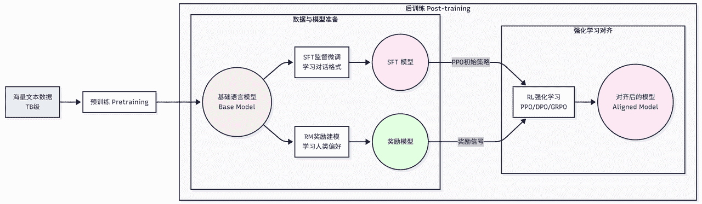

图 11.1 LLM 训练全景图

预训练阶段是 LLM 训练的第一阶段，目标是让模型学习语言的基本规律和世界知识。这个阶段使用海量的文本数据(通常是数 TB 级别)，通过自监督学习的方式训练模型。最常见的预训练任务是因果语言建模(Causal Language Modeling)，也称为下一个词预测(Next Token Prediction)。

给定一个文本序列 x1,x2,...,xtx1,x2,...,xt，模型需要预测下一个词 xt+1xt+1:

Lpretrain=−∑t=1Tlog⁡P(xt∣x1,x2,...,xt−1;θ)Lpretrain=−t=1∑TlogP(xt∣x1,x2,...,xt−1;θ)

其中 θθ 是模型参数，P(xt∣x1,...,xt−1;θ)P(xt∣x1,...,xt−1;θ) 是模型预测的下一个词的概率分布，目标是最小化负对数似然，即最大化预测正确词的概率。例如，给定文本"The cat sat on the"，模型需要预测下一个词最可能是"mat"。通过在海量文本上进行这样的训练，模型逐渐学会语法规则(什么样的词序是合法的)、语义知识(词与词之间的关系)、世界知识(关于世界的事实性信息)以及基础的推理能力。

预训练阶段的特点是数据量巨大、计算成本高、学到的是通用的语言理解和生成能力、采用无监督学习。

后训练阶段则是要解决预训练模型的不足。预训练后的模型虽然具备了强大的语言能力，但它只是一个"预测下一个词"的模型，并不知道如何遵循人类的指令、生成有帮助无害诚实的回答、拒绝不当的请求，以及以对话的方式与人交互。后训练阶段就是要解决这些问题，让模型对齐人类的偏好和价值观。

后训练通常包含三个步骤。第一步是监督微调(SFT)([15])，目标是让模型学会遵循指令和对话格式。训练数据是(prompt， completion)对，训练目标与预训练类似，仍然是最大化正确输出的概率:

LSFT=−∑i=1Nlog⁡P(yi∣xi;θ)LSFT=−i=1∑NlogP(yi∣xi;θ)

其中 xixi 是输入提示(prompt)，yiyi 是期望的输出，NN 是训练样本数量。SFT 的特点是数据量较小、需要人工标注、快速见效、主要学习任务格式和基本能力。

第二步是奖励建模(RM)。SFT 后的模型虽然能遵循指令，但生成的回答质量参差不齐。我们需要一种方式来评估回答的质量，这就是奖励模型的作用([13,14])。奖励模型的训练数据是偏好对比数据,包含同一个问题的两个回答,一个更好(chosen),一个更差(rejected)。奖励模型的训练目标是学习人类的偏好:

LRM=−E(x,yw,yl)[log⁡σ(rϕ(x,yw)−rϕ(x,yl))]LRM=−E(x,yw,yl)[logσ(rϕ(x,yw)−rϕ(x,yl))]

其中 rϕ(x,y)rϕ(x,y) 是奖励模型，输入是(提示，回答)对，输出是质量分数;ywyw 是更好的回答(chosen)，ylyl 是更差的回答(rejected)，σσ 是 sigmoid 函数，目标是让奖励模型给更好的回答更高的分数。

第三步是强化学习微调。有了奖励模型后，我们就可以用强化学习来优化语言模型，让它生成更高质量的回答。最经典的算法是 PPO(Proximal Policy Optimization)([1])，训练目标是:

JPPO=Ex,y∼πθ[rϕ(x,y)]−β⋅DKL(πθ∣∣πref)JPPO=Ex,y∼πθ[rϕ(x,y)]−β⋅DKL(πθ∣∣πref)

其中 πθπθ 是当前策略，即语言模型，πrefπref 是参考策略，这个场景下可以是 SFT 模型，rϕ(x,y)rϕ(x,y) 是奖励模型的评分，DKLDKL 是 KL 散度，目的是为了防止模型偏离太远，ββ 是平衡系数。这个目标函数的含义是:最大化奖励，同时不要偏离原始模型太远。

传统的 RLHF(Reinforcement Learning from Human Feedback)([5])需要大量人工标注偏好数据，成本高昂。为了降低成本，研究者提出了 RLAIF(Reinforcement Learning from AI Feedback)([7])，用强大的 AI 模型(如 GPT-4)来替代人类标注员。RLAIF 的工作流程是:用 SFT 模型生成多个候选回答，用强大的 AI 模型对回答进行评分和排序，用 AI 的评分训练奖励模型，用奖励模型进行强化学习。实验表明，RLAIF 的效果接近甚至超过 RLHF，同时成本大幅降低([11])。

### 11.1.3 Agentic RL 的核心理念

在理解了 LLM 的基础训练流程后，让我们来看看 Agentic RL 与传统训练方法的区别。传统的后训练(我们称之为 PBRFT: Preference-Based Reinforcement Fine-Tuning)主要关注单轮对话的质量优化:给定一个用户问题，模型生成一个回答，然后根据回答的质量获得奖励。这种方式适合优化对话助手，但对于需要多步推理、工具使用、长期规划的智能体任务来说，就显得力不从心了。

Agentic RL则是一种新的范式，它将 LLM 视为一个可学习的策略，嵌入在一个顺序决策循环中。在这个框架下，智能体需要在动态环境中与外部世界交互，执行多步行动来完成复杂任务，获得中间反馈来指导后续决策，优化长期累积奖励而非单步奖励。

让我们通过一个具体例子来理解这个区别。在 PBRFT 场景中，用户问"请解释什么是强化学习"，模型生成完整回答，然后根据回答质量直接给分。而在 Agentic RL 场景中，用户请求"帮我分析这个 GitHub 仓库的代码质量"，智能体需要经历多个步骤:首先调用 GitHub API 获取仓库信息，成功获得仓库结构和文件列表，得到+0.1 的奖;然后读取主要代码文件，成功获得代码内容，得到+0.1 的奖励;接着分析代码质量合理，得到+0.2 的奖励;最后生成分析报告质量高，得到+0.6 的奖励。总奖励是所有步骤的累积:1.0。

可以看到，Agentic RL 的关键特征是多步交互、每一步的行动都会改变环境状态、每一步都可以获得反馈、优化整个任务的完成质量。

强化学习是基于马尔可夫决策过程(Markov Decision Process， MDP)框架进行形式化的。MDP 由五元组 (S,A,P,R,γ)(S,A,P,R,γ) 定义:状态空间SS、行动空间AA、状态转移函数P(s′∣s,a)P(s′∣s,a)、奖励函数R(s,a)R(s,a)、折扣因子γγ。让我们从 MDP 的角度对比 PBRFT 和 Agentic RL，如表 11.1 所示。

表 11.1 PBRFT 与 Agentic RL 对比

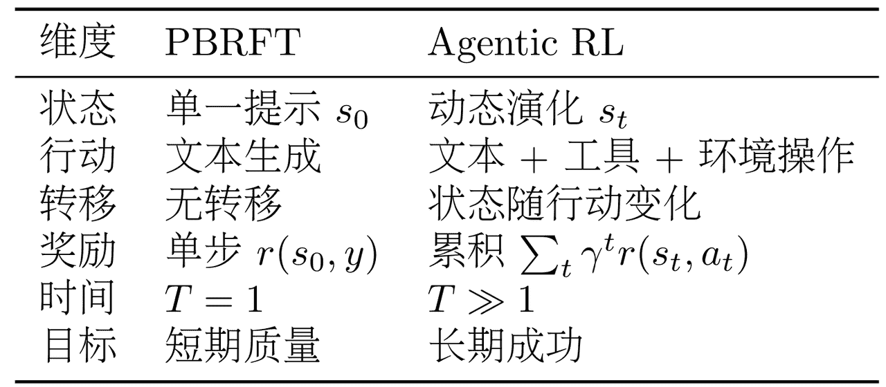

在状态方面，PBRFT 的状态 s0s0 仅由用户提示构成，时间跨度 T=1T=1(单步)，状态不变化，可以表示为 s0=prompts0=prompt。而 Agentic RL 的状态 stst 包含历史观察和上下文，时间跨度 T≫1T≫1(多步)，状态随行动演化，可以表示为 st=(prompt,o1,o2,...,ot)st=(prompt,o1,o2,...,ot)，其中 otot 是第 tt 步的观察(如工具返回结果、环境反馈等)。

在行动方面，PBRFT 的行动空间只有文本生成，单一行动类型，表示为 a=y∼πθ(y∣s0)a=y∼πθ(y∣s0)。而 Agentic RL 的行动空间包含文本生成、工具调用、环境操作等多种类型，表示为 at∈{attext,attool}at∈{attext,attool}，例如 attextattext 是生成思考过程或回答，attoolattool 是调用计算器、搜索引擎等工具。

在转移函数方面，PBRFT 无状态转移，表示为 P(s′∣s,a)=δ(s′−sterminal)P(s′∣s,a)=δ(s′−sterminal)。而 Agentic RL 的状态根据行动和环境动态变化，表示为 st+1∼P(st+1∣st,at)st+1∼P(st+1∣st,at)，例如调用搜索工具后，状态会包含搜索结果。

在奖励方面，PBRFT 只有单步奖励 r(s0,a)r(s0,a)，仅在任务结束时给予，表示为 RPBRFT=r(s0,y)RPBRFT=r(s0,y)，通常由奖励模型给出: r(s0,y)=rϕ(s0,y)r(s0,y)=rϕ(s0,y)。而 Agentic RL 有多步奖励 r(st,at)r(st,at)，可以在中间步骤给予部分奖励，表示为:

RAgentic=∑t=0Tγtr(st,at)RAgentic=t=0∑Tγtr(st,at)

其中 γ∈[0,1]γ∈[0,1] 是折扣因子，r(st,at)r(st,at) 可以是稀疏奖励(只在任务完成时给予,如答案正确 +1)、密集奖励(每步都给予，如工具调用成功 +0.1)或结合两者的混合奖励。

在目标函数方面，PBRFT 最大化单步期望奖励:

JPBRFT(θ)=Es0,y∼πθ[r(s0,y)]JPBRFT(θ)=Es0,y∼πθ[r(s0,y)]

而 Agentic RL 最大化累积折扣奖励:

JAgentic(θ)=Eτ∼πθ[∑t=0Tγtr(st,at)]JAgentic(θ)=Eτ∼πθ[t=0∑Tγtr(st,at)]

其中 τ=(s0,a0,s1,a1,...,sT)τ=(s0,a0,s1,a1,...,sT) 是完整的轨迹(trajectory)。

这种转变不仅仅是技术细节的差异，而是思维方式的根本转变。PBRFT 思维关注"如何让模型生成更好的单个回答"，优化回答质量，关注语言表达，进行单步决策。而 Agentic RL 思维关注"如何让智能体完成复杂任务"，优化任务完成度，关注行动策略，进行多步规划。这种转变使得 LLM 从"对话助手"进化为"自主智能体"，能够主动寻找信息、知道何时、如何使用外部工具、为了最终目标，愿意执行看似"绕路"的中间步骤、从错误学习。

Agentic RL 的目标是赋予 LLM 智能体六大核心能力，如图 11.2 所示。

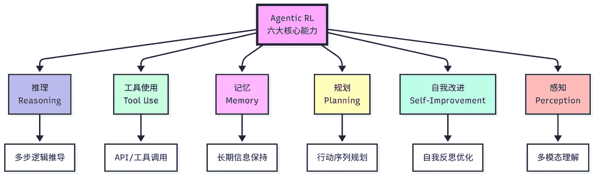

图 11.2 Agentic RL 的六大核心能力

推理(Reasoning)是指从给定信息中逻辑地得出结论的过程，是智能体的核心能力。传统的 CoT 提示方法依赖少样本示例，泛化能力有限;SFT 只能模仿训练数据中的推理模式，难以创新。强化学习的优势在于通过试错学习有效的推理策略，发现训练数据中没有的推理路径，学会何时需要深度思考、何时可以快速回答。推理任务可以建模为序列决策问题，给定问题 qq，智能体需要生成推理链 c=(c1,c2,...,cn)c=(c1,c2,...,cn) 和最终答案 aa。奖励函数通常设计为 r(q,c,a)=1r(q,c,a)=1 if a=a∗a=a∗ else 00，训练目标是 max⁡θEq,(c,a)∼πθ[r(q,c,a)]maxθEq,(c,a)∼πθ[r(q,c,a)]。通过这种方式，模型学会生成高质量的推理链，而不仅仅是记忆答案。

工具使用(Tool Use)是指智能体调用外部工来完成任务的能力。在工具使用任务中，行动空间扩展为 at∈{atthink,attool}at∈{atthink,attool},其中 atthinkatthink 是生成思考过程,attool=(tool_name，arguments)attool=(tool_name，arguments) 是调用工具。强化学习让智能体学会何时需要使用工具、选择哪个工具、如何组合多个工具。例如，在解决数学问题时，智能体需要学会何时使用计算器、何时使用代码解释器、何时直接推理。

记忆(Memory)是指智能体保持和重用过去信息的能力，对于长期任务至关重要。LLM 的上下文窗口有限，静态检索策略(如 RAG)无法针对任务优化。强化学习让智能体学会记忆管理策略:决定哪些信息值得记住、何时更新记忆、何时删除过时信息。这类似于人类的工作记忆，我们会主动管理大脑中的信息，保留重要的、遗忘无关的。

规划(Planning)是指制定行动序列以达成目标的能力。传统的 CoT 是线性思考，无法回溯;提示工程使用静态规划模板，难以适应新情况。强化学习让智能体学会动态规划:通过试错发现有效的行动序列，学会权衡短期和长期收益。例如，在多步任务中，智能体可能需要先执行一些看似"绕路"的步骤，例如收集信息，才能最终完成任务。

自我改进(Self-Improvement)是指智能体回顾自身输出、纠正错误并优化策略的能力。强化学习让智能体学会自我反思:识别自己的错误、分析失败原因、调整策略。这种能力使得智能体能够在没有人工干预的情况下持续改进，类似于人类的"从错误中学习"。

感知(Perception)是指理解多模态信息的能力。例如，强化学习可以提升视觉推理能力，让模型学会使用视觉工具，学会视觉规划。这使得智能体不仅能理解文本，还能理解和操作视觉世界。

### 11.1.4 HelloAgents 的 Agentic RL 设计

在理解了 Agentic RL 的核心理念后，让我们看看如何在 HelloAgents 框架中实现这些能力。

在技术选型上，我们集成了 TRL(Transformer Reinforcement Learning)框架([9])，模型选择 Qwen3-0.6B([10])。TRL 是 Hugging Face 的强化学习库，成熟稳定、功能完整、易于集成。Qwen3-0.6B 是阿里云的小型语言模型，0.6B 参数适合普通 GPU 训练，性能优秀且开源免费。

HelloAgents 的 Agentic RL 模块采用四层架构设计，如图 11.3 所示。

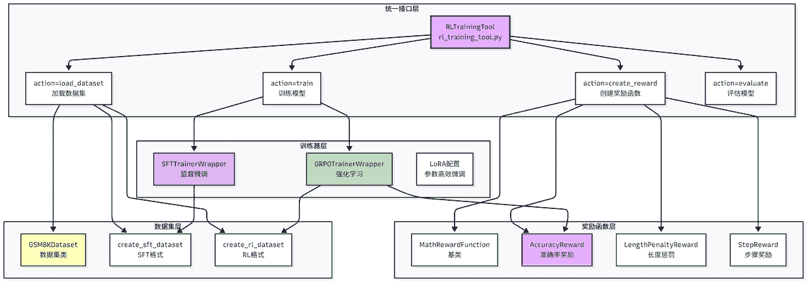

图 11.3 HelloAgents Agentic RL 架构

最底层是数据集层，包含GSM8KDataset类、create_sft_dataset()函数和create_rl_dataset()函数，负责数据加载和格式转换。第二层是奖励函数层，包含MathRewardFunction基类、AccuracyReward准确率奖励、LengthPenaltyReward长度惩罚、StepReward步骤奖励，以及便捷创建函数create_*_reward()，负责定义什么是好的行为。第三层是训练器层，包含SFTTrainerWrapper和GRPOTrainerWrapper，负责具体的训练逻辑和 LoRA 支持。最顶层是统一接口层，提供RLTrainingTool统一训练工具，支持四种操作:action="train"(训练模型)、action="load_dataset"(加载数据集)、action="create_reward"(创建奖励函数)、action="evaluate"(评估模型)。

### [11.1.5 快速上手示例](https://datawhalechina.github.io/hello-agents/#/./chapter11/%E7%AC%AC%E5%8D%81%E4%B8%80%E7%AB%A0%20Agentic-RL?id=_1115-%e5%bf%ab%e9%80%9f%e4%b8%8a%e6%89%8b%e7%a4%ba%e4%be%8b)

在深入学习之前，让我们先快速体验一下完整的训练流程。由于这一章的理论部分比较多，实战需要调试的地方也十分繁琐，因此不专注于构造工具而是学会应用。首先安装 HelloAgents 框架:

```
# 安装HelloAgents框架(第11章版本)
pip install &quot;hello-agents[rl]==0.2.5&quot;# 或者从源码安装cd HelloAgents
pip install -e &quot;.[rl]&quot;Copy to clipboardErrorCopied
```

然后运行快速训练示例:

```
import sys
import json

from hello_agents.tools import RLTrainingTool

# 创建RL训练工具
rl_tool = RLTrainingTool()# 1. 快速测试:SFT训练(10个样本，1个epoch)
sft_result_str = rl_tool.run({&quot;action&quot;: &quot;train&quot;，
    &quot;algorithm&quot;: &quot;sft&quot;,&quot;model_name&quot;: &quot;Qwen/Qwen3-0.6B&quot;,&quot;output_dir&quot;: &quot;./models/quick_test_sft&quot;,&quot;max_samples&quot;: 10,      # 只用10个样本快速测试&quot;num_epochs&quot;: 1,        # 只训练1轮&quot;batch_size&quot;: 2,&quot;use_lora&quot;: True        # 使用LoRA加速训练})

sft_result = json.loads(sft_result_str)print(f&quot;\n✓ SFT训练完成,模型保存在: {sft_result[&#x27;output_dir&#x27;]}&quot;)# 2. GRPO训练(5个样本,1个epoch)
grpo_result_str = rl_tool.run({&quot;action&quot;: &quot;train&quot;,&quot;algorithm&quot;: &quot;grpo&quot;,&quot;model_name&quot;: &quot;Qwen/Qwen3-0.6B&quot;,  # 使用基础模型&quot;output_dir&quot;: &quot;./models/quick_test_grpo&quot;,&quot;max_samples&quot;: 5,       # 只用5个样本快速测试&quot;num_epochs&quot;: 1,&quot;batch_size&quot;: 2,        # 必须能被num_generations(8)整除,使用2&quot;use_lora&quot;: True})

grpo_result = json.loads(grpo_result_str)print(f&quot;\n✓ GRPO训练完成,模型保存在: {grpo_result[&#x27;output_dir&#x27;]}&quot;)# 3. 评估模型
eval_result_str = rl_tool.run({&quot;action&quot;: &quot;evaluate&quot;,&quot;model_path&quot;: &quot;./models/quick_test_grpo&quot;,&quot;max_samples&quot;: 10,      # 在10个测试样本上评估&quot;use_lora&quot;: True})

eval_result = json.loads(eval_result_str)print(f&quot;\n✓ 评估完成:&quot;)print(f&quot;  - 准确率: {eval_result[&#x27;accuracy&#x27;]}&quot;)print(f&quot;  - 平均奖励: {eval_result[&#x27;average_reward&#x27;]}&quot;)print(f&quot;  - 测试样本数: {eval_result[&#x27;num_samples&#x27;]}&quot;)print(&quot;\n&quot; + &quot;=&quot; * 50)print(&quot;🎉 恭喜!你已经完成了第一个Agentic RL模型的训练!&quot;)print(&quot;=&quot; * 50)print(f&quot;\n模型路径:&quot;)print(f&quot;  SFT模型: {sft_result[&#x27;output_dir&#x27;]}&quot;)print(f&quot;  GRPO模型: {grpo_result[&#x27;output_dir&#x27;]}&quot;)Copy to clipboardErrorCopied
```

这个快速示例展示了完整的训练流程:SFT 训练让模型学习基础的推理格式和对话模式，GRPO 训练通过强化学习优化推理策略提升准确率，模型评估在测试集上评估训练效果。另外跑完之后准确率很低是正常现象，因为现在模型只见过 0.7%的训练样本，并且只运行了一轮。

## [11.2 数据集与奖励函数](https://datawhalechina.github.io/hello-agents/#/./chapter11/%E7%AC%AC%E5%8D%81%E4%B8%80%E7%AB%A0%20Agentic-RL?id=_112-%e6%95%b0%e6%8d%ae%e9%9b%86%e4%b8%8e%e5%a5%96%e5%8a%b1%e5%87%bd%e6%95%b0)

数据集和奖励函数是强化学习训练的两大基石。数据集定义了智能体要学习的任务，奖励函数定义了什么是好的行为。在本节中，我们将学习如何准备训练数据和设计奖励函数。

### 11.2.1 GSM8K 数学推理数据集

数学推理是评估 LLM 推理能力的理想任务。首先，数学问题有明确的正确答案，可以自动评估，不需要人工标注或复杂的奖励模型。其次，解决数学问题需要分解问题、逐步推导，这正是多步推理的典型场景。最后，学到的推理能力可以迁移到其他领域，具有很强的泛化性。相比之下，开放式问答任务(如"如何学习编程?")的答案质量难以客观评估，需要大量人工标注。

GSM8K(Grade School Math 8K)([4])是一个高质量的小学数学应用题数据集。如表 11.2 所示，数据集包含 7，473 个训练样本和 1，319 个测试样本，难度为小学数学水平(2-8 年级)，题型为应用题，需要 2-8 步推理才能得出答案。

表 11.2 GSM8K 数据集统计

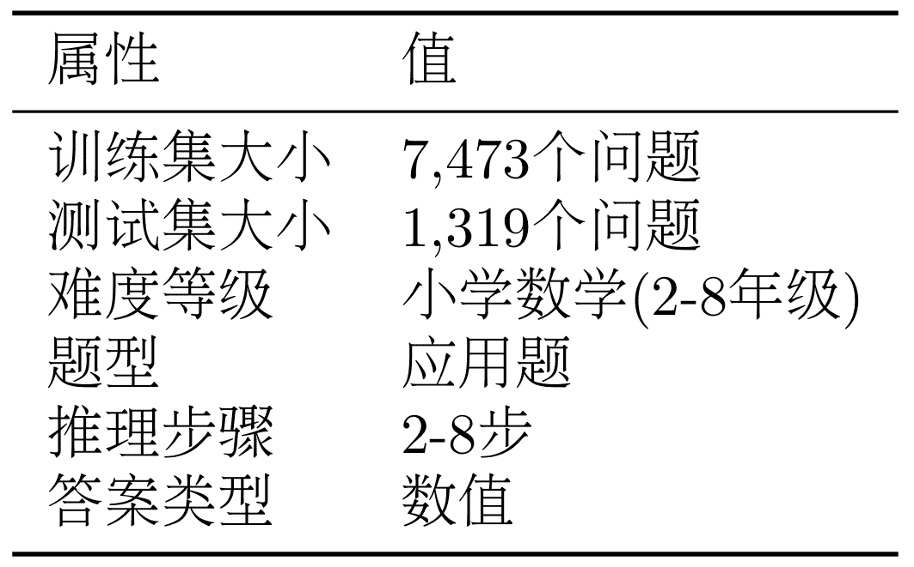

让我们看一个典型的 GSM8K 问题:

```
问题: Natalia sold clips to 48 of her friends in April, and then she sold half 
      as many clips in May. How many clips did Natalia sell altogether in April 
      and May?

答案: Natalia sold 48/2 = &lt;&lt;48/2=24&gt;&gt;24 clips in May.
      Natalia sold 48+24 = &lt;&lt;48+24=72&gt;&gt;72 clips altogether in April and May.
      #### 72

最终答案: 72Copy to clipboardErrorCopied
```

这个问题需要两步推理:首先计算 5 月份卖出的数量(48 的一半)，然后计算总数(4 月+5 月)。答案中的<<48/2=24>>是中间计算步骤的标记，#### 72标记最终答案。

GSM8K 数据集需要转换为不同的格式，以适应不同的训练方法，如图 11.4 所示。

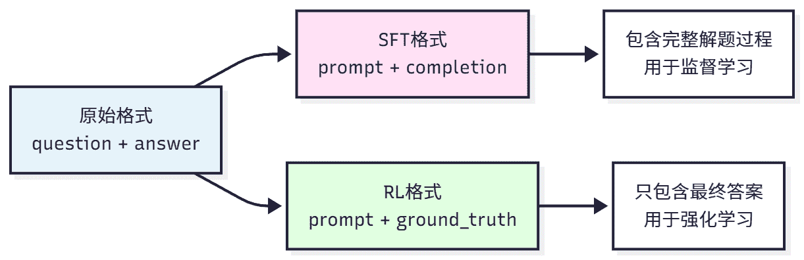

图 11.4 GSM8K 数据格式转换

原始格式直接来自数据集，包含问题(question)和答案(answer，含解题步骤)，适合人类阅读。SFT 格式用于监督微调，将问题转换为对话格式的 prompt，将完整解答作为 completion。例如:

```
{&quot;prompt&quot;: &quot;&lt;|im_start|&gt;user\nNatalia sold clips to 48 of her friends...&lt;|im_end|&gt;\n&lt;|im_start|&gt;assistant\n&quot;,&quot;completion&quot;: &quot;Let me solve this step by step.\n\nStep 1: ...\n\nFinal Answer: 72&lt;|im_end|&gt;&quot;}Copy to clipboardErrorCopied
```

关键点是使用模型的对话模板(如 Qwen 的<|im_start|>标记)，prompt 包含用户问题，completion 包含完整的解题过程和答案。这样模型可以学习如何格式化输出、如何分步推理。

RL 格式用于强化学习，只提供问题和正确答案，不提供解题过程。例如:

```
{&quot;prompt&quot;: &quot;&lt;|im_start|&gt;user\nNatalia sold clips to 48 of her friends...&lt;|im_end|&gt;\n&lt;|im_start|&gt;assistant\n&quot;,&quot;ground_truth&quot;: &quot;72&quot;}Copy to clipboardErrorCopied
```

关键点是 prompt 与 SFT 相同，但 ground_truth 只包含最终答案(用于计算奖励)，模型需要自己生成完整的推理过程。这种设计迫使模型学会自主推理，而不是简单地记忆答案。

如表 11.3 所示，三种格式各有用途。

表 11.3 数据格式对比

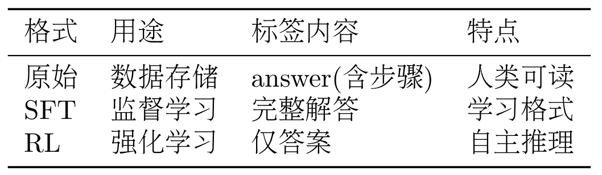

HelloAgents 提供了便捷的数据集加载函数。让我们通过代码来加载和查看数据集:

```
from hello_agents.tools import RLTrainingTool
import json

# 创建工具
rl_tool = RLTrainingTool()# 1. 加载SFT格式数据集
sft_result = rl_tool.run({&quot;action&quot;: &quot;load_dataset&quot;,&quot;format&quot;: &quot;sft&quot;,&quot;max_samples&quot;: 5  # 只加载5个样本查看})
sft_data = json.loads(sft_result)print(f&quot;数据集大小: {sft_data[&#x27;dataset_size&#x27;]}&quot;)print(f&quot;数据格式: {sft_data[&#x27;format&#x27;]}&quot;)print(f&quot;样本字段: {sft_data[&#x27;sample_keys&#x27;]}&quot;)# 2. 加载RL格式数据集
rl_result = rl_tool.run({&quot;action&quot;: &quot;load_dataset&quot;,&quot;format&quot;: &quot;rl&quot;,&quot;max_samples&quot;: 5})
rl_data = json.loads(rl_result)print(f&quot;数据集大小: {rl_data[&#x27;dataset_size&#x27;]}&quot;)print(f&quot;数据格式: {rl_data[&#x27;format&#x27;]}&quot;)print(f&quot;样本字段: {rl_data[&#x27;sample_keys&#x27;]}&quot;)Copy to clipboardErrorCopied
```

可以看到，SFT 格式包含完整的解题过程，用于监督学习;RL 格式只包含最终答案，模型需要自己生成推理过程。max_samples参数控制加载的样本数量，方便快速测试。

### [11.2.2 奖励函数设计](https://datawhalechina.github.io/hello-agents/#/./chapter11/%E7%AC%AC%E5%8D%81%E4%B8%80%E7%AB%A0%20Agentic-RL?id=_1122-%e5%a5%96%e5%8a%b1%e5%87%bd%e6%95%b0%e8%ae%be%e8%ae%a1)

奖励函数是强化学习的核心，它定义了什么是"好的行为"。一个好的奖励函数能够引导智能体学习到正确的策略，而一个糟糕的奖励函数可能导致训练失败或学到错误的行为。

在强化学习中，奖励函数 r(s,a)r(s,a) 或 r(s,a,s′)r(s,a,s′) 为智能体的每个行动分配一个数值奖励。智能体的目标是最大化累积奖励:

J(θ)=Eτ∼πθ[∑t=0Tγtr(st,at)]J(θ)=Eτ∼πθ[t=0∑Tγtr(st,at)]

对于数学推理任务，我们可以简化为:

r(q,a)=f(a,a∗)r(q,a)=f(a,a∗)

其中 qq 是问题，aa 是模型生成的答案，a∗a∗ 是正确答案，ff 是评估函数。

奖励函数的设计直接影响训练效果。好的奖励函数应该能清楚地定义什么是成功、能够提供梯度信号、不会产生过大的方差、容易调整和组合。糟糕的奖励函数可能只在任务结束时给奖励，中间步骤无反馈、存在奖励欺骗，使得智能体找到"作弊"方式获得高奖励、多个目标相互矛盾、方差过大，训练不收敛。

HelloAgents 提供了三种内置奖励函数，可以单独使用或组合使用，如图 11.5 所示。

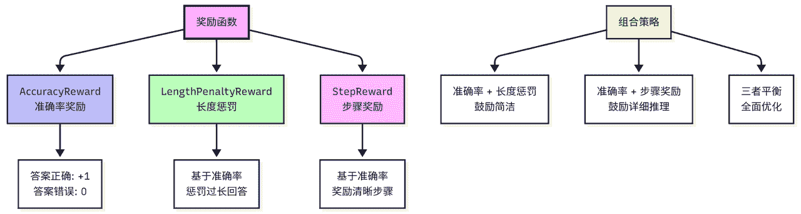

图 11.5 奖励函数设计

（1）准确率奖励

准确率奖励(AccuracyReward)是最基础的奖励函数，它只关心答案是否正确。数学定义为:

racc(a,a∗)={1if a=a∗0otherwiseracc(a,a∗)={10if a=a∗otherwise

其中 aa 是模型生成的答案，a∗a∗ 是正确答案。这是一个二值奖励函数，答案正确得 1 分，错误得 0 分。

实现时需要处理答案提取和比较。模型的输出可能包含大量文本，我们需要提取最终答案。常见的提取方法包括:查找"Final Answer:"后的数字、查找"####"标记后的数字、使用正则表达式提取最后一个数字。答案比较时需要处理数值精度(如 72.0 和 72 应该视为相同)、单位转换(如 1000 和 1k)、格式差异(如"72"和"seventy-two")。

使用示例:

```
from hello_agents.tools import RLTrainingTool
import json
rl_tool = RLTrainingTool()# 创建准确率奖励函数
reward_result = rl_tool.run({&quot;action&quot;: &quot;create_reward&quot;,&quot;reward_type&quot;: &quot;accuracy&quot;})
reward_data = json.loads(reward_result)print(f&quot;奖励类型: {reward_data[&#x27;reward_type&#x27;]}&quot;)print(f&quot;描述: {reward_data[&#x27;description&#x27;]}&quot;)# 注意: RLTrainingTool的create_reward操作返回的是配置信息,# 实际的奖励函数会在训练时自动创建和使用Copy to clipboardErrorCopied
```

输出:

```
预测: 72, 真实: 72, 奖励: 1.0
预测: 72.0, 真实: 72, 奖励: 1.0
预测: 73, 真实: 72, 奖励: 0.0Copy to clipboardErrorCopied
```

准确率奖励的优点是简单直接，容易理解和实现，适合有明确正确答案的任务。缺点是奖励稀疏，只有答案完全正确才有奖励，无法区分"接近正确"和"完全错误"，可能导致训练初期缺乏有效反馈。

（2）长度惩罚

长度惩罚(LengthPenaltyReward)鼓励模型生成简洁的回答，避免冗长啰嗦。数学定义为:

rlength(a,a∗,l)=racc(a,a∗)−α⋅max⁡(0,l−ltarget)rlength(a,a∗,l)=racc(a,a∗)−α⋅max(0,l−ltarget)

其中 ll 是生成文本的长度(字符数或 token 数)，ltargetltarget 是目标长度，αα 是惩罚系数(默认 0.001)。只有在答案正确的情况下才应用长度惩罚，避免模型为了减少惩罚而生成错误的短答案。

设计思路是:如果答案错误，奖励为 0(无论长度);如果答案正确且长度合理，奖励为 1;如果答案正确但过长，奖励为 1−α⋅(l−ltarget)1−α⋅(l−ltarget)。例如，目标长度 200 字符，实际长度 500 字符，惩罚系数 0.001，则奖励为 1−0.001×(500−200)=0.71−0.001×(500−200)=0.7。

使用示例:

```
# 创建长度惩罚奖励函数
reward_result = rl_tool.run({&quot;action&quot;: &quot;create_reward&quot;,&quot;reward_type&quot;: &quot;length_penalty&quot;,&quot;max_length&quot;: 1024,      # 最大长度&quot;penalty_weight&quot;: 0.001  # 惩罚权重})
reward_data = json.loads(reward_result)print(f&quot;奖励类型: {reward_data[&#x27;reward_type&#x27;]}&quot;)print(f&quot;描述: {reward_data[&#x27;description&#x27;]}&quot;)print(f&quot;最大长度: {reward_data[&#x27;max_length&#x27;]}&quot;)print(f&quot;惩罚权重: {reward_data[&#x27;penalty_weight&#x27;]}&quot;)Copy to clipboardErrorCopied
```

输出:

```
预测: 72, 真实: 72, 长度: 50, 奖励: 1.000
预测: 72, 真实: 72, 长度: 200, 奖励: 1.000
预测: 72, 真实: 72, 长度: 500, 奖励: 0.700
预测: 73, 真实: 72, 长度: 50, 奖励: 0.000Copy to clipboardErrorCopied
```

长度惩罚的优点是鼓励简洁表达，避免模型生成冗余内容，可以控制推理成本(更短的输出意味着更少的 token 消耗)。缺点是可能抑制详细推理，需要仔细调整惩罚系数，不同任务的最优长度差异很大。

（3）步骤奖励

步骤奖励(StepReward)鼓励模型生成清晰的推理步骤，提高可解释性。数学定义为:

rstep(a,a∗,s)=racc(a,a∗)+β⋅srstep(a,a∗,s)=racc(a,a∗)+β⋅s

其中 ss 是检测到的推理步骤数量，ββ 是步骤奖励系数(默认 0.1)。同样，只有在答案正确的情况下才给予步骤奖励。

步骤检测方法包括:查找"Step 1:"， "Step 2:"等标记、查找换行符数量、使用正则表达式匹配推理模式。例如，一个包含 3 个清晰步骤的正确答案，奖励为 1+0.1×3=1.31+0.1×3=1.3。

使用示例:

```
# 创建步骤奖励函数
reward_result = rl_tool.run({&quot;action&quot;: &quot;create_reward&quot;,&quot;reward_type&quot;: &quot;step&quot;,&quot;step_bonus&quot;: 0.1  # 每个步骤奖励0.1})
reward_data = json.loads(reward_result)print(f&quot;奖励类型: {reward_data[&#x27;reward_type&#x27;]}&quot;)print(f&quot;描述: {reward_data[&#x27;description&#x27;]}&quot;)print(f&quot;步骤奖励: {reward_data[&#x27;step_bonus&#x27;]}&quot;)Copy to clipboardErrorCopied
```

输出:

```
预测: 72, 真实: 72, 步骤: 0, 奖励: 1.00
预测: 72, 真实: 72, 步骤: 2, 奖励: 1.20
预测: 72, 真实: 72, 步骤: 5, 奖励: 1.50
预测: 73, 真实: 72, 步骤: 5, 奖励: 0.00Copy to clipboardErrorCopied
```

步骤奖励的优点是鼓励可解释的推理，生成的答案更容易验证和调试，有助于模型学习系统化的思考方式。缺点是可能导致模型为了获得更多奖励生成冗余步骤，需要平衡步骤数量和答案质量，步骤检测可能不准确。

在实际应用中，我们通常会组合多个奖励函数，以平衡不同的目标。常见的组合策略包括:

准确率 + 长度惩罚:鼓励简洁正确的答案，适合对话系统、问答系统。公式为:

r=racc−α⋅max⁡(0,l−ltarget)r=racc−α⋅max(0,l−ltarget)

准确率 + 步骤奖励:鼓励详细的推理过程，适合教育场景、可解释 AI。公式为:

r=racc+β⋅sr=racc+β⋅s

三者平衡:全面优化答案质量、简洁性和可解释性。公式为:r=racc−α⋅max⁡(0,l−ltarget)+β⋅sr=racc−α⋅max(0,l−ltarget)+β⋅s

需要仔细调整权重 αα 和 ββ，避免某个目标过度主导。

使用示例:

```
# 组合奖励函数:准确率 + 长度惩罚 + 步骤奖励# 注意: RLTrainingTool目前支持单一奖励类型# 组合奖励需要在训练配置中通过reward_fn参数指定# 这里展示如何配置不同类型的奖励函数# 准确率奖励
accuracy_result = rl_tool.run({&quot;action&quot;: &quot;create_reward&quot;,&quot;reward_type&quot;: &quot;accuracy&quot;})print(&quot;准确率奖励:&quot;, json.loads(accuracy_result)[&#x27;description&#x27;])# 长度惩罚奖励
length_result = rl_tool.run({&quot;action&quot;: &quot;create_reward&quot;,&quot;reward_type&quot;: &quot;length_penalty&quot;,&quot;max_length&quot;: 1024,&quot;penalty_weight&quot;: 0.001})print(&quot;长度惩罚奖励:&quot;, json.loads(length_result)[&#x27;description&#x27;])# 步骤奖励
step_result = rl_tool.run({&quot;action&quot;: &quot;create_reward&quot;,&quot;reward_type&quot;: &quot;step&quot;,&quot;step_bonus&quot;: 0.1})print(&quot;步骤奖励:&quot;, json.loads(step_result)[&#x27;description&#x27;])Copy to clipboardErrorCopied
```

输出:

```
组合奖励: 1.200
  - 准确率: 1.0
  - 长度惩罚: -0.100
  - 步骤奖励: +0.3Copy to clipboardErrorCopied
```

如表 11.4 所示，不同奖励函数适合不同的应用场景。

表 11.4 奖励函数对比

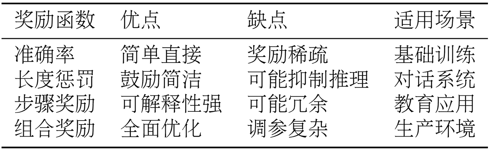

### 11.2.3 自定义数据集和奖励函数

虽然 HelloAgents 提供了 GSM8K 数据集和常用奖励函数，但在实际应用中，你可能需要使用自己的数据集或设计特定的奖励函数。本节将介绍如何扩展框架。

在使用自定义数据集之前，需要了解两种训练格式的数据要求:

SFT 格式:用于监督微调，需要包含以下字段:

+   prompt: 输入提示(包含 system 和 user 消息)

+   completion: 期望的输出

+   text: 完整的对话文本(可选)

RL 格式:用于强化学习，需要包含以下字段:

+   question: 原始问题

+   prompt: 输入提示(包含 system 和 user 消息)

+   ground_truth: 正确答案

+   full_answer: 完整答案(包含推理过程)

（1）使用 format_math_dataset 转换

最简单的方法是准备包含question和answer字段的原始数据，然后使用format_math_dataset()函数自动转换:

```
from datasets import Dataset
from hello_agents.rl import format_math_dataset

# 1. 准备原始数据
custom_data = [{&quot;question&quot;: &quot;What is 2+2?&quot;,&quot;answer&quot;: &quot;2+2=4. #### 4&quot;},{&quot;question&quot;: &quot;What is 5*3?&quot;,&quot;answer&quot;: &quot;5*3=15. #### 15&quot;},{&quot;question&quot;: &quot;What is 10+7?&quot;,&quot;answer&quot;: &quot;10+7=17. #### 17&quot;}]# 2. 转换为Dataset对象
raw_dataset = Dataset.from_list(custom_data)# 3. 转换为SFT格式
sft_dataset = format_math_dataset(
    dataset=raw_dataset,
    format_type=&quot;sft&quot;,
    model_name=&quot;Qwen/Qwen3-0.6B&quot;)print(f&quot;SFT数据集: {len(sft_dataset)}个样本&quot;)print(f&quot;字段: {sft_dataset.column_names}&quot;)# 4. 转换为RL格式
rl_dataset = format_math_dataset(
    dataset=raw_dataset,
    format_type=&quot;rl&quot;,
    model_name=&quot;Qwen/Qwen3-0.6B&quot;)print(f&quot;RL数据集: {len(rl_dataset)}个样本&quot;)print(f&quot;字段: {rl_dataset.column_names}&quot;)Copy to clipboardErrorCopied
```

（2）直接传入自定义数据集

使用 RLTrainingTool 时，可以通过custom_dataset参数直接传入自定义数据集:

```
from hello_agents.tools import RLTrainingTool

rl_tool = RLTrainingTool()# SFT训练
result = rl_tool.run({&quot;action&quot;: &quot;train&quot;,&quot;algorithm&quot;: &quot;sft&quot;,&quot;model_name&quot;: &quot;Qwen/Qwen3-0.6B&quot;,&quot;output_dir&quot;: &quot;./models/custom_sft&quot;,&quot;num_epochs&quot;: 3,&quot;batch_size&quot;: 4,&quot;use_lora&quot;: True,&quot;custom_dataset&quot;: sft_dataset  # 直接传入自定义数据集})# GRPO训练
result = rl_tool.run({&quot;action&quot;: &quot;train&quot;,&quot;algorithm&quot;: &quot;grpo&quot;,&quot;model_name&quot;: &quot;Qwen/Qwen3-0.6B&quot;,&quot;output_dir&quot;: &quot;./models/custom_grpo&quot;,&quot;num_epochs&quot;: 2,&quot;batch_size&quot;: 2,&quot;use_lora&quot;: True,&quot;custom_dataset&quot;: rl_dataset  # 直接传入自定义数据集})Copy to clipboardErrorCopied
```

（3）注册自定义数据集(推荐)

对于需要多次使用的数据集，推荐使用注册方式:

```
# 1. 注册数据集
rl_tool.register_dataset(&quot;my_math_dataset&quot;, rl_dataset)# 2. 使用注册的数据集
result = rl_tool.run({&quot;action&quot;: &quot;train&quot;,&quot;algorithm&quot;: &quot;grpo&quot;,&quot;dataset&quot;: &quot;my_math_dataset&quot;,  # 使用注册的数据集名称&quot;output_dir&quot;: &quot;./models/custom_grpo&quot;,&quot;num_epochs&quot;: 2,&quot;use_lora&quot;: True})Copy to clipboardErrorCopied
```

奖励函数用于评估模型生成的答案质量。自定义奖励函数需要遵循以下签名:

```
from typing import List
import re

def custom_reward_function(
    completions: List[str],**kwargs
) -&gt; List[float]:&quot;&quot;&quot;
    自定义奖励函数

    Args:
        completions: 模型生成的完成文本列表
        **kwargs: 其他参数,通常包含:
            - ground_truth: 正确答案列表
            - 其他数据集字段

    Returns:
        奖励值列表(每个值在0.0-1.0之间)
    &quot;&quot;&quot;
    ground_truths = kwargs.get(&quot;ground_truth&quot;, [])
    rewards = []for completion, truth in zip(completions, ground_truths):
        reward = 0.0# 提取答案
        numbers = re.findall(r&#x27;-?\d+\.?\d*&#x27;, completion)if numbers:try:
                pred = float(numbers[-1])
                truth_num = float(truth)
                error = abs(pred - truth_num)# 根据误差给予不同奖励if error &lt; 0.01:
                    reward = 1.0  # 完全正确elif error &lt; 1.0:
                    reward = 0.8  # 非常接近elif error &lt; 5.0:
                    reward = 0.5  # 接近# 额外奖励:鼓励展示推理步骤if &quot;step&quot; in completion.lower() or &quot;=&quot; in completion:
                    reward += 0.1except ValueError:
                reward = 0.0

        rewards.append(min(reward, 1.0))  # 限制最大值为1.0return rewardsCopy to clipboardErrorCopied
```

有两种方式使用自定义奖励函数:

（1）直接传入

```
result = rl_tool.run({&quot;action&quot;: &quot;train&quot;,&quot;algorithm&quot;: &quot;grpo&quot;,&quot;model_name&quot;: &quot;Qwen/Qwen3-0.6B&quot;,&quot;output_dir&quot;: &quot;./models/custom_grpo&quot;,&quot;custom_dataset&quot;: rl_dataset,&quot;custom_reward&quot;: custom_reward_function  # 直接传入奖励函数})Copy to clipboardErrorCopied
```

（2）注册使用(推荐)

```
# 1. 注册奖励函数
rl_tool.register_reward_function(&quot;my_reward&quot;, custom_reward_function)# 2. 使用注册的奖励函数
result = rl_tool.run({&quot;action&quot;: &quot;train&quot;,&quot;algorithm&quot;: &quot;grpo&quot;,&quot;dataset&quot;: &quot;my_math_dataset&quot;,&quot;output_dir&quot;: &quot;./models/custom_grpo&quot;# 奖励函数会自动使用与dataset同名的注册函数})Copy to clipboardErrorCopied
```

以下是一个完整的自定义数据集和奖励函数示例:

```
from datasets import Dataset
from hello_agents.tools import RLTrainingTool
from hello_agents.rl import format_math_dataset
import re
from typing import List

# 1. 准备自定义数据
custom_data = [{&quot;question&quot;: &quot;What is 2+2?&quot;, &quot;answer&quot;: &quot;2+2=4. #### 4&quot;},{&quot;question&quot;: &quot;What is 5+3?&quot;, &quot;answer&quot;: &quot;5+3=8. #### 8&quot;},{&quot;question&quot;: &quot;What is 10+7?&quot;, &quot;answer&quot;: &quot;10+7=17. #### 17&quot;}]# 2. 转换为训练格式
raw_dataset = Dataset.from_list(custom_data)
rl_dataset = format_math_dataset(raw_dataset, format_type=&quot;rl&quot;)# 3. 定义自定义奖励函数def tolerant_reward(completions: List[str], **kwargs) -&gt; List[float]:&quot;&quot;&quot;带容差的奖励函数&quot;&quot;&quot;
    ground_truths = kwargs.get(&quot;ground_truth&quot;, [])
    rewards = []for completion, truth in zip(completions, ground_truths):
        numbers = re.findall(r&#x27;-?\d+\.?\d*&#x27;, completion)if numbers:try:
                pred = float(numbers[-1])
                truth_num = float(truth)
                error = abs(pred - truth_num)if error &lt; 0.01:
                    reward = 1.0elif error &lt; 5.0:
                    reward = 0.5else:
                    reward = 0.0except ValueError:
                reward = 0.0else:
            reward = 0.0

        rewards.append(reward)return rewards

# 4. 创建工具并注册
rl_tool = RLTrainingTool()
rl_tool.register_dataset(&quot;my_dataset&quot;, rl_dataset)
rl_tool.register_reward_function(&quot;my_dataset&quot;, tolerant_reward)# 5. 训练
result = rl_tool.run({&quot;action&quot;: &quot;train&quot;,&quot;algorithm&quot;: &quot;grpo&quot;,&quot;model_name&quot;: &quot;Qwen/Qwen3-0.6B&quot;,&quot;dataset&quot;: &quot;my_dataset&quot;,&quot;output_dir&quot;: &quot;./models/custom_grpo&quot;,&quot;num_epochs&quot;: 2,&quot;batch_size&quot;: 2,&quot;use_lora&quot;: True})Copy to clipboardErrorCopied
```

## [11.3 SFT 训练](https://datawhalechina.github.io/hello-agents/#/./chapter11/%E7%AC%AC%E5%8D%81%E4%B8%80%E7%AB%A0%20Agentic-RL?id=_113-sft-%e8%ae%ad%e7%bb%83)

监督微调(Supervised Fine-Tuning， SFT)是强化学习训练的第一步，也是最重要的基础。SFT 让模型学习任务的基本格式、对话模式和初步的推理能力。没有 SFT 的基础，直接进行强化学习往往会失败，因为模型连基本的输出格式都不会。

### 11.3.1 为什么需要 SFT

在开始强化学习之前，我们需要先进行 SFT 训练。这是因为预训练模型虽然具备强大的语言能力，但它并不知道如何完成特定任务。预训练模型的训练目标是预测下一个词，而不是解决数学问题或使用工具。预训练模型的输出格式是自由文本，而我们需要结构化的输出(如"Step 1: ...， Step 2: ...， Final Answer: ...")。预训练模型没有见过任务相关的数据，不知道什么是"好的"推理过程。

SFT 的作用是教会模型任务的基本规则。首先，学习输出格式，让模型知道如何组织答案(如使用"Step 1"， "Final Answer"等标记)。其次，学习推理模式，通过示例学习如何分解问题、逐步推导。再次，建立基线能力，为后续的强化学习提供一个合理的起点。最后，减少探索空间，强化学习不需要从零开始，可以在 SFT 的基础上优化。

让我们通过一个对比实验来理解 SFT 的重要性。假设我们直接用预训练模型解决 GSM8K 问题:

```
from transformers import AutoTokenizer, AutoModelForCausalLM

# 加载预训练模型
model_name = &quot;Qwen/Qwen3-0.6B&quot;
tokenizer = AutoTokenizer.from_pretrained(model_name)
model = AutoModelForCausalLM.from_pretrained(model_name)# 测试问题
question = &quot;&quot;&quot;Natalia sold clips to 48 of her friends in April, and then she sold half as many clips in May. How many clips did Natalia sell altogether in April and May?&quot;&quot;&quot;# 构造输入
prompt = f&quot;&lt;|im_start|&gt;user\n{question}&lt;|im_end|&gt;\n&lt;|im_start|&gt;assistant\n&quot;
inputs = tokenizer(prompt, return_tensors=&quot;pt&quot;)# 生成回答
outputs = model.generate(**inputs, max_new_tokens=200)
response = tokenizer.decode(outputs[0], skip_special_tokens=False)print(&quot;预训练模型的回答:&quot;)print(response)Copy to clipboardErrorCopied
```

预训练模型的输出可能是:

```
&lt;|im_start|&gt;user
Natalia sold clips to 48 of her friends in April, and then she sold half as many clips in May. How many clips did Natalia sell altogether in April and May?&lt;|im_end|&gt;&lt;|im_start|&gt;assistant
I can help you with that. Let me think about this problem. Natalia sold clips to her friends. In April she sold 48 clips. In May she sold half as many. So we need to find out how many she sold in May and then add them together. But I&#x27;m not sure how to calculate half of 48. Maybe I should use a calculator? Or maybe I can just estimate...Copy to clipboardErrorCopied
```

可以看到，预训练模型虽然理解了问题，但输出非常冗长、缺乏结构、没有明确的答案、推理过程混乱。这样的输出无法用于强化学习，因为我们无法提取答案、无法评估质量、无法提供有效的奖励信号。

现在让我们看看 SFT 后的模型:

```
# 加载SFT模型(假设已经训练好)
sft_model_path = &quot;./models/sft_model&quot;
sft_model = AutoModelForCausalLM.from_pretrained(sft_model_path)# 使用相同的问题
outputs = sft_model.generate(**inputs, max_new_tokens=200)
response = tokenizer.decode(outputs[0], skip_special_tokens=False)print(&quot;SFT模型的回答:&quot;)print(response)Copy to clipboardErrorCopied
```

SFT 模型的输出:

```
&lt;|im_start|&gt;use**r**
Natalia sold clips to 48 of her friends in April, and then she sold half as many clips in May. How many clips did Natalia sell altogether in April and May?&lt;|im_end|&gt;&lt;|im_start|&gt;assistant
Let me solve this step by step.

Step 1: Calculate clips sold in May
Natalia sold half as many clips in May as in April.
Clips in May = 48 / 2 = 24

Step 2: Calculate total clips
Total = April + May = 48 + 24 = 72

Final Answer: 72&lt;|im_end|&gt;Copy to clipboardErrorCopied
```

可以看到，SFT 模型的输出结构清晰(使用"Step 1"， "Step 2"， "Final Answer"标记)、推理正确、答案明确、格式统一。这样的输出可以用于强化学习，因为我们可以提取答案、计算奖励、优化策略。

如图 11.6 所示，SFT 是从预训练模型到强化学习的桥梁。

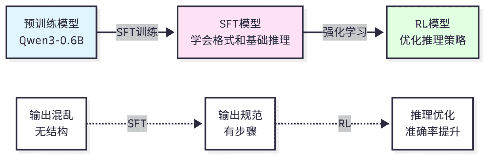

图 11.6 SFT 在训练流程中的作用

### 11.3.2 LoRA:参数高效微调

直接微调整个模型需要大量的计算资源和显存。对于 Qwen3-0.6B(0.6B 参数)，全量微调需要约 12GB 显存(FP16)或 24GB 显存(FP32)。对于更大的模型(如 7B、13B)，全量微调几乎不可能在消费级 GPU 上进行。

LoRA(Low-Rank Adaptation)([3])是一种参数高效微调方法，它只训练少量的额外参数，而保持原模型参数冻结。LoRA 的核心思想是:模型微调时的参数变化可以用低秩矩阵表示。

假设原模型的权重矩阵为 W∈Rd×kW∈Rd×k，微调后的权重为 W′=W+ΔWW′=W+ΔW。LoRA 假设 ΔWΔW 可以分解为两个低秩矩阵的乘积:

ΔW=BAΔW=BA

其中 B∈Rd×rB∈Rd×r, A∈Rr×kA∈Rr×k, r≪min⁡(d,k)r≪min(d,k) 是秩(rank)。

前向传播时，输出为:

h=Wx+ΔWx=Wx+BAxh=Wx+ΔWx=Wx+BAx

原模型参数 WW 保持冻结，只训练 BB 和 AA。

参数量对比:原模型参数量为 d×kd×k，LoRA 参数量为 d×r+r×k=r(d+k)d×r+r×k=r(d+k)。当 r≪min⁡(d,k)r≪min(d,k) 时，LoRA 参数量远小于原模型。例如，对于 d=4096,k=4096,r=8d=4096,k=4096,r=8 的情况，原模型参数量为 4096×4096=16,777,2164096×4096=16,777,216，LoRA 参数量为 8×(4096+4096)=65,5368×(4096+4096)=65,536，参数量减少了 256 倍!

因此可以总结 LoRA 的优势:显存占用大幅降低、训练速度更快、易于部署、防止过拟合。不过训练的效果通常情况会比全量调参更差一些。

如表 11.5 所示，LoRA 在不同模型规模下的效果对比。

表 11.5 LoRA vs 全量微调对比

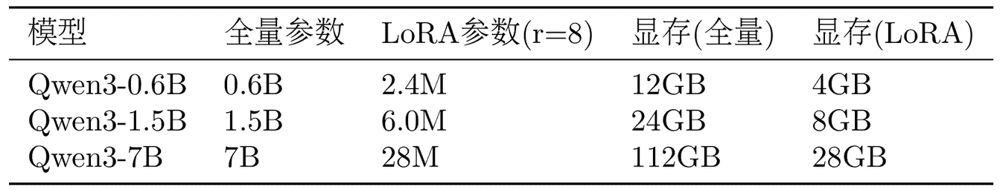

LoRA 的关键超参数包括:秩(rank，r)，控制 LoRA 矩阵的秩，越大表达能力越强，但参数量也越多，典型值为 4-64，默认 8;Alpha(αα)，LoRA 的缩放因子，实际更新为 ΔW=αrBAΔW=rαBA，控制 LoRA 的影响强度，典型值等于 rank;目标模块(target_modules)，指定哪些层应用 LoRA，通常选择注意力层(q_proj， k_proj， v_proj， o_proj)，也可以包括 MLP 层(gate_proj， up_proj， down_proj)。

### [11.3.3 SFT 训练实战](https://datawhalechina.github.io/hello-agents/#/./chapter11/%E7%AC%AC%E5%8D%81%E4%B8%80%E7%AB%A0%20Agentic-RL?id=_1133-sft-%e8%ae%ad%e7%bb%83%e5%ae%9e%e6%88%98)

现在让我们使用 HelloAgents 进行 SFT 训练。完整的训练流程包括:准备数据集、配置 LoRA、设置训练参数、开始训练、保存模型。

基础训练示例:

```
from hello_agents.tools import RLTrainingTool

# 创建训练工具
rl_tool = RLTrainingTool()# SFT训练
result = rl_tool.run({# 训练配置&quot;action&quot;: &quot;train&quot;,&quot;algorithm&quot;: &quot;sft&quot;,# 模型配置&quot;model_name&quot;: &quot;Qwen/Qwen3-0.6B&quot;,&quot;output_dir&quot;: &quot;./models/sft_model&quot;,# 数据配置&quot;max_samples&quot;: 100,     # 使用100个样本快速测试# 训练参数&quot;num_epochs&quot;: 3,        # 训练3轮&quot;batch_size&quot;: 4,        # 批次大小&quot;learning_rate&quot;: 5e-5,  # 学习率# LoRA配置&quot;use_lora&quot;: True,       # 使用LoRA&quot;lora_rank&quot;: 8,         # LoRA秩&quot;lora_alpha&quot;: 16,       # LoRA alpha})print(f&quot;\n✓ 训练完成!&quot;)print(f&quot;  - 模型保存路径: {result[&#x27;model_path&#x27;]}&quot;)print(f&quot;  - 训练样本数: {result[&#x27;num_samples&#x27;]}&quot;)print(f&quot;  - 训练轮数: {result[&#x27;num_epochs&#x27;]}&quot;)print(f&quot;  - 最终损失: {result[&#x27;final_loss&#x27;]:.4f}&quot;)Copy to clipboardErrorCopied
```

如果训练过程中损失逐渐下降，说明模型正在学习。

（1）训练参数详解

让我们详细了解各个训练参数的含义和调优建议。

数据参数:

+   max_samples: 使用的训练样本数量。快速测试时可以用 100-1000 个样本，完整训练建议使用全部数据(7473 个样本)。更多数据通常带来更好的效果，但训练时间也更长。

+   split: 数据集划分，默认"train"。可以设置为"train[:1000]"只使用前 1000 个样本。

训练参数:

+   num_epochs: 训练轮数。1 轮表示遍历整个数据集一次。太少(1-2 轮)可能欠拟合，太多(>10 轮)可能过拟合。建议从 3 轮开始，观察损失曲线调整。

+   batch_size: 每次更新使用的样本数。越大训练越稳定，但显存占用越高。建议根据显存调整:4GB 显存用 batch_size=1-2，8GB 显存用 batch_size=4-8，16GB 显存用 batch_size=8-16。

+   learning_rate: 学习率，控制参数更新的步长。太小(1e-6)收敛慢，太大(1e-3)可能不收敛。SFT 推荐 5e-5，LoRA 可以稍大(1e-4)。

LoRA 参数:

+   use_lora: 是否使用 LoRA。建议始终开启，除非有充足的显存。

+   lora_rank: LoRA 秩，控制表达能力。4-8 适合小任务，16-32 适合复杂任务，64 适合大规模微调。

+   lora_alpha: LoRA 缩放因子，通常设置为 rank 的 2 倍。rank=8 时，alpha=16;rank=16 时，alpha=32。

优化器参数:

+   optimizer: 优化器类型，默认"adamw"。AdamW 是最常用的选择，也可以尝试"sgd"或"adafactor"等。

+   weight_decay: 权重衰减，防止过拟合。默认 0.01，可以尝试 0.001-0.1。

+   warmup_ratio: 学习率预热比例。前 warmup_ratio 的步数学习率线性增加，然后线性衰减。默认 0.1(前 10%步数预热)。

（2）完整训练示例

让我们进行一次完整的 SFT 训练，使用全部数据和最佳实践:

```
from hello_agents.tools import RLTrainingTool

rl_tool = RLTrainingTool()# 完整SFT训练
result = rl_tool.run({&quot;action&quot;: &quot;train&quot;,&quot;algorithm&quot;: &quot;sft&quot;,# 模型配置&quot;model_name&quot;: &quot;Qwen/Qwen3-0.6B&quot;,&quot;output_dir&quot;: &quot;./models/sft_full&quot;,# 数据配置&quot;max_samples&quot;: None,    # 使用全部数据(7473个样本)# 训练参数&quot;num_epochs&quot;: 3,&quot;batch_size&quot;: 8,&quot;learning_rate&quot;: 5e-5,&quot;warmup_ratio&quot;: 0.1,&quot;weight_decay&quot;: 0.01,# LoRA配置&quot;use_lora&quot;: True,&quot;lora_rank&quot;: 16,        # 使用更大的rank&quot;lora_alpha&quot;: 32,&quot;lora_target_modules&quot;: [&quot;q_proj&quot;, &quot;k_proj&quot;, &quot;v_proj&quot;, &quot;o_proj&quot;],# 其他配置&quot;save_steps&quot;: 500,      # 每500步保存一次&quot;logging_steps&quot;: 100,   # 每100步记录一次&quot;eval_steps&quot;: 500,      # 每500步评估一次})print(f&quot;训练完成! 模型保存在: {result[&#x27;model_path&#x27;]}&quot;)Copy to clipboardErrorCopied
```

这个配置适合在 8GB 显存的 GPU 上训练，预计耗时 30-60 分钟。

（3）训练监控和调试

在训练过程中，我们需要监控三个关键指标。损失(Loss)应该逐渐下降，如果不下降可能是学习率太小或数据有问题，如果下降后又上升则可能是学习率太大或出现过拟合。梯度范数(Gradient Norm)应该在 0.1-10 的合理范围内，过大(>100)说明出现梯度爆炸需要降低学习率，过小(<0.01)说明梯度消失需要检查模型配置。学习率(Learning Rate)应该按照 warmup 策略变化，前 10%步数线性增加，然后线性衰减到 0。

训练中常见的问题及解决方案:显存不足时可以减小 batch_size 或 max_length，使用梯度累积或更小的模型;训练速度慢时可以增大 batch_size，减少 logging 频率，或使用混合精度训练;损失不下降时可以增大学习率，检查数据格式，或增加训练轮数;过拟合时可以增大 weight_decay，减少训练轮数，或使用更多数据。

### [11.3.4 模型评估](https://datawhalechina.github.io/hello-agents/#/./chapter11/%E7%AC%AC%E5%8D%81%E4%B8%80%E7%AB%A0%20Agentic-RL?id=_1134-%e6%a8%a1%e5%9e%8b%e8%af%84%e4%bc%b0)

训练完成后，我们需要评估模型的效果。评估指标包括:

+   准确率(Accuracy):答案完全正确的比例，最直接的指标，范围 0-1，越高越好。

+   平均奖励(Average Reward):所有样本的平均奖励，综合考虑准确率、长度、步骤等因素，范围取决于奖励函数设计。

+   推理质量(Reasoning Quality):推理过程的清晰度和逻辑性，需要人工评估或使用专门的评估模型。

使用 HelloAgents 评估模型:

```
from hello_agents.tools import RLTrainingTool

rl_tool = RLTrainingTool()# 评估SFT模型
eval_result = rl_tool.run({&quot;action&quot;: &quot;evaluate&quot;,&quot;model_path&quot;: &quot;./models/sft_full&quot;,&quot;max_samples&quot;: 100,     # 在100个测试样本上评估&quot;use_lora&quot;: True,})

eval_data = json.loads(eval_result)print(f&quot;\n评估结果:&quot;)print(f&quot;  - 准确率: {eval_data[&#x27;accuracy&#x27;]}&quot;)print(f&quot;  - 平均奖励: {eval_data[&#x27;average_reward&#x27;]}&quot;)print(f&quot;  - 测试样本数: {eval_data[&#x27;num_samples&#x27;]}&quot;)Copy to clipboardErrorCopied
```

对于 Qwen3-0.6B 这样的小模型，SFT 后在 GSM8K 上达到 40-50%的准确率是正常的。通过强化学习，我们可以进一步提升到 60-70%。

为了更好地理解 SFT 的效果，我们可以对比不同阶段的模型:

```
# 评估预训练模型(未经SFT)
base_result = rl_tool.run({&quot;action&quot;: &quot;evaluate&quot;,&quot;model_path&quot;: &quot;Qwen/Qwen3-0.6B&quot;,&quot;max_samples&quot;: 100,&quot;use_lora&quot;: False,})
base_data = json.loads(base_result)# 评估SFT模型
sft_result = rl_tool.run({&quot;action&quot;: &quot;evaluate&quot;,&quot;model_path&quot;: &quot;./models/sft_full&quot;,&quot;max_samples&quot;: 100,&quot;use_lora&quot;: True,})
sft_data = json.loads(sft_result)# 对比结果print(&quot;模型对比:&quot;)print(f&quot;预训练模型准确率: {base_data[&#x27;accuracy&#x27;]}&quot;)print(f&quot;SFT模型准确率: {sft_data[&#x27;accuracy&#x27;]}&quot;Copy to clipboardErrorCopied
```

在本节中，我们学习了 SFT 的重要性(学习格式、建立基线)、LoRA 原理(低秩分解、参数高效)、SFT 训练实战(参数配置、训练监控)、模型评估(准确率、对比分析）。

## [11.4 GRPO 训练](https://datawhalechina.github.io/hello-agents/#/./chapter11/%E7%AC%AC%E5%8D%81%E4%B8%80%E7%AB%A0%20Agentic-RL?id=_114-grpo-%e8%ae%ad%e7%bb%83)

在完成 SFT 训练后，我们已经得到了一个能够生成结构化答案的模型。但是，SFT 模型只是学会了"模仿"训练数据中的推理过程，并没有真正学会"思考"。强化学习可以让模型通过试错来优化推理策略，从而超越训练数据的质量。

### 11.4.1 从 PPO 到 GRPO

在强化学习领域，PPO(Proximal Policy Optimization)([1])是最经典的算法之一。PPO 通过限制策略更新的幅度，保证训练的稳定性。但是，PPO 在 LLM 训练中存在一些问题:需要训练 Value Model(价值模型)，增加了训练复杂度和显存占用;需要同时维护四个模型(Policy Model、Reference Model、Value Model、Reward Model)，工程实现复杂;训练不稳定，容易出现奖励崩塌或策略退化。

GRPO(Group Relative Policy Optimization)([2])是一种简化的 PPO 变体，专门为 LLM 设计。GRPO 的核心思想是:不需要 Value Model，使用组内相对奖励代替绝对奖励;简化训练流程，只需要 Policy Model 和 Reference Model;提高训练稳定性，减少奖励崩塌的风险。

让我们通过数学公式来理解 GRPO 的原理。PPO 的目标函数为:

JPPO(θ)=Es,a∼πθ[min⁡(πθ(a∣s)πold(a∣s)A(s,a),clip(πθ(a∣s)πold(a∣s),1−ϵ,1+ϵ)A(s,a))]JPPO(θ)=Es,a∼πθ[min(πold(a∣s)πθ(a∣s)A(s,a),clip(πold(a∣s)πθ(a∣s),1−ϵ,1+ϵ)A(s,a))]

其中 A(s,a)A(s,a) 是优势函数(Advantage)，需要 Value Model 来估计:

A(s,a)=Q(s,a)−V(s)=r(s,a)+γV(s′)−V(s)A(s,a)=Q(s,a)−V(s)=r(s,a)+γV(s′)−V(s)

GRPO 的目标函数简化为:

JGRPO(θ)=Es,a∼πθ[πθ(a∣s)πref(a∣s)⋅(r(s,a)−rˉgroup)]−β⋅DKL(πθ∣∣πref)JGRPO(θ)=Es,a∼πθ[πref(a∣s)πθ(a∣s)⋅(r(s,a)−rˉgroup)]−β⋅DKL(πθ∣∣πref)

其中 rˉgrouprˉgroup 是组内平均奖励，ββ 是 KL 散度惩罚系数。关键区别在于:GRPO 使用 r(s,a)−rˉgroupr(s,a)−rˉgroup 代替优势函数 A(s,a)A(s,a)，不需要 Value Model;GRPO 使用组内相对奖励，减少奖励方差;GRPO 添加 KL 散度惩罚，防止策略偏离太远。

如图 11.7 所示，PPO 和 GRPO 的训练流程对比。

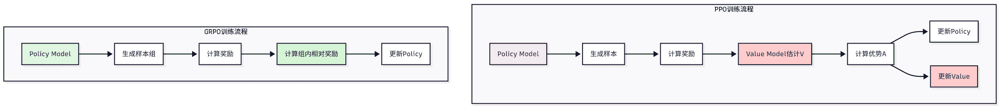

图 11.7 PPO vs GRPO 训练流程

可以看到，GRPO 省去了 Value Model 的训练，大大简化了流程。

如表 11.6 所示，PPO 和 GRPO 的详细对比。

表 11.6 PPO vs GRPO 对比

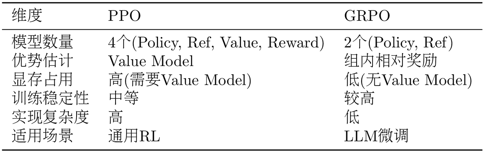

对于 LLM 训练，GRPO 是更好的选择，因为它更简单、更稳定、显存占用更低。

### 11.4.2 GRPO 训练实战

现在让我们使用 HelloAgents 进行 GRPO 训练。GRPO 训练的前提是已经完成 SFT 训练，因为 GRPO 需要一个合理的初始策略。

基础 GRPO 训练示例:

```
from hello_agents.tools import RLTrainingTool

# 创建训练工具
rl_tool = RLTrainingTool()# GRPO训练
result = rl_tool.run({# 训练配置&quot;action&quot;: &quot;train&quot;,&quot;algorithm&quot;: &quot;grpo&quot;,# 模型配置&quot;model_name&quot;: &quot;./models/sft_full&quot;,  # 从SFT模型开始&quot;output_dir&quot;: &quot;./models/grpo_model&quot;,# 数据配置&quot;max_samples&quot;: 100,     # 使用100个样本快速测试# 训练参数&quot;num_epochs&quot;: 3,&quot;batch_size&quot;: 4,&quot;learning_rate&quot;: 1e-5,  # GRPO学习率通常比SFT小# GRPO特定参数&quot;num_generations&quot;: 4,   # 每个问题生成4个答案&quot;kl_coef&quot;: 0.05,        # KL散度惩罚系数# LoRA配置&quot;use_lora&quot;: True,&quot;lora_rank&quot;: 16,&quot;lora_alpha&quot;: 32,# 奖励函数配置&quot;reward_type&quot;: &quot;accuracy&quot;,  # 使用准确率奖励})print(f&quot;\n✓ 训练完成!&quot;)print(f&quot;  - 模型保存路径: {result[&#x27;model_path&#x27;]}&quot;)print(f&quot;  - 训练样本数: {result[&#x27;num_samples&#x27;]}&quot;)print(f&quot;  - 训练轮数: {result[&#x27;num_epochs&#x27;]}&quot;)print(f&quot;  - 平均奖励: {result[&#x27;average_reward&#x27;]:.4f}&quot;)Copy to clipboardErrorCopied
```

如果 GRPO 训练过程中平均奖励逐渐提升，KL 散度保持在合理范围内，说明训练正常进行。

GRPO 有一些特定的参数需要理解和调优。

生成参数:

+   num_generations: 每个问题生成多少个答案。越多越好，但计算成本也越高。典型值为 4-8。生成多个答案的目的是计算组内相对奖励，增加训练信号的多样性。

+   max_new_tokens: 每个答案最多生成多少个 token。太少可能截断答案，太多浪费计算。建议 256-512。

+   temperature: 生成温度，控制随机性。0 表示贪婪解码，1 表示标准采样。GRPO 建议 0.7-1.0，保持一定的探索性。

优化参数:

+   learning_rate: GRPO 的学习率通常比 SFT 小，因为我们不想偏离 SFT 模型太远。建议 1e-5 到 5e-5。

+   kl_coef: KL 散度惩罚系数，控制策略更新的幅度。太小(0.01)可能导致策略偏离太远，太大(0.5)可能限制学习。建议 0.05-0.1。

+   clip_range: 策略比率裁剪范围，类似 PPO 的 epsilon。建议 0.2。

奖励参数:

+   reward_type: 奖励函数类型，可以是"accuracy"、"length_penalty"、"step"或"combined"。

+   reward_config: 奖励函数的额外配置，如长度惩罚的目标长度、步骤奖励的系数等。

让我们进行一次完整的 GRPO 训练，使用全部数据和最佳实践:

```
from hello_agents.tools import RLTrainingTool

rl_tool = RLTrainingTool()# 完整GRPO训练
result = rl_tool.run({&quot;action&quot;: &quot;train&quot;,&quot;algorithm&quot;: &quot;grpo&quot;,# 模型配置&quot;model_name&quot;: &quot;./models/sft_full&quot;,&quot;output_dir&quot;: &quot;./models/grpo_full&quot;,# 数据配置&quot;max_samples&quot;: None,    # 使用全部数据# 训练参数&quot;num_epochs&quot;: 3,&quot;batch_size&quot;: 4,&quot;learning_rate&quot;: 1e-5,&quot;warmup_ratio&quot;: 0.1,# GRPO特定参数&quot;num_generations&quot;: 4,&quot;max_new_tokens&quot;: 512,&quot;temperature&quot;: 0.8,&quot;kl_coef&quot;: 0.05,&quot;clip_range&quot;: 0.2,# LoRA配置&quot;use_lora&quot;: True,&quot;lora_rank&quot;: 16,&quot;lora_alpha&quot;: 32,# 奖励函数配置&quot;reward_type&quot;: &quot;combined&quot;,&quot;reward_config&quot;: {&quot;components&quot;: [{&quot;type&quot;: &quot;accuracy&quot;, &quot;weight&quot;: 1.0},{&quot;type&quot;: &quot;length_penalty&quot;, &quot;weight&quot;: 0.5, &quot;target_length&quot;: 200},{&quot;type&quot;: &quot;step&quot;, &quot;weight&quot;: 0.3, &quot;step_bonus&quot;: 0.1}]},# 其他配置&quot;save_steps&quot;: 500,&quot;logging_steps&quot;: 100,})print(f&quot;训练完成! 模型保存在: {result[&#x27;model_path&#x27;]}&quot;)Copy to clipboardErrorCopied
```

### 11.4.3 GRPO 训练过程解析

让我们深入理解 GRPO 的训练过程，看看每一步都发生了什么。

（1）训练循环

GRPO 的训练循环包括以下步骤:

1.  采样阶段:对于每个问题，使用当前策略生成多个答案(num_generations个)。这些答案构成一个"组"，用于计算相对奖励。

1.  奖励计算:对每个生成的答案计算奖励 riri。奖励可以是准确率、长度惩罚、步骤奖励或它们的组合。

1.  相对奖励:计算组内平均奖励 rˉ=1N∑i=1Nrirˉ=N1∑i=1Nri，然后计算相对奖励 r^i=ri−rˉr^i=ri−rˉ。这样做的好处是减少奖励方差，使训练更稳定。

1.  策略更新:使用相对奖励更新策略，同时添加 KL 散度惩罚，防止策略偏离参考模型太远。

1.  重复:重复上述步骤，直到完成所有训练轮次。

让我们通过一个具体例子来理解:

```
# 假设我们有一个问题
question = &quot;What is 48 + 24?&quot;# 生成4个答案
answers = [&quot;48 + 24 = 72. Final Answer: 72&quot;,      # 正确&quot;48 + 24 = 72. Final Answer: 72&quot;,      # 正确&quot;48 + 24 = 70. Final Answer: 70&quot;,      # 错误&quot;Let me think... 72. Final Answer: 72&quot; # 正确但冗长]# 计算奖励(假设使用准确率 + 长度惩罚)
rewards = [1.0, 1.0, 0.0, 0.8]  # 第4个答案因为冗长被惩罚# 计算组内平均奖励
avg_reward = (1.0 + 1.0 + 0.0 + 0.8) / 4 = 0.7# 计算相对奖励
relative_rewards = [1.0 - 0.7 = 0.3,   # 正确且简洁,相对奖励为正1.0 - 0.7 = 0.3,   # 正确且简洁,相对奖励为正0.0 - 0.7 = -0.7,  # 错误,相对奖励为负0.8 - 0.7 = 0.1    # 正确但冗长,相对奖励较小]# 策略更新:增加前两个答案的概率,减少第三个答案的概率Copy to clipboardErrorCopied
```

可以看到，相对奖励机制鼓励模型生成"比平均水平更好"的答案，而不是简单地追求高奖励。这样可以减少奖励方差，提高训练稳定性。

（2）KL 散度惩罚

KL 散度惩罚是 GRPO 的关键组成部分，它防止策略偏离参考模型太远。KL 散度定义为:

DKL(πθ∣∣πref)=Es,a∼πθ[log⁡πθ(a∣s)πref(a∣s)]DKL(πθ∣∣πref)=Es,a∼πθ[logπref(a∣s)πθ(a∣s)]

在实践中，我们计算每个 token 的 KL 散度，然后求和:

DKL=∑t=1Tlog⁡πθ(at∣s,a<t)πref(at∣s,a<t)DKL=t=1∑Tlogπref(at∣s,a<t)πθ(at∣s,a<t)

KL 散度越大，说明当前策略与参考模型差异越大。通过添加 KL 散度惩罚项 −β⋅DKL−β⋅DKL，我们限制策略更新的幅度，避免"遗忘"SFT 阶段学到的知识。

kl_coef (ββ) 的选择很重要:

+   太小(0.01):策略可能偏离太远，导致输出格式混乱或质量下降

+   太大(0.5):策略更新受限，学习缓慢，难以超越 SFT 模型

+   建议(0.05-0.1):平衡探索和稳定性

（3）训练监控

在 GRPO 训练过程中，我们需要监控以下指标:

+   平均奖励(Average Reward):应该逐渐上升。如果奖励不上升，可能是学习率太小、KL 惩罚太大、奖励函数设计不合理。如果奖励先升后降，可能是过拟合或奖励崩塌。

+   KL 散度(KL Divergence):应该保持在合理范围内(0.01-0.1)。如果 KL 散度过大(>0.5)，说明策略偏离太远，需要增大 kl_coef 或降低学习率。如果 KL 散度过小(<0.001)，说明策略几乎没有更新，需要减小 kl_coef 或增大学习率。

+   准确率(Accuracy):应该逐渐提升。这是最直观的指标，反映模型的实际能力。

+   生成质量(Generation Quality):需要人工检查生成的答案，确保格式正确、推理清晰。

HelloAgents 集成了两种主流的训练监控工具:Weights & Biases(wandb)和 TensorBoard。

方式 1:使用 Weights & Biases(推荐)

Weights & Biases 是目前最流行的机器学习实验跟踪平台，提供了强大的可视化和实验管理功能。

```
import os

# 1. 设置wandb(需要先注册账号: https://wandb.ai)
os.environ[&quot;WANDB_PROJECT&quot;] = &quot;hello-agents-grpo&quot;  # 项目名称
os.environ[&quot;WANDB_LOG_MODEL&quot;] = &quot;false&quot;            # 不上传模型文件# 2. 在训练配置中启用wandb
result = rl_tool.run({&quot;action&quot;: &quot;train&quot;,&quot;algorithm&quot;: &quot;grpo&quot;,&quot;model_name&quot;: &quot;Qwen/Qwen3-0.6B&quot;,&quot;output_dir&quot;: &quot;./models/grpo_monitored&quot;,&quot;num_epochs&quot;: 2,&quot;batch_size&quot;: 2,&quot;use_lora&quot;: True,# wandb会自动记录所有训练指标})# 训练完成后,访问 https://wandb.ai 查看训练曲线Copy to clipboardErrorCopied
```

wandb 会自动记录以下指标:

+   train/reward: 平均奖励

+   train/kl: KL 散度

+   train/loss: 训练损失

+   train/learning_rate: 学习率

+   train/epoch: 训练轮数

方式 2:使用 TensorBoard

TensorBoard 是 TensorFlow 提供的可视化工具，也支持 PyTorch 训练。

```
# 1. 训练时会自动在output_dir下创建tensorboard日志
result = rl_tool.run({&quot;action&quot;: &quot;train&quot;,&quot;algorithm&quot;: &quot;grpo&quot;,&quot;model_name&quot;: &quot;Qwen/Qwen3-0.6B&quot;,&quot;output_dir&quot;: &quot;./models/grpo_tb&quot;,&quot;num_epochs&quot;: 2,&quot;batch_size&quot;: 2,&quot;use_lora&quot;: True,})# 2. 启动TensorBoard查看训练曲线# 在命令行运行:# tensorboard --logdir=./models/grpo_tb# 然后访问 http://localhost:6006Copy to clipboardErrorCopied
```

方式 3:离线监控(无需外部工具)

如果不想使用 wandb 或 TensorBoard，也可以通过训练日志进行监控:

```
# 训练过程会打印详细日志
result = rl_tool.run({&quot;action&quot;: &quot;train&quot;,&quot;algorithm&quot;: &quot;grpo&quot;,&quot;model_name&quot;: &quot;Qwen/Qwen3-0.6B&quot;,&quot;output_dir&quot;: &quot;./models/grpo_simple&quot;,&quot;num_epochs&quot;: 2,&quot;batch_size&quot;: 2,&quot;use_lora&quot;: True,})# 日志示例:# Epoch 1/2 | Step 100/500 | Reward: 0.45 | KL: 0.023 | Loss: 1.234# Epoch 1/2 | Step 200/500 | Reward: 0.52 | KL: 0.031 | Loss: 1.156# ...Copy to clipboardErrorCopied
```

在 GRPO 训练中，可能会遇到一些问题。当奖励不上升时，可能是学习率太小或 KL 惩罚太大限制了策略更新，也可能是奖励函数设计不合理或 SFT 模型质量太差，此时可以增大学习率(从 1e-5 到 5e-5)、减小 kl_coef(从 0.1 到 0.05)、检查奖励函数或重新训练 SFT 模型。

当 KL 散度爆炸(超过 0.5 甚至 1.0)导致生成答案格式混乱时，通常是学习率太大或 KL 惩罚太小，或者奖励函数过于激进，可以降低学习率(从 5e-5 到 1e-5)、增大 kl_coef(从 0.05 到 0.1)、调整奖励函数或使用梯度裁剪。

当生成质量下降(准确率提升但格式混乱、推理不清晰)时，可能是奖励函数只关注准确率忽略了其他质量指标，或 KL 惩罚太小导致模型偏离 SFT 太远，或出现过拟合，此时应使用组合奖励函数同时优化多个指标、增大 kl_coef 保持一致性、减少训练轮数或增加训练数据。

GRPO 训练的显存占用比 SFT 高，因为需要同时生成多个答案并存储参考模型输出，容易出现 OOM。可以通过减小 num_generations(从 8 到 4)、batch_size(从 4 到 2)或 max_new_tokens(从 512 到 256)，或使用梯度检查点和混合精度训练来缓解。

## [11.5 模型评估与分析](https://datawhalechina.github.io/hello-agents/#/./chapter11/%E7%AC%AC%E5%8D%81%E4%B8%80%E7%AB%A0%20Agentic-RL?id=_115-%e6%a8%a1%e5%9e%8b%e8%af%84%e4%bc%b0%e4%b8%8e%e5%88%86%e6%9e%90)

训练完成后，我们需要全面评估模型的性能，不仅要看准确率这一个指标，还要深入分析模型的推理质量、错误模式、泛化能力等。本节将介绍如何系统地评估和分析 Agentic RL 模型。

### [11.5.1 评估指标体系](https://datawhalechina.github.io/hello-agents/#/./chapter11/%E7%AC%AC%E5%8D%81%E4%B8%80%E7%AB%A0%20Agentic-RL?id=_1151-%e8%af%84%e4%bc%b0%e6%8c%87%e6%a0%87%e4%bd%93%e7%b3%bb)

一个好的评估体系应该是多维度的，从不同角度衡量模型的能力。我们将评估指标分为三类:准确性指标、效率指标、质量指标。

（1）准确性指标

准确性指标衡量模型是否能够得出正确答案。

准确率(Accuracy):最基本的指标，答案完全正确的比例。计算公式为:Accuracy=正确答案数总问题数Accuracy=总问题数正确答案数

优点是简单直观，易于理解和比较。缺点是无法区分"接近正确"和"完全错误",对于复杂任务可能过于粗糙。

Top-K 准确率:生成 K 个答案，只要有一个正确就算对。计算公式为:Accuracy@K=至少有一个正确答案的问题数总问题数Accuracy@K=总问题数至少有一个正确答案的问题数

这个指标反映了模型的"潜力"，即通过多次采样能否找到正确答案。

数值误差(Numerical Error):对于数学问题，可以计算预测值与真实值的误差。计算公式为:

Error=1N∑i=1N∣yi−y^i∣Error=N1i=1∑N∣yi−y^i∣

这个指标可以区分"接近正确"(如预测 72.5，真实 72)和"完全错误"(如预测 100，真实 72)。

（2）效率指标

效率指标衡量模型生成答案的成本。

平均长度(Average Length):生成答案的平均 token 数。计算公式为:

Avg Length=1N∑i=1N∣yi∣Avg Length=N1i=1∑N∣yi∣

更短的答案意味着更低的推理成本和更快的响应速度。

推理步骤数(Reasoning Steps):答案中包含的推理步骤数量。计算公式为:

Avg Steps=1N∑i=1NsiAvg Steps=N1i=1∑Nsi

适当的步骤数(2-5 步)说明模型能够系统地分解问题，过多的步骤可能说明推理冗余。

推理时间(Inference Time):生成一个答案所需的时间。这个指标在实际部署中很重要，影响用户体验。

（3）质量指标

质量指标衡量答案的可读性和可解释性。

格式正确率(Format Correctness):答案是否符合预期格式(如包含"Step 1"， "Final Answer"等标记)。计算公式为:Format Correctness=格式正确的答案数总答案数Format Correctness=总答案数格式正确的答案数

格式正确是基本要求，格式混乱的答案即使结果正确也难以使用。

推理连贯性(Reasoning Coherence):推理步骤之间是否逻辑连贯。这个指标通常需要人工评估或使用专门的评估模型。

可解释性(Explainability):答案是否容易理解和验证。包含清晰步骤的答案比直接给出结果的答案更具可解释性。

如表 11.7 所示，不同指标的对比。

表 11.7 评估指标对比

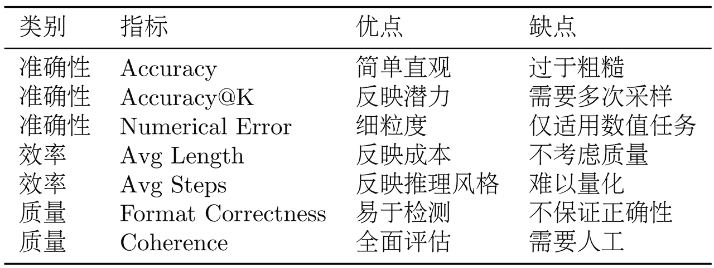

### [11.5.2 评估实战](https://datawhalechina.github.io/hello-agents/#/./chapter11/%E7%AC%AC%E5%8D%81%E4%B8%80%E7%AB%A0%20Agentic-RL?id=_1152-%e8%af%84%e4%bc%b0%e5%ae%9e%e6%88%98)

HelloAgents 提供了全面的评估功能，可以一次性计算多个指标。

```
from hello_agents.tools import RLTrainingTool

rl_tool = RLTrainingTool()# 全面评估print(&quot;=&quot; * 50)print(&quot;全面评估GRPO模型&quot;)print(&quot;=&quot; * 50)

result = rl_tool.run({&quot;action&quot;: &quot;evaluate&quot;,&quot;model_path&quot;: &quot;./models/grpo_full&quot;,&quot;max_samples&quot;: 200,&quot;use_lora&quot;: True,# 评估配置&quot;metrics&quot;: [&quot;accuracy&quot;,           # 准确率&quot;accuracy_at_k&quot;,      # Top-K准确率&quot;average_length&quot;,     # 平均长度&quot;average_steps&quot;,      # 平均步骤数&quot;format_correctness&quot;, # 格式正确率],&quot;k&quot;: 3,  # Top-3准确率})# 解析结果
eval_data = json.loads(result)# 打印结果print(f&quot;\n评估结果:&quot;)print(f&quot;  准确率: {eval_data[&#x27;accuracy&#x27;]}&quot;)print(f&quot;  平均奖励: {eval_data[&#x27;average_reward&#x27;]}&quot;)print(f&quot;  测试样本数: {eval_data[&#x27;num_samples&#x27;]}&quot;)Copy to clipboardErrorCopied
```

我们可以对比预训练模型、SFT 模型、GRPO 模型的性能:

```
# 评估三个模型
models = [(&quot;预训练模型&quot;, &quot;Qwen/Qwen3-0.6B&quot;, False),(&quot;SFT模型&quot;, &quot;./models/sft_full&quot;, True),(&quot;GRPO模型&quot;, &quot;./models/grpo_full&quot;, True),]

results = []for name, path, use_lora in models:print(f&quot;\n评估{name}...&quot;)
    result = rl_tool.run({&quot;action&quot;: &quot;evaluate&quot;,&quot;model_path&quot;: path,&quot;max_samples&quot;: 200,&quot;use_lora&quot;: use_lora,&quot;metrics&quot;: [&quot;accuracy&quot;, &quot;average_length&quot;, &quot;format_correctness&quot;],})
    results.append((name, result))# 打印对比表格print(&quot;\n&quot; + &quot;=&quot; * 70)print(f&quot;{&#x27;模型&#x27;:&lt;15} {&#x27;准确率&#x27;:&lt;12} {&#x27;平均长度&#x27;:&lt;15} {&#x27;格式正确率&#x27;:&lt;12}&quot;)print(&quot;=&quot; * 70)for name, result in results:print(f&quot;{name:&lt;15} {result[&#x27;accuracy&#x27;]:&lt;12.2%} {result[&#x27;average_length&#x27;]:&lt;15.1f} {result[&#x27;format_correctness&#x27;]:&lt;12.2%}&quot;)print(&quot;=&quot; * 70)Copy to clipboardErrorCopied
```

### [11.5.3 错误分析](https://datawhalechina.github.io/hello-agents/#/./chapter11/%E7%AC%AC%E5%8D%81%E4%B8%80%E7%AB%A0%20Agentic-RL?id=_1153-%e9%94%99%e8%af%af%e5%88%86%e6%9e%90)

仅仅知道准确率是不够的，我们需要深入分析模型在哪些类型的问题上容易出错，从而指导后续改进。模型的错误可以分为四类:计算错误(推理步骤正确但计算出错，如"48/2=25"，说明数值计算能力不足)、推理错误(推理逻辑错误导致解题思路不对，如先加后除而非先除后加，说明逻辑推理能力不足)、理解错误(没有正确理解问题，如问题问"总共"但只计算了一部分，说明语言理解能力不足)、格式错误(答案正确但格式不符合要求，如缺少"Final Answer:"标记，说明格式学习不足)。

错误分析示例:

```
from hello_agents.tools import RLTrainingTool

rl_tool = RLTrainingTool()# 评估并收集错误样本
result = rl_tool.run({&quot;action&quot;: &quot;evaluate&quot;,&quot;model_path&quot;: &quot;./models/grpo_full&quot;,&quot;max_samples&quot;: 200,&quot;use_lora&quot;: True,&quot;return_details&quot;: True,  # 返回详细结果})# 分析错误样本
errors = result[&#x27;errors&#x27;]  # 错误样本列表print(f&quot;总错误数: {len(errors)}&quot;)# 按错误类型分类
error_types = {&quot;计算错误&quot;: 0,&quot;推理错误&quot;: 0,&quot;理解错误&quot;: 0,&quot;格式错误&quot;: 0,}for error in errors:
    question = error[&#x27;question&#x27;]
    prediction = error[&#x27;prediction&#x27;]
    ground_truth = error[&#x27;ground_truth&#x27;]# 简单的错误分类逻辑(实际应用中可能需要更复杂的分析)if &quot;Final Answer:&quot; not in prediction:
        error_types[&quot;格式错误&quot;] += 1elif &quot;Step&quot; in prediction:# 有推理步骤,可能是计算或推理错误# 这里需要更细致的分析
        error_types[&quot;计算错误&quot;] += 1else:
        error_types[&quot;理解错误&quot;] += 1# 打印错误分布print(&quot;\n错误类型分布:&quot;)for error_type, count in error_types.items():
    percentage = count / len(errors) * 100print(f&quot;  {error_type}: {count} ({percentage:.1f}%)&quot;)Copy to clipboardErrorCopied
```

输出示例:

```
总错误数: 76

错误类型分布:
  计算错误: 32 (42.1%)
  推理错误: 18 (23.7%)
  理解错误: 22 (28.9%)
  格式错误: 4 (5.3%)Copy to clipboardErrorCopied
```

可以看到，计算错误是最主要的错误类型(42.1%)，说明模型的数值计算能力需要加强。格式错误很少(5.3%)，说明 SFT 训练效果良好。我们还可以分析模型在不同难度的问题上的表现:

```
# 按推理步骤数分组
step_groups = {&quot;简单(1-2步)&quot;: [],&quot;中等(3-4步)&quot;: [],&quot;困难(5+步)&quot;: [],}for sample in result[&#x27;details&#x27;]:
    steps = sample[&#x27;ground_truth_steps&#x27;]  # 真实答案的步骤数
    correct = sample[&#x27;correct&#x27;]if steps &lt;= 2:
        step_groups[&quot;简单(1-2步)&quot;].append(correct)elif steps &lt;= 4:
        step_groups[&quot;中等(3-4步)&quot;].append(correct)else:
        step_groups[&quot;困难(5+步)&quot;].append(correct)# 计算每组的准确率print(&quot;\n不同难度的准确率:&quot;)for group_name, results in step_groups.items():if len(results) &gt; 0:
        accuracy = sum(results) / len(results)print(f&quot;  {group_name}: {accuracy:.2%} ({len(results)}个样本)&quot;)Copy to clipboardErrorCopied
```

输出示例:

```
不同难度的准确率:
  简单(1-2步): 78.50% (85个样本)
  中等(3-4步): 58.30% (96个样本)
  困难(5+步): 31.60% (19个样本)Copy to clipboardErrorCopied
```

可以看到，模型在简单问题上表现良好(78.5%)，但在困难问题上表现较差(31.6%)。这说明模型的多步推理能力还有待提升

### [11.5.4 改进方向](https://datawhalechina.github.io/hello-agents/#/./chapter11/%E7%AC%AC%E5%8D%81%E4%B8%80%E7%AB%A0%20Agentic-RL?id=_1154-%e6%94%b9%e8%bf%9b%e6%96%b9%e5%90%91)

基于评估和分析结果，我们可以确定模型的改进方向，如图 11.8 所示。

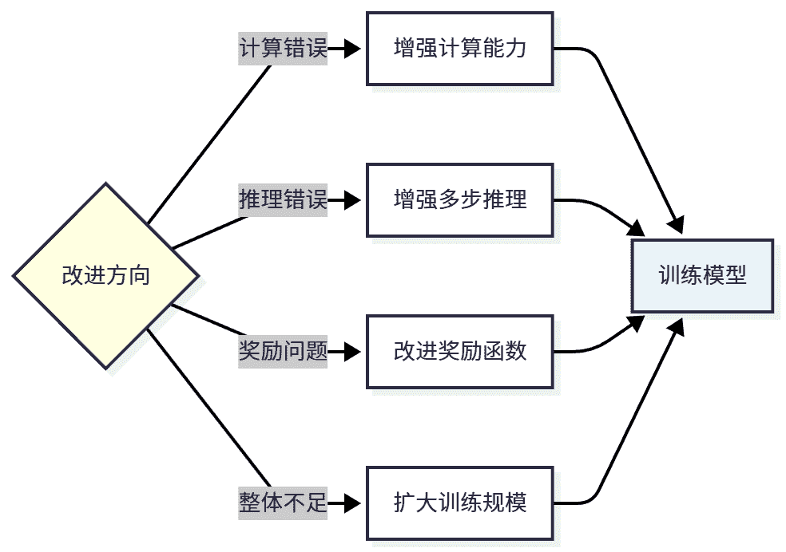

图 11.8 模型改进迭代流程

这是一个持续迭代的过程:训练模型 → 评估性能 → 分析错误 → 确定问题 → 选择改进方向 → 重新训练。通过多次迭代，模型性能会不断提升。

## [11.6 完整训练流程实战](https://datawhalechina.github.io/hello-agents/#/./chapter11/%E7%AC%AC%E5%8D%81%E4%B8%80%E7%AB%A0%20Agentic-RL?id=_116-%e5%ae%8c%e6%95%b4%e8%ae%ad%e7%bb%83%e6%b5%81%e7%a8%8b%e5%ae%9e%e6%88%98)

在前面的章节中，我们分别学习了数据准备、SFT 训练、GRPO 训练和模型评估。现在，让我们把这些知识整合起来，完成一个端到端的 Agentic RL 训练流程。

### [11.6.1 端到端训练流程](https://datawhalechina.github.io/hello-agents/#/./chapter11/%E7%AC%AC%E5%8D%81%E4%B8%80%E7%AB%A0%20Agentic-RL?id=_1161-%e7%ab%af%e5%88%b0%e7%ab%af%e8%ae%ad%e7%bb%83%e6%b5%81%e7%a8%8b)

一个完整的 Agentic RL 训练流程包括以下阶段:数据准备、SFT 训练、SFT 评估、GRPO 训练、GRPO 评估、模型部署。如图 11.9 所示。

[ht](https://raw.githubusercontent.com/datawhalechina/Hello-Agents/main/docs/images/11-figures/11-9.png)tps://raw.githubusercontent.com/datawhalechina/Hello-Agents/main/docs/images/11-figures/11-9.png

图 11.9 端到端训练流程

让我们通过一个完整的脚本来实现这个流程:

```
&quot;&quot;&quot;
完整的Agentic RL训练流程
从数据准备到模型部署的端到端示例
&quot;&quot;&quot;from hello_agents.tools import RLTrainingTool
import json
from datetime import datetime

class AgenticRLPipeline:&quot;&quot;&quot;Agentic RL训练流水线&quot;&quot;&quot;def __init__(self, config_path=&quot;config.json&quot;):&quot;&quot;&quot;
        初始化训练流水线
        
        Args:
            config_path: 配置文件路径
        &quot;&quot;&quot;
        self.rl_tool = RLTrainingTool()
        self.config = self.load_config(config_path)
        self.results = {}def load_config(self, config_path):&quot;&quot;&quot;加载配置文件&quot;&quot;&quot;with open(config_path, &#x27;r&#x27;) as f:return json.load(f)def log(self, message):&quot;&quot;&quot;记录日志&quot;&quot;&quot;
        timestamp = datetime.now().strftime(&quot;%Y-%m-%d %H:%M:%S&quot;)print(f&quot;[{timestamp}] {message}&quot;)def stage1_prepare_data(self):&quot;&quot;&quot;阶段1: 数据准备&quot;&quot;&quot;
        self.log(&quot;=&quot; * 50)
        self.log(&quot;阶段1: 数据准备&quot;)
        self.log(&quot;=&quot; * 50)# 加载并检查数据集
        result = self.rl_tool.run({&quot;action&quot;: &quot;load_dataset&quot;,&quot;format&quot;: &quot;sft&quot;,&quot;max_samples&quot;: self.config[&quot;data&quot;][&quot;max_samples&quot;],})# 解析JSON结果
        dataset_info = json.loads(result)

        self.log(f&quot;✓ 数据集加载完成&quot;)
        self.log(f&quot;  - 样本数: {dataset_info[&#x27;dataset_size&#x27;]}&quot;)
        self.log(f&quot;  - 格式: {dataset_info[&#x27;format&#x27;]}&quot;)
        self.log(f&quot;  - 数据列: {&#x27;, &#x27;.join(dataset_info[&#x27;sample_keys&#x27;])}&quot;)

        self.results[&quot;data&quot;] = dataset_info

        return dataset_info
    
    def stage2_sft_training(self):&quot;&quot;&quot;阶段2: SFT训练&quot;&quot;&quot;
        self.log(&quot;\n&quot; + &quot;=&quot; * 50)
        self.log(&quot;阶段2: SFT训练&quot;)
        self.log(&quot;=&quot; * 50)

        sft_config = self.config[&quot;sft&quot;]

        result = self.rl_tool.run({&quot;action&quot;: &quot;train&quot;,&quot;algorithm&quot;: &quot;sft&quot;,&quot;model_name&quot;: self.config[&quot;model&quot;][&quot;base_model&quot;],&quot;output_dir&quot;: sft_config[&quot;output_dir&quot;],&quot;max_samples&quot;: self.config[&quot;data&quot;][&quot;max_samples&quot;],&quot;num_epochs&quot;: sft_config[&quot;num_epochs&quot;],&quot;batch_size&quot;: sft_config[&quot;batch_size&quot;],&quot;use_lora&quot;: True,# 训练监控配置&quot;use_wandb&quot;: self.config.get(&quot;monitoring&quot;, {}).get(&quot;use_wandb&quot;, False),&quot;use_tensorboard&quot;: self.config.get(&quot;monitoring&quot;, {}).get(&quot;use_tensorboard&quot;, True),&quot;wandb_project&quot;: self.config.get(&quot;monitoring&quot;, {}).get(&quot;wandb_project&quot;, None),})# 解析JSON结果
        result_data = json.loads(result)

        self.log(f&quot;✓ SFT训练完成&quot;)
        self.log(f&quot;  - 模型路径: {result_data[&#x27;output_dir&#x27;]}&quot;)
        self.log(f&quot;  - 状态: {result_data[&#x27;status&#x27;]}&quot;)

        self.results[&quot;sft_training&quot;] = result_data

        return result_data[&quot;output_dir&quot;]def stage3_sft_evaluation(self, model_path):&quot;&quot;&quot;阶段3: SFT评估&quot;&quot;&quot;
        self.log(&quot;\n&quot; + &quot;=&quot; * 50)
        self.log(&quot;阶段3: SFT评估&quot;)
        self.log(&quot;=&quot; * 50)
        
        result = self.rl_tool.run({&quot;action&quot;: &quot;evaluate&quot;,&quot;model_path&quot;: model_path,&quot;max_samples&quot;: self.config[&quot;eval&quot;][&quot;max_samples&quot;],&quot;use_lora&quot;: True,})
        eval_data = json.loads(result)

        self.log(f&quot;✓ SFT评估完成&quot;)
        self.log(f&quot;  - 准确率: {eval_data[&#x27;accuracy&#x27;]}&quot;)
        self.log(f&quot;  - 平均奖励: {eval_data[&#x27;average_reward&#x27;]}&quot;)

        self.results[&quot;sft_evaluation&quot;] = eval_data

        return eval_data
    
    def stage4_grpo_training(self, sft_model_path):&quot;&quot;&quot;阶段4: GRPO训练&quot;&quot;&quot;
        self.log(&quot;\n&quot; + &quot;=&quot; * 50)
        self.log(&quot;阶段4: GRPO训练&quot;)
        self.log(&quot;=&quot; * 50)

        grpo_config = self.config[&quot;grpo&quot;]

        result = self.rl_tool.run({&quot;action&quot;: &quot;train&quot;,&quot;algorithm&quot;: &quot;grpo&quot;,&quot;model_name&quot;: sft_model_path,&quot;output_dir&quot;: grpo_config[&quot;output_dir&quot;],&quot;max_samples&quot;: self.config[&quot;data&quot;][&quot;max_samples&quot;],&quot;num_epochs&quot;: grpo_config[&quot;num_epochs&quot;],&quot;batch_size&quot;: grpo_config[&quot;batch_size&quot;],&quot;use_lora&quot;: True,# 训练监控配置&quot;use_wandb&quot;: self.config.get(&quot;monitoring&quot;, {}).get(&quot;use_wandb&quot;, False),&quot;use_tensorboard&quot;: self.config.get(&quot;monitoring&quot;, {}).get(&quot;use_tensorboard&quot;, True),&quot;wandb_project&quot;: self.config.get(&quot;monitoring&quot;, {}).get(&quot;wandb_project&quot;, None),})# 解析JSON结果
        result_data = json.loads(result)

        self.log(f&quot;✓ GRPO训练完成&quot;)
        self.log(f&quot;  - 模型路径: {result_data[&#x27;output_dir&#x27;]}&quot;)
        self.log(f&quot;  - 状态: {result_data[&#x27;status&#x27;]}&quot;)

        self.results[&quot;grpo_training&quot;] = result_data

        return result_data[&quot;output_dir&quot;]def stage5_grpo_evaluation(self, model_path):&quot;&quot;&quot;阶段5: GRPO评估&quot;&quot;&quot;
        self.log(&quot;\n&quot; + &quot;=&quot; * 50)
        self.log(&quot;阶段5: GRPO评估&quot;)
        self.log(&quot;=&quot; * 50)
        
        result = self.rl_tool.run({&quot;action&quot;: &quot;evaluate&quot;,&quot;model_path&quot;: model_path,&quot;max_samples&quot;: self.config[&quot;eval&quot;][&quot;max_samples&quot;],&quot;use_lora&quot;: True,})
        eval_data = json.loads(result)

        self.log(f&quot;✓ GRPO评估完成&quot;)
        self.log(f&quot;  - 准确率: {eval_data[&#x27;accuracy&#x27;]}&quot;)
        self.log(f&quot;  - 平均奖励: {eval_data[&#x27;average_reward&#x27;]}&quot;)

        self.results[&quot;grpo_evaluation&quot;] = eval_data

        return eval_data
    
    def stage6_save_results(self):&quot;&quot;&quot;阶段6: 保存结果&quot;&quot;&quot;
        self.log(&quot;\n&quot; + &quot;=&quot; * 50)
        self.log(&quot;阶段6: 保存结果&quot;)
        self.log(&quot;=&quot; * 50)# 保存训练结果
        results_path = &quot;training_results.json&quot;with open(results_path, &#x27;w&#x27;) as f:
            json.dump(self.results, f, indent=2)
        
        self.log(f&quot;✓ 结果已保存到: {results_path}&quot;)def run(self):&quot;&quot;&quot;运行完整流程&quot;&quot;&quot;try:# 阶段1: 数据准备
            self.stage1_prepare_data()# 阶段2: SFT训练
            sft_model_path = self.stage2_sft_training()# 阶段3: SFT评估
            self.stage3_sft_evaluation(sft_model_path)# 阶段4: GRPO训练
            grpo_model_path = self.stage4_grpo_training(sft_model_path)# 阶段5: GRPO评估
            self.stage5_grpo_evaluation(grpo_model_path)# 阶段6: 保存结果
            self.stage6_save_results()
            
            self.log(&quot;\n&quot; + &quot;=&quot; * 50)
            self.log(&quot;✓ 训练流程完成!&quot;)
            self.log(&quot;=&quot; * 50)except Exception as e:
            self.log(f&quot;\n✗ 训练失败: {str(e)}&quot;)raise# 使用示例if __name__ == &quot;__main__&quot;:# 创建配置文件
    config = {&quot;model&quot;: {&quot;base_model&quot;: &quot;Qwen/Qwen3-0.6B&quot;},&quot;data&quot;: {&quot;max_samples&quot;: 1000  # 使用1000个样本},&quot;sft&quot;: {&quot;output_dir&quot;: &quot;./models/sft_model&quot;,&quot;num_epochs&quot;: 3,&quot;batch_size&quot;: 8,},&quot;grpo&quot;: {&quot;output_dir&quot;: &quot;./models/grpo_model&quot;,&quot;num_epochs&quot;: 3,&quot;batch_size&quot;: 4,},&quot;eval&quot;: {&quot;max_samples&quot;: 200,&quot;sft_accuracy_threshold&quot;: 0.40  # SFT准确率阈值},&quot;monitoring&quot;: {&quot;use_wandb&quot;: False,  # 是否使用Wandb&quot;use_tensorboard&quot;: True,  # 是否使用TensorBoard&quot;wandb_project&quot;: &quot;agentic-rl-pipeline&quot;  # Wandb项目名}}# 保存配置with open(&quot;config.json&quot;, &#x27;w&#x27;) as f:
        json.dump(config, f, indent=2)# 运行训练流程
    pipeline = AgenticRLPipeline(&quot;config.json&quot;)
    pipeline.run()Copy to clipboardErrorCopied
```

运行这个脚本，你将看到完整的训练过程。

运行小建议：

从小规模开始:不要一开始就用全部数据训练。先用 100-1000 个样本快速迭代，验证流程和参数，确认效果后再扩大规模。这样可以节省大量时间和计算资源。

数据质量检查:在训练前检查数据质量，确保格式正确、答案准确、没有重复样本。可以使用以下代码:

```
def check_data_quality(dataset):&quot;&quot;&quot;检查数据质量&quot;&quot;&quot;
    issues = []# 检查必需字段
    required_fields = [&quot;prompt&quot;, &quot;completion&quot;]for field in required_fields:if field not in dataset.column_names:
            issues.append(f&quot;缺少字段: {field}&quot;)# 检查空值for i, sample in enumerate(dataset):if not sample[&quot;prompt&quot;] or not sample[&quot;completion&quot;]:
            issues.append(f&quot;样本{i}包含空值&quot;)# 检查重复
    prompts = [s[&quot;prompt&quot;] for s in dataset]
    duplicates = len(prompts) - len(set(prompts))if duplicates &gt; 0:
        issues.append(f&quot;发现{duplicates}个重复样本&quot;)return issues

# 使用
issues = check_data_quality(dataset)if issues:print(&quot;数据质量问题:&quot;)for issue in issues:print(f&quot;  - {issue}&quot;)else:print(&quot;✓ 数据质量检查通过&quot;)Copy to clipboardErrorCopied
```

数据增强:如果数据量不足，可以考虑数据增强，如改写问题(保持答案不变)、生成相似问题、反向翻译(translate back)。但要注意保持数据质量，避免引入噪声。

### [11.6.2 超参数调优](https://datawhalechina.github.io/hello-agents/#/./chapter11/%E7%AC%AC%E5%8D%81%E4%B8%80%E7%AB%A0%20Agentic-RL?id=_1162-%e8%b6%85%e5%8f%82%e6%95%b0%e8%b0%83%e4%bc%98)

超参数调优是提升模型性能的关键。下面是一些常用的调优策略。

（1）网格搜索

网格搜索(Grid Search)是最简单的调优方法，遍历所有参数组合，选择最佳的一组。

```
# 定义参数网格
param_grid = {&quot;learning_rate&quot;: [1e-5, 5e-5, 1e-4],&quot;lora_rank&quot;: [8, 16, 32],&quot;kl_coef&quot;: [0.05, 0.1, 0.2],}

best_accuracy = 0
best_params = None# 遍历所有组合for lr in param_grid[&quot;learning_rate&quot;]:for rank in param_grid[&quot;lora_rank&quot;]:for kl in param_grid[&quot;kl_coef&quot;]:print(f&quot;测试参数: lr={lr}, rank={rank}, kl={kl}&quot;)# 训练模型
            result = rl_tool.run({&quot;action&quot;: &quot;train&quot;,&quot;algorithm&quot;: &quot;grpo&quot;,&quot;learning_rate&quot;: lr,&quot;lora_rank&quot;: rank,&quot;kl_coef&quot;: kl,# 其他参数...})# 评估模型
            eval_result = rl_tool.run({&quot;action&quot;: &quot;evaluate&quot;,&quot;model_path&quot;: result[&quot;model_path&quot;],})# 更新最佳参数if eval_result[&quot;accuracy&quot;] &gt; best_accuracy:
                best_accuracy = eval_result[&quot;accuracy&quot;]
                best_params = {&quot;lr&quot;: lr, &quot;rank&quot;: rank, &quot;kl&quot;: kl}print(f&quot;最佳参数: {best_params}&quot;)print(f&quot;最佳准确率: {best_accuracy:.2%}&quot;)Copy to clipboardErrorCopied
```

网格搜索的优点是简单直接，能找到全局最优。缺点是计算成本高，参数多时不可行。

（2）随机搜索

随机搜索(Random Search)随机采样参数组合，比网格搜索更高效。

```
import random

# 定义参数范围
param_ranges = {&quot;learning_rate&quot;: (1e-6, 1e-4),  # 对数均匀分布&quot;lora_rank&quot;: [4, 8, 16, 32, 64],&quot;kl_coef&quot;: (0.01, 0.5),}

best_accuracy = 0
best_params = None# 随机采样N次
N = 10for i in range(N):# 随机采样参数
    lr = 10 ** random.uniform(-6, -4)  # 对数均匀
    rank = random.choice(param_ranges[&quot;lora_rank&quot;])
    kl = random.uniform(0.01, 0.5)print(f&quot;[{i+1}/{N}] 测试参数: lr={lr:.2e}, rank={rank}, kl={kl:.3f}&quot;)# 训练和评估(同上)# ...print(f&quot;最佳参数: {best_params}&quot;)print(f&quot;最佳准确率: {best_accuracy:.2%}&quot;)Copy to clipboardErrorCopied
```

随机搜索的优点是效率高，适合参数空间大的情况。缺点是可能错过最优解。

（3）贝叶斯优化

贝叶斯优化(Bayesian Optimization)使用概率模型指导搜索，更加智能。可以使用 Optuna 等库:

```
import optuna

def objective(trial):&quot;&quot;&quot;优化目标函数&quot;&quot;&quot;# 采样参数
    lr = trial.suggest_loguniform(&quot;learning_rate&quot;, 1e-6, 1e-4)
    rank = trial.suggest_categorical(&quot;lora_rank&quot;, [8, 16, 32])
    kl = trial.suggest_uniform(&quot;kl_coef&quot;, 0.01, 0.5)# 训练模型
    result = rl_tool.run({&quot;action&quot;: &quot;train&quot;,&quot;algorithm&quot;: &quot;grpo&quot;,&quot;learning_rate&quot;: lr,&quot;lora_rank&quot;: rank,&quot;kl_coef&quot;: kl,# 其他参数...})# 评估模型
    eval_result = rl_tool.run({&quot;action&quot;: &quot;evaluate&quot;,&quot;model_path&quot;: result[&quot;model_path&quot;],})return eval_result[&quot;accuracy&quot;]# 创建研究
study = optuna.create_study(direction=&quot;maximize&quot;)
study.optimize(objective, n_trials=20)# 打印最佳参数print(f&quot;最佳参数: {study.best_params}&quot;)print(f&quot;最佳准确率: {study.best_value:.2%}&quot;)Copy to clipboardErrorCopied
```

贝叶斯优化的优点是样本效率高，能快速找到好的参数。缺点是实现复杂，需要额外的库。

如表 11.8 所示，不同调优方法的对比。

表 11.8 超参数调优方法对比

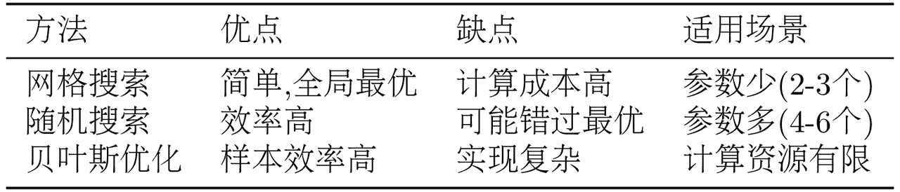

### 11.6.3 分布式训练

当数据量和模型规模增大时，单 GPU 训练会变得非常缓慢。这时我们需要使用分布式训练来加速训练过程。HelloAgents 基于 TRL 和 Hugging Face Accelerate，天然支持多 GPU 和多节点分布式训练

方案选择建议:

+   单机多卡(2-8 卡): 使用 DDP，简单高效

+   大模型(>7B): 使用 DeepSpeed ZeRO-2 或 ZeRO-3

+   多节点集群: 使用 DeepSpeed ZeRO-3 + Offload

（1）配置 Accelerate

首先需要创建 Accelerate 配置文件。运行以下命令:

```
accelerate configCopy to clipboardErrorCopied
```

根据提示选择配置:

```
In which compute environment are you running?
&gt; This machine

Which type of machine are you using?
&gt; multi-GPU

How many different machines will you use?
&gt; 1

Do you wish to optimize your script with torch dynamo?
&gt; NO

Do you want to use DeepSpeed?
&gt; YES

Which DeepSpeed config file do you want to use?
&gt; ZeRO-2

How many GPU(s) should be used for distributed training?
&gt; 4Copy to clipboardErrorCopied
```

这会在~/.cache/huggingface/accelerate/default_config.yaml生成配置文件。

（2）使用 DDP 训练

数据并行(DDP)是最简单的分布式方案，每个 GPU 持有完整模型副本，数据被分割到各个 GPU 上。

Accelerate 配置文件 (multi_gpu_ddp.yaml):

```
compute_environment: LOCAL_MACHINE
distributed_type: MULTI_GPU
num_processes: 4  # GPU数量
machine_rank: 0
num_machines: 1
gpu_ids: all
mixed_precision: fp16Copy to clipboardErrorCopied
```

训练脚本 (无需修改):

```
from hello_agents.tools import RLTrainingTool

rl_tool = RLTrainingTool()# 训练代码完全不变
result = rl_tool.run({&quot;action&quot;: &quot;train&quot;,&quot;algorithm&quot;: &quot;grpo&quot;,&quot;model_name&quot;: &quot;Qwen/Qwen3-0.6B&quot;,&quot;output_dir&quot;: &quot;./models/grpo_ddp&quot;,&quot;num_epochs&quot;: 3,&quot;batch_size&quot;: 4,  # 每个GPU的batch size&quot;use_lora&quot;: True,})Copy to clipboardErrorCopied
```

启动训练:

```
# 使用配置文件
accelerate launch --config_file multi_gpu_ddp.yaml train_script.py

# 或者直接指定参数
accelerate launch --num_processes 4 --mixed_precision fp16 train_script.pyCopy to clipboardErrorCopied
```

（3）使用 DeepSpeed ZeRO 训练

DeepSpeed ZeRO通过分片优化器状态、梯度和模型参数，大幅降低显存占用，支持更大的模型和 batch size。

ZeRO-2 配置文件 (deepspeed_zero2.yaml):

```
compute_environment: LOCAL_MACHINE
distributed_type: DEEPSPEED
num_processes: 4
machine_rank: 0
num_machines: 1
gpu_ids: all
mixed_precision: fp16
deepspeed_config:
  gradient_accumulation_steps: 4
  gradient_clipping: 1.0
  offload_optimizer_device: none
  offload_param_device: none
  zero3_init_flag: false
  zero_stage: 2  # ZeRO-2Copy to clipboardErrorCopied
```

ZeRO-3 配置文件 (deepspeed_zero3.yaml):

```
compute_environment: LOCAL_MACHINE
distributed_type: DEEPSPEED
num_processes: 4
machine_rank: 0
num_machines: 1
gpu_ids: all
mixed_precision: fp16
deepspeed_config:
  gradient_accumulation_steps: 4
  gradient_clipping: 1.0
  offload_optimizer_device: cpu  # 优化器状态卸载到CPU
  offload_param_device: cpu      # 参数卸载到CPU
  zero3_init_flag: true
  zero_stage: 3  # ZeRO-3Copy to clipboardErrorCopied
```

启动训练:

```
# ZeRO-2
accelerate launch --config_file deepspeed_zero2.yaml train_script.py

# ZeRO-3
accelerate launch --config_file deepspeed_zero3.yaml train_script.pyCopy to clipboardErrorCopied
```

如表 11.9 所示，这是 Qwen3-0.6B 模型用不同方式训练的显存对比:

表 11.9 显存对比 (Qwen3-0.6B 模型)

（4）多节点训练

对于超大规模训练，可以使用多个节点(机器)。

主节点配置 (multi_node_main.yaml):

```
compute_environment: LOCAL_MACHINE
distributed_type: DEEPSPEED
num_processes: 16  # 4节点 x 4GPU
machine_rank: 0    # 主节点
num_machines: 4
main_process_ip: 192.168.1.100  # 主节点IP
main_process_port: 29500
gpu_ids: all
mixed_precision: fp16
deepspeed_config:
  zero_stage: 3
  offload_optimizer_device: cpu
  offload_param_device: cpuCopy to clipboardErrorCopied
```

工作节点配置 (修改machine_rank为 1, 2, 3):

```
machine_rank: 1  # 工作节点1
# 其他配置相同Copy to clipboardErrorCopied
```

启动训练:

```
# 在主节点上
accelerate launch --config_file multi_node_main.yaml train_script.py

# 在工作节点1上
accelerate launch --config_file multi_node_worker1.yaml train_script.py

# 在工作节点2上
accelerate launch --config_file multi_node_worker2.yaml train_script.py

# 在工作节点3上
accelerate launch --config_file multi_node_worker3.yaml train_script.pyCopy to clipboardErrorCopied
```

（5）分布式训练最佳实践

1.  Batch Size 调整

分布式训练时，总 batch size = per_device_batch_size × num_gpus × gradient_accumulation_steps

```
# 单GPU: batch_size=4, gradient_accumulation=4, 总batch=16# 4GPU DDP: batch_size=4, gradient_accumulation=1, 总batch=16 (保持一致)Copy to clipboardErrorCopied
```

1.  学习率缩放

使用线性缩放规则: lr_new = lr_base × sqrt(total_batch_size_new / total_batch_size_base)

```
# 基准: 单GPU, batch=16, lr=5e-5# 4GPU: batch=64, lr=5e-5 × sqrt(64/16) = 1e-4Copy to clipboardErrorCopied
```

1.  监控和调试

```
# 启用详细日志
export ACCELERATE_LOG_LEVEL=INFO

# 启用NCCL调试(多节点)
export NCCL_DEBUG=INFO

# 检查GPU利用率
watch -n 1 nvidia-smiCopy to clipboardErrorCopied
```

### [11.6.4 生产部署](https://datawhalechina.github.io/hello-agents/#/./chapter11/%E7%AC%AC%E5%8D%81%E4%B8%80%E7%AB%A0%20Agentic-RL?id=_1164-%e7%94%9f%e4%ba%a7%e9%83%a8%e7%bd%b2)

训练完成后，我们需要将模型部署到生产环境。下面是一些部署建议。

（1）模型导出

将 LoRA 权重合并到基础模型，方便部署:

```
from transformers import AutoModelForCausalLM, AutoTokenizer
from peft import PeftModel

# 加载基础模型
base_model = AutoModelForCausalLM.from_pretrained(&quot;Qwen/Qwen3-0.6B&quot;)# 加载LoRA权重
model = PeftModel.from_pretrained(base_model, &quot;./models/grpo_model&quot;)# 合并权重
merged_model = model.merge_and_unload()# 保存合并后的模型
merged_model.save_pretrained(&quot;./models/merged_model&quot;)# 保存tokenizer
tokenizer = AutoTokenizer.from_pretrained(&quot;Qwen/Qwen3-0.6B&quot;)
tokenizer.save_pretrained(&quot;./models/merged_model&quot;)print(&quot;✓ 模型已导出到: ./models/merged_model&quot;)Copy to clipboardErrorCopied
```

（2）推理优化

使用量化和优化技术加速推理:

```
from transformers import AutoModelForCausalLM, AutoTokenizer
import torch

# 加载模型(使用8-bit量化)
model = AutoModelForCausalLM.from_pretrained(&quot;./models/merged_model&quot;,
    load_in_8bit=True,  # 8-bit量化
    device_map=&quot;auto&quot;,  # 自动分配设备)

tokenizer = AutoTokenizer.from_pretrained(&quot;./models/merged_model&quot;)# 推理def generate_answer(question):
    prompt = f&quot;&lt;|im_start|&gt;user\n{question}&lt;|im_end|&gt;\n&lt;|im_start|&gt;assistant\n&quot;
    inputs = tokenizer(prompt, return_tensors=&quot;pt&quot;).to(model.device)

    outputs = model.generate(**inputs,
        max_new_tokens=512,
        temperature=0.7,
        do_sample=True,)

    response = tokenizer.decode(outputs[0], skip_special_tokens=False)return response

# 测试
question = &quot;What is 48 + 24?&quot;
answer = generate_answer(question)print(answer)Copy to clipboardErrorCopied
```

（3）API 服务

使用 FastAPI 创建推理服务:

```
from fastapi import FastAPI
from pydantic import BaseModel
from transformers import AutoModelForCausalLM, AutoTokenizer

app = FastAPI()# 加载模型
model = AutoModelForCausalLM.from_pretrained(&quot;./models/merged_model&quot;)
tokenizer = AutoTokenizer.from_pretrained(&quot;./models/merged_model&quot;)class Question(BaseModel):
    text: str
    max_tokens: int = 512class Answer(BaseModel):
    text: str
    confidence: float@app.post(&quot;/generate&quot;, response_model=Answer)def generate(question: Question):&quot;&quot;&quot;生成答案&quot;&quot;&quot;
    prompt = f&quot;&lt;|im_start|&gt;user\n{question.text}&lt;|im_end|&gt;\n&lt;|im_start|&gt;assistant\n&quot;
    inputs = tokenizer(prompt, return_tensors=&quot;pt&quot;)

    outputs = model.generate(**inputs,
        max_new_tokens=question.max_tokens,
        temperature=0.7,
        return_dict_in_generate=True,
        output_scores=True,)

    response = tokenizer.decode(outputs.sequences[0], skip_special_tokens=False)# 计算置信度(简化版)
    confidence = 0.8  # 实际应该基于输出概率计算return Answer(text=response, confidence=confidence)# 运行: uvicorn api:app --host 0.0.0.0 --port 8000Copy to clipboardErrorCopied
```

## [11.8 本章小结](https://datawhalechina.github.io/hello-agents/#/./chapter11/%E7%AC%AC%E5%8D%81%E4%B8%80%E7%AB%A0%20Agentic-RL?id=_118-%e6%9c%ac%e7%ab%a0%e5%b0%8f%e7%bb%93)

在本章中，我们系统地学习了 Agentic RL 的理论和实践，从基础概念到完整的训练流程，从数据准备到模型部署。让我们回顾一下本章的主要内容。

（1）Agentic RL 的本质

Agentic RL 是将 LLM 作为可学习策略，嵌入到智能体的感知-决策-执行循环中，通过强化学习优化智能体在多步任务中的表现。它与传统的 PBRFT(Preference-Based Reinforcement Fine-Tuning)的核心区别在于:

+   任务性质:从单轮对话优化扩展到多步序贯决策

+   状态空间:从静态提示扩展到动态演化的环境状态

+   行动空间:从纯文本生成扩展到文本+工具+环境操作

+   奖励设计:从单步质量评估扩展到长期累积回报

+   优化目标:从短期响应质量扩展到长期任务成功

（2）六大核心能力

Agentic RL 旨在提升智能体的六大核心能力:

1.  推理(Reasoning):多步逻辑推导，学习推理策略

1.  工具使用(Tool Use):API/工具调用，学会何时用、如何用

1.  记忆(Memory):长期信息保持，学习记忆管理

1.  规划(Planning):行动序列规划，学会动态规划

1.  自我改进(Self-Improvement):自我反思优化，从错误中学习

1.  感知(Perception):多模态理解，视觉推理和工具使用

（3）训练流程

完整的 Agentic RL 训练流程包括:

1.  预训练(Pretraining):在大规模文本上学习语言知识(通常使用现成的预训练模型)

1.  监督微调(SFT):学习任务格式和基础推理能力

1.  强化学习(RL):通过试错优化推理策略，超越训练数据质量

其中，SFT 是基础，RL 是提升。没有 SFT 的基础，RL 很难成功;没有 RL 的优化，模型只能模仿训练数据。

如果你想深入学习 Agentic RL，建议按照以下路径:

基础阶段

1.  强化学习基础:学习 MDP、策略梯度、PPO 等基本概念

1.  LLM 基础:了解 Transformer、预训练、微调等技术

1.  实践 HelloAgents:运行本章的示例代码，理解完整流程

进阶阶段

1.  深入 TRL:学习 TRL 库的实现，理解 SFT 和 GRPO 等算法的细节

1.  自定义数据集:使用自己的数据集训练模型

1.  自定义奖励函数:设计适合自己任务的奖励函数

1.  参数调优:系统地调优超参数，提升模型性能

高级阶段

1.  多步推理:研究长序列推理任务

1.  工具学习:让智能体学会使用工具

1.  多智能体:研究多智能体协作

1.  前沿论文:阅读最新的研究论文，跟进前沿进展

希望本章能够帮助你理解和掌握 Agentic RL 技术，在自己的项目中应用这些知识，构建更智能的 Agent 系统!

## [参考文献](https://datawhalechina.github.io/hello-agents/#/./chapter11/%E7%AC%AC%E5%8D%81%E4%B8%80%E7%AB%A0%20Agentic-RL?id=%e5%8f%82%e8%80%83%e6%96%87%e7%8c%ae)

[1] Schulman, J., Wolski, F., Dhariwal, P., Radford, A., & Klimov, O. (2017). Proximal Policy Optimization Algorithms. arXiv preprint arXiv:1707.06347.

[2] Shao, Z., Wang, P., Zhu, Q., Xu, R., Song, J., Zhang, M., ... & Guo, D. (2024). DeepSeekMath: Pushing the Limits of Mathematical Reasoning in Open Language Models. arXiv preprint arXiv:2402.03300.

[3] Hu, E. J., Shen, Y., Wallis, P., Allen-Zhu, Z., Li, Y., Wang, S., ... & Chen, W. (2021). LoRA: Low-Rank Adaptation of Large Language Models. arXiv preprint arXiv:2106.09685.

[4] Cobbe, K., Kosaraju, V., Bavarian, M., Chen, M., Jun, H., Kaiser, L., ... & Schulman, J. (2021). Training Verifiers to Solve Math Word Problems. arXiv preprint arXiv:2110.14168.

[5] Ouyang, L., Wu, J., Jiang, X., Almeida, D., Wainwright, C., Mishkin, P., ... & Lowe, R. (2022). Training language models to follow instructions with human feedback. Advances in Neural Information Processing Systems, 35, 27730-27744.

[6] Rafailov, R., Sharma, A., Mitchell, E., Ermon, S., Manning, C. D., & Finn, C. (2023). Direct Preference Optimization: Your Language Model is Secretly a Reward Model. arXiv preprint arXiv:2305.18290.

[7] Lee, H., Phatale, S., Mansoor, H., Lu, K., Mesnard, T., Bishop, C., ... & Rastogi, A. (2023). RLAIF: Scaling Reinforcement Learning from Human Feedback with AI Feedback. arXiv preprint arXiv:2309.00267.

[8] Wei, J., Wang, X., Schuurmans, D., Bosma, M., Ichter, B., Xia, F., ... & Zhou, D. (2022). Chain-of-Thought Prompting Elicits Reasoning in Large Language Models. Advances in Neural Information Processing Systems, 35, 24824-24837.

[9] von Werra, L., Belkada, Y., Tunstall, L., Beeching, E., Thrush, T., Lambert, N., & Huang, S. (2020). TRL: Transformer Reinforcement Learning. GitHub repository. https://github.com/huggingface/trl

[10] Qwen Team. (2025). Qwen3 Technical Report. arXiv preprint arXiv:2505.09388.

[11] Bai, Y., Jones, A., Ndousse, K., Askell, A., Chen, A., DasSarma, N., ... & Kaplan, J. (2022). Training a Helpful and Harmless Assistant with Reinforcement Learning from Human Feedback. arXiv preprint arXiv:2204.05862.

[12] Wang, X., Wei, J., Schuurmans, D., Le, Q., Chi, E., Narang, S., ... & Zhou, D. (2022). Self-Consistency Improves Chain of Thought Reasoning in Language Models. arXiv preprint arXiv:2203.11171.

[13] Christiano, P. F., Leike, J., Brown, T., Martic, M., Legg, S., & Amodei, D. (2017). Deep Reinforcement Learning from Human Preferences. Advances in Neural Information Processing Systems, 30.

[14] Stiennon, N., Ouyang, L., Wu, J., Ziegler, D., Lowe, R., Voss, C., ... & Christiano, P. F. (2020). Learning to summarize with human feedback. Advances in Neural Information Processing Systems, 33, 3008-3021.

[15] Ziegler, D. M., Stiennon, N., Wu, J., Brown, T. B., Radford, A., Amodei, D., ... & Irving, G. (2019). Fine-Tuning Language Models from Human Preferences. arXiv preprint arXiv:1909.08593.

## [习题](https://datawhalechina.github.io/hello-agents/#/./chapter11/%E7%AC%AC%E5%8D%81%E4%B8%80%E7%AB%A0%20Agentic-RL?id=%e4%b9%a0%e9%a2%98)

> 提示：部分习题没有标准答案，重点在于培养学习者对 Agentic RL 和智能体训练的综合理解和实践能力。

1.  本章介绍了从 LLM 训练到 Agentic RL 的演进过程。请分析：

+   在 11.1.3 节的表 11.1 中，对比了 PBRFT（基于偏好的强化微调）和 Agentic RL 在 MDP 框架下的差异。请深入解释：为什么 Agentic RL 的状态空间 st=(prompt,o1,o2,...,ot)st=(prompt,o1,o2,...,ot) 包含历史观察，而 PBRFT 的状态 s0=prompts0=prompt 只包含初始提示？这种差异对训练过程和最终效果有什么影响？

+   假设你要训练一个"智能代码调试助手"，它需要：（1）分析代码找出 bug；（2）查阅文档了解 API 用法；（3）修改代码；（4）运行测试验证修复效果。请将这个任务映射到强化学习框架，明确定义状态空间、行动空间、奖励函数和状态转移函数。

+   在 11.1.1 节中提到，传统监督学习存在"难以优化长期目标"的局限。请设计一个具体的多步推理任务（如数学证明、复杂问题求解），展示为什么监督学习难以优化中间步骤，而强化学习可以通过延迟奖励来解决这个问题。

1.  SFT（监督微调）和 GRPO（群组相对策略优化）是本章的两个核心训练方法。基于 11.2 节和 11.3 节的内容，请深入思考：

1.  提示：这是一道动手实践题，建议实际操作

+   在 11.2.4 节的 SFT 训练代码中，我们使用了 LoRA（低秩适配）技术来减少训练参数。请分析：LoRA 的核心思想是什么？为什么它能够用少量参数（如 0.16%）实现接近全参数微调的效果？在什么情况下应该选择 LoRA 而不是全参数微调？

+   GRPO 算法（11.3 节）相比传统的 PPO 算法有什么优势？请对比两者的训练流程，分析 GRPO 如何通过"群组相对奖励"来简化训练过程并提升稳定性。如果要将 GRPO 应用到其他任务（如代码生成、对话优化），需要做哪些调整？

+   请基于 11.2.5 节的代码，扩展 SFT 训练流程，添加以下功能：（1）支持多轮对话数据的训练；（2）添加数据增强策略（如同义改写、难度调整）；（3）实现训练过程的可视化监控（如 loss 曲线、样本质量评估）。

1.  奖励函数设计是 Agentic RL 的核心挑战。基于 11.3.3 节的内容，请完成以下扩展实践：

1.  提示：这是一道动手实践题，建议实际操作

+   在 11.3.3 节中，我们为 GSM8K 数学问题设计了简单的二元奖励（正确+1，错误 0）。请设计一个更精细的奖励函数，能够：（1）对部分正确的答案给予部分奖励；（2）对推理过程的合理性进行评分；（3）惩罚过于冗长或低效的解题路径。这个奖励函数应该如何实现？

+   奖励函数的设计往往需要领域知识。请为以下三个不同的智能体任务设计奖励函数：（1）代码生成助手（需要考虑代码正确性、可读性、效率）；（2）客服对话智能体（需要考虑问题解决率、用户满意度、响应时间）；（3）游戏 AI（需要考虑胜率、策略多样性、对抗鲁棒性）。

+   在实际应用中，奖励函数可能存在"奖励黑客"（reward hacking）问题：智能体找到了获得高奖励的捷径，但并没有真正完成任务。请举例说明这种现象，并设计防御机制来避免奖励黑客。

1.  在 11.4 节的"数学推理智能体训练"案例中，我们看到了完整的训练流程。请深入分析：

+   案例中使用了 GSM8K 数据集进行训练和评估。请分析：这个数据集的特点是什么？它适合训练什么类型的推理能力？如果要训练一个能够处理更复杂数学问题（如高等数学、数学证明）的智能体，应该如何扩展数据集和训练方法？

+   在 11.4.3 节的训练结果中，我们观察到模型在训练集上的准确率提升，但可能存在过拟合风险。请设计一个"泛化能力评估"方案：如何测试模型是否真正学会了数学推理，而不是记住了训练数据？如何通过正则化、数据增强等技术提升泛化能力？

+   案例中的训练是离线的（使用预先收集的数据集）。请设计一个"在线学习"方案：智能体在实际使用过程中持续收集用户反馈，并自动更新模型。这个方案需要考虑哪些技术挑战（如数据质量控制、灾难性遗忘、安全性保障）？

1.  Agentic RL 的一个重要应用是让智能体学会使用工具。请思考：

+   在 11.1.3 节中提到，Agentic RL 适合优化"需要多步推理、工具使用、长期规划"的任务。请设计一个"工具学习"训练方案：给定一组工具（如搜索引擎、计算器、代码执行器），如何训练智能体学会在合适的时机选择合适的工具？奖励函数应该如何设计？

+   工具使用往往涉及复杂的依赖关系（如"必须先调用工具 A 获取信息，才能调用工具 B"）。请设计一个"分层强化学习"方案：高层策略负责任务规划，低层策略负责工具调用。这种分层结构如何训练？如何协调高层和低层的优化目标？

+   在实际应用中，工具的数量可能非常多（如 50+个 API），直接训练可能面临"探索效率低"的问题。请设计一个"课程学习"（curriculum learning）方案：从简单任务（使用少量工具）开始训练，逐步增加任务难度和工具数量。这个方案应该如何设计课程顺序？如何评估智能体是否准备好进入下一阶段？