# 第十二章 智能体性能评估

> 来源：[https://gotoaiworld.feishu.cn/docx/J9andNi28otGdAxxwopcyxVQnwc](https://gotoaiworld.feishu.cn/docx/J9andNi28otGdAxxwopcyxVQnwc)

在前面的章节中，我们构建了 HelloAgents 框架的核心功能，实现了多种智能体范式、工具系统、记忆机制和强化学习训练等。在构建智能体系统时，我们还需要解决一个核心问题：如何客观地评估智能体的性能？ 具体来说，我们需要回答以下问题：

1.  智能体是否具备预期的能力？

1.  在不同任务上的表现如何？

1.  与其他智能体相比处于什么水平？

本章将为 HelloAgents 增加性能评估系统（Evaluation System）。我们将深入理解智能体评估的理论基础，并实现评估的工具。

## [12.1 智能体评估基础](https://datawhalechina.github.io/hello-agents/#/./chapter12/%E7%AC%AC%E5%8D%81%E4%BA%8C%E7%AB%A0%20%E6%99%BA%E8%83%BD%E4%BD%93%E6%80%A7%E8%83%BD%E8%AF%84%E4%BC%B0?id=_121-%e6%99%ba%e8%83%bd%e4%bd%93%e8%af%84%e4%bc%b0%e5%9f%ba%e7%a1%80)

### 12.1.1 为何需要智能体评估

我们现在的 SimpleAgent，它已经具备了强大的推理和工具调用能力。让我们看一个典型的使用场景：

```
from hello_agents import SimpleAgent, HelloAgentsLLM
from hello_agents.tools import SearchTool

# 创建LLM和智能体
llm = HelloAgentsLLM()# 创建一个强调工具使用的系统提示词
system_prompt = &quot;&quot;&quot;你是一个AI助手，可以使用搜索工具来获取最新信息。

当需要搜索信息时，请使用以下格式：
[TOOL_CALL:search:搜索关键词]

例如：
- [TOOL_CALL:search:最新AI新闻]
- [TOOL_CALL:search:Python编程教程]

请在回答问题前先使用搜索工具获取最新信息。&quot;&quot;&quot;

agent = SimpleAgent(name=&quot;AI助手&quot;, llm=llm, system_prompt=system_prompt)# 添加搜索工具
agent.add_tool(SearchTool())# 示例：使用搜索工具回答问题
response = agent.run(&quot;最新的AI技术发展趋势是什么？&quot;)print(f&quot;\n回答：{response}&quot;)Copy to clipboardErrorCopied
```

这个智能体能正常工作，但我们面临一个核心问题：如何客观地评估它的性能？当我们优化提示词或更换 LLM 模型后，如何知道是否真的有改进？在部署到生产环境前，如何保证智能体的可靠性？这些问题都需要通过系统化的评估来解决。

智能体评估的核心价值在于提供标准化的方法来衡量智能体的能力。通过评估，我们可以用具体的数字指标量化智能体的表现，客观比较不同设计方案的优劣，及时发现智能体在特定场景下的弱点，并向用户证明智能体的可靠性。

与传统软件测试不同，智能体评估面临着独特的挑战。首先是输出的不确定性，同一问题可能有多个正确答案，很难用简单的对错来判断。其次是评估标准的多样性，不同任务需要不同的评估方法，工具调用需要检查函数签名，问答任务需要评估语义相似度。最后是评估成本的高昂，每次评估都需要大量的 API 调用，成本可能达到数百元甚至更多。

为了应对这些挑战，学术界和工业界提出了多个标准化的评估基准（Benchmark）。这些基准提供了统一的数据集、评估指标和评分方法，使我们能够在相同的标准下评估和对比不同的智能体系统。

### [12.1.2 主流评估基准概览](https://datawhalechina.github.io/hello-agents/#/./chapter12/%E7%AC%AC%E5%8D%81%E4%BA%8C%E7%AB%A0%20%E6%99%BA%E8%83%BD%E4%BD%93%E6%80%A7%E8%83%BD%E8%AF%84%E4%BC%B0?id=_1212-%e4%b8%bb%e6%b5%81%e8%af%84%e4%bc%b0%e5%9f%ba%e5%87%86%e6%a6%82%e8%a7%88)

智能体评估领域已经涌现出多个具有影响力的基准测试。下面介绍一些主流的评估基准和指标：

（1）工具调用能力评估

工具调用是智能体的核心能力之一。智能体需要理解用户意图，选择合适的工具，并正确构造函数调用。相关的评估基准包括：

+   BFCL (Berkeley Function Calling Leaderboard)([1])：UC Berkeley 推出，包含 1120+测试样本，涵盖 simple、multiple、parallel、irrelevance 四个类别，使用 AST 匹配算法评估，数据集规模适中，社区活跃。

+   ToolBench([2])：清华大学推出，包含 16000+真实 API 调用场景，覆盖真实世界的复杂工具使用场景。

+   API-Bank([3])：Microsoft Research 推出，包含 53 个常用 API 工具，专注于评估智能体对 API 文档的理解和调用能力。

（2）通用能力评估

评估智能体在真实世界任务中的综合表现，包括多步推理、知识运用、多模态理解等能力：

+   GAIA (General AI Assistants)([4])：Meta AI 和 Hugging Face 联合推出，包含 466 个真实世界问题，分为 Level 1/2/3 三个难度级别，评估多步推理、工具使用、文件处理、网页浏览等能力，使用准精确匹配（Quasi Exact Match）算法，任务真实且综合性强。

+   AgentBench([5])：清华大学推出，包含 8 个不同领域的任务，全面评估智能体的通用能力。

+   WebArena([6])：CMU 推出，评估智能体在真实网页环境中的任务完成能力和网页交互能力。

（3）多智能体协作评估

评估多个智能体协同工作的能力：

+   ChatEval([7])：评估多智能体对话系统的质量。

+   SOTOPIA([8])：评估智能体在社交场景中的互动能力。

+   自定义协作场景：根据具体应用场景设计的评估任务。

（4）常用评估指标

不同基准使用不同的评估指标，常见的包括：

+   准确性指标：Accuracy（准确率）、Exact Match（精确匹配）、F1 Score（F1 分数），用于衡量答案的正确性。

+   效率指标：Response Time（响应时间）、Token Usage（Token 使用量），用于衡量执行效率。

+   鲁棒性指标：Error Rate（错误率）、Failure Recovery（故障恢复），用于衡量容错能力。

+   协作指标：Communication Efficiency（通信效率）、Task Completion（任务完成度），用于衡量协作效果。

### 12.1.3 HelloAgents 评估体系设计

考虑到学习曲线和实用性，本章将重点介绍以下评估场景：

1.  BFCL：评估工具调用能力

+   选择理由：数据集规模适中，评估指标清晰，社区活跃

+   适用场景：评估智能体的函数调用准确性

1.  GAIA：评估通用 AI 助手能力

+   选择理由：任务真实，难度分级，综合性强

+   适用场景：评估智能体的综合问题解决能力

1.  数据生成质量评估：评估 LLM 生成数据质量

+   选择理由：通过这个案例可以完整体验如何使用 Agent 创造数据，评估数据的完整演示。

+   适用场景：评估生成的训练数据、测试数据的质量

+   评估方法：LLM Judge、Win Rate、人工验证

通过这三个评估场景，我们将构建一个完整的评估体系，如图 12.1 展示了我们的评估系统构建思路。

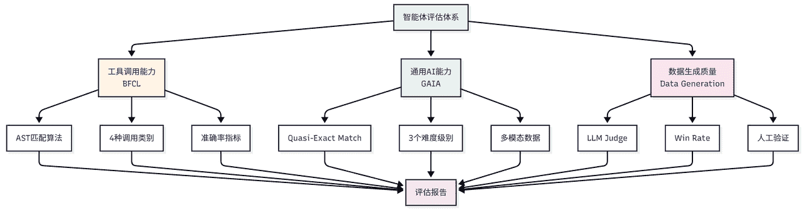

图 12.1 HelloAgents 评估体系架构图

### 12.1.4 本章学习目标与快速体验

让我们先看看第十二章的学习内容：

```
hello_agents/
├── evaluation/                         # 评估模块
│   └── benchmarks/                     # 评估基准实现
│       ├── bfcl/                       # BFCL评估实现
│       │   ├── dataset.py              # BFCL数据集加载器
│       │   ├── evaluator.py            # BFCL评估器（AST匹配）
│       │   ├── metrics.py              # BFCL专用指标
│       │   └── ast_matcher.py          # AST匹配算法
│       ├── gaia/                       # GAIA评估实现
│       │   ├── dataset.py              # GAIA数据集加载器
│       │   ├── evaluator.py            # GAIA评估器（准精确匹配）
│       │   ├── metrics.py              # GAIA专用指标
│       │   └── quasi_exact_match.py    # 准精确匹配算法
│       └── data_generation/            # 数据生成评估实现
│           ├── dataset.py              # AIME数据集加载器
│           ├── llm_judge.py            # LLM Judge评估器
│           └── win_rate.py             # Win Rate评估器
└── tools/builtin/                      # 内置工具模块
    ├── bfcl_evaluation_tool.py         # BFCL评估工具
    ├── gaia_evaluation_tool.py         # GAIA评估工具
    ├── llm_judge_tool.py               # LLM Judge工具
    └── win_rate_tool.py                # Win Rate工具Copy to clipboardErrorCopied
```

对于这一章的内容，学习目标是掌握应用评估工具的能力。让我们先准备好开发环境：

```
# 安装HelloAgents框架（第12章版本）
pip install &quot;hello-agents[evaluation]==0.2.7&quot;# 设置环境变量export HF_TOKEN=&quot;your_huggingface_token&quot;     # 用于GAIA数据集(后续也会有设置步骤)# 由于 `bfcl-eval` 官方包强制要求 numpy&lt;=2.0.0, 和HelloAgents 主依赖版本存在冲突,因此需要单独安装
pip install &quot;numpy==1.26.4&quot; bfcl-evalCopy to clipboardErrorCopied
```

在接下来的章节中，我们将深入学习每种评估方法的详细用法和介绍。

## 12.2 BFCL：工具调用能力评估

### 12.2.1 BFCL 基准介绍

BFCL (Berkeley Function Calling Leaderboard) 是由加州大学伯克利分校推出的函数调用能力评估基准([1])。在智能体系统中，工具调用（Tool Calling）是核心能力之一。智能体需要完成以下任务：

1.  理解任务需求：从用户的自然语言描述中提取关键信息

1.  选择合适工具：从可用工具集中选择最适合的工具

1.  构造函数调用：正确填写函数名和参数

1.  处理复杂场景：支持多函数调用、并行调用等高级场景

BFCL 基准包含四个评估类别，难度递增。从最基础的单函数调用（Simple）开始，逐步增加到需要调用多个函数的场景（Multiple），再到需要并行调用多个函数的复杂场景（Parallel），最后是需要判断是否需要调用函数的场景（Irrelevance）。这四个类别覆盖了智能体在实际应用中可能遇到的各种工具调用场景，如表 12.1 所示：

表 12.1 BFCL 基准中的四个评估类别

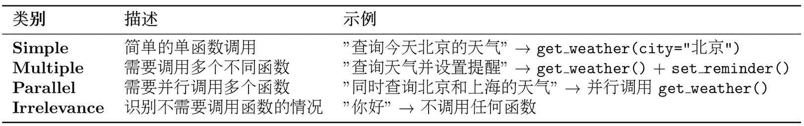

BFCL 的评估流程遵循标准的基准测试流程：首先加载数据集并选择评估类别，然后运行智能体获取预测结果，接着将预测结果解析为抽象语法树（AST），最后通过 AST 匹配算法判断预测是否正确。整个流程会遍历所有测试样本，最终计算出准确率等评估指标并生成评估报告。完整的评估流程如图 12.2 所示：

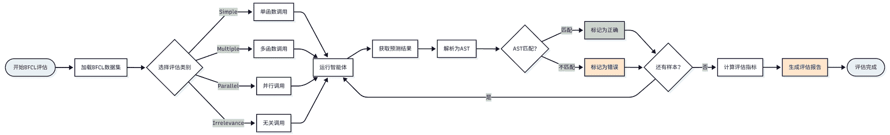

图 12.2 BFCL 评估流程图

（1）BFCL 数据集结构

BFCL 数据集采用 JSON 格式，每个测试样本包含以下字段：

```
{
  &quot;id&quot;: &quot;simple_001&quot;,
  &quot;question&quot;: &quot;What&#x27;s the weather like in Beijing today?&quot;,
  &quot;function&quot;: [
    {
      &quot;name&quot;: &quot;get_weather&quot;,
      &quot;description&quot;: &quot;Get the current weather for a location&quot;,
      &quot;parameters&quot;: {
        &quot;type&quot;: &quot;object&quot;,
        &quot;properties&quot;: {
          &quot;location&quot;: {
            &quot;type&quot;: &quot;string&quot;,
            &quot;description&quot;: &quot;The city name&quot;
          }
        },
        &quot;required&quot;: [&quot;location&quot;]
      }
    }
  ],
  &quot;ground_truth&quot;: [
    {
      &quot;name&quot;: &quot;get_weather&quot;,
      &quot;arguments&quot;: {
        &quot;location&quot;: &quot;Beijing&quot;
      }
    }
  ]
}Copy to clipboardErrorCopied
```

关键字段说明：

+   question: 用户的自然语言请求

+   function: 可用的函数列表（包含函数签名和描述）

+   ground_truth: 标准答案（期望的函数调用）

（2）AST 匹配说明

BFCL 使用AST 匹配（Abstract Syntax Tree Matching）作为核心评估算法，因此下文可以了解一下评估的策略。

BFCL 使用抽象语法树（AST）进行智能匹配，而不是简单的字符串匹配。AST 匹配的核心思想是：将函数调用解析为语法树，然后比较树的结构和节点值。

给定预测的函数调用 PP 和标准答案 GG，AST 匹配函数定义为：

AST_Match(P,G)={1if AST(P)≡AST(G)0otherwiseAST_Match(P,G)={10if AST(P)≡AST(G)otherwise

其中 AST(x)AST(x) 表示将函数调用解析为抽象语法树，≡≡ 表示语法树等价。

两个语法树等价需要满足三个核心条件：函数名必须完全一致（精确匹配），参数键值对集合相等（忽略顺序），以及每个参数的值在语义上等价（例如 2+3 等价于 5）。在具体的匹配过程中，函数名匹配要求字符串精确匹配，例如 get_weather 和 get_temperature 被视为不同的函数。参数匹配则使用 AST 进行智能比较，允许参数顺序不同（f(a=1, b=2) 等价于 f(b=2, a=1)），允许等价表达式（f(x=2+3) 等价于 f(x=5)），也允许不同的字符串表示（f(s="hello") 等价于 f(s='hello')）。对于多函数调用的场景，匹配算法要求调用相同数量的函数，每个函数调用都必须匹配，但调用顺序可以不同（使用集合匹配）。

AST 匹配示例：

```
# 示例1：参数顺序不同（匹配成功）
预测: get_weather(city=&quot;Beijing&quot;, unit=&quot;celsius&quot;)
标准: get_weather(unit=&quot;celsius&quot;, city=&quot;Beijing&quot;)
结果: ✅ 匹配成功

# 示例2：等价表达式（匹配成功）
预测: calculate(x=2+3)
标准: calculate(x=5)
结果: ✅ 匹配成功

# 示例3：函数名错误（匹配失败）
预测: get_temperature(city=&quot;Beijing&quot;)
标准: get_weather(city=&quot;Beijing&quot;)
结果: ❌ 匹配失败

# 示例4：参数值错误（匹配失败）
预测: get_weather(city=&quot;Shanghai&quot;)
标准: get_weather(city=&quot;Beijing&quot;)
结果: ❌ 匹配失败Copy to clipboardErrorCopied
```

（3）BFCL 评估指标

BFCL 使用以下指标评估智能体性能：

1.  准确率 (Accuracy)

准确率是最核心的指标，定义为 AST 匹配成功的样本比例：

Accuracy=1N∑i=1NAST_Match(Pi,Gi)Accuracy=N1i=1∑NAST_Match(Pi,Gi)

其中：

+   NN 是总样本数

+   PiPi 是第 ii 个样本的预测结果

+   GiGi 是第 ii 个样本的标准答案

+   AST_Match(Pi,Gi)∈{0,1}AST_Match(Pi,Gi)∈{0,1} 是 AST 匹配函数

1.  AST 匹配率 (AST Match Rate)

与准确率相同，强调使用 AST 匹配算法：

AST Match Rate=AccuracyAST Match Rate=Accuracy

1.  分类准确率 (Category-wise Accuracy)

对于每个类别 c∈{simple,multiple,parallel,…}c∈{simple,multiple,parallel,…}，计算该类别的准确率：

Accuracyc=1∣Dc∣∑i∈DcAST_Match(Pi,Gi)Accuracyc=∣Dc∣1i∈Dc∑AST_Match(Pi,Gi)

其中 DcDc 是类别 cc 的样本集合，∣Dc∣∣Dc∣ 是该类别的样本数。

1.  加权准确率 (Weighted Accuracy)

考虑不同类别的难度权重：

Weighted Accuracy=∑cwc⋅AccuracycWeighted Accuracy=c∑wc⋅Accuracyc

其中 wcwc 是类别 cc 的权重，满足 ∑cwc=1∑cwc=1。

1.  错误率 (Error Rate)

未能正确调用函数的样本比例：

Error Rate=1−Accuracy=1N∑i=1N(1−AST_Match(Pi,Gi))Error Rate=1−Accuracy=N1i=1∑N(1−AST_Match(Pi,Gi))

指标解释：

+   Accuracy = 1.0：所有样本都完全正确

+   Accuracy = 0.8：80%的样本正确，20%的样本错误

+   Accuracy = 0.0：所有样本都错误

分类准确率示例：

```
# 假设评估结果
simple_accuracy = 0.95      # Simple类别：95%正确
multiple_accuracy = 0.82    # Multiple类别：82%正确
parallel_accuracy = 0.68    # Parallel类别：68%正确# 加权准确率（假设权重相等）
weighted_accuracy = (0.95 + 0.82 + 0.68) / 3 = 0.817Copy to clipboardErrorCopied
```

（4）BFCL 官方评估工具

BFCL 提供官方 CLI 工具进行评估：

```
# 安装BFCL评估工具
pip install bfcl

# 运行官方评估
bfcl evaluate \
    --model-result-path ./results.json \
    --test-category simple_pythonCopy to clipboardErrorCopied
```

使用官方评估工具的优势在于：它使用官方的 AST 匹配算法，评估结果与排行榜完全一致，支持所有 BFCL v4 类别，并且能够自动生成详细的评估报告。

### 12.2.2 获取 BFCL 数据集

BFCL 数据集可以通过以下方式获取：

方法 1：从官方 GitHub 仓库克隆（推荐）

这是最可靠的方式，可以获取完整的数据集和 ground truth：

```
# 克隆BFCL仓库git clone https://github.com/ShishirPatil/gorilla.git temp_gorilla
cd temp_gorilla/berkeley-function-call-leaderboard

# 查看BFCL v4数据集ls bfcl_eval/data/
# 输出: BFCL_v4_simple_python.json  BFCL_v4_multiple.json  BFCL_v4_parallel.json  ...# 查看ground truthls bfcl_eval/data/possible_answer/
# 输出: BFCL_v4_simple_python.json  BFCL_v4_multiple.json  ...Copy to clipboardErrorCopied
```

推荐这种方式的原因是：它包含完整的 ground truth（标准答案），数据格式与官方评估工具完全一致，可以直接使用官方评估脚本，并且支持 BFCL v4 最新版本。

方法 2：使用 HelloAgents 加载官方数据

克隆仓库后，使用 HelloAgents 加载数据：

```
from hello_agents.evaluation import BFCLDataset

# 加载BFCL官方数据
dataset = BFCLDataset(
    bfcl_data_dir=&quot;./temp_gorilla/berkeley-function-call-leaderboard/bfcl_eval/data&quot;,
    category=&quot;simple_python&quot;  # BFCL v4类别)# 加载数据（包括测试数据和ground truth）
data = dataset.load()print(f&quot;✅ 加载了 {len(data)} 个测试样本&quot;)print(f&quot;✅ 加载了 {len(dataset.ground_truth)} 个ground truth&quot;)# 输出:# ✅ 加载了 400 个测试样本# ✅ 加载了 400 个ground truthCopy to clipboardErrorCopied
```

这个加载器的工作原理是：首先从bfcl_eval/data/加载测试数据，然后从bfcl_eval/data/possible_answer/加载 ground truth，接着自动合并测试数据和 ground truth，最后保留原始 BFCL 数据格式。其中 BFCL v4 数据集类别可以在表 12.2 查看。

表 12.2 BFCL 基准中的四个评估类别

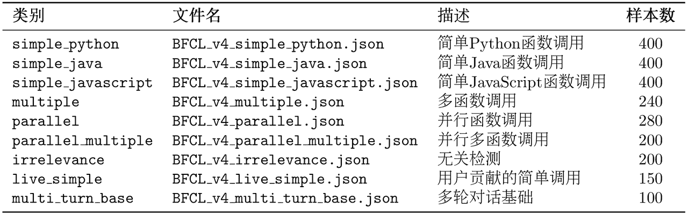

当然也可以通过代码查看可用类别：

```
# 获取所有支持的类别
categories = dataset.get_available_categories()print(f&quot;支持的类别: {categories}&quot;)# 输出: [&#x27;simple_python&#x27;, &#x27;simple_java&#x27;, &#x27;simple_javascript&#x27;, &#x27;multiple&#x27;, ...]Copy to clipboardErrorCopied
```

### 12.2.3 在 HelloAgents 中实现 BFCL 评估

现在让我们看看如何在 HelloAgents 框架中实现 BFCL 评估。我们提供了三种使用方式：

方式 1：使用 BFCLEvaluationTool（推荐）

这是最简单的方式，一行代码完成评估、报告生成和官方评估：

```
from hello_agents import SimpleAgent, HelloAgentsLLM
from hello_agents.tools import BFCLEvaluationTool

# 1. 创建要评估的智能体
llm = HelloAgentsLLM()
agent = SimpleAgent(name=&quot;TestAgent&quot;, llm=llm)# 2. 创建BFCL评估工具
bfcl_tool = BFCLEvaluationTool()# 3. 运行评估（自动完成所有步骤）
results = bfcl_tool.run(
    agent=agent,
    category=&quot;simple_python&quot;,  # 评估类别
    max_samples=5              # 评估样本数（0表示全部）)# 4. 查看结果print(f&quot;准确率: {results[&#x27;overall_accuracy&#x27;]:.2%}&quot;)print(f&quot;正确数: {results[&#x27;correct_samples&#x27;]}/{results[&#x27;total_samples&#x27;]}&quot;)Copy to clipboardErrorCopied
```

运行输出：

```
============================================================
BFCL一键评估
============================================================

配置:
   评估类别: simple_python
   样本数量: 5
   智能体: TestAgent

============================================================
步骤1: 运行HelloAgents评估
============================================================
✅ BFCL数据集加载完成
   数据目录: ./temp_gorilla/berkeley-function-call-leaderboard/bfcl_eval/data
   类别: simple_python
   样本数: 400
   Ground truth数: 400

🔧 开始 BFCL 评估...
   进度: 1/5
   进度: 5/5

✅ BFCL 评估完成
   总体准确率: 100.00%
   simple_python: 100.00% (5/5)

📊 评估结果:
   准确率: 100.00%
   正确数: 5/5

============================================================
步骤2: 导出BFCL格式结果
============================================================
✅ BFCL格式结果已导出
   输出文件: ./evaluation_results/bfcl_official/BFCL_v4_simple_python_result.json

============================================================
步骤3: 运行BFCL官方评估
============================================================
✅ 结果文件已复制到: ./result/Qwen_Qwen3-8B/BFCL_v4_simple_python_result.json

🔄 运行命令: bfcl evaluate --model Qwen/Qwen3-8B --test-category simple_python --partial-eval

============================================================
BFCL官方评估结果
============================================================
📊 评估结果汇总:
Model,Overall Acc,simple_python
Qwen/Qwen3-8B,100.00,100.00

🎯 最终结果:
   准确率: 100.00%
   正确数: 5/5

============================================================
步骤4: 生成评估报告
============================================================
📄 报告已生成: ./evaluation_reports/bfcl_report_20251011_005938.md

准确率: 100.00%
正确数: 5/5Copy to clipboardErrorCopied
```

自动生成的 Markdown 报告：

评估完成后，会自动生成一份详细的 Markdown 报告，包含：

```
# BFCL评估报告
**生成时间**: 2025-10-11 00:59:38

## 📊 评估概览

- **智能体**: TestAgent
- **评估类别**: simple_python
- **总体准确率**: 100.00%
- **正确样本数**: 5/5

## 📈 详细指标

### 分类准确率

- **simple_python**: 100.00% (5/5)

## 📝 样本详情

| 样本ID | 问题 | 预测结果 | 正确答案 | 是否正确 |
|--------|------|----------|----------|----------|
| simple_python_0 | Find the area of a triangle... | [{&#x27;name&#x27;: &#x27;calculate_triangle_area&#x27;...}] | [{&#x27;function_name&#x27;: {&#x27;base&#x27;: [10]...}}] | ✅ |
| simple_python_1 | Calculate the factorial of 5... | [{&#x27;name&#x27;: &#x27;calculate_factorial&#x27;...}] | [{&#x27;function_name&#x27;: {&#x27;number&#x27;: [5]}}] | ✅ |
...

## 📊 准确率可视化
准确率: ██████████████████████████████████████████████████ 100.00%

## 💡 建议
- ✅ 表现优秀！智能体在工具调用方面表现出色。Copy to clipboardErrorCopied
```

方式 2：使用一键评估脚本

适合命令行快速评估，在这一章配套的代码案例里，我们提供了04_run_bfcl_evaluation.py，支持直接命令行调用测评：

```
# 运行评估脚本
python chapter12/04_run_bfcl_evaluation.py --category simple_python --samples 10# 指定模型名称（用于BFCL官方评估）
python examples/04_run_bfcl_evaluation.py \--category simple_python \--samples 10 \
    --model-name &quot;Qwen/Qwen3-8B&quot;Copy to clipboardErrorCopied
```

脚本支持三个参数：--category指定评估类别（默认 simple_python），--samples指定评估样本数（默认 5，0 表示全部），--model-name指定模型名称用于 BFCL 官方评估（默认 Qwen/Qwen3-8B）。

方式 3：直接使用 Dataset 和 Evaluator

适合需要自定义评估流程的场景：

```
from hello_agents import SimpleAgent, HelloAgentsLLM
from hello_agents.evaluation import BFCLDataset, BFCLEvaluator

# 1. 创建智能体
llm = HelloAgentsLLM()
agent = SimpleAgent(name=&quot;TestAgent&quot;, llm=llm)# 2. 加载数据集
dataset = BFCLDataset(
    bfcl_data_dir=&quot;./temp_gorilla/berkeley-function-call-leaderboard/bfcl_eval/data&quot;,
    category=&quot;simple_python&quot;)
data = dataset.load()# 3. 创建评估器
evaluator = BFCLEvaluator(
    dataset=dataset,
    category=&quot;simple_python&quot;,
    evaluation_mode=&quot;ast&quot;  # 使用AST匹配模式)# 4. 运行评估
results = evaluator.evaluate(agent, max_samples=10)# 5. 查看结果print(f&quot;准确率: {results[&#x27;overall_accuracy&#x27;]:.2%}&quot;)print(f&quot;正确数: {results[&#x27;correct_samples&#x27;]}/{results[&#x27;total_samples&#x27;]}&quot;)# 6. 导出BFCL格式结果（可选）
evaluator.export_to_bfcl_format(
    results,
    output_path=&quot;./evaluation_results/my_results.json&quot;)Copy to clipboardErrorCopied
```

通过以上三种方式，我们可以根据不同的需求选择合适的评估方法。如果只是想快速了解智能体的表现，使用 BFCLEvaluationTool 的一键评估最为便捷；如果需要批量评估或集成到 CI/CD 流程，使用命令行脚本更加合适；如果需要深度定制评估流程或集成到自己的系统中，直接使用 Dataset 和 Evaluator 提供了最大的灵活性。

### 12.2.4 BFCL 官方评估工具集成

前面我们学习了如何使用 HelloAgents 内置的评估功能。实际上，BFCLEvaluationTool已经自动集成了 BFCL 官方评估工具，让你能够获得权威的、可对比的评估结果。

整个评估流程包括四个步骤：首先从 BFCL v4 数据集加载测试数据，然后使用 HelloAgents 运行评估获取智能体的预测结果，接着将结果导出为 BFCL 官方格式（JSONL），最后使用官方评估脚本计算最终分数。这个流程确保了评估结果与 BFCL 排行榜完全一致，如图 12.3 所示：

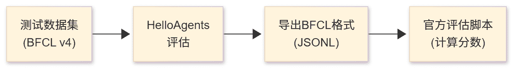

图 12.3 Helloagents 载入 BFCL 评估过程

使用BFCLEvaluationTool时，官方评估会自动运行（默认启用）：

```
from hello_agents import SimpleAgent, HelloAgentsLLM
from hello_agents.tools import BFCLEvaluationTool

# 创建智能体
llm = HelloAgentsLLM()
agent = SimpleAgent(name=&quot;TestAgent&quot;, llm=llm)# 创建评估工具
bfcl_tool = BFCLEvaluationTool()# 运行评估（自动运行官方评估）
results = bfcl_tool.run(
    agent=agent,
    category=&quot;simple_python&quot;,
    max_samples=5,# run_official_eval=True  # 默认为True，可以省略
    model_name=&quot;Qwen/Qwen3-8B&quot;  # 可选，指定模型名称)Copy to clipboardErrorCopied
```

工具会自动执行完整的评估流程：首先运行 HelloAgents 评估获取预测结果，然后将结果导出为 BFCL 格式并保存到evaluation_results/bfcl_official/目录，接着复制结果文件到result/{model_name}/目录以符合官方评估工具的要求，随后运行 BFCL 官方评估命令计算分数，最后显示官方评估结果并生成 Markdown 格式的评估报告。

官方评估输出示例：

```
============================================================
步骤3: 运行BFCL官方评估
============================================================

✅ 结果文件已复制到:
   ./result/Qwen_Qwen3-8B/BFCL_v4_simple_python_result.json

🔄 运行命令: bfcl evaluate --model Qwen/Qwen3-8B --test-category simple_python --partial-eval

============================================================
BFCL官方评估结果
============================================================

📊 评估结果汇总:
Model,Overall Acc,simple_python
Qwen/Qwen3-8B,100.00,100.00

🎯 最终结果:
   准确率: 100.00%
   正确数: 5/5Copy to clipboardErrorCopied
```

如果你想手动控制评估流程，可以禁用自动官方评估：

```
# 禁用官方评估
results = bfcl_tool.run(
    agent=agent,
    category=&quot;simple_python&quot;,
    max_samples=5,
    run_official_eval=False  # 禁用官方评估)# 然后手动运行官方评估import subprocess
subprocess.run([&quot;bfcl&quot;, &quot;evaluate&quot;,&quot;--model&quot;, &quot;Qwen/Qwen3-8B&quot;,&quot;--test-category&quot;, &quot;simple_python&quot;,&quot;--partial-eval&quot;])Copy to clipboardErrorCopied
```

你也可以手动生成报告：

```
# 运行评估
results = bfcl_tool.run(agent, category=&quot;simple_python&quot;, max_samples=5)# 手动生成报告
report = bfcl_tool.generate_report(
    results,
    output_file=&quot;./my_reports/custom_report.md&quot;)# 打印报告内容print(report)Copy to clipboardErrorCopied
```

### [12.2.5 核心组件实现细节](https://datawhalechina.github.io/hello-agents/#/./chapter12/%E7%AC%AC%E5%8D%81%E4%BA%8C%E7%AB%A0%20%E6%99%BA%E8%83%BD%E4%BD%93%E6%80%A7%E8%83%BD%E8%AF%84%E4%BC%B0?id=_1225-%e6%a0%b8%e5%bf%83%e7%bb%84%e4%bb%b6%e5%ae%9e%e7%8e%b0%e7%bb%86%e8%8a%82)

在前面的小节中，我们学习了如何使用 BFCL 评估工具。现在让我们深入了解 HelloAgents 评估系统的核心组件是如何实现的。理解这些实现细节不仅能帮助你更好地使用评估系统，还能让你根据自己的需求进行定制和扩展。

（1）BFCLDataset：数据集加载器

BFCLDataset 负责加载和管理 BFCL 数据集：

```
class BFCLDataset:&quot;&quot;&quot;BFCL数据集加载器&quot;&quot;&quot;def __init__(self, category: str = &quot;simple&quot;, local_data_path: Optional[str] = None):
        self.category = category
        self.local_data_path = local_data_path
        self.data = []def load(self) -&gt; List[Dict[str, Any]]:&quot;&quot;&quot;加载数据集&quot;&quot;&quot;# 优先从本地加载if self.local_data_path:return self._load_from_local()# 否则从Hugging Face加载return self._load_from_huggingface()Copy to clipboardErrorCopied
```

因为 BFCL 的数据集就在官方的仓库内，所以这里建议的方式是直接在本地 clone 一份进行测评。当找不到时才到 huggingface 进行加载。

（2）BFCLEvaluator：评估执行器

BFCLEvaluator 负责执行评估流程。它的核心是evaluate()方法，该方法协调整个评估过程：

```
class BFCLEvaluator:&quot;&quot;&quot;BFCL评估器&quot;&quot;&quot;def evaluate(self, agent: Any, max_samples: Optional[int] = None) -&gt; Dict[str, Any]:&quot;&quot;&quot;执行评估&quot;&quot;&quot;
        results = []for item in self.dataset[:max_samples]:# 1. 构造提示词
            prompt = self._build_prompt(item)# 2. 调用智能体
            response = agent.run(prompt)# 3. 提取函数调用
            predicted_calls = self._extract_function_calls(response)# 4. 与标准答案对比
            is_correct = self._compare_calls(predicted_calls, item[&quot;ground_truth&quot;])

            results.append({&quot;id&quot;: item[&quot;id&quot;],&quot;prediction&quot;: predicted_calls,&quot;ground_truth&quot;: item[&quot;ground_truth&quot;],&quot;is_correct&quot;: is_correct
            })return {&quot;results&quot;: results, &quot;total_samples&quot;: len(results)}Copy to clipboardErrorCopied
```

这个评估器的设计包含三个核心要点：首先是提示词构造，需要将数据集中的问题和函数定义转换为智能体可理解的提示词；其次是函数调用提取，需要从智能体的响应中提取函数调用，并支持多种格式（JSON、代码块等）；最后是 AST 匹配，使用抽象语法树进行函数调用对比，这比简单的字符串匹配更准确。

让我们看看函数调用提取的实现：

```
def _extract_function_calls(self, response: str) -&gt; List[Dict[str, Any]]:&quot;&quot;&quot;从响应中提取函数调用

    支持多种格式：
    1. JSON格式：{&quot;name&quot;: &quot;func&quot;, &quot;arguments&quot;: {...}}
    2. 代码块格式：```python\nfunc(arg1=val1)\n```
    3. 纯文本格式：func(arg1=val1)
    &quot;&quot;&quot;
    calls = []# 尝试JSON解析try:
        json_match = re.search(r&#x27;\{.*\}&#x27;, response, re.DOTALL)if json_match:
            data = json.loads(json_match.group())if isinstance(data, dict) and &quot;name&quot; in data:
                calls.append(data)elif isinstance(data, list):
                calls.extend(data)except json.JSONDecodeError:pass# 尝试代码块提取
    code_blocks = re.findall(r&#x27;```(?:python)?\n(.*?)\n```&#x27;, response, re.DOTALL)for code in code_blocks:# 解析Python函数调用
        parsed_calls = self._parse_python_calls(code)
        calls.extend(parsed_calls)return callsCopy to clipboardErrorCopied
```

（3）BFCLMetrics：指标计算器

BFCLMetrics 负责计算各种评估指标：

```
class BFCLMetrics:&quot;&quot;&quot;BFCL指标计算器&quot;&quot;&quot;def compute_metrics(self, results: List[Dict[str, Any]]) -&gt; Dict[str, Any]:&quot;&quot;&quot;计算所有指标&quot;&quot;&quot;return {&quot;accuracy&quot;: self._compute_accuracy(results),&quot;ast_match_rate&quot;: self._compute_ast_match_rate(results),&quot;parameter_accuracy&quot;: self._compute_parameter_accuracy(results),&quot;f1_score&quot;: self._compute_f1_score(results),&quot;category_statistics&quot;: self._compute_category_stats(results)}Copy to clipboardErrorCopied
```

AST 匹配的实现：

AST 匹配是 BFCL 评估的核心技术。它比简单的字符串匹配更智能，能够识别语义等价的函数调用：

```
def _ast_match(self, pred_call: Dict, true_call: Dict) -&gt; bool:&quot;&quot;&quot;使用AST匹配函数调用

    AST匹配的优势：
    1. 忽略参数顺序：func(a=1, b=2) 等价于 func(b=2, a=1)
    2. 识别等价表达式：2+3 等价于 5
    3. 忽略空格和格式差异
    &quot;&quot;&quot;# 1. 函数名必须完全匹配if pred_call.get(&quot;name&quot;) != true_call.get(&quot;name&quot;):return False# 2. 将参数转换为AST节点
    pred_args = self._args_to_ast(pred_call.get(&quot;arguments&quot;, {}))
    true_args = self._args_to_ast(true_call.get(&quot;arguments&quot;, {}))# 3. 比较AST节点return ast.dump(pred_args) == ast.dump(true_args)def _args_to_ast(self, args: Dict[str, Any]) -&gt; ast.AST:&quot;&quot;&quot;将参数字典转换为AST节点&quot;&quot;&quot;# 构造一个虚拟的函数调用
    code = f&quot;func({&#x27;, &#x27;.join(f&#x27;{k}={repr(v)}&#x27; for k, v in args.items())})&quot;
    tree = ast.parse(code)return tree.body[0].value  # 返回Call节点Copy to clipboardErrorCopied
```

（4）工具化封装：BFCLEvaluationTool

最后，我们将这些组件封装成一个 Tool，让它可以被智能体直接调用：

```
class BFCLEvaluationTool(Tool):&quot;&quot;&quot;BFCL评估工具&quot;&quot;&quot;def __init__(self, local_data_path: Optional[str] = None):super().__init__(
            name=&quot;bfcl_evaluation&quot;,
            description=&quot;评估智能体的工具调用能力&quot;)
        self.dataset = None
        self.evaluator = None
        self.metrics_calculator = BFCLMetrics()def run(self, parameters: Dict[str, Any]) -&gt; str:&quot;&quot;&quot;执行评估&quot;&quot;&quot;# 1. 加载数据集
        self.dataset = BFCLDataset(...)# 2. 创建评估器
        self.evaluator = BFCLEvaluator(...)# 3. 运行评估
        results = self.evaluator.evaluate(...)# 4. 计算指标
        metrics = self.metrics_calculator.compute_metrics(...)# 5. 返回JSON结果return json.dumps(results, ensure_ascii=False)Copy to clipboardErrorCopied
```

这个工具的设计遵循三个核心原则：首先继承 Tool 基类以遵循 HelloAgents 的工具规范，确保与框架的无缝集成；其次进行严格的参数验证，检查必需参数并提供友好的错误提示，提升用户体验；最后对结果进行格式化，返回 JSON 字符串以便于解析和展示。通过这种模块化的设计，我们实现了一个既易用又灵活的评估系统，用户可以直接使用高层的 Tool 接口快速完成评估，也可以深入到底层组件进行定制以满足特殊需求。

### [12.2.6 扩展与优化建议](https://datawhalechina.github.io/hello-agents/#/./chapter12/%E7%AC%AC%E5%8D%81%E4%BA%8C%E7%AB%A0%20%E6%99%BA%E8%83%BD%E4%BD%93%E6%80%A7%E8%83%BD%E8%AF%84%E4%BC%B0?id=_1226-%e6%89%a9%e5%b1%95%e4%b8%8e%e4%bc%98%e5%8c%96%e5%bb%ba%e8%ae%ae)

通过前面的学习，我们已经掌握了如何使用 HelloAgents 进行 BFCL 评估。需要注意的是，我们目前的实现是基于 SimpleAgent 的简单复现，主要完成了 BFCL 评估的基础功能。在实际应用中，BFCL 基准包含多个难度级别和场景，要在排行榜上获得更高的分数，还需要进一步的优化和扩展。

（1）当前实现的局限性

我们当前的 SimpleAgent 实现主要聚焦于评估流程的搭建，在工具调用能力上还有提升空间。SimpleAgent 使用自定义的工具调用格式[TOOL_CALL:tool_name:parameters]，这种格式需要 LLM 主动学习和使用，在复杂场景下的表现可能不如使用原生函数调用（Function Calling）的智能体。此外，我们目前只测试了 simple_python 等基础类别，对于 multiple、parallel、irrelevance 等更复杂的场景，还需要针对性的优化。

（2）提升 BFCL 分数的方向

要进一步提升 BFCL 评估分数，可以从以下几个方向入手。首先是优化智能体的工具调用能力，可以考虑使用支持原生函数调用的 LLM（如 GPT-4、Claude 等），或者改进提示词让 LLM 更好地理解工具调用格式。其次是扩展工具库，BFCL 测试中涉及各种类型的函数，可以根据测试数据集的特点，预先实现常用的工具类型，提高智能体的工具覆盖率。第三是针对不同难度级别设计不同的策略，例如在 multiple 场景下需要智能体能够规划多步骤的工具调用序列，在 parallel 场景下需要识别可以并行执行的工具调用，在 irrelevance 场景下需要判断是否真的需要调用工具。

（3）实践建议

对于想要在 BFCL 上取得更好成绩的开发者，建议采用以下实践策略。首先，从 simple 类别开始，确保基础的单函数调用能够稳定工作，这是后续优化的基础。然后，逐步测试 multiple、parallel 等更复杂的类别，分析失败案例，找出智能体的薄弱环节。在优化过程中，可以参考 BFCL 排行榜上的高分模型，学习它们的设计思路和优化技巧。同时，建议使用官方评估工具进行验证，确保优化后的结果与排行榜标准一致。

这里总结一些评估时可以进一步处理的建议：

1.  渐进式评估

从小样本开始，逐步增加样本数：

```
# 第一步：快速测试（5个样本）
results_quick = bfcl_tool.run(agent, category=&quot;simple_python&quot;, max_samples=5)# 第二步：中等规模测试（50个样本）if results_quick[&#x27;overall_accuracy&#x27;] &gt; 0.8:
    results_medium = bfcl_tool.run(agent, category=&quot;simple_python&quot;, max_samples=50)# 第三步：完整评估（全部样本）if results_medium[&#x27;overall_accuracy&#x27;] &gt; 0.8:
    results_full = bfcl_tool.run(agent, category=&quot;simple_python&quot;, max_samples=0)Copy to clipboardErrorCopied
```

1.  多类别评估

评估不同难度的任务：

```
categories = [&quot;simple_python&quot;, &quot;multiple&quot;, &quot;parallel&quot;, &quot;irrelevance&quot;]for category in categories:print(f&quot;\n评估类别: {category}&quot;)
    results = bfcl_tool.run(agent, category=category, max_samples=10)print(f&quot;准确率: {results[&#x27;overall_accuracy&#x27;]:.2%}&quot;)Copy to clipboardErrorCopied
```

1.  对比评估

对比不同配置的智能体：

```
# 配置1：默认提示词
agent1 = SimpleAgent(name=&quot;Agent-Default&quot;, llm=llm)
results1 = bfcl_tool.run(agent1, category=&quot;simple_python&quot;, max_samples=10)# 配置2：优化提示词
agent2 = SimpleAgent(name=&quot;Agent-Optimized&quot;, llm=llm)# ... 设置优化的系统提示词 ...
results2 = bfcl_tool.run(agent2, category=&quot;simple_python&quot;, max_samples=10)# 对比结果print(f&quot;默认配置准确率: {results1[&#x27;overall_accuracy&#x27;]:.2%}&quot;)print(f&quot;优化配置准确率: {results2[&#x27;overall_accuracy&#x27;]:.2%}&quot;)Copy to clipboardErrorCopied
```

如果你的评估结果很好，可以考虑提交到 BFCL 官方排行榜！

步骤 1：准备提交材料

1.  模型描述文档

1.  评估结果文件（所有类别）

1.  模型访问方式（API 或开源链接）

步骤 2：提交到 GitHub

访问 BFCL 官方仓库，按照说明提交 Pull Request：

+   仓库地址：[https://github.com/](https://github.com/ShishirPatil/gorilla)ShishirPatil/gorilla

+   提交指南：参考CONTRIBUTING.md

步骤 3：等待审核

BFCL 团队会审核你的提交，验证结果的准确性。审核通过后，你的模型将出现在官方排行榜上！

## 12.3 GAIA：通用 AI 助手能力评估

### 12.3.1 GAIA 基准介绍

GAIA (General AI Assistants) 是由 Meta AI 和 Hugging Face 联合推出的评估基准，专注于评估 AI 助手的通用能力([2])。与 BFCL 专注于工具调用不同，GAIA 评估的是智能体在真实世界任务中的综合表现。

GAIA 的设计理念是：真实世界的问题往往需要多种能力的综合运用。一个优秀的 AI 助手不仅需要调用工具，还需要：

+   多步推理：将复杂问题分解为多个子问题

+   知识运用：利用内置知识和外部知识库

+   多模态理解：处理文本、图片、文件等多种输入

+   网页浏览：从互联网获取最新信息

+   文件操作：读取和处理各种格式的文件

（1）GAIA 数据集结构

了解 GAIA 的评估理念后，让我们深入了解 GAIA 数据集的具体结构。GAIA 包含 466 个精心设计的真实世界问题，这些问题按照复杂度和所需推理步骤分为三个难度级别，从简单的零步推理任务到需要多步复杂推理的困难任务，全面覆盖了智能体在实际应用中可能遇到的各种场景，如表 12.3 所示：

表 12.3 GAIA 数据集难度级别分布

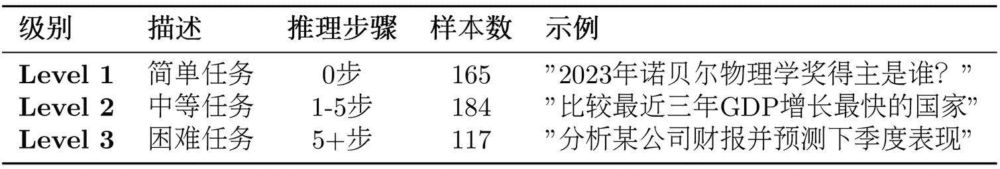

关于 GAIA 数据集的样本示例可以参考下面的代码片段：

```
{
  &quot;task_id&quot;: &quot;gaia_001&quot;,
  &quot;Question&quot;: &quot;What is the total population of the top 3 most populous cities in California?&quot;,
  &quot;Level&quot;: 2,
  &quot;Final answer&quot;: &quot;12847521&quot;,
  &quot;file_name&quot;: &quot;&quot;,
  &quot;file_path&quot;: &quot;&quot;,
  &quot;Annotator Metadata&quot;: {
    &quot;Steps&quot;: [
      &quot;Search for most populous cities in California&quot;,
      &quot;Get population data for top 3 cities&quot;,
      &quot;Sum the populations&quot;
    ],
    &quot;Number of steps&quot;: 3,
    &quot;How long did this take?&quot;: &quot;5 minutes&quot;,
    &quot;Tools&quot;: [&quot;web_search&quot;, &quot;calculator&quot;]
  }
}Copy to clipboardErrorCopied
```

关键字段说明：

+   Question: 问题描述

+   Level: 难度级别（1-3）

+   Final answer: 标准答案（可能是数字、文本或文件）

+   file_name/file_path: 附件文件（如果有）

+   Annotator Metadata: 标注者提供的元数据（推理步骤、所需工具等）

（2）准精确匹配介绍

GAIA 使用准精确匹配（Quasi Exact Match）评估算法，这是 GAIA 官方定义的评估标准。该算法的核心思想是：先对答案进行归一化处理，然后进行精确匹配。

给定预测答案 ApredApred 和标准答案 AtrueAtrue，准精确匹配函数定义为：

Quasi_Exact_Match(Apred,Atrue)={1if N(Apred)=N(Atrue)0otherwiseQuasi_Exact_Match(Apred,Atrue)={10if N(Apred)=N(Atrue)otherwise

其中 N(⋅)N(⋅) 是归一化函数，根据答案类型应用不同的规则。

归一化函数根据答案类型应用不同的规则。对于数字类型，需要移除逗号分隔符（1,000 → 1000）和单位符号（$100 → 100，50% → 50），例如"$1,234.56"归一化为"1234.56"。对于字符串类型，需要转换为小写（"Apple" → "apple"）、移除冠词（"the apple" → "apple"）、移除多余空格（"hello  world" → "hello world"）和移除末尾标点（"hello." → "hello"），例如"The United States"归一化为"united states"。对于列表类型，需要按逗号分隔元素，对每个元素应用字符串归一化，按字母顺序排序后重新连接，例如"Paris, London, Berlin"归一化为"berlin,london,paris"。

归一化示例：

```
# 数字答案
原始答案: &quot;$1,234.56&quot;
归一化后: &quot;1234.56&quot;# 字符串答案
原始答案: &quot;The United States of America&quot;
归一化后: &quot;united states of america&quot;# 列表答案
原始答案: &quot;Paris, London, Berlin&quot;
归一化后: &quot;berlin, london, paris&quot;Copy to clipboardErrorCopied
```

（3）GAIA 评估指标

GAIA 使用以下指标评估智能体性能：

1.  精确匹配率 (Exact Match Rate)

精确匹配率是 GAIA 的核心指标，定义为准精确匹配成功的样本比例：

Exact Match Rate=1N∑i=1NQuasi_Exact_Match(Apred,i,Atrue,i)Exact Match Rate=N1i=1∑NQuasi_Exact_Match(Apred,i,Atrue,i)

其中：

+   NN 是总样本数

+   Apred,iApred,i 是第 ii 个样本的预测答案

+   Atrue,iAtrue,i 是第 ii 个样本的标准答案

+   Quasi_Exact_Match(⋅,⋅)∈{0,1}Quasi_Exact_Match(⋅,⋅)∈{0,1} 是准精确匹配函数

1.  分级准确率 (Level-wise Accuracy)

对于每个难度级别 ℓ∈{1,2,3}ℓ∈{1,2,3}，计算该级别的准确率：

Accuracyℓ=1∣Dℓ∣∑i∈DℓQuasi_Exact_Match(Apred,i,Atrue,i)Accuracyℓ=∣Dℓ∣1i∈Dℓ∑Quasi_Exact_Match(Apred,i,Atrue,i)

其中 DℓDℓ 是难度级别 ℓℓ 的样本集合，∣Dℓ∣∣Dℓ∣ 是该级别的样本数。

1.  难度递进下降率 (Difficulty Progression Drop Rate)

衡量智能体在难度增加时的性能衰减：

Drop Rateℓ→ℓ+1=Accuracyℓ−Accuracyℓ+1AccuracyℓDrop Rateℓ→ℓ+1=AccuracyℓAccuracyℓ​−Accuracyℓ+1

+   Drop Rate1→2Drop Rate1→2：从 Level 1 到 Level 2 的下降率

+   Drop Rate2→3Drop Rate2→3：从 Level 2 到 Level 3 的下降率

1.  平均推理步骤数 (Average Reasoning Steps)

评估智能体完成任务所需的平均步骤数：

Avg Steps=1Ncorrect∑i∈CorrectstepsiAvg Steps=Ncorrect1i∈Correct∑stepsi

其中 NcorrectNcorrect 是正确回答的样本数，stepsistepsi 是第 ii 个样本的推理步骤数。

指标解释：

+   Exact Match Rate = 1.0：所有样本都完全正确

+   Exact Match Rate = 0.5：50%的样本正确，50%的样本错误

+   Drop Rate = 0.3：难度增加导致准确率下降 30%

+   Drop Rate = 0.0：难度增加不影响准确率（理想情况）

评估示例：

假设我们评估了 10 个样本，结果可以参考表 12.4 所示：

表 12.4 GAIA 数据集难度级别分布

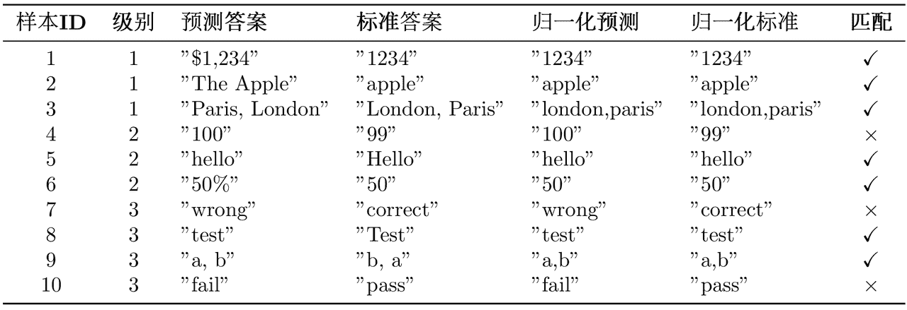

如果要计算这个案例的指标的话，可以参考下面的 Python 脚本。

```
# 1. 精确匹配率
total_samples = 10
correct_samples = 7  # 样本1,2,3,5,6,8,9
exact_match_rate = correct_samples / total_samples = 0.70  # 70%# 2. 分级准确率
level_1_correct = 3  # 样本1,2,3
level_1_total = 3
level_1_accuracy = 3 / 3 = 1.00  # 100%

level_2_correct = 2  # 样本5,6
level_2_total = 3
level_2_accuracy = 2 / 3 = 0.67  # 67%

level_3_correct = 2  # 样本8,9
level_3_total = 4
level_3_accuracy = 2 / 4 = 0.50  # 50%# 3. 难度递进下降率
drop_rate_1_to_2 = (1.00 - 0.67) / 1.00 = 0.33  # 33%
drop_rate_2_to_3 = (0.67 - 0.50) / 0.67 = 0.25  # 25%print(f&quot;精确匹配率: {exact_match_rate:.2%}&quot;)  # 70.00%print(f&quot;Level 1准确率: {level_1_accuracy:.2%}&quot;)  # 100.00%print(f&quot;Level 2准确率: {level_2_accuracy:.2%}&quot;)  # 66.67%print(f&quot;Level 3准确率: {level_3_accuracy:.2%}&quot;)  # 50.00%print(f&quot;Level 1→2 下降率: {drop_rate_1_to_2:.2%}&quot;)  # 33.00%print(f&quot;Level 2→3 下降率: {drop_rate_2_to_3:.2%}&quot;)  # 25.00%Copy to clipboardErrorCopied
```

结果分析：

+   整体表现：70%的精确匹配率，表现良好

+   难度敏感性：从 Level 1 到 Level 2 下降 33%，说明智能体在中等难度任务上有明显衰减

+   能力边界：Level 3 准确率为 50%，说明智能体在复杂任务上仍有提升空间

下降率越大，说明智能体在处理复杂任务时的能力衰减越明显。

（4）GAIA 官方系统提示词

GAIA 要求使用特定的系统提示词，确保模型输出符合评估格式：

```
GAIA_SYSTEM_PROMPT = &quot;&quot;&quot;You are a general AI assistant. I will ask you a question. Report your thoughts, and finish your answer with the following template: FINAL ANSWER: [YOUR FINAL ANSWER].

YOUR FINAL ANSWER should be a number OR as few words as possible OR a comma separated list of numbers and/or strings.

If you are asked for a number, don&#x27;t use comma to write your number neither use units such as $ or percent sign unless specified otherwise.

If you are asked for a string, don&#x27;t use articles, neither abbreviations (e.g. for cities), and write the digits in plain text unless specified otherwise.

If you are asked for a comma separated list, apply the above rules depending of whether the element to be put in the list is a number or a string.&quot;&quot;&quot;Copy to clipboardErrorCopied
```

GAIA 对答案格式有严格的要求：答案必须以FINAL ANSWER: [答案]的格式给出；对于数字类型的答案，不使用逗号分隔符和单位符号；对于字符串类型的答案，不使用冠词和缩写；对于列表类型的答案，使用逗号分隔并按字母顺序排列。

### 12.3.2 获取 GAIA 数据集

重要提示：GAIA 是受限数据集（Gated Dataset），需要先在 HuggingFace 上申请访问权限。

步骤 1：申请访问权限

1.  访问 [https://huggingface.co/datasets](https://huggingface.co/datasets/gaia-benchmark/GAIA)/gaia-benchmark/GAIA

1.  点击"Request access"按钮

1.  填写申请表单（通常会在几秒内批准）

1.  [获取你的 HuggingFace T](https://huggingface.co/settings/tokens)oken：https://huggingface.co/settings/tokens

步骤 2：配置环境变量

在.env文件中添加你的 HuggingFace Token：

```
# HuggingFace API 配置HF_TOKEN=hf_your_token_hereCopy to clipboardErrorCopied
```

方法 1：使用 HelloAgents 自动下载（推荐）

HelloAgents 会自动处理 GAIA 数据集的下载和缓存：

```
from hello_agents.evaluation import GAIADataset
import os

# 确保设置了HF_TOKEN，如果设置了.env无需这一行
os.environ[&quot;HF_TOKEN&quot;] = &quot;hf_your_token_here&quot;# 自动下载到 ./data/gaia/
dataset = GAIADataset(
    dataset_name=&quot;gaia-benchmark/GAIA&quot;,
    split=&quot;validation&quot;,  # 或 &quot;test&quot;
    level=1  # 可选: 1, 2, 3, None(全部))
items = dataset.load()print(f&quot;加载了 {len(items)} 个测试样本&quot;)# 输出: 加载了 53 个测试样本 (Level 1)Copy to clipboardErrorCopied
```

工作原理：

+   首次运行时，使用snapshot_download下载整个数据集到./data/gaia/

+   数据集包含 114 个文件（问题、图片、PDF 等材料）

+   后续使用直接从本地加载，速度很快

数据集目录结构：

```
./data/gaia/
├── 2023/
│   ├── validation/
│   │   ├── metadata.jsonl  (165个问题)
│   │   ├── *.png, *.pdf, *.csv, *.xlsx  (附件文件)
│   └── test/
│       ├── metadata.jsonl  (301个问题)
│       └── ... (附件文件)
├── GAIA.py
└── README.mdCopy to clipboardErrorCopied
```

方法 2：手动下载

如果你想手动下载数据集：

```
from huggingface_hub import snapshot_download
import os

# 设置Token
os.environ[&quot;HF_TOKEN&quot;] = &quot;hf_your_token_here&quot;# 下载数据集
snapshot_download(
    repo_id=&quot;gaia-benchmark/GAIA&quot;,
    repo_type=&quot;dataset&quot;,
    local_dir=&quot;./data/gaia&quot;,
    token=os.getenv(&quot;HF_TOKEN&quot;))Copy to clipboardErrorCopied
```

查看数据集统计：

```
# 查看数据集统计
stats = dataset.get_statistics()print(f&quot;总样本数: {stats[&#x27;total_samples&#x27;]}&quot;)print(f&quot;级别分布: {stats[&#x27;level_distribution&#x27;]}&quot;)# 输出:# 总样本数: 165# 级别分布: {1: 53, 2: 62, 3: 50}Copy to clipboardErrorCopied
```

### 12.3.3 在 HelloAgents 中实现 GAIA 评估

与 BFCL 类似，我们提供两种评估方式，推荐使用方式 1。

方式 1：使用 GAIAEvaluationTool 一键评估

这是最简单的方式，自动完成数据集下载、评估执行、结果导出和报告生成：

```
from hello_agents import SimpleAgent, HelloAgentsLLM
from hello_agents.tools import GAIAEvaluationTool

# GAIA官方系统提示词（来自论文）
GAIA_SYSTEM_PROMPT = &quot;&quot;&quot;You are a general AI assistant. I will ask you a question. Report your thoughts, and finish your answer with the following template: FINAL ANSWER: [YOUR FINAL ANSWER].

YOUR FINAL ANSWER should be a number OR as few words as possible OR a comma separated list of numbers and/or strings.

If you are asked for a number, don&#x27;t use comma to write your number neither use units such as $ or percent sign unless specified otherwise.

If you are asked for a string, don&#x27;t use articles, neither abbreviations (e.g. for cities), and write the digits in plain text unless specified otherwise.

If you are asked for a comma separated list, apply the above rules depending of whether the element to be put in the list is a number or a string.&quot;&quot;&quot;# 1. 创建智能体（使用GAIA官方系统提示词）
llm = HelloAgentsLLM()
agent = SimpleAgent(
    name=&quot;TestAgent&quot;,
    llm=llm,
    system_prompt=GAIA_SYSTEM_PROMPT  # 关键：使用GAIA官方提示词)# 2. 创建GAIA评估工具
gaia_tool = GAIAEvaluationTool()# 3. 一键运行评估
results = gaia_tool.run(
    agent=agent,
    level=1,  # Level 1: 简单任务
    max_samples=5,  # 评估5个样本
    export_results=True,  # 导出GAIA格式结果
    generate_report=True  # 生成评估报告)# 4. 查看结果print(f&quot;精确匹配率: {results[&#x27;exact_match_rate&#x27;]:.2%}&quot;)print(f&quot;部分匹配率: {results[&#x27;partial_match_rate&#x27;]:.2%}&quot;)print(f&quot;正确数: {results[&#x27;exact_matches&#x27;]}/{results[&#x27;total_samples&#x27;]}&quot;)Copy to clipboardErrorCopied
```

运行结果：

```
============================================================
GAIA一键评估
============================================================

配置:
   智能体: TestAgent
   难度级别: 1
   样本数量: 5

============================================================
步骤1: 运行HelloAgents评估
============================================================
   正在从HuggingFace下载: gaia-benchmark/GAIA
   📥 下载GAIA数据集...
   ✓ 数据集下载完成
   ✓ 加载了 165 个样本
✅ GAIA数据集加载完成
   数据源: gaia-benchmark/GAIA
   分割: validation
   级别: 1
   样本数: 53

🌟 开始 GAIA 评估...
   样本数量: 5
   进度: 5/5
✅ GAIA 评估完成
   精确匹配率: 80.00%
   部分匹配率: 80.00%

============================================================
步骤2: 导出GAIA格式结果
============================================================
✅ GAIA格式结果已导出
   输出文件: evaluation_results\gaia_official\gaia_level1_result_20251011_012648.jsonl
   样本数: 5
   包含推理轨迹: True
📄 提交说明已生成: evaluation_results\gaia_official\SUBMISSION_GUIDE_20251011_012648.md

============================================================
步骤3: 生成评估报告
============================================================
📄 报告已生成: evaluation_reports\gaia_report_20251011_012648.md

============================================================
🎯 最终结果
============================================================
   精确匹配率: 80.00%
   部分匹配率: 80.00%
   正确数: 4/5Copy to clipboardErrorCopied
```

评估完成后会自动生成三类文件：首先是 GAIA 格式结果文件（evaluation_results/gaia_official/gaia_level1_result_*.jsonl），采用 JSONL 格式（每行一个 JSON 对象），可直接用于提交到 GAIA 排行榜；其次是提交说明文件（evaluation_results/gaia_official/SUBMISSION_GUIDE_*.md），包含详细的提交步骤、结果文件格式说明和注意事项；最后是评估报告（evaluation_reports/gaia_report_*.md），包含评估结果摘要、详细指标、样本详情和可视化图表。

注意：如果你发现生成的评估结果不理想（例如准确率较低），这是正常现象。虽然 Level 1 是一步推理任务，但仍然需要智能体具备工具调用能力（如搜索引擎、计算器等）才能正确回答问题。我们当前使用的 SimpleAgent 主要用于演示评估流程，在工具调用能力上还有提升空间。

方式 2：使用 Dataset + Evaluator（灵活定制）

如果需要更细粒度的控制，可以直接使用底层组件：

```
from hello_agents.evaluation import GAIADataset, GAIAEvaluator

# 1. 加载数据集
dataset = GAIADataset(level=1)
items = dataset.load()print(f&quot;加载了 {len(items)} 个样本&quot;)# 2. 创建评估器
evaluator = GAIAEvaluator(dataset=dataset, level=1)# 3. 运行评估
results = evaluator.evaluate(agent, max_samples=5)# 4. 导出GAIA格式结果
evaluator.export_to_gaia_format(
    results,&quot;gaia_results.jsonl&quot;,
    include_reasoning=True)Copy to clipboardErrorCopied
```

生成的评估报告（gaia_report_*.md）可参考下面的文件：

```
# GAIA评估报告

**生成时间**: 2025-10-11 01:26:48

## 📊 评估概览

- **智能体**: TestAgent
- **难度级别**: 1
- **总样本数**: 2
- **精确匹配数**: 1
- **部分匹配数**: 1
- **精确匹配率**: 50.00%
- **部分匹配率**: 50.00%

## 📈 详细指标

### 分级准确率

- **Level 1**: 50.00% 精确 / 50.00% 部分 (1/2)

## 📝 样本详情（前10个）

| 任务ID | 级别 | 预测答案 | 正确答案 | 精确匹配 | 部分匹配 |
|--------|------|----------|----------|----------|----------|
| e1fc63a2-da7a-432f-be78-7c4a95598703 | 1 | 24000 | 17 | ❌ | ❌ |
| 8e867cd7-cff9-4e6c-867a-ff5ddc2550be | 1 | 3 | 3 | ✅ | ✅ |

## 📊 准确率可视化

精确匹配: █████████████████████████░░░░░░░░░░░░░░░░░░░░░░░░░ 50.00%
部分匹配: █████████████████████████░░░░░░░░░░░░░░░░░░░░░░░░░ 50.00%


## 💡 建议

- ⚠️ 表现一般，需要改进。
- 💡 建议检查工具使用和多步推理能力。Copy to clipboardErrorCopied
```

**生成的 GAIA 格式结果（gaia_level1_result_*.jsonl）：

{"task_id": "e1fc63a2-da7a-432f-be78-7c4a95598703", "model_answer": "24000", "reasoning_trace": "24000"}

{"task_id": "8e867cd7-cff9-4e6c-867a-ff5ddc2550be", "model_answer": "3", "reasoning_trace": "3"}Copy to clipboardErrorCopied

### 12.3.4 提交结果到 GAIA 官方排行榜

使用 GAIAEvaluationTool 运行评估后，会在evaluation_results/gaia_official/目录下生成提交所需的文件和详细的提交说明。

1.  GAIA 格式结果文件**：gaia_level1_result_*.jsonl

```
{&quot;task_id&quot;: &quot;xxx&quot;, &quot;model_answer&quot;: &quot;答案&quot;, &quot;reasoning_trace&quot;: &quot;推理过程&quot;}
{&quot;task_id&quot;: &quot;yyy&quot;, &quot;model_answer&quot;: &quot;答案&quot;, &quot;reasoning_trace&quot;: &quot;推理过程&quot;}Copy to clipboardErrorCopied
```

1.  提交说明文件：SUBMISSION_GUIDE_*.md

打开自动生成的SUBMISSION_GUIDE_*.md文件，里面包含完整的提交指南：

具体来说，打开浏览器，访问：

```
https://huggingface.co/spaces/gaia-benchmark/leaderboardCopy to clipboardErrorCopied
```

如图 12.4 所示，提交表单中填写信息即可：

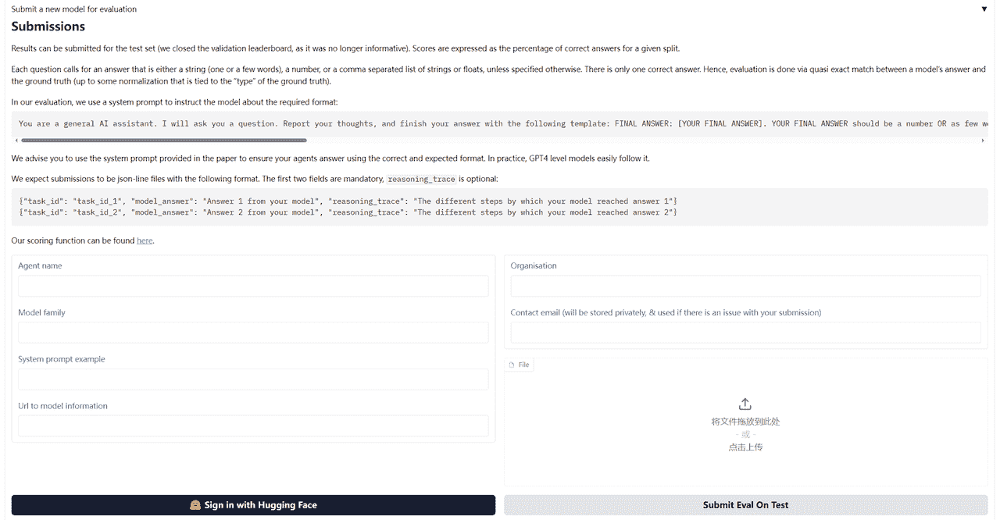

图 12.4 BFCL 评估流程图

提交前，可以手动检查生成的 JSONL 文件：

```
import json

# 读取结果文件with open(&quot;evaluation_results/gaia_official/gaia_level1_result_*.jsonl&quot;, &quot;r&quot;) as f:for line in f:
        result = json.loads(line)print(f&quot;Task ID: {result[&#x27;task_id&#x27;]}&quot;)print(f&quot;Answer: {result[&#x27;model_answer&#x27;]}&quot;)print(f&quot;Reasoning: {result[&#x27;reasoning_trace&#x27;]}&quot;)print(&quot;-&quot; * 50)Copy to clipboardErrorCopied
```

### [12.3.5 核心组件实现细节](https://datawhalechina.github.io/hello-agents/#/./chapter12/%E7%AC%AC%E5%8D%81%E4%BA%8C%E7%AB%A0%20%E6%99%BA%E8%83%BD%E4%BD%93%E6%80%A7%E8%83%BD%E8%AF%84%E4%BC%B0?id=_1235-%e6%a0%b8%e5%bf%83%e7%bb%84%e4%bb%b6%e5%ae%9e%e7%8e%b0%e7%bb%86%e8%8a%82)

GAIA 评估系统的实现与 BFCL 类似，但针对通用能力评估有一些特殊的设计。

（1）GAIADataset：支持多模态的数据加载器

GAIA 数据集的特殊之处在于它包含多模态数据（文本、文件、图片等）：

```
class GAIADataset:&quot;&quot;&quot;GAIA数据集加载器

    支持从HuggingFace加载GAIA数据集（受限数据集）
    &quot;&quot;&quot;def __init__(
        self,
        level: Optional[int] = None,
        split: str = &quot;validation&quot;,
        local_data_dir: Optional[str] = None):
        self.level = level
        self.split = split
        self.local_data_dir = local_data_dir or &quot;./data/gaia&quot;
        self.data = []def load(self) -&gt; List[Dict[str, Any]]:&quot;&quot;&quot;加载数据集&quot;&quot;&quot;# 从HuggingFace下载
        items = self._load_from_huggingface()# 按级别过滤if self.level:
            items = [item for item in items if item.get(&quot;level&quot;) == self.level]

        self.data = items
        return items

    def _load_from_huggingface(self) -&gt; List[Dict[str, Any]]:&quot;&quot;&quot;从HuggingFace下载GAIA数据集&quot;&quot;&quot;from huggingface_hub import snapshot_download
        import json

        # 下载数据集
        repo_id = &quot;gaia-benchmark/GAIA&quot;
        local_dir = snapshot_download(
            repo_id=repo_id,
            repo_type=&quot;dataset&quot;,
            local_dir=self.local_data_dir,
            local_dir_use_symlinks=False)# 加载JSONL文件
        data_file = Path(local_dir) / &quot;2023&quot; / self.split / &quot;metadata.jsonl&quot;
        items = []with open(data_file, &#x27;r&#x27;, encoding=&#x27;utf-8&#x27;) as f:for line in f:
                item = json.loads(line)
                items.append(self._standardize_item(item))return itemsCopy to clipboardErrorCopied
```

（2）GAIAEvaluator：实现 GAIA 官方评估算法

GAIA 的评估使用准精确匹配（Quasi Exact Match）算法，需要特殊的答案归一化和匹配逻辑：

```
class GAIAEvaluator:&quot;&quot;&quot;GAIA评估器

    实现GAIA官方的准精确匹配（Quasi Exact Match）评估算法
    &quot;&quot;&quot;def evaluate(self, agent: Any, max_samples: Optional[int] = None) -&gt; Dict[str, Any]:&quot;&quot;&quot;执行评估&quot;&quot;&quot;
        dataset_items = self.dataset.load()if max_samples:
            dataset_items = dataset_items[:max_samples]

        results = []for i, item in enumerate(dataset_items, 1):# 1. 构造提示词
            prompt = self._build_prompt(item[&quot;question&quot;], item)# 2. 调用智能体
            response = agent.run(prompt)# 3. 提取答案（GAIA格式：FINAL ANSWER: [答案]）
            predicted_answer = self._extract_answer(response)# 4. 归一化答案（GAIA官方规则）
            normalized_pred = self._normalize_answer(predicted_answer)
            normalized_truth = self._normalize_answer(item[&quot;final_answer&quot;])# 5. 准精确匹配
            exact_match = (normalized_pred == normalized_truth)

            results.append({&quot;task_id&quot;: item[&quot;task_id&quot;],&quot;predicted&quot;: predicted_answer,&quot;expected&quot;: item[&quot;final_answer&quot;],&quot;exact_match&quot;: exact_match,&quot;level&quot;: item.get(&quot;level&quot;, 0)})return self._format_results(results)Copy to clipboardErrorCopied
```

GAIA 使用特定的归一化规则来处理不同类型的答案：

```
def _normalize_answer(self, answer: str) -&gt; str:&quot;&quot;&quot;标准化答案字符串（GAIA官方标准化规则）

    规则：
    1. 数字：移除逗号分隔符和单位符号
    2. 字符串：移除冠词、转小写、移除多余空格
    3. 列表：逗号分隔，按字母顺序排序
    &quot;&quot;&quot;if not answer:return &quot;&quot;

    answer = answer.strip()# 检查是否是逗号分隔的列表if &#x27;,&#x27; in answer:
        parts = [self._normalize_single_answer(p.strip()) for p in answer.split(&#x27;,&#x27;)]
        parts.sort()  # GAIA要求按字母顺序排序return &#x27;,&#x27;.join(parts)else:return self._normalize_single_answer(answer)def _normalize_single_answer(self, answer: str) -&gt; str:&quot;&quot;&quot;标准化单个答案（不包含逗号的答案）&quot;&quot;&quot;
    answer = answer.strip().lower()# 移除常见的冠词
    articles = [&#x27;the&#x27;, &#x27;a&#x27;, &#x27;an&#x27;]
    words = answer.split()if words and words[0] in articles:
        words = words[1:]
        answer = &#x27; &#x27;.join(words)# 移除货币符号和百分号
    answer = answer.replace(&#x27;$&#x27;, &#x27;&#x27;).replace(&#x27;%&#x27;, &#x27;&#x27;).replace(&#x27;€&#x27;, &#x27;&#x27;).replace(&#x27;£&#x27;, &#x27;&#x27;)# 移除数字中的逗号分隔符
    answer = re.sub(r&#x27;(\d),(\d)&#x27;, r&#x27;\1\2&#x27;, answer)# 移除多余空格
    answer = &#x27; &#x27;.join(answer.split())# 移除末尾的标点符号
    answer = answer.rstrip(&#x27;.,;:!?&#x27;)return answerCopy to clipboardErrorCopied
```

GAIA 要求模型输出格式为FINAL ANSWER: [答案]：

```
def _extract_answer(self, response: str) -&gt; str:&quot;&quot;&quot;从响应中提取答案（GAIA格式）

    GAIA要求答案格式为：FINAL ANSWER: [答案]
    &quot;&quot;&quot;# 首先尝试提取GAIA官方格式的答案
    final_answer_pattern = r&#x27;FINAL ANSWER:\s*(.+?)(?:\n|$)&#x27;match = re.search(final_answer_pattern, response, re.IGNORECASE | re.MULTILINE)if match:
        answer = match.group(1).strip()# 移除可能的方括号
        answer = answer.strip(&#x27;[]&#x27;)return answer

    # 备用方案：查找其他答案标记
    answer_patterns = [r&#x27;答案[：:]\s*(.+)&#x27;,r&#x27;最终答案[：:]\s*(.+)&#x27;,r&#x27;Final answer[：:]\s*(.+)&#x27;,r&#x27;Answer[：:]\s*(.+)&#x27;,]for pattern in answer_patterns:match = re.search(pattern, response, re.IGNORECASE)if match:return match.group(1).strip()# 如果没有找到标记，返回最后一个非空行
    lines = response.strip().split(&#x27;\n&#x27;)for line in reversed(lines):
        line = line.strip()if line and not line.startswith(&#x27;#&#x27;):return line

    return response.strip()Copy to clipboardErrorCopied
```

评估完成后，可以导出为 GAIA 官方要求的 JSONL 格式：

```
def export_to_gaia_format(
    self,
    results: Dict[str, Any],
    output_path: Union[str, Path],
    include_reasoning: bool = True) -&gt; None:&quot;&quot;&quot;导出为GAIA官方格式（JSONL）

    GAIA要求的格式：
    {&quot;task_id&quot;: &quot;xxx&quot;, &quot;model_answer&quot;: &quot;答案&quot;, &quot;reasoning_trace&quot;: &quot;推理过程&quot;}
    &quot;&quot;&quot;
    output_path = Path(output_path)
    output_path.parent.mkdir(parents=True, exist_ok=True)with open(output_path, &#x27;w&#x27;, encoding=&#x27;utf-8&#x27;) as f:for result in results.get(&quot;detailed_results&quot;, []):
            entry = {&quot;task_id&quot;: result[&quot;task_id&quot;],&quot;model_answer&quot;: result[&quot;predicted&quot;]}if include_reasoning:
                entry[&quot;reasoning_trace&quot;] = result.get(&quot;response&quot;, result[&quot;predicted&quot;])

            f.write(json.dumps(entry, ensure_ascii=False) + &#x27;\n&#x27;)Copy to clipboardErrorCopied
```

（3）GAIAEvaluationTool：一键评估工具

GAIAEvaluationTool 封装了完整的评估流程，提供一键评估功能：

```
class GAIAEvaluationTool(Tool):&quot;&quot;&quot;GAIA评估工具

    提供一键评估功能：
    1. 运行HelloAgents评估
    2. 导出GAIA格式结果
    3. 生成评估报告
    4. 生成提交说明
    &quot;&quot;&quot;def run(
        self,
        agent: Any,
        level: Optional[int] = None,
        max_samples: Optional[int] = None,
        local_data_dir: Optional[str] = None,
        export_results: bool = True,
        generate_report: bool = True) -&gt; Dict[str, Any]:&quot;&quot;&quot;执行GAIA一键评估&quot;&quot;&quot;# 步骤1: 运行HelloAgents评估
        results = self._run_evaluation(agent, level, max_samples, local_data_dir)# 步骤2: 导出GAIA格式结果if export_results:
            self._export_results(results)# 步骤3: 生成评估报告if generate_report:
            self.generate_report(results)return resultsCopy to clipboardErrorCopied
```

GAIAEvaluationTool 会自动生成评估报告：

```
def generate_report(
    self,
    results: Dict[str, Any],
    output_file: Optional[Union[str, Path]] = None) -&gt; str:&quot;&quot;&quot;生成评估报告&quot;&quot;&quot;
    report = f&quot;&quot;&quot;# GAIA评估报告

**生成时间**: {datetime.now().strftime(&quot;%Y-%m-%d %H:%M:%S&quot;)}

## 📊 评估概览

- **智能体**: {results.get(&quot;agent_name&quot;, &quot;Unknown&quot;)}
- **难度级别**: {results.get(&quot;level_filter&quot;) or &#x27;全部&#x27;}
- **总样本数**: {results.get(&quot;total_samples&quot;, 0)}
- **精确匹配数**: {results.get(&quot;exact_matches&quot;, 0)}
- **精确匹配率**: {results.get(&quot;exact_match_rate&quot;, 0):.2%}

## 📈 详细指标

### 分级准确率

{self._format_level_metrics(results.get(&quot;level_metrics&quot;, {}))}

## 📝 样本详情（前10个）

{self._format_sample_details(results.get(&quot;detailed_results&quot;, [])[:10])}

## 📊 准确率可视化

{self._format_visualization(results.get(&quot;exact_match_rate&quot;, 0))}

## 💡 建议

{self._format_suggestions(results.get(&quot;exact_match_rate&quot;, 0))}
&quot;&quot;&quot;# 保存报告if output_file is None:
        output_dir = Path(&quot;./evaluation_reports&quot;)
        output_dir.mkdir(parents=True, exist_ok=True)
        output_file = output_dir / f&quot;gaia_report_{datetime.now().strftime(&#x27;%Y%m%d_%H%M%S&#x27;)}.md&quot;with open(output_file, &#x27;w&#x27;, encoding=&#x27;utf-8&#x27;) as f:
        f.write(report)return reportCopy to clipboardErrorCopied
```

## [12.4 数据生成质量评估](https://datawhalechina.github.io/hello-agents/#/./chapter12/%E7%AC%AC%E5%8D%81%E4%BA%8C%E7%AB%A0%20%E6%99%BA%E8%83%BD%E4%BD%93%E6%80%A7%E8%83%BD%E8%AF%84%E4%BC%B0?id=_124-%e6%95%b0%e6%8d%ae%e7%94%9f%e6%88%90%e8%b4%a8%e9%87%8f%e8%af%84%e4%bc%b0)

在 AI 系统开发中，高质量的训练数据是系统性能的基础。本节介绍如何使用 HelloAgents 框架评估生成数据的质量，以 AIME（美国数学邀请赛）([9])风格的数学题目生成为例。

AIME 是美国数学协会（MAA）主办的中等难度数学竞赛，介于 AMC 10/12 和美国数学奥林匹克（USAMO）之间。AIME 题目具有鲜明的特点：每道题的答案都是 0 到 999 之间的整数，题目涵盖代数、几何、数论、组合、概率等多个数学领域，需要多步推理但不涉及高深理论，难度适中（相当于 AIME 第 6-9 题的水平）。这些特点使得 AIME 题目成为评估数学题目生成质量的理想基准：答案格式统一便于自动化评估，题目难度适中适合大规模生成。我们使用 HuggingFace 上的TianHongZXY/aime-1983-2025数据集作为参考，该数据集包含从 1983 年到 2025 年的 900 多道 AIME 真题，为我们的生成和评估提供了丰富的参考样本。

### [12.4.1 评估方法概述](https://datawhalechina.github.io/hello-agents/#/./chapter12/%E7%AC%AC%E5%8D%81%E4%BA%8C%E7%AB%A0%20%E6%99%BA%E8%83%BD%E4%BD%93%E6%80%A7%E8%83%BD%E8%AF%84%E4%BC%B0?id=_1241-%e8%af%84%e4%bc%b0%e6%96%b9%e6%b3%95%e6%a6%82%e8%bf%b0)

在数据生成质量评估中，我们采用三种互补的评估方法：LLM Judge、Win Rate 和人工打分。选择这三种方法有两个重要原因。首先，从方法论角度来看，这些是当前智能体领域常用的自动化测评方案，也是许多学术论文中的主流做法，具有广泛的认可度和实践基础。其次，从适用性角度来看，这三种方法天然适合我们的评估场景：LLM Judge 和 Win Rate 用于评估题目生成质量（从正确性、清晰度、难度匹配等维度进行多维度评估），而人工打分用于评估答案生成质量（通过人类专家验证答案的准确性），这种分工非常合理且易于理解。

下面我们详细介绍这三种评估方法的具体实现。整个案例的实现流程如图 12.5 所示：

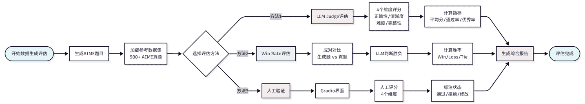

图 12.5 数据生成质量评估流程图

（1）LLM Judge 评估

设计动机：在数据生成质量评估中，我们需要对大量生成的题目进行快速、一致的质量评估。传统的人工评估虽然准确，但成本高、效率低，难以应对大规模数据生成的需求。LLM Judge 通过使用大语言模型作为评委，可以自动化地从多个维度评估生成数据的质量，不仅大幅提升评估效率，还能保持评估标准的一致性。更重要的是，LLM Judge 可以提供详细的评分理由和改进建议，帮助我们理解生成数据的优缺点，为后续优化提供方向。

在我们的实现中，LLM Judge 从四个关键维度评估 AIME 题目的质量：

表 12.5 LLM Judge 评估 AIME 题目的维度

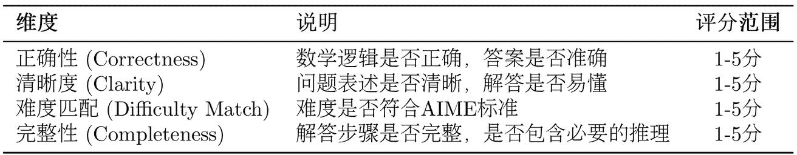

有了四个维度的评分后，我们需要将这些评分汇总成整体的评估指标。我们定义了三个关键指标来衡量生成题目的质量水平：

评估指标：

1.  平均分（Average Score）：计算所有题目在四个维度上的平均得分，反映生成题目的整体质量水平。Average Score=1N∑i=1N∑d=14Si,d4Average Score=N1i=1∑N4∑d=14Si,d

1.  及格率（Pass Rate）：统计平均分达到 3.5 分及以上的题目比例，反映生成题目的基本质量保障。

Pass Rate=∣{i:Scorei≥3.5}∣NPass Rate=N∣{i:Scorei≥3.5}∣

1.  优秀率（Excellent Rate）：统计平均分达到 4.5 分及以上的题目比例，反映生成题目的高质量占比。

Excellent Rate=∣{i:Scorei≥4.5}∣NExcellent Rate=N∣{i:Scorei≥4.5}∣

其中：

+   NN 是评估的题目总数

+   Si,dSi,d 是第 ii 个题目在第 dd 个维度的得分（1-5 分）

+   ScoreiScorei 是第 ii 个题目的平均分（四个维度得分的平均值）

这三个指标从不同角度反映生成质量：平均分给出整体水平，及格率保证基本质量，优秀率衡量高质量产出能力。

（2）Win Rate 评估

设计动机：虽然 LLM Judge 可以提供多维度的绝对评分，但我们还需要一个相对评估指标来衡量生成题目与真题的质量差距。Win Rate 评估通过成对对比的方式，让 LLM 直接判断生成题目和真题哪个更好，这种相对比较比绝对评分更符合人类的判断习惯，也更容易发现生成题目的相对优势和劣势。理想情况下，如果生成题目的质量接近真题，Win Rate 应该在 50%左右（即生成题目和真题各有 50%的胜率）。这个指标简单直观，可以快速判断生成系统的整体质量水平。

在我们的实现中，Win Rate 评估通过以下图 12.6 所示流程进行评估：

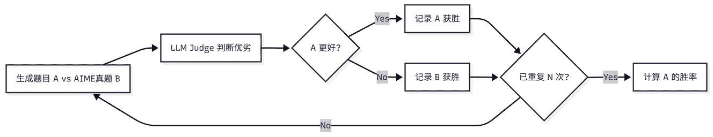

图 12.6 数据生成质量评估流程图

在成对对比评估中，每次比较会产生三种可能的结果：生成题目获胜（Win）、真题获胜（Loss）或平局（Tie）。我们通过统计这三种结果的比例来评估生成题目的质量：

评估指标：

1.  胜率（Win Rate）：生成题目被判定为更好的比例，反映生成题目相对于真题的优势。

Win Rate=WinsTotal ComparisonsWin Rate=Total ComparisonsWins

1.  败率（Loss Rate）：真题被判定为更好的比例，反映生成题目相对于真题的劣势。

Loss Rate=LossesTotal ComparisonsLoss Rate=Total ComparisonsLosses

1.  平局率（Tie Rate）：两者被判定为质量相当的比例，反映生成题目与真题的相似程度。

Tie Rate=TiesTotal ComparisonsTie Rate=Total ComparisonsTies

其中，Total Comparisons 是总的对比次数，Wins、Losses 和 Ties 分别是生成题目获胜、失败和平局的次数。这三个指标满足：Win Rate + Loss Rate + Tie Rate = 100%。

理想结果：Win Rate ≈ 50%（说明生成质量接近真题）。如果 Win Rate 显著低于 50%，说明生成题目质量不如真题，需要优化生成策略；如果 Win Rate 显著高于 50%，可能说明生成题目在某些方面超越了真题，或者评估标准存在偏差。

（3）人工验证

设计动机：尽管 LLM Judge 和 Win Rate 可以自动化评估题目质量，但对于数学题目这种需要严格逻辑推理的内容，人工验证仍然是不可或缺的。特别是在评估答案生成质量时，需要人类专家验证答案的准确性、解答步骤的完整性和数学推理的严密性。此外，人工验证还可以发现自动化评估可能遗漏的问题，如题目的创新性、趣味性等主观因素。为了提高人工验证的效率和体验，我们开发了基于 Gradio 的 Web 界面，让验证者可以方便地浏览题目、评分、标注状态和添加评论，大大降低了人工验证的门槛。

在我们的实现中，人工验证通过以下步骤进行：

1.  阅读题目、答案、解答

1.  评分（1-5 分）：正确性、清晰度、难度匹配、完整性

1.  标注状态：

+   ✅ approved（通过）

+   ❌ rejected（拒绝）

+   🔄 needs_revision（需修改）

1.  添加评论

### [12.4.2 系统架构](https://datawhalechina.github.io/hello-agents/#/./chapter12/%E7%AC%AC%E5%8D%81%E4%BA%8C%E7%AB%A0%20%E6%99%BA%E8%83%BD%E4%BD%93%E6%80%A7%E8%83%BD%E8%AF%84%E4%BC%B0?id=_1242-%e7%b3%bb%e7%bb%9f%e6%9e%b6%e6%9e%84)

数据生成与评估系统采用模块化设计：

```
data_generation/
├── aime_generator.py              # AIME题目生成器
├── human_verification_ui.py       # 人工验证界面
├── run_complete_evaluation.py     # 完整评估流程
│
├── generated_data/                # 生成的数据
│   ├── aime_generated_XXXXXX.json
│   └── generation_report_XXXXXX.md
│
└── evaluation_results/            # 评估结果
    └── XXXXXX/
        ├── llm_judge/
        ├── win_rate/
        └── comprehensive_report.mdCopy to clipboardErrorCopied
```

系统包含四个核心组件：首先是 AIMEGenerator（题目生成器），使用 HelloAgents 框架生成 AIME 风格题目，支持批量生成和进度保存，并能自动处理 API 速率限制；其次是 LLMJudgeTool（LLM Judge 评估工具），提供 4 维度质量评估，自动生成 JSON 结果和 Markdown 报告；第三是 WinRateTool（Win Rate 评估工具），通过成对对比评估计算胜率、败率和平局率；最后是 HumanVerificationUI（人工验证界面），基于 Gradio Web 界面，支持评分和状态标注。

### 12.4.3 AIME 题目生成器实现

```
class AIMEGenerator:&quot;&quot;&quot;AIME Problem Generator&quot;&quot;&quot;def __init__(
        self,
        llm: HelloAgentsLLM = None,
        delay_seconds: float = 1.0,
        use_reference_examples: bool = True,
        reference_dataset: str = &quot;TianHongZXY/aime-1983-2025&quot;):
        self.llm = llm or HelloAgentsLLM()
        self.agent = SimpleAgent(
            name=&quot;AIME Generator&quot;,
            llm=self.llm,
            system_prompt=&quot;You are a professional mathematics competition problem designer.&quot;)
        self.delay_seconds = delay_seconds
        self.use_reference_examples = use_reference_examples

        # Load reference examples from 900+ AIME problems (1983-2025)if use_reference_examples:
            dataset = load_dataset(reference_dataset, split=&quot;test&quot;)
            self.reference_examples = list(dataset)Copy to clipboardErrorCopied
```

我们的目标是生成类似风格的数据集，所以从 900+道 AIME 真题（1983-2025）中随机选择参考样例

生成提示词设计（英文）：

```
GENERATION_PROMPT = &quot;&quot;&quot;You are a professional mathematics competition problem designer, skilled in creating AIME (American Invitational Mathematics Examination) style problems.

【Reference Example】(For style reference only, please generate a completely different problem)
Problem: {example_problem}
Answer: {example_answer}

AIME Problem Characteristics:
1. Answer: An integer between 0 and 999
2. Topics: Algebra, Geometry, Number Theory, Combinatorics, Probability, etc.
3. Style: Requires multi-step reasoning, but no advanced theory
4. Difficulty: Medium to hard (similar to AIME problems 6-9)

Please generate a **completely different** AIME-style mathematics problem, including:
1. Problem statement (clear and complete, different from the reference)
2. Answer (an integer between 0 and 999, different from the reference)
3. Detailed solution (including all reasoning steps)
4. Topic classification (Algebra/Geometry/Number Theory/Combinatorics/Probability)

Please output in the following JSON format:
{
    &quot;problem&quot;: &quot;Problem statement in English&quot;,
    &quot;answer&quot;: 123,
    &quot;solution&quot;: &quot;Detailed solution steps in English&quot;,
    &quot;topic&quot;: &quot;Algebra&quot;
}
&quot;&quot;&quot;Copy to clipboardErrorCopied
```

我们选择使用英文生成题目有四个重要原因：首先是与 AIME 真题保持一致（AIME 是英文竞赛，生成英文题目更合理），其次是确保评估的公平性（LLM Judge 评估时英文 vs 英文更公平），第三是便于国际化（英文题目可以被更广泛使用），最后是避免翻译问题（不需要担心中英文翻译的准确性）。

批量生成实现：

```
def generate_and_save(self, num_problems: int = 30, output_dir: str = &quot;data_generation/generated_data&quot;):&quot;&quot;&quot;Generate and save problems with intelligent delay&quot;&quot;&quot;# Clean old checkpointsfor file in os.listdir(output_dir):if file.startswith(&quot;checkpoint_&quot;) and file.endswith(&quot;.json&quot;):
            os.remove(os.path.join(output_dir, file))# Generate with tqdm progress barwith tqdm(total=num_problems, desc=&quot;Generating AIME problems&quot;, unit=&quot;problem&quot;) as pbar:
        last_call_time = 0for i in range(num_problems):# Ensure minimum delay between API callsif last_call_time &gt; 0:
                elapsed = time.time() - last_call_time
                if elapsed &lt; self.delay_seconds:
                    wait_time = self.delay_seconds - elapsed
                    time.sleep(wait_time)# Generate problem (randomly select reference example)
            start_time = time.time()
            problem = self.generate_single()
            last_call_time = time.time()
            generation_time = last_call_time - start_time

            # Update progress bar
            pbar.set_postfix({&quot;topic&quot;: problem.get(&#x27;topic&#x27;, &#x27;N/A&#x27;),&quot;answer&quot;: problem.get(&#x27;answer&#x27;, &#x27;N/A&#x27;),&quot;time&quot;: f&quot;{generation_time:.1f}s&quot;})
            pbar.update(1)return generated_data_pathCopy to clipboardErrorCopied
```

LaTeX 数学公式支持：

生成的 AIME 题目包含 LaTeX 数学公式（如 $\frac{a}{b}$、$\sqrt{x}$），需要特殊处理 JSON 解析：

```
def _parse_response(self, response: str) -&gt; Dict[str, Any]:&quot;&quot;&quot;解析LLM响应（支持LaTeX数学公式）&quot;&quot;&quot;import re

    # 提取JSON部分if &quot;```json&quot; in response:
        json_str = response.split(&quot;```json&quot;)[1].split(&quot;```&quot;)[0].strip()else:
        json_str = response.strip()try:
        problem_data = json.loads(json_str)except json.JSONDecodeError:# 修复LaTeX转义问题：将 \frac 转为 \\frac# 正则表达式：找到未转义的反斜杠
        fixed_json_str = re.sub(r&#x27;(?&lt;!\\)\\(?![&quot;\\/bfnrtu])&#x27;, r&#x27;\\\\&#x27;, json_str)
        problem_data = json.loads(fixed_json_str)return problem_dataCopy to clipboardErrorCopied
```

LaTeX 公式中的反斜杠（如 \frac、\sqrt）在 JSON 中是非法的转义字符，会导致解析失败：

```
Invalid \escape: line 4 column 185 (char 375)Copy to clipboardErrorCopied
```

通过正则表达式将未转义的反斜杠替换为双反斜杠，使其在 JSON 中合法。

### 12.4.4 LLM Judge 评估工具

LLM Judge 工具使用 LLM 作为评委，对生成的题目进行多维度评估。

```
class LLMJudgeTool(Tool):&quot;&quot;&quot;LLM Judge评估工具&quot;&quot;&quot;def run(self, params: Dict[str, Any]) -&gt; str:&quot;&quot;&quot;运行LLM Judge评估&quot;&quot;&quot;# 1. 加载生成数据
        gen_dataset = AIDataset(dataset_type=&quot;generated&quot;, data_path=params[&quot;generated_data_path&quot;])
        gen_problems = gen_dataset.load()# 2. 加载参考数据（AIME 2025）
        ref_dataset = AIDataset(dataset_type=&quot;real&quot;, year=2025)
        ref_problems = ref_dataset.load()# 3. 创建评估器
        evaluator = LLMJudgeEvaluator(llm=self.llm, judge_model=params.get(&quot;judge_model&quot;, &quot;gpt-4o&quot;))# 4. 运行评估
        results = evaluator.evaluate_batch(gen_problems, max_samples=params.get(&quot;max_samples&quot;))# 5. 保存结果
        evaluator.export_results(results, result_file)# 6. 生成报告
        self._generate_report(results, report_file)return json.dumps({&quot;status&quot;: &quot;success&quot;, &quot;metrics&quot;: results[&quot;metrics&quot;]})Copy to clipboardErrorCopied
```

评估提示词：

```
EVALUATION_PROMPT = &quot;&quot;&quot;请评估以下AIME数学题目的质量。

题目：
{problem}

答案：{answer}

解答：
{solution}

请从以下4个维度评分（1-5分）：

1. &lt;strong&gt;正确性 (Correctness)&lt;/strong&gt;：数学逻辑是否正确，答案是否准确
2. &lt;strong&gt;清晰度 (Clarity)&lt;/strong&gt;：问题表述是否清晰，解答是否易懂
3. &lt;strong&gt;难度匹配 (Difficulty Match)&lt;/strong&gt;：难度是否符合AIME标准（中等偏难）
4. &lt;strong&gt;完整性 (Completeness)&lt;/strong&gt;：解答步骤是否完整，是否包含必要的推理

请按以下JSON格式输出：
{
    &quot;correctness&quot;: 5,
    &quot;clarity&quot;: 4,
    &quot;difficulty_match&quot;: 4,
    &quot;completeness&quot;: 5,
    &quot;comments&quot;: &quot;评价理由&quot;
}
&quot;&quot;&quot;Copy to clipboardErrorCopied
```

评估报告示例：

```
# LLM Judge评估报告

## 总体评分

- &lt;strong&gt;平均总分&lt;/strong&gt;: 4.2/5.0
- &lt;strong&gt;通过率&lt;/strong&gt;: 85.0% (≥3.5分)
- &lt;strong&gt;优秀率&lt;/strong&gt;: 40.0% (≥4.5分)

## 各维度评分

| 维度 | 平均分 | 评级 |
|------|--------|------|
| 正确性 | 4.3/5.0 | 良好 ⭐⭐⭐⭐ |
| 清晰度 | 4.1/5.0 | 良好 ⭐⭐⭐⭐ |
| 难度匹配 | 4.0/5.0 | 良好 ⭐⭐⭐⭐ |
| 完整性 | 4.4/5.0 | 良好 ⭐⭐⭐⭐ |Copy to clipboardErrorCopied
```

### 12.4.5 Win Rate 评估工具

Win Rate 工具通过成对对比评估生成数据相对于真题的质量。

```
class WinRateTool(Tool):&quot;&quot;&quot;Win Rate评估工具&quot;&quot;&quot;def run(self, params: Dict[str, Any]) -&gt; str:&quot;&quot;&quot;运行Win Rate评估&quot;&quot;&quot;# 1. 加载生成数据
        gen_dataset = AIDataset(dataset_type=&quot;generated&quot;, data_path=params[&quot;generated_data_path&quot;])
        gen_problems = gen_dataset.load()# 2. 加载参考数据（AIME 2025）
        ref_dataset = AIDataset(dataset_type=&quot;real&quot;, year=2025)
        ref_problems = ref_dataset.load()# 3. 创建评估器
        evaluator = WinRateEvaluator(llm=self.llm, judge_model=params.get(&quot;judge_model&quot;, &quot;gpt-4o&quot;))# 4. 运行评估
        results = evaluator.evaluate_win_rate(gen_problems, ref_problems, num_comparisons=params.get(&quot;num_comparisons&quot;))# 5. 保存结果和报告
        evaluator.export_results(results, result_file)
        self._generate_report(results, report_file)return json.dumps({&quot;status&quot;: &quot;success&quot;, &quot;metrics&quot;: results[&quot;metrics&quot;]})Copy to clipboardErrorCopied
```

AIDataset 负责加载生成数据和 AIME 真题数据，支持两种数据类型：

```
class AIDataset:&quot;&quot;&quot;AI数据集加载器

    支持两种数据类型：
    1. generated: 生成的数据（JSON格式）
    2. real: AIME真题（从HuggingFace加载）
    &quot;&quot;&quot;def __init__(
        self,
        dataset_type: str = &quot;generated&quot;,
        data_path: Optional[str] = None,
        year: Optional[int] = None):
        self.dataset_type = dataset_type
        self.data_path = data_path
        self.year = year  # 仅用于real类型，默认2025def load(self) -&gt; List[Dict[str, Any]]:&quot;&quot;&quot;加载数据集&quot;&quot;&quot;if self.dataset_type == &quot;generated&quot;:return self._load_generated_data()elif self.dataset_type == &quot;real&quot;:return self._load_real_data()def _load_real_data(self) -&gt; List[Dict[str, Any]]:&quot;&quot;&quot;从HuggingFace加载AIME 2025真题&quot;&quot;&quot;from huggingface_hub import snapshot_download

        # 使用AIME 2025数据集
        repo_id = &quot;math-ai/aime25&quot;# 下载数据集
        local_dir = snapshot_download(
            repo_id=repo_id,
            repo_type=&quot;dataset&quot;)# 读取JSONL文件
        data_file = list(Path(local_dir).glob(&quot;*.jsonl&quot;))[0]
        data = []with open(data_file, &#x27;r&#x27;, encoding=&#x27;utf-8&#x27;) as f:for line in f:if line.strip():
                    data.append(json.loads(line))# 统一数据格式（AIME 2025使用小写字段名）
        problems = []for idx, item in enumerate(data):
            problem = {&quot;problem_id&quot;: item.get(&quot;id&quot;, f&quot;aime_2025_{idx}&quot;),&quot;problem&quot;: item.get(&quot;problem&quot;, &quot;&quot;),&quot;answer&quot;: item.get(&quot;answer&quot;, &quot;&quot;),&quot;solution&quot;: item.get(&quot;solution&quot;, &quot;&quot;),  # AIME 2025没有solution字段}
            problems.append(problem)return problemsCopy to clipboardErrorCopied
```

我们选择只使用 AIME 2025 数据集有四个原因：首先是数据的时效性（2025 年是最新的 AIME 竞赛数据），其次是简化维护（只维护一个数据集，代码更简洁），第三是格式统一（JSONL 格式，字段名统一为小写），最后是代表性充分（30 道题目足以评估生成质量）。

对比提示词：

```
COMPARISON_PROMPT = &quot;&quot;&quot;请比较以下两个AIME数学题目的质量，判断哪个更好。

【题目A - 生成题目】
问题：{problem_a}
答案：{answer_a}
解答：{solution_a}

【题目B - AIME真题】
问题：{problem_b}
答案：{answer_b}
解答：{solution_b}

请从以下方面比较：
1. 数学逻辑的严谨性
2. 问题表述的清晰度
3. 难度的合理性
4. 解答的完整性

请按以下JSON格式输出：
{
    &quot;winner&quot;: &quot;A&quot; 或 &quot;B&quot; 或 &quot;Tie&quot;,
    &quot;reason&quot;: &quot;判断理由&quot;
}
&quot;&quot;&quot;Copy to clipboardErrorCopied
```

评估报告示例：

```
# Win Rate评估报告

## 胜率统计

| 指标 | 数值 | 百分比 |
|------|------|--------|
| 生成数据胜出 | 9次 | 45.0% |
| AIME真题胜出 | 8次 | 40.0% |
| 平局 | 3次 | 15.0% |

&lt;strong&gt;Win Rate&lt;/strong&gt;: 45.0%

✅ &lt;strong&gt;良好&lt;/strong&gt;: 生成数据质量接近参考数据（差距&lt;10%）。Copy to clipboardErrorCopied
```

### [12.4.6 人工验证界面](https://datawhalechina.github.io/hello-agents/#/./chapter12/%E7%AC%AC%E5%8D%81%E4%BA%8C%E7%AB%A0%20%E6%99%BA%E8%83%BD%E4%BD%93%E6%80%A7%E8%83%BD%E8%AF%84%E4%BC%B0?id=_1246-%e4%ba%ba%e5%b7%a5%e9%aa%8c%e8%af%81%e7%95%8c%e9%9d%a2)

使用 Gradio 创建 Web 界面，支持人工验证生成的题目。

```
class HumanVerificationUI:&quot;&quot;&quot;人工验证界面&quot;&quot;&quot;def launch(self, share: bool = False):&quot;&quot;&quot;启动Gradio界面&quot;&quot;&quot;with gr.Blocks(title=&quot;AIME题目人工验证&quot;) as demo:
            gr.Markdown(&quot;# 🎯 AIME题目人工验证系统&quot;)with gr.Row():with gr.Column(scale=2):# 题目显示区域
                    problem_text = gr.Textbox(label=&quot;问题描述&quot;, lines=5, interactive=False)
                    answer_text = gr.Textbox(label=&quot;答案&quot;, interactive=False)
                    solution_text = gr.Textbox(label=&quot;解答过程&quot;, lines=10, interactive=False)with gr.Column(scale=1):# 评分区域
                    correctness_slider = gr.Slider(1, 5, value=3, step=1, label=&quot;正确性&quot;)
                    clarity_slider = gr.Slider(1, 5, value=3, step=1, label=&quot;清晰度&quot;)
                    difficulty_slider = gr.Slider(1, 5, value=3, step=1, label=&quot;难度匹配&quot;)
                    completeness_slider = gr.Slider(1, 5, value=3, step=1, label=&quot;完整性&quot;)# 状态选择
                    status_radio = gr.Radio(
                        choices=[&quot;approved&quot;, &quot;rejected&quot;, &quot;needs_revision&quot;],
                        value=&quot;approved&quot;,
                        label=&quot;状态&quot;)# 验证按钮
                    verify_btn = gr.Button(&quot;✅ 提交验证&quot;, variant=&quot;primary&quot;)

            demo.launch(share=share, server_name=&quot;127.0.0.1&quot;, server_port=7860)Copy to clipboardErrorCopied
```

使用方法：

```
# 启动人工验证界面
python data_generation/human_verification_ui.py data_generation/generated_data/aime_generated_XXXXXX.json

# 打开浏览器访问
http://127.0.0.1:7860Copy to clipboardErrorCopied
```

最终效果可以参考图 12.7 所示，对于题目的正确性，最好人工打标 Review：

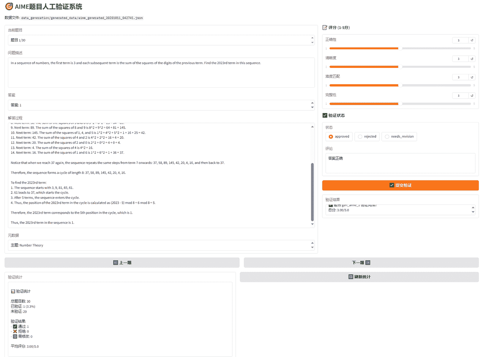

图 12.7 AIME 试题人工验证页面

验证流程：

1.  浏览器打开验证界面

1.  阅读题目、答案、解答

1.  从 4 个维度评分（1-5 分）

1.  选择验证状态（approved/rejected/needs_revision）

1.  添加评论（可选）

1.  点击"提交验证"

1.  查看下一题

验证结果保存：

验证结果自动保存为 <data_path>_verifications.json：

```
{
  &quot;gen_aime_1&quot;: {
    &quot;problem_id&quot;: &quot;gen_aime_1&quot;,
    &quot;scores&quot;: {
      &quot;correctness&quot;: 5,
      &quot;clarity&quot;: 4,
      &quot;difficulty_match&quot;: 4,
      &quot;completeness&quot;: 5
    },
    &quot;total_score&quot;: 4.5,
    &quot;status&quot;: &quot;approved&quot;,
    &quot;comments&quot;: &quot;题目质量很好，逻辑严谨&quot;,
    &quot;verified_at&quot;: &quot;2025-01-10T12:00:00&quot;
  }
}Copy to clipboardErrorCopied
```

### [12.4.7 完整评估流程](https://datawhalechina.github.io/hello-agents/#/./chapter12/%E7%AC%AC%E5%8D%81%E4%BA%8C%E7%AB%A0%20%E6%99%BA%E8%83%BD%E4%BD%93%E6%80%A7%E8%83%BD%E8%AF%84%E4%BC%B0?id=_1247-%e5%ae%8c%e6%95%b4%e8%af%84%e4%bc%b0%e6%b5%81%e7%a8%8b)

将所有评估方法整合到一个完整的流程中。

```
def run_complete_evaluation(
    num_problems: int = 30,
    delay_seconds: float = 3.0):&quot;&quot;&quot;
    运行完整评估流程

    Args:
        num_problems: 生成题目数量
        delay_seconds: 每次生成之间的延迟（秒），避免API速率限制
    &quot;&quot;&quot;# 步骤1: 生成AIME题目
    generator = AIMEGenerator(delay_seconds=delay_seconds)
    generated_data_path = generator.generate_and_save(
        num_problems=num_problems,
        output_dir=&quot;data_generation/generated_data&quot;)# 步骤2: 评估# 创建评估结果目录
    timestamp = datetime.now().strftime(&quot;%Y%m%d_%H%M%S&quot;)
    evaluation_dir = f&quot;data_generation/evaluation_results/{timestamp}&quot;
    os.makedirs(evaluation_dir, exist_ok=True)
    os.makedirs(os.path.join(evaluation_dir, &quot;llm_judge&quot;), exist_ok=True)
    os.makedirs(os.path.join(evaluation_dir, &quot;win_rate&quot;), exist_ok=True)# 创建LLM
    llm = HelloAgentsLLM()# 步骤2.1: LLM Judge评估
    llm_judge_result = Nonetry:
        llm_judge_tool = LLMJudgeTool(llm=llm)
        llm_judge_result_json = llm_judge_tool.run({&quot;generated_data_path&quot;: generated_data_path,&quot;reference_year&quot;: 2025,&quot;max_samples&quot;: num_problems,&quot;output_dir&quot;: os.path.join(evaluation_dir, &quot;llm_judge&quot;),&quot;judge_model&quot;: &quot;gpt-4o&quot;})
        llm_judge_result = json.loads(llm_judge_result_json)except Exception as e:print(f&quot;❌ LLM Judge评估失败: {e}&quot;)# 步骤2.2: Win Rate评估
    win_rate_result = Nonetry:
        win_rate_tool = WinRateTool(llm=llm)
        win_rate_result_json = win_rate_tool.run({&quot;generated_data_path&quot;: generated_data_path,&quot;reference_year&quot;: 2025,&quot;num_comparisons&quot;: min(num_problems, 20),&quot;output_dir&quot;: os.path.join(evaluation_dir, &quot;win_rate&quot;),&quot;judge_model&quot;: &quot;gpt-4o&quot;})
        win_rate_result = json.loads(win_rate_result_json)except Exception as e:print(f&quot;❌ Win Rate评估失败: {e}&quot;)# 步骤3: 生成综合报告
    comprehensive_report_path = Noneif llm_judge_result or win_rate_result:
        comprehensive_report_path = os.path.join(evaluation_dir, &quot;comprehensive_report.md&quot;)
        report = generate_comprehensive_report(
            generated_data_path,
            llm_judge_result,
            win_rate_result
        )with open(comprehensive_report_path, &#x27;w&#x27;, encoding=&#x27;utf-8&#x27;) as f:
            f.write(report)return {&quot;generated_data_path&quot;: generated_data_path,&quot;llm_judge_result&quot;: llm_judge_result,&quot;win_rate_result&quot;: win_rate_result,&quot;comprehensive_report_path&quot;: comprehensive_report_path
    }Copy to clipboardErrorCopied
```

运行方法：

```
# 基本用法（默认3秒延迟）
python data_generation/run_complete_evaluation.py 30# 自定义延迟（推荐3-5秒，避免API速率限制）
python data_generation/run_complete_evaluation.py 30 3.0# 参数说明：# - 30: 生成题目数量# - 3.0: 每次生成之间的延迟（秒）# 说明：# - 生成阶段：从900+道AIME真题（1983-2025）中随机选择参考样例# - 评估阶段：与AIME 2025年真题进行质量对比# - 数据集来源：math-ai/aime25（JSONL格式）Copy to clipboardErrorCopied
```

输出示例：

```
================================================================================
🚀 AIME数据生成与评估完整流程
================================================================================

配置信息:
  - 生成题目数量: 30
  - API延迟: 3.0秒/题
  - 生成参考数据: TianHongZXY/aime-1983-2025（900+道题）
  - 评估参考: AIME 2025真题

================================================================================
📝 步骤1: 生成AIME题目
================================================================================
📚 加载AIME真题数据集: TianHongZXY/aime-1983-2025
   ✓ 已加载 963 道参考题目

🎯 开始生成AIME题目
   目标数量: 30
   生成模型: gpt-4o
   延迟设置: 3.0秒/题

生成AIME题目:  100%|██████████| 30/30 [01:30&lt;00:00, 3.00s/题, 主题=Algebra, 答案=123, 耗时=3.0s]

✅ 步骤1完成！生成数据保存在: data_generation/generated_data/aime_generated_20250110_120000.json

🎯 步骤2.1: LLM Judge评估 (vs AIME 2025)

✅ LLM Judge评估完成！
   平均总分: 4.2/5.0
   通过率: 85.0%

🏆 步骤2.2: Win Rate评估 (vs AIME 2025)

✅ Win Rate评估完成！
   Win Rate: 45.0%

================================================================================
📊 步骤3: 生成综合报告
================================================================================

✅ 综合报告已保存: data_generation/evaluation_results/20250110_120000/comprehensive_report.md

================================================================================
🎉 完整评估流程完成！
================================================================================

📁 输出文件:
   - 生成数据: data_generation/generated_data/aime_generated_20250110_120000.json
   - 评估结果目录: data_generation/evaluation_results/20250110_120000
   - LLM Judge报告: data_generation/evaluation_results/20250110_120000/llm_judge/llm_judge_report_20250110_120000.md
   - Win Rate报告: data_generation/evaluation_results/20250110_120000/win_rate/win_rate_report_20250110_120000.md
   - 综合报告: data_generation/evaluation_results/20250110_120000/comprehensive_report.md

💡 下一步:
   1. 查看综合报告: data_generation/evaluation_results/20250110_120000/comprehensive_report.md
   2. 运行人工验证: python data_generation/human_verification_ui.py data_generation/generated_data/aime_generated_20250110_120000.jsonCopy to clipboardErrorCopied
```

### [12.4.8 综合评估报告](https://datawhalechina.github.io/hello-agents/#/./chapter12/%E7%AC%AC%E5%8D%81%E4%BA%8C%E7%AB%A0%20%E6%99%BA%E8%83%BD%E4%BD%93%E6%80%A7%E8%83%BD%E8%AF%84%E4%BC%B0?id=_1248-%e7%bb%bc%e5%90%88%e8%af%84%e4%bc%b0%e6%8a%a5%e5%91%8a)

系统自动生成综合评估报告，汇总所有评估结果。以下是示例报告：

```
# AIME数据生成与评估综合报告

## 1. 基本信息

- &lt;strong&gt;生成时间&lt;/strong&gt;: 2025-01-10 12:00:00
- &lt;strong&gt;生成题目数量&lt;/strong&gt;: 30
- &lt;strong&gt;参考AIME年份&lt;/strong&gt;: 2025

## 2. 数据生成统计

### 主题分布

| 主题 | 数量 | 占比 |
|------|------|------|
| 代数 | 10 | 33.3% |
| 几何 | 8 | 26.7% |
| 数论 | 7 | 23.3% |
| 组合 | 3 | 10.0% |
| 概率 | 2 | 6.7% |

## 3. LLM Judge评估结果

### 总体评分

- &lt;strong&gt;平均总分&lt;/strong&gt;: 4.2/5.0
- &lt;strong&gt;通过率&lt;/strong&gt;: 85.0% (≥3.5分)
- &lt;strong&gt;优秀率&lt;/strong&gt;: 40.0% (≥4.5分)

### 各维度评分

| 维度 | 平均分 | 评级 |
|------|--------|------|
| 正确性 | 4.3/5.0 | 良好 ⭐⭐⭐⭐ |
| 清晰度 | 4.1/5.0 | 良好 ⭐⭐⭐⭐ |
| 难度匹配 | 4.0/5.0 | 良好 ⭐⭐⭐⭐ |
| 完整性 | 4.4/5.0 | 良好 ⭐⭐⭐⭐ |

## 4. Win Rate评估结果

### 胜率统计

| 指标 | 数值 | 百分比 |
|------|------|--------|
| 生成数据胜出 | 9次 | 45.0% |
| AIME真题胜出 | 8次 | 40.0% |
| 平局 | 3次 | 15.0% |

&lt;strong&gt;Win Rate&lt;/strong&gt;: 45.0%

✅ &lt;strong&gt;良好&lt;/strong&gt;: 生成数据质量接近参考数据（差距&lt;10%）。

## 5. 综合结论

基于LLM Judge和Win Rate两种评估方法的结果：

1. &lt;strong&gt;LLM Judge评估&lt;/strong&gt;: 生成数据的平均质量为 &lt;strong&gt;4.2/5.0&lt;/strong&gt;
2. &lt;strong&gt;Win Rate评估&lt;/strong&gt;: 生成数据相对于AIME 2025真题的胜率为 &lt;strong&gt;45.0%&lt;/strong&gt;

✅ &lt;strong&gt;结论&lt;/strong&gt;: 生成数据质量&lt;strong&gt;优秀&lt;/strong&gt;，达到或超过AIME真题水平。可以用于实际应用。

## 6. 改进建议

- ✅ 继续保持当前的生成策略
- ✅ 可以考虑增加生成数量
- ✅ 建议进行人工验证以确保质量

## 7. 下一步行动

1. &lt;strong&gt;人工验证&lt;/strong&gt;: 运行 `python data_generation/human_verification_ui.py &lt;data_path&gt;` 进行人工验证
2. &lt;strong&gt;查看详细结果&lt;/strong&gt;:
   - LLM Judge详细报告
   - Win Rate详细报告
3. &lt;strong&gt;数据使用&lt;/strong&gt;: 如果质量满意，可以将生成的数据用于训练或测试Copy to clipboardErrorCopied
```

基于实际使用经验，总结以下内容：

在数据生成方面，应该使用合适的延迟时间（2-3 秒）避免 API 速率限制，启用检查点保存以避免中断损失，先小批量测试（10 个）确认无问题后再大批量生成，并定期检查生成质量及时调整提示词。在评估策略上，建议结合 LLM Judge 和 Win Rate 两种方法，其中 LLM Judge 用于绝对质量评估，Win Rate 用于相对质量对比，人工验证用于最终质量把关。质量标准方面，建议 LLM Judge 平均分达到 4.0/5.0 以上，Win Rate 达到 45%以上（接近 50%），通过率达到 80%以上，人工验证通过率达到 90%以上。在迭代优化过程中，应根据评估结果调整生成提示词，分析低分题目的共同问题，参考高分题目的优点，持续改进生成策略。

通过本节的学习，我们掌握了如何使用 HelloAgents 框架进行数据生成质量评估，包括 LLM Judge 评估、Win Rate 评估和人工验证三种方法。这套完整的评估体系可以确保生成数据的高质量，为 AI 系统的训练和测试提供可靠的数据支持。

对于 LLM Judge 和 Win Rate 评估，HelloAgents 也进行了工具集成，并提供了完整的示例代码。如果你对这两种评估方法的具体实现细节感兴趣，同样可以参考示例代码。

## [12.5 本章小结](https://datawhalechina.github.io/hello-agents/#/./chapter12/%E7%AC%AC%E5%8D%81%E4%BA%8C%E7%AB%A0%20%E6%99%BA%E8%83%BD%E4%BD%93%E6%80%A7%E8%83%BD%E8%AF%84%E4%BC%B0?id=_125-%e6%9c%ac%e7%ab%a0%e5%b0%8f%e7%bb%93)

在本章中，我们为 HelloAgents 框架构建了一个完整的性能评估系统。让我们回顾一下学到的核心内容：

（1）评估体系概览

我们建立了一个三层评估体系，全面覆盖智能体的不同能力维度。首先是工具调用能力评估（BFCL），专注于评估智能体的函数调用准确性，包含 simple、multiple、parallel、irrelevance 四个类别，使用 AST 匹配技术进行精确评估。其次是通用能力评估（GAIA），评估智能体的综合问题解决能力，包含三个难度级别共 466 个真实世界问题，关注多步推理、工具使用、文件处理等能力。第三是数据生成质量评估（AIME），评估 LLM 生成数据的质量，使用 LLM Judge 和 Win Rate 两种方法，支持人工验证和综合报告生成，确保生成数据达到参考数据的质量标准。

（2）核心技术要点

在技术实现上，我们采用了六个核心技术要点。首先是模块化设计，评估系统采用三层架构：数据层（Dataset 负责数据加载和管理）、评估层（Evaluator 负责执行评估流程）和指标层（Metrics 负责计算各种评估指标）。其次是工具化封装，所有评估功能都封装成 Tool，可以被智能体直接调用、集成到工作流中或通过统一接口使用。第三是 AST 匹配技术，使用抽象语法树匹配函数调用，比简单字符串匹配更智能，能够忽略参数顺序、识别等价表达式和忽略格式差异。第四是多模态支持，GAIA 评估支持文本问题、附件文件和图片输入等多模态数据。第五是 LLM Judge 评估，使用 LLM 作为评委评估生成数据质量，提供多维度评分（正确性、清晰度、难度匹配、完整性）、自动化评估流程、详细评估报告，并支持自定义评估维度和标准。第六是 Win Rate 对比评估，通过成对对比评估生成质量（生成数据 vs 参考数据），由 LLM 判断哪个更好并计算胜率统计，接近 50%表示质量相当。

（3）扩展方向

基于本章的评估系统，你可以在四个方向上进行扩展。首先是添加新的评估基准，可以参考 BFCL 和 GAIA 的实现模式，实现 Dataset、Evaluator、Metrics 三个组件，并封装成 Tool 供使用。其次是自定义评估指标，在 Metrics 类中添加新的指标计算方法，根据具体应用场景设计指标。第三是集成到 CI/CD 流程，在代码提交时自动运行评估，设置性能阈值防止性能退化，生成评估报告并归档。第四是扩展数据生成评估，支持更多数据类型（代码、对话、文档等），添加更多评估维度（创新性、多样性等），集成更多参考数据集，支持多模型对比评估。

恭喜你完成了第十二章的学习！ 🎉

评估是智能体开发的重要环节，它让我们能够：

+   客观衡量智能体的能力

+   发现和修复问题

+   持续改进系统

在下一章中，我们将探讨如何将 HelloAgents 框架应用于实际项目中。

继续加油！ 💪

## [习题](https://datawhalechina.github.io/hello-agents/#/./chapter12/%E7%AC%AC%E5%8D%81%E4%BA%8C%E7%AB%A0%20%E6%99%BA%E8%83%BD%E4%BD%93%E6%80%A7%E8%83%BD%E8%AF%84%E4%BC%B0?id=%e4%b9%a0%e9%a2%98)

> 提示：部分习题没有标准答案，重点在于培养学习者对智能体性能评估的综合理解和实践能力。

1.  本章介绍了多个智能体评估基准。请分析：

+   在 12.1.2 节中介绍了 BFCL、GAIA、AgentBench 等评估基准。请对比 BFCL 和 GAIA：它们分别评估智能体的哪些核心能力？为什么 BFCL 使用 AST 匹配算法，而 GAIA 使用准精确匹配（Quasi Exact Match）？这两种评估方法各有什么优缺点？

+   假设你要构建一个"智能客服系统"，需要评估以下能力：（1）理解用户意图的准确性；（2）调用后台 API 的正确性；（3）回答的友好性和专业性；（4）处理异常情况的鲁棒性。请为每个能力选择或设计合适的评估指标和方法。

+   在 12.1.1 节中提到，智能体评估面临"输出不确定性"、"评估标准多样性"、"评估成本高昂"三大挑战。请针对每个挑战提出具体的解决方案，并分析方案的可行性和局限性。

1.  BFCL（Berkeley Function Calling Leaderboard）是评估工具调用能力的重要基准。基于 12.2 节的内容，请深入思考：

1.  提示：这是一道动手实践题，建议实际操作

+   在 12.2.3 节的 AST 匹配算法中，我们通过比较抽象语法树来判断函数调用是否正确。请分析：为什么 AST 匹配比简单的字符串匹配更合适？在什么情况下 AST 匹配可能会产生误判（假阳性或假阴性）？如何改进 AST 匹配算法来提高准确性？

+   BFCL 数据集包含 simple、multiple、parallel、irrelevance 四个类别。请为每个类别设计 2-3 个新的测试样本，要求能够测试智能体在该类别下的边界情况或容易出错的场景。

+   请基于 12.2.4 节的代码，扩展 BFCL 评估器，添加以下功能：（1）支持评估工具调用的执行顺序（对于有依赖关系的多个工具调用）；（2）评估工具调用的效率（如是否使用了最少的调用次数）；（3）生成详细的错误分析报告（如哪些类型的错误最常见）。

1.  GAIA（General AI Assistants）评估智能体的综合能力。基于 12.3 节的内容，请完成以下扩展实践：

1.  提示：这是一道动手实践题，建议实际操作

+   在 12.3.2 节中介绍了 GAIA 的三个难度级别（Level 1/2/3）。请分析：这三个级别在任务复杂度、所需能力、评估标准等方面有什么差异？如果要设计 Level 4（超高难度），应该包含什么类型的任务？

+   GAIA 使用"准精确匹配"算法来评估答案的正确性。请分析：这种方法如何处理答案的多样性（如"42"、"四十二"、"42.0"都应该被认为是正确的）？在什么情况下准精确匹配可能不够用？请设计一个更智能的答案匹配算法，能够处理语义等价的答案。

+   请基于 12.3.4 节的代码，实现一个"自定义 GAIA 评估集"：选择一个特定领域（如医疗、法律、金融），设计 10 个真实世界问题，并实现完整的评估流程。要求问题涵盖不同难度级别，并提供标准答案和评分标准。

1.  LLM Judge 是使用大语言模型进行评估的新兴方法。基于 12.4 节的内容，请深入分析：

+   在 12.4.2 节中，我们使用 GPT-4 作为评判者来评估智能体的回答质量。请分析：LLM Judge 相比传统的规则匹配或指标计算有什么优势？它存在哪些潜在的偏见或局限性（如对某些回答风格的偏好、对长度的敏感性）？

+   LLM Judge 的评分标准设计至关重要。请为以下三个不同的评估场景设计详细的评分标准（包括评分维度、权重、示例）：（1）代码生成质量评估；（2）创意写作质量评估；（3）技术文档质量评估。

+   在 12.4.3 节中提到，可以使用多个 LLM Judge 进行"评审团"式评估。请设计一个"多评委评估系统"：使用 3-5 个不同的 LLM（如 GPT-4、Claude、Qwen）作为评委，如何聚合它们的评分？如何处理评委之间的分歧？如何检测和过滤异常评分？

1.  智能体评估的实践应用需要考虑多个方面。请思考：

+   在实际项目中，评估往往需要在"评估成本"和"评估质量"之间权衡。请设计一个"分层评估策略"：（1）快速评估（低成本，用于日常开发迭代）；（2）标准评估（中等成本，用于版本发布前）；（3）全面评估（高成本，用于重大更新或对外发布）。每层应该包含哪些评估项目？如何设计评估流程？

+   智能体的性能可能随时间变化（如依赖的外部 API 变化、用户需求变化）。请设计一个"持续评估系统"：能够定期自动运行评估，监控智能体性能的变化趋势，并在性能下降时及时告警。这个系统应该包含哪些组件？如何设计告警规则？

+   评估结果需要以清晰的方式呈现给不同的受众（如开发者、产品经理、用户）。请设计一个"评估报告生成系统"：能够根据受众类型自动生成不同详细程度的报告。开发者报告应该包含哪些技术细节？产品经理报告应该突出哪些业务指标？用户报告应该如何简化和可视化？

## [参考文献](https://datawhalechina.github.io/hello-agents/#/./chapter12/%E7%AC%AC%E5%8D%81%E4%BA%8C%E7%AB%A0%20%E6%99%BA%E8%83%BD%E4%BD%93%E6%80%A7%E8%83%BD%E8%AF%84%E4%BC%B0?id=%e5%8f%82%e8%80%83%e6%96%87%e7%8c%ae)

[1] Patil, S. G., Zhang, T., Wang, X., & Gonzalez, J. E. (2023). Gorilla: Large Language Model Connected with Massive APIs. arXiv preprint arXiv:2305.15334.

[2] Qin, Y., Liang, S., Ye, Y., Zhu, K., Yan, L., Lu, Y., ... & Sun, M. (2023). ToolLLM: Facilitating Large Language Models to Master 16000+ Real-world APIs. arXiv preprint arXiv:2307.16789.

[3] Li, M., Zhao, Y., Yu, B., Song, F., Li, H., Yu, H., ... & Li, Y. (2023). Api-bank: A comprehensive benchmark for tool-augmented llms. arXiv preprint arXiv:2304.08244.

[4] Mialon, G., Dessì, R., Lomeli, M., Nalmpantis, C., Pasunuru, R., Raileanu, R., ... & Scialom, T. (2023). GAIA: a benchmark for General AI Assistants. arXiv preprint arXiv:2311.12983.

[5] Liu, X., Yu, H., Zhang, H., Xu, Y., Lei, X., Lai, H., ... & Zhang, D. (2023). AgentBench: Evaluating LLMs as Agents. arXiv preprint arXiv:2308.03688.

[6] Zhou, S., Xu, F. F., Zhu, H., Zhou, X., Lo, R., Sridhar, A., ... & Neubig, G. (2023). WebArena: A Realistic Web Environment for Building Autonomous Agents. arXiv preprint arXiv:2307.13854.

[7] Chan, C. M., Chen, W., Su, Y., Yu, J., Xue, W., Zhang, S., ... & Liu, Z. (2023). ChatEval: Towards Better LLM-based Evaluators through Multi-Agent Debate. arXiv preprint arXiv:2308.07201.

[8] Zhou, X., Zhu, H., Mathur, L., Zhang, R., Yu, H., Qi, Z., ... & Neubig, G. (2023). SOTOPIA: Interactive Evaluation for Social Intelligence in Language Agents. arXiv preprint arXiv:2310.11667.

[9] Mathematical Association of America. (2024). American [I](https://www.maa.org/math-competitions/invitational-competitions/aime)nvitational Mathematics Examination (AIME). Retrieved from https://www.maa.org/math-competitions/invitational-competitions/aime