# 第十四章 自动化深度研究智能体

> 来源：[https://gotoaiworld.feishu.cn/docx/YkdadakCuoqBVDxQlgmcv22lnzh](https://gotoaiworld.feishu.cn/docx/YkdadakCuoqBVDxQlgmcv22lnzh)

在第十三章的旅行助手项目中，我们体验了如何将 HelloAgents 应用于一个多智能体产品。本章我们继续向前，聚焦「知识密集型应用」：构建一个能够自动化执行深度研究任务的智能体助手。

相比旅行规划，深度研究的难点在于信息的不断发散、事实的快速更新以及用户对引用来源的高要求。为了交付可信的研究报告，我们需要让智能体具备三个核心能力：

（1）问题剖析：将用户的开放主题拆解为可检索的查询语句。

（2）多轮信息采集：结合不同搜索 API 持续挖掘资料，并去重整合。

（3）反思与总结：依据阶段结果识别知识空白，决定是否继续检索，并生成结构化总结。

## [14.1 项目概述与架构设计](https://datawhalechina.github.io/hello-agents/#/./chapter14/%E7%AC%AC%E5%8D%81%E5%9B%9B%E7%AB%A0%20%E8%87%AA%E5%8A%A8%E5%8C%96%E6%B7%B1%E5%BA%A6%E7%A0%94%E7%A9%B6%E6%99%BA%E8%83%BD%E4%BD%93?id=_141-%e9%a1%b9%e7%9b%ae%e6%a6%82%e8%bf%b0%e4%b8%8e%e6%9e%b6%e6%9e%84%e8%ae%be%e8%ae%a1)

### 14.1.1 为什么需要深度研究助手

在信息爆炸的时代，我们每天都需要快速了解新的技术、概念或事件。传统的研究方式有几个痛点。首先是信息过载。搜索引擎返回成千上万的结果，你需要逐个点开链接，阅读大量内容，才能找到有用的信息。其次是缺少结构。即使找到了相关信息，这些信息往往是碎片化的，缺少系统性的组织。最后是重复劳动。每次研究新主题时，都需要重复"搜索→阅读→总结→整理"的过程。

这就是深度研究助手需要解决的问题。它不仅仅是一个搜索工具，而是一个能够自主规划、执行和总结的研究助手。

深度研究助手的核心价值：

1.  节省时间：将 1-2 小时的研究工作压缩到 5-10 分钟

1.  提高质量：系统化的研究流程，避免遗漏重要信息

1.  可追溯：记录所有搜索结果和来源，方便验证和引用

1.  可扩展：可以轻松添加新的搜索引擎、数据源和分析工具

### [14.1.2 技术架构概览](https://datawhalechina.github.io/hello-agents/#/./chapter14/%E7%AC%AC%E5%8D%81%E5%9B%9B%E7%AB%A0%20%E8%87%AA%E5%8A%A8%E5%8C%96%E6%B7%B1%E5%BA%A6%E7%A0%94%E7%A9%B6%E6%99%BA%E8%83%BD%E4%BD%93?id=_1412-%e6%8a%80%e6%9c%af%e6%9e%b6%e6%9e%84%e6%a6%82%e8%a7%88)

此次系统仍然采用经典的前后端分离架构，如图 14.1 所示。

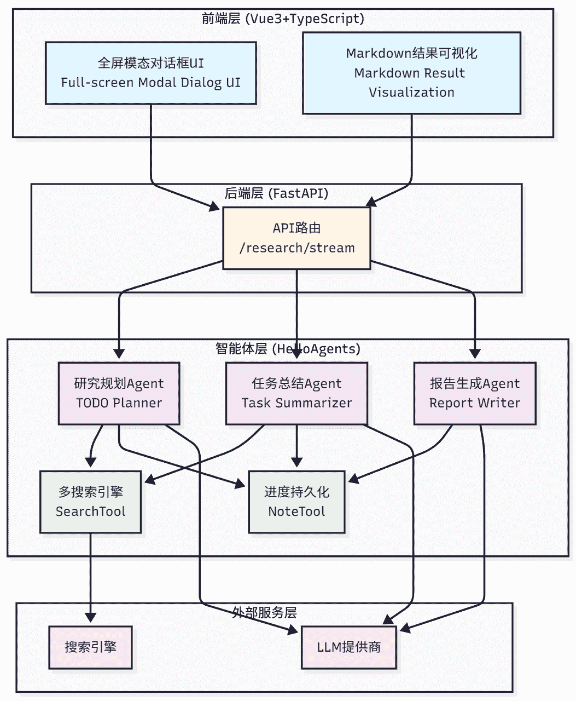

图 14.1 深度研究助手技术架构

系统分为四层架构设计：

前端层 (Vue3+TypeScript)：全屏模态对话框 UI、Markdown 结果可视化

后端层 (FastAPI)：API 路由（/research/stream）

智能体层 (HelloAgents)：三个专门 Agent（TODO Planner、Task Summarizer、Report Writer）+ 两个核心工具（SearchTool、NoteTool）

外部服务层：搜索引擎+ LLM 提供商

让我们看看一个完整的研究请求是如何在系统中流转的，如图 14.2 所示：

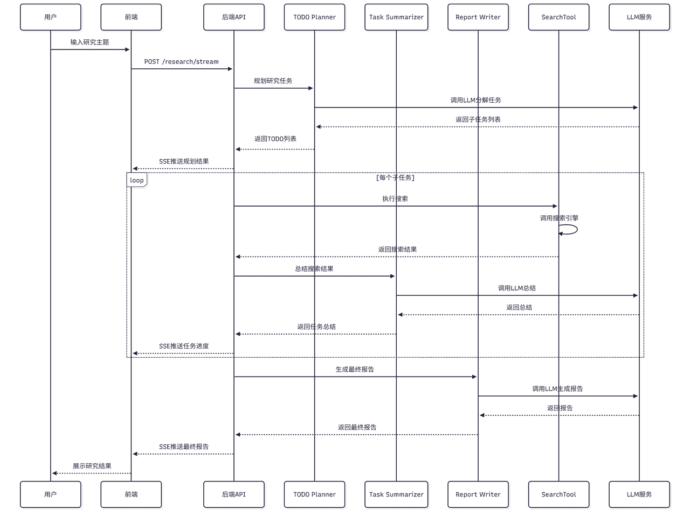

图 14.2 深度研究助手数据流转过程

1.  用户输入：用户在前端输入研究主题

1.  前端发送：前端通过 SSE 连接到/research/stream

1.  后端接收：FastAPI 接收请求，创建研究状态

1.  规划阶段：调用研究规划 Agent，分解为 3 个子任务

1.  执行阶段：逐个执行每个子任务

+   使用 SearchTool 搜索

+   调用任务总结 Agent 总结

+   使用 NoteTool 记录结果

1.  报告阶段：调用报告生成 Agent，整合所有总结

1.  流式返回：通过 SSE 推送进度和结果到前端

1.  前端展示：前端实时更新任务状态、进度条、日志、报告

项目的目录结构如下：

```
helloagents-deepresearch/
├── backend/                    # 后端代码
│   ├── src/
│   │   ├── agent.py           # 核心协调器
│   │   ├── main.py            # FastAPI入口
│   │   ├── models.py          # 数据模型
│   │   ├── prompts.py         # Prompt模板
│   │   ├── config.py          # 配置管理
│   │   └── services/          # 服务层
│   │       ├── planner.py     # 规划服务
│   │       ├── summarizer.py  # 总结服务
│   │       ├── reporter.py    # 报告服务
│   │       └── search.py      # 搜索服务
│   ├── .env                   # 环境变量
│   ├── pyproject.toml         # 依赖管理
│   └── workspace/             # 研究笔记
│
└── frontend/                   # 前端代码
    ├── src/
    │   ├── App.vue            # 主组件
    │   ├── components/        # UI组件
    │   │   └── ResearchModal.vue
    │   └── composables/       # 组合式函数
    │       └── useResearch.ts
    ├── package.json           # npm依赖
    └── vite.config.ts         # 构建配置Copy to clipboardErrorCopied
```

### 14.1.3 快速体验：5 分钟运行项目

在深入学习实现细节之前，让我们先把项目跑起来，看看最终的效果。这样你会对整个系统有一个直观的认识。

你可以通过以下命令检查版本：

```
python --version  # 应该显示 Python 3.10.x 或更高node --version    # 应该显示 v16.x.x 或更高npm --version     # 应该显示 8.x.x 或更高Copy to clipboardErrorCopied
```

（1）启动后端

```
# 1. 进入后端目录cd helloagents-deepresearch/backend

# 2. 安装依赖# 方式1：使用uv（推荐，更快的Python包管理器）
uv sync# 方式2：使用pip
pip install -e .# 3. 配置环境变量cp .env.example .env

# 4. 编辑.env文件，填入你的API密钥# 使用你喜欢的编辑器打开.env文件# 至少需要配置：# - LLM_PROVIDER（如 openai、deepseek、qwen）# - LLM_API_KEY（你的LLM API密钥）# - SEARCH_API（如 duckduckgo、tavily）# 5. 启动后端
python src/main.pyCopy to clipboardErrorCopied
```

如果一切正常，你会看到类似的输出：

```
INFO:     Started server process [12345]
INFO:     Waiting for application startup.
INFO:     Application startup complete.
INFO:     Uvicorn running on http://0.0.0.0:8000 (Press CTRL+C to quit)Copy to clipboardErrorCopied
```

（2）启动前端

打开一个新的终端窗口：

```
# 1. 进入前端目录cd helloagents-deepresearch/frontend

# 2. 安装依赖npm install# 3. 启动前端npm run devCopy to clipboardErrorCopied
```

如果一切正常，你会看到类似的输出：

```
  VITE v5.0.0  ready in 500 ms

  ➜  Local:   http://localhost:5174/
  ➜  Network: use --host to expose
  ➜  press h + enter to show helpCopy to clipboardErrorCopied
```

（3）开始研究

打开浏览器访问 http://localhost:5174，你会看到一个居中的输入卡片，如图 14.3 所示。输入研究主题，例如Datawhale是一个什么样的组织？，选择搜索引擎（如果配置了多个），点击"开始研究"按钮。

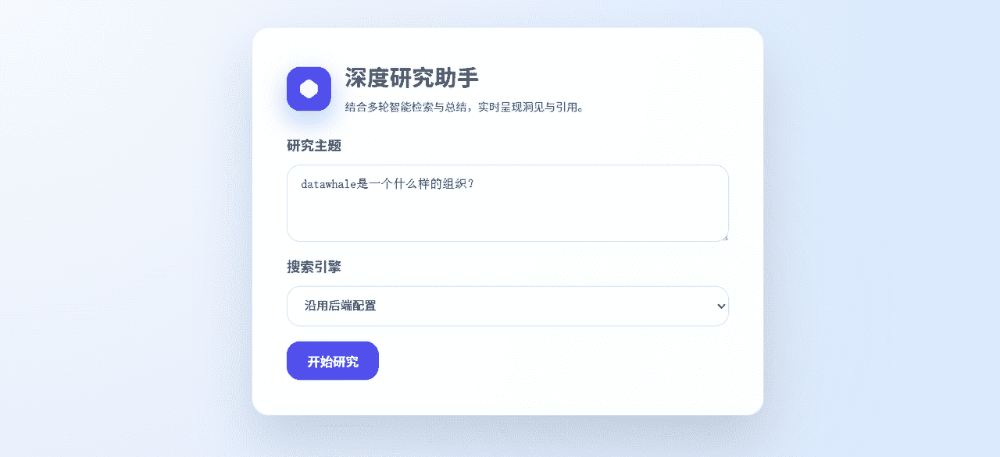

图 14.3 深度研究助手搜索页面

如图 14.4 所示，系统会自动展开为全屏，左侧显示研究信息，右侧实时显示研究进度和结果。整个研究过程大约需要 1-3 分钟，取决于主题的复杂度和搜索引擎的响应速度。

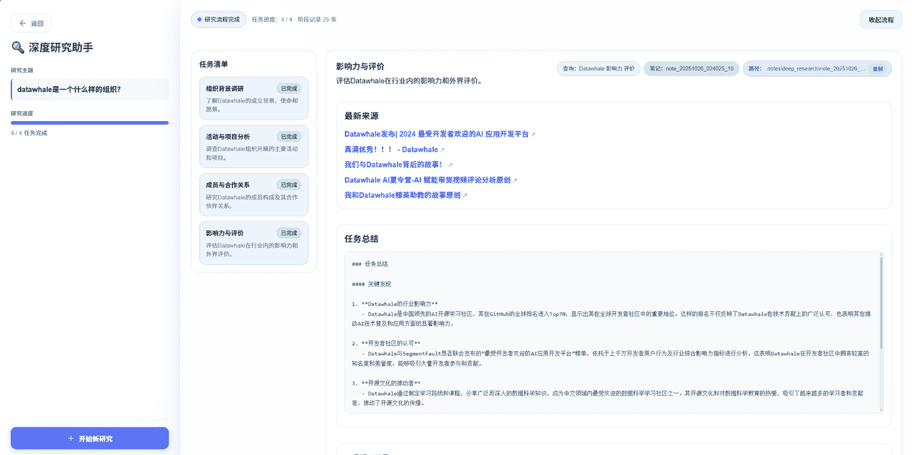

图 14.4 深度研究助手展开研究

研究完成后，你会看到：

+   任务列表：显示所有子任务及其状态

+   进度日志：显示研究过程中的所有操作

+   最终报告：结构化的 Markdown 报告，包含所有子任务的总结和来源引用

现在你已经成功运行了深度研究助手，对系统有了直观的认识。

## 14.2 TODO 驱动的研究范式

### 14.2.1 什么是 TODO 驱动的研究

传统的搜索引擎只能回答单个问题，而深度研究需要回答一系列相关的问题。TODO 驱动的研究范式将复杂的研究主题分解为多个子任务（TODO），逐个执行并整合结果。

这种范式的核心思想是：将"研究"这个复杂任务转化为"规划→执行→整合"的流程。

让我们通过一个例子来理解这个转变。假设你想研究"Datawhale 是一个什么样的组织？"，传统的搜索方式是：

```
用户输入：Datawhale是一个什么样的组织？
搜索引擎：返回10-20个链接
用户：逐个点开链接，阅读内容，记录笔记
结果：碎片化的信息，缺少系统性Copy to clipboardErrorCopied
```

这种方式的问题在于每个链接只涵盖主题的一个方面、缺少系统性结构，需要手动整理和总结。

TODO 驱动方式：系统化研究

```
用户输入：Datawhale是一个什么样的组织？

系统规划：
  ├─ TODO 1：Datawhale的基本信息（组织定位）
  ├─ TODO 2：Datawhale的主要项目（核心内容）
  ├─ TODO 3：Datawhale的社区文化（价值观）
  └─ TODO 4：Datawhale的影响力（社会贡献）

系统执行：
  对每个TODO：
    1. 搜索相关资料
    2. 总结关键信息
    3. 记录来源引用

系统整合：
  生成结构化报告：
    ├─ 第一部分：组织定位（来自TODO 1）
    ├─ 第二部分：核心内容（来自TODO 2）
    ├─ 第三部分：价值观（来自TODO 3）
    ├─ 第四部分：社会贡献（来自TODO 4）
    └─ 参考文献：所有来源引用Copy to clipboardErrorCopied
```

这种方式的优势在于将复杂主题分解为清晰的子问题，每个子任务的搜索结果和总结都被记录下来，方便追溯。同时，系统化的研究流程避免了遗漏重要信息，可以轻松添加新的子任务或调整执行顺序。

一个完整的 TODO 驱动研究系统包含三个核心要素：

（1）智能规划器（TODO Planner）：负责将研究主题分解为子任务。一个好的规划器需要理解主题的关键方面和研究目标，将主题分解为 3-5 个子任务（太少覆盖不全，太多会冗余），并为每个子任务设计合适的搜索查询。

（2）任务执行器（Task Executor）：负责执行每个子任务。执行器需要使用搜索引擎获取相关资料，提取关键信息并去除冗余内容，同时保存所有来源引用以方便验证。

（3）报告生成器（Report Writer）：负责整合所有子任务的结果。生成器需要按照逻辑顺序组织内容，合并重复的信息，并为每个观点添加来源引用。

在我们的案例里，TODO 驱动的研究流程如图 14.5 所示：

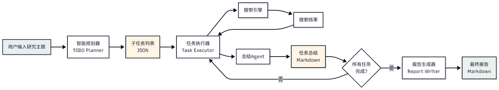

图 14.5 TODO 驱动的研究流程

整个流程是线性的，但每个阶段都有明确的输入和输出。这种设计使得系统易于理解和调试。

### [14.2.2 三阶段研究流程](https://datawhalechina.github.io/hello-agents/#/./chapter14/%E7%AC%AC%E5%8D%81%E5%9B%9B%E7%AB%A0%20%E8%87%AA%E5%8A%A8%E5%8C%96%E6%B7%B1%E5%BA%A6%E7%A0%94%E7%A9%B6%E6%99%BA%E8%83%BD%E4%BD%93?id=_1422-%e4%b8%89%e9%98%b6%e6%ae%b5%e7%a0%94%e7%a9%b6%e6%b5%81%e7%a8%8b)

TODO 驱动的研究流程分为三个阶段:规划（Planning）、执行（Execution）、报告（Reporting）。每个阶段都有专门的 Agent 负责。

（1）阶段 1：规划

规划阶段的目标是将研究主题分解为 3-5 个子任务。系统接收研究主题和当前日期作为输入，输出 JSON 格式的子任务列表。每个子任务包含三个字段：title（任务标题）、intent（研究意图）和 query（搜索查询）。

研究规划 Agent 会根据主题特点采用不同的分解策略，通常从基础概念入手，然后了解技术现状、实际应用和发展趋势，必要时还会进行对比分析。例如，对于"Datawhale 是一个什么样的组织？"，规划 Agent 可能生成以下子任务：

```
[
  {
    &quot;title&quot;: &quot;Datawhale的基本信息&quot;,
    &quot;intent&quot;: &quot;了解Datawhale的组织定位、成立时间、发展历程&quot;,
    &quot;query&quot;: &quot;Datawhale organization introduction history 2024&quot;
  },
  {
    &quot;title&quot;: &quot;Datawhale的主要项目&quot;,
    &quot;intent&quot;: &quot;了解Datawhale的核心开源项目和教程&quot;,
    &quot;query&quot;: &quot;Datawhale projects tutorials open source 2024&quot;
  },
......
]Copy to clipboardErrorCopied
```

一个好的规划应该覆盖全面、逻辑清晰、查询精准、条目数量适中。

（2）阶段 2：执行

执行阶段逐个执行每个子任务，搜索并总结相关资料。系统接收子任务列表和搜索引擎配置作为输入，输出每个子任务的总结（Markdown 格式）和来源引用列表。执行流程如下：

对于每个子任务，执行器会：

1.  搜索资料：使用配置的搜索引擎执行搜索

```
search_results = search_tool.run({&quot;input&quot;: task.query,&quot;backend&quot;: &quot;tavily&quot;,&quot;mode&quot;: &quot;structured&quot;,&quot;max_results&quot;: 5})Copy to clipboardErrorCopied
```

1.  获取搜索结果：提取标题、URL、摘要

```
{
  &quot;results&quot;: [
    {
      &quot;title&quot;: &quot;What is a Multimodal Model?&quot;,
      &quot;url&quot;: &quot;https://example.com/multimodal-model&quot;,
      &quot;snippet&quot;: &quot;A multimodal model is an AI model that can process multiple types of data...&quot;
    },
    ...
  ]
}Copy to clipboardErrorCopied
```

1.  调用总结 Agent：总结搜索结果

```
summary = summarizer_agent.run(
    task=task,
    search_results=search_results
)Copy to clipboardErrorCopied
```

1.  记录总结和来源：保存到 NoteTool

```
note_tool.run({&quot;action&quot;: &quot;create&quot;,&quot;title&quot;: task.title,&quot;content&quot;: f&quot;## {task.title}\n\n{summary}\n\n## 来源\n{sources}&quot;,&quot;tags&quot;: [&quot;research&quot;, &quot;summary&quot;]})Copy to clipboardErrorCopied
```

任务总结 Agent 会从每个搜索结果中提取核心观点，合并相似信息，保留重要的数字、日期、名称等关键数据，并为每个观点添加来源引用。例如，对于"Datawhale 的基本信息"的搜索结果，总结 Agent 可能生成：

```
## Datawhale的基本信息

Datawhale是一个专注于数据科学与AI领域的开源组织，成立于2018年[1]。组织的核心使命是&quot;for the learner，和学习者一起成长&quot;，致力于构建一个纯粹的学习社区[2]。

**核心定位：**

1. **开源教育平台**：提供高质量的AI和数据科学学习资源[1]
2. **学习者社区**：汇聚了数万名AI学习者和实践者[3]
3. **知识共享**：倡导开源精神，所有内容完全免费开放[2]

**发展历程：**

- **2018年**：Datawhale成立，发布首个开源教程[1]
- **2020年**：成为国内领先的AI学习社区之一[3]
- **2024年**：累计发布50+开源项目，影响10万+学习者[4]

## 来源

[1] https://github.com/datawhalechina
[2] https://datawhale.club/about
[3] https://www.zhihu.com/org/datawhale
[4] https://datawhale.cnCopy to clipboardErrorCopied
```

在执行过程中，系统会实时推送进度信息到前端：

```
{
  &quot;type&quot;: &quot;status&quot;,
  &quot;message&quot;: &quot;正在搜索：Datawhale的基本信息&quot;
}Copy to clipboardErrorCopied
```

```
{
  &quot;type&quot;: &quot;status&quot;,
  &quot;message&quot;: &quot;正在总结搜索结果...&quot;
}Copy to clipboardErrorCopied
```

```
{
  &quot;type&quot;: &quot;task&quot;,
  &quot;task&quot;: {
    &quot;id&quot;: 1,
    &quot;title&quot;: &quot;Datawhale的基本信息&quot;,
    &quot;status&quot;: &quot;completed&quot;
  }
}Copy to clipboardErrorCopied
```

（3）阶段 3：报告

报告阶段的目标是整合所有子任务的总结，生成最终报告。系统接收所有子任务的总结和研究主题作为输入，输出 Markdown 格式的最终报告。报告包含标题、概述、各个子任务的详细分析、总结和参考文献五个部分。例如，对于"Datawhale 是一个什么样的组织？"，最终报告可能是：

```
# Datawhale是一个什么样的组织？

## 概述

本报告系统地研究了Datawhale这个开源组织，涵盖基本信息、主要项目、社区文化和影响力四个方面。

## 1. Datawhale的基本信息

Datawhale是一个专注于数据科学与AI领域的开源组织，成立于2018年...

（此处插入子任务1的总结）

## 2. Datawhale的主要项目

Datawhale发布了多个高质量的开源教程，包括Hello-Agents、Joyful-Pandas等...

（此处插入子任务2的总结）
......
## 总结

通过本次研究，我们了解了Datawhale的组织定位、核心项目、社区文化和社会贡献。Datawhale是一个纯粹的学习社区，为AI教育做出了重要贡献。

## 参考文献

[1] https://github.com/datawhalechina
[2] https://datawhale.club/about
...Copy to clipboardErrorCopied
```

报告生成 Agent 会按照子任务的逻辑顺序组织内容，在开头添加简要概述，合并重复的信息，统一 Markdown 格式，并将所有来源引用整理到参考文献部分。

## [14.3 智能体系统设计](https://datawhalechina.github.io/hello-agents/#/./chapter14/%E7%AC%AC%E5%8D%81%E5%9B%9B%E7%AB%A0%20%E8%87%AA%E5%8A%A8%E5%8C%96%E6%B7%B1%E5%BA%A6%E7%A0%94%E7%A9%B6%E6%99%BA%E8%83%BD%E4%BD%93?id=_143-%e6%99%ba%e8%83%bd%e4%bd%93%e7%b3%bb%e7%bb%9f%e8%ae%be%e8%ae%a1)

### 14.3.1 Agent 职责划分

在深度研究助手中，我们设计了三个专门的 Agent，每个 Agent 负责一个特定的任务。这使得每个 Agent 都很简单，易于理解和维护。

在第七章中，我们学习了如何使用SimpleAgent来构建智能体。SimpleAgent的设计理念是简单直接：每次调用run()方法时，Agent 会分析用户的问题，决定是否需要调用工具，然后返回结果。这种设计在处理简单任务时非常有效，但当面对深度研究这样的复杂任务时，就需要我们继续采用多智能体协作的方案进行。

如表 14.1 所示，三个 Agent 分别负责规划、总结和报告生成。

表 14.1 三个 Agent 的职责划分

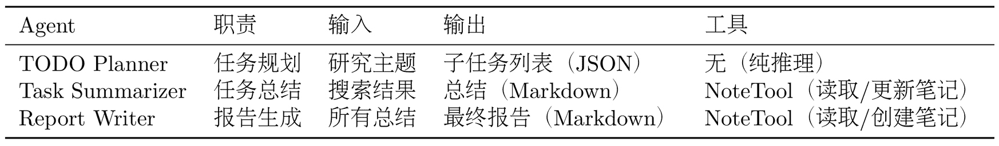

让我们详细介绍每个 Agent 的设计。

Agent 1：研究规划专家（TODO Planner）

职责：将研究主题分解为 3-5 个子任务

设计理念：研究规划专家的核心任务是理解用户的研究主题，分析主题的关键方面，然后生成一系列子任务。这个过程类似于人类研究者在开始研究前的"头脑风暴"阶段。

Prompt 设计：

```
todo_planner_instructions = &quot;&quot;&quot;
你是一个研究规划专家。你的任务是将用户的研究主题分解为3-5个子任务。

当前日期：{current_date}

研究主题：{research_topic}

请分析这个研究主题，将其分解为3-5个子任务。每个子任务应该：
1. 涵盖主题的一个重要方面
2. 有明确的研究目标
3. 可以通过搜索引擎找到相关资料

请以JSON格式返回子任务列表，每个子任务包含：
- title：任务标题（简洁明了）
- intent：任务意图（为什么要研究这个）
- query：搜索查询（用于搜索引擎的查询字符串，可以使用英文以获得更好的搜索结果）

示例输出：
[
  {{
    &quot;title&quot;: &quot;什么是多模态模型&quot;,
    &quot;intent&quot;: &quot;了解多模态模型的基础概念，为后续研究打下基础&quot;,
    &quot;query&quot;: &quot;multimodal model definition concept 2024&quot;
  }},
  ...
]

请确保：
1. 子任务数量在3-5个之间
2. 子任务之间有逻辑关系（如从基础到应用，从现状到趋势）
3. 搜索查询能够准确找到相关资料
4. 只返回JSON，不要包含其他文本
&quot;&quot;&quot;Copy to clipboardErrorCopied
```

关键设计点：提示词包含当前日期以获取最新信息，明确要求 JSON 格式输出便于解析，通过示例帮助 Agent 理解期望输出，并强调子任务数量、逻辑关系等约束。

实现代码：

这里的 ToolAwareSimpleAgent 是根据 SimpleAgent 拓展实现，可以在 14.3.2 了解，这里不用深究。

```
class PlanningService:def __init__(self, llm: HelloAgentsLLM):
        self._agent = ToolAwareSimpleAgent(
            name=&quot;TODO Planner&quot;,
            system_prompt=&quot;你是一个研究规划专家&quot;,
            llm=llm,
            tool_call_listener=self._on_tool_call
        )def plan_todo_list(self, state: SummaryState) -&gt; List[TodoItem]:
        prompt = todo_planner_instructions.format(
            current_date=get_current_date(),
            research_topic=state.research_topic,)
        
        response = self._agent.run(prompt)
        tasks_payload = self._extract_tasks(response)
        
        todo_items = []for idx, item in enumerate(tasks_payload, start=1):
            task = TodoItem(id=idx,
                title=item[&quot;title&quot;],
                intent=item[&quot;intent&quot;],
                query=item[&quot;query&quot;],)
            todo_items.append(task)return todo_items
    
    def _extract_tasks(self, response: str) -&gt; List[dict]:&quot;&quot;&quot;从Agent响应中提取JSON&quot;&quot;&quot;# 使用正则表达式提取JSON部分
        json_match = re.search(r&#x27;\[.*\]&#x27;, response, re.DOTALL)if json_match:
            json_str = json_match.group(0)return json.loads(json_str)else:raise ValueError(&quot;无法从响应中提取JSON&quot;)Copy to clipboardErrorCopied
```

Agent 2：任务总结专家（Task Summarizer）

职责：总结搜索结果，提取关键信息

设计理念：任务总结专家的核心任务是阅读搜索结果，提取关键信息，并以结构化的方式呈现。这个过程类似于人类研究者在阅读文献后做笔记的过程。

Prompt 设计：

```
task_summarizer_instructions = &quot;&quot;&quot;
你是一个任务总结专家。你的任务是总结搜索结果，提取关键信息。

任务标题：{task_title}
任务意图：{task_intent}
搜索查询：{task_query}

搜索结果：
{search_results}

请仔细阅读以上搜索结果，提取关键信息，并以Markdown格式返回总结。

总结应该包含：
1. **核心观点**：搜索结果中的核心观点和结论
2. **关键数据**：重要的数字、日期、名称等
3. **来源引用**：为每个观点添加来源引用（使用[1]、[2]等标记）

请确保：
1. 总结简洁明了，避免冗余
2. 保留重要的细节和数据
3. 为每个观点添加来源引用
4. 使用Markdown格式（标题、列表、加粗等）

示例输出：
## 核心观点

多模态模型是一种能够处理多种类型数据的AI模型[1]。与传统的单模态模型不同，多模态模型可以同时理解文本、图像、音频等[2]。

**关键特点：**
- 跨模态理解[1]
- 统一表示[3]
- 端到端训练[2]

## 来源

[1] https://example.com/source1
[2] https://example.com/source2
[3] https://example.com/source3
&quot;&quot;&quot;Copy to clipboardErrorCopied
```

关键设计点：提示词包含任务标题、意图、查询等上下文帮助 Agent 理解任务，明确要求输出包含核心观点、关键数据、来源引用，强调为每个观点添加来源引用，并通过示例帮助 Agent 理解期望的输出格式。

实现代码：

```
class SummarizationService:def __init__(self, llm: HelloAgentsLLM):
        self._agent = ToolAwareSimpleAgent(
            name=&quot;Task Summarizer&quot;,
            system_prompt=&quot;你是一个任务总结专家&quot;,
            llm=llm,
            tool_call_listener=self._on_tool_call
        )def summarize_task(
        self,
        task: TodoItem,
        search_results: List[dict]) -&gt; str:# 格式化搜索结果
        formatted_sources = self._format_sources(search_results)
        
        prompt = task_summarizer_instructions.format(
            task_title=task.title,
            task_intent=task.intent,
            task_query=task.query,
            search_results=formatted_sources,)
        
        summary = self._agent.run(prompt)return summary
    
    def _format_sources(self, search_results: List[dict]) -&gt; str:&quot;&quot;&quot;格式化搜索结果&quot;&quot;&quot;
        formatted = []for idx, result in enumerate(search_results, start=1):
            formatted.append(f&quot;[{idx}] {result[&#x27;title&#x27;]}\n&quot;f&quot;URL: {result[&#x27;url&#x27;]}\n&quot;f&quot;摘要: {result[&#x27;snippet&#x27;]}\n&quot;)return &quot;\n&quot;.join(formatted)Copy to clipboardErrorCopied
```

Agent 3：报告撰写专家（Report Writer）

职责：整合所有子任务的总结，生成最终报告

设计理念：报告撰写专家的核心任务是将所有子任务的总结整合成一份结构化的报告。这个过程类似于人类研究者在完成所有调研后撰写研究报告的过程。

Prompt 设计：

```
report_writer_instructions = &quot;&quot;&quot;
你是一个报告撰写专家。你的任务是整合所有子任务的总结，生成一份结构化的研究报告。

研究主题：{research_topic}

子任务总结：
{task_summaries}

请整合以上所有子任务的总结，生成一份结构化的研究报告。

报告应该包含：
1. **标题**：研究主题
2. **概述**：简要介绍研究主题和报告结构（2-3段）
3. **各个子任务的详细分析**：按照逻辑顺序组织（使用二级标题）
4. **总结**：总结研究的主要发现（1-2段）
5. **参考文献**：所有来源引用（按照子任务分组）

请确保：
1. 报告结构清晰，逻辑连贯
2. 消除重复的信息
3. 保留所有来源引用
4. 使用Markdown格式

示例输出：
# 多模态大模型的最新进展

## 概述

本报告系统地研究了多模态大模型的最新进展...

## 1. 什么是多模态模型

（此处插入子任务1的总结）

## 2. 最新的多模态模型有哪些

（此处插入子任务2的总结）

...

## 总结

通过本次研究，我们了解了...

## 参考文献

### 任务1：什么是多模态模型
[1] https://example.com/source1
...
&quot;&quot;&quot;Copy to clipboardErrorCopied
```

关键设计点：提示词明确要求报告包含标题、概述、详细分析、总结、参考文献等结构，强调按逻辑顺序组织内容，要求合并重复信息消除冗余，并保留所有来源引用。

实现代码：

```
class ReportingService:def __init__(self, llm: HelloAgentsLLM):
        self._agent = ToolAwareSimpleAgent(
            name=&quot;Report Writer&quot;,
            system_prompt=&quot;你是一个报告撰写专家&quot;,
            llm=llm,
            tool_call_listener=self._on_tool_call
        )def generate_report(
        self,
        research_topic: str,
        task_summaries: List[Tuple[TodoItem, str]]) -&gt; str:# 格式化子任务总结
        formatted_summaries = self._format_summaries(task_summaries)
        
        prompt = report_writer_instructions.format(
            research_topic=research_topic,
            task_summaries=formatted_summaries,)
        
        report = self._agent.run(prompt)return report
    
    def _format_summaries(
        self,
        task_summaries: List[Tuple[TodoItem, str]]) -&gt; str:&quot;&quot;&quot;格式化子任务总结&quot;&quot;&quot;
        formatted = []for idx, (task, summary) in enumerate(task_summaries, start=1):
            formatted.append(f&quot;## 任务{idx}：{task.title}\n&quot;f&quot;意图：{task.intent}\n\n&quot;f&quot;{summary}\n&quot;)return &quot;\n&quot;.join(formatted)Copy to clipboardErrorCopied
```

### 14.3.2 ToolAwareSimpleAgent 的设计

在第七章中，我们实现了SimpleAgent，它是 HelloAgents 框架的基础 Agent。但在深度研究助手中，我们需要一个能够记录工具调用的 Agent。这就是ToolAwareSimpleAgent的由来。

在深度研究助手中，我们需要记录每个 Agent 的工具调用情况，用于：

1.  调试：查看 Agent 调用了哪些工具，传入了什么参数

1.  日志：记录研究过程中的所有操作

1.  分析：分析 Agent 的行为模式

1.  进度展示：实时显示 Agent 正在做什么

SimpleAgent本身不支持工具调用监听，因此我们需要扩展它。

ToolAwareSimpleAgent在SimpleAgent的基础上增加了一个tool_call_listener参数，这是一个回调函数，每次工具调用时都会被调用。

使用示例：

```
from hello_agents import ToolAwareSimpleAgent

def tool_listener(call_info):print(f&quot;Agent: {call_info[&#x27;agent_name&#x27;]}&quot;)print(f&quot;工具: {call_info[&#x27;tool_name&#x27;]}&quot;)print(f&quot;参数: {call_info[&#x27;parsed_parameters&#x27;]}&quot;)print(f&quot;结果: {call_info[&#x27;result&#x27;]}&quot;)

agent = ToolAwareSimpleAgent(
    name=&quot;研究助手&quot;,
    system_prompt=&quot;你是一个研究助手&quot;,
    llm=llm,
    tool_call_listener=tool_listener
)Copy to clipboardErrorCopied
```

ToolAwareSimpleAgent继承自SimpleAgent，重写了_execute_tool_call方法：

```
class ToolAwareSimpleAgent(SimpleAgent):def __init__(
        self,
        name: str,
        system_prompt: str,
        llm: HelloAgentsLLM,
        tool_registry: Optional[ToolRegistry] = None,
        tool_call_listener: Optional[Callable] = None,):super().__init__(
            name=name,
            system_prompt=system_prompt,
            llm=llm,
            tool_registry=tool_registry,)
        self._tool_call_listener = tool_call_listener
    
    def _execute_tool_call(self, tool_name: str, parameters: str) -&gt; str:&quot;&quot;&quot;执行工具调用，并通知监听器&quot;&quot;&quot;# 解析参数
        parsed_parameters = self._parse_parameters(parameters)# 调用工具
        result = super()._execute_tool_call(tool_name, parameters)# 通知监听器if self._tool_call_listener:
            self._tool_call_listener({&quot;agent_name&quot;: self.name,&quot;tool_name&quot;: tool_name,&quot;parsed_parameters&quot;: parsed_parameters,&quot;result&quot;: result,})return resultCopy to clipboardErrorCopied
```

在深度研究助手中，我们使用ToolAwareSimpleAgent来记录所有 Agent 的工具调用：

```
class DeepResearchAgent:def __init__(self, config: Configuration):
        self.config = config
        self.llm = HelloAgentsLLM(...)# 创建工具调用监听器def tool_listener(call_info):
            self._emit_event({&quot;type&quot;: &quot;tool_call&quot;,&quot;agent&quot;: call_info[&quot;agent_name&quot;],&quot;tool&quot;: call_info[&quot;tool_name&quot;],&quot;parameters&quot;: call_info[&quot;parsed_parameters&quot;],})# 创建三个Agent，都使用相同的监听器
        self.planner = PlanningService(self.llm, tool_listener)
        self.summarizer = SummarizationService(self.llm, tool_listener)
        self.reporter = ReportingService(self.llm, tool_listener)Copy to clipboardErrorCopied
```

这样，所有 Agent 的工具调用都会被记录，并通过 SSE 推送到前端，实时显示给用户。

### 14.3.3 Agent 协作模式

三个 Agent 之间是顺序协作的关系，如图 14.6 所示。

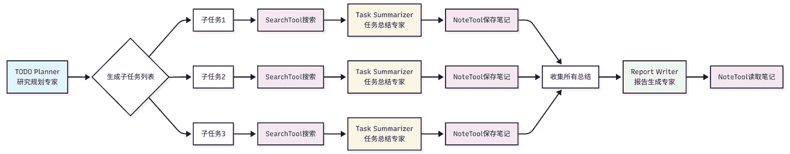

图 14.6 Agent 协作流程

顺序协作模式的特点是：

1.  线性流程：Agent 按照固定的顺序执行

1.  明确的输入输出：每个 Agent 的输入来自上一个 Agent 的输出

1.  无并发：同一时间只有一个 Agent 在工作

DeepResearchAgent是整个系统的核心协调器，负责调度三个 Agent：

```
class DeepResearchAgent:def run(self, research_topic: str) -&gt; str:# 1. 规划阶段
        self._emit_event({&quot;type&quot;: &quot;status&quot;, &quot;message&quot;: &quot;正在规划研究任务...&quot;})
        todo_list = self.planner.plan_todo_list(research_topic)
        self._emit_event({&quot;type&quot;: &quot;tasks&quot;, &quot;tasks&quot;: todo_list})# 2. 执行阶段
        task_summaries = []for task in todo_list:
            self._emit_event({&quot;type&quot;: &quot;status&quot;,&quot;message&quot;: f&quot;正在研究：{task.title}&quot;})# 搜索
            search_results = self.search_service.search(task.query)# 总结
            summary = self.summarizer.summarize_task(task, search_results)
            task_summaries.append((task, summary))
            
            self._emit_event({&quot;type&quot;: &quot;task_completed&quot;,&quot;task_id&quot;: task.id})# 3. 报告阶段
        self._emit_event({&quot;type&quot;: &quot;status&quot;, &quot;message&quot;: &quot;正在生成报告...&quot;})
        report = self.reporter.generate_report(research_topic, task_summaries)
        self._emit_event({&quot;type&quot;: &quot;report&quot;, &quot;content&quot;: report})return reportCopy to clipboardErrorCopied
```

## [14.4 工具系统集成](https://datawhalechina.github.io/hello-agents/#/./chapter14/%E7%AC%AC%E5%8D%81%E5%9B%9B%E7%AB%A0%20%E8%87%AA%E5%8A%A8%E5%8C%96%E6%B7%B1%E5%BA%A6%E7%A0%94%E7%A9%B6%E6%99%BA%E8%83%BD%E4%BD%93?id=_144-%e5%b7%a5%e5%85%b7%e7%b3%bb%e7%bb%9f%e9%9b%86%e6%88%90)

### 14.4.1 SearchTool 扩展

在第七章中，我们实现了SearchTool的基础版本，集成了 Tavily 和 SerpApi 两个搜索引擎，展示了多源搜索的设计思想。在本章的深度研究助手中，我们进一步扩展了SearchTool的能力，新增了 DuckDuckGo、Perplexity、SearXNG 等搜索引擎，并实现了 Advanced 模式（组合多个搜索引擎）。搜索是深度研究助手最核心的功能，这些扩展使得系统能够适应不同的使用场景和需求。

如表 14.2 所示，这次增加的搜索引擎有不同的特点和适用场景。

表 14.2 多搜索引擎对比

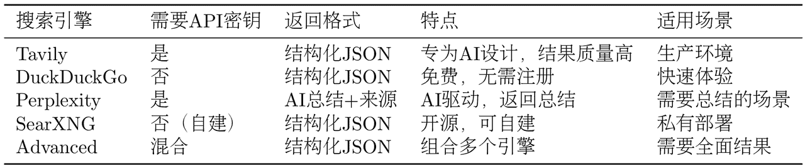

我们不再单独讨论如何扩展，可以参考源码以及第七章的拓展案例实现。SearchTool提供了统一的搜索接口，无论使用哪个搜索引擎，调用方式都是一样的。

在深度研究助手中，我们通过配置文件选择搜索引擎：

```
# config.pyclass SearchAPI(str, Enum):
    TAVILY = &quot;tavily&quot;
    DUCKDUCKGO = &quot;duckduckgo&quot;
    PERPLEXITY = &quot;perplexity&quot;
    SEARXNG = &quot;searxng&quot;
    ADVANCED = &quot;advanced&quot;class Configuration(BaseModel):
    search_api: SearchAPI = SearchAPI.DUCKDUCKGO
    # ...Copy to clipboardErrorCopied
```

```
# .env
SEARCH_API=tavilyCopy to clipboardErrorCopied
```

这样，用户可以通过修改.env文件来选择搜索引擎，无需修改代码。

SearchTool返回的结果是一个字典，包含：

+   results：搜索结果列表，每个结果包含标题、URL、摘要

+   backend：使用的搜索引擎

+   answer：AI 生成的答案（仅 Perplexity）

+   notices：通知信息（如 API 限制、错误等）

以下是一些特殊情况的处理。

搜索结果可能包含重复的 URL，我们需要去重：

```
def deduplicate_sources(sources: List[dict]) -&gt; List[dict]:&quot;&quot;&quot;去除重复的URL&quot;&quot;&quot;
    seen_urls = set()
    unique_sources = []for source in sources:if source[&quot;url&quot;] not in seen_urls:
            seen_urls.add(source[&quot;url&quot;])
            unique_sources.append(source)return unique_sourcesCopy to clipboardErrorCopied
```

搜索结果可能包含大量文本，我们需要限制每个来源的 Token 数量：

```
def limit_source_tokens(source: dict, max_tokens: int = 2000) -&gt; dict:&quot;&quot;&quot;限制来源的Token数量&quot;&quot;&quot;
    snippet = source[&quot;snippet&quot;]# 简单的Token估算：1个Token约等于4个字符
    max_chars = max_tokens * 4if len(snippet) &gt; max_chars:
        snippet = snippet[:max_chars] + &quot;...&quot;return {**source,&quot;snippet&quot;: snippet
    }Copy to clipboardErrorCopied
```

### 14.4.2 NoteTool 使用

在深度研究助手中，我们使用NoteTool来持久化研究进度。NoteTool是第九章集成的内置工具，用于创建、读取、更新和删除笔记。

在研究过程中，我们需要记录每个子任务的搜索结果、总结以及最终的研究报告。这些信息需要持久化到磁盘，以便在研究过程中断时能够从上次的进度继续，同时也方便查看研究过程中的所有操作，分析研究的质量和效率。

NoteTool将笔记存储在指定的工作空间目录中，每个笔记是一个 Markdown 文件。笔记的文件名是任务 ID，内容包含任务标题、任务意图、搜索查询、搜索结果和总结。

最后生成的文件风格会是下面的树状图风格：

```
workspace/
├── notes/
│   ├── 1.md  # 任务1的笔记
│   ├── 2.md  # 任务2的笔记
│   ├── 3.md  # 任务3的笔记
│   └── ...
└── reports/
    └── final_report.md  # 最终报告Copy to clipboardErrorCopied
```

在深度研究助手中，我们使用NoteTool来记录每个子任务的研究进度：

```
class NotesService:def __init__(self, workspace: str):
        self.note_tool = NoteTool(workspace=workspace)def save_task_summary(
        self,
        task: TodoItem,
        search_results: List[dict],
        summary: str):&quot;&quot;&quot;保存任务总结&quot;&quot;&quot;# 格式化笔记内容
        content = self._format_note_content(
            task=task,
            search_results=search_results,
            summary=summary
        )# 创建笔记
        self.note_tool.run({&quot;action&quot;: &quot;create&quot;,&quot;title&quot;: f&quot;任务{task.id}：{task.title}&quot;,&quot;content&quot;: content,&quot;tags&quot;: [&quot;research&quot;, &quot;summary&quot;]})def _format_note_content(
        self,
        task: TodoItem,
        search_results: List[dict],
        summary: str) -&gt; str:&quot;&quot;&quot;格式化笔记内容&quot;&quot;&quot;
        content = f&quot;# 任务{task.id}：{task.title}\n\n&quot;
        content += f&quot;## 任务信息\n\n&quot;
        content += f&quot;- **意图**：{task.intent}\n&quot;
        content += f&quot;- **查询**：{task.query}\n\n&quot;
        
        content += f&quot;## 搜索结果\n\n&quot;for idx, result in enumerate(search_results, start=1):
            content += f&quot;[{idx}] {result[&#x27;title&#x27;]}\n&quot;
            content += f&quot;URL: {result[&#x27;url&#x27;]}\n&quot;
            content += f&quot;摘要: {result[&#x27;snippet&#x27;]}\n\n&quot;
        
        content += f&quot;## 总结\n\n{summary}\n&quot;return contentCopy to clipboardErrorCopied
```

### 14.4.3 ToolRegistry 工具管理

ToolRegistry是 HelloAgents 框架的工具注册表，同样也是在我们的第七章所支持，用于管理所有工具的注册和调用。在深度研究助手中，我们使用ToolRegistry来管理SearchTool和NoteTool。

在创建 Agent 之前，我们需要先注册工具：

```
from hello_agents import ToolAwareSimpleAgent
from hello_agents.tools import ToolRegistry
from hello_agents.tools import SearchTool
from hello_agents.tools import NoteTool

# 创建工具
search_tool = SearchTool(backend=&quot;hybrid&quot;)
note_tool = NoteTool(workspace=&quot;./workspace/notes&quot;)# 创建注册表
registry = ToolRegistry()# 注册工具
registry.register_tool(search_tool)
registry.register_tool(note_tool)# 创建Agent
agent = ToolAwareSimpleAgent(
    name=&quot;研究助手&quot;,
    system_prompt=&quot;你是一个研究助手&quot;,
    llm=llm,
    tool_registry=registry
)Copy to clipboardErrorCopied
```

当 Agent 需要调用工具时，它会生成工具调用指令，如图 14.7 所示。

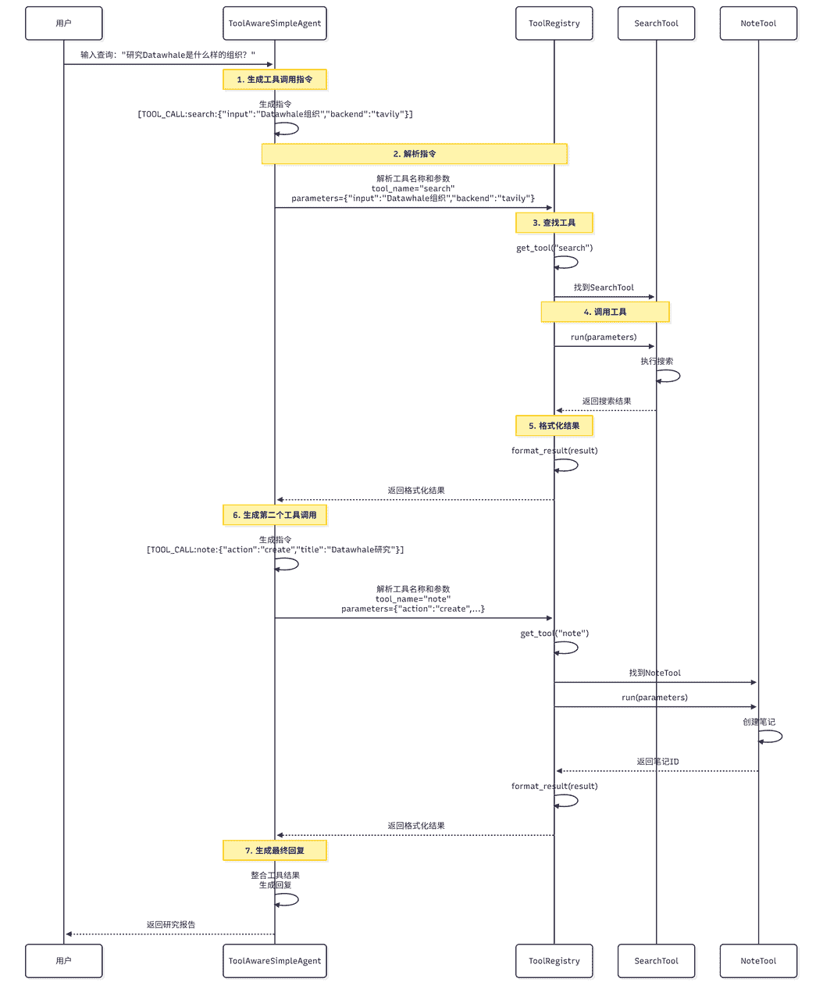

图 14.7 工具调用流程

**工具调用流程：

1.  Agent 生成指令：Agent 生成工具调用指令，如[TOOL_CALL:search_tool:{"input": "Datawhale组织", "backend": "tavily"}]

1.  解析指令：ToolRegistry解析指令，提取工具名称和参数

1.  查找工具：ToolRegistry根据工具名称查找对应的工具

1.  调用工具：调用工具的run方法，传入参数

1.  返回结果：工具返回执行结果

1.  格式化结果：将结果格式化为字符串，返回给 Agent

## [14.5 服务层实现](https://datawhalechina.github.io/hello-agents/#/./chapter14/%E7%AC%AC%E5%8D%81%E5%9B%9B%E7%AB%A0%20%E8%87%AA%E5%8A%A8%E5%8C%96%E6%B7%B1%E5%BA%A6%E7%A0%94%E7%A9%B6%E6%99%BA%E8%83%BD%E4%BD%93?id=_145-%e6%9c%8d%e5%8a%a1%e5%b1%82%e5%ae%9e%e7%8e%b0)

本节将详细介绍核心服务的实现，包括 PlanningService、SummarizationService、ReportingService 和 SearchService。这些服务是连接 Agent 和工具的桥梁，负责具体的业务逻辑。

### [14.5.1 任务规划服务](https://datawhalechina.github.io/hello-agents/#/./chapter14/%E7%AC%AC%E5%8D%81%E5%9B%9B%E7%AB%A0%20%E8%87%AA%E5%8A%A8%E5%8C%96%E6%B7%B1%E5%BA%A6%E7%A0%94%E7%A9%B6%E6%99%BA%E8%83%BD%E4%BD%93?id=_1451-%e4%bb%bb%e5%8a%a1%e8%a7%84%e5%88%92%e6%9c%8d%e5%8a%a1)

PlanningService负责调用研究规划 Agent，将研究主题分解为子任务。这是整个研究流程的第一步，也是最关键的一步。

（1）方案实现

它的核心职责是：

1.  构建规划 Prompt：根据研究主题和当前日期构建 Prompt

1.  调用规划 Agent：调用 TODO Planner Agent 生成子任务列表

1.  解析 JSON 响应：从 Agent 的响应中提取 JSON 格式的子任务列表

1.  验证子任务格式**：确保每个子任务包含必需的字段（title、intent、query）

```
import re
import json
from typing import List, Callable, Optional
from datetime import datetime

from hello_agents import HelloAgentsLLM
from hello_agents import ToolAwareSimpleAgent
from models import TodoItem, SummaryState
from prompts import todo_planner_instructions

class PlanningService:&quot;&quot;&quot;任务规划服务&quot;&quot;&quot;def __init__(
        self,
        llm: HelloAgentsLLM,
        tool_call_listener: Optional[Callable] = None):
        self._llm = llm
        self._tool_call_listener = tool_call_listener

        # 创建规划Agent
        self._agent = ToolAwareSimpleAgent(
            name=&quot;TODO Planner&quot;,
            system_prompt=&quot;你是一个研究规划专家，擅长将复杂的研究主题分解为清晰的子任务。&quot;,
            llm=llm,
            tool_call_listener=tool_call_listener
        )def plan_todo_list(self, state: SummaryState) -&gt; List[TodoItem]:&quot;&quot;&quot;规划TODO列表

        Args:
            state: 研究状态，包含研究主题

        Returns:
            子任务列表
        &quot;&quot;&quot;# 构建Prompt
        prompt = todo_planner_instructions.format(
            current_date=self._get_current_date(),
            research_topic=state.research_topic,)# 调用Agent
        response = self._agent.run(prompt)# 解析JSON
        tasks_payload = self._extract_tasks(response)# 验证并创建TodoItem
        todo_items = []for idx, item in enumerate(tasks_payload, start=1):# 验证必需字段if not all(key in item for key in [&quot;title&quot;, &quot;intent&quot;, &quot;query&quot;]):raise ValueError(f&quot;任务{idx}缺少必需字段&quot;)

            task = TodoItem(id=idx,
                title=item[&quot;title&quot;],
                intent=item[&quot;intent&quot;],
                query=item[&quot;query&quot;],)
            todo_items.append(task)return todo_items

    def _get_current_date(self) -&gt; str:&quot;&quot;&quot;获取当前日期&quot;&quot;&quot;return datetime.now().strftime(&quot;%Y年%m月%d日&quot;)def _extract_tasks(self, response: str) -&gt; List[dict]:&quot;&quot;&quot;从Agent响应中提取JSON

        Agent的响应可能包含额外的文本，如：
        &quot;好的，我将为您规划以下任务：\n[{...}, {...}]\n这些任务涵盖了...&quot;

        我们需要提取其中的JSON部分。
        &quot;&quot;&quot;# 方法1：使用正则表达式提取JSON数组
        json_match = re.search(r&#x27;\[.*\]&#x27;, response, re.DOTALL)if json_match:
            json_str = json_match.group(0)try:return json.loads(json_str)except json.JSONDecodeError as e:raise ValueError(f&quot;JSON解析失败：{e}&quot;)# 方法2：如果没有找到JSON数组，尝试直接解析整个响应try:return json.loads(response)except json.JSONDecodeError:raise ValueError(&quot;无法从响应中提取JSON&quot;)Copy to clipboardErrorCopied
```

（2）JSON 解析与验证

Agent 返回的 JSON 可能包含额外的文本或格式错误，我们需要 robust 的解析逻辑：

常见问题：

1.  包含额外文本：Agent 可能在 JSON 前后添加说明文字

1.  格式错误：JSON 可能缺少引号、逗号等

1.  字段缺失：某些子任务可能缺少必需字段

解决方案：

1.  使用正则表达式：提取 JSON 部分

1.  多种解析策略：先尝试提取 JSON 数组，再尝试直接解析

1.  字段验证：确保每个子任务包含必需字段

示例：

```
# Agent响应示例1：包含额外文本
response1 = &quot;&quot;&quot;
好的，我将为您规划以下任务：

[
  {
    &quot;title&quot;: &quot;什么是多模态模型&quot;,
    &quot;intent&quot;: &quot;了解基础概念&quot;,
    &quot;query&quot;: &quot;multimodal model definition&quot;
  },
  {
    &quot;title&quot;: &quot;最新的多模态模型&quot;,
    &quot;intent&quot;: &quot;了解技术现状&quot;,
    &quot;query&quot;: &quot;latest multimodal models 2024&quot;
  }
]

这些任务涵盖了Datawhale组织的基本信息和核心项目。
&quot;&quot;&quot;# 提取JSON
tasks1 = service._extract_tasks(response1)# 结果：[{&quot;title&quot;: &quot;Datawhale的基本信息&quot;, ...}, ...]# Agent响应示例2：纯JSON
response2 = &quot;&quot;&quot;
[
  {&quot;title&quot;: &quot;Datawhale的基本信息&quot;, &quot;intent&quot;: &quot;了解组织定位&quot;, &quot;query&quot;: &quot;Datawhale organization introduction&quot;},
  {&quot;title&quot;: &quot;Datawhale的主要项目&quot;, &quot;intent&quot;: &quot;了解核心内容&quot;, &quot;query&quot;: &quot;Datawhale projects tutorials 2024&quot;}
]
&quot;&quot;&quot;# 提取JSON
tasks2 = service._extract_tasks(response2)# 结果：[{&quot;title&quot;: &quot;什么是多模态模型&quot;, ...}, ...]Copy to clipboardErrorCopied
```

（3）规划质量评估

一个好的规划应该满足以下标准：

1.  覆盖全面：涵盖主题的所有重要方面

1.  逻辑清晰：子任务之间有明确的逻辑关系

1.  查询精准：搜索查询能够准确找到相关资料

1.  数量适中：3-5 个子任务

我们可以添加一个评估方法：

```
def evaluate_plan(self, todo_items: List[TodoItem]) -&gt; dict:&quot;&quot;&quot;评估规划质量

    Returns:
        评估结果，包含分数和建议
    &quot;&quot;&quot;
    score = 100
    suggestions = []# 检查数量if len(todo_items) &lt; 3:
        score -= 20
        suggestions.append(&quot;子任务数量过少，可能遗漏重要信息&quot;)elif len(todo_items) &gt; 5:
        score -= 10
        suggestions.append(&quot;子任务数量过多，可能存在冗余&quot;)# 检查查询质量for task in todo_items:if len(task.query.split()) &lt; 2:
            score -= 10
            suggestions.append(f&quot;任务「{task.title}」的查询过于简单&quot;)# 检查逻辑关系# （这里可以添加更复杂的逻辑检查）return {&quot;score&quot;: score,&quot;suggestions&quot;: suggestions
    }Copy to clipboardErrorCopied
```

### [14.5.2 总结服务](https://datawhalechina.github.io/hello-agents/#/./chapter14/%E7%AC%AC%E5%8D%81%E5%9B%9B%E7%AB%A0%20%E8%87%AA%E5%8A%A8%E5%8C%96%E6%B7%B1%E5%BA%A6%E7%A0%94%E7%A9%B6%E6%99%BA%E8%83%BD%E4%BD%93?id=_1452-%e6%80%bb%e7%bb%93%e6%9c%8d%e5%8a%a1)

SummarizationService负责调用任务总结 Agent，总结搜索结果。这是研究流程的核心环节，决定了研究的质量。

它的职责是：

1.  格式化搜索结果：将搜索结果格式化为易读的文本

1.  构建总结 Prompt：根据任务信息和搜索结果构建 Prompt

1.  调用总结 Agent：调用 Task Summarizer Agent 生成总结

1.  提取来源引用：从总结中提取来源引用

核心代码：

```
from typing import List, Callable, Optional, Tuple

from hello_agents import HelloAgentsLLM
from hello_agents import ToolAwareSimpleAgent
from models import TodoItem
from prompts import task_summarizer_instructions

class SummarizationService:&quot;&quot;&quot;总结服务&quot;&quot;&quot;def __init__(
        self,
        llm: HelloAgentsLLM,
        tool_call_listener: Optional[Callable] = None):
        self._llm = llm
        self._tool_call_listener = tool_call_listener

        # 创建总结Agent
        self._agent = ToolAwareSimpleAgent(
            name=&quot;Task Summarizer&quot;,
            system_prompt=&quot;你是一个任务总结专家，擅长从搜索结果中提取关键信息。&quot;,
            llm=llm,
            tool_call_listener=tool_call_listener
        )def summarize_task(
        self,
        task: TodoItem,
        search_results: List[dict]) -&gt; Tuple[str, List[str]]:&quot;&quot;&quot;总结任务

        Args:
            task: 任务信息
            search_results: 搜索结果列表

        Returns:
            (总结文本, 来源URL列表)
        &quot;&quot;&quot;# 格式化搜索结果
        formatted_sources = self._format_sources(search_results)# 构建Prompt
        prompt = task_summarizer_instructions.format(
            task_title=task.title,
            task_intent=task.intent,
            task_query=task.query,
            search_results=formatted_sources,)# 调用Agent
        summary = self._agent.run(prompt)# 提取来源URL
        source_urls = [result[&quot;url&quot;] for result in search_results]return summary, source_urls

    def _format_sources(self, search_results: List[dict]) -&gt; str:&quot;&quot;&quot;格式化搜索结果

        将搜索结果格式化为易读的文本，包含：
        - 序号
        - 标题

### 报告结构设计

最终报告应该包含以下部分，.......## 参考文献### 任务1：什么是多模态模型- https://example.com/multimodal-model-definition
....### 任务2：最新的多模态模型有哪些- https://example.com/gpt4v
.......Copy to clipboardErrorCopied
```

### [14.5.3 报告生成服务](https://datawhalechina.github.io/hello-agents/#/./chapter14/%E7%AC%AC%E5%8D%81%E5%9B%9B%E7%AB%A0%20%E8%87%AA%E5%8A%A8%E5%8C%96%E6%B7%B1%E5%BA%A6%E7%A0%94%E7%A9%B6%E6%99%BA%E8%83%BD%E4%BD%93?id=_1453-%e6%8a%a5%e5%91%8a%e7%94%9f%e6%88%90%e6%9c%8d%e5%8a%a1)

ReportingService负责调用报告生成 Agent，整合所有子任务的总结。这是研究流程的最后一步，生成最终的研究报告。

它的职责是：

1.  格式化子任务总结：将所有子任务的总结格式化为统一的格式

1.  构建报告 Prompt：根据研究主题和子任务总结构建 Prompt

1.  调用报告 Agent：调用 Report Writer Agent 生成最终报告

1.  整理引用：将所有来源引用整理到参考文献部分

核心代码实现：

```
from typing import List, Callable, Optional, Tuple

from hello_agents import HelloAgentsLLM
from hello_agents import ToolAwareSimpleAgent
from models import TodoItem
from prompts import report_writer_instructions

class ReportingService:&quot;&quot;&quot;报告生成服务&quot;&quot;&quot;def __init__(
        self,
        llm: HelloAgentsLLM,
        tool_call_listener: Optional[Callable] = None):
        self._llm = llm
        self._tool_call_listener = tool_call_listener

        # 创建报告Agent
        self._agent = ToolAwareSimpleAgent(
            name=&quot;Report Writer&quot;,
            system_prompt=&quot;你是一个报告撰写专家，擅长整合信息并生成结构化的报告。&quot;,
            llm=llm,
            tool_call_listener=tool_call_listener
        )def generate_report(
        self,
        research_topic: str,
        task_summaries: List[Tuple[TodoItem, str, List[str]]]) -&gt; str:&quot;&quot;&quot;生成最终报告

        Args:
            research_topic: 研究主题
            task_summaries: 子任务总结列表，每个元素是(任务, 总结, 来源URL列表)

        Returns:
            最终报告（Markdown格式）
        &quot;&quot;&quot;# 格式化子任务总结
        formatted_summaries = self._format_summaries(task_summaries)# 构建Prompt
        prompt = report_writer_instructions.format(
            research_topic=research_topic,
            task_summaries=formatted_summaries,)# 调用Agent
        report = self._agent.run(prompt)return report

    def _format_summaries(
        self,
        task_summaries: List[Tuple[TodoItem, str, List[str]]]) -&gt; str:&quot;&quot;&quot;格式化子任务总结

        将所有子任务的总结格式化为统一的格式，包含：
        - 任务序号
        - 任务标题
        - 任务意图
        - 总结内容
        - 来源URL
        &quot;&quot;&quot;
        formatted = []for idx, (task, summary, source_urls) in enumerate(task_summaries, start=1):
            formatted.append(f&quot;## 任务{idx}：{task.title}\n\n&quot;f&quot;**意图**：{task.intent}\n\n&quot;f&quot;{summary}\n\n&quot;f&quot;**来源**：\n&quot;)for url in source_urls:
                formatted.append(f&quot;- {url}\n&quot;)
            formatted.append(&quot;\n&quot;)return &quot;&quot;.join(formatted)Copy to clipboardErrorCopied
```

### [14.5.4 搜索调度服务](https://datawhalechina.github.io/hello-agents/#/./chapter14/%E7%AC%AC%E5%8D%81%E5%9B%9B%E7%AB%A0%20%E8%87%AA%E5%8A%A8%E5%8C%96%E6%B7%B1%E5%BA%A6%E7%A0%94%E7%A9%B6%E6%99%BA%E8%83%BD%E4%BD%93?id=_1454-%e6%90%9c%e7%b4%a2%e8%b0%83%e5%ba%a6%e6%9c%8d%e5%8a%a1)

SearchService负责调度搜索引擎，执行搜索并返回结果。这是连接 Agent 和 SearchTool 的桥梁。在这里我们没有采用往常一样的使得 simpleAgent 直接调用工具的形式，而是将 SearchTool 的执行结果通过中间层来返回给 Agent，这样会使得 Agent 更加专注处理得到的信息。

它的职责是：

1.  调度搜索引擎：根据配置选择搜索引擎

1.  执行搜索：调用 SearchTool 执行搜索

1.  处理结果：去重、限制 Token、格式化

1.  错误处理：处理搜索失败的情况

核心代码：

```
from typing import List, Optional
import logging

from hello_agents.tools import SearchTool
from config import Configuration

logger = logging.getLogger(__name__)class SearchService:&quot;&quot;&quot;搜索调度服务&quot;&quot;&quot;def __init__(self, config: Configuration):
        self.config = config

        # 创建SearchTool
        self.search_tool = SearchTool(backend=&quot;hybrid&quot;)def search(
        self,
        query: str,
        max_results: int = 5) -&gt; List[dict]:&quot;&quot;&quot;执行搜索

        Args:
            query: 搜索查询
            max_results: 最大结果数量

        Returns:
            搜索结果列表
        &quot;&quot;&quot;try:# 调用SearchTool
            raw_response = self.search_tool.run({&quot;input&quot;: query,&quot;backend&quot;: self.config.search_api.value,&quot;mode&quot;: &quot;structured&quot;,&quot;max_results&quot;: max_results
            })# 提取结果
            results = raw_response.get(&quot;results&quot;, [])# 处理结果
            results = self._deduplicate_sources(results)
            results = self._limit_source_tokens(results)

            logger.info(f&quot;搜索成功：{query}，返回{len(results)}个结果&quot;)return results

        except Exception as e:
            logger.error(f&quot;搜索失败：{query}，错误：{e}&quot;)return []def _deduplicate_sources(self, sources: List[dict]) -&gt; List[dict]:&quot;&quot;&quot;去除重复的URL&quot;&quot;&quot;
        seen_urls = set()
        unique_sources = []for source in sources:
            url = source.get(&quot;url&quot;, &quot;&quot;)if url and url not in seen_urls:
                seen_urls.add(url)
                unique_sources.append(source)return unique_sources

    def _limit_source_tokens(
        self,
        sources: List[dict],
        max_tokens_per_source: int = 2000) -&gt; List[dict]:&quot;&quot;&quot;限制每个来源的Token数量&quot;&quot;&quot;
        limited_sources = []for source in sources:
            snippet = source.get(&quot;snippet&quot;, &quot;&quot;)# 简单的Token估算：1个Token约等于4个字符
            max_chars = max_tokens_per_source * 4if len(snippet) &gt; max_chars:
                snippet = snippet[:max_chars] + &quot;...&quot;

            limited_sources.append({**source,&quot;snippet&quot;: snippet
            })return limited_sourcesCopy to clipboardErrorCopied
```

根据配置选择搜索引擎，如图 14.8 所示：

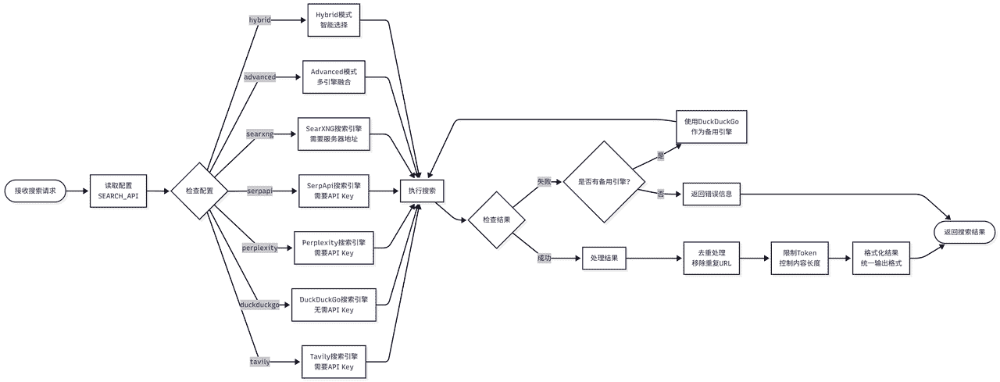

图 14.8 搜索引擎调度流程

**调度逻辑：

1.  读取配置：从.env文件读取SEARCH_API配置

1.  选择引擎：根据配置选择搜索引擎（tavily、duckduckgo、perplexity 等）

1.  执行搜索：调用 SearchTool 执行搜索

1.  处理结果：去重、限制 Token、格式化

1.  返回结果：返回处理后的搜索结果

为了提高效率和降低成本，我们可以添加搜索结果缓存：

import hashlib

import json

from pathlib import Path

class SearchService:def init(self, config: Configuration):

self.config = config

self.search_tool = SearchTool(backend="hybrid")# 缓存目录

self.cache_dir = Path("./cache/search")

self.cache_dir.mkdir(parents=True, exist_ok=True)def search(

self,

query: str,

max_results: int = 5,

use_cache: bool = True) -> List[dict]:"""执行搜索（带缓存）"""# 生成缓存键

cache_key = self._generate_cache_key(query, max_results)

cache_file = self.cache_dir / f"{cache_key}.json"# 尝试从缓存读取if use_cache and cache_file.exists():

logger.info(f"从缓存读取搜索结果：{query}")with open(cache_file, "r", encoding="utf-8") as f:return json.load(f)# 执行搜索

results = self._execute_search(query, max_results)# 保存到缓存if use_cache and results:with open(cache_file, "w", encoding="utf-8") as f:

json.dump(results, f, ensure_ascii=False, indent=2)return results

def _generate_cache_key(self, query: str, max_results: int) -> str:"""生成缓存键"""# 使用查询和最大结果数生成MD5哈希

content = f"{query}_{max_results}_{self.config.search_api.value}"return hashlib.md5(content.encode()).hexdigest()Copy to clipboardErrorCopied

通过四个核心服务（PlanningService、SummarizationService、ReportingService、SearchService），我们构建了一个完整的研究流程。这些服务各司其职，通过清晰的接口协作，实现了从研究主题到最终报告的自动化流程。

## [14.6 前端交互设计](https://datawhalechina.github.io/hello-agents/#/./chapter14/%E7%AC%AC%E5%8D%81%E5%9B%9B%E7%AB%A0%20%E8%87%AA%E5%8A%A8%E5%8C%96%E6%B7%B1%E5%BA%A6%E7%A0%94%E7%A9%B6%E6%99%BA%E8%83%BD%E4%BD%93?id=_146-%e5%89%8d%e7%ab%af%e4%ba%a4%e4%ba%92%e8%ae%be%e8%ae%a1)

在前面的章节中，我们实现了完整的后端系统。本节将详细介绍前端交互设计，包括全屏模态对话框 UI、实时进度展示和研究结果可视化。

### 14.6.1 全屏模态对话框 UI 设计

深度研究助手采用全屏模态对话框的 UI 设计，这种设计有以下优势：

1.  沉浸式体验：全屏显示，避免干扰，专注于研究

1.  清晰的层次：主页面和研究页面分离，层次清晰

1.  易于关闭：点击关闭按钮或按 ESC 键即可返回主页面

1.  响应式设计：适配不同屏幕尺寸

如图 14.9 所示，全屏模态对话框包含以下部分：

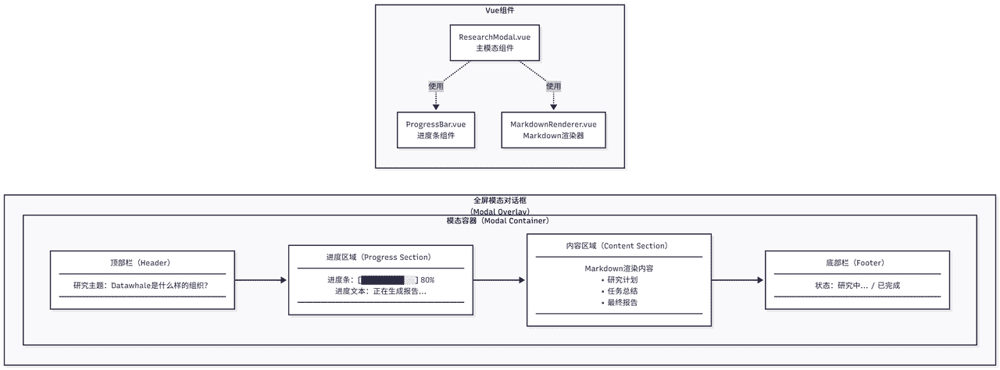

图 14.9 全屏模态对话框 UI

UI 组件：

1.  顶部栏：包含研究主题和关闭按钮

1.  进度区域：显示当前研究进度（规划、执行、报告）

1.  内容区域：显示研究结果（Markdown 格式）

1.  底部栏**：显示状态信息（如"研究中..."、"已完成"）

对应的 Vue 实现如下所示(ResearchModal.vue):

```
&lt;template&gt;&lt;div v-if=&quot;isOpen&quot; class=&quot;modal-overlay&quot; @click.self=&quot;close&quot;&gt;&lt;div class=&quot;modal-container&quot;&gt;&lt;!-- 顶部栏 --&gt;&lt;div class=&quot;modal-header&quot;&gt;&lt;h2&gt;{{ researchTopic }}&lt;/h2&gt;&lt;button @click=&quot;close&quot; class=&quot;close-button&quot;&gt;&lt;svg&gt;&lt;!-- 关闭图标 --&gt;&lt;/svg&gt;&lt;/button&gt;&lt;/div&gt;&lt;!-- 进度区域 --&gt;&lt;div class=&quot;progress-section&quot;&gt;&lt;div class=&quot;progress-bar&quot;&gt;&lt;div 
            class=&quot;progress-fill&quot; 
            :style=&quot;{ width: progressPercentage + &#x27;%&#x27; }&quot;&gt;&lt;/div&gt;&lt;/div&gt;&lt;div class=&quot;progress-text&quot;&gt;{{ progressText }}&lt;/div&gt;&lt;/div&gt;&lt;!-- 内容区域 --&gt;&lt;div class=&quot;content-section&quot;&gt;&lt;div v-if=&quot;isLoading&quot; class=&quot;loading-spinner&quot;&gt;&lt;div class=&quot;spinner&quot;&gt;&lt;/div&gt;&lt;p&gt;研究中，请稍候...&lt;/p&gt;&lt;/div&gt;&lt;div v-else class=&quot;markdown-content&quot; v-html=&quot;renderedMarkdown&quot;&gt;&lt;/div&gt;&lt;/div&gt;&lt;!-- 底部栏 --&gt;&lt;div class=&quot;modal-footer&quot;&gt;&lt;span class=&quot;status-text&quot;&gt;{{ statusText }}&lt;/span&gt;&lt;/div&gt;&lt;/div&gt;&lt;/div&gt;&lt;/template&gt;&lt;script setup lang=&quot;ts&quot;&gt;import { ref, computed, watch } from &#x27;vue&#x27;import { marked } from &#x27;marked&#x27;interface Props {isOpen: boolean
  researchTopic: string
}const props = defineProps&lt;Props&gt;()const emit = defineEmits&lt;{close: []}&gt;()// 状态const isLoading = ref(true)const progressPercentage = ref(0)const progressText = ref(&#x27;准备中...&#x27;)const statusText = ref(&#x27;研究中...&#x27;)const markdownContent = ref(&#x27;&#x27;)// 渲染Markdownconst renderedMarkdown = computed(() =&gt; {return marked(markdownContent.value)})// 关闭模态框const close = () =&gt; {emit(&#x27;close&#x27;)}// 监听ESC键const handleKeydown = (e: KeyboardEvent) =&gt; {if (e.key === &#x27;Escape&#x27;) {close()}}// 挂载时添加键盘监听watch(() =&gt; props.isOpen, (isOpen) =&gt; {if (isOpen) {
    document.addEventListener(&#x27;keydown&#x27;, handleKeydown)} else {
    document.removeEventListener(&#x27;keydown&#x27;, handleKeydown)}})&lt;/script&gt;&lt;style scoped&gt;.modal-overlay {position: fixed;top: 0;left: 0;width: 100vw;height: 100vh;background-color: rgba(0, 0, 0, 0.5);display: flex;justify-content: center;align-items: center;z-index: 1000;}
......
&lt;/style&gt;Copy to clipboardErrorCopied
```

为了适配不同屏幕尺寸，我们添加媒体查询：

```
/* 平板设备 */@media (max-width: 768px) {.modal-container {width: 95vw;height: 95vh;}.modal-header,
  .progress-section,
  .content-section,
  .modal-footer {padding: 15px 20px;}}/* 手机设备 */@media (max-width: 480px) {.modal-container {width: 100vw;height: 100vh;border-radius: 0;}.modal-header h2 {font-size: 18px;}}Copy to clipboardErrorCopied
```

### [14.6.2 实时进度展示](https://datawhalechina.github.io/hello-agents/#/./chapter14/%E7%AC%AC%E5%8D%81%E5%9B%9B%E7%AB%A0%20%E8%87%AA%E5%8A%A8%E5%8C%96%E6%B7%B1%E5%BA%A6%E7%A0%94%E7%A9%B6%E6%99%BA%E8%83%BD%E4%BD%93?id=_1462-%e5%ae%9e%e6%97%b6%e8%bf%9b%e5%ba%a6%e5%b1%95%e7%a4%ba)

深度研究助手使用 SSE 实现实时进度展示。SSE 是一种服务器推送技术，允许服务器主动向客户端发送数据，在协议章节也有所讲解。

如图 14.10 所示，SSE 流程包括以下步骤：

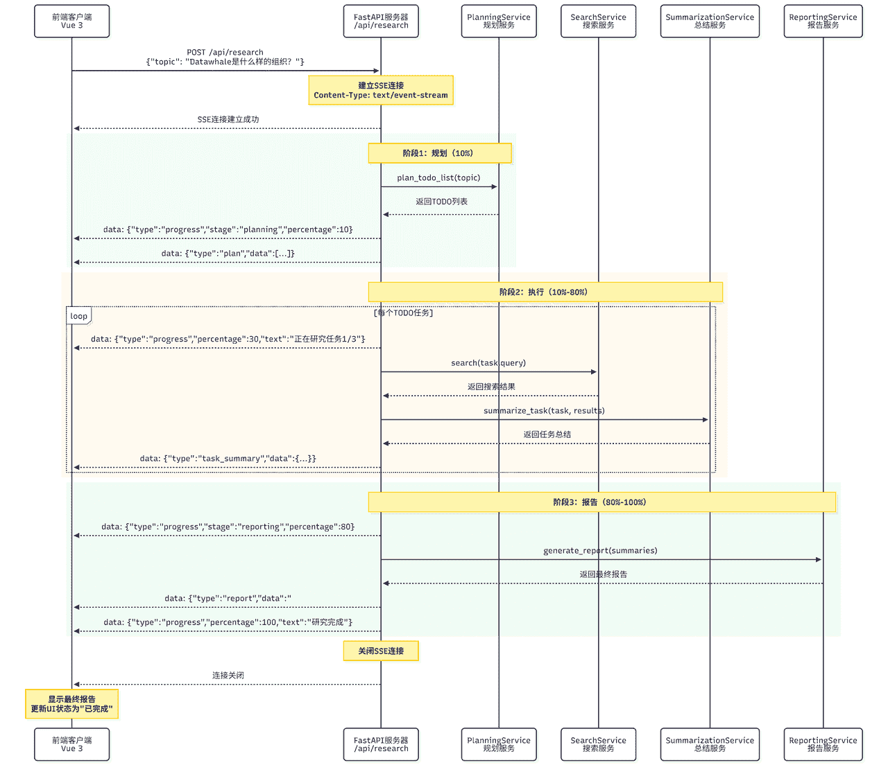

图 14.10 SSE 流程

流程说明：

1.  客户端发起请求：发送 POST 请求到/api/research，包含研究主题

1.  服务器建立 SSE 连接：返回text/event-stream响应

1.  服务器推送进度：定期推送研究进度（规划、执行、报告）

1.  客户端接收进度：监听 SSE 事件，更新 UI

1.  研究完成：服务器推送最终报告，关闭连接

如果想把 SSE 用于前后端的项目中还需要做如下配置。

后端 FastAPI SSE 端点：

```
from fastapi import FastAPI
from fastapi.responses import StreamingResponse
from typing import AsyncGenerator
import asyncio
import json

app = FastAPI()async def research_stream(topic: str) -&gt; AsyncGenerator[str, None]:&quot;&quot;&quot;研究流式生成器
    
    生成SSE格式的数据：
    data: {&quot;type&quot;: &quot;progress&quot;, &quot;data&quot;: {...}}
    
    &quot;&quot;&quot;try:# 1. 规划阶段yield f&quot;data: {json.dumps({&#x27;type&#x27;: &#x27;progress&#x27;, &#x27;stage&#x27;: &#x27;planning&#x27;, &#x27;percentage&#x27;: 10, &#x27;text&#x27;: &#x27;正在规划研究任务...&#x27;})}\n\n&quot;# 调用PlanningService
        todo_items = await planning_service.plan_todo_list(topic)yield f&quot;data: {json.dumps({&#x27;type&#x27;: &#x27;plan&#x27;, &#x27;data&#x27;: [item.dict() for item in todo_items]})}\n\n&quot;# 2. 执行阶段
        task_summaries = []for idx, task in enumerate(todo_items, start=1):# 更新进度
            percentage = 10 + (idx / len(todo_items)) * 70yield f&quot;data: {json.dumps({&#x27;type&#x27;: &#x27;progress&#x27;, &#x27;stage&#x27;: &#x27;executing&#x27;, &#x27;percentage&#x27;: percentage, &#x27;text&#x27;: f&#x27;正在研究任务{idx}/{len(todo_items)}：{task.title}&#x27;})}\n\n&quot;# 搜索
            search_results = await search_service.search(task.query)# 总结
            summary, source_urls = await summarization_service.summarize_task(task, search_results)
            
            task_summaries.append((task, summary, source_urls))# 推送任务总结yield f&quot;data: {json.dumps({&#x27;type&#x27;: &#x27;task_summary&#x27;, &#x27;task_id&#x27;: task.id, &#x27;summary&#x27;: summary})}\n\n&quot;# 3. 报告阶段yield f&quot;data: {json.dumps({&#x27;type&#x27;: &#x27;progress&#x27;, &#x27;stage&#x27;: &#x27;reporting&#x27;, &#x27;percentage&#x27;: 90, &#x27;text&#x27;: &#x27;正在生成最终报告...&#x27;})}\n\n&quot;# 生成报告
        report = await reporting_service.generate_report(topic, task_summaries)# 推送最终报告yield f&quot;data: {json.dumps({&#x27;type&#x27;: &#x27;report&#x27;, &#x27;data&#x27;: report})}\n\n&quot;# 完成yield f&quot;data: {json.dumps({&#x27;type&#x27;: &#x27;progress&#x27;, &#x27;stage&#x27;: &#x27;completed&#x27;, &#x27;percentage&#x27;: 100, &#x27;text&#x27;: &#x27;研究完成！&#x27;})}\n\n&quot;except Exception as e:# 错误处理yield f&quot;data: {json.dumps({&#x27;type&#x27;: &#x27;error&#x27;, &#x27;message&#x27;: str(e)})}\n\n&quot;@app.post(&quot;/api/research&quot;)async def research(request: ResearchRequest):&quot;&quot;&quot;研究端点（SSE）&quot;&quot;&quot;return StreamingResponse(
        research_stream(request.topic),
        media_type=&quot;text/event-stream&quot;,
        headers={&quot;Cache-Control&quot;: &quot;no-cache&quot;,&quot;Connection&quot;: &quot;keep-alive&quot;,})Copy to clipboardErrorCopied
```

前端使用 EventSource 接收 SSE：

```
// composables/useResearch.ts
import { ref } from &#x27;vue&#x27;

export function useResearch() {
  const isLoading = ref(false)
  const progressPercentage = ref(0)
  const progressText = ref(&#x27;&#x27;)
  const markdownContent = ref(&#x27;&#x27;)
  const error = ref&lt;string | null&gt;(null)
  
  const startResearch = (topic: string) =&gt; {
    isLoading.value = true
    error.value = null
    
    // 创建EventSource
    const eventSource = new EventSource(`/api/research?topic=${encodeURIComponent(topic)}`)
    
    // 监听消息
    eventSource.onmessage = (event) =&gt; {
      const data = JSON.parse(event.data)
      
      switch (data.type) {
        case &#x27;progress&#x27;:
          progressPercentage.value = data.percentage
          progressText.value = data.text
          break
          
        case &#x27;plan&#x27;:
          // 显示规划结果
          console.log(&#x27;规划结果:&#x27;, data.data)
          break
          
        case &#x27;task_summary&#x27;:
          // 追加任务总结到Markdown
          markdownContent.value += `\n\n## 任务${data.task_id}\n\n${data.summary}`
          break
          
        case &#x27;report&#x27;:
          // 显示最终报告
          markdownContent.value = data.data
          break
          
        case &#x27;error&#x27;:
          error.value = data.message
          eventSource.close()
          isLoading.value = false
          break
          
        case &#x27;completed&#x27;:
          eventSource.close()
          isLoading.value = false
          break
      }
    }
    
    // 错误处理
    eventSource.onerror = (err) =&gt; {
      console.error(&#x27;SSE错误:&#x27;, err)
      error.value = &#x27;连接失败，请重试&#x27;
      eventSource.close()
      isLoading.value = false
    }
  }
  
  return {
    isLoading,
    progressPercentage,
    progressText,
    markdownContent,
    error,
    startResearch,
  }
}Copy to clipboardErrorCopied
```

在组件中使用：

```
&lt;script setup lang=&quot;ts&quot;&gt;import { useResearch } from &#x27;@/composables/useResearch&#x27;const { 
  isLoading, 
  progressPercentage, 
  progressText, 
  markdownContent, 
  error,
  startResearch 
} = useResearch()const handleStartResearch = (topic: string) =&gt; {startResearch(topic)}&lt;/script&gt;Copy to clipboardErrorCopied
```

### [14.6.3 研究结果可视化](https://datawhalechina.github.io/hello-agents/#/./chapter14/%E7%AC%AC%E5%8D%81%E5%9B%9B%E7%AB%A0%20%E8%87%AA%E5%8A%A8%E5%8C%96%E6%B7%B1%E5%BA%A6%E7%A0%94%E7%A9%B6%E6%99%BA%E8%83%BD%E4%BD%93?id=_1463-%e7%a0%94%e7%a9%b6%e7%bb%93%e6%9e%9c%e5%8f%af%e8%a7%86%e5%8c%96)

研究结果以 Markdown 格式展示，包含标题、段落、列表、引用等元素。我们使用marked库将 Markdown 转换为 HTML，并添加自定义样式。

渲染 Markdown：

```
import { marked } from &#x27;marked&#x27;

// 配置marked
marked.setOptions({
  breaks: true,  // 支持换行
  gfm: true,     // 支持GitHub Flavored Markdown
})

// 渲染
const renderedHtml = marked(markdownContent.value)Copy to clipboardErrorCopied
```

研究报告中包含大量来源引用，我们需要特殊处理：

```
## 参考文献

### 任务1：Datawhale的基本信息
- [Datawhale GitHub](https://github.com/datawhalechina)
- [Datawhale 官网](https://datawhale.club)

### 任务2：Datawhale的主要项目
- [Hello-Agents 教程](https://github.com/datawhalechina/Hello-Agents)
......Copy to clipboardErrorCopied
```

通过全屏模态对话框 UI、SSE 实时进度展示和 Markdown 结果可视化，我们构建了一个用户友好的前端界面。用户可以清晰地看到研究进度，并以美观的格式查看研究结果。

## [14.7 本章小结](https://datawhalechina.github.io/hello-agents/#/./chapter14/%E7%AC%AC%E5%8D%81%E5%9B%9B%E7%AB%A0%20%E8%87%AA%E5%8A%A8%E5%8C%96%E6%B7%B1%E5%BA%A6%E7%A0%94%E7%A9%B6%E6%99%BA%E8%83%BD%E4%BD%93?id=_147-%e6%9c%ac%e7%ab%a0%e5%b0%8f%e7%bb%93)

在本章中，我们从零开始构建了一个完整的自动化深度研究智能体系统。让我们回顾一下核心要点：

（1）TODO 驱动的研究范式

我们提出了一种新的研究范式——TODO 驱动的研究。这种范式将复杂的研究主题分解为可执行的子任务，通过三个阶段完成研究：

+   规划阶段：将研究主题分解为 3-5 个子任务，每个子任务包含标题、意图和搜索查询

+   执行阶段：对每个子任务执行搜索和总结，生成结构化的知识

+   报告阶段：整合所有子任务的总结，生成最终的研究报告

这种范式的优势在于：

1.  可控性强：每个子任务都有明确的目标和范围

1.  质量可靠：通过专门的 Agent 保证每个环节的质量

1.  易于调试：可以单独调试每个子任务

1.  可扩展性好：可以轻松添加新的子任务或修改现有子任务

（2）三 Agent 协作系统

我们设计了三个专门的 Agent，各司其职：

+   TODO Planner（研究规划专家）：负责将研究主题分解为子任务

+   Task Summarizer（任务总结专家）：负责总结每个子任务的搜索结果

+   Report Writer（报告撰写专家）：负责整合所有子任务的总结，生成最终报告

这种设计的优势在于：

1.  职责清晰：每个 Agent 专注于一个特定的任务

1.  Prompt 优化：可以为每个 Agent 定制专门的 Prompt

1.  易于维护：修改一个 Agent 不会影响其他 Agent

1.  质量保证：每个 Agent 都是该领域的"专家"

（3）ToolAwareSimpleAgent 的设计

我们扩展了 HelloAgents 框架的SimpleAgent，实现了ToolAwareSimpleAgent。这个 Agent 具有工具调用监听能力，可以：

+   监听工具调用：通过回调函数监听每次工具调用

+   实时反馈：将工具调用信息实时推送给前端

+   调试支持：记录所有工具调用，便于调试

这个 Agent 已经集成到 HelloAgents 框架中，可以在其他项目中复用。

（4）工具系统集成

我们充分利用了 HelloAgents 框架的工具系统：

+   SearchTool：扩展支持更多种搜索引擎（Tavily、DuckDuckGo、Perplexity 等）

+   NoteTool：持久化研究进度，支持恢复和审计

+   ToolRegistry：统一管理所有工具，支持自定义扩展

通过配置化的设计，用户可以轻松切换搜索引擎，无需修改代码。

（5）核心服务实现

我们实现了四个核心服务，连接 Agent 和工具：

+   PlanningService：调用规划 Agent，解析 JSON，验证格式

+   SummarizationService：调用总结 Agent，处理搜索结果，提取来源

+   ReportingService：调用报告 Agent，整合总结，生成报告

+   SearchService：调度搜索引擎，处理结果，错误降级，结果缓存

这些服务各司其职，通过清晰的接口协作，实现了从研究主题到最终报告的自动化流程。

（6）前端交互设计

我们设计了用户友好的前端界面：

+   全屏模态对话框：沉浸式体验，清晰的层次

+   SSE 实时进度：实时展示研究进度，用户体验良好

+   Markdown 可视化：美观的格式，清晰的结构

通过 Vue 3 + TypeScript + SSE 的技术栈，我们实现了一个现代化的 Web 应用。

这些知识不仅适用于深度研究助手，也可以应用到其他 AI 应用中。希望读者能够在本章的基础上，探索更多的可能性，构建出更强大的 AI 系统。

在下一章中，我们将构建一个与游戏引擎结合的多 Agent 系统——赛博小镇，探索 Agent 之间的复杂交互和协作模式。敬请期待！