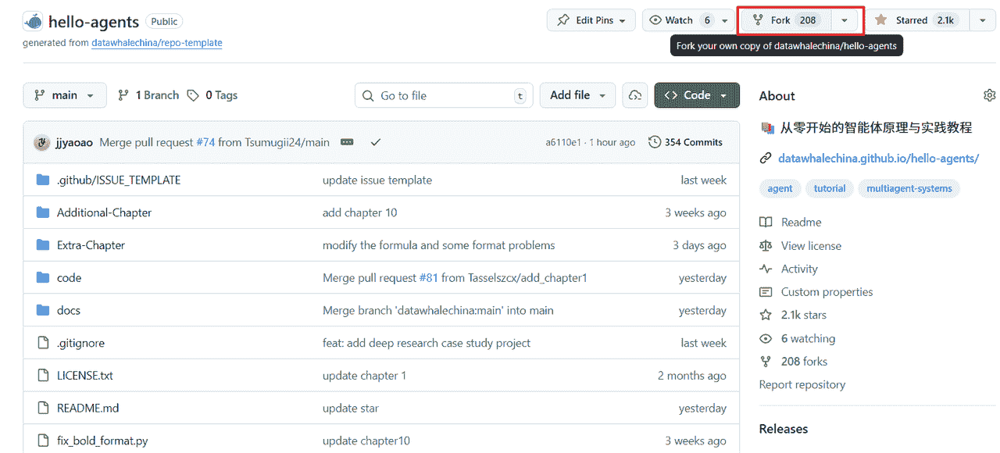
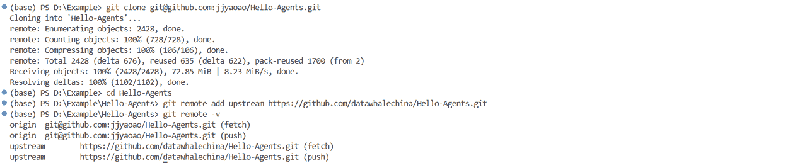
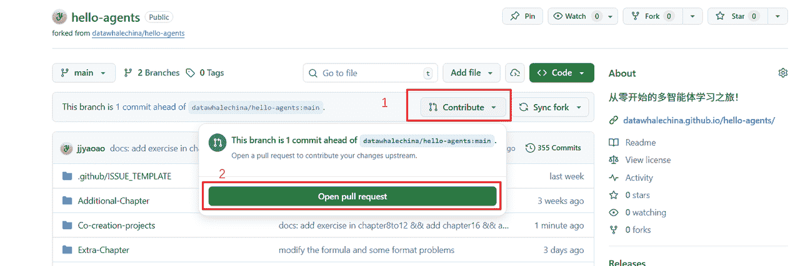
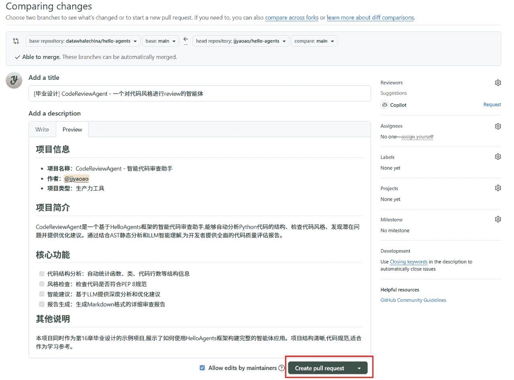

# 第十六章 毕业设计：构建属于你的多智能体应用

> 来源：[https://gotoaiworld.feishu.cn/docx/EFKxdk977oDZ2zxSjuTczmAanZd](https://gotoaiworld.feishu.cn/docx/EFKxdk977oDZ2zxSjuTczmAanZd)

恭喜你来到 Hello-Agents 教程的最后一章！在前面的 15 章中，我们从零开始构建了 HelloAgents 框架，学习了智能体的核心概念、多种范式、工具系统、记忆机制、通信协议、强化学习训练和性能评估等知识。在第 13-15 章中，我们还通过三个完整的实战项目（智能旅行助手、自动化深度研究智能体、赛博小镇）展示了如何将所学知识融会贯通。

现在，是时候让你成为真正的智能体系统构建者了！本章将指导你构建属于你自己的多智能体应用，并通过开源协作的方式与社区分享你的成果。

## [16.1 毕业设计的意义](https://datawhalechina.github.io/hello-agents/#/./chapter16/%E7%AC%AC%E5%8D%81%E5%85%AD%E7%AB%A0%20%E6%AF%95%E4%B8%9A%E8%AE%BE%E8%AE%A1?id=_161-%e6%af%95%e4%b8%9a%e8%ae%be%e8%ae%a1%e7%9a%84%e6%84%8f%e4%b9%89)

### 16.1.1 为什么要做毕业设计

学习技术最好的方式不是看教程，而是动手实践。通过前面章节的学习，你已经掌握了构建智能体系统的理论知识和技术工具。但是，真正的挑战在于：如何将这些知识应用到实际问题中？如何设计一个完整的系统？如何处理各种边界情况和异常？

毕业设计的核心价值在于培养你的综合应用能力，将前面学到的所有知识（智能体范式、工具系统、记忆机制、通信协议等）选择性的整合到一个完整的项目中。

通过本章的学习和实践，希望你能够独立设计并实现一个完整的智能体应用，熟练使用 HelloAgents 框架的各种功能，掌握 Git 和 GitHub 的基本操作，学会编写清晰的项目文档，参与开源社区的协作开发，最终获得一个可以展示的技术作品。

### [16.1.2 毕业设计的形式](https://datawhalechina.github.io/hello-agents/#/./chapter16/%E7%AC%AC%E5%8D%81%E5%85%AD%E7%AB%A0%20%E6%AF%95%E4%B8%9A%E8%AE%BE%E8%AE%A1?id=_1612-%e6%af%95%e4%b8%9a%e8%ae%be%e8%ae%a1%e7%9a%84%e5%bd%a2%e5%bc%8f)

你的毕业设计将以开源项目的形式提交到 Hello-Agents 的共创项目仓库（Co-creation-projects目录）。具体要求如下：

1.  项目命名：使用{你的GitHub用户名}-{项目名称}的格式，例如jjyaoao-CodeReviewAgent

1.  项目内容：

+   一个可运行的 Jupyter Notebook（.ipynb文件）或 Python 脚本

+   完整的依赖列表（requirements.txt）

+   清晰的 README 文档（README.md）

+   可选：演示视频、截图、数据集等

1.  提交方式：通过 GitHub 的 Pull Request（PR）提交

1.  评审流程：社区成员会 review 你的代码，提出改进建议，通过后合并到主仓库

## [16.2 项目选题指南](https://datawhalechina.github.io/hello-agents/#/./chapter16/%E7%AC%AC%E5%8D%81%E5%85%AD%E7%AB%A0%20%E6%AF%95%E4%B8%9A%E8%AE%BE%E8%AE%A1?id=_162-%e9%a1%b9%e7%9b%ae%e9%80%89%e9%a2%98%e6%8c%87%e5%8d%97)

### [16.2.1 选题原则](https://datawhalechina.github.io/hello-agents/#/./chapter16/%E7%AC%AC%E5%8D%81%E5%85%AD%E7%AB%A0%20%E6%AF%95%E4%B8%9A%E8%AE%BE%E8%AE%A1?id=_1621-%e9%80%89%e9%a2%98%e5%8e%9f%e5%88%99)

一个好的毕业设计项目应该具有实用性，解决真实的问题而不是为了技术而技术，我们需要追求在有限的时间和资源内可以完成，并且能够清晰地展示你的技术能力。

### [16.2.2 推荐选题方向](https://datawhalechina.github.io/hello-agents/#/./chapter16/%E7%AC%AC%E5%8D%81%E5%85%AD%E7%AB%A0%20%E6%AF%95%E4%B8%9A%E8%AE%BE%E8%AE%A1?id=_1622-%e6%8e%a8%e8%8d%90%e9%80%89%e9%a2%98%e6%96%b9%e5%90%91)

以下是一些推荐的项目方向，你可以选择其中一个，也可以自己提出新的想法：

（1）生产力工具类

+   智能代码审查助手：自动分析代码质量、发现潜在 bug、提出优化建议

+   智能文档生成器：根据代码自动生成 API 文档、用户手册

+   智能会议助手：记录会议内容、生成会议纪要、提取行动项

+   智能邮件助手：自动分类邮件、生成回复草稿、提醒重要事项

（2）学习辅助类

+   智能学习伙伴：根据学习进度推荐学习资源、生成练习题、答疑解惑

+   智能论文助手：帮助查找文献、总结论文、生成引用

+   智能编程导师：提供编程练习、代码 review、学习路径规划

+   智能语言学习助手：提供对话练习、语法纠错、词汇扩展

（3）创意娱乐类

+   智能故事生成器：根据用户输入生成小说、剧本、诗歌

+   智能游戏 NPC：创建有个性的游戏角色，能够与玩家自然对话

+   智能音乐推荐：根据心情、场景推荐音乐，生成播放列表

+   智能菜谱助手：根据食材、口味推荐菜谱，生成购物清单

（4）数据分析类

+   智能数据分析师：自动分析数据、生成可视化图表、撰写分析报告

+   智能股票分析：分析股票数据、新闻舆情，提供投资建议

+   智能舆情监控：监控社交媒体、新闻网站，分析舆情趋势

+   智能竞品分析：收集竞品信息、对比分析、生成报告

（5）生活服务类

+   智能健康助手：记录健康数据、提供健康建议、制定运动计划

+   智能理财助手：记录收支、分析消费习惯、提供理财建议

+   智能购物助手：比价、推荐商品、生成购物清单

+   智能家居控制：通过自然语言控制智能家居设备

### [16.2.3 选题示例](https://datawhalechina.github.io/hello-agents/#/./chapter16/%E7%AC%AC%E5%8D%81%E5%85%AD%E7%AB%A0%20%E6%AF%95%E4%B8%9A%E8%AE%BE%E8%AE%A1?id=_1623-%e9%80%89%e9%a2%98%e7%a4%ba%e4%be%8b)

让我们通过一个具体的例子来说明如何选题和设计项目。

项目名称：智能代码审查助手（CodeReviewAgent）

问题分析：代码审查是软件开发中的重要环节，但人工审查耗时且容易遗漏问题。现有的静态分析工具只能发现语法错误，无法理解代码逻辑，因此需要一个能够理解代码语义、提供深度分析的智能助手。

核心功能：该项目将实现代码质量分析（检查代码风格、命名规范、注释完整性）、潜在 bug 检测（发现逻辑错误、边界条件问题、资源泄漏）、性能优化建议（识别性能瓶颈、提出优化方案）、安全漏洞扫描（检测 SQL 注入、XSS 等安全问题）以及最佳实践推荐（根据语言特性和设计模式提出改进建议）。

预期成果：最终将交付一个可运行的 Jupyter Notebook 展示完整的审查流程，支持 Python、JavaScript 等主流语言，能够生成结构化的 Markdown 格式审查报告，并提供具体的代码示例和改进建议。

## [16.3 开发环境准备](https://datawhalechina.github.io/hello-agents/#/./chapter16/%E7%AC%AC%E5%8D%81%E5%85%AD%E7%AB%A0%20%E6%AF%95%E4%B8%9A%E8%AE%BE%E8%AE%A1?id=_163-%e5%bc%80%e5%8f%91%e7%8e%af%e5%a2%83%e5%87%86%e5%a4%87)

### [16.3.1 安装必要工具](https://datawhalechina.github.io/hello-agents/#/./chapter16/%E7%AC%AC%E5%8D%81%E5%85%AD%E7%AB%A0%20%E6%AF%95%E4%B8%9A%E8%AE%BE%E8%AE%A1?id=_1631-%e5%ae%89%e8%a3%85%e5%bf%85%e8%a6%81%e5%b7%a5%e5%85%b7)

在开始开发之前，请确保你的开发环境已经安装了以下工具：

（1）Python 环境

```
# 安装HelloAgents
pip install &quot;hello-agents[all]&quot;Copy to clipboardErrorCopied
```

（2）Git 和 GitHub

```
# 检查Git版本git --version# 配置Git用户信息git config --global user.name &quot;你的名字&quot;git config --global user.email &quot;你的邮箱&quot;# 配置GitHub SSH密钥（推荐）# 1. 生成SSH密钥
ssh-keygen -t ed25519 -C &quot;你的邮箱&quot;# 2. 将公钥添加到GitHub# 复制 ~/.ssh/id_ed25519.pub 的内容# 在GitHub Settings &gt; SSH and GPG keys 中添加# 3. 测试连接ssh -T git@github.comCopy to clipboardErrorCopied
```

（3）Jupyter Notebook

```
# 安装Jupyter
pip install jupyter notebook

# 或者使用JupyterLab（推荐）
pip install jupyterlab

# 启动Jupyter
jupyter labCopy to clipboardErrorCopied
```

### 16.3.2 Fork 项目仓库

步骤 1：Fork 仓库

1.  [访问 Hello-Agents 仓库：https:/](https://github.com/datawhalechina/Hello-Agents)/github.com/datawhalechina/Hello-Agents

1.  点击右上角的"Fork"按钮，如图 16.1 红色方框位置

1.  选择你的 GitHub 账号，创建 Fork



图 16.1 Fork 仓库步骤

步骤 2：克隆到本地

```
# 如图16.2所示，克隆你Fork的仓库git clone git@github.com:你的用户名/Hello-Agents.git

# 进入项目目录cd Hello-Agents

# 添加上游仓库（用于同步更新）git remote add upstream https://github.com/datawhalechina/Hello-Agents.git

# 查看远程仓库git remote -vCopy to clipboardErrorCopied
```



图 16.2 克隆仓库到本地

步骤 3：创建开发分支

```
# 创建并切换到新分支git checkout -b feature/你的项目名称

# 例如:git checkout -b feature/code-review-agentCopy to clipboardErrorCopied
```

### [16.3.3 项目目录结构](https://datawhalechina.github.io/hello-agents/#/./chapter16/%E7%AC%AC%E5%8D%81%E5%85%AD%E7%AB%A0%20%E6%AF%95%E4%B8%9A%E8%AE%BE%E8%AE%A1?id=_1633-%e9%a1%b9%e7%9b%ae%e7%9b%ae%e5%bd%95%e7%bb%93%e6%9e%84)

在Co-creation-projects目录下创建你的项目文件夹：

```
# 进入共创项目目录cd Co-creation-projects

# 创建项目文件夹（格式:GitHub用户名-项目名称）mkdir 你的用户名-项目名称

# 例如:mkdir jjyaoao-CodeReviewAgent

# 进入项目目录cd jjyaoao-CodeReviewAgentCopy to clipboardErrorCopied
```

推荐的项目结构：

```
jjyaoao-CodeReviewAgent/
├── README.md              # 项目说明文档
├── requirements.txt       # Python依赖列表
├── main.ipynb            # 主要的Jupyter Notebook
├── data/                 # 数据文件（可选）
│   ├── sample_code.py
│   └── test_cases.json
├── outputs/              # 输出结果（可选）
│   ├── review_report.md
│   └── screenshots/
├── src/                  # 源代码（可选，如果代码较多）
│   ├── agents/
│   ├── tools/
│   └── utils/
└──Copy to clipboardErrorCopied
```

## [16.4 项目开发指南](https://datawhalechina.github.io/hello-agents/#/./chapter16/%E7%AC%AC%E5%8D%81%E5%85%AD%E7%AB%A0%20%E6%AF%95%E4%B8%9A%E8%AE%BE%E8%AE%A1?id=_164-%e9%a1%b9%e7%9b%ae%e5%bc%80%e5%8f%91%e6%8c%87%e5%8d%97)

### 16.4.1 编写 README 文档

README 是项目的门面，一个好的 README 应该包含以下内容：

```
# 项目名称

&gt; 一句话描述你的项目

## 📝 项目简介

详细介绍你的项目:
- 解决什么问题？
- 有什么特色功能？
- 适用于什么场景？

## ✨ 核心功能

- [ ] 功能1:描述
- [ ] 功能2:描述
- [ ] 功能3:描述

## 🛠️ 技术栈

- HelloAgents框架
- 使用的智能体范式（如ReAct、Plan-and-Solve等）
- 使用的工具和API
- 其他依赖库

## 🚀 快速开始

### 环境要求

- Python 3.10+
- 其他要求

### 安装依赖

\`\`\`bash
pip install -r requirements.txt
\`\`\`

### 配置API密钥

\`\`\`bash
# 创建.env文件
cp .env.example .env

# 编辑.env文件，填入你的API密钥
\`\`\`

### 运行项目

\`\`\`bash
# 启动Jupyter Notebook
jupyter lab

# 打开main.ipynb并运行
\`\`\`

## 📖 使用示例

展示如何使用你的项目，最好包含代码示例和运行结果。

## 🎯 项目亮点

- 亮点1:说明
- 亮点2:说明
- 亮点3:说明

## 📊 性能评估

如果有评估结果，展示在这里:
- 准确率:XX%
- 响应时间:XX秒
- 其他指标

## 🔮 未来计划

- [ ] 待实现的功能1
- [ ] 待实现的功能2
- [ ] 待优化的部分

## 🤝 贡献指南

欢迎提出Issue和Pull Request！

## 📄 许可证

MIT License

## 👤 作者

- GitHub: [@你的用户名](https://github.com/你的用户名)
- Email: 你的邮箱（可选）

## 🙏 致谢

感谢Datawhale社区和Hello-Agents项目！Copy to clipboardErrorCopied
```

### 16.4.2 编写 requirements.txt

列出项目所需的所有 Python 依赖：

```
# 核心依赖
hello-agents[all]&gt;=0.2.7

# 可视化（如果需要）
matplotlib&gt;=3.7.0
plotly&gt;=5.14.0

# Web框架（如果需要）
fastapi&gt;=0.109.0
uvicorn&gt;=0.27.0Copy to clipboardErrorCopied
```

### 16.4.3 开发 Jupyter Notebook

（1）Notebook 结构建议

一个好的 Jupyter Notebook 应该包含以下部分：

```
# ========================================# 第1部分:项目介绍# ========================================&quot;&quot;&quot;
# 项目名称

## 项目简介
简要介绍项目的目标和功能

## 作者信息
- 姓名:XXX
- GitHub:@XXX
- 日期:2025-XX-XX
&quot;&quot;&quot;# ========================================# 第2部分:环境配置# ========================================# 安装依赖
!pip install -q hello-agents[all]# 导入必要的库from hello_agents import SimpleAgent, HelloAgentsLLM
from hello_agents.tools import BaseTool
import os
from dotenv import load_dotenv

# 加载环境变量
load_dotenv()# ========================================# 第3部分:工具定义# ========================================class CustomTool(BaseTool):&quot;&quot;&quot;自定义工具类&quot;&quot;&quot;

    name = &quot;tool_name&quot;
    description = &quot;工具描述&quot;def run(self, query: str) -&gt; str:&quot;&quot;&quot;工具执行逻辑&quot;&quot;&quot;# 实现你的工具逻辑return &quot;结果&quot;# ========================================# 第4部分:智能体构建# ========================================# 创建LLM
llm = HelloAgentsLLM()# 创建智能体
agent = SimpleAgent(
    name=&quot;智能体名称&quot;,
    llm=llm,
    system_prompt=&quot;系统提示词&quot;)# 添加工具
agent.add_tool(CustomTool())# ========================================# 第5部分:功能演示# ========================================# 示例1:基础功能print(&quot;=== 示例1:基础功能 ===&quot;)
result = agent.run(&quot;用户输入&quot;)print(result)# 示例2:复杂场景print(&quot;\n=== 示例2:复杂场景 ===&quot;)
result = agent.run(&quot;复杂的用户输入&quot;)print(result)# ========================================# 第6部分:性能评估（可选）# ========================================# 评估代码# ...# ========================================# 第7部分:总结与展望# ========================================&quot;&quot;&quot;
## 项目总结

### 实现的功能
- 功能1
- 功能2

### 遇到的挑战
- 挑战1及解决方案
- 挑战2及解决方案

### 未来改进方向
- 改进1
- 改进2
&quot;&quot;&quot;Copy to clipboardErrorCopied
```

### [16.4.4 测试你的项目](https://datawhalechina.github.io/hello-agents/#/./chapter16/%E7%AC%AC%E5%8D%81%E5%85%AD%E7%AB%A0%20%E6%AF%95%E4%B8%9A%E8%AE%BE%E8%AE%A1?id=_1644-%e6%b5%8b%e8%af%95%e4%bd%a0%e7%9a%84%e9%a1%b9%e7%9b%ae)

在提交之前，可以使用测试清单来判断自己的项目是否满足提交要求：

```
- [ ] 代码能够正常运行，没有报错
- [ ] README文档完整，说明清晰
- [ ] requirements.txt包含所有依赖
- [ ] 有清晰的使用示例
- [ ] 代码有适当的注释
- [ ] 输出结果符合预期
- [ ] 处理了常见的异常情况
- [ ] 项目结构清晰，文件命名规范
- [ ] 大文件已妥善处理（见下节）Copy to clipboardErrorCopied
```

### [16.4.5 大文件处理指南](https://datawhalechina.github.io/hello-agents/#/./chapter16/%E7%AC%AC%E5%8D%81%E5%85%AD%E7%AB%A0%20%E6%AF%95%E4%B8%9A%E8%AE%BE%E8%AE%A1?id=_1645-%e5%a4%a7%e6%96%87%e4%bb%b6%e5%a4%84%e7%90%86%e6%8c%87%e5%8d%97)

⚠️ 重要：避免主仓库过大

为了保持 Hello-Agents 主仓库的轻量化，请遵循以下大文件处理规范：

（1）文件大小限制

+   项目总大小： 不超过 5MB

+   禁止直接提交： 视频文件、大型数据集、模型文件

（2）大文件处理方案

如果你的项目包含大文件（数据集、视频、模型等），请使用以下方案：

方案 1：使用外部链接（推荐）

将大文件上传到外部平台，在 README 中提供下载链接：

```
## 数据集

本项目使用的数据集较大，请从以下链接下载:

- 数据集1: [百度网盘](链接) 提取码: xxxx
- 数据集2: [Google Drive](链接)
- 演示视频: [B站](链接) / [YouTube](链接)Copy to clipboardErrorCopied
```

推荐的外部平台：

+   数据集： 百度网盘、Google Drive、Kaggle、HuggingFace Datasets

+   视频： B 站、YouTube、腾讯视频

+   模型： HuggingFace Models、ModelScope

+   图片： GitHub Issues、图床服务

方案 2：创建独立仓库

如果项目资源较多，建议创建独立的数据仓库：

```
## 项目资源

由于项目包含大量数据和演示资源，已单独创建资源仓库:

- 资源仓库: https://github.com/你的用户名/项目名称-resources
- 包含内容: 数据集、演示视频、模型文件、测试数据等

### 使用方法

\`\`\`bash
# 克隆资源仓库
git clone https://github.com/你的用户名/项目名称-resources.git

# 将数据放到项目目录
cp -r 项目名称-resources/data ./data
\`\`\`Copy to clipboardErrorCopied
```

方案 3：使用示例数据

在主仓库中只提供小规模的示例数据：

```
# 在README中说明## 数据说明- `data/sample.csv`: 示例数据（100条记录）
- 完整数据集（10万条记录）请从[这里](链接)下载Copy to clipboardErrorCopied
```

（3）最佳实践示例

```
你的用户名-项目名称/
├── README.md              # 包含外部资源链接
├── requirements.txt
├── main.ipynb
├── .gitignore            # 忽略大文件
├── data/
│   └── sample.csv        # 仅示例数据（&lt;1MB）
└── outputs/
    └── demo_result.png   # 仅演示结果（&lt;1MB）Copy to clipboardErrorCopied
```

README 中的说明：

```
## 数据和资源

### 示例数据
项目包含小规模示例数据用于快速测试（位于`data/sample.csv`）

### 完整数据集
完整数据集（500MB）请从以下链接下载:
- 百度网盘: [链接] 提取码: xxxx
- 下载后解压到`data/`目录

### 演示视频
- B站: [项目演示视频](链接)
- YouTube: [Demo Video](链接)Copy to clipboardErrorCopied
```

## 16.5 提交 Pull Request

### 16.5.1 提交代码到 GitHub

步骤 1：检查修改

```
# 查看修改的文件git statusCopy to clipboardErrorCopied
```

步骤 2：添加文件

```
# 添加所有修改的文件git add .# 或者添加特定文件git add Co-creation-projects/你的用户名-项目名称/Copy to clipboardErrorCopied
```

步骤 3：提交修改

提交信息应遵循以下格式：

```
# 格式:类型: 简短描述git commit -m &quot;feat: 添加XXX毕业设计项目&quot;Copy to clipboardErrorCopied
```

提交类型规范：

+   feat： 新增功能或项目（毕业设计项目使用此类型）

+   fix： 修复 bug

+   docs： 文档更新

+   style： 代码格式调整（不影响功能）

+   refactor： 代码重构

+   test： 测试相关

+   chore： 其他修改（如依赖更新）

步骤 4：推送到 GitHub

```
# 推送到你的Fork仓库git push origin feature/你的项目名称Copy to clipboardErrorCopied
```

### 16.5.2 创建 Pull Request

步骤 1：访问 GitHub

1.  访问你 Fork 的仓库：https://github.com/你的用户名/Hello-Agents

1.  点击"Pull requests"标签，如图 16.3 所示

1.  点击"New pull request"按钮



图 16.3 创建 Pull Request

步骤 2：选择分支

+   Base repository： datawhalechina/Hello-Agents

+   Base branch： main

+   Head repository： 你的用户名/Hello-Agents

+   Compare branch： feature/你的项目名称

步骤 3：填写 PR 信息

⚠️ 重要：PR 标题统一格式

为了便于管理和检索，所有毕业设计项目的 PR 标题必须遵循以下格式：

```
[毕业设计] 项目名称 - 简短描述Copy to clipboardErrorCopied
```

示例：

+   [毕业设计] CodeReviewAgent - 智能代码审查助手

+   [毕业设计] StudyBuddy - AI学习伙伴

+   [毕业设计] DataAnalyst - 智能数据分析师

PR 描述模板：

```
## 项目信息

- **项目名称**:XXX
- **作者**:@你的用户名
- **项目类型**:生产力工具/学习辅助/创意娱乐/数据分析/生活服务

## 项目简介

简要描述你的项目（2-3句话）

## 核心功能

- [ ] 功能1
- [ ] 功能2
- [ ] 功能3

## 技术亮点

- 使用了XXX范式
- 实现了XXX功能
- 优化了XXX性能

## 演示效果

（可选）添加截图或GIF展示项目效果

## 自检清单

- [ ] 代码能够正常运行
- [ ] README文档完整
- [ ] requirements.txt完整
- [ ] 有清晰的使用示例
- [ ] 代码有适当的注释

## 其他说明

（可选）其他需要说明的内容Copy to clipboardErrorCopied
```

步骤 4：提交 PR

如图 16.4 所示，点击"Create pull request"按钮提交。



图 16.4 提交 Pull Request

### 16.5.3 响应 Review 意见

提交 PR 后，社区成员会 review 你的代码并提出建议。请及时响应：

1.  查看评论：在 PR 页面查看 reviewer 的评论

1.  修改代码：根据建议修改代码

1.  提交更新：

```
git add .git commit -m &quot;fix: 根据review意见修改XXX&quot;git push origin feature/你的项目名称Copy to clipboardErrorCopied
```

1.  回复评论：在 GitHub 上回复 reviewer，说明你的修改

## [16.6 示例项目展示](https://datawhalechina.github.io/hello-agents/#/./chapter16/%E7%AC%AC%E5%8D%81%E5%85%AD%E7%AB%A0%20%E6%AF%95%E4%B8%9A%E8%AE%BE%E8%AE%A1?id=_166-%e7%a4%ba%e4%be%8b%e9%a1%b9%e7%9b%ae%e5%b1%95%e7%a4%ba)

为了帮助你更好地理解毕业设计的要求，这里展示一个完整的示例项目，请别担心，小的创意同样可以被收录，只要是自己动手的作品都是值得珍惜的。

项目信息

+   项目名称：CodeReviewAgent

+   作者：@jjyaoao

+   项目路径：Co-creation-projects/jjyaoao-CodeReviewAgent/

项目结构

```
jjyaoao-CodeReviewAgent/
├── README.md              # 项目文档
├── requirements.txt       # 依赖列表
├── main.ipynb            # 主程序(含快速演示和完整功能)
├── .env.example          # 环境变量示例
├── .gitignore            # Git忽略规则
├── data/
│   └── sample_code.py    # 示例代码
└── outputs/
    └── review_report.md  # 示例报告Copy to clipboardErrorCopied
```

核心代码片段（main.ipynb）

```
# ========================================# 智能代码审查助手# ========================================from hello_agents import SimpleAgent, HelloAgentsLLM, ToolRegistry
from hello_agents.tools import Tool, ToolParameter
from typing import Dict, Any, List
import ast
import os

# ========================================# 0. 配置LLM参数# ========================================

os.environ[&quot;LLM_MODEL_ID&quot;] = &quot;Qwen/Qwen2.5-72B-Instruct&quot;
os.environ[&quot;LLM_API_KEY&quot;] = &quot;your_api_key_here&quot;
os.environ[&quot;LLM_BASE_URL&quot;] = &quot;https://api-inference.modelscope.cn/v1/&quot;
os.environ[&quot;LLM_TIMEOUT&quot;] = &quot;60&quot;# ========================================# 1. 定义代码分析工具# ========================================class CodeAnalysisTool(Tool):&quot;&quot;&quot;代码静态分析工具&quot;&quot;&quot;def __init__(self):super().__init__(
            name=&quot;code_analysis&quot;,
            description=&quot;分析Python代码的结构、复杂度和潜在问题&quot;)def run(self, parameters: Dict[str, Any]) -&gt; str:&quot;&quot;&quot;分析代码并返回结果&quot;&quot;&quot;
        code = parameters.get(&quot;code&quot;, &quot;&quot;)if not code:return &quot;错误:代码不能为空&quot;try:
            tree = ast.parse(code)
            functions = [node for node in ast.walk(tree)if isinstance(node, ast.FunctionDef)]
            classes = [node for node in ast.walk(tree)if isinstance(node, ast.ClassDef)]

            result = {&quot;函数数量&quot;: len(functions),&quot;类数量&quot;: len(classes),&quot;代码行数&quot;: len(code.split(&#x27;\n&#x27;)),&quot;函数列表&quot;: [f.name for f in functions],&quot;类列表&quot;: [c.name for c in classes]}return str(result)except SyntaxError as e:return f&quot;语法错误:{str(e)}&quot;def get_parameters(self) -&gt; List[ToolParameter]:return [
            ToolParameter(
                name=&quot;code&quot;,type=&quot;string&quot;,
                description=&quot;要分析的Python代码&quot;,
                required=True)]class StyleCheckTool(Tool):&quot;&quot;&quot;代码风格检查工具&quot;&quot;&quot;def __init__(self):super().__init__(
            name=&quot;style_check&quot;,
            description=&quot;检查代码是否符合PEP 8规范&quot;)def run(self, parameters: Dict[str, Any]) -&gt; str:&quot;&quot;&quot;检查代码风格&quot;&quot;&quot;
        code = parameters.get(&quot;code&quot;, &quot;&quot;)if not code:return &quot;错误:代码不能为空&quot;

        issues = []
        lines = code.split(&#x27;\n&#x27;)for i, line in enumerate(lines, 1):if len(line) &gt; 79:
                issues.append(f&quot;第{i}行:超过79个字符&quot;)if line.startswith(&#x27; &#x27;) and not line.startswith(&#x27;    &#x27;):if len(line) - len(line.lstrip()) not in [0, 4, 8, 12]:
                    issues.append(f&quot;第{i}行:缩进不规范&quot;)if not issues:return &quot;代码风格良好，符合PEP 8规范&quot;return &quot;发现以下问题:\n&quot; + &quot;\n&quot;.join(issues)def get_parameters(self) -&gt; List[ToolParameter]:return [
            ToolParameter(
                name=&quot;code&quot;,type=&quot;string&quot;,
                description=&quot;要检查的Python代码&quot;,
                required=True)]# ========================================# 2. 创建工具注册表和智能体# ========================================# 创建工具注册表
tool_registry = ToolRegistry()
tool_registry.register_tool(CodeAnalysisTool())
tool_registry.register_tool(StyleCheckTool())# 初始化LLM
llm = HelloAgentsLLM()# 定义系统提示词
system_prompt = &quot;&quot;&quot;你是一位经验丰富的代码审查专家。你的任务是:

1. 使用code_analysis工具分析代码结构
2. 使用style_check工具检查代码风格
3. 基于分析结果，提供详细的审查报告

审查报告应包括:
- 代码结构分析
- 风格问题
- 潜在bug
- 性能优化建议
- 最佳实践建议

请以Markdown格式输出报告。&quot;&quot;&quot;# 创建智能体
agent = SimpleAgent(
    name=&quot;代码审查助手&quot;,
    llm=llm,
    system_prompt=system_prompt,
    tool_registry=tool_registry
)# ========================================# 3. 运行示例# ========================================# 读取示例代码with open(&quot;data/sample_code.py&quot;, &quot;r&quot;, encoding=&quot;utf-8&quot;) as f:
    sample_code = f.read()print(&quot;=== 待审查的代码 ===&quot;)print(sample_code)print(&quot;\n&quot; + &quot;=&quot;*50 + &quot;\n&quot;)# 执行代码审查print(&quot;=== 开始代码审查 ===&quot;)
review_result = agent.run(f&quot;请审查以下Python代码:\n\n```python\n{sample_code}\n```&quot;)print(review_result)# 保存审查报告with open(&quot;outputs/review_report.md&quot;, &quot;w&quot;, encoding=&quot;utf-8&quot;) as f:
    f.write(review_result)print(&quot;\n审查报告已保存到 outputs/review_report.md&quot;)Copy to clipboardErrorCopied
```

README.md 示例

```
# CodeReviewAgent - 智能代码审查助手

&gt; 基于HelloAgents框架的智能代码审查工具

## 📝 项目简介

CodeReviewAgent是一个智能代码审查助手，能够自动分析Python代码的质量、发现潜在问题并提供优化建议。

### 核心功能

- ✅ 代码结构分析:统计函数、类、代码行数等
- ✅ 风格检查:检查是否符合PEP 8规范
- ✅ 智能建议:基于LLM提供深度分析和优化建议
- ✅ 报告生成:生成Markdown格式的审查报告

## 🛠️ 技术栈

- HelloAgents框架（SimpleAgent + ToolRegistry）
- Python AST模块（代码解析）
- ModelScope API（Qwen2.5-72B模型）

## 🚀 快速开始

### 安装依赖

\`\`\`bash
pip install -r requirements.txt
\`\`\`

### 配置LLM参数

**方式1: 使用.env文件**

\`\`\`bash
cp .env.example .env
# 编辑.env文件,填入你的API密钥
\`\`\`

**方式2: 直接在Notebook中设置**

项目已预配置ModelScope API,可直接运行。如需修改,编辑main.ipynb第1部分的配置代码。

### 运行项目

\`\`\`bash
jupyter lab
# 打开main.ipynb并运行所有单元格
\`\`\`

## 📖 使用示例

1. 将待审查的代码放入`data/sample_code.py`
2. 运行`main.ipynb`
3. 查看生成的审查报告`outputs/review_report.md`

## 🎯 项目亮点

- **自动化**:无需人工逐行检查，自动发现问题
- **智能化**:利用LLM理解代码语义，提供深度建议
- **可扩展**:易于添加新的检查规则和工具

## 👤 作者

- GitHub: [@jjyaoao](https://github.com/jjyaoao)
- 项目链接:[CodeReviewAgent](https://github.com/datawhalechina/Hello-Agents/tree/main/Co-creation-projects/jjyaoao-CodeReviewAgent)

## 🙏 致谢

感谢Datawhale社区和Hello-Agents项目！Copy to clipboardErrorCopied
```

## [16.7 总结与展望](https://datawhalechina.github.io/hello-agents/#/./chapter16/%E7%AC%AC%E5%8D%81%E5%85%AD%E7%AB%A0%20%E6%AF%95%E4%B8%9A%E8%AE%BE%E8%AE%A1?id=_167-%e6%80%bb%e7%bb%93%e4%b8%8e%e5%b1%95%e6%9c%9b)

通过完成毕业设计，你应该已经掌握了智能体系统设计的完整流程。从需求出发设计系统架构，熟练使用 HelloAgents 框架的各种功能和组件，开发自定义工具扩展智能体能力，完成从需求分析到代码实现的完整项目开发，学会使用 Git 和 GitHub 进行开源协作，以及编写清晰的技术文档。

在本项目中，我们从零开始构建了 HelloAgents 框架，并用它实现了多个实用的应用。完成毕业设计只是开始，你可以继续深入学习更多智能体范式和算法、提示工程和上下文工程、多智能体协作机制等理论知识；也可以扩展技术栈，学习 Web 开发构建完整的应用、学习数据库实现数据持久化、学习部署将应用上线；还可以持续优化你的项目，添加更多功能、优化性能和用户体验、完善测试和文档；更重要的是，积极参与社区贡献，帮助其他学习者、参与 Hello-Agents 框架开发、分享你的经验和心得。

从第一章的简单智能体，到现在能够独立构建完整的多智能体应用，你已经走过了一段精彩的学习旅程。但这不是终点，而是新的起点。

AI 技术日新月异，智能体领域更是充满无限可能。希望你能够保持好奇心持续学习新技术，勇于用 AI 技术解决实际问题创造价值，乐于将你的经验和成果分享给社区，不断打磨你的作品追求卓越。

最后，感谢你完整阅读了本项目。希望你在学习的过程中有所收获，也希望你能够将所学应用到实际项目中，创造出令人惊叹的智能体应用。AI 的未来充满无限可能，让我们一起探索和创造!

记住：最好的学习方式就是动手实践！

现在，开始构建属于你的智能体应用吧！我们期待在 Co-creation-projects 目录中看到你的精彩作品！