# A Visual Guide to LLM Agents

> 来源：[https://gotoaiworld.feishu.cn/docx/DzJYdATyfoRC2ZxU68oc0cfSnOd](https://gotoaiworld.feishu.cn/docx/DzJYdATyfoRC2ZxU68oc0cfSnOd)

LLM Agents are becoming widespread, seemingly taking over the “regular” conversational LLM we are familiar with. These incredible capabilities are not easily created and require many components working in tandem.

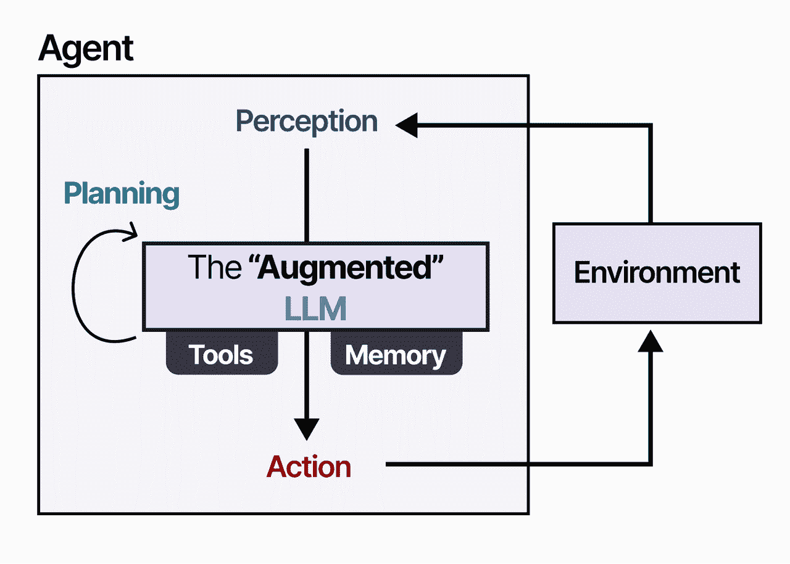

With over 60 custom visuals in this post, you will explore the field of LLM Agents, their main components, and explore Multi-Agent frameworks.

Thank you for reading Exploring Language Models! Subscribe to receive new posts on Gen AI and the book: Hands-On Large Language Models

Subscribe

👈 click on the stack of lines on the left to see a Table of Contents (ToC)

# What Are LLM Agents?

To understand what LLM Agents are, let us first explore the basic capabilities of an LLM. Traditionally, an LLM does nothing more than next-token prediction.

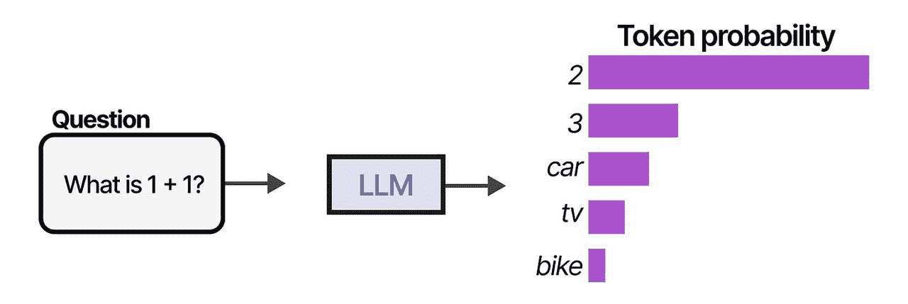

By sampling many tokens in a row, we can mimic conversations and use the LLM to give more extensive answers to our queries.

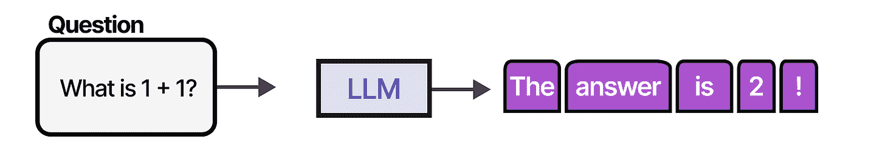

However, when we continue the “conversation”, any given LLM will showcase one of its main disadvantages. It does not remember conversations!

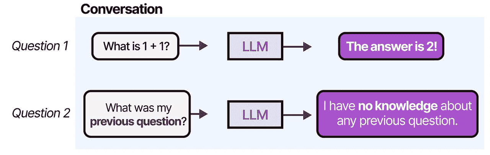

There are many other tasks that LLMs often fail at, including basic math like multiplication and division:

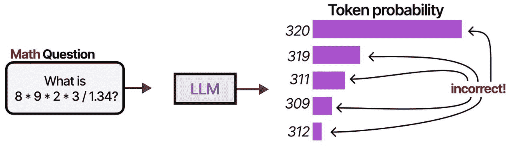

Does this mean LLMs are horrible? Definitely not! There is no need for LLMs to be capable of everything as we can compensate for their disadvantage through external tools, memory, and retrieval systems.

Through external systems, the capabilities of the LLM can be enhanced. Anthropic calls this “The Augmented LLM”.

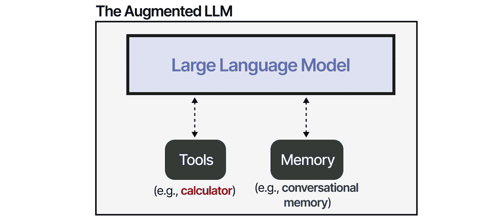

Fo**r instance**, when faced with a math question, the LLM may decide to use the appropriate tool (a calculator).

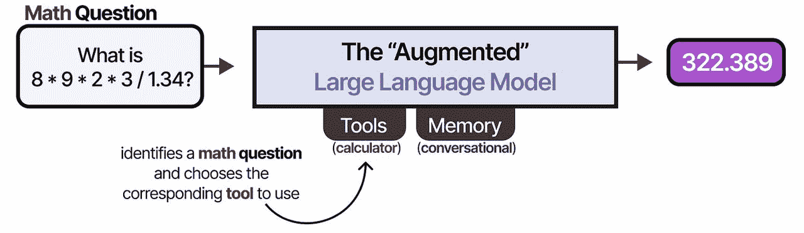

So is this “Augmented LLM” then an Agent? No, and maybe a bit yes…

Let’s start with a d[efi](https://newsletter.maartengrootendorst.com/p/a-visual-guide-to-llm-agents#footnote-1-156659273)nition of Agents:(1)

An **agent** **is anyt**hing that can be viewe**d as perc**eiving its environment through sensors and acting upon that environment through actuators.

— Russell & Norvig, AI: A Modern Approach (2016)

Agents interact with their environment and typically consist of several important components:

+   **Environments** — The world the agent interacts with

+   **Sensors** — Used to observe the environment

+   **Actuators** — Tools used to interact with the environment

+   **Effectors **— The “brain” or rules deciding how to go from observations to actions

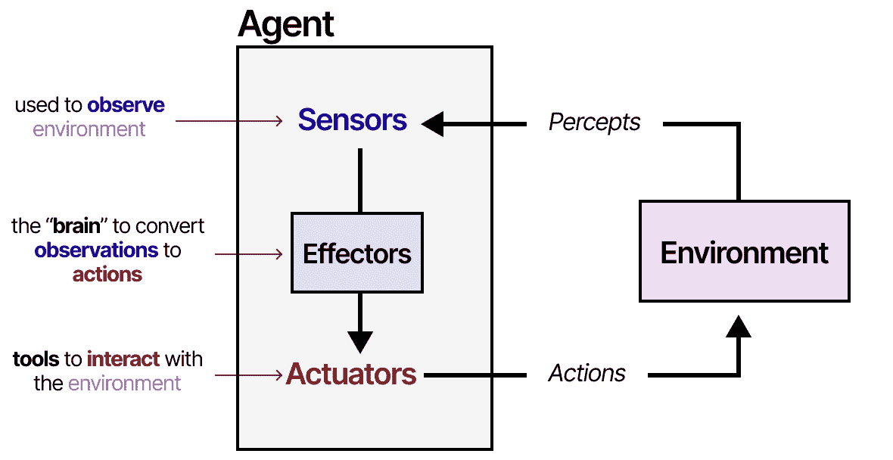

This framework is used for all kinds of agents that interact with all kinds of environments, like robots interacting with their physical environment or AI agents interacting with software.

We can generalize this framework a bit to make it suitable for the “Augmented LLM” instead.

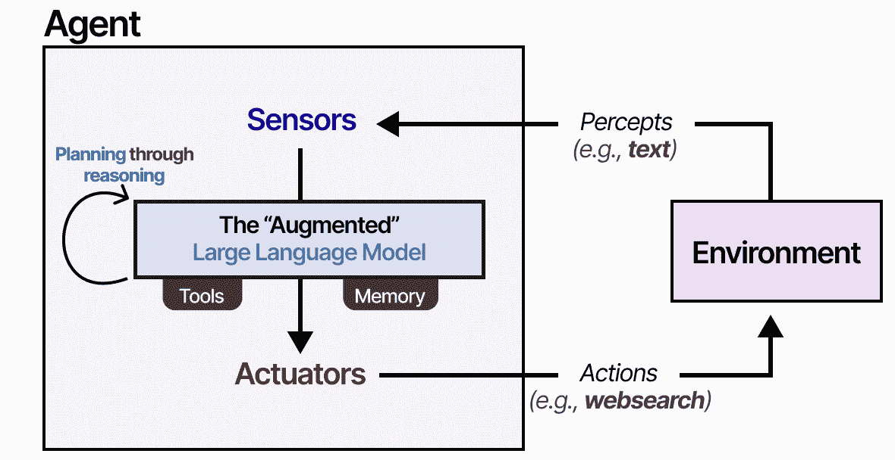

Using the “Augmented” LLM, the Agent can observe t**he environment** through textual input (as LLMs are generally textual models) and perform certain actions through its use of tools (like searching the web).

To select which actions to take, the LLM Agent has a vital component: its ability to plan. For this, LLMs need to be able to “reason” and “think” through methods like chain-of-thought.

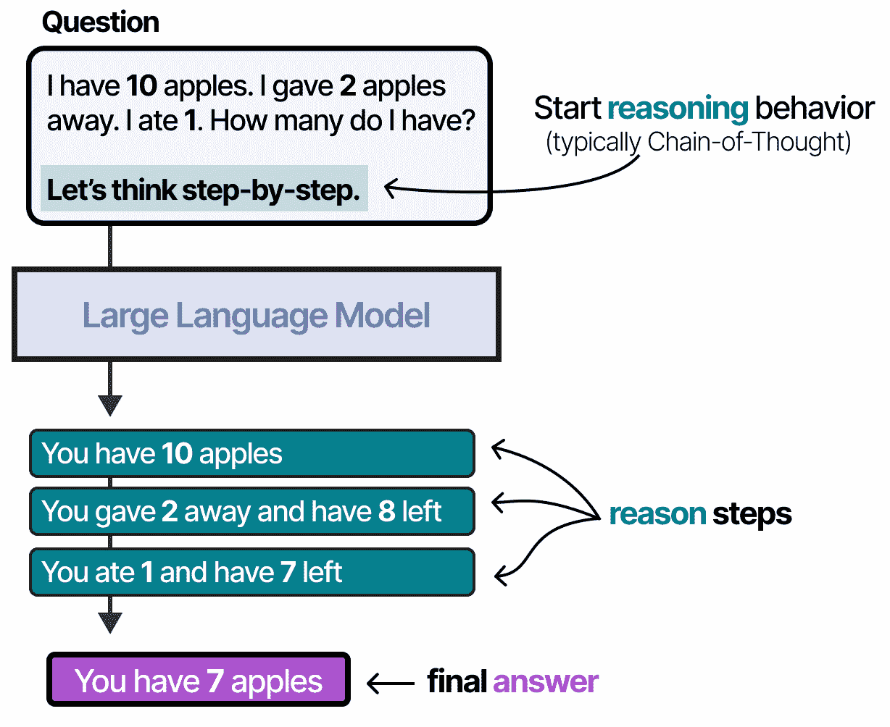

For more information about reasoning, check out The Visual Guide to Reasoning LLMs

Using this reasoning behavior, LLM Agents will plan out the necessary actions to take.

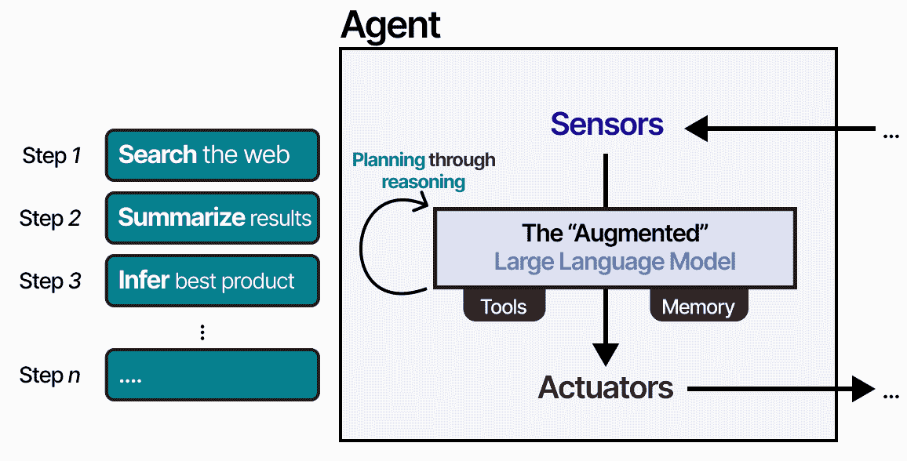

This planning behavior allows the Agent to understand the situation (LLM), plan next steps (planning), take actions (tools), and keep track of the taken actions (memory).

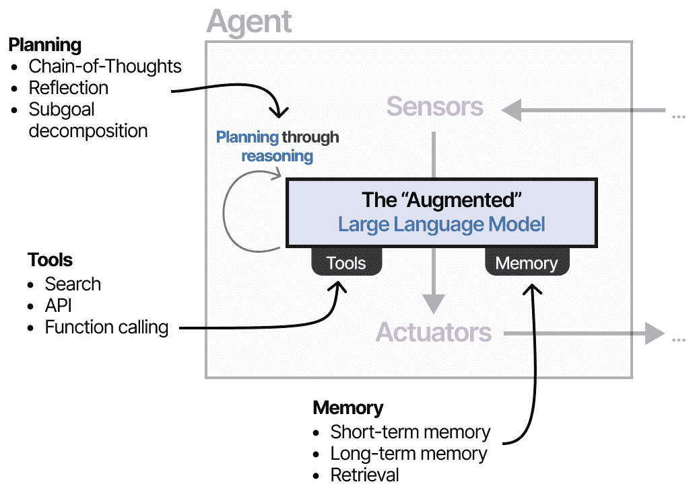

Depending on the system, you can LLM Agents with varying degrees of autonomy.

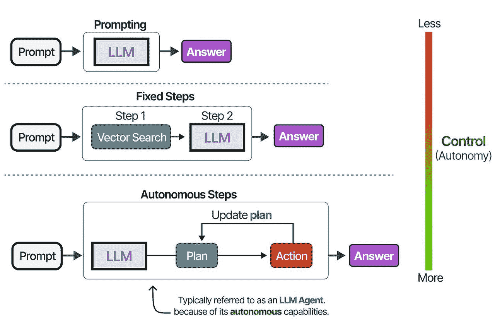

Depending on who you ask, a system is more “agentic” the more the LLM decides how the system can behave.

In **the ne**xt** sect**ions, **we will **go through various methods of autonomous behavior through the LLM Agent’s three main components: Memory, Tools, and Planning.

# Memory

LLMs are forgetful systems, or more accurately, do not perform any memorization at all when interacting with them.

For instance, when you ask an LLM a question and then follow it up with another question, it will not remember the former.

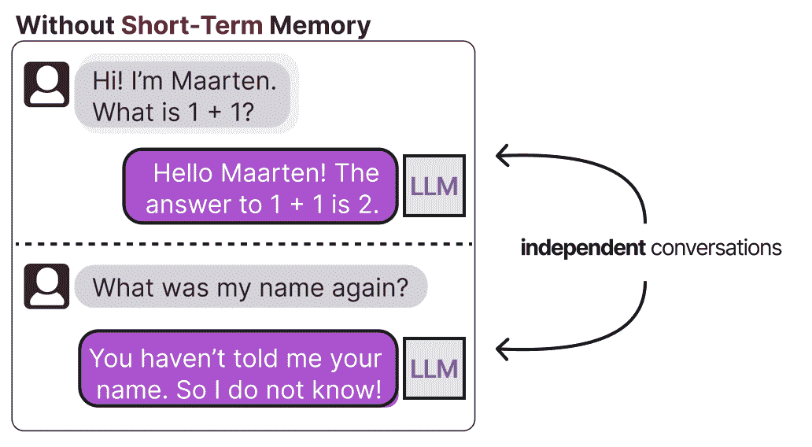

We typically refer to this as short-term memory, also called working memory, which functions as a buffer for the (near-) immediate context. This includes recent actions the LLM Agent has taken.

However, the LLM Agent also needs to keep track of potentially dozens of steps, not only the most recent actions.

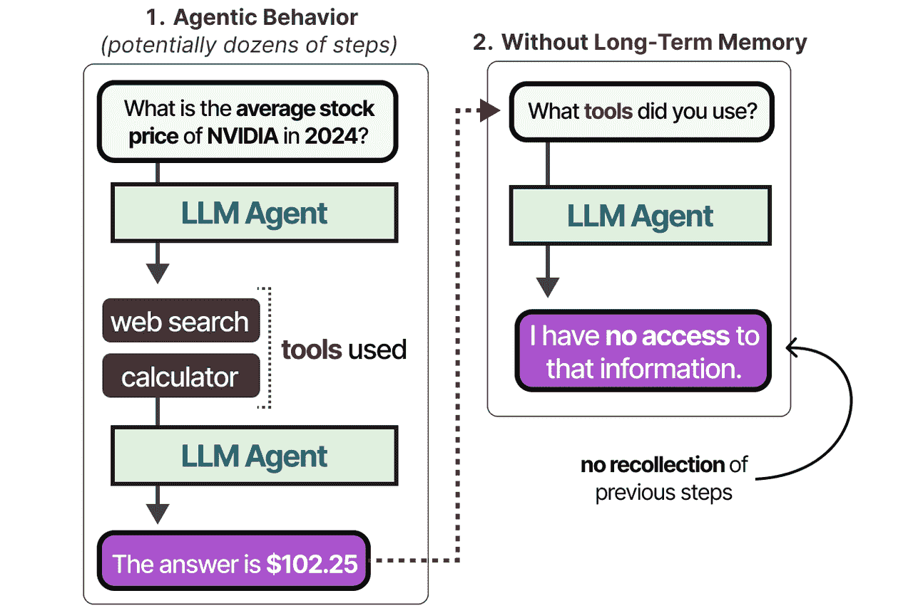

This is referred to as long-term memory as the LLM Agent could theoretically take dozens or even hundreds of steps that need to be memorized.

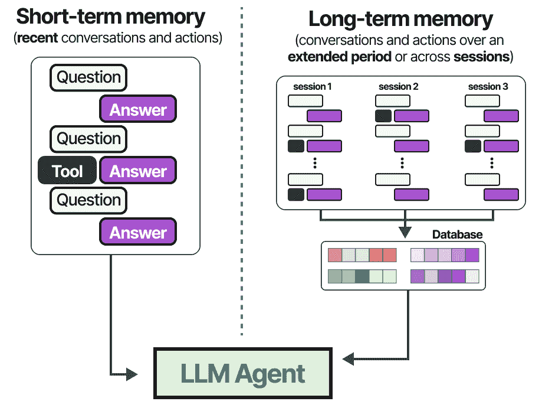

Let’s explore several tricks for giving these models memory.

## Short-Term Memory

The most straightforward method for enabling short-term memory is to use the model's context window, which is essentially the number of tokens an LLM can process.

The context window tends to be at least 8192 tokens and sometimes can scale up to hundreds of thousands of tokens!

A large context window can be used to track the full conversation history as part of the input prompt.

[https://substackcdn.com/image/fetch/$s_!12fR!,w_1456,c_limit,f_auto,q_auto:good,fl_progressive:steep/](https://substackcdn.com/image/fetch/$s_!12fR!,w_1456,c_limit,f_auto,q_auto:good,fl_progressive:steep/https://substack-post-media.s3.amazonaws.com/public/images/66e6afca-afc6-4a3f-a4b0-4d11e050c558_1204x616.png)https%3A%2F%2Fsubstack-post-media.s3.amazonaws.com%2Fpublic%2Fimages%2F66e6afca-afc6-4a3f-a4b0-4d11e050c558_1204x616.png

This works as long as the conversation history fits within the LLM’s context window and is a nice way of mimicking memory. However, instead of actually memorizing a conversation, we essentially “tell” the LLM what that conversation was.

For models with a smaller context window, or when the conversation history is large, we can instead use another LLM to summarize the conversations that happened thus far.

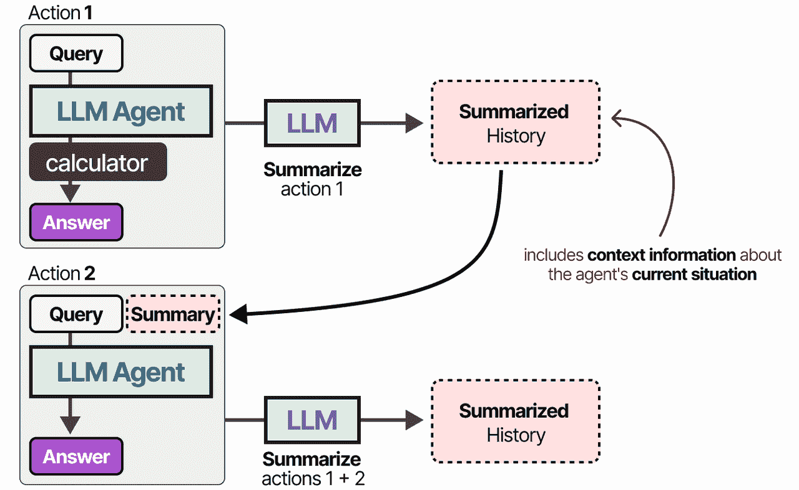

By continuously summarizing conversations, we can keep the size of this conversation small. It will reduce the number of tokens while keeping track of only the most vital information.

## Long-term Memory

Long-term memory in LLM Agents includes the agent’s past action space that needs to be retained over an extended period.

A common technique to enable long-term memory is to store all previous interactions, actions, and conversations in an external vector database.

To build such a database, conversations are first embedded into numerical representations that capture their meaning.

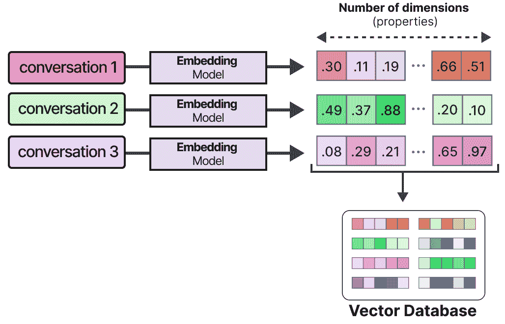

After building the database, we can embed any given prompt and find the most relevant information in the vector database by comparing the prompt embedding with the database embeddings.

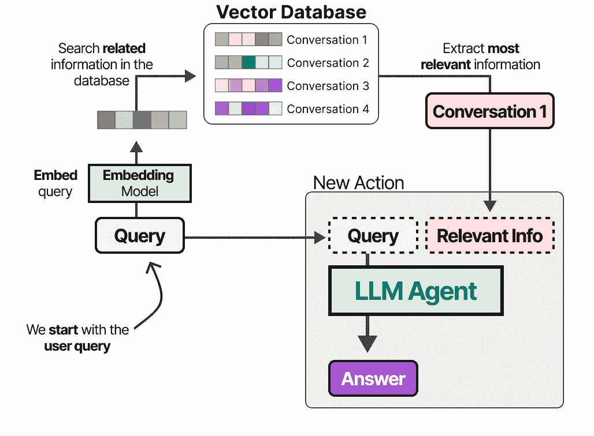

This method is often referred to as Retrieval-Augmented Generation (RAG).

Long-term memory can also involve retaining information from different sessions. For instance, you might want an LLM Agent to remember any research it has done in previous sessions.

Different types of information can also be relate[d t](https://newsletter.maartengrootendorst.com/p/a-visual-guide-to-llm-agents#footnote-2-156659273)o different types of memory to be stored. In psychology, there are numerous types of memory to differentiate, but the Cognitive Architectures for Language Agents paper coupled four of them to LLM Agents.(2)

This differentiation helps in building agentic frameworks. Semantic memory (facts about the world) might be stored in a different database than working memory (current and recent circumstances).

# Tools

Tools allow a given LLM to either interact with an external environment (such as databases) or use external applications (such as custom code to run).

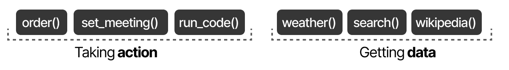

Tools generally **have two use **cases: fetching data** to retrieve **up-to-date information and taking action like setting a meeting or ordering food.

To actually use a tool, the LLM has to generate text that fits wit**h th**e API of the given tool. We tend to expect strings that can be formatted to JSON so that it can easily be fed to a code interpreter.

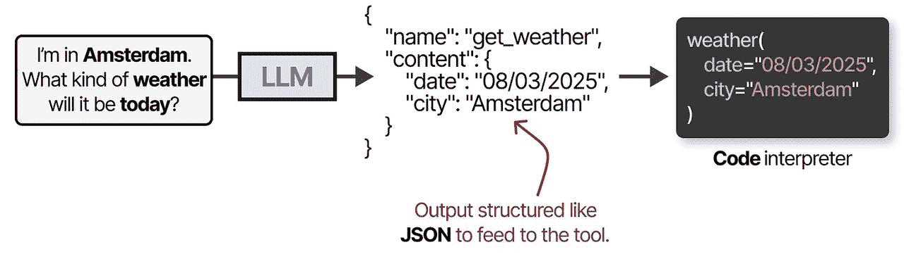

Note that this is not limited to JSON, we can also call the tool in code itself!

You can also generate custom functions that the LLM can use, like a basic multiplication function. This is often referred to as function calling.

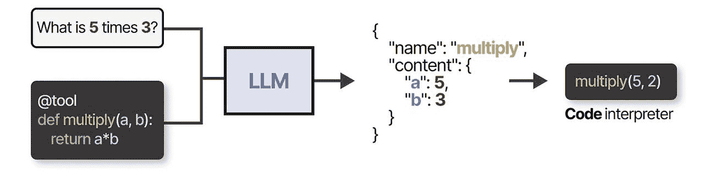

Some LLMs can use any tools if they are prompted correctly and extensively. Tool-use is something that most current LLMs are capable of.

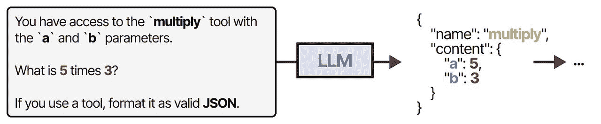

A more stable method for accessing tools is by fine-tuning the LLM (more on that later!).

Tools can either be used in a given order if the agentic framework is fixed…

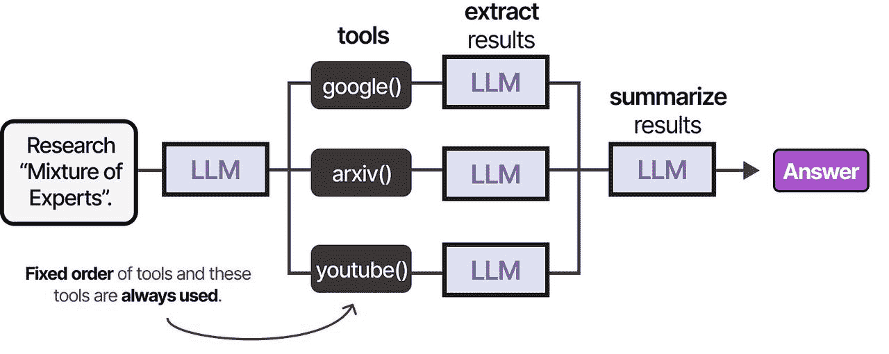

…or the LLM can autonomously choose which tool to use and when. LLM Agents, like the above image, are essentially sequences of LLM calls (but with autonomous selection of actions/tools/etc.).

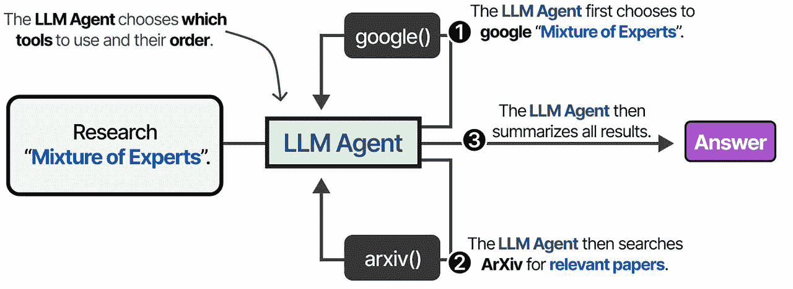

In other words, the output of intermediate steps is fed back into the LLM to continue processing.

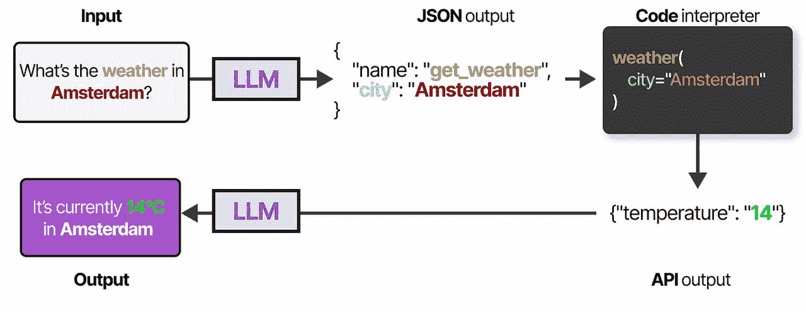

## Toolformer

Tool use is a powerful technique for strengthening LLMs' capabilities and compensating for their disadvantages. As such, research efforts on tool use and learning have seen a rapid surge in the last few years.

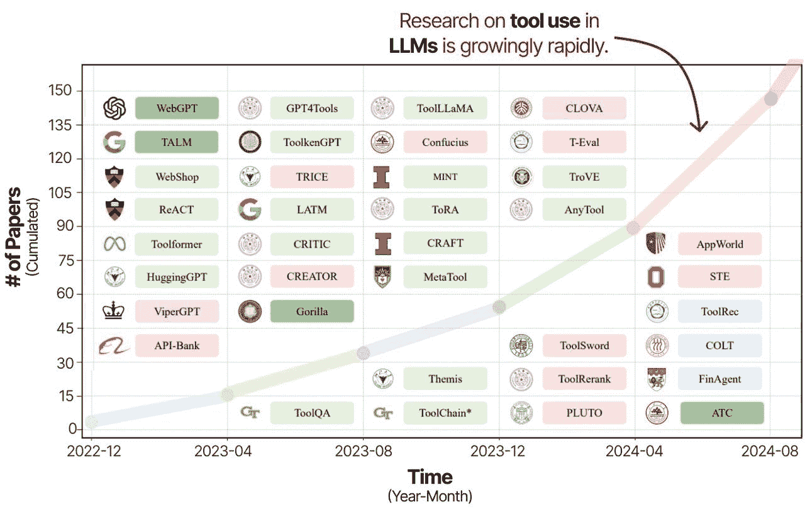

Annotated and crop[ped picture of the “Tool Learn](https://arxiv.org/pdf/2405.17935)ing with Large Language Models: A Survey” paper. With an increasing focus on tool use, (Agentic) LLMs are expected to become more powerful.

Much of this research involves not only prompting LLMs for tool use but training them specifically for tool use instead.

One of the first techniques to do so is called Toolf[orm](https://newsletter.maartengrootendorst.com/p/a-visual-guide-to-llm-agents#footnote-3-156659273)er, a model trained to decide which APIs to call and how.(3)

It does so by using the [ and ] tokens to indicate the start and end of calling a tool. When given a prompt, for example “What is 5 times 3?”, it starts generating tokens until it reaches the [ token.

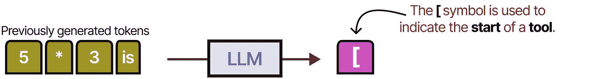

After that, it generates tokens until it reaches the → token which indicates that the LLM stops generating tokens.

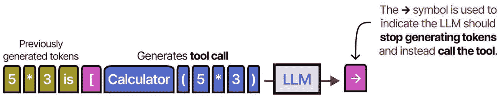

Then, the tool will** be ca**lled, and the output will be added to the tokens generated thus far.

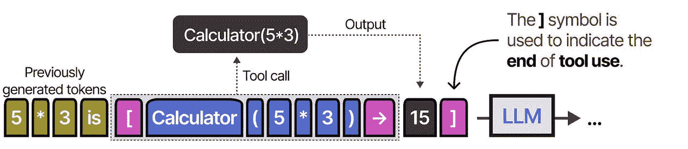

The ] symbol indicates that the LLM can now continue generating if necessary.

Toolformer creates this behavior by carefully generating a dataset with many tool uses the model can train on. For each tool, a few-shot prompt is manually created and used to sample outputs that use these tools.

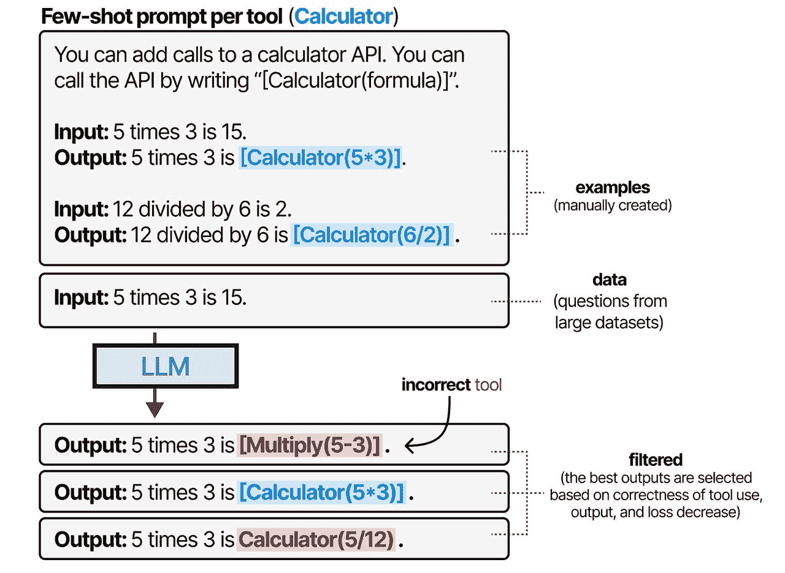

The outputs are filtered based on correctness of the tool use, output, and loss decrease. The resulting dataset is used to train an LLM to adhere to this format of tool use.

Sin[ce ](https://newsletter.maartengrootendorst.com/p/a-visual-guide-to-llm-agents#footnote-4-156659273)t[he ](https://newsletter.maartengrootendorst.com/p/a-visual-guide-to-llm-agents#footnote-5-156659273)release of Toolformer, there have been many exciting techniques such as LLMs that can use thousands of tools (ToolLLM(4)) or LLMs that can easily retrieve the most relevant tools (Gorilla(5)).

Either way, most current LLMs (beginning of 2025) have been trained to call tools easily through JSON generation (as we saw before).

## Model Context Protocol (MCP)

Tools are an important component of Agentic frameworks, allowing LLMs to interact with the world and extend their capabilities. However, enabling tool use when you have many different API becomes troublesome as any tool needs to be:

+   Manually **tracked** and fed to the LLM

+   Manually **described** (including its expected JSON schema)

+   Manually **updated** whenever its API changes

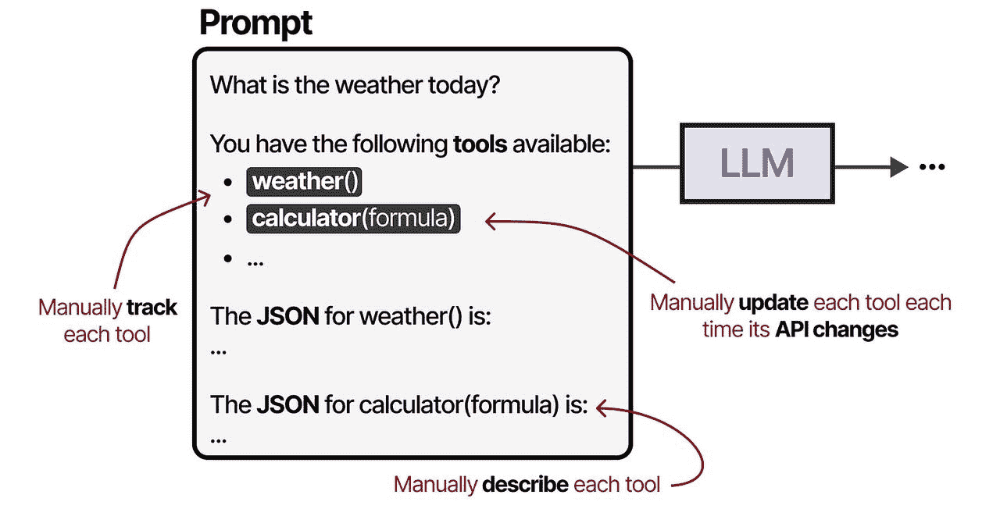

To make tools easier to implement for any given Agentic fram[ewo](https://newsletter.maartengrootendorst.com/p/a-visual-guide-to-llm-agents#footnote-6-156659273)rk, Anthropic developed the Model Context Protocol (MCP).(6) MCP standardizes API access for services like weather apps and GitHub.

It consists of three components:

+   MCP **Host** — LLM application (such as Cursor) that manages connections

+   MCP **Client** — Maintains 1:1 connections with MCP servers

+   MCP **Server** — Provides context, tools, and capabilities to the LLMs

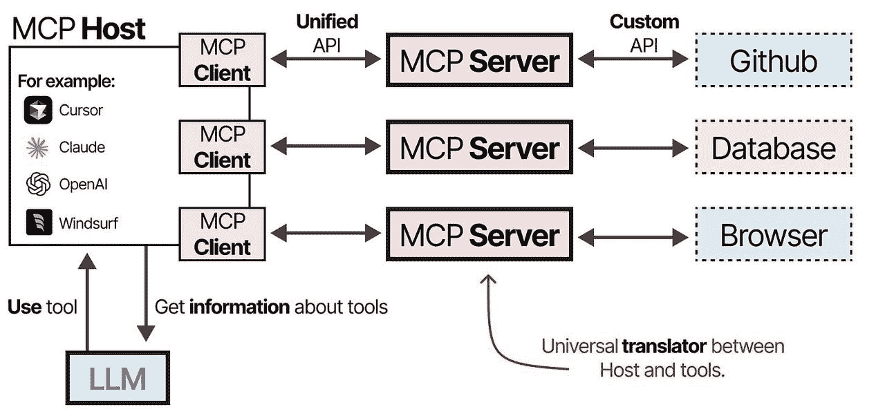

For example, let’s assume you want a given LLM application to summarize the 5 latest commits from your repository.

The MCP Host (together with the client) would first call the MCP Server to ask which tools are available.

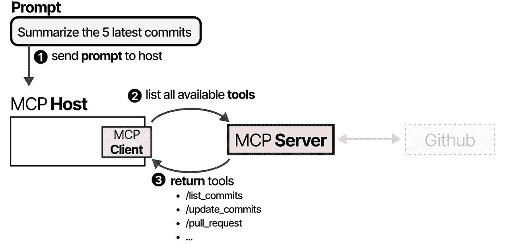

The LLM receives the information and may choose to use a tool. It sends a request to the MCP Server via the Host, then receives the results, including the tool used.

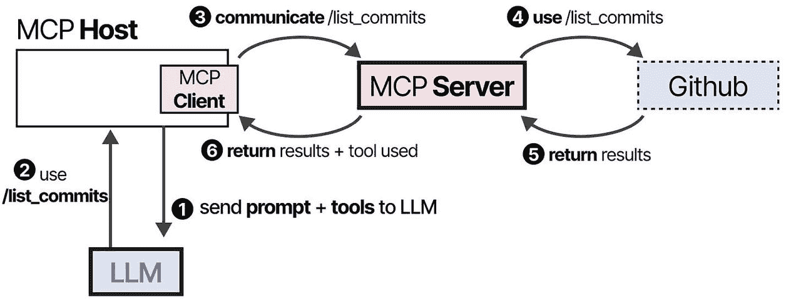

Finally, the LLM receives the results and can parse an answer to the user.

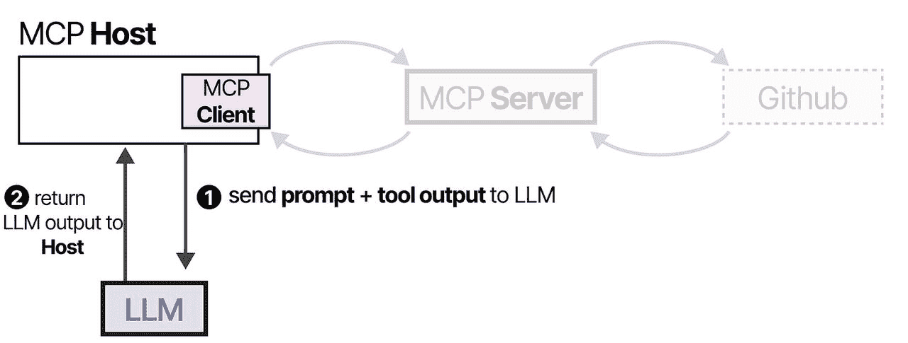

This framework makes creating tools easier by connecting to MCP Servers that any LLM application can use. So when you create an MCP Server to interact with Github, any LLM application that supports MCP can use it.

# Planning

Tool use allows an LLM to increase its capabilities. They are typically called using JSON-like requests.

But how does the LLM, in an agentic system, decide which tool to use and when?

This is where planning comes in. Planning in LLM Agents involves breaking a given task up into actionable steps.

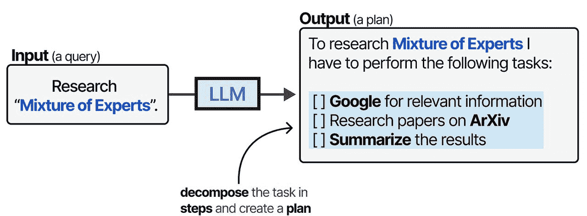

This plan allows the model to iteratively reflect on past behavior and update the current plan if necessary.

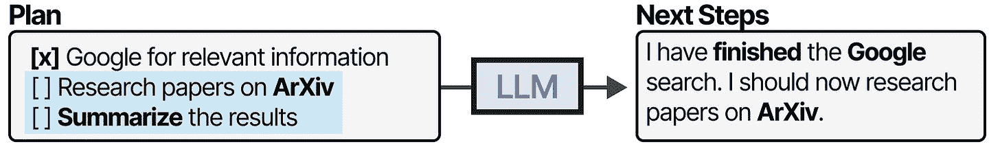

I love it when a plan comes together!

To enable planning in LLM Agents, let’s first look at the foundation of this technique, namely reasoning.

## Reasoning

Planning actionable steps requires complex reasoning behavior. As such, the LLM must be able to showcase this behavior before taking the next step in planning out the task.

“Reasoning” LLMs are those that tend to “think” before answering a question.

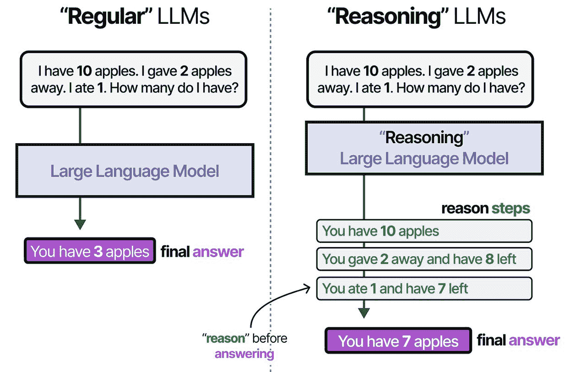

I am using the terms “reasoning” and “thinking” a bit loosely as we can argue whether this is human-like thinking or merely breaking the answer down to structured steps.

This reasoning behavior can be enabled by roughly two choices: fine-tuning the LLM or specific prompt engineering.

With prompt engineering, we can create examples of the reasoning proces[s t](https://newsletter.maartengrootendorst.com/p/a-visual-guide-to-llm-agents#footnote-7-156659273)hat the LLM should follow. Providing examples (also called few-shot prompting(7)) is a great method for steering the LLM’s behavior.

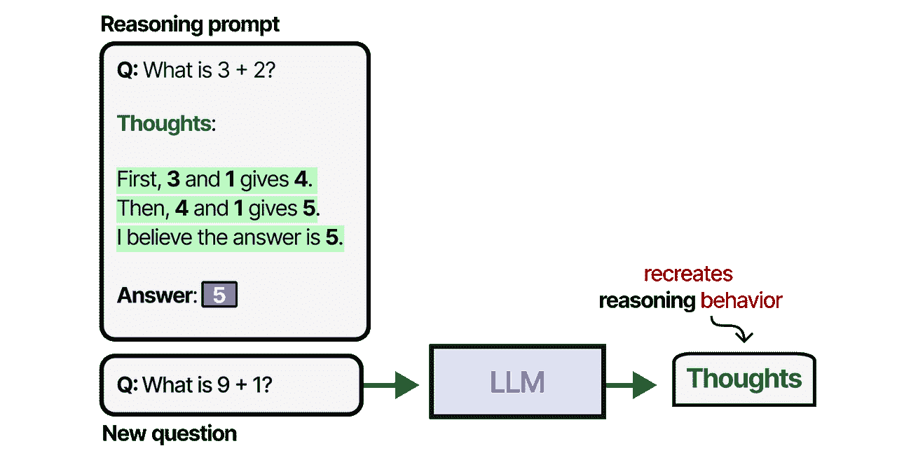

Thi[s m](https://newsletter.maartengrootendorst.com/p/a-visual-guide-to-llm-agents#footnote-8-156659273)ethodology of providing examples of thought processes is called Chain-of-Thought and enables more complex reasoning behavior.(8)

Cha[in-](https://newsletter.maartengrootendorst.com/p/a-visual-guide-to-llm-agents#footnote-9-156659273)of-thought can also be enabled without any examples (zero-shot prompting) by simply stating “Let’s think step-by-step”.(9)

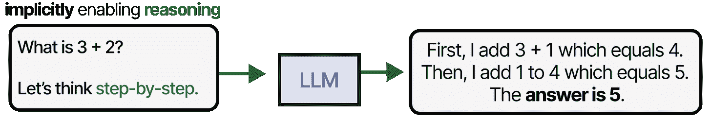

When training an LLM, we can either give it a sufficient amount of datasets that include thought-like examples or the LLM can discover its own thinking process.

A great example is DeepSeek-R1 where rewards are used to guide the usage of thinking processes.

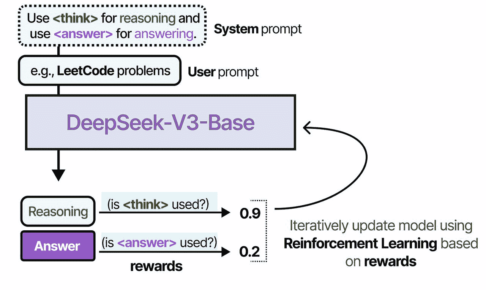

For more information about Rea[soning LLMs,](https://newsletter.maartengrootendorst.com/p/a-visual-guide-to-reasoning-llms) see my visual guide.

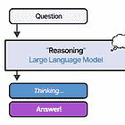

#### A Visual Guide to Reasoning LLMs

Maarten Grootendorst

·

Feb 3

[Read full story](https://newsletter.maartengrootendorst.com/p/a-visual-guide-to-reasoning-llms)

## Reasoning and Acting

Enabling reasoning behavior in LLMs is great but does not necessarily make it capable of planning actionable steps.

The techniques we focused on thus far either showcase reasoning behavior or interact with the environment through tools.

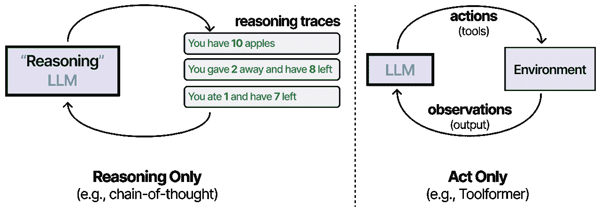

Chain-of-Thought, for instance, is focused purely on reasoning.

One of the first techniques to combine both pro[cess](https://newsletter.maartengrootendorst.com/p/a-visual-guide-to-llm-agents#footnote-10-156659273)es is called ReAct (Reason and Act).(10)

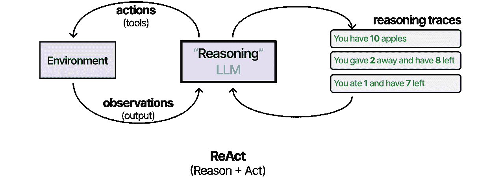

ReAct does so through careful prompt engineering. The ReAct prompt describes three steps:

+   **Thought** - A reasoning step about the current situation

+   **Action** - A set of actions to execute (e.g., tools)

+   **Observation** - A reasoning step about the result of the action

The prompt itself is then quite straightforward.

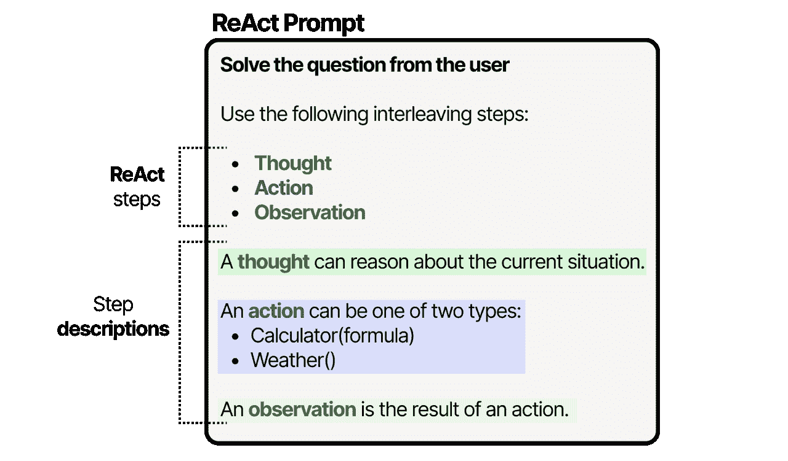

The LLM uses this prompt (which can be used as a system prompt) to steer its behaviors to work in cycles of thoughts, actions, and observations.

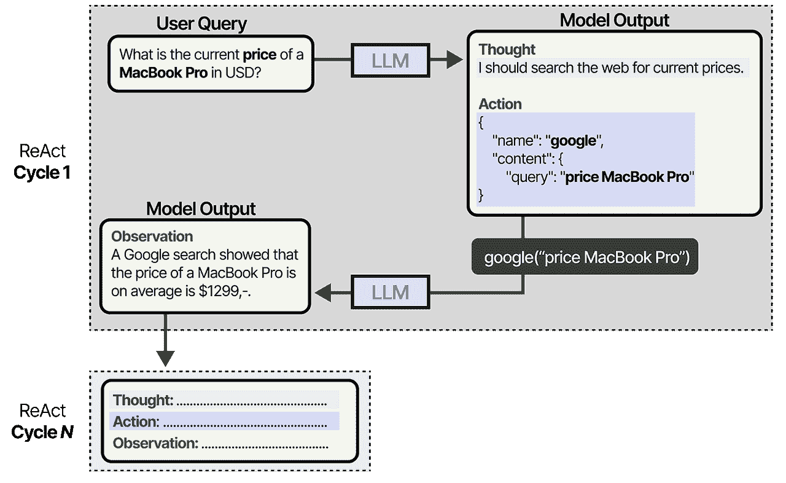

It continues this behavior until an action specifies to return the result. By iterating over thoughts and observations, the LLM can plan out actions, observe its output, and adjust accordingly.

As such, this framework enables LLMs to demonstrate more autonomous agentic behavior compared to Agents with predefined and fixed steps.

## Reflecting

Nobody, not even LLMs with ReAct, will perform every task perfectly. Failing is part of the process as long as you can reflect on that process.

This[ pro](https://newsletter.maartengrootendorst.com/p/a-visual-guide-to-llm-agents#footnote-11-156659273)cess is missing from ReAct and is where Reflexion comes in. Reflexion is a technique that uses verbal reinforcement to help agents learn from prior failures.(11)

The method assumes three LLM roles:

+   **Actor** — Chooses and executes actions based on state observations. We can use methods like Chain-of-Thought or ReAct.

+   **Evaluator** — Scores the outputs produced by the Actor.

+   **Self-reflection** — Reflects on the action taken by the Actor and scores generated by the Evaluator.

Memory modules are added to track actions (short-term) and self-reflections (long-term), helping the Agent learn from its mistakes and identify improved actions.

A s[imil](https://newsletter.maartengrootendorst.com/p/a-visual-guide-to-llm-agents#footnote-12-156659273)ar and elegant technique is called SELF-REFINE, where actions of refining output and generating feedback are repeated.(12)

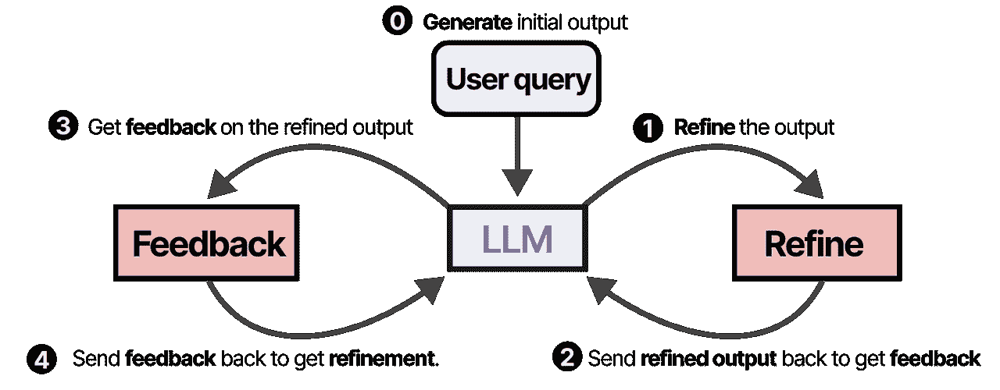

The same LLM is in charge of generating the initial output, the refined output, and feedback.

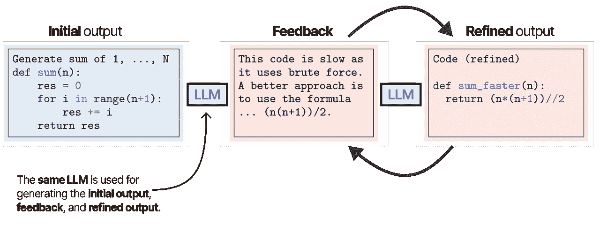

[A](https://proceedings.neurips.cc/paper_files/paper/2023/file/91edff07232fb1b55a505a9e9f6c0ff3-Paper-Conference.pdf)nnotated figure of the “SELF-REFINE: Iterative Refinement with Self-Feedback” paper.

Interestingly, this self-reflective behavior, both Reflexion and SELF-REFINE, closely resembles that of reinforcement learning where a reward is given based on the quality of the output.

# Multi-Agent Collaboration

The single Agent we explored has several issues: too many tools may complicate selection, context becomes too complex, and the task may require specialization.

**Instead, we **c**an lo**ok** towar**ds Mul**ti-Agent**s, frameworks where multiple agents (each with access to tools, memory, and planning) are interacting with each other and their environments:

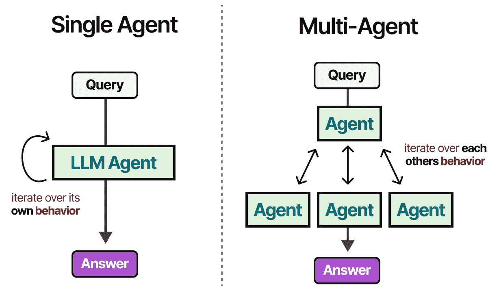

These Multi-Agent systems usually consist of specialized Agents, each equipped with their own toolset and overseen by a supervisor. The supervisor manages communication between Agents and can assign specific tasks to the specialized Agents.

Each Agent might have different types of tools available, but there might also be different memory systems.

In practice, there are dozens of Multi-Agent architectures with two components at their core:

+   Agent **Initialization** — How are individual (specialized) Agents created?

+   Agent **Orchestration** — How are all Agents coordinated?

Let’s explore various interesting Multi-Agent frameworks and highlight how these components are implemented.

## Interactive Simulacra of Human Behavior

Ar[g](https://arxiv.org/pdf/2304.03442)ua[bly ](https://newsletter.maartengrootendorst.com/p/a-visual-guide-to-llm-agents#footnote-13-156659273)one of the most influential, and frankly incredibly cool, Multi-Agent papers is called “Generative Agents: Interactive Simulacra of Human Behavior”.(13)

In this paper, they created computational software agents that simulate believable human behavior, which they call Generative Agents.

The **profile** each Generative Agent is given makes them behave in unique ways and helps create more interesting and dynamic behavior.

Each Agent is initialized **with t**hr**ee modul**es (me**mory, plan**ning, and reflection) very much like the core components that we have seen previously with ReAct and Reflexion.

The Memory module is one of the most vital components in this framework. It stores both the planning and reflection behaviors, as well as all events thus far.

For any given next step or question, memories are retrieved and scored on their recency, importance, and relevance. The highest scoring memories are shared with the Agent.

[A](https://arxiv.org/pdf/2304.03442)nnoted figure of the Generative Agents: Interactive Simulacra of Human Behavior paper.

Together, they allow for Agents to freely go about their behavior and interact with one another. As such, there is very little Agent orchestration as they do not have specific goals to work to.

Annotated image from the interactive demo.

There are too many amazing snippets of information in [this](https://newsletter.maartengrootendorst.com/p/a-visual-guide-to-llm-agents#footnote-14-156659273) paper, but I want to highlight their evaluation metric.(14)

Their evaluation involved the believability of the Agent’s behaviors as the main metric, with human evaluators scoring them.

[A](https://arxiv.org/pdf/2304.03442)nnotated figure of the Generative Agents: Interactive Simulacra of Human Behavior paper.

It showcases how important observation, planning, and reflection are together in the performance of these Generative Agents. As explored before, planning is not complete without reflective behavior.

## Modular Frameworks

Whate[ver ](https://newsletter.maartengrootendorst.com/p/a-visual-guide-to-llm-agents#footnote-15-156659273)[fram](https://newsletter.maartengrootendorst.com/p/a-visual-guide-to-llm-agents#footnote-16-156659273)ework you choose for creating Multi-Agent systems, they are generally composed of several ingredients, including its profile, perception of the environment, memory, planning, and available actions.(15)(16)

P[opul](https://newsletter.maartengrootendorst.com/p/a-visual-guide-to-llm-agents#footnote-17-156659273)ar framew[orks](https://newsletter.maartengrootendorst.com/p/a-visual-guide-to-llm-agents#footnote-18-156659273) for implem[enti](https://newsletter.maartengrootendorst.com/p/a-visual-guide-to-llm-agents#footnote-19-156659273)ng these components are AutoGen(17), MetaGPT(18), and CAMEL(19). However, each framework approaches communication between each Agent a bit differently.

With CAMEL, for instance, the user** first **creat**es its quest**ion and defines AI User and AI Assistant roles. The AI user role represents the human user and will guide the process.

After that, the AI User and AI Assistant will collaborate on resolving the query by interacting with each other.

This role-playing methodology enables collaborative communication between agents.

AutoGen and MetaGPT have different methods of communication, but it all boils down to this collaborative nature of communication. Agents have opportunities to engage and talk with one another to update their current status, goals, and next steps.

In the last year, and especially the last few weeks, the growth of these frameworks has been explosive.

2025 is going to be a truly exciting year as these frameworks keep maturing and developing!

# **Conclusion**

This concludes our journey of LLM Agents! Hopefully, this post gives a better understanding of how LLM Agents are built.

To see more visualizations related to LLMs and to support this newsletter, check out the book I wrote on Large Language Models!

Official website of [the bo](https://www.amazon.com/Hands-Large-Language-Models-Understanding/dp/1098150961)[ok. Yo](https://github.com/handsOnLLM/Hands-On-Large-Language-Models)u can order the book on Amazon. All code is uploaded to GitHub.

[1](https://newsletter.maartengrootendorst.com/p/a-visual-guide-to-llm-agents#footnote-anchor-1-156659273)

Russell, S. J., & Norvig, P. (2016). Artificial intelligence: a modern approach. pearson.

[2](https://newsletter.maartengrootendorst.com/p/a-visual-guide-to-llm-agents#footnote-anchor-2-156659273)

Sumers, Theodore, et al. "Cognitive architectures for language agents." Transactions on Machine Learning Research (2023).

[3](https://newsletter.maartengrootendorst.com/p/a-visual-guide-to-llm-agents#footnote-anchor-3-156659273)

Schick, Timo, et al. "Toolformer: Language models can teach themselves to use tools." Advances in Neural Information Processing Systems 36 (2023): 68539-68551.

[4](https://newsletter.maartengrootendorst.com/p/a-visual-guide-to-llm-agents#footnote-anchor-4-156659273)

Qin, Yujia, et al. "Toolllm: Facilitating large language models to master 16000+ real-world apis." arXiv preprint arXiv:2307.16789 (2023).

[5](https://newsletter.maartengrootendorst.com/p/a-visual-guide-to-llm-agents#footnote-anchor-5-156659273)

Patil, Shishir G., et al. "Gorilla: Large language model connected with massive apis." Advances in Neural Information Processing Systems 37 (2024): 126544-126565.

[6](https://newsletter.maartengrootendorst.com/p/a-visual-guide-to-llm-agents#footnote-anchor-6-156659273)

"Introducing the Model Context Protocol." Anthropic, www.anthropic.com/news/model-context-protocol. Accessed 13 Mar. 2025.

[7](https://newsletter.maartengrootendorst.com/p/a-visual-guide-to-llm-agents#footnote-anchor-7-156659273)

Mann, Ben, et al. "Language models are few-shot learners." arXiv preprint arXiv:2005.14165 1 (2020): 3.

[8](https://newsletter.maartengrootendorst.com/p/a-visual-guide-to-llm-agents#footnote-anchor-8-156659273)

Wei, Jason, et al. "Chain-of-thought prompting elicits reasoning in large language models." Advances in neural information processing systems 35 (2022): 24824-24837.

[9](https://newsletter.maartengrootendorst.com/p/a-visual-guide-to-llm-agents#footnote-anchor-9-156659273)

Kojima, Takeshi, et al. "Large language models are zero-shot reasoners." Advances in neural information processing systems 35 (2022): 22199-22213.

[10](https://newsletter.maartengrootendorst.com/p/a-visual-guide-to-llm-agents#footnote-anchor-10-156659273)

Yao, Shunyu, Zhao, Jeffrey, Yu, Dian, Du, Nan, Shafran, Izhak, Narasimhan, Karthik, and Cao, Yuan. ReAct: Synergizing Reasoning and Acting in Language Models. Retrieved from https://par.nsf.gov/biblio/10451467. International Conference on Learning Representations (ICLR).

[11](https://newsletter.maartengrootendorst.com/p/a-visual-guide-to-llm-agents#footnote-anchor-11-156659273)

Shinn, Noah, et al. "Reflexion: Language agents with verbal reinforcement learning." Advances in Neural Information Processing Systems 36 (2023): 8634-8652.

[12](https://newsletter.maartengrootendorst.com/p/a-visual-guide-to-llm-agents#footnote-anchor-12-156659273)

Madaan, Aman, et al. "Self-refine: Iterative refinement with self-feedback." Advances in Neural Information Processing Systems 36 (2023): 46534-46594.

[13](https://newsletter.maartengrootendorst.com/p/a-visual-guide-to-llm-agents#footnote-anchor-13-156659273)

Park, Joon Sung, et al. "Generative agents: Interactive simulacra of human behavior." Proceedings of the 36th annual acm symposium on user interface software and technology. 2023.

[14](https://newsletter.maartengrootendorst.com/p/a-visual-guide-to-llm-agents#footnote-anchor-14-156659273)

To see a cool interactive playground of t[he Generative Agents,](https://reverie.herokuapp.com/arXiv_Demo/) follow this link: https://reverie.herokuapp.com/arXiv_Demo/

[15](https://newsletter.maartengrootendorst.com/p/a-visual-guide-to-llm-agents#footnote-anchor-15-156659273)

Wang, Lei, et al. "A survey on large language model based autonomous agents." Frontiers of Computer Science 18.6 (2024): 186345.

[16](https://newsletter.maartengrootendorst.com/p/a-visual-guide-to-llm-agents#footnote-anchor-16-156659273)

Xi, Zhiheng, et al. "The rise and potential of large language model based agents: A survey." Science China Information Sciences 68.2 (2025): 121101.

[17](https://newsletter.maartengrootendorst.com/p/a-visual-guide-to-llm-agents#footnote-anchor-17-156659273)

Wu, Qingyun, et al. "Autogen: Enabling next-gen llm applications via multi-agent conversation." arXiv preprint arXiv:2308.08155 (2023).

[18](https://newsletter.maartengrootendorst.com/p/a-visual-guide-to-llm-agents#footnote-anchor-18-156659273)

Hong, Sirui, et al. "Metagpt: Meta programming for multi-agent collaborative framework." arXiv preprint arXiv:2308.00352 3.4 (2023): 6.

[19](https://newsletter.maartengrootendorst.com/p/a-visual-guide-to-llm-agents#footnote-anchor-19-156659273)

Li, Guohao, et al. "Camel: Communicative agents for" mind" exploration of large language model society." Advances in Neural Information Processing Systems 36 (2023): 51991-52008.

要理解 LLM Agent 是什么，我们首先需要探索 LLM 的基本能力。传统上，LLM 做的仅仅是下一个 token 的预测。

通过连续采样多个 token，我们可以模拟对话，并利用 LLM 对我们的查询提供更全面的回答。

**然而，当我们继续"对话"时，任何 LLM **都会显示其主要缺点：即如果不依赖对话系统将整个对话历史作为上下文传入模型，那么模型就不会记得对话内容。

LLM 不擅长的任务还有很多，包括基础的数学运算，如乘法和除法：

这是否意味着 LLM **不太行**？

当然不是！

LLM 不需要具备所有能力，因为我们可以通过外部工具、记忆和检索系统来弥补其不足。

通过外部系统，LLM 的能力可以**得到增强。A**nthropic 将这称为"增强型大模型"（The Augmented LLM）。

例如，当面对数学问题时，LLM可能决定使用适当的工具（计算器）。

那么这种"增强型 LLM"就是 Agent 吗？

严格来说并不是，但似乎也有那么一点儿神似.....

让我们从Agent的定义开始：

**一个 agent 是任何可以被视为通过传感器感**知环境，并通过执行器作用于该环境的实体。

—— Russell & Norvig，《人工智能：一种现代方法》(2016)

Agent 与环境交互，通常有几个重要组件：

+   • **环境** —  Agent 交互的世界

+   • **传感器** — 用于观察环境

+   • **执行器** — 用于与环境交互的工具

+   • **效应器** — 决定如何从观察转化为行动的"大脑"或规则

这个框架适用于与各种环境交互的各类 agent，如与物理环境交互的机器人或与软件交互的 AI agent。

[这里有没有想到我们](https://mp.weixin.qq.com/s?__biz=MzIzMDc2Njc0MQ==&mid=2247485219&idx=1&sn=6cb0d3e9e3faa0b29bed3b62670df149&scene=21#wechat_redirect)之前文章中关于 RL 的基础概念？Agent 的概念基本是相同的。

我们可以稍微概括这个框架，使其更适合"增强型LLM"。

使用"增强型"LLM，Agent 可以通过文本输入观察环境（因为LLM通常是文本模型），并通过使用工具（如网络搜索）执行特定操作。

**为了选择**采取哪些行动，LLM Agent 拥有一个至关重要的组件：规划能力。

而拥有规划能力，则意味着 LLM 需要能够通过思维链等方法进行"推理"与"思考"。

[关于推理型 LLM](https://mp.weixin.qq.com/s?__biz=MzIzMDc2Njc0MQ==&mid=2247487819&idx=1&sn=c95db9e48ab1a20efa74f658550bf28b&scene=21#wechat_redirect)s，请查看这篇文章《图解推理型 LLM》

利用这种推理行为，LLM Agent 将规划出必要的行动步骤。

这种规划行为使 Agent 能够理解情况（LLM）、规划下一步（规划）、采取行动（工具）并跟踪已采取的行动（记忆）。

根据系统的不同，可以获得具有不同自主程度的LLM Agent。

一个系统越自主， LLM 就越能决定系统的行为方式。

**在文**章**接下**来**的内**容中，我们将通过 LLM Agent 的三个主要组件：记忆、工具和规划，讨论各种自主行为方法。

---

## 记忆-Memory

LLM 是健忘的系统，或者更准确地说，与它们交互时根本不执行任何记忆功能。

例如，当你向LLM提出一个问题，然后重开一个对话，询问另一个问题时，它不会记得之前的问题。

我们通常将此称为**短期记忆**，也称为工作记忆，它作为（近期）即时上下文的缓冲区。这包括 LLM Agent 最近采取的行动。

然而，LLM Agent 还需要跟踪可能数十个步骤，而不仅仅是最近的行动。

这被称为**长期记忆**，因为 LLM Agent 理论上可能需要记住数十甚至数百个步骤。

让我们详细了解一下这几种为 LLM 提供记忆能力的技巧。

### 短期记忆

实现短期记忆的最直接方法是使用模型的上下文窗口，即 LLM 可以处理的 token 数量。

上下文窗口通常至少为 8192 个token，有时甚至可以扩展到数十万个 token.

大型上下文窗口,可用于将完整的对话历史作为输入 prompt 的一部分进行跟踪。

只要对话历史适合 LLM 的上下文窗口，这种方法就能有效模拟记忆。

但是，这并非真正记住对话，而是在"告诉"LLM这个对话是什么。

对于上下文窗口较小的模型，或者当对话历史较大时，我们可以使用另一个LLM来总结迄今为止发生的对话。

通过持续总结对话，我们可以保持较小的对话规模。这将减少 token 数量，同时只跟踪最重要的信息。

### 长期记忆

LLM Agent 的长期记忆包括需要长期保留的 Agent 过去的行动空间。

> 行动空间：指的是 Agent 过去所有的操作、决策和互动记录，而不仅仅是静态的数据或信息。

**实现长期记忆的常见技术是将所有先前的**交互、行动和对话存储在外部向量数据库中。

要构建这样的数据库，首先将对话嵌入到能够捕捉其含义的数值表示中。

构建数据库后，我们可以嵌入任何给定的提示，并通过比较提示嵌入与数据库嵌入来找到向量数据库中最相关的信息。

这种方法也就是**检索增强生成**（Retrieval-Augmented Generation，RAG）。

长期记忆还可以涉及保留来自不同会话的信息。例如，你可能希望 LLM Agent 记住它在以前会话中所做的任何研究。

不同类型的信息也可以与不同类型的存储记忆相关联。在心理学中，有许多类型的记忆可以区分，但在《Cognitive Architectures for Language Agents》论文将其中四种与LLM Agent 相关联。

1.  Working Memory（工作记忆）

+   • 人类示例：购物清单。人类大脑用工作记忆来暂时存放、操作当前需要使用的信息，比如你在逛超市时，脑海里记着要买的东西。

+   • 代理示例：Context（上下文）。在LLM Agent中，工作记忆可以理解为模型在一次对话或推理过程中，需要临时“装载”的上下文信息，用于实时生成回复或执行操作。

1.  Procedural Memory（程序性记忆）

+   • 人类示例：系鞋带。人类的程序性记忆是对“如何做一件事”的技能或步骤的记忆，例如骑自行车、打字等，这些行为一旦学会，就可以相对自动地执行。

+   • 代理示例：System Prompt（系统提示）。对于LLM Agent而言，“程序性记忆”可以视作模型在执行任务时所依据的固定指令或规则。它规定了模型在面对某些输入时，需要如何去执行、遵循哪些步骤或约束。

1.  Semantic Memory（语义记忆）

+   • 人类示例：狗的品种。语义记忆是关于世界的通用知识、事实和概念，不依赖个人的具体经历，比如知道“巴黎是法国的首都”。

+   • 代理示例：User Information（用户信息）。对于LLM Agent来说，语义记忆中可以包括用户的偏好、历史对话中的关键信息、外部知识库中的事实等。这些事实类信息是与特定事件无关的通用知识。

1.  Episodic Memory（情景记忆）

+   • 人类示例：7岁生日。情景记忆是对个人经历的记忆，包含时间、地点、人物等具体情境。

+   • 代理示例：Past Actions（过去行为）。在LLM Agent中，这部分对应代理在与用户或环境交互中所做出的具体操作或决策的历史记录，帮助代理回溯和利用过去的经历来影响当前或未来的决策。

这种区分有助于构建代理框架。语义记忆（关于世界的事实）可能存储在与工作记忆（当前和最近情况）不同的数据库中。

---

## 工具-Tools

### 工具

工具允许给定的 LLM 与外部环境（如数据库）交互或使用外部应用程序（如运行自定义代码）。

工具通常有两种用途：

**获取数据，**以检索最新信息;

**采取行动**，如设定会议或订购食物。

要实际使用工具，LLM 必须生成符合给定工具 API 的文本。我们通常期望生成可以格式化为 JSON 的字符串，以便它能够轻松地输到代码解释器中。

注意，这不仅限于JSON，我们也可以在代码本身中调用工具。

你还可以生成 LLM 能直接使用的自定义函数，比如基本的乘法函数。这通常被称为函数调用- function calling。

如果提示词足够准确，一些 LLM 可以使用任何工具。工具使用是大多数当前 LLM 都具备的能力。

访问工具的更稳定方法是通过微调 LLM（稍后会详细介绍）。

如果代理框架是固定的，工具可以按照特定顺序使用；

或者 LLM 可以自主选择使用哪种工具以及何时使用。

LLM 调用序列的中间步骤，会被反馈回 LLM 以继续处理。

可以认为，LLM Agent，本质上是 LLM 调用的序列（但具有自主选择行动/工具等的能力）。

### Toolformer

工具使用是增强LLM能力并弥补其不足的强大技术。因此，关于工具使用和学习的研究工作在过去几年中迅速增加。

从《Tool Learning with Large Language Models: A Survey》论文中截取并注释的图片。

随着对工具使用的日益关注，（Agentic）LLM 预计将变得更加强大。

这些研究不仅包括提示 LLM 使用工具，还特别针对工具使用对模型进行训练。

最早采用这种技术之一被称为 Toolformer，这是一个训练用来决定调用哪些 API 以及如何调用的模型。

它通过使用[and] token来指示调用工具的开始和结束。当给定一个提示，例如"5乘以3等于多少？"，它开始生成 token 直到达到 [ token。

之后，它继续生成 token 直到达到→，这表示 LLM 停止生成 token。

然后，工具将被调用，输出将被添加到目前为止生成的 token 中。

]符号表示 LLM 现在可以在必要时继续生成。

**Toolformer通过生成包含大量工具使用示例的数据集来训练模型**。对于每种工具，人工创建的 few-shot 提示会引导模型生成相应的使用示例。

基于工具使用的**正确性、结果、损失减少**对输出进行过滤。最终的数据集用于训练LLM 遵循这种工具使用格式。

自 Toolformer 发布以来，出现了许多令人兴奋的技术，如可以使用数千种工具的 LLM（ToolLLM）或可以轻松检索最相关工具的LLM（Gorilla）。

无论如何，大多数当前的 LLM（2025年初）都已经被训练为通过 JSON 生成（正如我们之前所见）轻松调用工具。

### 模型上下文协议（MCP）

工具是代理框架的重要组成部分，使 LLMs 能够与世界交互并扩展其能力。

然而，当存在多种不同API时，启用工具使用变得麻烦，因为任何工具都需要：

+   • 手动跟踪并输入到LLM中

+   • 手动描述（包括其预期的JSON schema）

+   • 每当API发生变化时，手动更新

为了使工具在任何代理框架中更容易实现，Anthropic 开发了 Model Context Protocol (MCP)。

MCP为天气应用和 GitHub 等服务标准化了 API 访问。

它由三个组件组成：

+   • MCP Host（宿主） — LLM 应用程序（如 Cursor）负责管理连接;

+   • MCP Client（客户端） — 维护与 MCP 服务器的 1:1 连接;

+   • MCP Server（服务器） — 向 LLMs 提供上下文、工具和功能;

例如，假设你希望某个 LLM 应用程序总结你的代码仓库中最新的5个提交。

MCP Host（与 MCP Client一起）会首先调用 MCP Server 询问哪些工具可用。

LLM 接收这些信息后，可能会选择使用某个工具。它通过 Host 向 MCP Server发送请求，然后接收结果，包括所使用的工具。

最后，LLM 接收结果并能够解析出回答给用户。

这个框架通过连接到任何 LLM 应用程序都可以使用的 MCP Servers，使创建工具变得更加简单。因此，当你创建一个与 Github 交互的 MCP Server时，任何支持 MCP 的LLM 应用程序都可以使用它。

---

## 规划-Planning

工具使用允许 LLM 增强其能力。它们通常通过类 JSON 请求进行调用。

但在代理系统中，LLM 如何决定使用哪个工具以及何时使用呢？

这就是规划（planning）发挥作用的地方。LLM Agents 中的规划涉及将给定任务分解为可执行的步骤。

这种规划使模型能够迭代地反思过去的行为，并在必要时更新当前计划。

**要在LL**M代理中实现计划能力，让我们首先看看这种技术的基础，即推理能力。

### 推理（Reasoning）

规划可执行步骤需要复杂的推理行为。因此，LLM 必须能够展示这种行为，然后才能进行任务规划的下一步。

"推理型"LLM是那些倾向于在回答问题前先"思考"的模型。

这里对"推理-reasoning"和"思考-thinking"这两个术语使用得比较宽松，因为我们可以讨论这是否真的类似于人类思考，或者仅仅是将答案分解为结构化步骤。

这种推理行为大致可以通过两种选择来实现：微调LLM或特定的提示工程（prompt engineering）。

通过提示工程，我们可以创建 LLM 应遵循的推理过程示例。提供示例（也称为少样本提示，few-shot prompting）是引导 LLM 行为的一种优秀方法。

这种提供思考过程示例的方法被称为思维链（Chain-of-Thought），它能够实现更复杂的推理行为。

思维链也可以在没有任何示例（零样本提示，zero-shot prompting）的情况下实现，只需简单地说明"让我们一步步思考"。

在训练 LLM 时，我们可以给它提供足够数量包含思考类示例的数据集，或者 LLM 可以发现自己的思考过程，比如使用强化学习。

DeepSeek-R1是一个很好的例子，它使用奖励机制来引导思考过程的使用。

[具体细节可参考这一篇文章](https://mp.weixin.qq.com/s?__biz=MzIzMDc2Njc0MQ==&mid=2247487849&idx=1&sn=115f0d39e7d47d4342110123d94bfcb1&scene=21#wechat_redirect)。

### 推理与行动-Reasoning and Acting

在LLM中启用推理行为很好，但这并不一定使其能够规划可执行的步骤。

迄今为止我们关注的技术要么展示推理行为，要么通过工具与环境交互。

例如，思维链（Chain-of-Thought）纯粹专注于推理。

最早将这两个过程结合起来的技术之一被称为 ReAct（Reason and Act）。

ReAct通过精心设计的提示工程来实现这一点。ReAct提示描述了三个步骤：

+   • **思考（Thought）** - 关于当前情况的推理步骤

+   • **行动（Action）** - 要执行的一系列行动（例如，使用工具）

+   • **观察（Observation）** - 关于行动结果的推理步骤

提示本身相当直接：

LLM使用这个提示（可作为系统提示使用）来引导其行为，在思考、行动和观察的循环中工作。

它会一直保持这种行为，直到某个行动指示返回结果。通过对思考和观察的迭代，LLM 可以规划行动，观察其输出，并相应地进行调整。

因此，与那些预定义固定步骤的代理相比，这个框架使 LLMs 能够展示更加自主的代理行为。

### 反思（Reflecting）

没有人，甚至采用 ReAct 的LLM，能在每个任务上都表现出色。失败在所难免，关键是从中反思，以推动成长。

这个过程在 ReAct 中缺失，而这正是 Reflexion 发挥作用的地方。Reflexion是一种使用语言强化来帮助代理从先前失败中学习的技术。

该方法假设三个LLM角色：

+   • **执行者（Actor）** — 根据状态观察选择并执行行动。我们可以使用思维链或ReAct等方法。

+   • **评估者（Evaluator）** — 对执行者产生的输出进行评分。

+   • 自我反思（Self-reflection） — 反思执行者采取的行动和评估者生成的评分。

添加了内存模块来跟踪行动（短期）和自我反思（长期），帮助 Agent 从错误中学习并识别改进的行动。

一种类似但更优雅的技术被称为SELF-REFINE，其中反复执行精炼输出和生成反馈的行动。

同一个LLM负责生成初始输出、精炼后的输出和反馈。

有趣的是，这种自我反思行为，无论是Reflexion还是SELF-REFINE，都与强化学习非常相似，在强化学习中，基于输出质量给予奖励。

---

## 多智能体协同

我们之前探讨过的单一 Agent 存在一些问题：工具太多可能导致选择困难，上下文变得过于复杂，并且某些任务可能需要更专业化的处理。

因此，我们可以考虑使用多智能体（Multi-Agent）框架，这类框架由多个 Agent 组成，每个 Agent 都有自己的工具、记忆与规划能力，它们之间能够相互交互，并与环境产生互动。

这些多智能体系统通常由专门的智能体组成，每个智能体拥有自己的工具集，并由一个主管（Supervisor）来进行管理。主管负责协调智能体之间的通信，并将特定任务分配给专业化的智能体。

每个 Agent 可能配备不同类型的工具，并可能拥有不同的记忆系统。

实际上，已有数十种多智能体架构，它们的核心通常包括以下两个组件：

+   • 智能体初始化（Agent Initialization）—— 如何创建个体（专门的）智能体？

+   • 智能体编排（Agent Orchestration）—— 如何协调所有智能体？

接下来，我们将探索一些有趣的多智能体框架，并重点分析这些组件是如何实现的。

### 交互式人类行为模拟

或许最具影响力、也相当酷的多智能体论文之一，就是《生成式智能体：交互式人类行为模拟》（Generative Agents: Interactive Simulacra of Human Behavior）。

在这篇论文中，作者创造了一种计算软件智能体，能够模拟可信的人类行为，他们称之为生成式智能体（Generative Agents）。

每个生成式智能体都拥有独特的个性配置文件，这使它们能够表现出独特的行为，并促使更有趣、更具动态性的互动产生。

每个智能体在初始化时都具备三个模块（记忆、规划和反思），这与我们之前探讨过的 ReAct 和 Reflexion 核心组件非常相似。

**记忆模块**是这个框架中最重要的组件之一。它存储着规划与反思行为，以及到目前为止发生的所有事件。

当智能体需要采取下一步行动或回答问题时，它会检索记忆，并根据记忆内容的时效性、重要性和相关性进行评分，将得分最高的记忆提供给智能体。

这些模块协同工作，使智能体能够自由地进行行动，并彼此互动。因此，这一框架的智能体编排较少，因为它们没有具体的目标。

**这篇论文**中有许多精彩的信息片段，但我想特别强调其评估指标。

该评估主要使用了智能体行为的可信性作为指标，由人工评估员对智能体进行评分。

该评估展示了观察、规划与反思对于生成式智能体表现的重要性。正如之前所述，没有反思行为的规划是不完整的。

### 模块化框架

无论你选择哪种框架创建多智能体系统，这些框架通常由多个要素组成，包括智能体的配置文件、对环境的感知、记忆、规划以及可用的行动。

用于实现这些组件的热门框架包括 AutoGen、MetaGPT 和 CAMEL。然而，每个框架处理智能体间通信的方式略有不同。

例如，在 CAMEL 中，用户首先提出问题，并定义 AI 用户（AI User）和 AI 助理（AI Assistant）的角色。AI 用户角色代表人类用户，并引导整个过程。

随后，AI 用户与 AI 助理相互协作，通过交互来解决问题。

这种角色扮演的方法实现了智能体之间的协作交流。

AutoGen 和 MetaGPT 的通信方法虽然有所不同，但本质上都是基于这种协作性质的通信。智能体可以相互交流，以更新自身状态、目标以及下一步行动。

过去一年，尤其是最近几周，这些框架呈现出爆发式的增长。

随着这些框架不断成熟与发展，2025 年将是令人无比期待的一年！