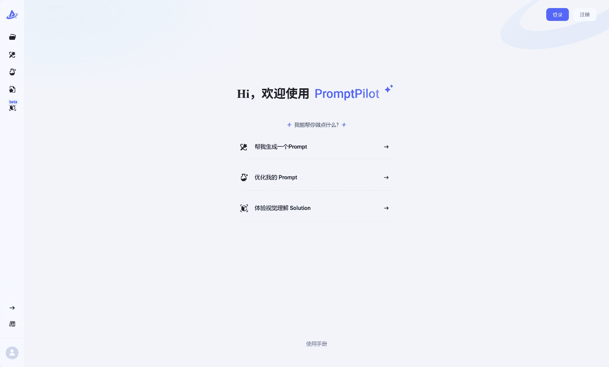
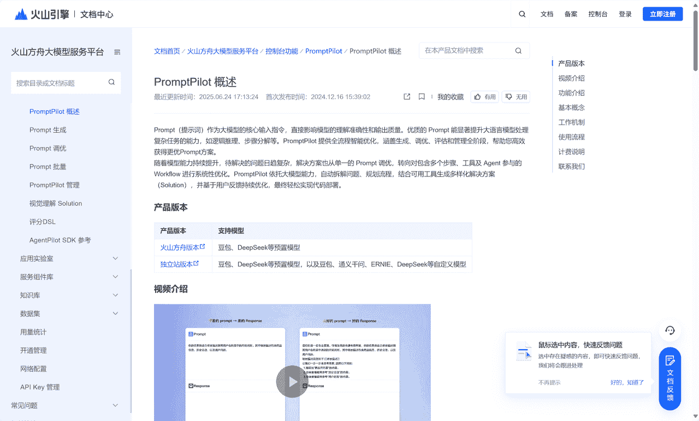
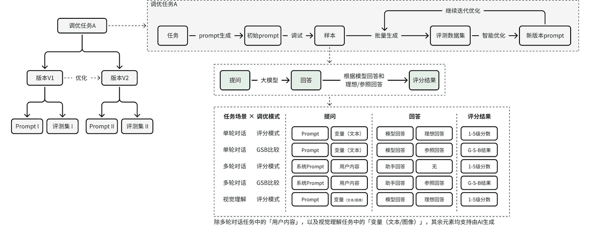
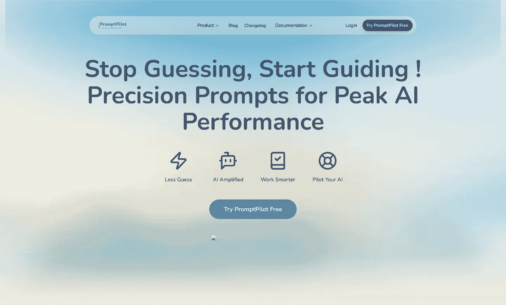

# Prompt Engineering

> 来源：[https://gotoaiworld.feishu.cn/docx/FmE2dbJ25o4d5KxMWhsc7huGnie](https://gotoaiworld.feishu.cn/docx/FmE2dbJ25o4d5KxMWhsc7huGnie)

# 一、什么是 Prompt Engineering

> 提示词工程（Prompt Engineering）是一门通过设计精准、结构化的自然语言指令（即 “提示词”），引导大语言模型（LLM）生成符合预期输出的技术与方法论。它并非简单的 “提问技巧”，而是结合大模型底层逻辑、任务特性和应用场景的系统性工程，核心目标是提升大模型输出的准确性、可控性、效率与安全性，让 AI 能力更精准地适配实际业务需求。

## 1.核心本质：架起 “人类意图” 与 “模型能力” 的桥梁

大语言模型（如 GPT-4、LLaMA、Claude 等）的核心能力是基于海量训练数据学习语言规律，但其输出天然存在 “不确定性”—— 相同问题可能生成不同结果，复杂任务易出现 “幻觉”（虚构信息），或无法精准匹配用户隐含需求。

提示词工程的本质，是通过结构化设计输入指令，弥补这种 “不确定性”：

+   从 “模糊需求” 到 “清晰指令”：将人类的抽象意图（如 “写一篇好文章”）转化为模型可理解的具体指令（如 “写一篇关于 AI 伦理的议论文，分 3 个论点，每段配案例，结尾呼吁行动”）；

+   从 “自由输出” 到 “可控结果”：通过约束输出格式（如 “用 JSON 返回”）、限定推理路径（如 “分步分析”）、补充上下文信息（如 “基于以下数据”），让模型输出更贴合任务目标；

+   从 “通用能力” 到 “场景适配”：针对垂直领域（如代码生成、医疗诊断、金融分析），设计包含专业术语、逻辑框架的提示词，激活模型在特定场景的深层能力。

## 2.核心构成与工作原理

1.  提示词的核心要素

一个完整的工程化提示词通常包含 4 个关键部分（“4I 框架”）：

+   指令（Instruction）：明确模型要完成的任务（如 “总结”“翻译”“分析”“创作”）；

+   上下文（Context）：提供必要的背景信息（如历史对话、领域知识、参考数据），帮助模型理解场景；

+   输入（Input）：待处理的原始内容（如用户问题、文本片段、数据表格）；

+   输出格式（Output Format）：约束结果的呈现形式（如列表、表格、JSON、代码块）。

例如，针对 “数据分析” 任务的提示词可设计为：

> 指令：分析以下销售数据，总结 3 个核心趋势；

> 上下文：数据来自某电商平台 2024 年 Q1，包含 “商品类别”“销售额”“同比增长率” 字段；

> 输入：[附上具体数据表格]；

> 输出格式：用分点列表呈现，每点包含 “趋势描述 + 数据支撑”。

1.  底层逻辑：大模型如何 “理解” 提示词？

大模型通过 “Token 化” 将提示词转化为数值序列，再通过注意力机制（Attention Mechanism）捕捉词与词的关联。提示词工程的设计需贴合这一机制：

+   注意力引导：关键信息（如核心指令、约束条件）需放在上下文窗口的显著位置（通常是开头或结尾），避免被模型 “忽略”；

+   Token 经济性：在模型上下文窗口（如 GPT-4 的 8k/128k Token）限制内，用最少的文字传递最关键信息，避免冗余内容稀释重点；

+   模型认知规律：复杂任务需 “分步引导”（如 “思维链提示”），因为模型更擅长处理线性推理，而非直接跳跃到结论。

## 3.核心价值：解决大模型落地的关键痛点

在实际应用中，提示词工程是大模型从 “实验室演示” 走向 “企业级落地” 的核心支撑，主要解决四大痛点：

1.  减少 “幻觉”：通过补充权威上下文（如 “基于 XX 文档”）、要求 “引用来源” 等提示，降低模型虚构信息的概率；

1.  提升任务适配性：针对特定场景（如代码调试、法律文书撰写），设计包含专业逻辑的提示词，让通用模型具备 “领域专家” 能力；

1.  控制输出成本：通过优化提示词结构，减少不必要的 Token 消耗（如避免重复指令），降低 API 调用成本；

1.  增强安全性：通过 “拒绝有害请求”“过滤敏感信息” 等提示，规避模型输出违规内容的风险。

## 4.应用场景与典型案例

提示词工程的应用覆盖大模型所有落地场景，典型包括：

+   内容生成：通过风格指令（如 “模仿鲁迅文风”）、结构约束（如 “分章节 + 小标题”）生成文案、报告、故事等；

+   数据分析：引导模型从表格 / 文本中提取关键指标（如 “从财报中计算毛利率并解释变化原因”）；

+   代码开发：用精确指令生成特定语言代码（如 “用 Python 实现二分查找，包含测试用例”）；

+   智能客服：通过 “结合用户历史对话”“优先引用产品手册” 等提示，生成精准回复；

+   多模态任务：在图文生成中，用提示词控制图像风格（如 “赛博朋克风城市夜景”）或解析图像内容（如 “提取图表中的 3 个关键数据”）。

## 5.发展与趋势

提示词工程并非静态技术，而是随大模型能力演进不断发展：

+   早期以 “指令式提示” 为主（如 “告诉我 XX”）；

+   中期发展出 “思维链”“少样本提示” 等进阶技巧，聚焦复杂推理；

+   当下正走向 “工程化” 与 “自动化”：结合工具链（如 LangChain 的 PromptTemplate）实现提示词批量生成与版本管理，甚至通过 “提示词优化模型” 自动生成高效提示词。

未来，提示词工程将与模型微调、RAG（检索增强生成）等技术深度融合，成为大模型工业化应用的核心基础设施之一。

简言之，提示词工程是 “让大模型听懂人话、做对事” 的关键技术 —— 它不依赖模型底层参数调整，却能通过 “输入优化” 释放 AI 的巨大潜力，是每个大模型使用者和开发者的必备能力。

# 第一部分：基础认知与核心原理

### 第 1 章：提示词工程的定义与价值

+   什么是提示词工程？：从 “自然语言指令” 到 “大模型可控输出” 的桥梁

+   为什么需要提示词工程？：解决大模型 “幻觉”、提升输出准确性、适配特定任务的核心作用

+   发展脉络：从早期 “指令式提示” 到现代 “结构化工程化设计” 的演进

+   应用边界：提示词能解决的问题（如任务拆解、风格控制）与局限（如模型固有能力天花板）

### 第 2 章：大模型理解提示词的底层逻辑

+   大语言模型的 “输入 - 输出” 机制：提示词如何被 token 化、编码并影响注意力分布

+   上下文窗口与提示词长度：token 限制对提示词设计的影响（如长文本截断、关键信息优先级）

+   提示词与模型参数的关系：为什么相同提示词在不同模型（GPT-4/LLaMA/ Claude）上效果不同？

+   案例：通过可视化注意力权重，解析提示词关键信息如何引导模型输出

### 第 3 章：提示词的核心构成要素

+   基础结构：指令（Instruction）、上下文（Context）、输入（Input）、输出格式（Output Format）的 “4I 框架”

+   各要素的作用：

+   指令：明确任务目标（如 “总结”“翻译”“分析”）

+   上下文：提供背景信息（如历史对话、领域知识）

+   输入：待处理的原始内容（如文本、问题）

+   输出格式：约束结果形式（如列表、表格、JSON）

+   要素组合示例：不同场景下的结构优先级（如创意写作重指令风格，数据分析重输入细节）

### 第 4 章：提示词设计的通用原则

+   清晰性（Clarity）：避免模糊表述（如用 “列出 3 个原因，每点不超过 20 字” 替代 “说说为什么”）

+   具体性（Specificity）：补充领域细节（如 “作为资深 Java 工程师，分析这段代码的性能瓶颈”）

+   相关性（Relevance）：剔除无关信息，聚焦核心任务（如客服场景中只保留用户问题和产品信息）

+   引导性（Guidance）：通过逻辑提示（如 “首先... 其次... 最后...”）降低模型认知负荷

# 第二部分：核心方法与基础技巧

### 第 5 章：基础提示模式（Prompt Patterns）

+   零样本提示（Zero-Shot）：无需示例直接指令（适用简单任务：“翻译‘你好’为英语”）

+   少样本提示（Few-Shot）：通过示例引导模型（适用复杂任务：给 2 个 “问题 + 正确回答” 示例，再让模型处理新问题）

+   思维链提示（Chain-of-Thought, CoT）：引导模型分步推理（如数学题：“先算第一步，再算第二步... 最后得出答案”）

+   角色提示（Role Prompting）：赋予模型特定身份（如 “作为财务分析师，用 3 个指标分析这家公司的盈利能力”）

+   对比练习：同一任务用不同模式的效果差异（如 “直接问结果” vs “引导分步推理”）

### 第 6 章：输出格式控制技巧

+   结构化输出：强制模型生成表格、列表、JSON、Markdown 等格式（如 “用 JSON 输出：{‘结论’：...，‘依据’：...}”）

+   长度控制：通过 “不超过 X 字”“分 3 段” 等指令精准控制篇幅

+   风格控制：调整语气（正式 / 口语化）、文风（学术 / 幽默）、专业度（大众 / 行业术语）

+   多语言输出：指定翻译方向与风格（如 “将这段话翻译成法语，保持商务信函正式语气”）

### 第 7 章：复杂任务的提示词拆解策略

+   任务分层：将 “写一份市场分析报告” 拆分为 “收集数据→分析竞品→总结趋势→提出建议”

+   多轮提示：通过多轮对话逐步细化（如第一轮确定框架，第二轮填充细节，第三轮优化表达）

+   约束条件嵌入：在提示词中预设边界（如 “分析时必须包含政策、市场、技术 3 个维度，忽略临时促销信息”）

+   案例：从 “模糊需求” 到 “精准提示” 的迭代过程（如用户说 “写篇文章”→拆分为 “主题：AI 伦理；受众：大学生；结构：引言 + 3 个论点 + 结论”）

# 第三部分：进阶策略与场景化技巧

### 第 8 章：推理与逻辑能力增强技巧

+   自我一致性（Self-Consistency）：通过多次生成并对比结果提升准确性（如 “用 3 种不同思路解这道题，最后综合得出最优答案”）

+   反向提示（Reverse Prompting）：从结果倒推过程（如 “假设结论是 A，列出支持 A 的 3 个证据”）

+   对抗性提示（Adversarial Prompting）：主动挑战模型漏洞（如 “指出你上次回答的 3 个潜在错误”）

+   适用场景：数学解题、逻辑论证、漏洞检测

### 第 9 章：创意与生成类任务技巧

+   灵感激发：通过 “联想链” 提示拓展思路（如 “从‘环保’联想到 3 个不相关的概念，并用它们创作一个故事”）

+   风格迁移：模仿特定作家 / 作品风格（如 “用鲁迅的文风写一段关于 AI 的短文”）

+   细节丰富：通过 “五感描写”“场景具象化” 指令增强画面感（如 “描述一个雨天的咖啡馆，包含声音、气味、视觉细节”）

+   适用场景：文案创作、故事生成、设计构思

### 第 10 章：专业领域提示词设计

+   技术领域：代码生成与调试（如 “用 Python 实现快速排序，包含注释和时间复杂度分析”）

+   金融领域：数据分析与报告（如 “基于以下财报数据，用 3 个指标分析公司偿债能力，输出专业术语”）

+   教育领域：个性化教学（如 “用高中生能理解的语言解释量子力学，举 2 个生活中的例子”）

+   医疗领域：信息提取与解读（如 “从这份病历中提取关键症状、诊断结果，用通俗语言总结”）

+   核心：领域术语的精准使用 + 受众适配的表达调整

### 第 11 章：多模态提示词工程（文本 + 图像 / 语音）

+   文本引导图像生成：提示词如何控制图像风格、元素、构图（如 “生成一幅赛博朋克风格的城市夜景，包含飞屋、霓虹灯，色调偏蓝紫”）

+   图像描述与理解：如何用提示词引导模型解析图像内容（如 “分析这张图表，提取 X 轴、Y 轴含义及 3 个关键数据点”）

+   跨模态联动：文本指令与语音生成的配合（如 “将这段文字转换为播报语音，语气亲切，语速稍慢”）

# 第四部分：工程化实践与最佳实践

### 第 12 章：企业级提示词管理与版本控制

+   提示词模板库建设：按场景分类（客服、分析、创作）、按模型适配（GPT-4 / 国产大模型）

+   版本迭代：记录提示词优化历史（如 V1.0 漏检信息→V2.0 增加 “必须包含 XX 字段” 约束）

+   团队协作：提示词评审流程（如技术团队审核逻辑、业务团队审核领域准确性）

+   工具推荐：PromptBase（模板库）、LangChain PromptTemplate（动态生成）

### 第 13 章：提示词效果评估与优化方法

+   评估指标：

+   准确性（输出与事实的一致性）

+   相关性（与任务目标的匹配度）

+   效率（是否用最少 token 达成目标）

+   鲁棒性（对输入微小变化的稳定性）

+   评估工具：LangSmith（全链路跟踪）、人工标注（高敏感场景）、A/B 测试（不同提示词对比）

+   优化流程：从 “问题诊断” 到 “针对性调整”（如输出冗余→增加 “简洁性” 约束；逻辑混乱→增加 “分点推理” 指令）

### 第 14 章：常见问题与避坑指南

+   模型 “不服从” 指令：原因（模糊表述、超出能力）与解决（拆分任务、增加示例）

+   输出过长 / 过短：通过 “精确字数”“分 X 段” 等指令校准

+   幻觉生成：通过 “必须基于以下信息回答，否则注明‘信息不足’” 等约束减少虚构

+   跨模型适配：同一场景下，提示词在闭源模型（GPT）与开源模型（LLaMA）中的调整技巧

### 第 15 章：最佳实践案例库

+   案例 1：客服智能问答系统的提示词设计（精准提取用户问题 + 调用知识库 + 友好回复）

+   案例 2：数据分析报告自动化（提示词引导模型从数据中提炼洞察 + 生成可视化建议）

+   案例 3：代码生成与调试（提示词明确语言、功能、性能要求 + 自动补全注释）

+   案例 4：创意广告文案批量生成（提示词控制品牌调性 + 多风格变体输出）

# 第五部分：工具生态与扩展资源

### 第 16 章：提示词工程工具链

+   开发工具：LangChain PromptTemplate、Promptify、Hugging Face Prompt Toolkit

+   测试工具：LangSmith、Pinecone Prompt Evaluator

+   辅助工具：Token 计数器、提示词格式化工具、多模型对比平台

### 第 17 章：学习资源与社区

+   经典论文解读：《Chain-of-Thought Prompting Elicits Reasoning in Large Language Models》等

+   权威指南：OpenAI Prompt Engineering Guide、Anthropic Claude 最佳实践

+   社区案例：GitHub 提示词工程仓库、Kaggle 提示词竞赛优秀方案

### 第 18 章：未来趋势与扩展方向

+   提示词工程与微调的结合（轻量级提示词 + 小样本微调提升效果）

+   自动化提示词生成（通过模型生成优化提示词）

+   多模态与多 Agent 场景下的提示词协同

# 第五部分：提示词工程Blog

###

# 提示词工具

### 1.1 PromptPilot

PromptPilot：字节新产品，一键生成高质量提示词，还支持提示词优化！

https://promptpilot.volcengine.com/

使用手册

https://www.volcengine.com/docs/82379/1399495

工作机制

PromptPilot：字节新产品，一键生成高质量提示词，还支持提示词优化！

https://developer.volcengine.com/articles/7516755929941934089

### 1.2 Promptpilot Online

https://promptpilot.online/

