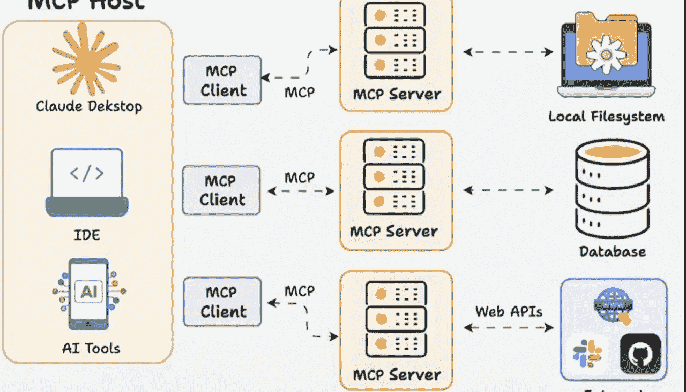
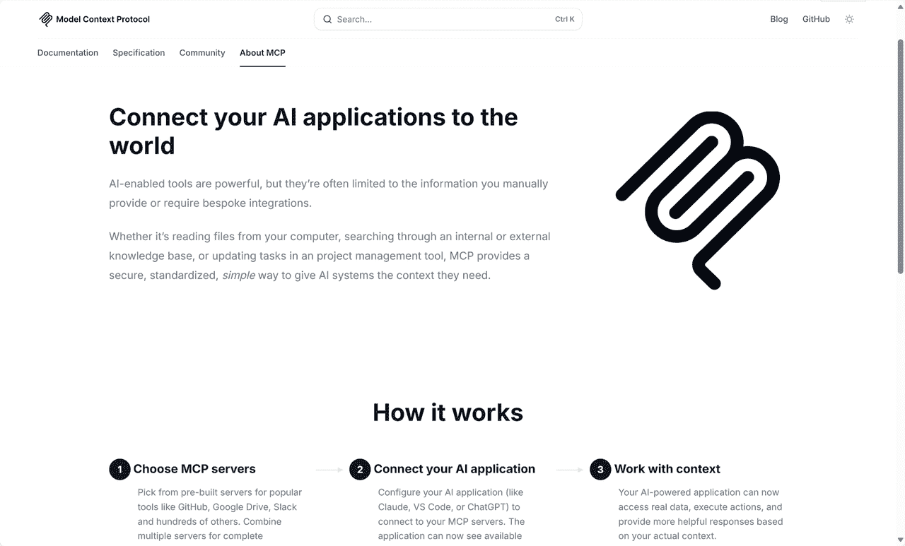

# MCP (Model Context Protocol）

> 来源：[https://gotoaiworld.feishu.cn/docx/OLgAd13Tso2ZQgxEu1McPPCjnDf](https://gotoaiworld.feishu.cn/docx/OLgAd13Tso2ZQgxEu1McPPCjnDf)

# 1.MCP：AI 应用的 “标准化接口”

一起来认识**MCP（模型上下文协议）** ——AI 应用的 “USB - C 接口”。

MCP 是开源协议，核心**是标准化上下文传**递：让 AI 应用（如 Claude Desktop、IDE、AI 工具 ）向大模型（LLM ）传上下文时，有统一标准。就像不同设备用 USB - C 互联互通，MCP 让 LLM 与数据（本地文件、数据库 ）、工具（Web API ）对接更丝滑。

看架构：MCP Cli**ent 负责发起请求**，MCP Server 做中间枢纽，打通多端（桌面端、IDE、移动端 ）与多源（文件、数据库、API ）。无论你用什么工具、什么数据，MCP 都能 “翻译” 成 LLM 懂的语言，解决 “各系统对接乱、标准不统一” 的问题。

对企业来说，MCP 能加速 AI 应用集成：不用再为每个工具、数据写专属适配代码，一套协议打通全流程。想让 LLM 调用企业私有数据、对接内部系统？MCP 就是 “通用桥梁”，降低开发成本，让 AI 能力更快落地。

掌握 M**CP ，**就是给 AI 应用装上 “标准化引擎”，让多系统协同更高效。接下来，咱们看看 MCP 怎么在实际开发中用起来！

在 AI 模型领域，结合参考文档内容，MCP（Model Context Protocol，模型上下文协议） 是一种开源协议，旨在标准化 AI 应用向大语言模型（LLM）提供上下文的方式，核心价值是为 LLM 与数据来源、工具的连接提供统一标准，类似 “AI 应用的 USB-C 接口”。

**MCP 的核心定义与定位**

**本质**：作为连接 AI 模型与各类数据、工具的标准化协议，MCP 解决了 LLM 在集成数据和工具时的兼容性、灵活性问题。就像 USB-C 通过统一接口连接不同设备（如充电器、显示器），MCP 让 LLM 能通过标准化方式对接多种数据源和服务，无需为每个接口单独适配。

**核心目标**：支持在 LLM 基础上构建智能代理（Agents）和复杂工作流，让 LLM 更高效地整合数据、调用工具，同时保障数据安全与技术灵活性。

**MCP 的核心价值与优势**

**标准化集成能力**：提供一系列预构建的集成组件，让 LLM 可直接 “接入” 各类数据源和工具，无需重复开发适配逻辑。

**灵活切换 LLM 供应商**：支持在不同 LLM 提供商（如 Anthropic、OpenAI 等）之间无缝切换，降低技术绑定风险。

**数据安全最佳实践**：确保数据在用户自有基础设施内安全流转，避免敏感信息泄露。

**简化复杂工作流构建**：为基于 LLM 的代理（Agents）和多步骤工作流提供底层协议支撑，降低开发复杂度。

MCP 的核心架构（客户端 - 服务器架构）

MCP 通过 “主机 - 客户端 - 服务器” 模式实现数据与工具的标准化连接，核心组件包括：

**

MCP 主机（Hosts**）：如 Claude Desktop、IDE 或其他 AI 工具，作为需要通过 MCP 访问数据的前端应用。

MCP 客户端（Clients）：运行在主机中的协议客户端，与服务器保持一对一连接，负责协议通信。

MCP 服务器（Servers）：轻量级程序，每个服务器通过 MCP 协议暴露特定能力（如访问本地文件、调用远程 API 等），是连接数据源 / 工具与 LLM 的桥梁。

**数据源与服务**：包括本地数据源（如电脑文件、数据库）和远程服务（如 Web API、外部系统），由 MCP 服务器安全访问并将信息传递给 LLM。

# **2.MCP 的典型应用场景**

**LLM 与本地数据集成**：通过 MCP 服务器让 Claude 等 LLM 安全访问本地文件、数据库，无需上传数据至云端。

**多工具协同调用**：支持 LLM 通过 MCP 标准化调用不同远程服务（如 API 接口、第三方工具），构建复杂工作流（如数据分析→报告生成→邮件发送）。

**跨平台 LLM 应用开发**：开发者可基于 MCP 快速构建兼容多 LLM、多数据源的 AI 工具，无需重复开发适配逻辑。

**总结**

MCP 是 AI 领域的 “标准化连接协议”，通过统一接口解决了 LLM 与数据、工具集成时的兼容性、安全性和灵活性问题，为构建高效、安全、可扩展的 LLM 应用（如智能代理、复杂工作流）提供了底层支撑，是推动 LLM 工业化落地的重要基础设施。

MCP（Model Context Protocol，模型上下文协议）

# **3.MCP GitHub**

https://github.com/modelcontextprotocol

# **4.MCP Docs**

[**h**](https://modelcontextprotocol.io/docs/getting-started/intro)ttps://modelcontextprotocol.io/docs/getting-started/intro

# 5.MCP Architecture

[h](https://modelcontextprotocol.io/docs/learn/architecture)ttps://modelcontextprotocol.io/docs/learn/architecture

# **6.MCP Tutorials**

[h](https://modelcontextprotocol.io/docs/tutorials/use-remote-mcp-server)ttps://modelcontextprotocol.io/docs/tutorials/use-remote-mcp-server