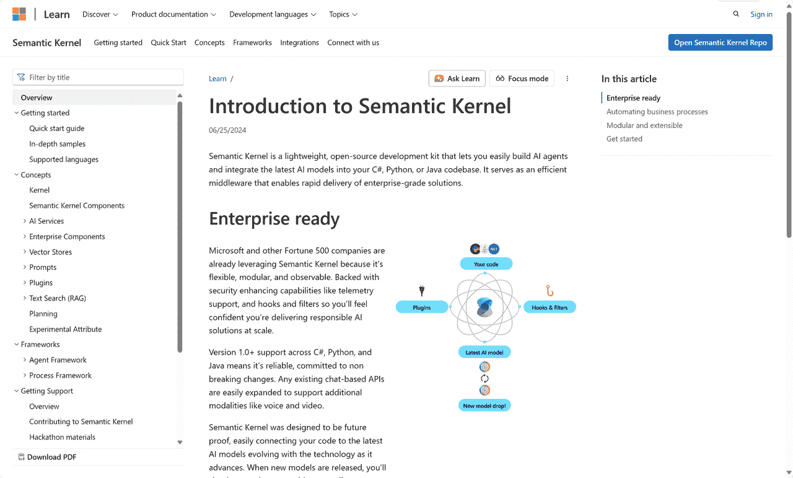
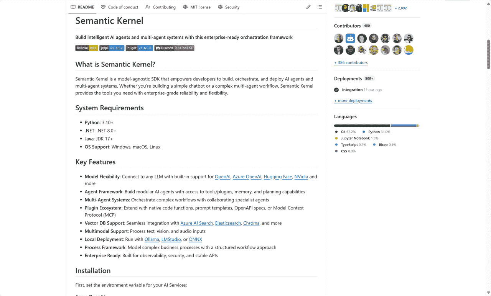
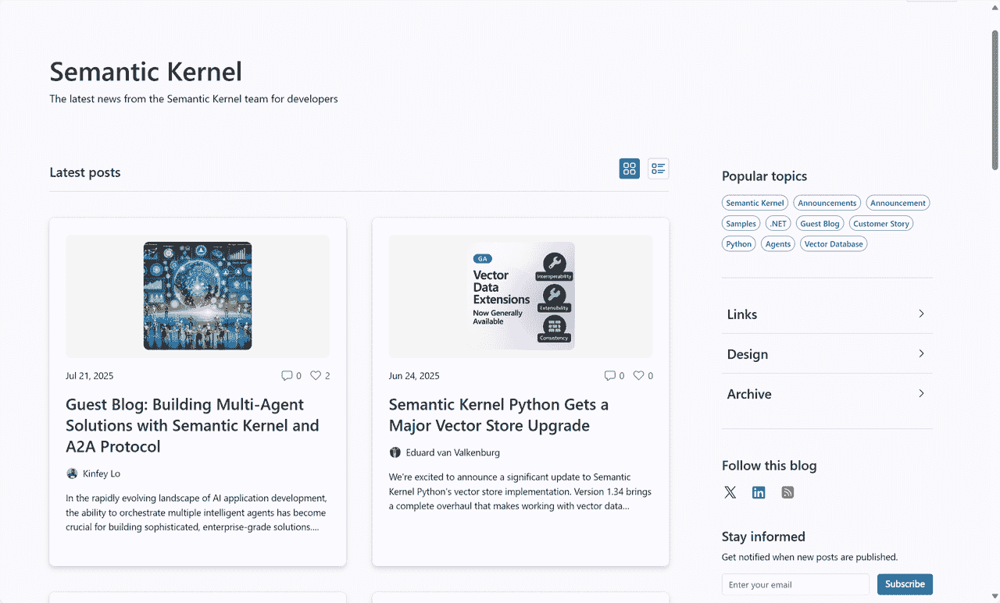

# Semantic Kernel(SK)概述

> 来源：[https://gotoaiworld.feishu.cn/docx/PdCYdFhk6oH3cdxsL6QcbUIPnFb](https://gotoaiworld.feishu.cn/docx/PdCYdFhk6oH3cdxsL6QcbUIPnFb)

# 一、Semantic Kernel(SK)

> Semantic Kernel 是一个轻量级的开源开发工具包，可让您轻松构建 AI 代理并将最新的 AI 模型集成到 C#、Python 或 Java 代码库中。它充当高效的中间件，能够快速交付企业级解决方案。

Semantic Kernel（简称 SK）是微软开发的一个开源 SDK（软件开发工具包），核心目标是桥接大语言模型（LLMs）与传统编程逻辑，帮助开发者更高效地构建 “AI 原生” 应用 —— 即让 AI 能力（如自然语言理解、推理）与现有软件系统、业务逻辑无缝融合，实现更智能的自动化和交互。

### 核心定位

SK 的本质是一个 “协同框架”：它允许开发者将自然语言定义的 AI 逻辑（如 “总结邮件”“分析用户情绪”）与传统代码（如 API 调用、数据库操作、业务规则）结合，让大语言模型不仅能处理文本，还能像 “程序员” 一样调用工具、执行复杂任务，同时保持对流程的可控性。

### 核心功能与组件

1.  双函数体系：Semantic Functions + Native Functions

+   Semantic Functions（语义函数）：用自然语言描述的逻辑（无需编写代码），由 LLM 直接执行。例如，定义一个 “邮件摘要” 函数，只需用提示词描述 “总结邮件内容，提取收件人、截止日期和核心诉求”，SK 会自动调用 LLM 生成结果。

+   Native Functions（原生函数）：用传统编程语言（如 C#、Python）编写的代码逻辑，可调用 API、操作数据库、执行计算等。例如，一个 “查询订单状态” 的原生函数，会调用企业数据库接口并返回结果。

+   两者可无缝协同：比如，先用语义函数解析用户的自然语言请求（如 “查一下我最近的订单有没有发货”），再调用原生函数执行数据库查询，最后用语义函数将结果整理成自然语言回复。

1.  规划能力（Planner）
SK 的规划器能将用户的复杂请求（如 “帮我整理本周的会议纪要，提取行动项并同步给参会人，同时在日历中创建提醒”）自动拆解为一系列函数调用（语义函数 + 原生函数），并按逻辑顺序执行，无需开发者手动编写流程。

1.  记忆管理（Memory）
支持 “短期记忆”（对话上下文）和 “长期记忆”（结构化存储的知识，如用户偏好、历史交互），让 AI 应用能记住上下文，实现连贯的多轮对话，或基于历史数据做出更智能的决策。

1.  多模型与多语言支持
兼容主流大语言模型（如 GPT-4、Claude、Llama 系列，以及 Azure OpenAI 服务），同时支持 C#、Python 等编程语言，便于不同技术栈的开发者使用。

1.  与微软生态深度集成
无缝对接微软产品体系，如 Azure（云服务）、Teams（协作平台）、Power Platform（低代码工具）等，方便企业级应用快速落地。

### 典型工作流程

1.  用户输入自然语言请求（如 “明天下午 3 点和客户开会，帮我订会议室并发送邀请”）；

1.  SK 的规划器解析请求，拆解为：

+   语义函数：提取会议时间（“明天下午 3 点”）、参与人（“客户”）；

+   原生函数：调用企业会议室预订 API、调用邮件 / 日历 API 发送邀请；

1.  执行函数链，将结果汇总后，用语义函数生成自然语言反馈（如 “会议室已预订，邀请已发送至客户邮箱”）。

### 应用场景

+   智能助手：构建能处理复杂任务的企业助手（如自动生成报告、安排日程、处理审批）；

+   业务流程自动化：将 AI 嵌入现有工作流（如客服自动响应 + 工单创建、供应链异常检测 + 通知）；

+   低代码开发：帮助非技术人员通过自然语言定义逻辑，快速搭建 AI 应用。

### 优势

+   降低 AI 与传统系统的集成门槛：无需重写现有代码，即可为系统注入 AI 能力；

+   可控性与灵活性平衡：既利用 LLM 的自然语言理解能力，又通过原生函数保证核心业务逻辑的稳定性和可审计性；

+   企业级适配：支持私有数据隔离、权限管理，符合企业安全合规要求。

### 二、核心官网资源

1.  权威文档中心
https://learn.microsoft.com/en-us/semantic-kernel/overview/

官网的 [概述页面](https://learn.microsoft.com/en-us/semantic-kernel/overview/) 详细介绍了 SK 的架构、功能和典型工作流程，包含：

+   快速入门指南：5 分钟内搭建第一个 AI 代理（如智能助手）；

+   概念详解：涵盖语义函数、规划器、记忆管理等核心组件的技术原理；

+   多语言示例：提供 C#、Python 代码片段，演示如何调用 LLM 与原生函数协同工作。

1.  GitHub 开源仓库

项目代码和社区资源托管在 [https://github.com/micro](https://github.com/microsoft/semantic-kernel)soft/semantic-kernel，包含：

+   最新版本发布：如支持多模型函数调用的 v1.4.4 版本（2025 年 6 月更新）；

+   实战样例：企业级应用示例（如工单自动化、会议智能助手）；

+   贡献指南：参与代码贡献、提交 Bug 或提出新功能建议。

1.  微软生态[集成文档
官网的 A](https://learn.microsoft.com/en-us/semantic-kernel/integrations/azure)zure 集成指南 详细说明如何与 Azure OpenAI 服务、Teams 等产品无缝对接，例如：

+   使用 Azure 云服务部署私有 AI 代理；

+   在 Teams 中嵌入 SK 驱动的智能审批机器人。

1.  开发者社区

+   Discord 技术讨论：通过 https://discord.gg/semantickernel 与微软工程师和全球开发者交流；

+   博客与更新：微软官方博客 Semantic Kernel Blog 定期发布新功能解读和行业案例。

### 三、企业级支持

官网的 [企业安全合规文档](https://learn.microsoft.com/en-us/semantic-kernel/security) 特别针对企业用户提供：

+   数据隔离方案（如私有云部署时的权限控制）；

+   审计日志与操作追踪配置指南；

+   符合 GDPR、ISO 27001 等标准的实施建议。

### 四、版本兼容性说明

+   2[025 年最新动态：官网已更新对 Llama 3.1、GP](https://github.com/microsoft/semantic-kernel-java)T-4o 等新一代模型的支持文档，并新增 Java 语言 SDK（https://github.com/microsoft/semantic-kernel-java）；

+   旧版兼容：仍保留对 v0.9 版本的技术支持文档，方便存量项目迁移。