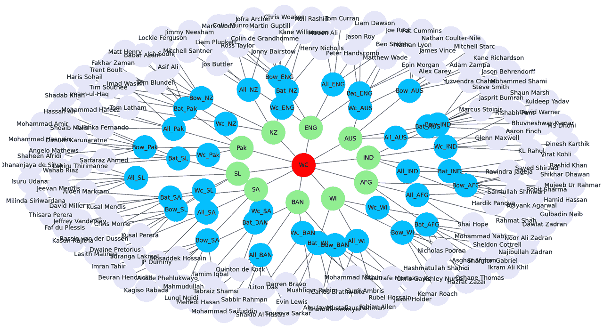

# Knowledge Graph知识图谱

> 来源：[https://gotoaiworld.feishu.cn/docx/XDl2daLkeoQHkxxFmBmcK7sJnXe](https://gotoaiworld.feishu.cn/docx/XDl2daLkeoQHkxxFmBmcK7sJnXe)

# 一、核心定义：什么是 AI 大模型知识图谱？

知识图谱：本质是一种结构化的语义知识库，通过 “实体 - 关系 - 属性” 三元组（如 “火箭发动机 - 由 - 涡轮泵 - 组成”“长征五号 - 推力 - 500 吨”）描述真实世界的概念、实体及其关联，是 “机器可理解” 的知识载体。

AI 大模型：以 GPT、DeepSeek、ERNIE 等为代表，通过海量数据训练具备强大的自然语言理解、逻辑推理、文本生成能力，但存在 “知识碎片化”“幻觉（生成错误信息）”“可解释性差” 等问题。

结合后的核心：AI 大模型知识图谱通过大模型自动抽取、构建、更新知识图谱，同时让大模型基于知识图谱的结构化知识进行推理和决策，实现 “知识结构化存储 + 大模型智能应用” 的闭环。

# 二、核心价值：为什么需要 AI 大模型知识图谱？

提升知识建模效率传统知识图谱需人工定义 schema（知识框架）、标注实体关系，耗时耗力；大模型可自动从文本（如技术文档、论文、故障报告）中抽取实体（如 “氢氧发动机”）、关系（如 “安装于”）、属性（如 “工作温度”），将知识图谱构建周期缩短 50% 以上。

增强大模型可靠性大模型单独推理时可能 “编造知识”（如错误描述导弹制导原理），而知识图谱可作为 “事实依据库”，让大模型推理时引用图谱中的权威数据（如 “导弹陀螺仪精度参数”），减少 “幻觉” 问题。

深化语义理解与复杂推理知识图谱的结构化关系（如 “火箭 - 一级箭体 - 包含 - 氧化剂贮箱”）能帮助大模型理解深层逻辑；大模型则可基于图谱进行多步推理（如 “从‘发动机振动超标’推导出‘涡轮泵叶轮磨损’，再关联‘材料疲劳参数’”）。

支撑行业知识沉淀与复用在产品研发、航天等领域，可将核心技术知识（如 “航天器热控设计规范”“导弹弹道计算模型”）沉淀为图谱，通过大模型实现自然语言查询（如 “查询长征五号姿控系统故障案例”），加速知识传递。

# 三、技术构成：核心模块与协同逻辑

AI 大模型知识图谱的核心能力依赖于 “大模型赋能知识图谱” 和 “知识图谱增强大模型” 的双向协同，具体模块包括：

模块功能描述大模型的作用知识图谱的作用知识抽取从文本 / 数据中提取实体、关系、属性基于大模型的语义理解能力，自动识别专业术语（如 “栅格舵”“导引头”）和隐含关系（如 “导弹 - 射程 - 受 - 燃料量 - 影响”）提供预定义的知识框架（schema），约束抽取方向（如只关注 “航天材料 - 性能参数”）知识融合消除实体歧义、合并重复知识（如 “‘长五’与‘长征五号’为同一实体”）通过大模型的上下文理解能力，解决歧义（如 “‘东风’可能指导弹或风速，结合航天场景锁定为导弹型号”）存储实体唯一标识和统一属性，确保知识一致性知识推理基于已有知识推导新关系（如 “已知‘发动机推力不足’和‘燃料压力低’，推导出‘阀门故障’”）提供逻辑推理能力，处理复杂因果关系（多步推理）提供推理的 “知识基础”，确保每一步推理有实体 / 关系支撑，提升可解释性知识查询与应用支持自然语言查询、知识问答、决策辅助将用户自然语言问题（如 “如何优化火箭箭体结构强度？”）转化为图谱查询逻辑，生成易懂回答快速检索关联知识（如 “箭体材料 - 强度参数 - 对应 - 结构设计标准”），支撑精准回答大模型知识注入将图谱知识 “喂给” 大模型，增强其专业能力基于图谱知识微调大模型，使其更懂垂直领域（如航天材料特性、导弹制导原理）提供结构化的 “精准知识”，避免大模型从海量数据中学习到错误信息

