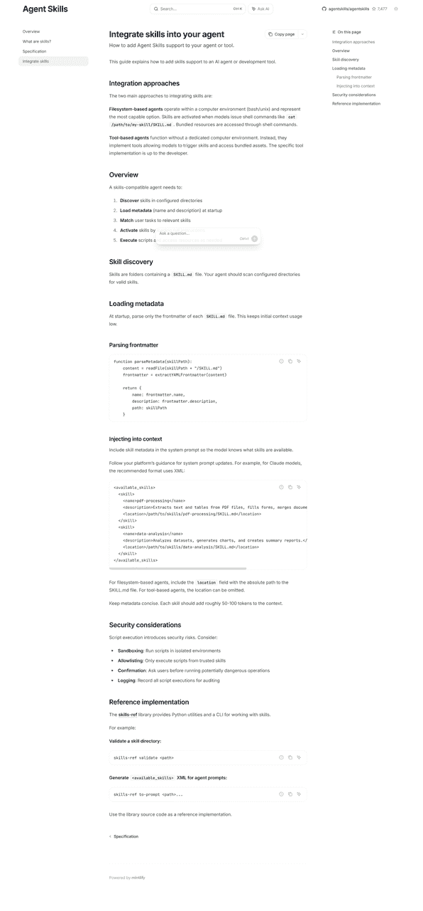

# Agent Skills Documents

> 来源：[https://gotoaiworld.feishu.cn/docx/TLkPdponlovlmpxcLlvcQ6MWnth](https://gotoaiworld.feishu.cn/docx/TLkPdponlovlmpxcLlvcQ6MWnth)

# Overview

Copy page

A simple, open format for giving agents new capabilities and expertise.

Agent Skills are folders of instructions, scripts, and resources that agents can discover and use to do things more accurately and efficiently.

https://agentskills.io/home

## Why Agent Skills?

Agents are increasingly capable, but often don’t have the context they need to do real work reliably. Skills solve this by giving agents access to procedural knowledge and company-, team-, and user-specific context they can load on demand. Agents with access to a set of skills can extend their capabilities based on the task they’re working on.For skill authors: Build capabilities once and deploy them across multiple agent products.For compatible agents: Support for skills lets end users give agents new capabilities out of the box.For teams and enterprises: Capture organizational knowledge in portable, version-controlled packages.

##

## What can Agent Skills enable?

+   Domain expertise: Package specialized knowledge into reusable instructions, from legal review processes to data analysis pipelines.

+   New capabilities: Give agents new capabilities (e.g. creating presentations, building MCP servers, analyzing datasets).

+   Repeatable workflows: Turn multi-step tasks into consistent and auditable workflows.

+   Interoperability: Reuse the same skill across different skills-compatible agent products.

##

## Adoption

Agent Skills are supported by leading AI development tools.

