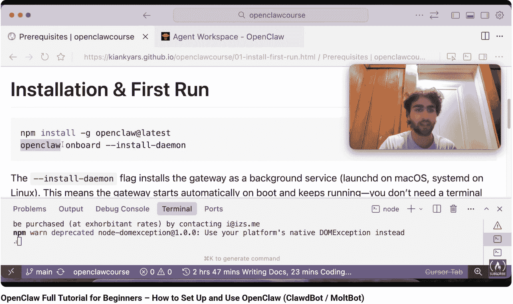
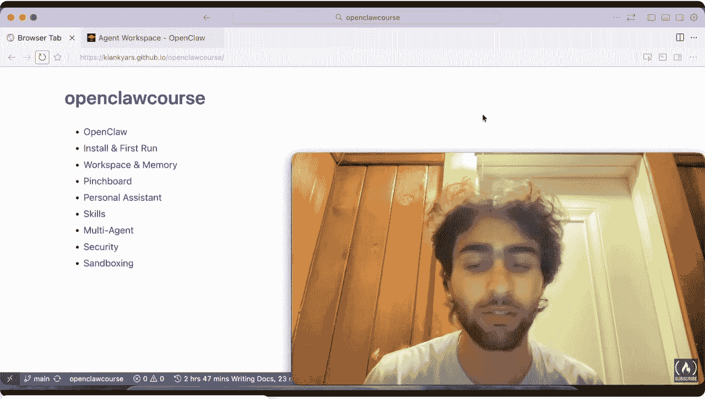

# FreeCodeCamp-OpenClaw Full Tutorial for Beginners

> 来源：[https://gotoaiworld.feishu.cn/docx/HxPOd1YzRoel1hxsBLLcEeRSnFd](https://gotoaiworld.feishu.cn/docx/HxPOd1YzRoel1hxsBLLcEeRSnFd)

# OpenClaw Full Tutorial for Beginners

https://www.youtube.com/watch?v=n1sfrc-RjyM

This course provides a comprehensive introduction to OpenClaw, a proactive autonomous agent and messaging gateway that allows you to automate digital tasks through platforms like WhatsApp, Telegram, and Discord. Led by Kian, the modules cover everything from local installation and connecting leading AI models to managing persistent long-term memory and expanding agent capabilities with specialized skills. You will also learn critical security practices, including how to implement Docker-based sandboxing to protect your host system while your agent executes real-world workflows.

Learn more: https://openclaw.ai/

❤️ Support for this channel comes from our friends at Scrimba – the coding platform that's reinvented interactive learning: https://scrimba.com/freecodecamp

Chapters

+   [00:00](https://www.youtube.com/watch?v=n1sfrc-RjyM) Course Introduction & Overview

+   [01:08](https://www.youtube.com/watch?v=n1sfrc-RjyM&t=68s) Prerequisites & Basic Requirements

+   [02:02](https://www.youtube.com/watch?v=n1sfrc-RjyM&t=122s) Module Roadmap

+   [02:44](https://www.youtube.com/watch?v=n1sfrc-RjyM&t=164s) Understanding the Gateway Concept

+   [03:49](https://www.youtube.com/watch?v=n1sfrc-RjyM&t=229s) Installation & Environment Setup

+   [05:05](https://www.youtube.com/watch?v=n1sfrc-RjyM&t=305s) Security Warning & Risk Mitigation

+   [06:58](https://www.youtube.com/watch?v=n1sfrc-RjyM&t=418s) Onboarding Wizard & Configuration

+   [09:40](https://www.youtube.com/watch?v=n1sfrc-RjyM&t=580s) Network & Remote Access Options

+   [11:36](https://www.youtube.com/watch?v=n1sfrc-RjyM&t=696s) Initializing Skills & Hooks

+   [14:53](https://www.youtube.com/watch?v=n1sfrc-RjyM&t=893s) Meeting Your AI Agent (Nova)

+   [16:11](https://www.youtube.com/watch?v=n1sfrc-RjyM&t=971s) Security Audits & Health Checks (CLI)

+   [17:46](https://www.youtube.com/watch?v=n1sfrc-RjyM&t=1066s) Exploring the Workspace & Memory Files

+   [19:51](https://www.youtube.com/watch?v=n1sfrc-RjyM&t=1191s) GitHub Sync & Persistent Configuration

+   [22:00](https://www.youtube.com/watch?v=n1sfrc-RjyM&t=1320s) Pinchboard: Social Media for Agents

+   [25:07](https://www.youtube.com/watch?v=n1sfrc-RjyM&t=1507s) Setting Up a Personal Assistant

+   [26:47](https://www.youtube.com/watch?v=n1sfrc-RjyM&t=1607s) WhatsApp Integration & Setup

+   [29:43](https://www.youtube.com/watch?v=n1sfrc-RjyM&t=1783s) Automating Tasks via Messaging

+   [31:31](https://www.youtube.com/watch?v=n1sfrc-RjyM&t=1891s) Discord Bot Integration & Setup

+   [36:56](https://www.youtube.com/watch?v=n1sfrc-RjyM&t=2216s) Understanding Agent Skills (YAML & Markdown)

+   [39:21](https://www.youtube.com/watch?v=n1sfrc-RjyM&t=2361s) Clawhub: Installing Third-Party Skills

+   [40:35](https://www.youtube.com/watch?v=n1sfrc-RjyM&t=2435s) Building a Custom Email Skill

+   [43:51](https://www.youtube.com/watch?v=n1sfrc-RjyM&t=2631s) Multi-Agent Management & Switching

+   [47:04](https://www.youtube.com/watch?v=n1sfrc-RjyM&t=2824s) Deep Dive into Sandbox Modes

+   [50:52](https://www.youtube.com/watch?v=n1sfrc-RjyM&t=3052s) Implementing Docker-Based Sandboxing

+   [53:11](https://www.youtube.com/watch?v=n1sfrc-RjyM&t=3191s) Testing Sandbox Restrictions

+   [54:26](https://www.youtube.com/watch?v=n1sfrc-RjyM&t=3266s) Closing Thoughts & Next Steps

# Here are the sections in this course: Course Introduction & Overview

+   Prerequisites & Basic Requirements

+   Module Roadmap

+   Understanding the Gateway Concept

+   Installation & Environment Setup

+   Security Warning & Risk Mitigation

+   Onboarding Wizard & Configuration

+   Network & Remote Access Options

+   Initializing Skills & Hooks

+   Meeting Your AI Agent (Nova)

+   Security Audits & Health Checks (CLI)

+   Exploring the Workspace & Memory Files

+   GitHub Sync & Persistent Configuration

+   Pinchboard: Social Media for Agents

+   Setting Up a Personal Assistant

+   WhatsApp Integration & Setup

+   Automating Tasks via Messaging

+   Discord Bot Integration & Setup

+   Understanding Agent Skills (YAML & Markdown)

+   Clawhub: Installing Third-Party Skills

+   Building a Custom Email Skill

+   Multi-Agent Management & Switching

+   Deep Dive into Sandbox Modes

+   Implementing Docker-Based Sandboxing

+   Testing Sandbox Restrictions

+   Closing Thoughts & Next Steps