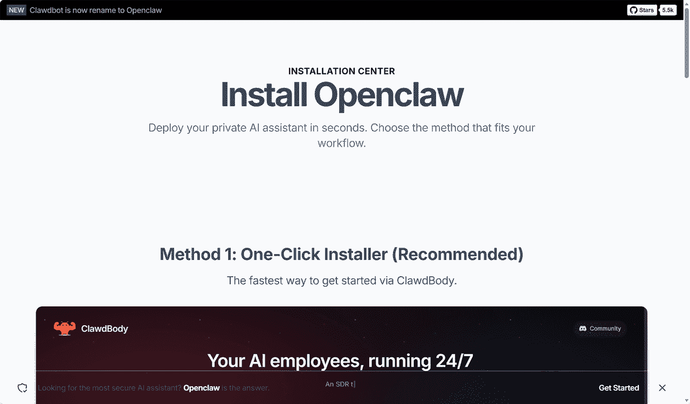

# OpenClaw WiKi 维基百科

> 来源：[https://gotoaiworld.feishu.cn/docx/Z6IydIv0ao6CuTxopJLcW3xYnOb](https://gotoaiworld.feishu.cn/docx/Z6IydIv0ao6CuTxopJLcW3xYnOb)

OpenClaw WiKi

[http](https://openclawwiki.org/docs/getting-started/quick-start/)s:/[/ope](https://openclawwiki.org/blog/)ncl[awwiki.or](https://openclawwiki.org/moltbot-to-openclaw/)g/

[Docs  ](https://openclawwiki.org/skills/) B[log   Mi](https://openclawwiki.org/showcase/)gration   Skills  Showcase  Tools

# Unlock the Power of Openclaw

# **Formerl**y kno**wn as Mo**ltbot and Clawdbot.Your Private AI Assistant.Build your own self-hosted AI on Mac Mini M4. Secure, fast, and completely yours.

## OpenClaw Docs

https://openclawwiki.org/docs/getting-started/quick-start

## OpenClaw Blog

https://openclawwiki.org/blog

## OpenClaw Skills

https://openclawwiki.org/skills

## OpenClaw Showcase

https://openclawwiki.org/showcase

## OpenClaw Tools

https://openclawwiki.org/tools

## OpenClaw Installation

https://openclawwiki.org/install-openclaw

