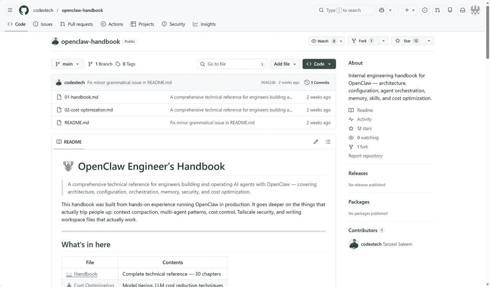

# OpenClaw Engineer's Handbook

> 来源：[https://gotoaiworld.feishu.cn/docx/PxbTdTzytoiOSSx9vHXcTTqtns5](https://gotoaiworld.feishu.cn/docx/PxbTdTzytoiOSSx9vHXcTTqtns5)

# OpenClaw Engineer's Handbook

> A comprehensive technical reference for engineers building and operating AI agents with OpenClaw — covering architecture, configuration, orchestration, memory, security, and cost optimization.

This handbook was built from hands-on experience running OpenClaw in production. It goes deeper on the things that actually trip people up: context compaction, multi-agent patterns, cost control, Tailscale security, and writing workspace files that actually work.

https://github.com/codextech/openclaw-handbook

## What's in here

---

## Handbook — Table of Contents

### Foundation

+   1. What is OpenClaw — Architecture positioning, how it differs from ChatGPT, core concepts

+   2. Installation & First Run — Prerequisites, npm install, onboarding wizard, .env setup

+   3. Core Architecture — Gateway vs. Agent Runtime, WebSocket protocol, the agentic loop, command queue

### Configuration & Files

+   4. Configuration Reference — Full annotated openclaw.json, every setting explained

+   5. File Structure — Every file in ~/.openclaw/ and the workspace, what each one does

+   6. Sessions & Agent Channels — Session lifecycle, DM scope, channel bindings and routing

### Scheduling

+   7. Heartbeat vs. Cron — Full breakdown, config examples, when to use which, comparison table

### Agent Orchestration

+   [8. Agent Orchestration & ](https://github.com/codextech/openclaw-handbook/blob/main/01-handbook.md#8-agent-orchestration--multi-agent-patterns)Multi-Agent Patterns — Sub-agents, orchestrator pattern, spawn depth, agent-to-agent communication

### Memory

+   9. Managing Agent Memory — Three memory layers, daily logs, vector search, Mem0/Cognee integrations

+   [10. Context Window Man](https://github.com/codextech/openclaw-handbook/blob/main/01-handbook.md#10-context-window-management--compaction)agement & Compaction — The compaction danger, pre-flush config, context pruning

### Security & Permissions

+   [11. Sandbox Mode](https://github.com/codextech/openclaw-handbook/blob/main/01-handbook.md#11-sandbox-modes--tool-permissions)s & Tool Permissions — off/non-main/all modes, tools.allow/deny, available tool groups

+   [22. Securing Ope](https://github.com/codextech/openclaw-handbook/blob/main/01-handbook.md#22-securing-openclaw-with-tailscale)nClaw with Tailscale — Serve vs. Funnel, setup walkthrough, security best practices

### Skills & Integrations

+   12. Adding Skills & MCP Integration — Skill format, ClawHub, custom skills, MCP servers, skills vs. MCP

+   13. Channel Setup Guides — WhatsApp, Telegram, Slack, Discord step-by-step

+   18. Browser Automation — All browser tool calls, real examples, config

### Operations

+   [14. Access Contro](https://github.com/codextech/openclaw-handbook/blob/main/01-handbook.md#14-access-control--multi-user-setup)l & Multi-User Setup — allowFrom, dmPolicy, pairing flow, session isolation

+   15. Slash Commands — Full Reference — Every /command with description

+   19. Auth Profiles & Model Failover — auth-profiles.json, failover chain logic, monitoring

+   [23. WebChat UI](https://github.com/codextech/openclaw-handbook/blob/main/01-handbook.md#23-webchat-ui) — Local browser interface, when to use it vs. messaging apps

### Advanced

+   [16. Writing Effec](https://github.com/codextech/openclaw-handbook/blob/main/01-handbook.md#16-writing-effective-workspace-files)tive Workspace Files — AGENTS.md, SOUL.md, USER.md, HEARTBEAT.md, MEMORY.md best practices with real examples

+   17. Lobster — The Workflow Engine — YAML syntax, LLM task steps, approval gates, loops

+   20. Hooks System — TypeScript lifecycle hooks with code examples

+   21. Canvas (A2UI) — Visual workspace, tool calls, use cases

### Reliability & Cost

+   24. Privacy & Data Flow Map — Exactly what leaves your machine, local-only config

+   [25. Backup, Reco](https://github.com/codextech/openclaw-handbook/blob/main/01-handbook.md#25-backup-recovery--disaster-prep)very & Disaster Prep — Git backup strategy, golden config, recovery procedure

+   [26. Troubleshooti](https://github.com/codextech/openclaw-handbook/blob/main/01-handbook.md#26-troubleshooting--openclaw-doctor)ng & openclaw doctor — Common failures with fix commands

+   27. Performance Tuning — Concurrency, debounce, context pruning, model selection

### Reference

+   [28. How OpenClaw Diff](https://github.com/codextech/openclaw-handbook/blob/main/01-handbook.md#28-how-openclaw-differs-from-other-tools)ers From Other Tools — vs. LangChain, CrewAI, n8n, OpenAI Assistants

+   29. Deployment Patterns — Mac Mini, VPS, Docker, multi-agent setup

+   30. Security Audit Checklist — 30-point pre-production checklist

---

## Cost Optimization — Table of Contents

+   The Core Principle

+   Model Tiers — What They Cost — Heavy hitters, workhorses, micro-models

+   [Technique 1 — Per-ag](https://github.com/codextech/openclaw-handbook/blob/main/02-cost-optimization.md#technique-1--per-agent-model-assignment)ent model assignment

+   [Technique 2 — Per-cron-](https://github.com/codextech/openclaw-handbook/blob/main/02-cost-optimization.md#technique-2--per-cron-job-model-assignment)job model assignment

+   [Technique 3 — Heartbeat](https://github.com/codextech/openclaw-handbook/blob/main/02-cost-optimization.md#technique-3--heartbeat-with-the-cheapest-model) with cheapest model

+   [Technique 4 — Sub](https://github.com/codextech/openclaw-handbook/blob/main/02-cost-optimization.md#technique-4--sub-agent-model-tiering)-agent model tiering

+   Technique 5 — Context pruning

+   [Technique 6 — Compact](https://github.com/codextech/openclaw-handbook/blob/main/02-cost-optimization.md#technique-6--compaction-threshold-tuning)ion threshold tuning

+   Technique 7 — Daily session reset

+   [Technique 8 — Slim ](https://github.com/codextech/openclaw-handbook/blob/main/02-cost-optimization.md#technique-8--slim-down-workspace-files)down workspace files

+   Technique 9 — Lazy skill loading

+   [Technique 10 — Loc](https://github.com/codextech/openclaw-handbook/blob/main/02-cost-optimization.md#technique-10--local-models-via-ollama-for-appropriate-tasks)al models via Ollama

+   Technique 11 — Queue debounce

+   [Decision Framework —](https://github.com/codextech/openclaw-handbook/blob/main/02-cost-optimization.md#decision-framework--which-model-to-pick) Which model to pick

+   Quick Wins Checklist

---

## Who this is for

Engineers and developers who are:

+   Setting up OpenClaw for the first time and want to go beyond the basics

+   Running OpenClaw in production and hitting edge cases

+   Building multi-agent systems and want reference patterns

+   Trying to reduce LLM API costs without sacrificing capability

+   Deploying OpenClaw for a team and need to think about security and access control

---

## Prerequisites assumed

+   Comfortable with terminal and JSON config files

+   Basic understanding of how LLMs work (context windows, tokens, tool use)

+   Familiarity with concepts like cron expressions, WebSockets, and environment variables

No prior OpenClaw experience required — the handbook starts from installation.

---

## Contributing

Found something wrong, outdated, or missing? PRs are welcome.

+   Corrections — open a PR directly

+   New sections — open an issue first to discuss scope

+   Config examples — especially welcome, the more real-world the better

Please keep examples generic (no real API keys, no personal details).

---

## Resources

+   OpenClaw Official Docs

+   [OpenClaw GitHub](https://github.com/openclaw/openclaw)

+   ClawHub Skills Registry

+   OpenClaw Discord

https://github.com/codextech/openclaw-handbook

## Table of Contents

1.  What is OpenClaw

1.  Installation & First Run

1.  [Core Architecture & How](https://github.com/codextech/openclaw-handbook/blob/main/01-handbook.md#3-core-architecture--how-it-works-internally) It Works Internally

1.  Configuration Reference

1.  [File Structure — ](https://github.com/codextech/openclaw-handbook/blob/main/01-handbook.md#5-file-structure--every-file-explained)Every File Explained

1.  Sessions & Agent Channels

1.  [Heartbeat vs. Cron ](https://github.com/codextech/openclaw-handbook/blob/main/01-handbook.md#7-heartbeat-vs-cron--complete-breakdown)— Complete Breakdown

1.  [Agent Orchestration & ](https://github.com/codextech/openclaw-handbook/blob/main/01-handbook.md#8-agent-orchestration--multi-agent-patterns)Multi-Agent Patterns

1.  Managing Agent Memory

1.  [Context Window Man](https://github.com/codextech/openclaw-handbook/blob/main/01-handbook.md#10-context-window-management--compaction)agement & Compaction

1.  Sandbox Modes & Tool Permissions

1.  Adding Skills & MCP Integration

1.  Channel Setup Guides

1.  Access Control & Multi-User Setup

1.  Slash Commands — Full Reference

1.  Writing Effective Workspace Files

1.  Lobster — The Workflow Engine

1.  Browser Automation

1.  Auth Profiles & Model Failover

1.  [Hooks System](https://github.com/codextech/openclaw-handbook/blob/main/01-handbook.md#20-hooks-system)

1.  [Canvas (A2UI)](https://github.com/codextech/openclaw-handbook/blob/main/01-handbook.md#21-canvas-a2ui)

1.  Securing OpenClaw with Tailscale

1.  [WebChat UI](https://github.com/codextech/openclaw-handbook/blob/main/01-handbook.md#23-webchat-ui)

1.  Privacy & Data Flow Map

1.  Backup, Recovery & Disaster Prep

1.  Troubleshooting & openclaw doctor

1.  Performance Tuning

1.  [How OpenClaw Diff](https://github.com/codextech/openclaw-handbook/blob/main/01-handbook.md#28-how-openclaw-differs-from-other-tools)ers From Other Tools

1.  Deployment Patterns

1.  Security Audit Checklist