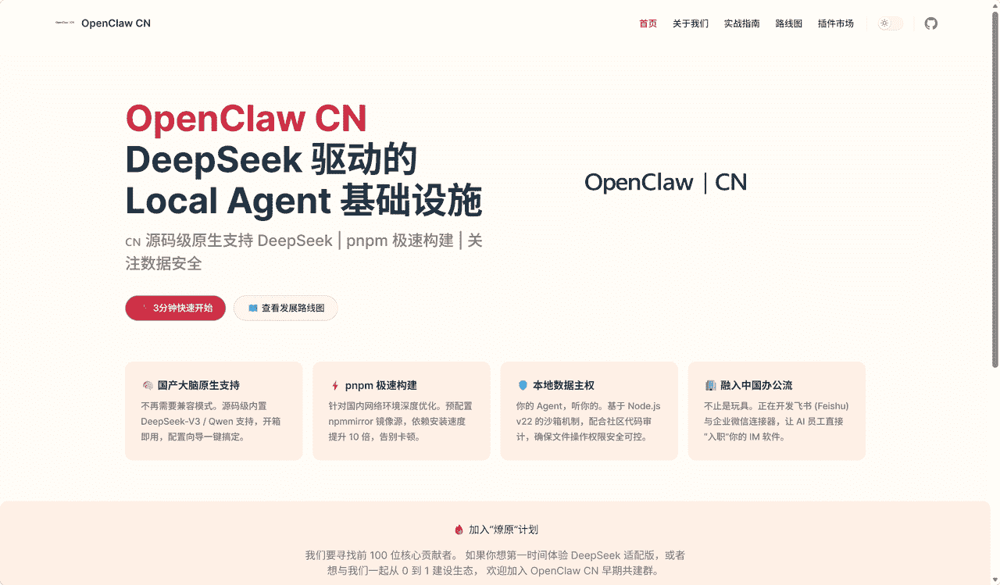

#  OpenClaw 中国社区

> 来源：[https://gotoaiworld.feishu.cn/docx/NbB6dRzcyo3gemxg4koc0u51n2c](https://gotoaiworld.feishu.cn/docx/NbB6dRzcyo3gemxg4koc0u51n2c)

https://open-claw.org.cn/



# OpenClaw CN 发展路线图

OpenClaw CN 刚刚起步。我们拒绝画大饼，我们只做看得见、摸得着的迭代。以下是我们 2026 年前两个季度的核心作战计划。

## [🚀](https://open-claw.org.cn/roadmap/#%F0%9F%9A%80-%E7%AC%AC%E4%B8%80%E9%98%B6%E6%AE%B5-%E7%AD%91%E5%9F%BA-2026-q1-2%E6%9C%88) 第一阶段：筑基 (2026 Q1 - 2月)#

目标：跑通流程，扫清障碍，让 DeepSeek 能在 OpenClaw 上“丝滑”运行。

+   [x] 基础设施搭建

+   [x] 完成 Gitee/GitHub 双向同步管道

+   [x] 上线基于 VitePress 的中文官网

+   [x] 部署国内 CDN 加速与域名备案体系

+   [x] 文档本土化

+   [x] 核心文档《快速开始》中文化与环境适配修正

+   [x] 上线 DeepSeek 专属配置指南

+   [x] 国产模型适配 (里程碑)

+   [x] DeepSeek 源码级原生支持：实现 provider: deepseek，无需代理配置。

+   [x] DeepSeek R1/V3 专项适配：完成 Onboard 向导集成。

## [🔗](https://open-claw.org.cn/roadmap/#%F0%9F%94%97-%E7%AC%AC%E4%BA%8C%E9%98%B6%E6%AE%B5-%E8%BF%9E%E6%8E%A5-2026-q1-3%E6%9C%88) 第二阶段：连接 (2026 Q1 - 3月)#

目标：建立生态，连接中国特有的互联网服务。

+   [ ] 插件生态 (Plugins)

+   [ ] 飞书 (Feishu) 连接器：开发 Webhook 插件，让 Agent 入驻飞书群。

+   [ ] 企业🛰️ (WeCom) 连接器：支持通过企业🛰️接收指令。

+   [ ] 中文搜索增强：集成必应/百度搜索 API，优化中文语境下的检索能力。

+   [ ] 社区建设

+   [ ] 上线“贡献者墙”，自动同步 Gitee/GitHub 贡献头像。

+   [ ] 设立“Issue 悬赏榜”，发布急需解决的 Bug 或功能。

## [🌳](https://open-claw.org.cn/roadmap/#%F0%9F%8C%B3-%E7%AC%AC%E4%B8%89%E9%98%B6%E6%AE%B5-%E7%B9%81%E8%8D%A3-2026-q2) 第三阶段：繁荣 (2026 Q2)#

目标：落地商业场景，打造“基于 Agent 的超级产品”。

+   [ ] Killer Apps (杀手级场景 Demo)

+   [ ] 全网聚合跑腿助手 (Gig Worker Agent)：

+   场景：Agent 同时监听美团、饿了么、闪送等多个网页端后台。

+   价值：自动抓取高价值订单，统一通过飞书推送给跑腿师傅，师傅在飞书一键抢单，无需在多个 App 间切换。

+   [ ] 售后服务闭环系统 (Service Loop Agent)：

+   场景：家电/维修师傅上门服务。

+   流程：师傅在飞书填写维修结果 -> Agent 自动登录京东/天猫/各品牌售后后台 -> 自动填写复杂的回执表单并上传照片。

+   价值：将繁琐的“填表工作”自动化，让师傅专注于技术服务。

+   [ ] 开发者工具

+   [ ] 推出 OpenClaw CN 命令行工具 (CLI)，一行命令完成环境初始化。

# 快速开始[#](https://open-claw.org.cn/guide/getting-started#%E2%9A%A1-%E5%BF%AB%E9%80%9F%E5%BC%80%E5%A7%8B)

欢迎来到 OpenClaw 中国社区。本指南将帮助你在 3 分钟内，在本地电脑上启动并运行一个纯净、安全的 OpenClaw Agent。

## 🛠️ 环境准备#

OpenClaw CN 引入了最新的底层安全机制与构建工具，请确保环境满足以下要求：

+   [Node.js：必须 >= ](https://nodejs.org/zh-cn)v22.0.0 (下载 Node.js v22)

+   包管理器：强制推荐使用 pnpm (npm 在处理依赖树时可能会卡死)

+   Git：用于下载代码 ([下载 Git](https://git-scm.com/))

### [安](https://open-claw.org.cn/guide/getting-started#%E5%AE%89%E8%A3%85-pnpm-%E5%A6%82%E6%9E%9C%E4%BD%A0%E8%BF%98%E6%B2%A1%E6%9C%89)装 pnpm (如果你还没有)#

bash

```
npm install -g pnpm
```

## 🚀 安装步骤#

### 下载代码与版本选择[#](https://open-claw.org.cn/guide/getting-started#_1-%E4%B8%8B%E8%BD%BD%E4%BB%A3%E7%A0%81%E4%B8%8E%E7%89%88%E6%9C%AC%E9%80%89%E6%8B%A9)

为了确保国内访问速度，请从 Gitee 镜像仓库下载。 为了获得最稳定的体验，推荐切换到最新的稳定版分支：

bash

```
# 1. 克隆仓库git clone https://gitee.com/OpenClaw-CN/openclaw-cn.gitcd openclaw-cn# 2. (推荐) 切换到稳定版分支，例如：v2026.2.2-cn# 你可以通过 git tag 查看所有版本git checkout v2026.2.2-cn
```

### 配置国内加速 (关键！)[#](https://open-claw.org.cn/guide/getting-started#_2-%E9%85%8D%E7%BD%AE%E5%9B%BD%E5%86%85%E5%8A%A0%E9%80%9F-%E5%85%B3%E9%94%AE)

在安装依赖前，务必设置 pnpm 镜像源，否则下载速度会很慢：

bash

```
pnpm config set registry https://registry.npmmirror.com/
```

### 安装与构建[#](https://open-claw.org.cn/guide/getting-started#_3-%E5%AE%89%E8%A3%85%E4%B8%8E%E6%9E%84%E5%BB%BA)

OpenClaw 是一个现代化的全栈应用，首次运行需要编译前端 UI 和后端核心：

bash

```
# 安装依赖 (飞快 🚀)pnpm install# 构建前端界面pnpm ui:build# 构建核心服务pnpm build
```

### 启动初始化向导[#](https://open-claw.org.cn/guide/getting-started#_4-%E5%90%AF%E5%8A%A8%E5%88%9D%E5%A7%8B%E5%8C%96%E5%90%91%E5%AF%BC)

我们提供了交互式的初始化工具，帮你一键配置 DeepSeek：

bash

```
pnpm openclaw onboard --install-daemon
```

**💡 提示**

在向导中，Select Provider 步骤请直接选择 DeepSeek (Recommended for CN)，系统会自动完成所有配置。

### 启动服务 (初始化完成后)[#](https://open-claw.org.cn/guide/getting-started#_5-%E5%90%AF%E5%8A%A8%E6%9C%8D%E5%8A%A1-%E5%88%9D%E5%A7%8B%E5%8C%96%E5%AE%8C%E6%88%90%E5%90%8E)

初始化完成后，你可以通过以下命令再次启动网关服务（前提是网关已经关闭）：

bash

```
# 启动网关 (Gateway)node openclaw.mjs gateway --port 18789 --verbose
```

如果你关闭了管理页面，可以通过以下命令再次打开：

bash

```
# 打开管理面板 (Dashboard)node openclaw.mjs dashboard
```

## 🎯 你的第一个任务#

启动成功后，进入管理面板或交互式命令行，试着给 Agent 下达第一个指令：

> "请帮我在桌面上创建一个名为 hello_openclaw.txt 的文件，并在里面写入：大道至简，实战落地。"

Agent 将会自动规划任务、调用文件系统 API，并完成操作。