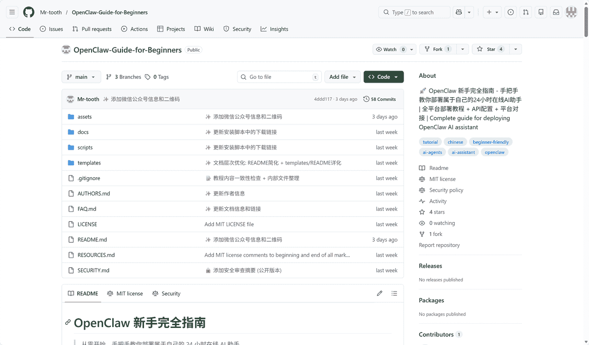

# OpenClaw-Guide-for-Beginners

> 来源：[https://gotoaiworld.feishu.cn/docx/WmuddwL5RoG8atxiF89cMIYmnZf](https://gotoaiworld.feishu.cn/docx/WmuddwL5RoG8atxiF89cMIYmnZf)

OpenClaw 新手完全指南 - 手把手教你部署属于自己的24小时在线AI助手 | 全平台部署教程 + API配置 + 平台对接 | Complete guide for deploying OpenClaw AI assistant

https://github.com/Mr-tooth/OpenClaw-Guide-for-Beginners



# OpenClaw 新手完全指南

> 从零开始，手把手教你部署属于自己的 24 小时在线 AI 助手

## 📖 项目简介

OpenClaw（原名 Clawdbot、Moltbot）是一个开源的个人 AI 助手平台，在短短 3 周内突破 190,000+ Stars，成为 GitHub 历史上增长最快的开源项目之一。

核心特性：

+   🤖 真正的 AI Agent —— 不只是聊天，还能执行操作

+   🔒 本地运行 —— 数据完全由你掌控

+   🌐 多平台对接 —— 支持飞书、钉钉、微信、Telegram 等

+   ⚡ 24小时在线 —— 云服务器部署全天候待命

+   🛠️ 1700+ Skills —— 丰富的技能扩展库

## 🚀 快速开始

根据你的平台选择对应教程：

## 💰 API 平台推荐

OpenClaw 需要接入大模型 API 才能运行。以下是各平台的优惠信息：

💡 新手建议：先注册硅[基流动体](https://cloud.siliconflow.cn/i/lva59yow)验免费额度，再根据需求选择其他平台。

👉 查[看详细 API 配置教程 ](https://github.com/Mr-tooth/OpenClaw-Guide-for-Beginners/blob/main/docs/api-config/api-configuration.md)| 模[型选择指南 ](https://github.com/Mr-tooth/OpenClaw-Guide-for-Beginners/blob/main/docs/api-config/model-comparison.md)| 成[本优化](https://github.com/Mr-tooth/OpenClaw-Guide-for-Beginners/blob/main/docs/api-config/cost-optimization.md)

## ☁️ 云服务器推荐

想要 24 小时在线的 AI 助手？推荐使用云服务器部署：

### 阿里云（推荐）

OpenClaw 专属活动页，通过我的链接注册享受独家优惠：

[🔗 立即部署 - 半小时搞定](https://www.aliyun.com/activity/ecs/clawdbot?userCode=yyzsc1al)

专属福利:

+   🎁 普惠套餐（2核2G不限流量，99元/年，新用户 68元/年 起）

+   🔗 阿里百炼 AI 大模型 88% 折扣

+   💎 建站三件套（域名+服务器+AI建站，百元搞定）

+   ⏰ 半小时内完成部署

### 云服务商对比

👉 查[看云服务器部署教程 ](https://github.com/Mr-tooth/OpenClaw-Guide-for-Beginners/blob/main/docs/cloud/cloud-deployment-guide.md)| 阿[里云专属教程 ](https://github.com/Mr-tooth/OpenClaw-Guide-for-Beginners/blob/main/docs/cloud/aliyun-guide.md)| 腾[讯云专属教程](https://github.com/Mr-tooth/OpenClaw-Guide-for-Beginners/blob/main/docs/cloud/tencent-guide.md)

## 📱 平台对接

OpenClaw 支持对接多种消息平台：

## 🎯 学习路径

根据你的经验选择合适的学习路径：

### 🌱 新手入门路径

1.  阅读 [5分钟快速上手](https://github.com/Mr-tooth/OpenClaw-Guide-for-Beginners/blob/main/docs/start/quickstart.md)

1.  根据系统选择安装教程（Windows/macOS/Linux）

1.  配置 API ([API配置详解](https://github.com/Mr-tooth/OpenClaw-Guide-for-Beginners/blob/main/docs/api-config/api-configuration.md))

1.  对接第一个平台（推荐钉钉或飞书）

1.  遇到问题查看 [FAQ](https://github.com/Mr-tooth/OpenClaw-Guide-for-Beginners/blob/main/FAQ.md)

### 🚀 服务器部署路径

1.  阅读 [云服务器部署指南](https://github.com/Mr-tooth/OpenClaw-Guide-for-Beginners/blob/main/docs/cloud/cloud-deployment-guide.md)

1.  选择云服务商（推荐[阿里云](https://www.aliyun.com/activity/ecs/clawdbot?userCode=yyzsc1al)）

1.  配置服务器和域名

1.  部署 OpenClaw

1.  对接消息平台

### 🔧 进阶开发路径

1.  熟悉基础配置

1.  学习 [技能开发](https://github.com/Mr-tooth/OpenClaw-Guide-for-Beginners/blob/main/docs/advanced/skills.md)

1.  研究 [安全配置](https://github.com/Mr-tooth/OpenClaw-Guide-for-Beginners/blob/main/docs/advanced/security.md)

1.  掌握 [故障排查](https://github.com/Mr-tooth/OpenClaw-Guide-for-Beginners/blob/main/docs/advanced/troubleshooting.md)

---

## 📚 目录结构

```
OpenClaw-Guide-for-Beginners/
├── README.md                    # 项目首页（本文件）
├── AUTHORS.md                   # 作者信息
├── FAQ.md                       # 常见问题解答
├── RESOURCES.md                 # 资源汇总
├── docs/                        # 教程文档目录
│   ├── start/                   # 快速开始
│   │   └── quickstart.md        # 5分钟快速上手
│   ├── windows/                 # Windows 相关教程
│   │   └── windows-install-guide.md
│   ├── wsl/                     # WSL 相关教程
│   │   ├── wsl-setup.md         # WSL 安装配置
│   │   ├── wsl-troubleshooting.md
│   │   └── wsl-advanced.md      # WSL 高级配置
│   ├── macos/                   # macOS 相关教程
│   │   └── macos-install-guide.md
│   ├── linux/                   # Linux 相关教程
│   │   └── linux-install-guide.md
│   ├── docker/                  # Docker 部署教程
│   │   ├── docker-deployment.md      # Docker 基础部署
│   │   ├── docker-production.md      # Docker 生产部署
│   │   ├── docker-cloud-deployment.md # Docker Cloud 部署
│   │   └── docker-troubleshooting.md
│   ├── cloud/                   # 云服务器相关教程
│   │   ├── cloud-deployment-guide.md
│   │   ├── aliyun-guide.md      # 阿里云专属教程
│   │   └── tencent-guide.md    # 腾讯云教程
│   ├── android/                 # Android 相关教程
│   │   └── android-deployment-guide.md
│   ├── api-config/              # API 配置教程
│   │   ├── api-configuration.md
│   │   ├── model-comparison.md  # 模型选择指南
│   │   └── cost-optimization.md # 成本优化指南
│   ├── platform-integration/    # 平台对接教程
│   │   ├── platform-integration-overview.md
│   │   ├── feishu-integration.md
│   │   ├── dingtalk-integration.md
│   │   ├── telegram-integration.md
│   │   └── wechat-integration.md
│   └── advanced/                # 进阶主题
│       ├── security.md          # 安全配置指南
│       ├── skills.md            # 技能开发与使用
│       └── troubleshooting.md   # 故障排除
├── scripts/                     # 安装脚本
│   ├── install-windows.bat      # Windows 安装脚本
│   ├── install-wsl.ps1          # WSL 安装脚本
│   ├── install-linux.sh         # Linux 安装脚本
│   ├── install-macos.sh         # macOS 安装脚本
│   └── install-docker.sh        # Docker 安装脚本
├── images/                      # 教程图片
└── templates/                   # 配置模板
    ├── README.md                # 模板使用指南
    ├── openclaw-template.json   # 主配置模板
    └── env-template.txt         # 环境变量模板
```

## ⚙️ 配置模板和脚本

> ⚠️ 重要: 模板文件仅供参考，请勿直接覆盖你的配置文件！！！

---

### 📋 配置模板

项目提供了配置模板供参考，适用于理解配置结构，粘贴局部内容，不推荐直接覆盖使用。

⚠️ 为什么不能直接覆盖？

模板文件缺少系统配置（meta、wizard、browser、auth），直接覆盖会导致：

+   ❌ openclaw doctor 报错

+   ❌ Gateway 启动失败

+   ❌ 丢失浏览器和认证配置

✅ 推荐的使用方法：

1.  使用配置向导（推荐新手）

1.  openclaw onboard --install-daemon

1.  使用命令行配置

1.  openclaw config set provider siliconflow
openclaw config set api_key sk-xxxxxxxx

1.  手动编辑配置文件

1.  nano ~/.openclaw/openclaw.json
# 只修改需要的字段，不要删除系统字段！

详细使用指南: [查看模板使用指南](https://github.com/Mr-tooth/OpenClaw-Guide-for-Beginners/blob/main/templates/README.md)

---

### 🛠️ 一键安装脚本

> ⚠️ 慎重使用: 适用于全新安装，不适用于已有Open

Claw环境的用户

使用方法（以Linux为例）:

# 下载并运行

curl -fsSL https://raw.githubusercontent.com/Mr-tooth/OpenClaw-Guide-for-Beginners/main/scripts/install-linux.sh | bash

# 或分步执行

curl -O https://raw.githubusercontent.com/Mr-tooth/OpenClaw-Guide-for-Beginners/main/scripts/install-linux.sh

chmod +x install-linux.sh

./install-linux.sh

脚本功能:

+   ✅ 自动检测系统环境

+   ✅ 安装 Node.js（如未安装）

+   ✅ 安装 OpenClaw

+   ✅ 运行配置向导

+   ✅ 提供后续配置指导

---

### 🔐 配置验证

无论使用哪种方法配置，最后都要验证：

# 运行诊断

openclaw doctor

# 检查模型配置

openclaw models list

# 检查 Gateway 状态

openclaw gateway status

预期输出:

```
✅ OpenClaw CLI: 已安装 v2026.2.19
✅ Node.js: 已安装 v22.22.0
✅ Gateway: 运行中
✅ 模型配置: 正常
```

---

详细教程: [API配置](https://github.com/Mr-tooth/OpenClaw-Guide-for-Beginners/blob/main/docs/api-config/api-configuration.md) | [快速上手](https://github.com/Mr-tooth/OpenClaw-Guide-for-Beginners/blob/main/docs/start/quickstart.md)

## ❓ 常见问题

### Q: 哪个 API 平台最推荐？

A: 推荐根据你的需求选择：

+   新手入门：硅基流动（免费额度多，上手简单）

+   性价比优先：火山方舟 Coding Plan（首月仅8.91元）

+   长期使用：智谱 GLM Coding Plan（年付优惠力度大）

+   阿里生态用户：阿里百炼（与阿里云整合好）

### Q: 配置文件在哪里？

A:

+   主配置: ~/.openclaw/openclaw.json

+   环境变量: ~/.openclaw/.env

+   工作空间: ~/.openclaw/workspace

### Q: 如何重置配置？

A:

# 删除配置文件（⚠️ 慎重操作）

rm ~/.openclaw/openclaw.json

# 重新运行配置向导

openclaw onboard --install-daemon

### Q: 如何备份配置？

A:

# 备份到当前目录

cp ~/.openclaw/openclaw.json ./openclaw-backup.json

cp ~/.openclaw/.env ./env-backup.txt 2>/dev/null || true# 或创建备份目录

mkdir -p ~/openclaw-backup

cp -r ~/.openclaw/* ~/openclaw-backup/

### Q: 配置文件格式错误怎么办？

A:

# 1. 使用 openclaw doctor 诊断

openclaw doctor

# 2. 使用 JSON 验证工具

cat ~/.openclaw/openclaw.json | python3 -m json.tool

# 3. 如果无法修复，备份并重新初始化

cp ~/.openclaw/openclaw.json ~/.openclaw/openclaw.json.broken

openclaw onboard --install-daemon

---

详细使用说明: [查看模板使用指南](https://github.com/Mr-tooth/OpenClaw-Guide-for-Beginners/blob/main/templates/README.md) | [API配置教程](https://github.com/Mr-tooth/OpenClaw-Guide-for-Beginners/blob/main/docs/api-config/api-configuration.md)

## 🤝 贡献指南

欢迎提交 Issue 和 Pull Request 帮助完善教程！