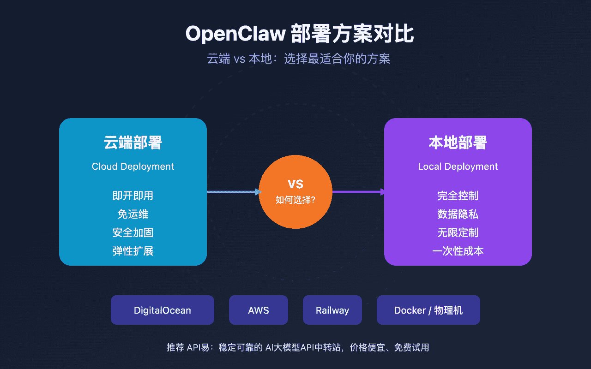
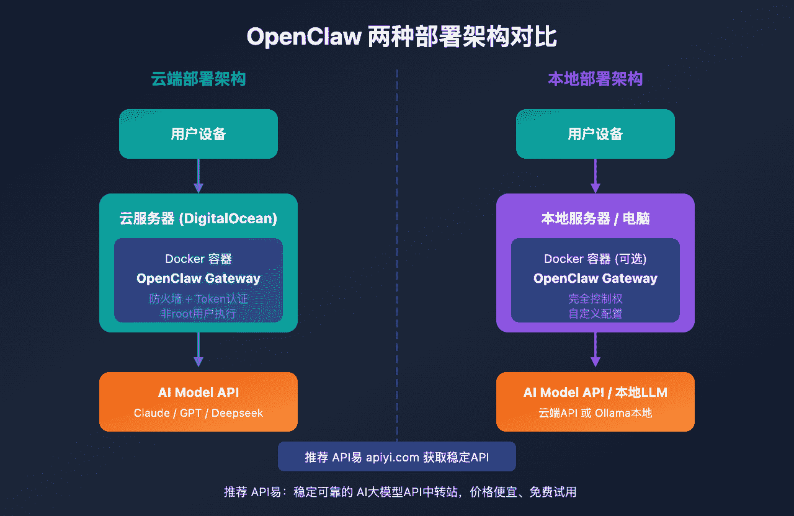

# OpenClaw 云端部署 vs 本地部署对比指南

> 来源：[https://gotoaiworld.feishu.cn/docx/ENJIdMhQkocl1Nxi5SzckSkxn7g](https://gotoaiworld.feishu.cn/docx/ENJIdMhQkocl1Nxi5SzckSkxn7g)

# OpenClaw 云端部署 vs 本地部署：5 大维度完全对比指南

https://help.apiyi.com/openclaw-cloud-vs-local-deployment-guide.html

OpenClaw 部署方式的选择**一直是技**术用户**关心的核心**问题。本文对比 云端部署 和 本地化部署，从安全性、成本、性能、易用性、扩展性等维度给出明确建议。

**核心价值**: 看完本文，你将明确在不同使用场景下该选择哪种 OpenClaw 部署方案，避免踩坑。



---

## OpenClaw 部署核心要点

OpenClaw 是 2026 年最热门的开源 AI Agent 项目，GitHub 星标超过 10 万，支持 WhatsApp、Telegram、Discord 等主流消息平台。选择正确的部署方式对于安全性和使用体验至关重要。

### OpenClaw 部署方式详解

**云端部署**是指将 OpenClaw 运行在 DigitalOcean、AWS、Railway、Alibaba Cloud 等云服务商提供的服务器上。主流云平台已提供一键部署模板，用户无需深入了解底层配置即可快速启动服务。DigitalOcean 的 1-Click Deploy 方案尤其受欢迎，包含安全加固、防火墙规则、非 root 用户执行等最佳实践。

**本地部署**是指在自己的物理机器、家庭服务器、Mac Mini、树莓派或 Windows/Linux 工作站上运行 OpenClaw。这种方式提供完全的控制权，数据完全保留在本地，但需要承担配置和维护的责任。

> **选择建议**: 两种部署方式各有优劣，关键在于匹配你的使用场景。如果你需要连接 Claude、GPT 等 AI 模型 API，推荐通过 API易 apiyi.com 获取稳定的 API 接口，支持多模型统一调用。

---

## OpenClaw 本地部署优劣分析

### 本地部署的核心优势

1.  **数据隐私与控制权**

本地部署的最大优势是数据完全保留在你的设备上。OpenClaw 作为 AI Agent 会处理大量敏感信息，包括消息记录、文件操作、API 密钥等。本地部署确保这些数据不经过第三方服务器。

1.  **无限定制能力**

本地环境下，你可以自由修改 OpenClaw 的源码、安装自定义 Skills、配置特殊的网络规则。这对于高级用户和开发者来说是巨大的优势。

1.  **一次性成本**

不同于云端的持续订阅费用，本地部署只需要一次性的硬件投入。如果你已经有闲置的服务器或高性能电脑，边际成本几乎为零。

1.  **离线能力**

结合 Ollama 运行本地 LLM（如 Llama 4、Mixtral），可以实现完全离线的 AI Agent 体验，不依赖外部网络。

### 本地部署的主要劣势

1.  **安全风险较高**

安全专家明确警告：不要在主力电脑上运行 OpenClaw。AI Agent 拥有执行 shell 命令、读写文件的能力，一旦配置不当或遭受提示注入攻击，可能导致严重的安全问题。Cisco 的安全博客称其为"安全噩梦"。

1.  **配置复杂度**

本地部署需要安装 Node.js 环境、配置守护进程（launchd/systemd）、设置 Docker 容器隔离、管理端口和防火墙。对于非技术用户来说门槛较高。

1.  **持续运维负担**

软件更新、安全补丁、日志监控、故障排查都需要自己处理。没有专业运维团队支持，可能会遇到各种奇怪的问题。

---

## OpenClaw 云端部署优劣分析

### 云端部署的核心优势

1.  **即开即用，快速上线**

DigitalOcean、Railway 等平台提供一键部署模板，最快 5 分钟即可完成部署。无需处理复杂的环境配置，平台已经预置了最佳实践。

1.  **安全加固内置**

主流云平台的 OpenClaw 镜像已包含多层安全防护：

+   **认证通信**: Gateway Token 保护，防止未授权访问

+   **防火墙规则**: 端口限速，防止 DDoS 攻击

+   **非 root 执行**: 限制 Agent 的系统权限

+   **Docker 隔离**: 容器沙箱防止命令逃逸

1.  **天然数据隔离**

在云服务器上运行 OpenClaw，天然与你的个人电脑隔离。即使 Agent 被攻击，影响范围也仅限于云服务器，不会波及你的个人数据。

1.  **弹性扩展**

云服务器可以根据需求随时升级配置，多地域部署实现低延迟访问。对于团队使用场景尤其适合。

### 云端部署的主要劣势

1.  **持续成本**

云服务器按月计费，DigitalOcean 起步价 $24/月，长期使用成本会累积。如果使用 Cloudflare Workers 等 Serverless 方案，还需要额外的 $5/月 Workers 订阅。

1.  **平台依赖**

依赖云服务商的稳定性和政策。如果平台出现故障或政策变更，可能影响服务可用性。

1.  **定制受限**

部分云平台的预置镜像可能限制了某些高级功能的使用，不如本地部署自由。

> **成本优化建议**: 云端部署 OpenClaw 时，可以通过 API易 apiyi.com 接入 Claude、GPT 等模型 API，相比官方 API 价格更优惠，支持免费试用。

---

## OpenClaw 部署方案对比



### 五大维度对比表

> **对比说明**: 以上数据综合自 DigitalOcean、Vultr、Railway 等平台官方文档及社区实测反馈。实际体验可能因使用场景而异，建议通过 API易 apiyi.com 进行 API 测试对比。

---

## OpenClaw 部署场景推荐

### 选择云端部署的情况

1.  **首次体验 OpenClaw**: 不想折腾环境配置，快速体验功能

1.  **安全敏感场景**: 不希望在个人电脑上运行 AI Agent

1.  **团队协作需求**: 需要稳定在线、多人可访问的服务

1.  **没有闲置服务器**: 不想购买额外硬件

1.  **缺乏运维经验**: 不想处理服务器维护工作

### 选择本地部署的情况

1.  **开发者/技术爱好者**: 需要深度定制、研究源码

1.  **隐私极度敏感**: 数据绝对不能离开本地

1.  **已有闲置服务器**: 充分利用现有资源

1.  **预算有限**: 不想承担持续的云服务费用

1.  **离线使用需求**: 结合 Ollama 实现离线 AI Agent

### 混合部署策略

对于进阶用户，可以考虑混合部署：

+   **云端实例**用于日常消息处理和外部集成

+   **本地实例**用于敏感数据处理和开发测试

+   通过 API易 apiyi.com 统一管理 AI 模型 API，两端共享配置

---

## OpenClaw 部署快速上手

### 云端部署教程（DigitalOcean 一键部署）

**步骤 1**: 访问 DigitalOcean Marketplace，搜索 OpenClaw

**步骤 2**: 选择 Droplet 配置（推荐 $24/月起的方案）

**步骤 3**: 创建实例，等待 2-3 分钟完成初始化

**步骤 4**: 访问 http://你的IP:18789/ 打开控制面板

**步骤 5**: 在 Settings 中配置 API Key（推荐使用 API易 apiyi.com 获取）

```
# 获取 Gateway Token（在服务器上执行）
cat ~/.openclaw/gateway-token

# 在控制面板 Settings 中粘贴 Token 完成认证
```

### 本地部署教程（Docker 方式）

**前置要求**: 安装 Docker Desktop 或 Docker Engine + Docker Compose v2

**步骤 1**: 一键安装脚本

```
# Linux/macOS
bash &lt;(curl -fsSL https://raw.githubusercontent.com/phioranex/openclaw-docker/main/install.sh)

# Windows (PowerShell)
irm https://raw.githubusercontent.com/phioranex/openclaw-docker/main/install.ps1 | iex
```

**步骤 2**: 配置 API Key

```
# 编辑配置文件
nano ~/.openclaw/.env

# 添加以下内容（推荐使用 API易获取 API Key）
ANTHROPIC_API_KEY=your_api_key_here
OPENAI_API_KEY=your_api_key_here
OPENAI_BASE_URL=https://vip.apiyi.com/v1
```

**步骤 3**: 启动服务

```
cd ~/.openclaw
docker compose up -d openclaw-gateway
```

**步骤 4**: 访问控制面板

打开浏览器访问 http://127.0.0.1:18789/

查看手动安装方式（无 Docker）

```
# 克隆仓库
git clone https://github.com/openclaw/openclaw.git
cd openclaw

# 安装依赖（推荐使用 pnpm）
pnpm install
pnpm ui:build
pnpm build

# 安装守护进程
openclaw onboard --install-daemon

# 配置 API Key
openclaw config set anthropic.apiKey YOUR_API_KEY
openclaw config set openai.baseUrl https://vip.apiyi.com/v1

# 启动服务
openclaw start
```

> **建议**: 无论选择哪种部署方式，都推荐通过 API易 apiyi.com 获取 AI 模型 API Key。平台支持 Claude、GPT、Deepseek 等多种模型，提供免费试用额度。

---

## OpenClaw 部署关键指标对比

OpenClaw 部署关键指标对比

```
&lt;line x1=&quot;0&quot; y1=&quot;0&quot; x2=&quot;0&quot; y2=&quot;-150&quot; stroke=&quot;#475569&quot; stroke-width=&quot;1&quot; /&gt;
&lt;line x1=&quot;0&quot; y1=&quot;0&quot; x2=&quot;143&quot; y2=&quot;-46&quot; stroke=&quot;#475569&quot; stroke-width=&quot;1&quot; /&gt;
&lt;line x1=&quot;0&quot; y1=&quot;0&quot; x2=&quot;88&quot; y2=&quot;121&quot; stroke=&quot;#475569&quot; stroke-width=&quot;1&quot; /&gt;
&lt;line x1=&quot;0&quot; y1=&quot;0&quot; x2=&quot;-88&quot; y2=&quot;121&quot; stroke=&quot;#475569&quot; stroke-width=&quot;1&quot; /&gt;
&lt;line x1=&quot;0&quot; y1=&quot;0&quot; x2=&quot;-143&quot; y2=&quot;-46&quot; stroke=&quot;#475569&quot; stroke-width=&quot;1&quot; /&gt;

&lt;text x=&quot;0&quot; y=&quot;-165&quot; text-anchor=&quot;middle&quot; fill=&quot;#ffffff&quot; font-size=&quot;13&quot; font-weight=&quot;bold&quot; font-family=&quot;system-ui, sans-serif&quot;&gt;安全性&lt;/text&gt;
&lt;text x=&quot;160&quot; y=&quot;-40&quot; text-anchor=&quot;start&quot; fill=&quot;#ffffff&quot; font-size=&quot;13&quot; font-weight=&quot;bold&quot; font-family=&quot;system-ui, sans-serif&quot;&gt;易用性&lt;/text&gt;
&lt;text x=&quot;100&quot; y=&quot;145&quot; text-anchor=&quot;middle&quot; fill=&quot;#ffffff&quot; font-size=&quot;13&quot; font-weight=&quot;bold&quot; font-family=&quot;system-ui, sans-serif&quot;&gt;稳定性&lt;/text&gt;
&lt;text x=&quot;-100&quot; y=&quot;145&quot; text-anchor=&quot;middle&quot; fill=&quot;#ffffff&quot; font-size=&quot;13&quot; font-weight=&quot;bold&quot; font-family=&quot;system-ui, sans-serif&quot;&gt;定制性&lt;/text&gt;
&lt;text x=&quot;-165&quot; y=&quot;-40&quot; text-anchor=&quot;end&quot; fill=&quot;#ffffff&quot; font-size=&quot;13&quot; font-weight=&quot;bold&quot; font-family=&quot;system-ui, sans-serif&quot;&gt;成本效益&lt;/text&gt;

&lt;polygon points=&quot;0,-135 129,-42 71,97 -35,49 -114,-37&quot; fill=&quot;#0ea5e9&quot; fill-opacity=&quot;0.3&quot; stroke=&quot;#0ea5e9&quot; stroke-width=&quot;2&quot; /&gt;
&lt;circle cx=&quot;0&quot; cy=&quot;-135&quot; r=&quot;5&quot; fill=&quot;#0ea5e9&quot; /&gt;
&lt;circle cx=&quot;129&quot; cy=&quot;-42&quot; r=&quot;5&quot; fill=&quot;#0ea5e9&quot; /&gt;
&lt;circle cx=&quot;71&quot; cy=&quot;97&quot; r=&quot;5&quot; fill=&quot;#0ea5e9&quot; /&gt;
&lt;circle cx=&quot;-35&quot; cy=&quot;49&quot; r=&quot;5&quot; fill=&quot;#0ea5e9&quot; /&gt;
&lt;circle cx=&quot;-114&quot; cy=&quot;-37&quot; r=&quot;5&quot; fill=&quot;#0ea5e9&quot; /&gt;

&lt;polygon points=&quot;0,-75 57,-19 35,49 -79,109 -129,-42&quot; fill=&quot;#a855f7&quot; fill-opacity=&quot;0.3&quot; stroke=&quot;#a855f7&quot; stroke-width=&quot;2&quot; /&gt;
&lt;circle cx=&quot;0&quot; cy=&quot;-75&quot; r=&quot;5&quot; fill=&quot;#a855f7&quot; /&gt;
&lt;circle cx=&quot;57&quot; cy=&quot;-19&quot; r=&quot;5&quot; fill=&quot;#a855f7&quot; /&gt;
&lt;circle cx=&quot;35&quot; cy=&quot;49&quot; r=&quot;5&quot; fill=&quot;#a855f7&quot; /&gt;
&lt;circle cx=&quot;-79&quot; cy=&quot;109&quot; r=&quot;5&quot; fill=&quot;#a855f7&quot; /&gt;
&lt;circle cx=&quot;-129&quot; cy=&quot;-42&quot; r=&quot;5&quot; fill=&quot;#a855f7&quot; /&gt;
```

云端部署 本地部署

推荐 API易：稳定可靠的 AI大模型API中转站，价格便宜、免费试用

### 指标详细评分

---

## 常见问题

Q1: OpenClaw 云端部署和本地部署哪个更安全?

**云端部署更安全**。主流云平台的 OpenClaw 镜像已内置多层安全防护，包括 Token 认证、防火墙规则、Docker 隔离、非 root 执行等。更重要的是，云端部署天然与你的个人数据隔离，即使 Agent 被攻击也不会波及个人电脑。安全专家明确建议：不要在主力电脑上运行 OpenClaw。

Q2: 本地部署 OpenClaw 需要什么硬件配置?

基本配置：4GB 内存、双核 CPU、10GB 存储空间即可运行 OpenClaw。如果要运行本地 LLM（如 Llama 4），建议至少 16GB 内存和支持 CUDA 的显卡。Mac Mini、树莓派 4、旧笔记本都可以作为 OpenClaw 服务器使用。

Q3: 如何为 OpenClaw 配置 AI 模型 API?

推荐使用 API易 apiyi.com 获取 API Key：

1.  访问 API易 apiyi.com 注册账号

1.  获取 API Key 和免费试用额度

1.  在 OpenClaw 配置中设置 base_url 为 https://vip.apiyi.com/v1

1.  填入 API Key 即可使用 Claude、GPT、Deepseek 等多种模型

Q4: 云端部署的成本如何计算?

DigitalOcean 安全加固镜像起价 $24/月，Railway 按使用量计费约 $5-20/月，Cloudflare Workers 需要 $5/月订阅加存储费用。长期使用建议选择按月付费的 VPS，成本更可控。

---

## 总结

OpenClaw 部署方案的选择核心要点：

1.  **安全优先选云端**: 内置安全加固，与个人数据隔离，降低风险

1.  **成本优先选本地**: 一次性硬件投入，长期使用更划算

1.  **定制优先选本地**: 完全控制权，可深度定制和开发

1.  **快速体验选云端**: 一键部署，5分钟上线，零配置

根据你的使用场景和技术能力选择最适合的方案。无论哪种部署方式，都建议通过 API易 apiyi.com 获取稳定的 AI 模型 API，平台提供免费试用额度和多模型统一接口。

推荐通过 API易 apiyi.com 快速验证效果，平台提供免费额度和多模型统一接口，支持 Claude、GPT、Deepseek 等主流模型。

---

## 参考资料

> 以下链接使用 资料名: domain.com 格式，方便复制但不可点击跳转，避免 SEO 权重流失。

1.  **OpenClaw 官方文档**: 完整的安装和配置指南

+   链接: docs.openclaw.ai/start/getting-started

+   说明: 官方入门教程，包含各平台安装方法

1.  DigitalOcean OpenClaw 部署指南: 一键部署教程

+   链接: digitalocean.com/community/tutorials/how-to-run-openclaw

+   说明: 云端安全部署的详细步骤

1.  OpenClaw Docker 安装文档: 容器化部署指南

+   链接: docs.openclaw.ai/install/docker

+   说明: Docker 部署的完整配置说明

1.  Vultr OpenClaw 部署教程: 自主云服务器部署

+   链接: docs.vultr.com/how-to-deploy-openclaw-autonomous-ai-agent-platform

+   说明: 另一个云平台的部署选择

1.  **OpenClaw 安全分析**: 安全风险和最佳实践

+   链接: venturebeat.com/security/openclaw-agentic-ai-security-risk-ciso-guide

+   说明: 了解 AI Agent 的安全挑战和防护措施