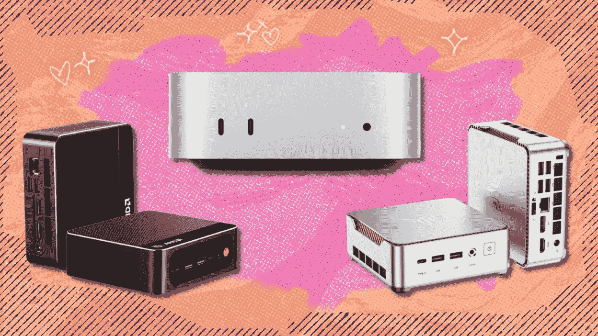
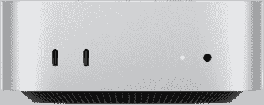
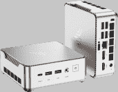
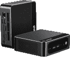
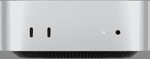
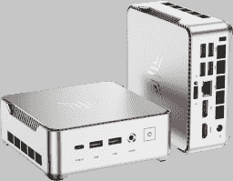
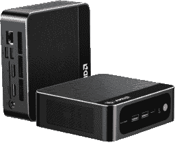

# The best mini PC deals for running OpenClaw

> 来源：[https://gotoaiworld.feishu.cn/docx/JlogdPCozoQMWgxmJSrcd3yWnLr](https://gotoaiworld.feishu.cn/docx/JlogdPCozoQMWgxmJSrcd3yWnLr)

# The best mini PC deals for running OpenClaw: Save on Apple Mac mini, Kamuri Pinova P2, and Beelink Mini

https://mashable.com/article/openai-dept-of-war-deal-sam-altman-update-mass-surveillance

All products featured here are independently selected by our editors and writers. If you buy something through links on our site, Mashable may earn an affiliate commission.

Credit: Apple / KAMRUI / Beelink / Mashable Photo Composite

---

Deal pricing and availability subject to change after time of publication. Learn more about how we select deals.

**Best mini PC deals to run **OpenClaw at a glance

---

**Best Apple deal**

[**Apple Mac mini (**](https://zdcs.link/QxeXWm?pageview_type=Standard&template=article&module=product-summary-list&element=offer&item=buy-link&element_label=Apple+Mac+mini+%28M4%2C+16GB%2C+156GB+SSD%29&object_type=article&object_uuid=00nzl6pS2DnFGNyCYfZvg89&short_url=QxeXWm&u=https%3A%2F%2Fmashable.com%2Farticle%2Fmini-pc-deals-openclaw&session_uuid=ca3a4a4b-e733-4d76-93d6-f61c6b685246&view_instance_uuid=8b1d7f83-0c6a-48ef-aa88-92cace299836)M4, 16GB, 156GB SSD)

**$569** (save $30)

[**Get Deal**](https://zdcs.link/QxeXWm?pageview_type=Standard&template=article&module=product-summary-list&element=offer&item=buy-button&element_label=Get+Deal&object_type=article&object_uuid=00nzl6pS2DnFGNyCYfZvg89&short_url=QxeXWm&u=https%3A%2F%2Fmashable.com%2Farticle%2Fmini-pc-deals-openclaw&session_uuid=ca3a4a4b-e733-4d76-93d6-f61c6b685246&view_instance_uuid=8b1d7f83-0c6a-48ef-aa88-92cace299836)

---

Best Kamuri deal

[**Kamuri Pinova P2 Mini **](https://zdcs.link/QOjROE?pageview_type=Standard&template=article&module=product-summary-list&element=offer&item=buy-link&element_label=Kamuri+Pinova+P2+Mini+PC+%2816GB%2C+512GB+SSD%29&object_type=article&object_uuid=00nzl6pS2DnFGNyCYfZvg89&short_url=QOjROE&u=https%3A%2F%2Fmashable.com%2Farticle%2Fmini-pc-deals-openclaw&session_uuid=ca3a4a4b-e733-4d76-93d6-f61c6b685246&view_instance_uuid=8b1d7f83-0c6a-48ef-aa88-92cace299836)PC (16GB, 512GB SSD)

**$299.99** (save $20)

[**Get Deal**](https://zdcs.link/QOjROE?pageview_type=Standard&template=article&module=product-summary-list&element=offer&item=buy-button&element_label=Get+Deal&object_type=article&object_uuid=00nzl6pS2DnFGNyCYfZvg89&short_url=QOjROE&u=https%3A%2F%2Fmashable.com%2Farticle%2Fmini-pc-deals-openclaw&session_uuid=ca3a4a4b-e733-4d76-93d6-f61c6b685246&view_instance_uuid=8b1d7f83-0c6a-48ef-aa88-92cace299836)

---

Best Beelink deal

Beelink Mini PC (24GB, 500GB SSD)

**$439** (save $30)

[**Get Deal**](https://zdcs.link/z64oWZ?pageview_type=Standard&template=article&module=product-summary-list&element=offer&item=buy-button&element_label=Get+Deal&object_type=article&object_uuid=00nzl6pS2DnFGNyCYfZvg89&short_url=z64oWZ&u=https%3A%2F%2Fmashable.com%2Farticle%2Fmini-pc-deals-openclaw&session_uuid=ca3a4a4b-e733-4d76-93d6-f61c6b685246&view_instance_uuid=8b1d7f83-0c6a-48ef-aa88-92cace299836)

[OpenClaw](https://mashable.com/article/what-is-clawdbot-how-to-try) is the latest AI attempting to make our lives (maybe?) easier. The open-source AI assistant runs locally on your device that operates on your behalf, scanning your email inbox, messages, calendar, Slack notifications, and more. On top of this, OpenClaw can alert you of especially important items that come across your virtual desk. Use OpenClaw with ChatGPT and you could be scheduling flights, replying to messages, and plenty more.

So long as you're cool with using AI and the inherent security risks that come with OpenClaw, you might want a mini PC dedicated to running the lobster AI assistant. For a time, the OpenClaw hype was so real that Silicone Valley buyers were depleting the supply of the Mac Mini. That initial bump has settled down (for now) and we have the Mac Mini in stock and on sale today, plus a few other mini PCs that could be ideal for OpenClaw.

## Best Apple deal

Credit: Apple

[**Apple Mac Mini (**](https://zdcs.link/QxeXWm?pageview_type=Standard&template=article&module=shop-card&element=offer&item=title&element_label=Apple+Mac+Mini+%28M4%2C+16GB%2C+256GB+SSD%29&object_type=article&object_uuid=00nzl6pS2DnFGNyCYfZvg89&short_url=QxeXWm&u=https%3A%2F%2Fmashable.com%2Farticle%2Fmini-pc-deals-openclaw&session_uuid=ca3a4a4b-e733-4d76-93d6-f61c6b685246&view_instance_uuid=8b1d7f83-0c6a-48ef-aa88-92cace299836)M4, 16GB, 256GB SSD)

**$569**** at **A**mazon

$5**99 Save $30

[**Get Deal**](https://zdcs.link/QxeXWm?pageview_type=Standard&template=article&module=shop-card&element=offer&item=buy-button&element_label=Get+Deal&object_type=article&object_uuid=00nzl6pS2DnFGNyCYfZvg89&short_url=QxeXWm&u=https%3A%2F%2Fmashable.com%2Farticle%2Fmini-pc-deals-openclaw&session_uuid=ca3a4a4b-e733-4d76-93d6-f61c6b685246&view_instance_uuid=8b1d7f83-0c6a-48ef-aa88-92cace299836)

### Why we like it

If you're in the Apple ecosphere, the Mac mini with M4 chip could be awesome for running OpenClaw. The version with 16GB of memory and 256GB SSD usually sells for $599, but it's on sale today at Amazon for $569.

The Mac Mini has two USB-C ports, a headphone jack, ethernet connection, HDMI, and three Thunderbolt 4 ports. Like the name suggests, Apple went small with this mini PC and it weighs under two pounds and measures five inches in width and length, and just two inches in height. It'll be easy to travel with the Mac mini or find a spot for it on your desktop.

## Best Kamuri deal

Credit: Kamuri

[**Kamuri Pinova P2 Mini **](https://zdcs.link/QOjROE?pageview_type=Standard&template=article&module=shop-card&element=offer&item=title&element_label=Kamuri+Pinova+P2+Mini+PC+%2816GB%2C+512GB+SSD%29&object_type=article&object_uuid=00nzl6pS2DnFGNyCYfZvg89&short_url=QOjROE&u=https%3A%2F%2Fmashable.com%2Farticle%2Fmini-pc-deals-openclaw&session_uuid=ca3a4a4b-e733-4d76-93d6-f61c6b685246&view_instance_uuid=8b1d7f83-0c6a-48ef-aa88-92cace299836)PC (16GB, 512GB SSD)

**$299.99**** at Ama**z**on

$319.**99 Save $20

[**Get Deal**](https://zdcs.link/QOjROE?pageview_type=Standard&template=article&module=shop-card&element=offer&item=buy-button&element_label=Get+Deal&object_type=article&object_uuid=00nzl6pS2DnFGNyCYfZvg89&short_url=QOjROE&u=https%3A%2F%2Fmashable.com%2Farticle%2Fmini-pc-deals-openclaw&session_uuid=ca3a4a4b-e733-4d76-93d6-f61c6b685246&view_instance_uuid=8b1d7f83-0c6a-48ef-aa88-92cace299836)

### Why we like it

Coming in at a smidge smaller than the Mac Mini, the Kamuri Pinova 2 Mini PC is another great option for OpenClaw. Today's sale price of $299.99 applies to the model with 16GB DDR4 RAM and 512GB SSD, which is expandable to up to 4TB.

Since the Kamuri Pinova 2 Mini PC will be powered on 24/7 to run OpenClaw, it'll be nice to have the under 38 decibel fan noise. Plus, Kamuri includes a VESA mount and screws so you can easily keep your desktop clear and affix the mini PC to the back of a monitor.

---

**Related Stories**

---

+   [Op](https://mashable.com/article/what-is-clawdbot-how-to-try)enClaw is the viral AI assistant formerly known as Clawdbot: What it is, how to try it

+   [Best MacBooks 2025: Which](https://mashable.com/roundup/best-macbooks) model would we buy?

+   [Anthropic CEO warns that AI could bring slavery, bi](https://mashable.com/article/opinion-anthropic-ceo-dario-amodei-essay-warning-artificial-intelligence)oterrorism, and unstoppable drone armies. I'm not buying it.

+   [A](https://mashable.com/article/anthropic-ceo-warns-white-collar-unemployment-ai)nthropic CEO warns AI will destroy half of all white-collar jobs

+   [OpenClaw founder Peter Stei](https://mashable.com/article/openclaw-founder-peter-steinberger-joins-openai)nberger joins OpenAI

## Best Beehive deal

Credit: Beelink

Beelink Mini PC (24GB, 500GB SSD)

**$439**** at **A**mazon

$4**69 Save $30

[**Get Deal**](https://zdcs.link/z64oWZ?pageview_type=Standard&template=article&module=shop-card&element=offer&item=buy-button&element_label=Get+Deal&object_type=article&object_uuid=00nzl6pS2DnFGNyCYfZvg89&short_url=z64oWZ&u=https%3A%2F%2Fmashable.com%2Farticle%2Fmini-pc-deals-openclaw&session_uuid=ca3a4a4b-e733-4d76-93d6-f61c6b685246&view_instance_uuid=8b1d7f83-0c6a-48ef-aa88-92cace299836)

### Why we like it

[With support fo](https://zdcs.link/z64oWZ?pageview_type=Standard&template=article&module=content_body&element=offer&item=text-link&element_label=Beelink+Mini+PC&object_type=article&object_uuid=00nzl6pS2DnFGNyCYfZvg89&short_url=z64oWZ&u=https%3A%2F%2Fmashable.com%2Farticle%2Fmini-pc-deals-openclaw&session_uuid=ca3a4a4b-e733-4d76-93d6-f61c6b685246&view_instance_uuid=8b1d7f83-0c6a-48ef-aa88-92cace299836)r WiFI 6, the Beelink Mini PC is more than capable of operating OpenClaw. Plus, Beelink gets major bragging rights for being incredibly lightweight. The Beelink weighs just 400 grams which works out to 0.88 pounds, or about half the weight of the Apple Mac Mini.

Today's sale price of $439 earns you 24GB RAM and 500GB SSD, running AMD Ryzen 7. Beelink incorporated two fans on this model — one for the system itself and an additional SSD fan.

https://canitrunopenclaw.com/best/mini-pc-for-openclaw

**1**

Beelink Mini S12 ProRuns Great

16GB RAM / Intel N100 (4-core E-core @ 3.4GHz) / $170

N100 is surprisingly capable. 16GB and low power make it the best value always-on OpenClaw box.

6s cold start1s warm

$170

[Details](https://canitrunopenclaw.com/can/openclaw/run-on/beelink-mini-s12-pro)

**2**

GMKtec NucBox K8Runs Great

16GB RAM / Intel Core i5-12450H (8-core @ 2.0-4.4GHz) / $350

12th-gen i5 with 16GB is more than enough. Good always-on server.

4s cold start0.6s warm

$350

[Details](https://canitrunopenclaw.com/can/openclaw/run-on/gmktec-nucbox-k8)

**3**

Beelink SER5 MaxRuns Great

32GB RAM / AMD Ryzen 7 5800H (8-core @ 3.2GHz) / $380

32GB RAM handles multiple agents via cloud APIs. Ryzen 5800H is fast for Node.js workloads.

3s cold start0.4s warm

$380

[Details](https://canitrunopenclaw.com/can/openclaw/run-on/beelink-ser5-max)

**4**

Lenovo ThinkCentre M75q TinyRuns Great

16GB RAM / AMD Ryzen 5 5600GE (6-core @ 3.4-4.4GHz) / $380

Ryzen 5600GE and 16GB is a solid combo. Enterprise reliability for always-on use.

5s cold start0.7s warm

$380

[Details](https://canitrunopenclaw.com/can/openclaw/run-on/lenovo-thinkcentre-m75q)

**5**

[ASUS PN53](https://canitrunopenclaw.com/devices/asus-pn53)Runs Great

16GB RAM / AMD Ryzen 7 6800U (8-core @ 2.7-4.7GHz) / $450

Zen 3+ with 16GB handles OpenClaw comfortably. RDNA 2 iGPU is a bonus.

4s cold start0.6s warm

$450

[Details](https://canitrunopenclaw.com/can/openclaw/run-on/asus-pn53)

**6**

LattePanda SigmaRuns Great

16GB RAM / Intel Core i5-1340P (12-core @ 1.9-4.6GHz) / $500

12-core i5 and 16GB. Dual Ethernet makes it versatile for networking setups.

4s cold start0.6s warm

$500

[Details](https://canitrunopenclaw.com/can/openclaw/run-on/lattepanda-sigma)

**7**

Geekom Mini IT12Runs Great

32GB RAM / Intel Core i7-12650H (10-core @ 2.3-4.7GHz) / $500

10-core i7 and 32GB. Multiple agents and services concurrently. Fast NVMe keeps things responsive under load.

3s cold start0.4s warm

$500

[Details](https://canitrunopenclaw.com/can/openclaw/run-on/geekom-mini-it12)

**8**

Minisforum UM780 XTXRuns Great

32GB RAM / AMD Ryzen 7 7840HS (8-core @ 3.8-5.1GHz) / $530

32GB and Zen 4. Handles multiple agents and services concurrently. Best value mini PC for a dedicated AI host.

3s cold start0.4s warm

$530

[Details](https://canitrunopenclaw.com/can/openclaw/run-on/minisforum-um780-xtx)

**9**

Intel NUC 13 ProRuns Great

16GB RAM / Intel Core i5-1340P (12-core) / $550

i5-1340P and 16GB. Silent operation. Ideal always-on OpenClaw server for cloud API workloads.

4s cold start0.6s warm

$550

[Details](https://canitrunopenclaw.com/can/openclaw/run-on/intel-nuc-13-pro)

**10**

Mac Mini M1 (used)Runs OK

8GB RAM / Apple M1 (8-core) / $400

M1 is still fast. 8GB unified memory is tight for local models but cloud APIs work great.

5s cold start0.6s warm

$400

[Details](https://canitrunopenclaw.com/can/openclaw/run-on/mac-mini-m1)