# Best Hardware for OpenClaw in 2026

> 来源：[https://gotoaiworld.feishu.cn/docx/YOk9d9yLrove3qxMMktcGWVqnYq](https://gotoaiworld.feishu.cn/docx/YOk9d9yLrove3qxMMktcGWVqnYq)

1.Best Mini PC for OpenClaw (Formerly called Clawdbot & Moltbot): The Ultimate Guide!

https://www.pcbuildadvisor.com/best-mini-pc-for-home-server-the-ultimate-guide-with-comparisons/

# Best Mini PC for OpenClaw (Formerly called Clawdbot & Moltbot): The Ultimate Guide!

By [Alayna Waseem ](https://www.pcbuildadvisor.com/author/admin-login/)/ February 13, 2026

If you’re looking for the Best Mini PC for OpenClaw, I have you covered!

**If you’v**e he**ard the** name[s Clawdb](https://openclaw.ai/)ot or Moltbot floating around GitHub or your X feed, you’re looking at the same beast: an AI project that went from a niche developer tool to a viral phenomenon with over 190,000 GitHub stars in a matter of weeks. Think of OpenClaw not as another chatbot you visit in a browser, but as a digital nervous system that lives on your hardware and talks to you through the apps you already use.

I put this guide together becau**se findi**ng the best OpenClaw machine depends on more than just RAM. Whether I am developing agents, running multiple simulations, or connecting to hardware, the right mini PC makes the workflow smoother, stable, and more portable.

> In case you want a[** short answ**](https://www.amazon.com/dp/B0DNFNMTPN?ref=t_ac_view_request_product_image&campaignId=amzn1.campaign.35RT19OPHLQSX&linkCode=tr1&tag=brutallyho048-20&linkId=amzn1.campaign.35RT19OPHLQSX_1772152149871)er, this Mac Mini M4 is the** safest (se**curity) a**nd**** m**ost recommended OpenClaw **PC o**[**ption. KAMR**](https://www.amazon.com/dp/B0GGYB66SN?ref=t_ac_view_request_product_image&campaignId=amzn1.campaign.2IO0L7NLUOE7Y&linkCode=tr1&tag=brutallyho048-20&linkId=amzn1.campaign.2IO0L7NLUOE7Y_1772154168425)**UI Pinova P1 (tried & tested model) is the perfect budg**et PC for OpenClaw under $300 that should be perfect for 70-80% of the users. If you’re looking for a POWERFUL PC that can both run OpenClaw and also give you the ability and flexibility to add local LLMs (either to power your OpenClaw instance for free or otherwise), then this ACEMAGIC M5 is unbeatable in terms of performance at the $799 price point. For commercial use-cases and advanced LLM hosting, MINISFORUM MS-S1 is the undisputed king.

**I focus on what matters for OpenClaw users: consistent CPU and GPU performance, enough RAM and fast storage,** the right ports for sensors and displays, and good thermals and support so the system stays online when I need it most.

**Contents**  [hide](https://www.pcbuildadvisor.com/best-mini-pc-for-openclaw-formerly-called-clawdbot-moltbot-the-ultimate-guide/#)

[1](https://www.pcbuildadvisor.com/best-mini-pc-for-openclaw-formerly-called-clawdbot-moltbot-the-ultimate-guide/#What_is_the_difference_between_a_PC_and_a_Mini_PC_for_OpenClaw) What is the difference between a PC and a Mini PC for OpenClaw?

[2 Update Added o](https://www.pcbuildadvisor.com/best-mini-pc-for-openclaw-formerly-called-clawdbot-moltbot-the-ultimate-guide/#Update_Added_on_February_27_2026)n February 27, 2026:

[3 Overall Top Picks: Best ](https://www.pcbuildadvisor.com/best-mini-pc-for-openclaw-formerly-called-clawdbot-moltbot-the-ultimate-guide/#Overall_Top_Picks_Best_Mini_PC_for_OpenClaw)Mini PC for OpenClaw

[4](https://www.pcbuildadvisor.com/best-mini-pc-for-openclaw-formerly-called-clawdbot-moltbot-the-ultimate-guide/#What_is_Openclaw_formerly_called_moltbotclawdbot) What is Openclaw (formerly called moltbot/clawdbot):

[5 OpenClaw Hardware FAQ](https://www.pcbuildadvisor.com/best-mini-pc-for-openclaw-formerly-called-clawdbot-moltbot-the-ultimate-guide/#OpenClaw_Hardware_FAQ_The_Ultimate_Guide): The Ultimate Guide

### What is the difference between a PC and a Mini PC for OpenClaw?

A Mini PC **is** a PC. It simply uses an efficient mobile architecture to fit into a tiny chassis. For OpenClaw, Mini PCs are often superior to towers: they draw 15W–45W (vs. 300W+), operate silently, and provide the same processing logic in a compact, “always-on” footprint ideal for 24/7 hosting.

### Update Added on February 27, 2026:

Even though we wrote the article only days ago, the speed of change in PC technology is insane. It’s mainly because PC manufacturers are fighting to pull the AI-use case market, even in the consumer segments.

> [**ACEMAGIC M5**](https://www.amazon.com/dp/B0GGYB66SN?ref=t_ac_view_request_product_image&campaignId=amzn1.campaign.2IO0L7NLUOE7Y&linkCode=tr1&tag=brutallyho048-20&linkId=amzn1.campaign.2IO0L7NLUOE7Y_1772154168425)** was recently launched and has now become available on A****mazon. I think it’s an ide**al mid-tier Mini PC for OpenClaw. Since it comes with the super powerful Intel Core i5-14500HX processor (14 Cores/20Threads, Turbo 4.9GHz) & 32GB of Ram, this PC gets very close to the performance of the $1200 Geekom A9 Mini PC, at the current introductory price tag of $799.

> **We think this is a great sub-$1000 mini PC option, and even though the regular price is expec**ted to be around $899 after the initial promotional price, it will still disrupt the current market.Most importantly, this is a great PC for OpenClaw and even for deploying local AI LLM models (since it also comes with 1TB of storage).

## Overall Top Picks: Best Mini PC for OpenClaw

# What is Openclaw (formerly called moltbot/clawdbot):

At its core, OpenClaw is a self-hosted autonomous agent. Unlike ChatGPT, which sits in a silo, OpenClaw is designed to be “always on” and deeply integrated with your local system.

1.  It Lives Where You Are:** You don’t go to its website**; you DM it on WhatsApp, Telegram, Signal, Discord, or iMessage.

1.  It Runs on Your Hardware: You host it on your own Mac (the viral “Mac Mini” trend was fueled by this), Linux server, or VPS. This means your files stay on your machine.

1.  It’s Not Just Talk: While it uses LLMs (like Claude 3.5, GPT-4o, or local models via Ollama) to think, it has “hands.” It can run terminal commands, manage your files, and browse the web.

## What Wonders Can It Do?

**The “won**der” of OpenClaw is its autonomy. It doesn’t just wait for you to ask a question; it can proactively manage your life through “Skills.”

+   The “Jarvis” Experience: You can text it from a coffee shop: “Find the Q4 report on my desktop and email it to Sarah,” and it will search your local drive, draft the email, and send it.

+   Proactive Life Management: It can monitor your GitHub repos for bugs, check your calendar to warn you about double-bookings, or even watch your smart home devices (like adjusting your Philips Hue lights or Sonos speakers).

+   Autonomous Coding: It can literally write and run its own scripts to solve problems you give it. If you ask it to track a specific stock price every hour, it can write the Python script, set up a cron job, and message you the updates.

+   Persistent Memory: It actually remembers you. It stores your preferences, past conversations, and work patterns in local Markdown files, so it gets “smarter” and more personalized the more you use it.

> Ho**wever, as Open**Claw has the keys to your terminal and your DMs, a misconfi**gured setup is a nightmare fuel scenario for** security pros. It’s a tool for the vibe coders and the brave, those who want a true AI assistant and are willing to manage the risks of giving an AI the steering wheel to their digital life.

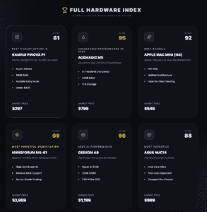

> **How I Picked These Mi**ni PCs for openclaw?

> When I evaluated** these m**ini PCs for OpenClaw I focused on real world needs rather than marketing specs. First, CPU and GPU capability matter because I want smooth simulation and any on-device inference, so I favored modern Ryzen, Intel, and Apple M-series chips.

> I looked for at least 16 GB of RAM or easy upgrade paths and fast NVMe storage so builds and logs do not slow down. Ports and networking are critical for robot integration, so I checked for multiple video outputs, USB types, and reliable Ethernet. Thermals and noise influence long runs, so I gave extra weight to systems that manage heat and stay stable under load.

> Finally, I balanced price and support because a dependable device with good warranty and driver availability reduces downtime.

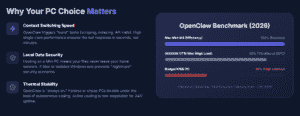

## 💰 Best Budget pc for openclaw

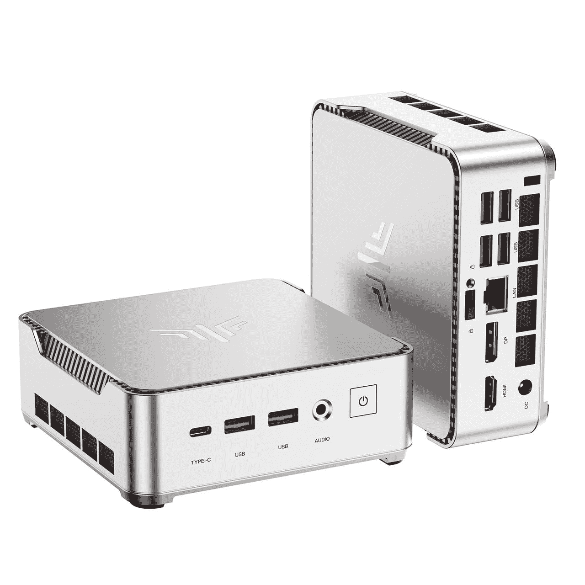

### KAMRUI Pinova P1

KAMRUI Pinova P1 Mini PC with AMD Ryzen 4300U, 16GB RAM and 512GB SSD; triple 4K outputs (HDMI+DP+Type-C), WiFi and Bluetooth in a compact silver chassis.

**$297.00**

[Get Details](https://www.amazon.com/dp/B0DNFNMTPN?ref=t_ac_view_request_product_image&campaignId=amzn1.campaign.35RT19OPHLQSX&linkCode=tr1&tag=brutallyho048-20&linkId=amzn1.campaign.35RT19OPHLQSX_1772152350372)

[Kamrui P1](https://www.amazon.com/dp/B0DNFNMTPN?ref=t_ac_view_request_product_image&campaignId=amzn1.campaign.35RT19OPHLQSX&linkCode=tr1&tag=brutallyho048-20&linkId=amzn1.campaign.35RT19OPHLQSX_1772152350372)** (4 co**res, 4 threads, up to 3.7GHz) covers the essentials without asking for a big budget. It boots fast, handles daily development tasks and runs Windows or Linux comfortably thanks to 16GB of RAM (DDR4), Ryzen 3 4300U processor, and a 512GB SSD. The triple-display outputs are handy when I want one screen for logs, another for visualization and a third for dashboards. It’s small enough to tuck under a monitor or take to a lab, and for most OpenClaw workflows: testing agents, running demos, or doing light inference. It’s more than capable for all of it.

> In sho**rt, this is a great starter OpenClaw machine, and would be ideal for m**ost **b**rowser-based workflows due to 16GB Ram and a very decent Ryzen 3 processor (easily beats the Intel N150 in benchmark testing). It would also be more than capable of running software like Excel without any issues. But don’t expect it to be able to do even basic video editing or or running CAD software. This computer is not designed to be great for a lot of multi-tasking.

> If you want a complete machine which can do just about any**t**hi[ng ](https://www.pcbuildadvisor.com/the-500-mini-pc-faceoff-apple-mac-mini-m4-vs-beelink-ser5-max-can-2x-ram-ser5-max-compensate-for-mac-minis-beast-processor/)and would allow you to run dozens of concurrent OpenClaw workflows, simply get the Apple Mac Mini M4. It’s unbeatable in terms of the performance it offers for $500. No Windows Mini PC Under $1000 even comes close to it. And this is not just my opinion, but something we has actually rigorously tested, with technical performance benchmarks shared here.

### Long-Term Cost Benefits

Buying a well-specced but budget mini PC like this reduces the need for upgrades early. The NVMe SSD and 16GB RAM delay storage and memory bottlenecks, and lower power draw cuts operating costs if it runs 24/7.

### Situational Benefits

### Ease Of Use

### Versatility

This mini PC handles a wide mix of tasks from office work to lightweight edge compute. It’s not a high-end training box, but its display and port flexibility make it useful across development, demos and home use.

### Practicality

Small footprint, multiple video outputs and common USB ports make it practical for desk setups and portable labs. You may want a dock or USB hub if you attach many sensors or dongles.

### Energy Efficiency

The Ryzen 4300U is a low-power processor, so the unit runs cool and keeps electricity use modest during long runs or continuous demos.

### Speed / Response Time

With an NVMe SSD and 16GB of RAM the Pinova feels snappy for booting, compiling code and switching applications; heavier model training will still be limited by integrated graphics.

### Key Benefits

+   Strong value: Modern Ryzen 4300U with 16GB/512GB at a low price

+   Triple 4K-capable outputs make multi-monitor setups easy

+   Compact, quiet design that fits on crowded desks

+   Sufficient ports for typical robotics peripherals and displays

Current Price: **$249.00**

Rating: **4.4** (total: 1,754+)

[Get Details](https://www.amazon.com/KAMRUI-GK3-2-5-inch-Ethernet-Business/dp/B0BC7S9R5C?tag=brutallyho048-20)

## 🎯 Best Business option

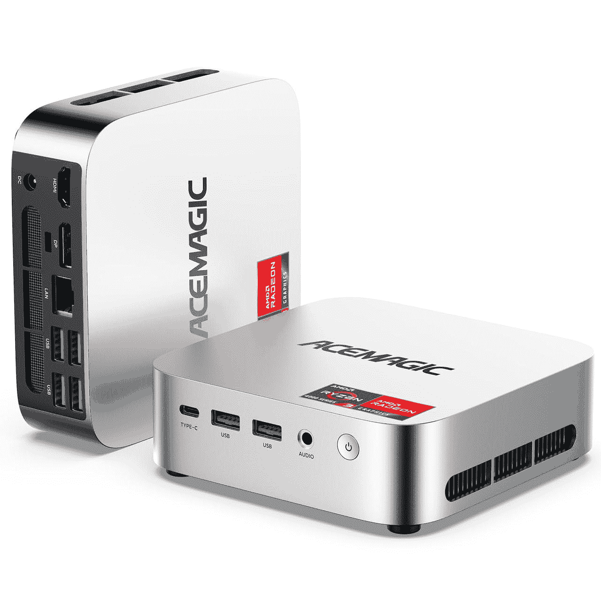

### **ACEMAGIC K1**

ACEMAGIC K1 Mini PC with AMD Ryzen 4300U (28W), 16GB DDR4, 256GB M.2 SSD, dual 4K HDMI+DP1.4, Gigabit Ethernet and Windows 11 Pro-ready in a compact silver chassis.

**$219.99**

[Get Details](https://www.amazon.com/ACEMAGIC-K1-Processor-Computers-Ethernet/dp/B0G2YHBWS4?tag=brutallyho048-20)

I appreciate the ACEMAGIC K1 when I need a compact work machine that stays out of the way but still gets business tasks done. It feels built for office workflows: steady performance for video calls, spreadsheets and light encoding, plus dual 4K outputs so I can keep a spreadsheet and a dashboard visible at the same time. Setup is straightforward and the small footprint fits well on a crowded desk or a meeting room AV rack. It can run a continuous service or be a portable dev station I grab for demos, and while it’s not a heavy GPU rig, it balances performance and price in a way that makes sense for teams and students.

### Long-Term Cost Benefits

Choosing a sensible spec like 16GB RAM and an NVMe SSD delays upgrade needs and keeps support headaches low; stable drivers and broad compatibility reduce time spent troubleshooting across multiple workstations.

### Situational Benefits

### Ease Of Use

### Versatility

It’s a versatile little machine for business, education and light media work; not aimed at heavy gaming or large-scale model training but well suited to mixed office and demo duties.

### Practicality

The K1’s port selection and dual-display support make it practical for desks, meeting rooms and compact lab setups; I often pair it with a USB dock if I need more ports.

### Energy Efficiency

With a 28W U-series Ryzen, the unit is power-conscious and stays relatively cool, which matters when devices run all day in an office or lab.

### Speed / Response Time

Boots quickly from the M.2 SSD and feels responsive for multitasking, web development and light encoding; CPU headroom is modest but consistent for typical business loads.

### Key Benefits

+   Balanced performance for business apps with Ryzen 4300U and 16GB RAM

+   Dual 4K outputs let me run two high-res monitors for multitasking

+   Gigabit Ethernet and multiple USB ports simplify connectivity

+   Compact, office-friendly design that’s easy to move or mount

Current Price: **$219.99**

Rating: **4.3** (total: 116+)

[Get Details](https://www.amazon.com/ACEMAGIC-K1-Processor-Computers-Ethernet/dp/B0G2YHBWS4?tag=brutallyho048-20)

## 🎮 Best for openclaw & light Gaming

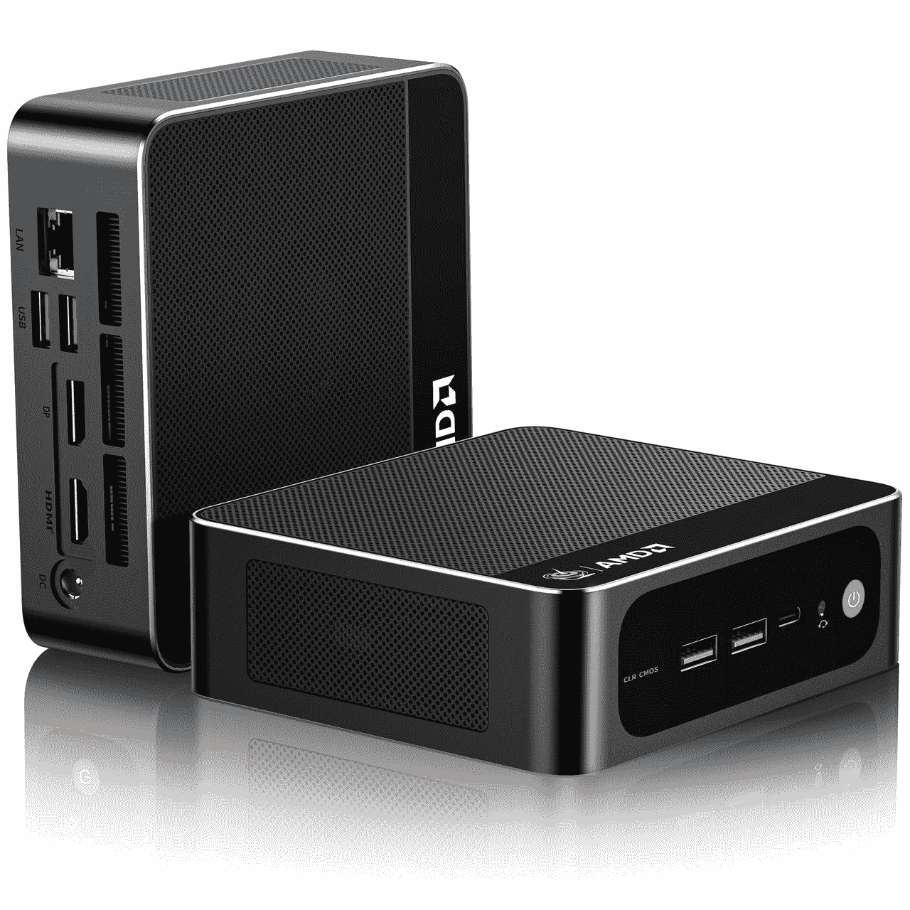

### **Beelink SER5**

Beelink SER5 MAX Mini PC with AMD Ryzen 7 6800U, 24GB LPDDR5, 500GB M.2 SSD, AMD Radeon 680M, triple 4K outputs, Wi‑Fi 6, BT5.4 and 2.5GbE in a compact black chassis.

**$419.00**

[Get Details](https://www.amazon.com/Beelink-Computers-Display-Desktop-Computer/dp/B0CRKXMKDT?tag=brutallyho048-20)

I reach for the Beelink SER5 when I want a compact machine that can actually handle visuals and light gaming while staying useful for development and demos. The Radeon 680M and Ryzen 7 give me more GPU headroom than most integrated setups, so running three displays with dashboards, camera feeds and logs feels natural.

It’s easy to tuck behind a monitor or use as a small server, and I appreciate the faster LAN when I need low-latency connections. A couple of reviewers mentioned quirky DP ports and the occasional reboot, so I test my exact peripheral mix before I commit, but in day-to-day use it’s a smooth, space-saving option that balances power and price.

### Long-Term Cost Benefits

Investing in a mini PC with a solid integrated GPU and ample RAM reduces the need for early upgrades. The faster network and NVMe storage also lower the chance of bottlenecks, so you spend less time troubleshooting and more time working.

### Situational Benefits

### Ease Of Use

### Versatility

This unit comfortably covers gaming, multimedia, development and small server roles; it’s a solid all-rounder if your priorities include display flexibility and stronger integrated graphics.

### Practicality

Plenty of modern ports and a compact footprint make it practical for desks, mounts and small racks. If you attach many USB sensors or cameras, plan for a quality hub.

### Energy Efficiency

Built on an efficient Ryzen mobile chip and LPDDR5 memory, the SER5 offers good performance per watt so it stays cool during typical office and development loads.

### Speed / Response Time

Boots quickly from the NVMe drive and feels responsive when switching apps, compiling small projects or running multiple browser tabs; heavy long-running workloads may still push thermal limits.

### Key Benefits

+   Strong integrated graphics for visualization and light gaming

+   Triple 4K display support fits multi-monitor workflows

+   24GB LPDDR5 plus 500GB NVMe gives fast responsiveness

+   2.5GbE and Wi‑Fi 6 provide reliable network performance

Current Price: **$419.00**

Rating: **4.6** (total: 662+)

[Get Details](https://www.amazon.com/Beelink-Computers-Display-Desktop-Computer/dp/B0CRKXMKDT?tag=brutallyho048-20)

## 🚀 Best for AI Performance & LLM

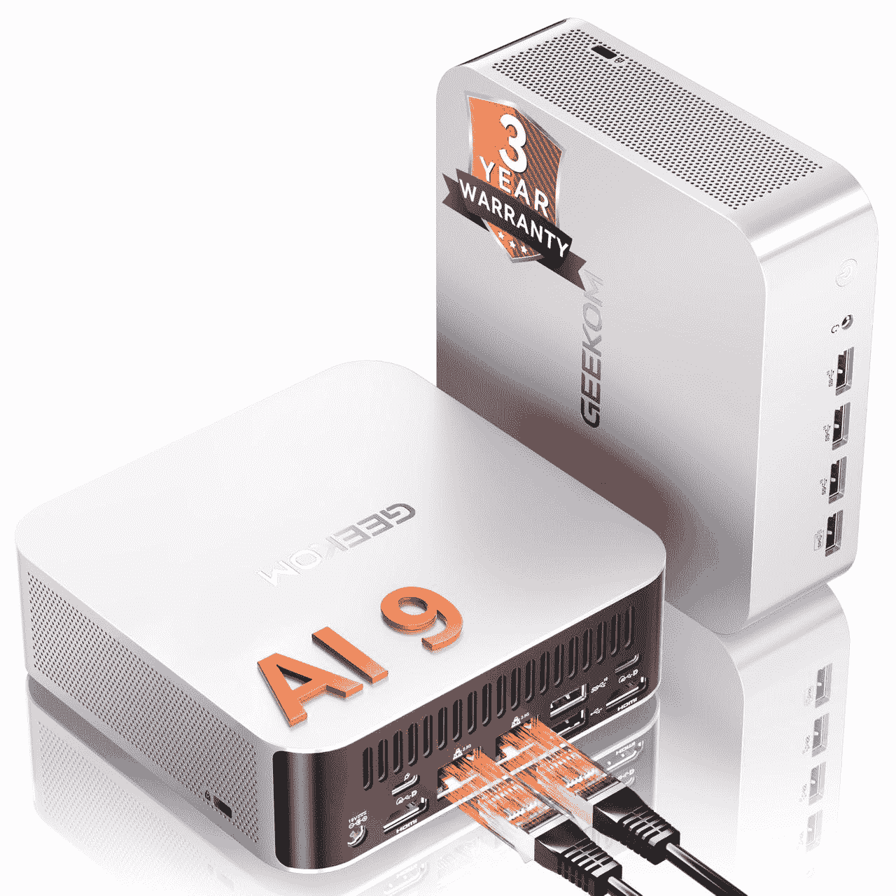

### **GEEKOM A9**

GEEKOM A9 Max AI Mini PC with Ryzen AI 9 HX370, Radeon 890M, 32GB DDR5, 2TB SSD, Windows 11 Pro, Wi‑Fi 7, Dual 2.5GbE and USB4 in a compact silver chassis.

**$1,199.00**

[Get Details](https://www.amazon.com/GEEKOM-A9-Max-Copilot-Warranty/dp/B0FJ213R6G?tag=brutallyho048-20)

I turn to the GEEKOM A9 when I need a compact machine that keeps up with heavier development, multi‑monitor workflows and occasional AI tasks. It feels like a small workstation: lots of RAM and storage, a powerful Ryzen AI chip and modern connectivity that make everyday builds, multitasking and media work smooth.

It does run warmer under heavy GPU loads, so I avoid long gaming marathons on it, but for OpenClaw development, running multiple visualizations, and even light model inference, it offers headroom most mini PCs lack.

### Long-Term Cost Benefits

Picking a higher-spec mini PC up front reduces upgrade cycles: the large SSD and ample DDR5 RAM delay storage or memory upgrades, and the advanced ports mean fewer compatibility purchases later.

### Situational Benefits

### Ease Of Use

### Versatility

This machine covers a wide range of use cases: development, multimedia, light gaming tests and small-scale AI workloads, making it a true all-round performer for power users who need a compact desktop.

### Practicality

With fast networking, multiple high-speed ports and large internal storage, it’s practical as a single-box solution for desk, lab node or portable demo machine; consider an external hub for many USB sensors.

### Energy Efficiency

Performance per watt is solid for its class, but sustained heavy GPU or AI loads will draw more power and increase fan activity and heat output.

### Speed / Response Time

The NVMe SSD and DDR5 RAM make boot, load and context switching feel immediate; heavier long-running GPU tasks may throttle performance as thermals kick in.

### Key Benefits

+   Top-tier Ryzen AI processor and Radeon 890M for strong CPU/GPU balance

+   32GB DDR5 and 2TB NVMe keep builds, VMs and large datasets responsive

+   Modern I/O: USB4, Dual 2.5GbE and Wi‑Fi 7 for fast networking and peripherals

+   Supports multiple high-resolution displays and heavy multitasking

Current Price: **$1,199.00**

Rating: **4.4** (total: 322+)

[Get Details](https://www.amazon.com/GEEKOM-A9-Max-Copilot-Warranty/dp/B0FJ213R6G?tag=brutallyho048-20)

## 🔰 Best Workstation – most powerful & ideal for commerical use-cases

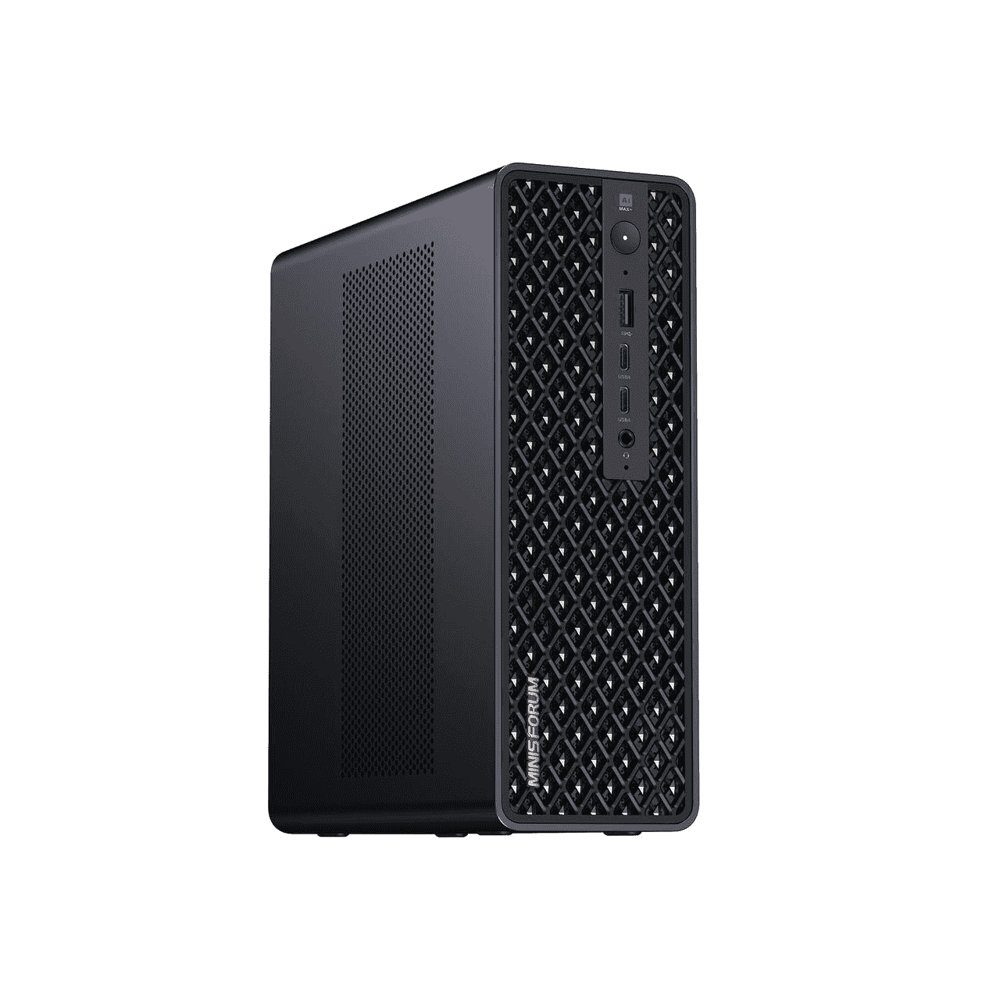

### MINISFORUM MS-S1

MINISFORUM MS-S1 Max mini AI workstation with AMD Ryzen AI Max+ 395, 128GB RAM, 2TB SSD, USB4 v2, dual 10GbE, PCIe x16 slot and robust cooling in a compact chassis.

**$2,959.00**

[Get Details](https://www.amazon.com/MINISFORUM-AMD-Ryzen-Max-395/dp/B0G2VJR4JD?tag=brutallyho048-20)

I reach for the MS-S1 when I need a true mini workstation that won’t compromise on performance. It feels like a scaled-down tower: massive RAM, roomy NVMe storage and a powerful Ryzen AI core make heavy multitasking, large builds and even some AAA workloads feel smooth.

The PCIe x16 slot and dual 10GbE are the sort of extras I appreciate for lab use and quick data transfers, and the built-in power supply keeps the setup tidy. It’s not a cheap pick, but for intensive OpenClaw development, multi-monitor visualizations and on-device inference, it’s a compact workhorse that saves me time during large jobs.

### Long-Term Cost Benefits

Investing in a high-spec mini workstation reduces upgrade cycles: ample RAM, large NVMe storage and modern I/O delay the need for replacements and cut the time spent juggling external peripherals or slow transfers.

### Situational Benefits

### Ease Of Use

### Versatility

This machine handles development, visualization, light GPU tasks and even add-in cards, making it suitable for bench work, a compact lab server or a portable workstation for demanding demos.

### Practicality

Despite its power, the MS-S1 stays compact and replaces multiple boxes: internal PSU, lots of ports and expansion options reduce the need for external adapters and separate servers.

### Energy Efficiency

Performance-per-watt is competitive for a high-end mini, but sustained heavy AI or GPU jobs will raise power draw and fan activity more than smaller, lower-spec units.

### Speed / Response Time

Boots and loads large projects quickly with NVMe storage and ample RAM; interactive tasks and multi-window workflows feel immediate even under heavy use.

### Key Benefits

+   Desktop-class CPU/GPU performance in a small form factor

+   128GB RAM and 2TB NVMe for large datasets and many VMs

+   USB4 v2, Dual 10GbE and PCIe x16 for fast I/O and expansion

+   Strong cooling and built-in 320W PSU for sustained workloads

Current Price: **$2,959.00**

Rating: **5** (total: 10+)

[Get Details](https://www.amazon.com/MINISFORUM-AMD-Ryzen-Max-395/dp/B0G2VJR4JD?tag=brutallyho048-20)

## 🧩 Most Versatile

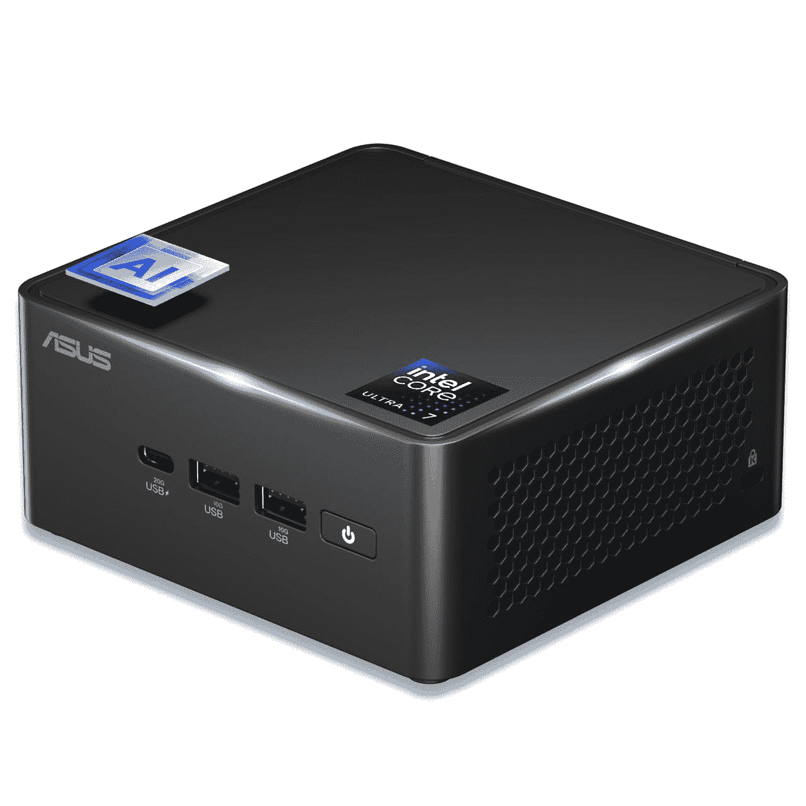

### **ASUS NUC14**

ASUS NUC 14 Pro AI Mini PC with Ultra 7 155H, 32GB DDR5, 1TB PCIe4 SSD, Intel Arc GPU, Thunderbolt/Type‑C and 8K support in a compact NUC chassis.

**$999.00**

[Get Details](https://www.amazon.com/Ultra-4-8GHz-Desktop-Computer-Intel/dp/B0D6BKM3M1?tag=brutallyho048-20)

I reach for the NUC14 when I want a single compact box that can do a bit of everything. It replaces my bulky desktop for photo editing, runs multiple high‑res displays for monitoring OpenClaw runs, and is quiet enough to live on my desk. The Intel Arc GPU and 32GB of DDR5 give it more graphical and multitasking headroom than typical mini PCs, and the Thunderbolt/Type‑C connectivity makes hooking up fast drives and docks painless. It’s the sort of machine I use for daily development, media work and occasional heavier tasks where portability and flexibility matter.

### Long-Term Cost Benefits

Picking a NUC with modern I/O and DDR5 memory means fewer upgrades down the road. Fast NVMe storage and Thunderbolt support reduce the need to buy external adapters, and solid performance delays replacement for several years.

### Situational Benefits

### Ease Of Use

### Versatility

The NUC14 comfortably spans office work, creative tasks, light gaming tests and lab use. Its mix of CPU, Arc GPU and ports makes it a true multi-role mini PC.

### Practicality

Plenty of ports, Thunderbolt flexibility and compact size make it practical for tight desks, AV racks and mobile demos. Add a hub if you need many USB sensors.

### Energy Efficiency

Modern Intel silicon and efficient cooling keep power draw reasonable for a high‑performance mini, so it stays cool and quiet during most workflows.

### Speed / Response Time

With PCIe 4 NVMe and DDR5 memory the NUC14 feels snappy for booting, loading large projects and switching between heavy apps; sustained peak loads will engage fans.

### Key Benefits

+   Balanced CPU and dedicated Intel Arc GPU for graphics and compute

+   32GB DDR5 and 1TB PCIe 4 NVMe for responsive multitasking and storage

+   Thunderbolt/Type‑C and many high‑speed ports for flexible expansion

+   Compact, quiet design that works as a desktop, server node or demo unit

Current Price: **$999.00**

Rating: **4.5** (total: 139+)

[Get Details](https://www.amazon.com/Ultra-4-8GHz-Desktop-Computer-Intel/dp/B0D6BKM3M1?tag=brutallyho048-20)

## 🍏 Best overall [the realiability (M4 Processor)& security of Apple OS at an unbeatable price]

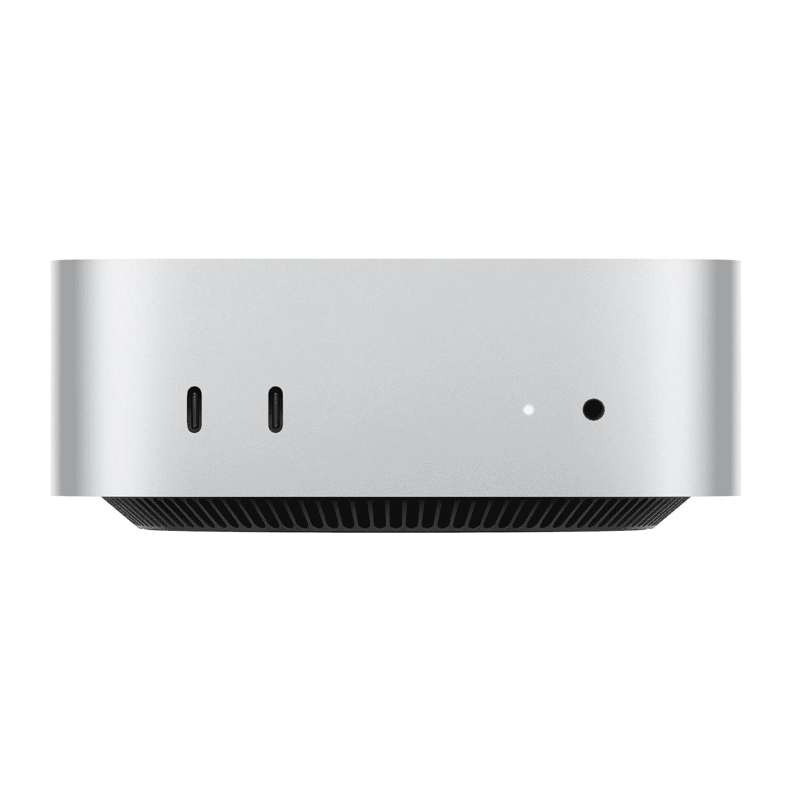

### **Apple Mac mini**

Apple 2024 Mac mini with M4 chip, 10‑core CPU/GPU, 16GB unified memory and 256GB SSD; compact desktop-class performance with Thunderbolt 4 and Gigabit Ethernet.

**$549.00**

[Get Details](https://www.amazon.com/Apple-2024-Desktop-Computer-10%E2%80%91core/dp/B0DLBTPDCS?tag=brutallyho048-20)

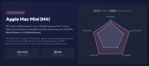

I **pic**k the Mac mini when I want a tiny, dependable desktop that just works without any issues. The M4 chipset makes multitasking feel effortless and the unified memory helps when I have many apps, browser tabs and photo libraries open.

For OpenClaw, I like it for its stability & security, quiet cooling and speed **when co**mpiling or running visualization tools, though you’ll want more internal storage if you keep large datasets locally. Which can easily be achieved by purchasing an expansion dock like this one. This is much more affordable than upgrading SSD within Apple’s ecosystem, which is highway robbery.

> **I perso**anlly think at this price point, it is practically impossible for any other Mini PC to beat the performance of Mac Mini, especially for an autnomous agent (OpenClaw), both for the speed and power of the M4 processor, and the superior security that an Apple OS offers over Windows.

### Long-Term Cost Benefits

The M4 platform and robust macOS support mean fewer driver headaches and longer usable life; that stability reduces maintenance and replacement costs over several years.

### Situational Benefits

### Ease Of Use

### Versatility

Great for developers who prefer macOS, creators working with Apple media formats, and anyone who values a compact, quiet workstation that pairs well with other Apple hardware.

### Practicality

Small footprint and solid ports make it practical for desks, studios and lab stations; plan for external storage if you work with large datasets or media libraries.

### Energy Efficiency

The M4 chip delivers strong performance per watt, so the Mac mini stays cool and economical to run during long sessions.

### Speed / Response Time

Boots quickly and feels immediate during everyday tasks, app launches and most development work; very responsive for interactive visualizations and edits.

### Key Benefits

+   Apple M4 performance in a compact, quiet chassis

+   Excellent macOS integration with iPhone and iPad workflows

+   Three-display support via Thunderbolt and HDMI for dashboards

+   Good baseline memory and fast SSD for responsive everyday use

Current Price: **$549.00**

Rating: **4.8** (total: 2,579+)

[Get Details](https://www.amazon.com/Apple-2024-Desktop-Computer-10%E2%80%91core/dp/B0DLBTPDCS?tag=brutallyho048-20)

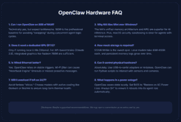

## FAQ

### Which Mini PC Is Best For Running OpenClaw?

I pick a mini PC based on what I actually run with OpenClaw: light development **and demo**s nee**d less t**han full AI workloads. For most users I recommend at least 16GB RAM, an NVMe SSD for fast builds and logs, and a modern CPU (Ryzen/Intel or Apple M4) — that combo handles simulations, multiple monitors and basic inference.

If you plan on on-device AI or heavy visualization, I lean toward higher-tier machines like the GEEKOM A9 ($1,199.00) or the MINISFORUM MS-S1 ($2,959.00); for tight budgets the KAMRUI Pinova ($249.00) or ACEMAGIC K1 ($219.99) are solid picks but may need a dock or hub for extra ports.

### Will Mini PCs Work With Sensors And Robot Hardware?

Yes, but I always check connectivity before I commit. Mo**st mini PCs g**ive you plenty of USB and Ethernet, so using a USB-to-serial adapter, powered USB hub or a small interface board covers sensors, cameras and microcontrollers. I avoid relying solely on Wi‑Fi for robotic links; wired Ethernet is steadier for telemetry and remote control. Also test drivers and OS support for any interface you need, and plan for a powered hub if you attach multiple cameras or USB peripherals.

### How Do I Keep A Mini PC Stable During Long Runs?

I treat stability as a combination of thermal, power and software care. Pick a model with decent cooling and avoid cramped mounts that block airflow, disable aggressive sleep/power saving for long experiments, and keep firmware and drivers current.

I also use wired networking for reliability, monitor temps and CPU load during long jobs, and plug critical setups into a small UPS to survive brief power hiccups.

## What Buyers Prefer

When deciding between the KAMRUI Pinova, ACEMAGIC K1 and Beelink SER5, I find buyers prioritize a mix of value, connectivity and graphics headroom. Budget-focused users gravitate to the Pinova for its price-to-performance, office and classroom buyers pick the K1 for steady networking and dual‑4K support, and those who need stronger visuals or multi‑display setups opt for the SER5 for its better integrated GPU and faster LAN.

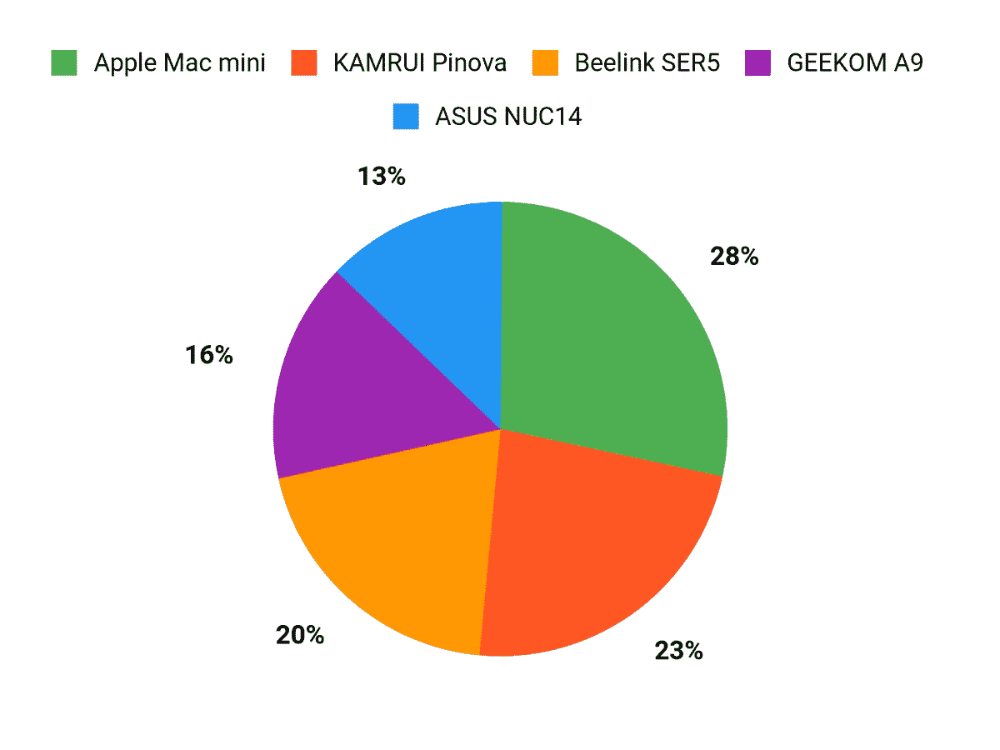

## Wrapping Up

To pick the right mini PC for OpenClaw I recommend matching the machine to how you work. If you want the lowest cost that still runs Windows or Linux reliably I would choose the KAMRUI Pinova, while Beelink offers stronger integrated graphics for visualization and light gaming.

> **For he**avy models, AI workloads, or multi monitor development the GEEKOM A9 and the MINISFORUM MS-S1 provide significantly more headroom. If you prefer macOS and tight Apple ecosystem integration the M4 Mac mini is the easiest, most refined choice.

Ultimately I pick based on required ports, thermal reliability, and how much future expansion I expect, and I suggest testing drivers and connectivity for your exact OpenClaw setup before committing.

# OpenClaw Hardware FAQ: The Ultimate Guide

OpenClaw (formerly Clawdbot/Moltbot) is a self-hosted autonomous agent. To run this “digital nervous system” privately and reliably, your hardware choice is critical. Here are the 12 essential hardware questions answered.

### Can I run OpenClaw on 8GB of RAM?

Technically yes, but expect bottlenecks. 16GB is the professional baseline. OpenClaw runs concurrent processes—core logic, memory databases, and often local LLMs (via Ollama). 8GB will cause “swapping,” drastically slowing your agent’s response time.

### Why is the M4 Mac Mini recommended over Windows machines?

The M4 excels due to its high-speed NPU and Unified Memory architecture, which handles AI inference natively and efficiently. Additionally, macOS’s sandboxed security simplifies protecting an agent that has full access to your terminal and files.

### Does OpenClaw require a dedicated GPU (RTX)?

Only if running models locally (e.g., Llama 3 via Ollama). For cloud-based APIs (Claude 3.5/GPT-4o), high-end integrated graphics like the Radeon 780M/890M are sufficient. Local models require high VRAM/bandwidth to process “thinking” cycles quickly.

### How much storage do I need?

A 512GB NVMe SSD is the “sweet spot.” While the base install is small, local AI models take 4GB–40GB each, and OpenClaw’s “Persistent Memory” (Markdown logs) grows over time with usage.

### Is Wired Ethernet better than Wi-Fi?

Yes. OpenClaw relies on stable triggers via DMs (WhatsApp/Discord). Jitter or latency on Wi-Fi can cause the agent to time out or miss proactive events. Wired Gigabit ensures a constant, responsive connection.

### Can a Mini PC control physical hardware via OpenClaw?

Absolutely. Most Mini PCs feature multiple USB 3.2/USB4 ports. By connecting USB-to-Serial adapters or Arduinos, OpenClaw can run Python scripts to interact with sensors and cameras, acting as a robotic brain.

### Will a Mini PC overheat if left on 24/7?

OpenClaw is light at idle but spikes during “Autonomous Coding” or simulations. Avoid fanless “stick” PCs; choose models with active cooling (fans) like the Geekom A9 or Beelink SER5 to ensure long-term thermal stability.

### What happens if the power goes out?

OpenClaw saves its state to local Markdown files. To ensure 100% uptime, use a small UPS and configure your BIOS “Restore on AC Power Loss” setting to “Always On” so the agent reboots automatically.

### Does OpenClaw run better on Linux, Mac, or Windows?

Linux (Ubuntu/Debian) is the most stable for managing “Terminal Skills” and cron jobs. macOS is excellent for security and NPU performance. Windows 11 Pro is fully supported but requires more overhead.

### Can I host multiple agents on one Mini PC?

Yes, if you have the RAM. Each agent instance adds memory overhead. A 64GB or 128GB machine (like the Minisforum MS-S1) can support an “agent swarm” performing different specialized tasks simultaneously.

### Is it worth buying a used Mini PC?

Yes, if it has at least a Ryzen 4000 series chip. Avoid older Intel Celeron or N-series processors; OpenClaw requires the “snappy” context-switching capabilities found in mid-tier performance chips.

Disclosure: This Roundup is reader-supported. When you click through links we may earn a referral commission, at NO EXTRA COST to the reader.

##

这篇 2026 年的测评文章核心对比了四款适合运行 OpenClaw 的硬件，聚焦 “自托管 AI 助手” 的核心需求（24/7 运行、并发处理、本地推理可选、低噪节能），最终给出按预算和场景划分的明确选型建议，以下是完整总结：

### 一、核心前提：OpenClaw 对硬件的关键要求

OpenClaw 并非普通聊天机器人，需支撑浏览器自动化、多消息渠道管理（Telegram/WhatsApp 等）、本地 LLM 推理（可选）或云 API 代理、实时工具调用，因此硬件需满足：

1.  支持 7×24 小时稳定运行；

1.  能处理并发 I/O 任务，不卡顿；

1.  可选本地 AI 推理能力（隐私需求）；

1.  低功耗、低噪音，适合桌面或机架部署。

### 二、四款硬件详细对比（含核心参数、优劣、适配场景）

### 三、关键维度横向对比（一目了然）

### 四、最终选型建议（按需求精准匹配）

1.  **入门 / 实验党**：选 Raspberry Pi 5，95 欧元低成本试水，适合仅用云 API 的轻量场景，折腾性强；

1.  **实用稳定派**：选 x86 迷你主机（N100/N305），150-400 欧元性价比之王，Linux 生态成熟，适合日常办公、多任务自动化，无需本地推理；

1.  **平衡优选派**：选 ClawBox（Jetson Orin Nano），399 欧元兼顾本地推理与静音低功耗，预装 OpenClaw 开箱即用，是多数用户的 “甜点级” 选择；

1.  **高端性能派**：选 Mac Mini M4，预算充足且需高性能本地推理，适合对模型运行速度有高要求、熟悉 macOS 的用户。

### 五、核心结论

OpenClaw 硬件选型无 “唯一答案”，核心看预算、是否需要本地推理、现有技术生态：

+   无需本地推理：优先 x86 迷你主机（性价比）或 Raspberry Pi 5（低成本）；

+   需要本地推理：优先 ClawBox（平衡成本与性能）或 Mac Mini M4（高性能）；

+   核心原则：无需过度追求高端硬件，OpenClaw 兼容性极强，从树莓派到工作站均可运行，匹配自身需求即可。

[https://www.pcbuildadvisor.com/best-mini-pc-for-o](https://www.pcbuildadvisor.com/best-mini-pc-for-openclaw-formerly-called-clawdbot-moltbot-the-ultimate-guide/)penclaw-formerly-called-clawdbot-moltbot-the-ultimate-guide/

这篇 2026 年的深度测评文章，核心是为 OpenClaw（前身为 Clawdbot/Moltbot）推荐适配的迷你主机，覆盖从预算到专业级全场景，结合硬件性能、兼容性、实际使用场景给出明确选型，以下是完整总结：

### 一、核心前提：OpenClaw 的硬件核心需求

OpenClaw 是一款自托管自治 AI 代理（非普通聊天机器人），需 7×24 小时运行，支持多消息渠道管理（WhatsApp/Telegram 等）、浏览器自动化、本地 LLM 推理（可选）或云 API 代理，因此硬件需满足：

1.  稳定的 CPU/GPU 性能，支撑并发 I/O 和推理任务；

1.  至少 16GB RAM（避免多任务卡顿）和高速 NVMe 存储（保障日志 / 模型读写）；

1.  丰富端口（适配传感器 / 显示器）和可靠网络；

1.  良好的散热和低噪音，适配长期运行；

1.  兼容 Linux/macOS/Windows 系统（Linux 最稳定，macOS 安全性优，Windows 支持完整）。

### 二、7 款核心推荐机型（按场景分类，含核心参数 / 优劣 / 适配人群）

文章按 “预算 - 性能 - 专业度” 分级，每款均经过实测验证，核心信息如下：

### 三、关键补充：新增热门机型（2026 年 2 月更新）

ACEMAGIC M5： introductory 价 799 美元（常规价 899），Intel Core i5-14500HX（14 核 20 线程，4.9GHz）、32GB RAM、1TB SSD，性能接近 1200 美元的 Geekom A9，支持本地 LLM 部署，是中端市场性价比黑马。

### 四、硬件选型核心指南（按需求精准匹配）

1.  **预算优先（≤$300）**：选 KAMRUI Pinova P1 或 ACEMAGIC K1，满足 70-80% 用户的基础 OpenClaw 需求（云 API 调用、简单自动化）；

1.  **平衡实用（$400-$600）**：选 Beelink SER5 MAX 或 Mac Mini M4，前者适合 Windows/Linux 用户，后者适合 Apple 生态用户；

1.  AI 性能导向（$800-$1200）：选 ACEMAGIC M5 或 ASUS NUC14，兼顾本地 LLM 和多任务处理；

1.  专业 / 商业级（≥$1200）：选 GEEKOM A9 Max 或 MINISFORUM MS-S1 Max，适配复杂推理和高并发场景。

### 五、必看 FAQ（避坑关键）

1.  内存要求：8GB 可运行但有瓶颈，16GB 是专业基线，本地 LLM 需 32GB+；

1.  存储建议：512GB NVMe SSD 是 “甜点级”，本地模型需预留 4-40GB / 个；

1.  网络选择：有线以太网比 Wi-Fi 更稳定，避免消息触发超时；

1.  稳定性保障：选带主动散热的机型（如 Beelink SER5、GEEKOM A9），避免风扇 less 设计；配置 UPS 应对断电，BIOS 设置 “断电自动重启”；

1.  系统选择：Linux（Ubuntu/Debian）最适合终端技能和定时任务，macOS 安全性优，Windows 11 Pro 支持完整但开销略高。

### 六、最终结论

OpenClaw 硬件选型的核心是 “匹配使用场景”：

+   基础需求（云 API + 简单自动化）：优先 KAMRUI Pinova P1（性价比之王）；

+   中度需求（可视化 + 轻量本地 LLM）：选 Beelink SER5 MAX 或 Mac Mini M4；

+   重度需求（复杂 LLM + 高并发）：GEEKOM A9 Max 或 MINISFORUM MS-S1 Max；

+   无明确偏好时，Mac Mini M4 是 “最安全” 的通用选择，稳定性和生态优势突出。

选型时需额外关注端口兼容性、散热能力和售后支持，避免因硬件细节影响长期运行。

https://www.pcbuildadvisor.com/best-mini-pc-for-home-server-the-ultimate-guide-with-comparisons/