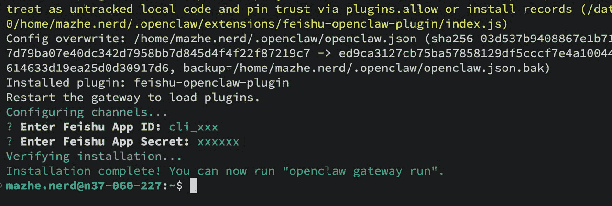
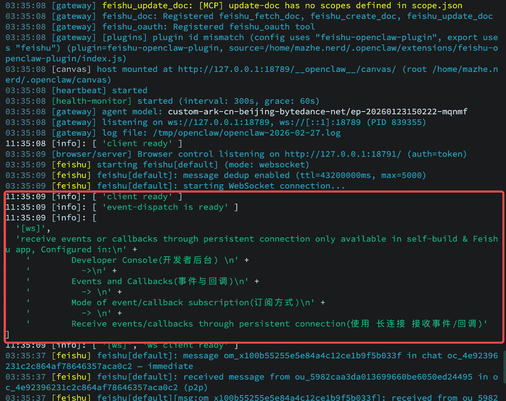
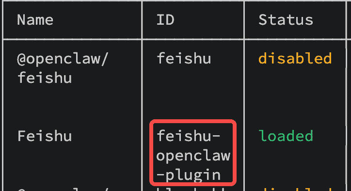
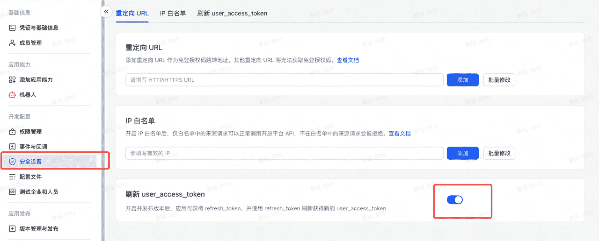
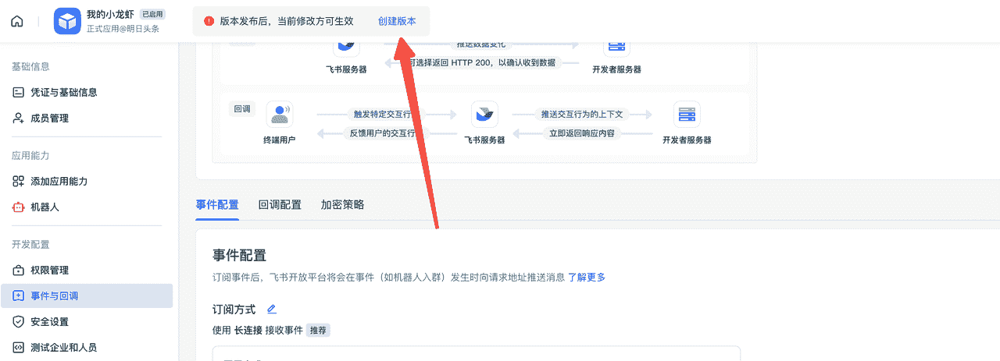
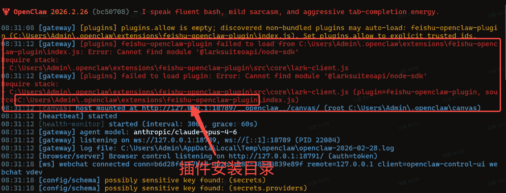
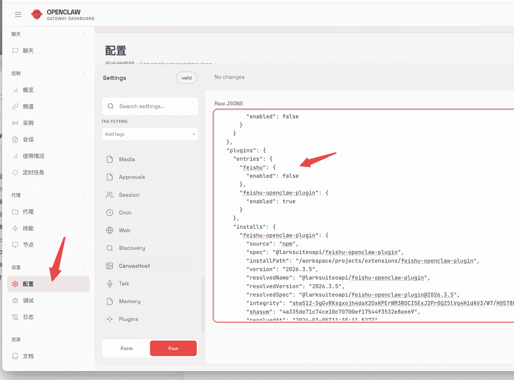
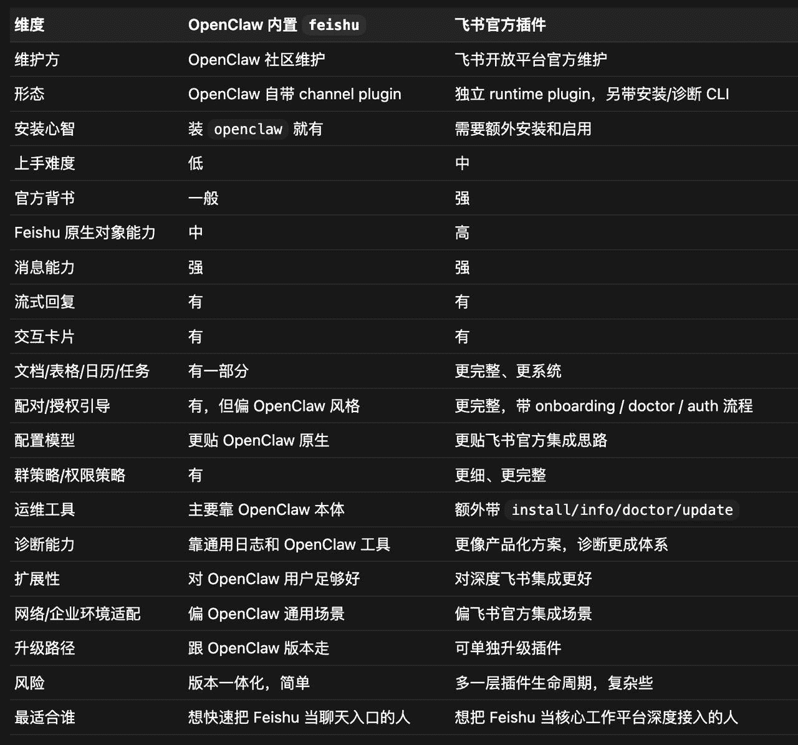

# OpenClaw飞书官方插件使用指南（公开版）

> 来源：[https://gotoaiworld.feishu.cn/docx/LbpZd96lQoDXkBxDbUMcg2r6nFg](https://gotoaiworld.feishu.cn/docx/LbpZd96lQoDXkBxDbUMcg2r6nFg)

> 本插**件目**前处于快速迭代阶段，请谨慎尝试。为了提供更优质的用户体验，产品研发团队正在快速优化迭代，每天我们的龙虾插件都在变得更稳定、部署更简单、功能更好用。点击右上角... 关注文档更新。🦞

> [**飞书插件**](https://bytedance.larkoffice.com/docx/MFK7dDFLFoVlOGxWCv5cTXKmnMh?preview_comment_id=7614018304513723588&last_doc_message_id=7614018124266179787&scene=feed&theme=light&contentTheme=DARK&sub_scene=tab&sourceType=feed#Nf1gdFH4xo325pxZnuicAcaznFj)最新版本：2026.3.8 ｜更新日志

# 让你的飞书长出龙虾钳** **🦞

你或许早就把小龙虾接到了飞书上，他能帮你写东西、查资料、出方案——但它也经常会说，"我没有飞书文档/消息/日历权限，请把内容发给我"，你不得不反复复制粘贴。

今天，飞书 OpenClaw 官方插件正式上线！

在获得你的**授权**后，OpenClaw 可以直接以你的身份看文档找资料、核对日历看档期、理解群聊上下文。

你说一句话，它就能伸出“钳子”，直接在飞书里帮你把活儿干了。

> **一句话能做什么？ **


> **完整能力一览**

| 类别 | 能力 |
| --- | --- |
| 💬 消息 | 消息读取（群聊/单聊历史、话题回复）、消息发送（含发卡片）、消息回复、消息搜索、图片/文件下载 |
| 📄 文档 | 创建云文档、更新云文档、读取云文档内容 |
| 📊 多维表格 | 创建/管理多维表格、数据表、字段、记录（增删改查、批量操作、高级筛选）、视图 |
| 📊 电子表格 | 创建、编辑、查看电子表格 |
| 📅 日历日程 | 日历管理、日程管理（创建/查询/修改/删除/搜索）、参会人管理、忙闲查询 |
| ✅ 任务 | 任务管理（创建/查询/更新/完成）、清单管理、子任务、评论 |

> 代用户身份发消息需在飞书开放平台额外开通机器人 im:message.send_as_user 权限，部分企业如字节不支持此操作

此外，有了插件，你的 OpenClaw 还能在飞书[上和你更好](https://bytedance.larkoffice.com/docx/MFK7dDFLFoVlOGxWCv5cTXKmnMh?contentTheme=DARK&last_doc_message_id=7613984628180896971&preview_comment_id=7613377996409375688&sourceType=feed&theme=light#share-Hwmbdv69ZoPYNpxN0RMc5E8YnPg)的互动，支持流式输出卡片回复（需手动开启）、识别合并转发消息、发表情等，欢迎体验！

该插件由于有用户身份授权，**暂**不适合作为群机器人供多人使用，也不建议用公司的飞书账号接入，建议先用个人账号体验，请仔细评估后安装。

# 安装教程

## 免安装自带飞书插件的平台

使用  [Coze 编程](https://docs.coze.cn/tutorial/openclaw)、[ArkClaw](https://www.volcengine.com/activity/codingplan-feishu?utm_campaign=arkclaw&utm_content=arkclaw&utm_medium=feishu&utm_source=OWO&utm_term=webinar) 平台安装的 OpenClaw 已自带飞书插件，无需阅读后续的安装步骤。

## 前置准备

安装 openclaw https://openclaw.ai/

[立省 500！30 分钟把 OpenClaw 在飞书上配到可用](https://larkcommunity.feishu.cn/wiki/LDmXwEVhJitBa5kU0mjc16VKneb?from=from_copylink)果你还没有OpenClaw，可以参照快速上手指南：

> openclaw 版本限制：

+   **Linux/MacOS：op**enclaw  2026.2.26 及以上；

+   **Windows：openc**law 2026.3.2 及以上

> 可通过openclaw -v命令查看；如果低于该版本可能出现异常

> 执行这个命令升级：npm install -g openclaw

> 其它升级方式可参考：https://docs.openclaw.ai/install/development-channels#switching-channels

## 创建飞书机器人、导入权限

> 后续我们将提供一键创建机器人的能力，敬请期待

> 可以复用已有机器人，但注意下面的权限和卡片回调要配置全

> 注意：导入完整的权限列表 对后续功能的使用体验非常重要（不用经常申请权限）！！

| 创建应用 | 1.  登录[飞书开放平台](https://open.feishu.cn/app?lang=zh-CN)，单击“创建企业自建应用”按钮。 |
| --- | --- |
| 开启机器人能力 | 添加机器人能力 |
| 导入所需权限 | 在左侧目录选择“开发配置 &gt; 权限管理”，单击“批量导入/导出权限”按钮。 |
| 发布应用并审核通过 | 1.  发布应用。 |
| 获取应用appid  appsecret | 1.  在左侧目录选择“基础信息 &gt; 凭证与基础信息”。 |

## 安装飞书插件

> **如果历史**上已安装了其他飞书插件，在这一步安装过程中将会自动禁用其他飞书插件，无需额外处理；如果你所在的平台有辅助开发 Agent ，可以试试让Agent辅助安装

执行指令：

```
npx -y https://sf3-cn.feishucdn.com/obj/open-platform-opendoc/3001f02e44c6269c6df09c01aad601cd_QWN3XUhUSQ.tgz install
```

> 提示：👆如果执行这一行命令行出错，可在命令行前 增加sudo 重新执行

+   如果历史已关联飞书应用，可选是沿用历史飞书应用，还是创建或关联新应用。如果是创建或关联新应用，则填入第1步中创建新应用的 appid 和 appsecret



```
openclaw gateway run
```

+   验证是否成功：

运行上述代码后，如果出现下面这段说明插件已经开始监听飞书的事件，启动成功



运行  open**claw p**lugins list，ID为feishu-openclaw-plugin的Status为loaded，ID为feishu的Status为disabled则标明已成功启用飞书官方插件：



## 订阅机器人长链接 接收事件 和卡片回调

> 注意：需要配置卡片回调，便于小龙虾可以感知到你点击了卡片按钮操作

| 进入[飞书开放平台](https://open.feishu.cn/app?lang=zh-CN)，配置事件订阅方式 | 配置方式为长连接 |
| --- | --- |
| 点击回调配置 | 配置方式为长连接 |
| 安全设置 |  |
| 发布版本并审核通过 |  |

## 完成机器人的配对并开始使用

> 如果希望快速完成给龙虾的权限授权，便于丝滑调用各种飞书工具，可以随时告诉AI：“我想授予所有用户权限”，来完成权限的授予。

1.  在飞书中向机器人发送任意消息，系统会生成一个配对码（字母+数字组合）；如果历史已安装过飞书插件，可能没有该配对过程。

1.  配对码有效期为 5 分钟，超时需重新触发

1.  在服务器终端执行以下命令完成绑定：openclaw pairing approve feishu <配对码> --notify

> 输入时不带 <>

1.  按照下图完成授权，便于后续 openclaw 可以通过你的身份完成消息、文档、多维表格、日历等任务。
如果不想在此刻授权，也可以直接开始对话，后续在对话框中输入 /feishu auth 来完成批量授权

|  |  |
| --- | --- |
|  |  |

1.  确认是否安装成功，可在与AI 的对话中发送：/feishu start；如果返回了版本号信息，则代表安装成功。

1.  为了让龙虾能学会这些新技能并正确使用，请和龙虾说“学习一下我安装的新飞书插件，列出有哪些能力”

# 使用教程

## 如何切换到流式输出

切换到流式输出，可运行指令（如果你是本地部署，需要去终端输入；如果是云端部署，去云端的对话框输入）：

```
openclaw config set channels.feishu.streaming true
```

不用流式输出 可以通过运行指令：

```
openclaw config set channels.feishu.streaming false
```

流式输出卡片上支持显示更多内容

```
openclaw config set channels.feishu.footer.elapsed true  // 开启耗时
openclaw config set channels.feishu.footer.status true  // 开启状态展示
```

## 设置多任务并行、独立上下文

机器人可在话题群/消息群话题模式中，针对每个话题拥有独立上下文以及多任务并行。

如需开启该能力 可运行指令

```
openclaw config set channels.feishu.threadSession true
```

如需关闭，可运行指令

```
openclaw config set channels.feishu.threadSession false
```

## 如何修改飞书机器人在群内的回复方式

目前插件默认方式：可被拉进群，只有at 机器人才可回复。

模式 1：只有 @机器人 才回复（最常用）

**配置方法**

```
# 设置需要 @ 才回复
openclaw config set channels.feishu.requireMention true --json# 重启生效sh /workspace/projects/scripts/restart.sh
```

**完整配置示例**

```
{&quot;channels&quot;: {&quot;feishu&quot;: {&quot;enabled&quot;: true,&quot;appId&quot;: &quot;cli_你的AppID&quot;,&quot;appSecret&quot;: &quot;你的AppSecret&quot;,&quot;requireMention&quot;: true,&quot;groupPolicy&quot;: &quot;open&quot;}}}
```

---

模式 2：不用 @，所有消息都回复

需要额外在开发者后台申请权限-应用身份权限：获取群组中所有消息（敏感权限）im:message.group_msg

**配置方法**

```
# 设置不需要 @ 也回复
openclaw config set channels.feishu.requireMention false --json# 重启生效sh /workspace/projects/scripts/restart.sh
```

```
{&quot;channels&quot;: {&quot;feishu&quot;: {&quot;enabled&quot;: true,&quot;appId&quot;: &quot;cli_你的AppID&quot;,&quot;appSecret&quot;: &quot;你的AppSecret&quot;,&quot;requireMention&quot;: &quot;open&quot;,&quot;groupPolicy&quot;: &quot;open&quot;}}}
```

> ⚠️ 注意：这个模式在大群里容易刷屏，谨慎使用！

---

模式 3：只有指定群 @机器人 才回复（高级）

**效果**

+   大部分群：不用 @ 也能回复（或者完全不回复）

+   特定群：必须 @ 才回复

+   适合：不同群不同规则，比如工作群严格一点，闲聊群随意一点

**配置方法**

第一步：获取群 ID；让机器人加入群后，发送任意消息，然后在日志里找群 ID，或者让机器人回复群 ID。或飞书群设置页面中有ID

**第二步：配置特定群规则**

```
# 先设置默认所有群都不需要 @
openclaw config set channels.feishu.requireMention open --json# 然后给特定群设置需要 @（这里群ID只是示例，你要替换成真实的）
openclaw config set channels.feishu.groups.oc_xxxxxxxx.requireMention true --json# 重启生效sh /workspace/projects/scripts/restart.sh
```

**完整配置示例**

```
{&quot;channels&quot;: {&quot;feishu&quot;: {&quot;enabled&quot;: true,&quot;appId&quot;: &quot;cli_你的AppID&quot;,&quot;appSecret&quot;: &quot;你的AppSecret&quot;,&quot;requireMention&quot;: &quot;open&quot;,&quot;groupPolicy&quot;: &quot;open&quot;,&quot;groups&quot;: {&quot;oc_532044075a61d112f04fa63109c75e9b&quot;: {&quot;requireMention&quot;: true},&quot;oc_另一个群ID&quot;: {&quot;requireMention&quot;: true}}}}}
```

## 常见诊断命令与问题修复

1.  可在与AI 的对话中发送

1.  **/feishu start**：确认是否安装成功；

1.  **/feishu doctor**：可检查配置是否正常；

1.  如果希望批量完成用户授权， 可批量完成用户授权；

1.  插件中也内置了常见问题的解决方案，遇到问题 都可以先问问小龙虾了！

1.  如果不行，则运行指令：

```
npx https://sf3-cn.feishucdn.com/obj/open-platform-opendoc/3001f02e44c6269c6df09c01aad601cd_QWN3XUhUSQ.tgz doctor
```

可以查看问题，自主修复：


运行 fix尝试自动修复

```
npx https://sf3-cn.feishucdn.com/obj/open-platform-opendoc/3001f02e44c6269c6df09c01aad601cd_QWN3XUhUSQ.tgz doctor --fix
```


1.  如果仍然无法修复，可在反馈群里反馈信息

运行 info 查看版本信息，反馈问题时带上辅助排查

```
npx https://sf3-cn.feishucdn.com/obj/open-platform-opendoc/3001f02e44c6269c6df09c01aad601cd_QWN3XUhUSQ.tgz info 
```


--all查看详细配置信息

```
npx https://sf3-cn.feishucdn.com/obj/open-platform-opendoc/3001f02e44c6269c6df09c01aad601cd_QWN3XUhUSQ.tgz info --all
```

# 更新教程

插件能力实时更新，欢迎更新到插件最新版本体验最新能力

在「终端」中运行下面代码：

```
npx -y https://sf3-cn.feishucdn.com/obj/open-platform-opendoc/3001f02e44c6269c6df09c01aad601cd_QWN3XUhUSQ.tgz update
```

> 提示：👆如果执行这一行命令行出错，可在命令行前 增加sudo 重新执行

# 常见问题

## 没有 OpenClaw 应该如何部署？

+   OpenClaw 是本次介绍的飞书插件的运行基础，请先选择符合自己需要的部署方案完成部署。

+   本地版建议使用 TRAE SOLO 等编程 Agent 辅助安装；

+   云端版如 [Coze 编程](https://docs.coze.cn/tutorial/openclaw)、[ArkClaw](https://www.volcengine.com/activity/codingplan-feishu?utm_campaign=arkclaw&utm_content=arkclaw&utm_medium=feishu&utm_source=OWO&utm_term=webinar)等可以一键部署，在后续使用中也可以提供开发Agent辅助你调试；你可以通过视频感受下这类产品的快捷部署方式⬇️


[0305 扣子编程一键部署 OpenClaw.mov](https://internal-api-drive-stream.feishu.cn/space/api/box/stream/download/all/VMaMbHyUzoswPyxifgzca8XQnhc)

## 插件安装完毕运行后，报cannot find module xxx

原因是系统没有安装插件的依赖（可能是安装被中断or权限问题）

**解决方法：进入插件安装**目录，运行npm install



## Coze上安装失败的处理方式

依次在终端执行以下命令，如果未能正常运行，请等待飞书插件和 Coze 的后续更新。

```
// 先执行
export NPM_CONFIG_REGISTRY=https://registry.npmmirror.com
```

```
npx -y https://sf3-cn.feishucdn.com/obj/open-platform-opendoc/3001f02e44c6269c6df09c01aad601cd_QWN3XUhUSQ.tgz install
```

> 提示：👆如果执行这一行命令行出错，可在命令行前 增加sudo 重新执行

检查一下老插件的配置，参考下图。如果为“true”需要改成“false”



## 升级到 openclaw 3.2 版本上无法正常调用工具

这个openclaw 版本默认把新 agent 的工具权限关闭。修复方式 在 openclaw.json 找到并修改为下面这段内容：

```
{
  &quot;tools&quot;: {
    &quot;profile&quot;: &quot;full&quot;,
    &quot;sessions&quot;: {
      &quot;visibility&quot;: &quot;all&quot;
    }
  }
}
```

## 飞书官方插件与 OpenClaw 社区原有插件有何区别？

飞书官方插件，能以用户身份读写消息、文档等，体验更丝滑；以下为粗略的对比（由AI整理，供参考）



# 用户内测体验互助群

> 欢迎群内大家彼此帮助回复问题，老玩家带带新玩家，一起探索龙虾新玩法提升工作效率

# 更新日志

## **v2026.3.8**

1.  **支持电子表格的读写**：小龙虾现在可以帮你看表格数据、追加内容啦！使用前记[得在开发者后](https://bytedance.larkoffice.com/docx/MFK7dDFLFoVlOGxWCv5cTXKmnMh?contentTheme=DARK&last_doc_message_id=7614500658142711002&preview_comment_id=7614073723921976548&sourceType=feed&theme=light#share-H2KkdvYdYo7NMjxNiLhcFIZqngg)台导入电子表格相关权限哦  权限配置指南

1.  **支持在云文档中添加文件和图片**：小龙虾写文档时可以插入图片、文件附件了，让文档内容更丰富

1.  **AI 可感知表情反馈**：小龙虾现在能"看懂"你的表情了！收到你的 👍、❤️ 等表情后，可以据此调整回复逻辑，比如通过 👍 确认操作执行

## v 2026.3.7-beta.1

**问题修复：**修复windows 使用反复授权问题，可升级到最新版本体验

## **v 2026.3.6**

感谢大家的使用和反馈，基于大家提出的问题和建议，我们进行了如下更新：

1.  **安装支持windows 环境**：已支持windows 系统安装插件

1.  **话题群和话题模式群能力升级：**可[通过命令](https://bytedance.larkoffice.com/docx/MFK7dDFLFoVlOGxWCv5cTXKmnMh#Iw3OdbEWsoeMdDxnUavcWhrZnQd)一键开启在话题群、话题模式群中让每个独立话题中拥有独立上下文和并行执行任务，让小龙虾同时干多件事。配置方式

1.  **问题修复：**修复知识库文档无法读取评论的问题，修复 /feishu doctor 指令中版本号错误问题

如果你已经用上了我们的插件，建议更新到我们的新插件，可[以参考这](https://bytedance.larkoffice.com/docx/MFK7dDFLFoVlOGxWCv5cTXKmnMh#KXuGd1IEjoIRe9xRLffcMPIgnjg)里的更新指令快速升级到最新版  更新指令