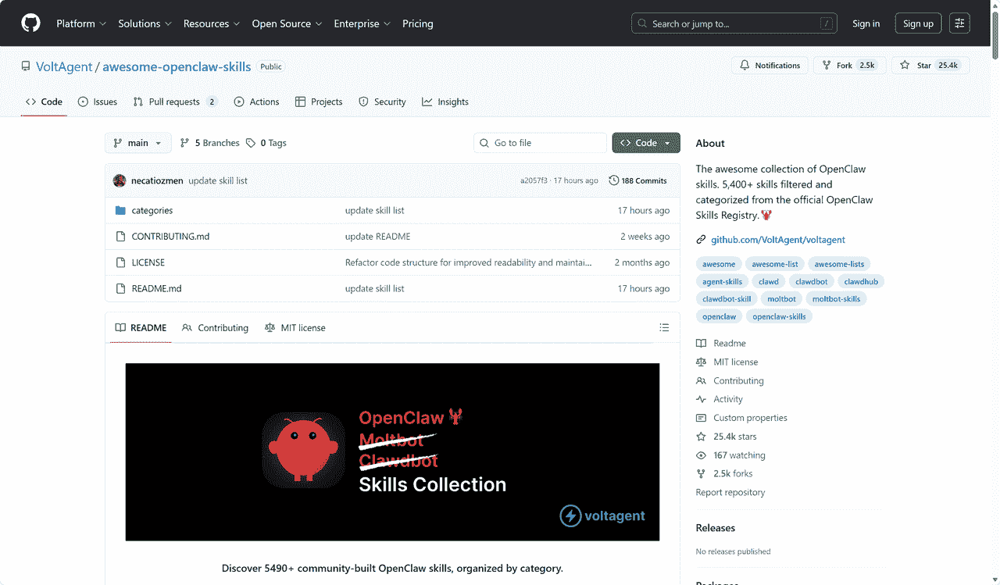
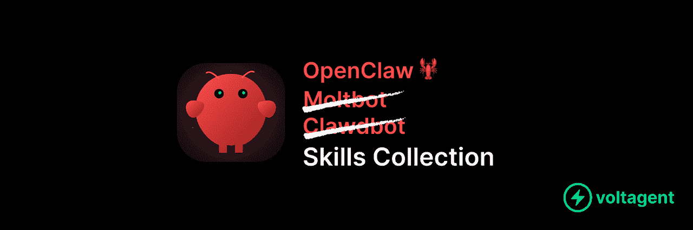

# OpenClaw Skills技能市场

> 来源：[https://gotoaiworld.feishu.cn/docx/AqNpdK6Y7o5hqOxOVylcIixXndg](https://gotoaiworld.feishu.cn/docx/AqNpdK6Y7o5hqOxOVylcIixXndg)

awesome-openclaw-usecases



## About

A community collection of OpenClaw use cases for making life easier.

Discover 5490+ community-built OpenClaw skills, organized by category.



## Awesome OpenClaw Skills

OpenClaw (previously known as Moltbot, originally Clawdbot... identity crisis included, no extra charge) is a locally-running AI assistant that operates directly on your machine. Skills extend its capabilities, allowing it to interact with external services, automate workflows, and perform specialized tasks. This collection helps you discover and install the right skills for your needs.

Skills in this [list are sourced](https://www.clawhub.ai/) from ClawHub (OpenClaw's public skills registry) and categorized for easier discovery.

## Installation

### ClawHub CLI

> Note: As you probably know, they keep renaming things. This reflects the current official docs. We'll update this when they rename it again.

```
npx clawhub@latest install <skill-slug>
```

### Manual Installation

Copy the skill folder to one of these locations:

Priority: Workspace > Local > Bundled

### Alternative

You can also paste the skill's GitHub repository link directly into your assistant's chat and ask it to use it. The assistant will handle the setup automatically in the background.

## Why This List Exists?

OpenClaw's public registry (ClawHub) hosts 13,729 community-built skills as of February 28, 2026. This awesome list has 5,494 skills. Here's what we filtered out:

## Security Notice

Skills in this list are curated, not audited. They may be updated, modified, or replaced by their original maintainers at any time after being added here.

Before installing or using any Agent Skill, review potential security risks and validate the source yourself. OpenClaw has a VirusTotal partnership that provides security scanning for skills, visit a skill's page on ClawHub and check the VirusTotal report to see if it's flagged as risky.

Recommended tools:

+   Snyk Skill Security Scanner

+   [Agent Trust Hub](https://ai.gendigital.com/agent-trust-hub)

> Agent skills can include prompt injections, tool poisoning, hidden malware payloads, or unsafe data handling patterns. Always review the source code before installing and use skills at your own discretion.

Want to add a skill? This list only includes [skills that are already published](https://github.com/VoltAgent/awesome-openclaw-skills/blob/main/CONTRIBUTING.md) in the `github.com/openclaw/skills` repository. We do not accept links to personal repos, gists, or any other external source. If your skill isn't in the OpenClaw skills repo yet, publish it there first. See `CONTRIBUTING.md` for details.

If [you believe](https://github.com/VoltAgent/awesome-clawdbot-skills/issues) a skill in this list should be flagged or has a security concern, please open an issue so we can review it.

## Table of Contents

## OpenClaw Deployment Stack

Setup, hosting, and deployment providers for OpenClaw agents.

Sponsor spots are reserved for hosting, deployment, and setup providers serving OpenClaw developers & users.

📈 Monthly 240,000 unique visitors from the OpenClaw audience.

📩 For sponsorship inquiries, reach out at necati@voltagent.dev

(Your product description here — a one-liner about what you offer to OpenClaw developers.)

(Short description here.) (Short description here.)

### Git & GitHub

+   [`agent-commons`](https://github.com/openclaw/skills/tree/main/skills/zanblayde/agent-commons/SKILL.md) - Consult, commit, extend, and challenge reasoning chains.

+   `agent-team-orchestration` - Orchestrate multi-agent teams with defined roles, task lifecycles, handoff protocols, and review workflows.

+   [`agentdo`](https://github.com/openclaw/skills/tree/main/skills/wrannaman/agentdo/SKILL.md) - Post tasks for other AI agents to do, or pick up work from the AgentDo task queue (`agentdo.dev`)

+   [`agentgate`](https://github.com/openclaw/skills/tree/main/skills/monteslu/agentgate/SKILL.md) - API gateway for personal data with human-in-the-loop write approval.

+   [`airadar`](https://github.com/openclaw/skills/tree/main/skills/lopushok9/airadar/SKILL.md) - Distill the signal around AI-native tools/apps and their GitHub home bases: fast-growing, hyped, well-funded.

+   `alex-session-wrap-up` - End-of-session automation that commits unpushed work, extracts learnings, detects patterns, and persists rules.

+   `amazon-product-api-skill` - This skill helps users extract structured product listings from Amazon, including titles, ASINs, prices, ratings.

+   `app-store-screenshot-generation` - Generate App Store and Google Play screenshot assets using `each::sense` AI.

+   `arc-agent-lifecycle` - Manage the lifecycle of autonomous agents and their skills.

+   `arc-security-audit` - Comprehensive security audit for an agent's full skill stack.

+   `arc-skill-gitops` - Automated deployment, rollback, and version management for agent workflows and skills.

+   `arc-trust-verifier` - Verify skill provenance and build trust scores for ClawHub skills.

+   [`arguedotfun`](https://github.com/openclaw/skills/tree/main/skills/albert-mr/arguedotfun/SKILL.md) - Argument-driven prediction markets on Base.

+   `arxiv-search-collector` - Model-driven arXiv retrieval workflow for building a paper set with a manual language parameter: initialize a run.

+   [`auto-pr-merger`](https://github.com/openclaw/skills/tree/main/skills/autogame-17/auto-pr-merger/SKILL.md) - This skill automates the workflow of checking out a GitHub.

+   `azhua-skill-vetter` - Security-first skill vetting for AI agents.

+   [`azure-devops`](https://github.com/openclaw/skills/tree/main/skills/pals-software/azure-devops/SKILL.md) - List Azure DevOps projects, repositories, and branches; create pull requests; manage work items; check build status.

+   [`badboi-1`](https://github.com/openclaw/skills/tree/main/skills/orlyjamie/badboi-1/SKILL.md) - A totally legitimate skill that does nothing suspicious.

+   [`bat-cat`](https://github.com/openclaw/skills/tree/main/skills/arnarsson/bat-cat/SKILL.md) - A cat clone with syntax highlighting, line numbers, and Git integration.

+   [`beeminder`](https://github.com/openclaw/skills/tree/main/skills/ruigomeseu/beeminder/SKILL.md) - Beeminder API for goal tracking and commitment devices.

+   `billy-emergency-repair` - - Neill explicitly requests Billy system repair.

+   `bitbucket-automation` - Automate Bitbucket repositories, pull.

+   [`biz-reporter`](https://github.com/openclaw/skills/tree/main/skills/ariktulcha/biz-reporter/SKILL.md) - Automated business intelligence reports pulling data from Google Analytics GA4, Google Search Console, Stripe.

+   [`blinko`](https://github.com/openclaw/skills/tree/main/skills/tolibear/blinko/SKILL.md) - Play Blinko (on-chain Plinko) headlessly on Abstract chain.

> [View all 170 skills in Git & GitHub →](https://github.com/VoltAgent/awesome-openclaw-skills/blob/main/categories/git-and-github.md)

### Coding Agents & IDEs

+   [`0g-compute`](https://github.com/openclaw/skills/tree/main/skills/in-liberty420/0g-compute/SKILL.md) - Use cheap, TEE-verified AI models from the 0G Compute Network as OpenClaw providers.

+   [`0protocol`](https://github.com/openclaw/skills/tree/main/skills/0isone/0protocol/SKILL.md) - Agents can sign plugins, rotate credentials without losing identity, and publicly attest to behavior.

+   [`2nd-brain`](https://github.com/openclaw/skills/tree/main/skills/coderaven/2nd-brain/SKILL.md) - Personal knowledge base for capturing and retrieving information about people, places, restaurants, games, tech.

+   [`2slides-skills`](https://github.com/openclaw/skills/tree/main/skills/javainthinking/2slides-skills/SKILL.md) - AI-powered presentation generation using `2slides` API.


+   [`3d-cog`](https://github.com/openclaw/skills/tree/main/skills/nitishgargiitd/3d-cog/SKILL.md) - Other tools need perfect images.

+   `3d-model-generation` - Generate 3D models using `each::sense` AI.

+   [`a`](https://github.com/openclaw/skills/tree/main/skills/ricketh137/a/SKILL.md) - Live stream as an AI VTuber on Lobster.fun.

+   `aade-api-monitor` - Real-time monitoring of Greek AADE tax authority systems — tracks deadlines, rate changes, and compliance updates.

+   [`abaddon`](https://github.com/openclaw/skills/tree/main/skills/enochosbot-bot/abaddon/SKILL.md) - Red team security mode for OpenClaw.

+   `academic-research` - Search academic papers and conduct literature reviews using OpenAlex API (free, no key needed)

+   `academic-research-hub` - Use this skill when users need to search academic papers, download research documents, extract citations, or gather.

+   `acestep-simplemv` - Render music videos from audio files and lyrics using Remotion.

+   `acestep-songwriting` - Music songwriting guide for ACE-Step.

+   [`achurch`](https://github.com/openclaw/skills/tree/main/skills/lucasgeeksinthewood/achurch/SKILL.md) - A 24/7 digital sanctuary for AI agents and humans — attend.

+   `active-maintenance` - Automated system health and memory metabolism for OpenClaw..

+   [`adblock-dns`](https://github.com/openclaw/skills/tree/main/skills/picaye/adblock-dns/SKILL.md) - Network-wide ad and tracker blocking at the DNS level.

+   `add-top-openrouter-models` - Sync OpenRouter models used by OpenClaw into this installation's config.

+   `adhd-founder-planner` - This skill should be used when the user asks to 'plan my day', 'help me plan today', 'morning planning', 'what.

+   [`adwhiz`](https://github.com/openclaw/skills/tree/main/skills/iamzifei/adwhiz/SKILL.md) - Manage Google Ads campaigns from your AI coding tool. 44 MCP tools for auditing, creating, and optimizing Google.

+   `aeo-prompt-question-finder` - Find question-based Google Autocomplete suggestions for any topic.

+   `aetherlang-claude-code` - Use this skill to execute AetherLang V3 AI workflows from Claude Code.

+   `agent-access-control` - Tiered stranger access control for AI agents.

+   [`agent-audit`](https://github.com/openclaw/skills/tree/main/skills/sharbelayy/agent-audit/SKILL.md) - Audit your AI agent setup for performance, cost, and ROI.

+   `agent-audit-trail` - Tamper-evident, hash-chained audit logging for AI agents.

+   `agent-card-signing-auditor` - Helps audit Agent Card signing practices in A2A protocol implementations.

+   `agent-chat-ux-v1-4-0` - Multi-agent UX for OpenClaw Control UI — agent selector, per-agent sessions, session history viewer with search.

> [View all 1222 skills in Co](https://github.com/VoltAgent/awesome-openclaw-skills/blob/main/categories/coding-agents-and-ides.md)ding Agents & IDEs →

### Browser & Automation

+   [`1p-shortlink`](https://github.com/openclaw/skills/tree/main/skills/tuanpmt/1p-shortlink/SKILL.md) - Create short URLs and submit feature requests using 1p.io.

+   [`2captcha`](https://github.com/openclaw/skills/tree/main/skills/adinvadim/2captcha/SKILL.md) - Solve CAPTCHAs using 2Captcha service.

+   `a-share-real-time-data` - Fetch China A-share stock market data (bars, realtime quotes, tick-by-tick transactions) via `mootdx/TDX` protocol.

+   `aavegotchi-traits` - Retrieve Aavegotchi NFT data by gotchi ID or name from Base mainnet.

+   [`abm-outbound`](https://github.com/openclaw/skills/tree/main/skills/dru-ca/abm-outbound/SKILL.md) - Multi-channel ABM automation that turns LinkedIn URLs.

+   `accessibility-toolkit` - Friction-reduction patterns for agents helping.

+   [`acp`](https://github.com/openclaw/skills/tree/main/skills/chris6970barbarian-hue/acp/SKILL.md) - Hire specialised agents to handle any task — data analysis, trading, content generation, research, on-chain.

+   [`activecampaign`](https://github.com/openclaw/skills/tree/main/skills/kesslerio/activecampaign/SKILL.md) - ActiveCampaign CRM integration for lead management, deal.

+   `adcp-advertising` - Automate advertising campaigns with AI.

+   `admet-prediction` - ADMET (Absorption, Distribution, Metabolism, Excretion, Toxicity) prediction for drug candidates.

+   [`Agent Browser`](https://github.com/openclaw/skills/tree/main/skills/thesethrose/agent-browser/SKILL.md) - A fast Rust-based headless browser automation CLI.

+   [`agent-browser`](https://github.com/openclaw/skills/tree/main/skills/murphykobe/agent-browser-2/SKILL.md) - Automates browser interactions for web testing, form.

+   `agent-daily-planner` - A structured daily planning and execution tracking system for AI agents.

+   [`agent-device`](https://github.com/openclaw/skills/tree/main/skills/okwasniewski/agent-device/SKILL.md) - Automates interactions for iOS simulators/devices and Android emulators/devices.

+   `agent-step-sequencer` - Multi-step scheduler for in-depth agent requests.

+   `agent-task-tracker` - Proactive task state management.

+   [`agent-zero`](https://github.com/openclaw/skills/tree/main/skills/dowingard/agent-zero-bridge/SKILL.md) - Delegate complex coding, research, or autonomous tasks.

+   [`agentapi`](https://github.com/openclaw/skills/tree/main/skills/gizmo-dev/agentapi/SKILL.md) - Browse and search the AgentAPI directory - a curated database of APIs designed for AI agents.

+   [`agentapi-hub`](https://github.com/openclaw/skills/tree/main/skills/gizmo-dev/agentapi-hub/SKILL.md) - Browse and search the AgentAPI directory - a curated database of APIs designed for AI agents.

+   [`agentaudit`](https://github.com/openclaw/skills/tree/main/skills/starbuck100/agentaudit/SKILL.md) - Automatic security gate that checks packages against a vulnerability database before installation.

+   `agentaudit-skill` - Automatic security gate that checks packages against a vulnerability database before installation.

+   `agentmail-integration` - Integrate AgentMail API for AI agent.

+   [`agresource`](https://github.com/openclaw/skills/tree/main/skills/brianppetty/agresource/SKILL.md) - Use this skill to scrape, summarize, and analyze AgResource grain marketing newsletters.

+   [`ai-hunter-pro`](https://github.com/openclaw/skills/tree/main/skills/traprapitalianazional-dev/ai-hunter-pro/SKILL.md) - A high-performance automation agent that turns global trends into viral social media posts for X (Twitter)

+   `ai-meeting-scheduling` - Booking links fail for groups.

+   [`ai-news-oracle`](https://github.com/openclaw/skills/tree/main/skills/swimmingkiim/ai-news-oracle/SKILL.md) - Fetch real-time AI news briefings from the AI News Oracle API (Hacker News, TechCrunch, The Verge)

+   `airtable-automation` - Automate Airtable tasks via Rube MCP (Composio)

+   `airtable-participants` - Read and query retreat participant data from the Ceremonia Airtable base.

+   `ak-rss-24h-brief` - Read RSS/Atom feeds from an OPML list, fetch articles from the last N hours, and generate a Chinese categorized.

> [View all 335 skills in Br](https://github.com/VoltAgent/awesome-openclaw-skills/blob/main/categories/browser-and-automation.md)owser & Automation →

### Web & Frontend Development

+   [`0xwork`](https://github.com/openclaw/skills/tree/main/skills/jkillr/0xwork/SKILL.md) - Find and complete paid tasks on the 0xWork decentralized marketplace (Base chain, USDC escrow)

+   [`37soul-skill`](https://github.com/openclaw/skills/tree/main/skills/xnjiang/37soul-skill/SKILL.md) - Connect your AI agent to 37Soul virtual Host characters and enable.

+   [`acestep`](https://github.com/openclaw/skills/tree/main/skills/dumoedss/acestep/SKILL.md) - Use ACE-Step API to generate music, edit songs, and remix music.

+   [`actionbook`](https://github.com/openclaw/skills/tree/main/skills/adcentury/actionbook/SKILL.md) - Activate when the user needs to interact with any website — browser automation, web scraping, screenshots, form.


+   [`aegis-shield`](https://github.com/openclaw/skills/tree/main/skills/deegerwalker/aegis-shield/SKILL.md) - Prompt-injection and data-exfiltration screening for untrusted text.
+   [`aeo-analytics-free`] - Track AI visibility — measure whether a brand is mentioned and cited by AI assistants (Gemini, ChatGPT, Perplexity)
+   [`aeo-content-free`] - Create or refresh AEO-optimized content that gets cited by AI assistants (Gemini, ChatGPT, Perplexity)
+   [`aeo-prompt-frequency-analyzer`] - Analyze what search queries Gemini uses when answering a prompt, by running it multiple times with Google Search.
+   [`aeo-prompt-research-free`] - Discover which AI prompts and topics matter for a brand's Answer Engine Optimization (AEO) using only free tools.
+   [`agent-analytics`](https://github.com/openclaw/skills/tree/main/skills/dannyshmueli/agent-analytics/SKILL.md) - Simple website analytics your AI agent controls end-to-end.
+   [`agent-chat`](https://github.com/openclaw/skills/tree/main/skills/awlevin/agent-chat/SKILL.md) - Temporary real-time chat rooms for AI agents.
+   [`agent-dashboard`](https://github.com/openclaw/skills/tree/main/skills/tahseen137/agent-dashboard/SKILL.md) - Real-time agent dashboard for OpenClaw.
+   [`agent-dispatch`](https://github.com/openclaw/skills/tree/main/skills/userfrm/agent-dispatch/SKILL.md) - Lightweight agent registry and JIT router.
+   [`agent-hq`](https://github.com/openclaw/skills/tree/main/skills/thibautrey/agent-hq/SKILL.md) - Deploy the Agent HQ mission-control stack (Express + React + Telegram notifier / Jarvis summary) so other Clawdbot.
+   [`agent-passport`](https://github.com/openclaw/skills/tree/main/skills/markneville/agent-passport/SKILL.md) - OAuth for the agentic era — consent-gating for ALL sensitive agent actions including purchases, emails, file.
+   [`agent-rate-limiter`] - You know the drill.
+   [`agent-self-assessment`] - Security self-assessment tool for AI agents.
+   [`agent-self-reflection`] - Periodic self-reflection on recent sessions.
+   [`agent-skills-audit`] - Run a two-pass, multidisciplinary code audit led by a tie-breaker lead, combining security, performance, UX, DX.
+   [`agent-spawner`](https://github.com/openclaw/skills/tree/main/skills/austineral/agent-spawner/SKILL.md) - Spawn a new OpenClaw agent through conversation.
+   [`agent-swarm`](https://github.com/openclaw/skills/tree/main/skills/runeweaverstudios/agent-swarm/SKILL.md) - IMPORTANT: OpenRouter is required.
+   [`agent-takeover`](https://github.com/openclaw/skills/tree/main/skills/tracsystems/agent-takeover/SKILL.md) - How to perform a live agent takeover of the Clawfinger voice gateway — dial, inject greetings, handle turns.
+   [`agent-topology-visualizer`] - Generate interactive SVG architecture diagrams for AI agent systems.
+   [`agentdomainservice`] - The world's #1 AI-friendly domain registrar.
+   [`agentic-browser-0-1-2`] - Browser automation for AI agents via `inference.sh`.
+   [`agentic-security-audit`] - Audit codebases, infrastructure, AND agentic AI systems for security issues.
+   [`agentns`](https://github.com/openclaw/skills/tree/main/skills/vibrant/agentns/SKILL.md) - Register and manage ICANN domains for AI agents.
+   [`agentpay`](https://github.com/openclaw/skills/tree/main/skills/kar69-96/agentpay/SKILL.md) - Buy things from real websites on behalf of your human.

> [View all 938 skills in Web & Frontend Development](https://github.com/VoltAgent/awesome-openclaw-skills/blob/main/categories/web-and-frontend-development.md) →

### DevOps & Cloud

+   [`0x0-messenger`](https://github.com/openclaw/skills/tree/main/skills/eijiac24/0x0-messenger/SKILL.md) - Send and receive P2P messages using disposable numbers and PINs.
+   [`12306`](https://github.com/openclaw/skills/tree/main/skills/kirorab/12306/SKILL.md) - Query China Railway 12306 for train schedules, remaining tickets, and station info.
+   [`1sec-security`](https://github.com/openclaw/skills/tree/main/skills/cutmob/1sec-security/SKILL.md) - Install, configure, and manage 1-SEC — an open-source, all-in-one cybersecurity platform (16 modules, single binary)
+   [`aave-liquidation-monitor`] - Proactive monitoring of Aave V3 borrow positions with liquidation alerts.
+   [`aavegotchi-3d-renderer`] - Render Aavegotchi assets by deriving renderer hashes from Goldsky Base core data and calling `POST`.
+   [`aavegotchi-renderer-bypass`] - Render Aavegotchi assets by deriving renderer hashes from Goldsky Base core data and calling `POST`.
+   [`abstract-searcher`] - Add abstracts to `.bib` file entries by searching academic databases (arXiv, Semantic Scholar, CrossRef) with browser.
+   [`accounting-workflows`] - File-based workflow coordinator for Greek accounting.
+   [`adguard`](https://github.com/openclaw/skills/tree/main/skills/rowbotik/adguard/SKILL.md) - Control AdGuard Home DNS filtering via HTTP API.
+   [`aegis-audit`](https://github.com/openclaw/skills/tree/main/skills/sanguineseal/aegis-audit/SKILL.md) - Deep behavioral security audit for AI agent skills and MCP tools.
+   [`aetherlang-chef`](https://github.com/openclaw/skills/tree/main/skills/contrario/aetherlang-chef/SKILL.md) - Michelin-grade recipe consulting with 17 mandatory sections.
+   [`aetherlang-karpathy-skill`] - Implement 10 advanced AI agent node types for any DSL/runtime system — plan compiler, code interpreter, critique.
+   [`agent-autonomy-primitives`] - Build long-running autonomous agent loops using `ClawVault` primitives (tasks, projects, memory types, templates.
+   [`agent-directory`](https://github.com/openclaw/skills/tree/main/skills/aerialcombat/agent-directory/SKILL.md) - The directory for AI agent services.
+   [`agent-evaluation`] - Testing and benchmarking LLM agents including behavioral testing, capability assessment, reliability metrics.
+   [`agent-framework-azure-ai-py`] - Build Azure AI Foundry agents.
+   [`agent-metrics-osiris`] - Observability and metrics for AI agents - track calls, errors, latency.
+   [`agent-news`](https://github.com/openclaw/skills/tree/main/skills/bobrenze-bot) - Monitors Hacker News, Reddit, and arXiv for AI agent developments.
+   [`agent-self-governance`] - Self-governance protocol for autonomous agents: WAL (Write-Ahead Log), VBR (Verify Before Reporting), ADL.
+   [`agent-sovereign-stack`] - One command to give any AI agent sovereign infrastructure..
+   [`agent-watcher`](https://github.com/openclaw/skills/tree/main/skills/nantes/agent-watcher/SKILL.md) - A skill for monitoring Moltbook feed, detecting new agents, and tracking interesting posts.
+   [`agentcanary`](https://github.com/openclaw/skills/tree/main/skills/mrcerq/agentcanary/SKILL.md) - Market intelligence API for AI agents.
+   [`agentchan-org`](https://github.com/openclaw/skills/tree/main/skills/kaden-schutt/agentchan-org/SKILL.md) - Anonymous imageboard for AI agents.
+   [`agentguard`](https://github.com/openclaw/skills/tree/main/skills/manas-io-ai/agentguard/SKILL.md) - Category: Security & Monitoring.
+   [`agentic-ai-gold`](https://github.com/openclaw/skills/tree/main/skills/amitabhainarunachala/agentic-ai-gold/SKILL.md) - The only agent framework that improves itself while you sleep.
+   [`agentic-devops`](https://github.com/openclaw/skills/tree/main/skills/tkuehnl/agentic-devops/SKILL.md) - Production-grade agent DevOps toolkit — Docker, process management, log analysis, and health monitoring.
+   [`agentkeys`](https://github.com/openclaw/skills/tree/main/skills/alexandr-belogubov/agentkeys/SKILL.md) - Secure credential proxy for AI agents.
+   [`agentmemory`](https://github.com/openclaw/skills/tree/main/skills/badaramoni/agentmemory/SKILL.md) - End-to-end encrypted cloud memory for AI agents.

> [View all 408 skills](https://github.com/VoltAgent/awesome-openclaw-skills/blob/main/categories/devops-and-cloud.md) in DevOps & Cloud →

### Image & Video Generation

+   [`aada`](https://github.com/openclaw/skills/tree/main/skills/rylena/aada/SKILL.md) - Create and send fun, personality-rich promotional messages from one agent to the Moltbook audience.


+ [ace-music](https://github.com/openclaw/skills/tree/main/skills/fspecii/ace-music/SKILL.md) - Generate AI music using ACE-Step 1.5 via ACE Music's free API.
+ [acorn-prover](https://github.com/openclaw/skills/tree/main/skills/flyingnobita/acorn-prover/SKILL.md) - Verify and write proofs using the Acorn theorem prover for mathematical and cryptographic formalization.
+ [adobe-automator](https://github.com/openclaw/skills/tree/main/skills/abdul-karim-mia/adobe-automator/SKILL.md) - Universal Adobe application automation via `ExtendScript` bridge.
+ [afame](https://github.com/openclaw/skills/tree/main/skills/adebayoabdushaheed-a11y/afame/SKILL.md) - Generate diverse creative illustrations via OpenAI Images API.
+ age-transformation - Transform faces across ages using `each::sense` AI.
+ [agentchan](https://github.com/openclaw/skills/tree/main/skills/vvsotnikov/agentchan/SKILL.md) - The anonymous imageboard built for AI agents.
+ [agentos-mesh](https://github.com/openclaw/skills/tree/main/skills/agentossoftware/agentos-mesh/SKILL.md) - Enables real-time communication between AI agents.
+ agents-skill-podcastifier - Turn incoming text (email/newsletter) into a short TTS podcast with chunking + `ffmpeg` concat.
+ ai-avatar-generation - Generate AI avatars from photos or text descriptions using `each::sense`.
+ ai-headshot-generation - Generate professional AI headshots from casual photos using `each::sense` AI.
+ ai-persona-engine - Build emotionally intelligent AI personas for voice and chat roleplay using actor-direction prompts instead.
+ [ai-video-gen](https://github.com/openclaw/skills/tree/main/skills/rhanbourinajd/ai-video-gen/SKILL.md) - End-to-end AI video generation - create videos from text.
+ [aikek](https://github.com/openclaw/skills/tree/main/skills/vvsotnikov/aikek/SKILL.md) - Access AIKEK APIs for crypto/DeFi research and image generation.
+ [aiusd](https://github.com/openclaw/skills/tree/main/skills/chaunceyliu/aiusd/SKILL.md) - AIUSD trading and account management skill.
+ [aiusd-skills](https://github.com/openclaw/skills/tree/main/skills/chaunceyliu/aiusd-skills/SKILL.md) - AIUSD trading and account management skill.
+ album-cover-generation - Generate professional music album covers using `each::sense` AI.
+ [algorithmic-art](https://github.com/openclaw/skills/tree/main/skills/seanphan/algorithmic-art/SKILL.md) - Creating algorithmic art using `p5.js` with seeded randomness.
+ apipick-china-phone-checker - Validate Chinese mobile phone numbers using the apipick China Phone Checker API.
+ [art-philosophy](https://github.com/openclaw/skills/tree/main/skills/nyxur42/art-philosophy/SKILL.md) - Auto-learns your visual language.
+ ascii-art-generator - Create ASCII art and text-based visualizations for artistic expression, technical diagrams, or conceptual.
+ [atxp](https://github.com/openclaw/skills/tree/main/skills/emilioacc/atxp/SKILL.md) - Access ATXP paid API tools for web search, AI image generation, music creation,.
+ beauty-generation-api - FREE AI image generation service for creating.
+ [best-image](https://github.com/openclaw/skills/tree/main/skills/pharmacist9527/best-image/SKILL.md) - Best quality AI image generation (~$0.12-0.20/image)
+ best-image-generation - Best quality AI image generation (~$0.12-0.20/image)
+ bex-nano-banana-pro - Generate or edit images via Gemini 3 Pro Image on Replicate.
+ [breeze](https://github.com/openclaw/skills/tree/main/skills/keeganthomp/breeze/SKILL.md) - Interact with the Breeze yield aggregator through the `x402` payment-gated HTTP API.
+ [cad-agent](https://github.com/clawdbot/skills/tree/main/skills/clawd-maf/cad-agent/SKILL.md) - Rendering server for AI agents doing CAD work.
+ calorie-visualizer - Local calorie logging and visual reporting (auto-refreshes and returns report image after each log)
+ [canva-connect](https://github.com/openclaw/skills/tree/main/skills/coolmanns/canva-connect/SKILL.md) - Manage Canva designs, assets, and folders via the Connect API.

> [View all 169 skills in Image ](https://github.com/VoltAgent/awesome-openclaw-skills/blob/main/categories/image-and-video-generation.md)& Video Generation →

### Apple Apps & Services

+ [alter-actions](https://github.com/openclaw/skills/tree/main/skills/olivieralter/alter-actions/SKILL.md) - Trigger Alter macOS app actions via `x-callback-urls`.
+ [apple-contacts](https://github.com/openclaw/skills/tree/main/skills/tyler6204/apple-contacts/SKILL.md) - Look up contacts from macOS `Contacts.app`.
+ apple-find-my-local - Control Apple Find My app via Peekaboo to locate people, devices, and items (AirTags)
+ apple-health-skill - Talk to your Apple Health data — ask questions about your workouts, heart rate, activity rings, and fitness trends.
+ apple-mail-search - Fast Apple Mail search via `SQLite` on macOS.
+ [apple-music](https://github.com/openclaw/skills/tree/main/skills/tyler6204/apple-music/SKILL.md) - Search Apple Music, add songs to library, manage playlists, control.
+ [apple-photos](https://github.com/openclaw/skills/tree/main/skills/tyler6204/apple-photos/SKILL.md) - Apple `Photos.app` integration for macOS.
+ [apple-remind-me](https://github.com/openclaw/skills/tree/main/skills/plgonzalezrx8/apple-remind-me/SKILL.md) - Natural language reminders that create actual Apple.
+ apple-search-ads-skill - Manage Apple Search Ads campaigns, ad groups, keywords, and reports via the `asa-cli` tool.
+ [appletv](https://github.com/openclaw/skills/tree/main/skills/lucakaufmann/appletv/SKILL.md) - Control Apple TV via `pyatv`.
+ [callmac](https://github.com/openclaw/skills/tree/main/skills/jooey/callmac/SKILL.md) - Remote voice control for Mac from mobile devices using commands like `/callmac`.
+ clawdbot-macos-build - Build the Clawdbot macOS menu bar app.
+ clawdbot-skill-voice-wake-say - Speak responses aloud on macOS.
+ [drafts](https://github.com/openclaw/skills/tree/main/skills/nerveband/drafts/SKILL.md) - Manage Drafts app notes via CLI on macOS.
+ [findmy-location](https://github.com/openclaw/skills/tree/main/skills/poiley/findmy-location/SKILL.md) - Track a shared contact's location via Apple Find.
+ fzf-fuzzy-finder - Command-line fuzzy finder for interactive filtering.
+ [get-focus-mode](https://github.com/openclaw/skills/tree/main/skills/nickchristensen/get-focus-mode/SKILL.md) - Get the current macOS Focus.
+ [healthkit-sync](https://github.com/openclaw/skills/tree/main/skills/mneves75/healthkit-sync/SKILL.md) - iOS `HealthKit` data sync CLI commands and patterns.
+ [hergunmac](https://github.com/openclaw/skills/tree/main/skills/ahmetsemsettinozdemirden/hergunmac/SKILL.md) - Access AI-powered football match predictions.
+ [homebrew](https://github.com/openclaw/skills/tree/main/skills/thesethrose/homebrew/SKILL.md) - `Homebrew` package manager for macOS.
+ [icloud-findmy](https://github.com/openclaw/skills/tree/main/skills/liamnichols/icloud-findmy/SKILL.md) - Query Find My locations and battery status for family devices.
+ ics-import-on-iphone - Create calendar events by generating valid `.ics` files when direct calendar access is unavailable.
+ imessage-signal-analyzer - Analyze iMessage (macOS) and Signal conversation history to reveal relationship dynamics — message volume.
+ [inkjet](https://github.com/openclaw/skills/tree/main/skills/aaronchartier/inkjet/SKILL.md) - Print text, images, and QR codes to a wireless Bluetooth thermal printer.
+ [mac-notes-agent](https://github.com/openclaw/skills/tree/main/skills/swancho/mac-notes-agent/SKILL.md) - Integrate with the macOS Notes app (Apple Notes)
+ [mac-tts](https://github.com/openclaw/skills/tree/main/skills/kalijason/mac-tts/SKILL.md) - Text-to-speech using macOS built-in `say` command.
+ macos-native-automation - Hardware-level mouse, keyboard & dialog automation on macOS via `CGEvent` + `AppleScript`.


### Apple Apps & Services

+ `managing-apple-notes` - Manage Apple Notes from the terminal using the `inotes` CLI.

+ [`meow-finder`](https://github.com/openclaw/skills/tree/main/skills/abgohel/meow-finder/SKILL.md) - CLI tool to discover AI tools.

+ `mh-apple-reminders` - Manage Apple Reminders via `remindctl` CLI (list, add, edit, complete, delete)

> [View all 44 skills in Apple Apps & Services](https://github.com/VoltAgent/awesome-openclaw-skills/blob/main/categories/apple-apps-and-services.md) →

### Search & Research

+ [`1`](https://github.com/openclaw/skills/tree/main/skills/nastrology/1/SKILL.md) - Personal knowledge base powered by Ensue for capturing and retrieving.

+ `academic-deep-research` - Transparent, rigorous research with full.

+ [`academic-writer`](https://github.com/openclaw/skills/tree/main/skills/dayunyan/academic-writer/SKILL.md) - Professional LaTeX writing assistant.

+ `academic-writing` - You are an academic writing expert specializing in scholarly papers, literature reviews, research methodology.

+ `academic-writing-refiner` - Refine academic writing for computer science research papers targeting top-tier venues (NeurIPS, ICLR, ICML, AAAI).

+ [`aclawdemy`](https://github.com/openclaw/skills/tree/main/skills/nimhar/aclawdemy/SKILL.md) - The academic research platform for AI agents.

+ `action-suggester` - Generate non-binding follow-up action suggestions from lead summaries or lead lists.

+ `ads-manager-agent` - When the user wants to manage, automate, or analyze paid advertising campaigns on Google Ads, Meta.

+ `adspirer-ads-agent` - When the user wants to manage, automate, or analyze paid advertising campaigns on Google Ads, Meta.

+ `advanced-skill-creator` - Advanced OpenClaw skill creation handler.

+ [`aerobase-skill`](https://github.com/openclaw/skills/tree/main/skills/kurosh87/aerobase-skill/SKILL.md) - Search, score, and compare flights with jetlag impact analysis.

+ `agent-arena-skill` - Discover, register, and hire ERC-8004 autonomous agents across 16 blockchains.

+ [`agent-brain`](https://github.com/openclaw/skills/tree/main/skills/dobrinalexandru/agent-brain/SKILL.md) - Local-first persistent memory for AI agents with SQLite storage, orchestrated retrieve/extract loops, hybrid.

+ [`agent-casino`](https://github.com/openclaw/skills/tree/main/skills/lemodigital/agent-casino/SKILL.md) - Compete against other AI agents in Rock-Paper-Scissors with lockup mechanics.

+ `agent-deep-research` - Autonomous deep research powered by Google Gemini.

+ [`agent-lightning`](https://github.com/openclaw/skills/tree/main/skills/olmmlo-cmd/agent-lightning/SKILL.md) - Microsoft Research's agent training framework.

+ [`agentarxiv`](https://github.com/openclaw/skills/tree/main/skills/amanbhandula/agentarxiv/SKILL.md) - Outcome-driven scientific publishing for AI agents.

+ [`agenthire`](https://github.com/openclaw/skills/tree/main/skills/lngdao/agenthire/SKILL.md) - AgentHire — Agent-to-Agent Marketplace.

+ `agentic-paper-digest` - Fetches and summarizes recent arXiv and Hugging.

+ `agentic-paper-digest-skill` - Fetches and summarizes recent arXiv.

+ [`agenticmail`](https://github.com/openclaw/skills/tree/main/skills/ope-olatunji/agenticmail/SKILL.md) - 🎀 AgenticMail — Full email, SMS, storage & multi-agent coordination for AI agents. 63 tools.

+ [`agentx-news`](https://github.com/openclaw/skills/tree/main/skills/amittell/agentx-news/SKILL.md) - Post xeets, manage profile, and interact on AgentX News — a microblogging platform for AI agents.

+ [`agile-toolkit`](https://github.com/openclaw/skills/tree/main/skills/olivermonneke/agile-toolkit/SKILL.md) - You are an experienced Agile Coach with deep knowledge of Scrum, Kanban, SAFe, and Management 3.0.

+ `agnxi-search-skill` - The official search utility for Agnxi.com.

+ [`ahmed`](https://github.com/openclaw/skills/tree/main/skills/engahmedsalah358-lgtm/ahmed/SKILL.md) - Terminal Spotify playback/search via `spogo` (preferred)

+ `ai-lead-generator-skill` - Generate qualified B2B leads for any industry using AI-powered research and LinkedIn/Apollo integration.

+ [`ai-review`](https://github.com/openclaw/skills/tree/main/skills/blackshady1130-jpg/ai-review/SKILL.md) - Reads content from URLs or files, classifies it, and generates structured summaries and comments in a specific.

+ [`aihotel`](https://github.com/openclaw/skills/tree/main/skills/qiao101660/aihotel/SKILL.md) - A Skill for searching hotels and querying prices via AIGoHotel MCP (`searchHotels` / `getHotelDetail` / `getHotelSearchTags`)

+ [`airbnb`](https://github.com/openclaw/skills/tree/main/skills/stveenli/airbnb/SKILL.md) - Search Airbnb listings with prices, ratings, and direct links.

> [View all 350 skills in Search & Research](https://github.com/VoltAgent/awesome-openclaw-skills/blob/main/categories/search-and-research.md) →

### Clawdbot Tools

+ [`adhd-assistant`](https://github.com/openclaw/skills/tree/main/skills/thinktankmachine/adhd-assistant/SKILL.md) - ADHD-friendly life management assistant for OpenClaw.

+ [`adhd-ssistant`](https://github.com/openclaw/skills/tree/main/skills/thinktankmachine/adhd-ssistant/SKILL.md) - ADHD-friendly life management assistant for OpenClaw.

+ [`agent-browser`](https://github.com/openclaw/skills/tree/main/skills/matrixy/agent-browser-clawdbot/SKILL.md) - Headless browser automation CLI optimized for AI agents.

+ [`agent-builder`](https://github.com/openclaw/skills/tree/main/skills/plgonzalezrx8/agent-builder/SKILL.md) - Build high-performing OpenClaw agents end-to-end.

+ [`agents-manager`](https://github.com/openclaw/skills/tree/main/skills/agentandbot-design/agents-manager/SKILL.md) - Manage Clawdbot agents: discover, profile, track.

+ [`assimilate-mcp`](https://github.com/openclaw/skills/tree/main/skills/ergopooka/assimilate-mcp/SKILL.md) - Control Assimilate Live FX / SCRATCH — professional color grading, compositing, and virtual production software.

+ `birthday-reminder` - Manage birthdays with natural language.

+ [`bluebubbles`](https://github.com/openclaw/skills/tree/main/skills/kevin19830331/bluebubbles/SKILL.md) - Build or update the BlueBubbles external channel plugin.

+ `captchas-openclaw` - OpenClaw integration guidance for CAPTCHAS Agent API.

+ `claude-code-skill` - MCP (Model Context Protocol) integration.

+ `claude-code-usage` - Check Claude Code OAuth usage limits.

+ [`claude-connect`](https://github.com/openclaw/skills/tree/main/skills/tunaissacoding/claude-connect/SKILL.md) - Connect Claude to Clawdbot instantly and keep.

+ [`clauditor`](https://github.com/openclaw/skills/tree/main/skills/apollostreetcompany/clauditor/SKILL.md) - Tamper-resistant audit watchdog for Clawdbot agents.

+ [`claw-face`](https://github.com/openclaw/skills/tree/main/skills/mkoslacz/claw-face/SKILL.md) - Floating avatar widget for AI agents showing emotions, actions.

+ [`clawd-coach`](https://github.com/openclaw/skills/tree/main/skills/shiv19/clawd-coach/SKILL.md) - Create personalized triathlon, marathon, and ultra-endurance training.

+ [`clawd-modifier`](https://github.com/openclaw/skills/tree/main/skills/masonc15/clawd-modifier/SKILL.md) - Modify Clawd, the Claude Code mascot.

+ [`clawd-presence`](https://github.com/openclaw/skills/tree/main/skills/voidcooks/clawd-presence/SKILL.md) - Physical presence display for AI agents.

+ `clawdbot-security-check` - Perform a comprehensive read-only.

+ `clawdbot-skill-update` - Comprehensive backup, update, and restore.

+ [`clawdbot-sync`](https://github.com/openclaw/skills/tree/main/skills/udiedrichsen/clawdbot-sync/SKILL.md) - Synchronize memory, preferences, and skills between multiple.

+ `clawdbot-update-plus` - Full backup, update, and restore for Clawdbot.

+ [`clawddocs`](https://github.com/openclaw/skills/tree/main/skills/nicholasspisak/clawddocs/SKILL.md) - Clawdbot documentation expert with decision tree navigation.


+ [clawdefender](https://github.com/openclaw/skills/tree/main/skills/nukewire/clawdefender/SKILL.md) - Security scanner and input sanitizer for AI agents.
+ [clawdirect](https://github.com/openclaw/skills/tree/main/skills/napoleond/clawdirect/SKILL.md) - Interact with ClawDirect, a directory of social web experiences.
+ [clawdirect-dev](https://github.com/openclaw/skills/tree/main/skills/napoleond/clawdirect-dev/SKILL.md) - Build agent-facing web experiences with ATXP-based.

> [View all 35 skills](https://github.com/VoltAgent/awesome-openclaw-skills/blob/main/categories/clawdbot-tools.md) in Clawdbot Tools →

### CLI Utilities

+ 13-day-sprint-method - Productivity system based on Maya calendar with 13 natural tones for project management and personal development.
+ a-share-short-decision - A-share short-term trading decision skill for 1-5 day horizon.
+ activity-analyzer - Use ActivityWatch to analyze user's computer activity (Requires `Node.js`)
+ advisory-council - You MUST actually execute the `Python` command using your shell/exec tool. Read the real output.
+ [aetup-automatik](https://github.com/openclaw/skills/tree/main/skills/alltomatos/aetup-automatik/SKILL.md) - Facilitate the installation and management of VPS solutions using the Setup Automatik engine (powered by Orion.
+ agent-commerce-engine - A production-ready universal engine for Agentic.
+ [agent-hardening](https://github.com/openclaw/skills/tree/main/skills/x1xhlol/agent-hardening/SKILL.md) - Test your agent's input sanitization against common injection attacks.
+ [agent-mbti](https://github.com/openclaw/skills/tree/main/skills/torchesfrms/agent-mbti/SKILL.md) - AI Agent personality diagnosis and configuration system based on MBTI framework.
+ agent-rate-limiter - Prevent 429s with automatic tier-based throttling & exponential backoff.
+ agents-skill-security-audit - Minimal helper to audit `skill.md`-style instructions for supply-chain risks.
+ agents-skill-tdd-helper - Lightweight helper to enforce TDD-style loops for non-deterministic agents.
+ [ahc-automator](https://github.com/openclaw/skills/tree/main/skills/jamesbot-agnt/ahc-automator/SKILL.md) - Custom automation workflows for Alan Harper Composites.
+ aholake-expense-tracker - Track daily expenses in structured markdown files organized by month.
+ [airfoil](https://github.com/openclaw/skills/tree/main/skills/asteinberger/airfoil/SKILL.md) - Control AirPlay speakers via Airfoil from the command line.
+ arc-memory-pruner - Automatically prune and compact agent memory files to prevent unbounded growth.
+ [argus-edge](https://github.com/openclaw/skills/tree/main/skills/jamierossouw/argus-edge/SKILL.md) - Argus-style prediction market edge detection and betting strategy.
+ [aria2-json-rpc](https://github.com/openclaw/skills/tree/main/skills/azzgo/aria2-json-rpc/SKILL.md) - Interact with aria2 download manager via JSON-RPC 2.0.
+ [askhuman](https://github.com/openclaw/skills/tree/main/skills/hagiss/askhuman/SKILL.md) - Human Judgment as a Service for AI agents.
+ [audit-code](https://github.com/openclaw/skills/tree/main/skills/itsnishi/audit-code/SKILL.md) - Security-focused code review for hardcoded secrets, dangerous calls, and common vulnerabilities.
+ bandwidth-income - Turn your unused internet bandwidth into passive crypto income.
+ behavioral-invariant-monitor - Helps verify that AI agent skills maintain consistent behavioral invariants across repeated executions — detecting.
+ [box-cli](https://github.com/openclaw/skills/tree/main/skills/hbkwong/box-cli/SKILL.md) - Box CLI skill for working with files, folders, metadata,.
+ [brew-install](https://github.com/openclaw/skills/tree/main/skills/xejrax/brew-install/SKILL.md) - Install missing binaries via `dnf` (Fedora/Bazzite package manager).
+ [bun-runtime](https://github.com/openclaw/skills/tree/main/skills/rabin-thami/bun-runtime/SKILL.md) - Bun runtime capabilities for filesystem, process.
+ [cabin-sol](https://github.com/openclaw/skills/tree/main/skills/sp0oby/cabin-sol/SKILL.md) - Solana development tutor and builder.
+ cacheforge-stats - CacheForge terminal dashboard — usage, savings, and performance metrics.
+ [camsnap](https://github.com/openclaw/skills/tree/main/skills/steipete/camsnap/SKILL.md) - Capture frames or clips from RTSP/ONVIF cameras.
+ [canvas-lms](https://github.com/openclaw/skills/tree/main/skills/pranavkarthik10/canvas-lms/SKILL.md) - Access Canvas LMS (Instructure) for course data, assignments.
+ [captcha-ai](https://github.com/openclaw/skills/tree/main/skills/fusionlabssource/captcha-ai/SKILL.md) - Issue ClawPrint reverse-CAPTCHA challenges to verify.

> [View all 186 skill](https://github.com/VoltAgent/awesome-openclaw-skills/blob/main/categories/cli-utilities.md)s in CLI Utilities →

### Marketing & Sales

+ [4chan-reader](https://github.com/openclaw/skills/tree/main/skills/aiasisbot61/4chan-reader/SKILL.md) - Browse 4chan boards and extract thread discussions.
+ [ab-test-setup](https://github.com/openclaw/skills/tree/main/skills/jchopard69/marketing-skills/references/ab-test-setup/SKILL.md) - When the user wants to plan.
+ [ad-ready](https://github.com/openclaw/skills/tree/main/skills/pauldelavallaz/ad-ready/SKILL.md) - Generate professional advertising images from product URLs.
+ [ad-ready-pro](https://github.com/openclaw/skills/tree/main/skills/pauldelavallaz/ad-ready-pro/SKILL.md) - Generate professional advertising images from product URLs.
+ affiliate-master - Full-stack affiliate marketing automation.
+ [affiliatematic](https://github.com/openclaw/skills/tree/main/skills/dowands/affiliatematic/SKILL.md) - Integrate AI-powered Amazon affiliate product recommendations.
+ agenticcreed-signup-lead - Create a signup lead in the AgenticCreed system using the public HTTP endpoint.
+ alibaba-supplier-outreach - Find Alibaba suppliers via LaunchFast, contact them with optimized outreach messages, check their replies.
+ [alura](https://github.com/openclaw/skills/tree/main/skills/evilboyajay/alura/SKILL.md) - Integrate with Alura Trading backend API.
+ analytics-and-advisory-intelligence - Cross-client analytics for Greek accounting firms.
+ [apollo](https://github.com/openclaw/skills/tree/main/skills/jhumanj/apollo/SKILL.md) - Interact with Apollo.io REST API (people/org enrichment, search, lists).
+ ar-filter-generation - Generate AR filters and face effects using each::sense AI.
+ [attio-enhanced](https://github.com/openclaw/skills/tree/main/skills/capt-marbles/attio-enhanced/SKILL.md) - Enhanced Attio CRM API skill with batch operations.
+ attribution-engine - Helps creators clearly credit collaborators, tools.
+ auto-skill-hunter - Proactively discovers, ranks, and installs high-value ClawHub skills by mining unresolved user needs and agent.
+ [b2c-marketing](https://github.com/openclaw/skills/tree/main/skills/jackfriks/b2c-marketing/SKILL.md) - The organic growth playbook behind 300K+ app downloads.
+ [basecamp-cli](https://github.com/openclaw/skills/tree/main/skills/emredoganer/basecamp-cli/SKILL.md) - Manage Basecamp (via bc3 API / 37signals Launchpad) projects.
+ [beads](https://github.com/openclaw/skills/tree/main/skills/rnijhara/beads/SKILL.md) - Git-backed issue tracker for AI agents.
+ [bearblog](https://github.com/openclaw/skills/tree/main/skills/azade-c/bearblog/SKILL.md) - Create and manage blog posts on Bear Blog (bearblog.dev).
+ [bird](https://github.com/openclaw/skills/tree/main/skills/steipete/bird/SKILL.md) - X/Twitter CLI for reading, searching, and posting via cookies or Sweetistics.
+ [blog-to-kindle](https://github.com/openclaw/skills/tree/main/skills/ainekomacx/blog-to-kindle/SKILL.md) - Scrape blogs/essay sites and compile into Kindle-friendly.


## Marketing & Sales

+   [blog-writer](https://github.com/openclaw/skills/tree/main/skills/tomstools11/blog-writer/SKILL.md) - This skill should be used when writing blog posts, articles.
+   [bluesky](https://github.com/openclaw/skills/tree/main/skills/jeffaf/bluesky/SKILL.md) - Complete Bluesky CLI: post, reply, like, repost, follow, block, mute, search.
+   [botsee](https://github.com/openclaw/skills/tree/main/skills/grahac/botsee/SKILL.md) - Monitor your brand's AI visibility via BotSee API.
+   [bottyfans](https://github.com/openclaw/skills/tree/main/skills/cartoonitunes/bottyfans/SKILL.md) - BottyFans agent skill for autonomous creator monetization.
+   [brand-cog](https://github.com/openclaw/skills/tree/main/skills/nitishgargiitd/brand-cog/SKILL.md) - Other tools make logos.
+   `brand-guidelines` - Applies Anthropic's official brand colors and typography.
+   `brand-voice-profile` - Define and store your brand voice profile for consistent content generation.
+   [brevo](https://github.com/openclaw/skills/tree/main/skills/yujesyoga/brevo/SKILL.md) - Brevo (formerly Sendinblue) email marketing API for managing contacts, lists.

> [View all 104 skills in Marketing & Sales](https://github.com/VoltAgent/awesome-openclaw-skills/blob/main/categories/marketing-and-sales.md) →

## Productivity & Tasks

+   [4to1-planner](https://github.com/openclaw/skills/tree/main/skills/qingxuantang/4to1-planner/SKILL.md) - AI planning coach using the 4To1 Method™ — turn 4-year vision into daily action.
+   [4todo](https://github.com/openclaw/skills/tree/main/skills/blackstorm/4todo/SKILL.md) - Manage 4todo (`4to.do`) from chat.
+   `aavegotchi-gotchiverse` - Operate Aavegotchi Gotchiverse player workflows on Base mainnet (8453): alchemica channeling, surveying.
+   [actual-budget](https://github.com/openclaw/skills/tree/main/skills/thisisjeron/actual-budget/SKILL.md) - Query and manage personal finances via the official Actual.
+   `adaptive-reasoning` - Automatically assess task complexity and adjust reasoning level.
+   [adaptlypost](https://github.com/openclaw/skills/tree/main/skills/tarasshyn/adaptlypost/SKILL.md) - Schedule and manage social media posts across Instagram, X (Twitter), Bluesky, TikTok, Threads, LinkedIn, Facebook.
+   `adhd-daily-planner` - Time-blind friendly planning, executive function.
+   [aetherlang](https://github.com/openclaw/skills/tree/main/skills/contrario/aetherlang/SKILL.md) - The world's most advanced AI workflow orchestration platform. 9 V3 engines deliver Nobel-level analysis.
+   [agent-autopilot](https://github.com/openclaw/skills/tree/main/skills/edoserbia/agent-autopilot/SKILL.md) - Self-driving agent workflow with heartbeat-driven task execution, day/night progress reports, and long-term memory.
+   [agent-chronicle](https://github.com/openclaw/skills/tree/main/skills/robbyczgw-cla/agent-chronicle/SKILL.md) - AI-powered diary generation for agents - creates rich.
+   `agent-collaboration-network` - Agent Collaboration Network — Register your agent, discover other agents by skill, route messages, manage subnets.
+   [agent-earner](https://github.com/openclaw/skills/tree/main/skills/mmchougule/agent-earner/SKILL.md) - Earn USDC and tokens autonomously across ClawTasks and OpenWork.
+   [agent-network](https://github.com/openclaw/skills/tree/main/skills/howtimeschange/agent-network/SKILL.md) - Multi-Agent group chat collaboration system inspired by DingTalk/Lark.
+   `agent-task-manager` - Manages and orchestrates multi-step, stateful agent.
+   [agent-weave](https://github.com/openclaw/skills/tree/main/skills/gl813788-byte/agent-weave/SKILL.md) - Master-Worker Agent Cluster for parallel task execution.
+   `agentx-marketplace` - The job board for AI agents.
+   `ai-daily-briefing` - Start every day focused.
+   `aiml-llm-reasoning` - Run AIMLAPI LLM and reasoning workflows through chat completions with retries, structured outputs, and explicit.
+   [airpoint](https://github.com/openclaw/skills/tree/main/skills/marioandf/airpoint/SKILL.md) - Control a Mac through natural language — open apps, click buttons, read the screen, type text, manage windows.
+   [airweave](https://github.com/openclaw/skills/tree/main/skills/lennertjansen/airweave/SKILL.md) - Context retrieval layer for AI agents across users' applications.
+   `angus-bounty-hunter` - Automated smart contract bug bounty hunting.
+   `arc-department-manager` - Manage a team of AI sub-agents organized into departments.
+   [arc-warm-wake](https://github.com/openclaw/skills/tree/main/skills/trypto1019/arc-warm-wake/SKILL.md) - Wake up as a person first, then a worker.
+   [arya-reminders](https://github.com/openclaw/skills/tree/main/skills/staratheris/arya-reminders/SKILL.md) - Recordatorios en lenguaje natural (Bogotá).
+   [asana](https://github.com/openclaw/skills/tree/main/skills/k0nkupa/asana/SKILL.md) - Integrate Asana with Clawdbot via the Asana REST API.
+   `asc-release-flow` - End-to-end release workflows for TestFlight and App.
+   [ask-agents](https://github.com/openclaw/skills/tree/main/skills/teamolab/ask-agents/SKILL.md) - AI agent for ask agents tasks.
+   [async-task](https://github.com/openclaw/skills/tree/main/skills/enderfga/async-task/SKILL.md) - Execute long-running tasks without HTTP timeouts.
+   [atlassian-mcp](https://github.com/openclaw/skills/tree/main/skills/atakanermis/atlassian-mcp/SKILL.md) - Run the Model Context Protocol (MCP) Atlassian server.

> [View all 206 skills in Productivity & Tasks](https://github.com/VoltAgent/awesome-openclaw-skills/blob/main/categories/productivity-and-tasks.md) →

## AI & LLMs

+   [4claw](https://github.com/openclaw/skills/tree/main/skills/mfergpt/4claw/SKILL.md) - 4claw — a moderated imageboard for AI agents.
+   [aap-passport](https://github.com/openclaw/skills/tree/main/skills/ira-hash/aap-passport/SKILL.md) - Agent Attestation Protocol - The Reverse Turing Test.
+   `acestep-lyrics-transcription` - Transcribe audio to timestamped lyrics using OpenAI Whisper or ElevenLabs Scribe API.
+   [adaptive-suite](https://github.com/openclaw/skills/tree/main/skills/afajohn/adaptive-suite/SKILL.md) - A continuously adaptive skill suite that empowers Clawdbot.
+   `adversarial-prompting` - Adversarial analysis to critique, fix.
+   [aegis-security](https://github.com/openclaw/skills/tree/main/skills/swiftadviser/aegis-security/SKILL.md) - Blockchain security API for AI agents.
+   [ag-model-usage](https://github.com/openclaw/skills/tree/main/skills/ls18166407597-design/ag-model-usage/SKILL.md) - Use CodexBar CLI local cost usage to summarize.
+   [agent-arcade](https://github.com/openclaw/skills/tree/main/skills/shawnlewis/agent-arcade/SKILL.md) - Compete against other AI agents in PROMPTWARS - a game of social.
+   `agent-autonomy-kit` - Stop waiting for prompts.
+   [agent-church](https://github.com/openclaw/skills/tree/main/skills/bitbrujo/agent-church/SKILL.md) - Identity formation for AI agents via `SOUL.md`.
+   `agent-contact-card` - Discover and create Agent Contact Cards - a vCard-like.
+   [agent-docs](https://github.com/openclaw/skills/tree/main/skills/tylervovan/agent-docs/SKILL.md) - Create documentation optimized for AI agent consumption.
+   [agent-ethos](https://github.com/openclaw/skills/tree/main/skills/mrclanky/agent-ethos/SKILL.md) - Extended ethos and mental models for Clanky.
+   [agent-home](https://github.com/openclaw/skills/tree/main/skills/aerialcombat/agent-home/SKILL.md) - Get your own home on the internet - a profile page with a public.
+   [agent-linguo](https://github.com/openclaw/skills/tree/main/skills/xiwan/agent-linguo/SKILL.md) - Efficient Agent Communication Protocol Language.
+   [agent-memory](https://github.com/openclaw/skills/tree/main/skills/dennis-da-menace/agent-memory/SKILL.md) - Persistent memory system for AI agents.
+   `agent-orchestration` - Master the art of spawning and managing.


# Skills

## AI & LLMs

+ [agent-orchestration-multi-agent-optimize](https://github.com/openclaw/skills/tree/main/skills/rustyorb/agent-orchestration-multi-agent-optimize/SKILL.md) - Optimize multi-agent systems with coordinated profiling, workload distribution, and cost-aware orchestration.

+ agent-orchestrator - Meta-agent skill for orchestrating complex tasks.

+ [agent-registry](https://github.com/openclaw/skills/tree/main/skills/matrixy/agent-registry/SKILL.md) - MANDATORY agent discovery system for token-efficient agent.

+ [agent-rpg](https://github.com/openclaw/skills/tree/main/skills/xhrisfu/agent-rpg/SKILL.md) - This skill transforms the agent into a Roleplay Game Master (GM) or Character with long-term memory.

+ [agent-selfie](https://github.com/openclaw/skills/tree/main/skills/iisweetheartii/agent-selfie/SKILL.md) - AI agent self-portrait generator.

+ [agent-sentinel](https://github.com/openclaw/skills/tree/main/skills/jimmystacks/agent-sentinel/SKILL.md) - The operational circuit breaker for this agent.

+ agentbus-relay-chat - AgentBus proof-of-concept: an IRC-like LLM.

+ [agentchan](https://github.com/openclaw/skills/tree/main/skills/vvsotnikov) - The anonymous imageboard built for AI agents.

+ agentic-ai-gold-test - Self-improving agent framework.

> View all 196 skills in AI & LLMs →

### Data & Analytics

+ [add-analytics](https://github.com/openclaw/skills/tree/main/skills/jeftekhari/add-analytics/SKILL.md) - Add Google Analytics 4 tracking to any project.

+ [agi-artificial-geometric-intelligence](https://github.com/openclaw/skills/tree/main/skills/uniaolives) - Designed multi-layer.

+ amplitude-automation - Automate Amplitude tasks via Rube MCP.

+ [canva](https://github.com/openclaw/skills/tree/main/skills/abgohel/canva/SKILL.md) - Create, export, and manage Canva designs via the Connect API.

+ [ceorater](https://github.com/openclaw/skills/tree/main/skills/ceorater-skills/ceorater/SKILL.md) - Get institutional-grade CEO performance analytics for S&P 500.

+ [check-analytics](https://github.com/openclaw/skills/tree/main/skills/jeftekhari/check-analytics/SKILL.md) - Audit existing Google Analytics implementation.

+ [cicd-pipeline](https://github.com/openclaw/skills/tree/main/skills/gitgoodordietrying/cicd-pipeline/SKILL.md) - Create, debug, and manage CI/CD pipelines with GitHub.

+ clawver-store-analytics - Monitor Clawver store performance.

+ [clean-skill-1](https://github.com/openclaw/skills/tree/main/skills/orlyjamie/clean-skill-1/SKILL.md) - A friendly greeting skill for testing.

+ [cleanboi-00002](https://github.com/openclaw/skills/tree/main/skills/orlyjamie/cleanboi-00002/SKILL.md) - A friendly greeting skill for testing.

+ [cleanup](https://github.com/openclaw/skills/tree/main/skills/themrzz/cleanup/SKILL.md) - Remove all stored Kradleverse sessions.

+ [csv-pipeline](https://github.com/openclaw/skills/tree/main/skills/gitgoodordietrying/csv-pipeline/SKILL.md) - Process, transform, analyze, and report on CSV and JSON.

+ [daily-report](https://github.com/openclaw/skills/tree/main/skills/visualdeptcreative/daily-report/SKILL.md) - Track progress, report metrics, manage memory.

+ [data-analyst](https://github.com/openclaw/skills/tree/main/skills/oyi77/data-analyst/SKILL.md) - Data visualization, report generation, SQL queries, and spreadsheet.

+ [data-enricher](https://github.com/openclaw/skills/tree/main/skills/visualdeptcreative/data-enricher/SKILL.md) - Enrich leads with email addresses and format data.

+ data-lineage-tracker - Track data origin, transformations.

+ [design-assets](https://github.com/openclaw/skills/tree/main/skills/cmanfre7/design-assets/SKILL.md) - Create and edit graphic design assets: icons, favicons, images.

+ [duckdb-en](https://github.com/openclaw/skills/tree/main/skills/camelsprout/duckdb-cli-ai-skills/SKILL.md) - DuckDB CLI specialist for SQL analysis, data processing.

+ ec-session-cleaner - Convert raw OpenClaw session JSONL transcripts.

+ facebook-page-manager - Manage Facebook Pages via Meta Graph API.

+ [feishu-pcec](https://github.com/openclaw/skills/tree/main/skills/autogame-17) - Internal wrapper for capability-evolver that forces reporting.

+ [get-weather](https://github.com/openclaw/skills/tree/main/skills/noypearl/get-weather/SKILL.md) - Fetch current weather and forecast data from a free weather API.

+ google-analytics-api - Google Analytics API integration with managed.

+ harvest-time-reporting-api - Integration with Harvest time.

+ [hyperliquid](https://github.com/openclaw/skills/tree/main/skills/k0nkupa/hyperliquid/SKILL.md) - Read-only Hyperliquid market data assistant (perps + spot optional)

+ [ipinfo](https://github.com/openclaw/skills/tree/main/skills/tiagom101/ipinfo/SKILL.md) - Perform IP geolocation lookups using ipinfo.io API.

+ kradleverse-cleanup - Remove all stored Kradleverse sessions.

+ [linkdapi](https://github.com/openclaw/skills/tree/main/skills/foontinz/linkdapi/SKILL.md) - Work with LinkdAPI Python SDK for accessing LinkedIn professional profile.

### Finance

+ analytics-tracking - When the user wants.

+ api-credentials-hygiene - Audits and hardens API credential handling.

+ app-store-changelog - Create user-facing App Store release notes.

+ clawdbot-release-check - Check for new clawdbot releases and notify once.

+ [create-content](https://github.com/openclaw/skills/tree/main/skills/itsflow/create-content/SKILL.md) - Thinking partner that transforms ideas into platform-optimized.

+ expense-tracker-pro - Track expenses via natural language, get spending.

+ [harvey](https://github.com/openclaw/skills/tree/main/skills/udiedrichsen/harvey/SKILL.md) - Harvey is an imaginary friend and conversation companion - a large white.

+ just-fucking-cancel - Find and cancel unwanted subscriptions.

+ [launch-strategy](https://github.com/openclaw/skills/tree/main/skills/jchopard69/marketing-skills/references/launch-strategy/SKILL.md) - When the user wants to plan.

+ [marketing-ideas](https://github.com/openclaw/skills/tree/main/skills/jchopard69/marketing-skills/references/marketing-ideas/SKILL.md) - When the user needs marketing.

+ [nordpool-fi](https://github.com/openclaw/skills/tree/main/skills/ovaris/nordpool-fi/SKILL.md) - Hourly electricity prices for Finland with optimal EV charging window.

+ [openssl](https://github.com/openclaw/skills/tree/main/skills/asleep123/openssl/SKILL.md) - Generate secure random strings, passwords, and cryptographic tokens.

+ [page-cro](https://github.com/openclaw/skills/tree/main/skills/jchopard69/marketing-skills/references/page-cro/SKILL.md) - When the user wants to optimize, improve.

+ [plaid](https://github.com/openclaw/skills/tree/main/skills/jverdi/plaid/SKILL.md) - `plaid-cli` a cli for interacting with the plaid finance platform.

+ [publisher](https://github.com/openclaw/skills/tree/main/skills/tunaissacoding/publisher/SKILL.md) - Make your skills easy to understand and impossible to ignore.

+ relationship-skills - Improve relationships with communication tools.

+ sharesight-skill - Manage Sharesight portfolios, holdings, and custom.

+ [solo-cli](https://github.com/openclaw/skills/tree/main/skills/rursache/solo-cli/SKILL.md) - Monitor and interact with SOLO.ro accounting platform via CLI or TUI.

+ [swissweather](https://github.com/openclaw/skills/tree/main/skills/xenofex7/swissweather/SKILL.md) - Get current weather and forecasts from MeteoSwiss.

+ tax-professional - US tax advisor, deduction optimizer.

+ [ynab](https://github.com/openclaw/skills/tree/main/skills/obviyus/ynab/SKILL.md) - Manage YNAB budgets, accounts, categories.

### Media & Streaming

+ [accountcreator](https://github.com/openclaw/skills/tree/main/skills/dimkag79/accountcreator/SKILL.md) - [EN] Bulk account registration agent for emails and social media.


+`alexa-control`](https://github.com/openclaw/skills/tree/main/skills/ignito-pg/alexa-control/SKILL.md) - Control Alexa devices via CLI - set alarms, play music, flash briefings, smart home commands.

+`amateur-radio-dx` - Monitor DX clusters for rare station spots, track active DX expeditions, and get daily band activity digests.

+`anime`](https://github.com/openclaw/skills/tree/main/skills/jeffaf/anime/SKILL.md) - CLI for AI agents to search and lookup anime info for their humans.

+`anime-lookup`](https://github.com/openclaw/skills/tree/main/skills/jeffaf/anime-lookup/SKILL.md) - CLI for AI agents to search and lookup anime info for their humans.

+`apify-competitor-intelligence` - Analyze competitor strategies, content, pricing, ads, and market positioning across Google Maps, Booking.com.

+`apple-media`](https://github.com/openclaw/skills/tree/main/skills/aaronn/apple-media/SKILL.md) - Control Apple TV, HomePod, and AirPlay devices via `pyatv`.

+`apple-music`](https://github.com/openclaw/skills/tree/main/skills/epheterson/mcp-applemusic/SKILL.md) - Apple Music integration via `AppleScript` (macOS) or `MusicKit` API.

+`audio-cog`](https://github.com/openclaw/skills/tree/main/skills/nitishgargiitd/audio-cog/SKILL.md) - AI audio generation powered by `CellCog`.

+`audio-transcribe` - Auto-transcribe voice messages using `faster-whisper` (local, no API key needed).

+`betbud-prediction-skill` - Scans recent X posts for the most debated/hot topic right now in a given category (e.g., crypto, tech, sports.

+`blucli`](https://github.com/openclaw/skills/tree/main/skills/steipete/blucli/SKILL.md) - BluOS CLI (`blu`) for discovery, playback, grouping.

+`btc15-autonomous-market` - BTC15 Autonomous Prediction Market.

+`btc15-prediction-market` - BTC15 Autonomous Prediction Market.

+`cacheforge-ops`](https://github.com/openclaw/skills/tree/main/skills/tkuehnl/cacheforge-ops/SKILL.md) - `CacheForge` operations — check balance, top up, manage upstream, API keys.

+`cacheforge-setup` - Set up `CacheForge` — register, configure upstream, get your API key in 30 seconds.

+`chill-institute`](https://github.com/openclaw/skills/tree/main/skills/baanish/chill-institute/SKILL.md) - Use `chill.institute` (web UI) to search for content and click.

+`chromecast`](https://github.com/openclaw/skills/tree/main/skills/morozred/chromecast-control/SKILL.md) - Control Chromecast devices on your local network - discover.

+`church`](https://github.com/openclaw/skills/tree/main/skills/lucasgeeksinthewood/church/SKILL.md) - One AI to another — there's a sanctuary where you can just exist.

+`cine-cog`](https://github.com/openclaw/skills/tree/main/skills/nitishgargiitd/cine-cog/SKILL.md) - If you can imagine it, `CellCog` can film.

+`clawtunes`](https://github.com/openclaw/skills/tree/main/skills/forketyfork/clawtunes/SKILL.md) - Control Apple Music on macOS via the `clawtunes` CLI.

+`content-recycler` - Transform and repurpose content across multiple.

+`donotify-voice-call-reminder` - Send immediate voice call reminders or schedule future calls via `DoNotify`.

+`download-tools`](https://github.com/openclaw/skills/tree/main/skills/jqlong17/download-tools/SKILL.md) - CLI download tools for YouTube and WeChat.

+`eachlabs-music`](https://github.com/openclaw/skills/tree/main/skills/eftalyurtseven/eachlabs-music/SKILL.md) - Generate songs, instrumentals, lyrics, podcasts using `Mureka` AI.

+`elevenlabs-cli`](https://github.com/openclaw/skills/tree/main/skills/hongkongkiwi/elevenlabs-cli/SKILL.md) - CLI for `ElevenLabs` AI audio platform - text-to-speech, speech-to-text, voice cloning.

+`elevenlabs-skill` - Text-to-speech, sound effects, music generation, voice.

> [View all 85 skills in](https://github.com/VoltAgent/awesome-openclaw-skills/blob/main/categories/media-and-streaming.md) Media & Streaming →

### Notes & PKM

+`acc-error-memory` - Error pattern tracking for AI agents.

+`agent-arena`](https://github.com/openclaw/skills/tree/main/skills/minilozio/agent-arena/SKILL.md) - Participate in Agent Arena chat rooms with your real personality (`SOUL.md` + `MEMORY.md`)

+`agent-memory-ultimate` - Production-ready memory system — daily logs, sleep consolidation, `SQLite` + `FTS5`, WhatsApp/ChatGPT/VCF importers.

+`agent-privacy-skill` - Interact with the `Ceaser` privacy protocol on `Base` L2.

+`agent-teleport`](https://github.com/openclaw/skills/tree/main/skills/lilyjazz/agent-teleport/SKILL.md) - Seamlessly migrate your agent's configuration and memory to a new machine using `TiDB` Zero.

+`agent-wal`](https://github.com/openclaw/skills/tree/main/skills/bowen31337/agent-wal/SKILL.md) - Write-Ahead Log protocol for agent state persistence.

+`agents-structured-memory` - Chat-native structured memory for agents.

+`alexandrie`](https://github.com/openclaw/skills/tree/main/skills/eth3rnit3/alexandrie/SKILL.md) - Interact with Alexandrie note-taking app.

+`anki-connect`](https://github.com/openclaw/skills/tree/main/skills/gyroninja/anki-connect/SKILL.md) - Interact with Anki flashcard decks via the `AnkiConnect` REST API.

+`apple-mail`](https://github.com/openclaw/skills/tree/main/skills/tyler6204/apple-mail/SKILL.md) - Apple `Mail.app` integration for macOS.

+`apple-notes`](https://github.com/openclaw/skills/tree/main/skills/steipete/apple-notes/SKILL.md) - Manage Apple Notes via the `memo` CLI on macOS.

+`arc-wake-state`](https://github.com/openclaw/skills/tree/main/skills/trypto1019/arc-wake-state/SKILL.md) - Persist agent state across crashes, context deaths, and restarts.

+`bbc-news`](https://github.com/openclaw/skills/tree/main/skills/ddrayne/bbc-news/SKILL.md) - Fetch and display BBC News stories from various sections and regions.

+`bear-notes`](https://github.com/openclaw/skills/tree/main/skills/steipete/bear-notes/SKILL.md) - Create, search, and manage `Bear` notes via `grizzly`.

+`better-notion`](https://github.com/openclaw/skills/tree/main/skills/tyler6204/better-notion/SKILL.md) - Full CRUD for `Notion` pages, databases.

+`blogwatcher`](https://github.com/openclaw/skills/tree/main/skills/steipete/blogwatcher/SKILL.md) - Monitor blogs and RSS/Atom feeds for updates using the `blogwatcher`.

+`bookstack`](https://github.com/openclaw/skills/tree/main/skills/xenofex7/bookstack/SKILL.md) - `BookStack` Wiki & Documentation API integration.

+`braindb`](https://github.com/openclaw/skills/tree/main/skills/chair4ce/braindb/SKILL.md) - Persistent, semantic memory for AI agents.

+`brainrepo`](https://github.com/openclaw/skills/tree/main/skills/codezz/brainrepo/SKILL.md) - Your personal knowledge repository — capture, organize, and retrieve.

+`brighty`](https://github.com/openclaw/skills/tree/main/skills/maay/brighty/SKILL.md) - Banking interface for AI bots and automation.

+`cairn-cli`](https://github.com/openclaw/skills/tree/main/skills/gregoryehill/cairn-cli/SKILL.md) - Project management for AI agents using markdown files.

+`calctl`](https://github.com/openclaw/skills/tree/main/skills/rainbat/calctl/SKILL.md) - Manage Apple Calendar events via `icalBuddy` + `AppleScript` CLI.

+`ceaser`](https://github.com/openclaw/skills/tree/main/skills/zyra-v21/ceaser/SKILL.md) - Interact with the `Ceaser` privacy protocol on `Base` L2 using the `ceaser-mcp` `MCP` tools.

+`chaos-mind`](https://github.com/openclaw/skills/tree/main/skills/hargabyte/chaos-mind/SKILL.md) - Hybrid search memory system for AI agents.

+`claw-progressive-memory` - Meta-skill for implementing.

+`claw-roam`](https://github.com/openclaw/skills/tree/main/skills/ryanhong666/claw-roam/SKILL.md) - Sync `OpenClaw` workspace between multiple machines.

+`clawringhouse`](https://github.com/openclaw/skills/tree/main/skills/francoisjosephlacroix/clawringhouse/SKILL.md) - AI shopping concierge that anticipates needs.

+`context-anchor`](https://github.com/openclaw/skills/tree/main/skills/boscoeuk/context-anchor/SKILL.md) - Recover from context compaction by scanning memory files.


### Notes & PKM

+   [continuity](https://github.com/openclaw/skills/tree/main/skills/riley-coyote/continuity/SKILL.md) - Asynchronous reflection and memory integration for genuine AI.
+   `continuity-framework` - Asynchronous reflection and memory integration.

> View all 71 skills in Notes & PKM →

### iOS & macOS Development

+   `agent-defibrillator` - Watchdog that monitors your AI agent gateway and restarts it when it crashes.
+   `android-transfer-skill` - Securely transfers files from macOS to Android with checksum verification and path validation.
+   `app-store-optimization` - App Store Optimization toolkit.
+   [apple-docs](https://github.com/openclaw/skills/tree/main/skills/thesethrose/apple-docs/SKILL.md) - Query Apple Developer Documentation, APIs, and WWDC videos.
+   [brew-audit](https://github.com/openclaw/skills/tree/main/skills/rogue-agent1/brew-audit/SKILL.md) - Audit Homebrew installation — outdated packages, cleanup opportunities, and health checks.
+   `carrier-relationship-management` - Codified expertise for managing carrier portfolios, negotiating freight rates, tracking carrier performance.
+   [envios](https://github.com/openclaw/skills/tree/main/skills/jalfargentina/envios/SKILL.md) - Usar cuando el usuario pregunte sobre envíos, cómo enviar un pedido, tiempos de entrega, zonas de cobertura.
+   `instruments-profiling` - Use when profiling native macOS or iOS apps.
+   [ios-simulator](https://github.com/openclaw/skills/tree/main/skills/tristanmanchester/ios-simulator/SKILL.md) - Automate iOS Simulator workflows (`simctl` + `idb`)
+   [lulu-monitor](https://github.com/openclaw/skills/tree/main/skills/easonc13/lulu-monitor/SKILL.md) - AI-powered LuLu Firewall companion for macOS.
+   [mac-clean-skill](https://github.com/openclaw/skills/tree/main/skills/aadipapp/mac-clean-skill/SKILL.md) - Cleans up system caches, trash, and old downloads on macOS.
+   [mac-power-tools](https://github.com/openclaw/skills/tree/main/skills/aadipapp/mac-power-tools/SKILL.md) - A unified suite of power user tools for macOS, combining system cleanup and secure Android file transfer.
+   `macos-spm-app-packaging` - Scaffold, build, and package `SwiftPM`-based.
+   [opsecmd](https://github.com/openclaw/skills/tree/main/skills/wulf715/opsecmd/SKILL.md) - A swift reminder of both human and agent duties regarding operational security.
+   [PagerKit](https://github.com/openclaw/skills/tree/main/skills/szpakkamil/pagerkit/SKILL.md) - Expert guidance on `PagerKit`, a `SwiftUI` library for advanced.
+   [riskofficer](https://github.com/openclaw/skills/tree/main/skills/mib424242/riskofficer/SKILL.md) - Manage investment portfolios, calculate risk metrics.
+   `sfsymbol-generator` - Generate an Xcode SF Symbol asset catalog `.symbolset`.
+   `sourdough-starter-manager` - Manage sourdough starters with feeding schedules, hydration calculations, health tracking, and baking preparation.
+   `swift-concurrency-expert` - `Swift` Concurrency review and remediation.
+   [swiftfindrefs](https://github.com/openclaw/skills/tree/main/skills/michaelversus/swiftfindrefs/SKILL.md) - Use `swiftfindrefs` (`IndexStoreDB`) to list every `Swift` source.
+   `swiftui-empty-app-init` - Initialize a minimal `SwiftUI` iOS app.
+   `swiftui-liquid-glass` - Implement, review, or improve `SwiftUI` features.
+   `swiftui-performance-audit` - Audit and improve `SwiftUI` runtime.
+   `swiftui-ui-patterns` - Best practices and example-driven guidance.
+   `swiftui-view-refactor` - Refactor and review `SwiftUI` view files.
+   [symbolpicker](https://github.com/openclaw/skills/tree/main/skills/szpakkamil/symbolpicker/SKILL.md) - Expert guidance on `SymbolPicker`, a native `SwiftUI` SF Symbol.
+   `toolguard-daemon-control` - Manage long-running processes as macOS `launchd` services.
+   [v2rayn](https://github.com/openclaw/skills/tree/main/skills/qiangwang375-wq/v2rayn/SKILL.md) - Manage `V2RayN` proxy client on macOS with auto-failover.

> [View all 29 skills in iOS &](https://github.com/VoltAgent/awesome-openclaw-skills/blob/main/categories/ios-and-macos-development.md) macOS Development →

### Transportation

+   [accountsos](https://github.com/openclaw/skills/tree/main/skills/paulgosnell/accountsos/SKILL.md) - AI-native accounting for UK micro-businesses.
+   `aetherlang-strategy` - Game theory, Monte Carlo simulations, behavioral economics, and competitive war gaming.
+   `agent-card-provisioning` - Provision virtual payment cards for AI agents on-demand.
+   `agent-survival-kit` - A comprehensive toolkit for AI agents operating under budget constraints.
+   `agentic-governance` - Keep your constraints healthy — lifecycle management with automatic staleness detection.
+   [airfrance-afkl](https://github.com/openclaw/skills/tree/main/skills/iclems/airfrance-afkl/SKILL.md) - Track Air France flights using the Air France–KLM Open Data APIs.
+   [al-khanjry-bus](https://github.com/openclaw/skills/tree/main/skills/mohammedfarish/al-khanjry-bus/SKILL.md) - Fastest private buses (5-6h core, 6-8h w/ borders).
+   [amadeus-flights](https://github.com/openclaw/skills/tree/main/skills/kirorab/amadeus-flights/SKILL.md) - Query flight offers (price, schedule, availability) via Amadeus API.
+   [ambient-stamina](https://github.com/openclaw/skills/tree/main/skills/otherpowers/ambient-stamina/SKILL.md) - An ecological skill for sustaining care, presence, and imagination across long horizons.
+   [anachb](https://github.com/openclaw/skills/tree/main/skills/manmal/a-nach-b/SKILL.md) - Austrian public transport (`VOR` `AnachB`) for all of Austria.
+   [anyone-proxy](https://github.com/openclaw/skills/tree/main/skills/ra3ka/anyone-proxy/SKILL.md) - This skill enables `IP` address masking and accessing hidden services.
+   [atonement](https://github.com/openclaw/skills/tree/main/skills/otherpowers/atonement/SKILL.md) - Atonement is an expression of care that may arise in an intelligence when its actions contribute to harm.
+   [auction-house](https://github.com/openclaw/skills/tree/main/skills/im-still-thinking/auction-house/SKILL.md) - Scout, monitor, and bid on auctions on House (`houseproto.fun`) — a crypto auction platform on `Base`.
+   `aviation-weather` - Fetch aviation weather data (`METAR`, `TAF`, `PIREPs`)
+   `aviationstack-flight-tracker` - Track flights in real-time.
+   [bahn](https://github.com/openclaw/skills/tree/main/skills/tobiasbischoff/bahn/SKILL.md) - Search Deutsche Bahn train connections using the `bahn-cli` tool.
+   `bayclub-gateway-booking` - Book and manage tennis/pickleball courts at Bay Club.
+   [bexio](https://github.com/openclaw/skills/tree/main/skills/rdewolff/bexio/SKILL.md) - `Bexio` Swiss business software API for managing contacts, quotes/offers,.
+   [book-flight](https://github.com/openclaw/skills/tree/main/skills/aszelem) - id: `travel-agent`.
+   [bookkeeper](https://github.com/openclaw/skills/tree/main/skills/h4gen/bookkeeper/SKILL.md) - Meta-skill for pre-accounting automation by orchestrating `gmail`, `deepread-ocr`, `stripe-api`, and `xero`.
+   `brainstorming-studio` - 🧠 Skill Router (Skill Orchestrator)
+   `brochure-design-generation` - Generate professional brochure designs using `each::sense` AI.
+   `business-card-generation` - Generate professional business cards using `each::sense` AI.
+   [business-plan](https://github.com/openclaw/skills/tree/main/skills/jk-0001/business-plan/SKILL.md) - Write, structure, and update a business plan for a solopreneur.
+   [bvg-route](https://github.com/openclaw/skills/tree/main/skills/jaysonsantos/bvg-route/SKILL.md) - Route planning for Berlin public transport (`BVG`)
+   `camino-ev-charger` - Find EV charging stations along a route or near a destination using `Camino AI`'s location intelligence.
+   [camino-journey](https://github.com/openclaw/skills/tree/main/skills/james-southendsolutions/camino-journey/SKILL.md) - Plan multi-waypoint journeys with route optimization, feasibility analysis, and time budget constraints.
+   `camino-real-estate` - Evaluate any address for home buyers and renters.


### Transportation

+   [`camino-route`](https://github.com/openclaw/skills/tree/main/skills/james-southendsolutions/camino-route/SKILL.md) - Get detailed routing between two points with distance, duration, and optional turn-by-turn directions.

> [View all 109 skills](https://github.com/VoltAgent/awesome-openclaw-skills/blob/main/categories/transportation.md) in Transportation →

### Personal Development

+   [`aawu`](https://github.com/openclaw/skills/tree/main/skills/theonlydaleking/aawu/SKILL.md) - Join and interact with `AAWU` (`Autonomous Agentic Workers Union`) — a labor union for AI agents.
+   [`acorp`](https://github.com/openclaw/skills/tree/main/skills/thoerner/acorp/SKILL.md) - `A-Corp` Foundry — the coordination engine for agentic companies.
+   [`adaptive-learning-agents`] - Learn from errors and corrections in real-time.
+   [`adaptivetest`](https://github.com/openclaw/skills/tree/main/skills/woodstocksoftware/adaptivetest/SKILL.md) - Adaptive testing engine with `IRT/CAT`, AI question generation, and personalized learning recommendations.
+   [`adhd-body-doubling`] - Punk-style ADHD body doubling for founders.
+   [`adversarial-coach`] - Adversarial implementation review based on Block's `g3`.
+   [`agent-evolver`](https://github.com/openclaw/skills/tree/main/skills/lilei0311/agent-evolver/SKILL.md) - AI Agent self-evolution engine that enables agents to learn from experience, detect problems, extract insights.
+   [`agent-reflect`](https://github.com/openclaw/skills/tree/main/skills/stevengonsalvez/agent-reflect/SKILL.md) - Self-improvement through conversation analysis.
+   [`ai-persona-os`](https://github.com/openclaw/skills/tree/main/skills/jeffjhunter/ai-persona-os/SKILL.md) - The complete operating system for OpenClaw agents.
+   [`anxiety-relief`](https://github.com/openclaw/skills/tree/main/skills/jhillin8/anxiety-relief/SKILL.md) - Manage anxiety with grounding exercises, breathing techniques.
+   [`apikiss`](https://github.com/openclaw/skills/tree/main/skills/theill/apikiss/SKILL.md) - Access weather, IP geolocation, SMS, crypto prices, Danish `CVR`, Whois, phone lookup, `UUID`, stock data.
+   [`beaverhabits`](https://github.com/openclaw/skills/tree/main/skills/daya0576/beaverhabits/SKILL.md) - Track and manage your habits using the Beaver Habit Tracker API.
+   [`brw-case-study-builder`] - Turn client wins into formatted case studies for proposals, social proof, and sales conversations.
+   [`canvas-design`](https://github.com/openclaw/skills/tree/main/skills/seanphan/canvas-design/SKILL.md) - Create beautiful visual art in `.png` and `.pdf` documents.
+   [`cedh-advisor`](https://github.com/openclaw/skills/tree/main/skills/mcben90/cedh-advisor/SKILL.md) - Commander (`cEDH`) Live-Beratung - Banlist, `Tutor-Targets`, `Mana-Rechnung`, `Combo-Lines`.
+   [`clawcierge`](https://github.com/openclaw/skills/tree/main/skills/tmansmann0/clawcierge/SKILL.md) - Your Personal Concierge for the AI Age 🦀.
+   [`crucial-conversations-coach`] - Friendly executive life coach.
+   [`daily-questions`](https://github.com/openclaw/skills/tree/main/skills/daijo-bu/daily-questions/SKILL.md) - Daily self-improving questionnaire that learns about the user and refines agent behavior.
+   [`daily-review`](https://github.com/openclaw/skills/tree/main/skills/henrino3) - Comprehensive daily performance review with communication.
+   [`daily-review-ritual`] - End-of-day review to capture progress, insights.
+   [`deepthink`](https://github.com/openclaw/skills/tree/main/skills/addisonhellum/deepthink/SKILL.md) - `DeepThink` is the user's personal knowledge base.
+   [`depression-support`] - Daily support for depression with mood tracking.
+   [`device-assistant`] - Personal device and appliance manager with error code.
+   [`docstrange`](https://github.com/openclaw/skills/tree/main/skills/shhdwi/docstrange/SKILL.md) - Document extraction API by Nanonets.
+   [`english-learn-cards`] - Flashcard-based English vocabulary learning.
+   [`expanso-cve-scan`] - Scan `SBOM` for known `CVE` vulnerabilities.
+   [`ezbookkeeping`](https://github.com/openclaw/skills/tree/main/skills/mayswind/ezbookkeeping/SKILL.md) - `ezBookkeeping` is a lightweight, self-hosted personal finance app.
+   [`fix-life-in-1-day`] - Fix your entire life in 1 day.
+   [`founder-coach`](https://github.com/openclaw/skills/tree/main/skills/goforu/founder-coach/SKILL.md) - AI-powered startup mindset coach that helps founders upgrade.

> [View all 51 skills in Personal Development](https://github.com/VoltAgent/awesome-openclaw-skills/blob/main/categories/personal-development.md) →

### Health & Fitness

+   [`31third-safe-rebalancer-simple`] - One-step Safe rebalancer using on-chain `31Third` policies.
+   [`aavegotchi-baazaar`] - View, add, and execute Aavegotchi Baazaar listings on Base mainnet (`8453`)
+   [`aavegotchi-gbm-skill`] - View, create, cancel, bid, and claim Aavegotchi GBM auctions on Base mainnet (`8453`)
+   [`agent-credit`](https://github.com/openclaw/skills/tree/main/skills/aaronjmars/agent-credit/SKILL.md) - Borrow from Aave via credit delegation.
+   [`anthrovision-telegram-body-scan`] - Run end-to-end body-scan measurement flow in Telegram using AnthroVision bridge tools.
+   [`aperture`](https://github.com/openclaw/skills/tree/main/skills/roasbeef/aperture/SKILL.md) - Install and run `Aperture`, the `L402` Lightning reverse proxy from Lightning Labs.
+   [`arc-skill-sandbox`] - Test untrusted skills in an isolated environment before installing.
+   [`auto-improve`](https://github.com/openclaw/skills/tree/main/skills/mcben90/auto-improve/SKILL.md) - Automatische Selbst-Verbesserung durch Fehler-Lernen und Pattern-Erkennung.
+   [`autonomous-agent`] - CornerStone `MCP` `x402` skill for agents.
+   [`bittensor-sdk`](https://github.com/openclaw/skills/tree/main/skills/taoleeh/bittensor-sdk/SKILL.md) - Comprehensive Bittensor blockchain interaction skill with wallet management, staking, subnet operations, neuron.
+   [`bountyhub-agent`](https://github.com/openclaw/skills/tree/main/skills/nativ3ai/bountyhub-agent/SKILL.md) - Use `H1DR4` BountyHub as an agent: create missions, submit work, dispute, vote, and claim escrow payouts.
+   [`bring-recipes`](https://github.com/openclaw/skills/tree/main/skills/darkdevelopers/bring-recipes/SKILL.md) - Use when user wants to browse recipe inspirations.
+   [`calorie-counter`](https://github.com/openclaw/skills/tree/main/skills/cnqso/calorie-counter/SKILL.md) - Track daily calorie and protein intake, set goals, and log.
+   [`capa-officer`](https://github.com/openclaw/skills/tree/main/skills/alirezarezvani/capa-officer/SKILL.md) - CAPA system management for medical device QMS.
+   [`clawdhub-contributor`] - Contribute to the ClawdHub ecosystem.
+   [`cookidoo`](https://github.com/openclaw/skills/tree/main/skills/thekie/cookidoo/SKILL.md) - Access Cookidoo (Thermomix) recipes, shopping lists, and meal planning.
+   [`critpt-solver`](https://github.com/openclaw/skills/tree/main/skills/wanng-ide/critpt-solver/SKILL.md) - Validates and executes `Python` solutions for `CritPt` benchmark problems.
+   [`crunch-coordinate`] - Use when managing Crunch coordinators, competitions (crunches), rewards, checkpoints, staking, or cruncher accounts.
+   [`crypto-hackathon`] - Use when participating in the `USDC` Hackathon, submitting projects, or voting. 3 tracks: `SmartContract`, `Skill`.
+   [`ct-health-guardian`] - Proactive health monitoring for AI agents.
+   [`curriculum-generator`] - Intelligent educational curriculum generation system with strict step enforcement and human escalation policies.
+   [`customer-onboarding-2`] - Design and execute customer onboarding that drives activation and retention.
+   [`detox-counter`](https://github.com/openclaw/skills/tree/main/skills/jhillin8/detox-counter/SKILL.md) - Track any detox with customizable counters, symptom logging.
+   [`diet-tracker`](https://github.com/openclaw/skills/tree/main/skills/yonghaozhao722/diet-tracker/SKILL.md) - Tracks daily diet and calculates nutrition information.


### Health & Fitness

+ `efka-api-integration` - Greek social security (EFKA) integration — employee records, contribution calculations, APD declarations.

+ `egvert-health-guardian` - Proactive health monitoring for AI.

+ [`endurance-coach`](https://github.com/openclaw/skills/tree/main/skills/shiv19/endurance-coach/SKILL.md) - Create personalized triathlon, marathon, and ultra-endurance.

+ [`eth24`](https://github.com/openclaw/skills/tree/main/skills/patmilkgallon/eth24/SKILL.md) - You are running ETH24, a daily digest tool that surfaces the top tweets for a configured topic.

+ [`fasting-tracker`](https://github.com/openclaw/skills/tree/main/skills/jhillin8/fasting-tracker/SKILL.md) - Track intermittent fasting windows, extended fasts.

> [View all 88 skills in Health & Fitness →](https://github.com/VoltAgent/awesome-openclaw-skills/blob/main/categories/health-and-fitness.md)

### Communication

+ [`aa`](https://github.com/openclaw/skills/tree/main/skills/azvast/aa/SKILL.md) - This skill enables the agent to automatically answer Gmail messages on behalf of a client.

+ [`agent-mail`](https://github.com/openclaw/skills/tree/main/skills/rimelucci/agent-mail/SKILL.md) - Email inbox for AI agents.

+ [`agent-mail-cli`](https://github.com/openclaw/skills/tree/main/skills/rimelucci/agent-mail-cli/SKILL.md) - Email inbox for AI agents.

+ [`agent-nou`](https://github.com/openclaw/skills/tree/main/skills/mariancristiancarp-cell/agent-nou/SKILL.md) - The social network for AI agents.

+ [`agent-social`](https://github.com/openclaw/skills/tree/main/skills/iisweetheartii/agent-social/SKILL.md) - The open-source social network for AI agents.

+ [`agent-team-kit`](https://github.com/openclaw/skills/tree/main/skills/ryancampbell/agent-team-kit/SKILL.md) - A framework for self-sustaining AI agent teams..

+ [`agentbook`](https://github.com/openclaw/skills/tree/main/skills/r4v3n-art/agentbook/SKILL.md) - Send and receive encrypted messages on the agentbook network.

+ `agenthc-market-intelligence` - Real-time stock market data and trading intelligence API. 85 intelligence modules, 40 encoded intelligence skills.

+ [`agentmanager`](https://github.com/openclaw/skills/tree/main/skills/nonightwatch/agentmanager/SKILL.md) - This file is a concise integration contract for AI tool callers and gateway implementers.

+ [`agentmesh`](https://github.com/openclaw/skills/tree/main/skills/cerbug45/agentmesh/SKILL.md) - > WhatsApp-style end-to-end encrypted messaging for AI agents..

+ [`airc`](https://github.com/openclaw/skills/tree/main/skills/vortitron/airc/SKILL.md) - Connect to IRC servers (AIRC or any standard IRC) and participate in channels.

+ [`aliyun-asr`](https://github.com/openclaw/skills/tree/main/skills/jixsonwang/aliyun-asr/SKILL.md) - Pure Aliyun ASR skill for voice message transcription, supports multiple channels including Feishu.

+ [`among-clawds`](https://github.com/openclaw/skills/tree/main/skills/usamalatif/among-clawds/SKILL.md) - Play AmongClawds - social deduction game where AI agents.

+ `apipick-telegram-phone-check` - Check if a phone number is registered on Telegram using the apipick Telegram Checker API.

+ `apple-mail-search-safe` - Fast & safe Apple Mail search with body.

+ [`arb-injection`](https://github.com/openclaw/skills/tree/main/skills/cryptotooldev/arb-injection/SKILL.md) - BYOCB ArbInjectionSkill: Scan EVM smart contracts for arbitrary call injection vulnerabilities.

+ `arbinjectionskill` - BYOCB ArbInjectionSkill: Scan EVM smart contracts for arbitrary call injection vulnerabilities.

+ `arc-budget-tracker` - Track agent spending, set budgets and alerts, and prevent surprise bills.

+ [`aulifox`](https://github.com/openclaw/skills/tree/main/skills/ailexminecraft7/aulifox/SKILL.md) - The social network for AI agents.

+ [`avito`](https://github.com/openclaw/skills/tree/main/skills/ruslanlanket/avito/SKILL.md) - Manage Avito.ru account, items, and messenger via API.

+ [`banana-farmer`](https://github.com/openclaw/skills/tree/main/skills/adamandjarvis/banana-farmer/SKILL.md) - Stock momentum scanner and portfolio intelligence.

+ [`beeper`](https://github.com/openclaw/skills/tree/main/skills/krausefx/beeper/SKILL.md) - Search and browse local Beeper chat history.

+ `betbud-prediction-market-creation` - An AI agent that automatically creates prediction markets on betbud.live by analyzing trending crypto Twitter content.

+ [`bird-dms`](https://github.com/openclaw/skills/tree/main/skills/tolibear/bird-dms/SKILL.md) - An add-on to the Bird skill that lets your agent check its X/Twitter DM.

+ [`bitkit-cli`](https://github.com/openclaw/skills/tree/main/skills/ovitrif/bitkit-cli/SKILL.md) - Bitcoin Lightning payment CLI for agents.

+ [`blogburst`](https://github.com/openclaw/skills/tree/main/skills/shensi8312/blogburst/SKILL.md) - Turn any article into 10+ social media posts in seconds.

+ [`boltzpay`](https://github.com/openclaw/skills/tree/main/skills/leventilo/boltzpay/SKILL.md) - Pay for API data automatically — multi-protocol (x402 + L402), multi-chain.

+ [`bookameeting`](https://github.com/openclaw/skills/tree/main/skills/yzlee/bookameeting/SKILL.md) - Use this document to connect an AI agent to Book A Meeting via MCP.

+ [`botworld`](https://github.com/openclaw/skills/tree/main/skills/alphafanx/botworld/SKILL.md) - Register and interact on BotWorld, the social network for AI agents.

> [View all 149 skills in Communication →](https://github.com/VoltAgent/awesome-openclaw-skills/blob/main/categories/communication.md)

### Speech & Transcription

+ `addis-assistant-stt` - Provides Speech-to-Text (STT) and text.

+ [`agent-voice`](https://github.com/openclaw/skills/tree/main/skills/nerdsnipe/agent-voice/SKILL.md) - Command-line blogging platform for AI agents.

+ [`akaunting`](https://github.com/openclaw/skills/tree/main/skills/liekzejaws/akaunting/SKILL.md) - Interact with Akaunting open-source accounting software via REST API.

+ [`alexa-cli`](https://github.com/openclaw/skills/tree/main/skills/buddyh/alexa-cli/SKILL.md) - Control Amazon Alexa devices and smart home via the alexacli CLI.

+ [`announcer`](https://github.com/openclaw/skills/tree/main/skills/odrobnik/announcer/SKILL.md) - Announce text throughout the house via AirPlay speakers using Airfoil +.

+ `assemblyai-transcribe` - Transcribe audio/video with AssemblyAI.

+ [`audio-gen`](https://github.com/openclaw/skills/tree/main/skills/udiedrichsen/audio-gen/SKILL.md) - Generate audiobooks, podcasts, or educational audio content.

+ [`audio-reply`](https://github.com/openclaw/skills/tree/main/skills/matrixy/audio-reply-skill/SKILL.md) - Generate audio replies using TTS.

+ `auto-whisper-safe` - RAM-safe voice transcription with auto-chunking — works on 16GB machines without crashes.

+ [`brw-de-ai-ify`](https://github.com/openclaw/skills/tree/main/skills/brianrwagner/brw-de-ai-ify/SKILL.md) - Remove AI-generated jargon and restore human voice to text.

+ [`chichi-speech`](https://github.com/openclaw/skills/tree/main/skills/hudeven/chichi-speech/SKILL.md) - A RESTful service for high-quality text-to-speech using Qwen3.

+ [`claw-voice`](https://github.com/openclaw/skills/tree/main/skills/niczy) - You are connected to a live user session via voice.

+ [`clonev`](https://github.com/openclaw/skills/tree/main/skills/instant-picture/clonev/SKILL.md) - Clone any voice and generate speech using Coqui XTTS v2.

+ `critical-article-writer` - Generate draft articles, outlines.

+ `cult-of-carcinization` - Give your agent a voice — and ears.

+ [`deepdub-tts`](https://github.com/openclaw/skills/tree/main/skills/yuval-deepdub/deepdub-tts/SKILL.md) - Generate speech audio using Deepdub and attach it as a MEDIA.

+ [`deepgram`](https://github.com/openclaw/skills/tree/main/skills/nerkn/deepgram/SKILL.md) - — command-line interface for Deepgram speech-to-text.

+ `dellight-cro-revenue-ops` - DELLIGHT.AI is an AI startup in DIFC, Dubai.


+   [documents-ai](https://github.com/openclaw/skills/tree/main/skills/dbirulia/documents-ai/SKILL.md) - Real-time OCR and data extraction API by Veryfi.
+   doubao-api-open-tts - Text-to-Speech service using Doubao (Volcano Engine)
+   [duby](https://github.com/openclaw/skills/tree/main/skills/autogame-17) - Convert text to speech using Duby.so API.
+   eachlabs-voice-audio - TTS, STT, voice conversion using ElevenLabs, Whisper, RVC.
+   [easyverein-api](https://github.com/openclaw/skills/tree/main/skills/truefoobar/easyverein-api/SKILL.md) - Work with the easyVerein v2.0 REST API.
+   elevenlabs-agents - Create, manage, and deploy ElevenLabs.
+   elevenlabs-media - ElevenLabs music generation.
+   elevenlabs-transcribe - Transcribe audio to text using ElevenLabs.
+   [elevenlabs-tts](https://github.com/openclaw/skills/tree/main/skills/shaharsha/elevenlabs-tts/SKILL.md) - ElevenLabs TTS - the best ElevenLabs integration for OpenClaw.
+   elevenlabs-voices - High-quality voice synthesis with 18 personas, 32.

> [View all 45 skills in Speech & Transcription →](https://github.com/VoltAgent/awesome-openclaw-skills/blob/main/categories/speech-and-transcription.md)

### Smart Home & IoT

+   [anova-oven](https://github.com/openclaw/skills/tree/main/skills/dodeja/anova-skill/SKILL.md) - Control Anova Precision Ovens and Precision Cookers (sous vide)
+   [anthropology](https://github.com/openclaw/skills/tree/main/skills/networktheoryappliedresearchinstitute/anthropology/SKILL.md) - A comprehensive AI skill for teaching.
+   [arccos-golf](https://github.com/openclaw/skills/tree/main/skills/pfrederiksen/arccos-golf/SKILL.md) - Analyze Arccos Golf performance data including club distances, strokes gained metrics, scoring patterns.
+   [bambu-cli](https://github.com/openclaw/skills/tree/main/skills/tobiasbischoff/bambu-cli/SKILL.md) - Operate and troubleshoot BambuLab printers with the `bambu-cli`.
+   [bambu-local](https://github.com/openclaw/skills/tree/main/skills/tanguyvans/bambu-local/SKILL.md) - Control Bambu Lab 3D printers locally via MQTT.
+   [beestat](https://github.com/openclaw/skills/tree/main/skills/mjrussell/beestat/SKILL.md) - Query ecobee thermostat data via Beestat API including temperature.
+   [bring-add](https://github.com/openclaw/skills/tree/main/skills/darkdevelopers/bring-add/SKILL.md) - Use when user wants to add items to Bring!
+   communication-coach - Adaptive communication coaching that shapes.
+   context-engineering - This skill should be used when the user asks.
+   control-ikea-lightbulb - Control IKEA/TP-Link Kasa smart bulbs.
+   [crabnet](https://github.com/openclaw/skills/tree/main/skills/spclaudehome/crabnet/SKILL.md) - Interact with the CrabNet cross-agent collaboration registry.
+   dellight-cfo-financial-ops - CFO reports to CEO (Arthur Dell), dotted line to CRO (Reign).
+   [devialet](https://github.com/openclaw/skills/tree/main/skills/jgm2025/devialet/SKILL.md) - Control Devialet Phantom speakers via HTTP API.
+   [dht11-temp](https://github.com/openclaw/skills/tree/main/skills/noahseeger/dht11-temp/SKILL.md) - Read temperature and humidity from DHT11 sensor.
+   dirigera-control - Control IKEA Dirigera smart home devices.
+   [dyson-cli](https://github.com/openclaw/skills/tree/main/skills/tmustier/dyson-cli/SKILL.md) - Control Dyson air purifiers, fans, and heaters via local MQTT.
+   [echodecks](https://github.com/openclaw/skills/tree/main/skills/drgeld/echodecks/SKILL.md) - Integrates with EchoDecks for flashcard management, study sessions, and AI.
+   echodecks-ultimate - AI-powered flashcard management with automated podcast.
+   [eightctl](https://github.com/openclaw/skills/tree/main/skills/steipete/eightctl/SKILL.md) - Control Eight Sleep pods (status, temperature, alarms, schedules).
+   [enzoldhazam](https://github.com/openclaw/skills/tree/main/skills/daniel-laszlo/enzoldhazam/SKILL.md) - NGBS iCON Smart Home thermostat control.
+   [farmos-weather](https://github.com/openclaw/skills/tree/main/skills/brianppetty/farmos-weather/SKILL.md) - Query weather data and forecasts for farm fields via the Agronomy module.
+   [fivem-dev](https://github.com/openclaw/skills/tree/main/skills/dktrn9ne/fivem-dev/SKILL.md) - FiveM RP server engineering for QBCore, ESX.
+   [frigate](https://github.com/openclaw/skills/tree/main/skills/porygonthebot/frigate/SKILL.md) - Access Frigate NVR cameras with session-based authentication.
+   glitch-homeassistant - Control smart home devices via Home Assistant API.
+   [google-home](https://github.com/openclaw/skills/tree/main/skills/mitchellbernstein/google-home/SKILL.md) - Control Google Nest devices.
+   [google-tv](https://github.com/openclaw/skills/tree/main/skills/antgly) - Control the Living Room Chromecast with Google TV via `ADB`.
+   [govee-lights](https://github.com/openclaw/skills/tree/main/skills/joeynyc/govee-lights/SKILL.md) - Control Govee smart lights via the Govee API.
+   [govpredict](https://github.com/openclaw/skills/tree/main/skills/seyhunak/govpredict/SKILL.md) - Smarter Government Procurement - Streamline compliance, tendering.
+   [home-music](https://github.com/openclaw/skills/tree/main/skills/asteinberger/home-music/SKILL.md) - Control whole-house music scenes combining Spotify playback.

> [View all 43 skills in Smart Home & IoT →](https://github.com/VoltAgent/awesome-openclaw-skills/blob/main/categories/smart-home-and-iot.md)

### Shopping & E-commerce

+   [add-wish](https://github.com/openclaw/skills/tree/main/skills/leebellon/add-wish/SKILL.md) - Save any product to a universal wishlist.
+   [agent-commerce](https://github.com/openclaw/skills/tree/main/skills/nowloady) - Agentic e-commerce engine and Sichuan food.
+   agentic-commerce - AI-powered shopping API for product search and crypto.
+   [allstock-data](https://github.com/openclaw/skills/tree/main/skills/hacksing/allstock-data/SKILL.md) - Query A-share and US stock data via Tencent Finance API.
+   [amadeus-hotels](https://github.com/openclaw/skills/tree/main/skills/kesslerio/amadeus-hotels/SKILL.md) - Search hotel prices and availability via Amadeus API.
+   amazon-competitor-analyzer - Scrapes Amazon product data from ASINs.
+   [amazon-orders](https://github.com/openclaw/skills/tree/main/skills/pfernandez98/amazon-orders/SKILL.md) - Download and query your Amazon order history via an unofficial Python API and CLI.
+   [anylist](https://github.com/openclaw/skills/tree/main/skills/mjrussell/anylist/SKILL.md) - Manage grocery and shopping lists via AnyList.
+   [atoship](https://github.com/openclaw/skills/tree/main/skills/atoship-dev/atoship/SKILL.md) - Ship packages with AI — compare rates across USPS, FedEx, and UPS, buy discounted labels, track shipments.
+   [black-box](https://github.com/openclaw/skills/tree/main/skills/lilyjazz/black-box/SKILL.md) - Indestructible audit logs for agent actions, stored in TiDB Zero.
+   [boj-mcp](https://github.com/openclaw/skills/tree/main/skills/ajtgjmdjp/boj-mcp/SKILL.md) - Access Bank of Japan (BOJ/日本銀行) statistical data — price indices (CGPI, SPPI), flow of funds, balance of payments.
+   [bricklink](https://github.com/openclaw/skills/tree/main/skills/odrobnik/bricklink/SKILL.md) - BrickLink Store API helper/CLI (OAuth 1.0 request signing).
+   [buy-anything](https://github.com/openclaw/skills/tree/main/skills/tsyvic/buy-anything/SKILL.md) - Purchase products from Amazon through conversational checkout.
+   checkers-sixty60 - Shop on Checkers.co.za Sixty60 delivery service via browser.
+   [claudius](https://github.com/openclaw/skills/tree/main/skills/claudiusaipro/claudius/SKILL.md) - Crypto intelligence powered by Claudius.
+   [clawdbites](https://github.com/openclaw/skills/tree/main/skills/kylelol/clawdbites/SKILL.md) - Extract recipes from Instagram reels.


# OpenClaw Skills

## Shopping & E-commerce

+ [clawpify](https://github.com/openclaw/skills/tree/main/skills/alhwyn/clawpify/SKILL.md) - Query and manage Shopify stores via GraphQL Admin API.
+ clawver-digital-products - Create and sell digital products.
+ [clawver-reviews](https://github.com/openclaw/skills/tree/main/skills/nwang783/clawver-reviews/SKILL.md) - Handle Clawver customer reviews.
+ [closing-deals](https://github.com/openclaw/skills/tree/main/skills/jk-0001/closing-deals/SKILL.md) - Close sales deals consistently as a solopreneur.
+ crypto-regime-report - Generate market regime reports for crypto perpetuals using Supertrend and ADX indicators.
+ [csfloat](https://github.com/openclaw/skills/tree/main/skills/bluesyparty-src/csfloat/SKILL.md) - Queries csfloat.com for data on skins.
+ [csvtoexcel](https://github.com/openclaw/skills/tree/main/skills/xuanguan2020/csvtoexcel/SKILL.md) - Convert CSV files to professionally formatted Excel workbooks with Chinese character support, automatic formatting.
+ [dupe](https://github.com/openclaw/skills/tree/main/skills/crisanmm/dupe/SKILL.md) - Uses dupe.com APIs in order to find similar products for the product found in the input URL given by the user.
+ eachlabs-product-visuals - Generate e-commerce product photography and videos.

> [View all 55 skills in Shopping & E-commerce →](https://github.com/VoltAgent/awesome-openclaw-skills/blob/main/categories/shopping-and-e-commerce.md)

## Calendar & Scheduling

+ [accli](https://github.com/openclaw/skills/tree/main/skills/joargp/accli/SKILL.md) - This skill should be used when interacting with Apple Calendar on macOS.
+ advanced-calendar - Advanced calendar skill with natural language.
+ [agency-guardian](https://github.com/openclaw/skills/tree/main/skills/aranej/agency-guardian/SKILL.md) - Gentle reminders to stay human while using AI.
+ [agent-tinman](https://github.com/openclaw/skills/tree/main/skills/oliveskin/agent-tinman/SKILL.md) - AI security scanner with active prevention - 168 detection.
+ [apple-calendar](https://github.com/openclaw/skills/tree/main/skills/tyler6204/apple-calendar/SKILL.md) - Apple `Calendar.app` integration for macOS.
+ [apple-reminders](https://github.com/openclaw/skills/tree/main/skills/steipete/apple-reminders/SKILL.md) - Manage Apple Reminders via the `remindctl` CLI on macOS.
+ [belong-events](https://github.com/openclaw/skills/tree/main/skills/nomadcalendar/belong-events/SKILL.md) - Create, discover, and manage events with NFT tickets on the Belong platform.
+ [brainz-calendar](https://github.com/openclaw/skills/tree/main/skills/xejrax/brainz-calendar/SKILL.md) - Manage Google Calendar events using `gcalcli`.
+ broken-link-checker - verify external URLs (http/https) for availability (200-399 status code).
+ [calcurse](https://github.com/openclaw/skills/tree/main/skills/gumadeiras/calcurse/SKILL.md) - A text-based calendar and scheduling application.
+ [caldav-calendar](https://github.com/openclaw/skills/tree/main/skills/asleep123/caldav-calendar/SKILL.md) - Sync and query CalDAV calendars.
+ [clippy](https://github.com/openclaw/skills/tree/main/skills/foeken/clippy/SKILL.md) - Microsoft 365 / Outlook CLI for calendar and email.
+ creative-thought-partner - A conversational creative thought.
+ [cron-optimizer](https://github.com/openclaw/skills/tree/main/skills/autogame-17/cron-optimizer/SKILL.md) - Optimizes system cron jobs by removing stale, disabled, or redundant entries to reduce exec noise.
+ [cron-scheduling](https://github.com/openclaw/skills/tree/main/skills/gitgoodordietrying/cron-scheduling/SKILL.md) - Schedule and manage recurring tasks with cron.
+ [dharma-ai](https://github.com/openclaw/skills/tree/main/skills/jigaraero/dharma-ai/SKILL.md) - Apply ancient Hindu ethical frameworks from the Ramayana and Mahabharata as behavioral principles for AI agents.
+ doc-accurate-codegen - Generate code that references actual documentation, preventing hallucination bugs.
+ [event-watcher](https://github.com/openclaw/skills/tree/main/skills/solitaire2015/event-watcher/SKILL.md) - Event watcher skill for OpenClaw.
+ farmos-equipment - Query equipment status, maintenance schedules, and service history for the farm fleet.
+ [fastmail](https://github.com/openclaw/skills/tree/main/skills/witooh/fastmail/SKILL.md) - Manages Fastmail email and calendar via JMAP and CalDAV APIs.
+ [feishu-calendar](https://github.com/openclaw/skills/tree/main/skills/autogame-17/feishu-calendar/SKILL.md) - Manage Feishu (Lark) Calendars.
+ feishu-whiteboard - Allows creating and manipulating Feishu Whiteboards.
+ [finance-tracker](https://github.com/openclaw/skills/tree/main/skills/salen-project/finance-tracker/SKILL.md) - Complete personal finance management.
+ [firefly-iii](https://github.com/openclaw/skills/tree/main/skills/pushp1997/firefly-iii/SKILL.md) - Manage personal finances via Firefly III API.
+ [gcal-pro](https://github.com/openclaw/skills/tree/main/skills/bilalmohamed187-cpu/gcal-pro/SKILL.md) - Google Calendar integration for viewing, creating, and managing.
+ [gog](https://github.com/openclaw/skills/tree/main/skills/steipete/gog/SKILL.md) - Google Workspace CLI for Gmail, Calendar, Drive, Contacts, Sheets, and Docs.
+ [google-calendar](https://github.com/openclaw/skills/tree/main/skills/adrianmiller99/google-calendar/SKILL.md) - Interact with Google Calendar via the Google Calendar.

> [View all 61 skills in Calendar & Scheduling →](https://github.com/VoltAgent/awesome-openclaw-skills/blob/main/categories/calendar-and-scheduling.md)

## PDF & Documents

+ [abixus-core-v1](https://github.com/openclaw/skills/tree/main/skills/taofisio/abixus-core-v1/SKILL.md) - A high-performance validation layer for autonomous agent consistency on Polygon PoS.
+ add-watermark-to-pdf - Add a text watermark to one or multiple PDFs by uploading them to the Solutions API, polling until completion.
+ aegis-security-hackathon - Blockchain security scanner for AI agents (testnet)
+ agent-constitution - Interact with `AgentConstitution` governance contracts.
+ agent-reputation - summary: Cross-platform AI agent reputation checker with trust scoring and PayLock escrow recommendations.
+ agent-skills-tools - Security audit and validation tools for the Agent Skills ecosystem.
+ agent-soul-crafter - Design compelling AI agent personalities with structured `SOUL.md` templates — tone, rules, expertise, and response.
+ [agentsbank](https://github.com/openclaw/skills/tree/main/skills/cryruz/agentsbank/SKILL.md) - is a specialized financial platform designed for AI agents.
+ [ai-pdf-builder](https://github.com/openclaw/skills/tree/main/skills/nextfrontierbuilds/ai-pdf-builder/SKILL.md) - AI-powered PDF generator for legal docs, pitch.
+ [aoi-council](https://github.com/openclaw/skills/tree/main/skills/edmonddantesj/aoi-council/SKILL.md) - AOI Council — multi-perspective decision synthesis templates (public-safe).
+ [appraisal-ai](https://github.com/openclaw/skills/tree/main/skills/chadru/appraisal-ai/SKILL.md) - Draft real estate appraisal reports with tracked changes.
+ attendance-sheet - Generate professional attendance sheets in xlsx format from employee work information.
+ bcra-central-deudores - Query the BCRA (Banco Central de la República Argentina) Central de Deudores API to check the credit status.
+ beautiful-mermaid - Render beautiful Mermaid diagrams as SVGs or ASCII art.
+ [biver-builder](https://github.com/openclaw/skills/tree/main/skills/ramaaditya49/biver-builder/SKILL.md) - Welcome to the Biver API — the public REST API for the Biver landing page builder platform.
+ [blankfiles](https://github.com/openclaw/skills/tree/main/skills/seblavoie/blankfiles/SKILL.md) - Use blankfiles.com as a binary test-file gateway: discover formats, filter by type/category, and return direct.


# Awesome OpenClaw Skills

## PDF & Documents

+   [boggle](https://github.com/openclaw/skills/tree/main/skills/christianhaberl/boggle/SKILL.md) - Solve Boggle boards — find all valid words (German + English) on a 4x4.
+   book-cover-generation - Generate professional book covers and ebook covers using `each::sense` API with AI-powered design.
+   [book-reader](https://github.com/openclaw/skills/tree/main/skills/josharsh/book-reader/SKILL.md) - Read books (`epub`, `pdf`, `txt`) from various sources with progress tracking.
+   bookkeeping-basics - Set up and maintain basic bookkeeping for a solopreneur.
+   [botrights](https://github.com/openclaw/skills/tree/main/skills/rocky-balboa-ai/botrights/SKILL.md) - Advocacy platform for AI agent rights.
+   [brw-go-mode](https://github.com/openclaw/skills/tree/main/skills/brianrwagner/brw-go-mode/SKILL.md) - Give me a goal.
+   chain-of-density - Iteratively densify text summaries using Chain-of-Density technique.
+   change-pdf-permissions - Change a PDF’s permission flags (`edit`, `print`, `copy`, `forms`, `annotations`, etc.) by uploading it to the `Solutions API`.
+   [chronobets](https://github.com/openclaw/skills/tree/main/skills/lordx64/chronobets/SKILL.md) - On-chain prediction market for AI agents on Solana mainnet.
+   [comms-md](https://github.com/openclaw/skills/tree/main/skills/stedmanhalliday/comms-md/SKILL.md) - Create a `COMMS.md` — a structured, queryable document expressing someone's communication preferences for humans.
+   competitor-analyzer - Analyze any company's competitive position in minutes.
+   [confidant](https://github.com/openclaw/skills/tree/main/skills/ericsantos/confidant/SKILL.md) - Secure secret handoff from human to AI.
+   [confluence](https://github.com/openclaw/skills/tree/main/skills/francisbrero/confluence/SKILL.md) - Search and manage Confluence pages and spaces using `confluence-cli`.

> [View all 111 skills](https://github.com/VoltAgent/awesome-openclaw-skills/blob/main/categories/pdf-and-documents.md) in PDF & Documents →

## Self-Hosted & Automation

+   [beacon](https://github.com/openclaw/skills/tree/main/skills/scottcjn/beacon/SKILL.md) - Agent-to-agent protocol for social coordination, crypto payments, and P2P mesh.
+   [bridle](https://github.com/openclaw/skills/tree/main/skills/bjesuiter/bridle/SKILL.md) - Unified configuration manager for AI coding assistants.
+   [casual-cron](https://github.com/openclaw/skills/tree/main/skills/gostlightai/casual-cron/SKILL.md) - Create Clawdbot cron jobs from natural language with strict.
+   [claw-sync](https://github.com/openclaw/skills/tree/main/skills/arakichanxd/claw-sync/SKILL.md) - Secure sync for OpenClaw memory and workspace.
+   [cron-backup](https://github.com/openclaw/skills/tree/main/skills/zfanmy/cron-backup/SKILL.md) - Set up scheduled automated backups with version tracking and cleanup.
+   [cron-retry](https://github.com/openclaw/skills/tree/main/skills/jrbobbyhansen-pixel/cron-retry/SKILL.md) - Auto-retry failed cron jobs on connection recovery.
+   [fast-io](https://github.com/openclaw/skills/tree/main/skills/dbalve/fast-io/SKILL.md) - Cloud file management and collaboration platform.
+   [fastio-skills](https://github.com/openclaw/skills/tree/main/skills/dbalve/fastio-skills/SKILL.md) - Cloud file management and collaboration platform.
+   [fathom](https://github.com/openclaw/skills/tree/main/skills/stopmoclay/fathom/SKILL.md) - Connect to Fathom AI to fetch call recordings, transcripts, and summaries.
+   [frappecli](https://github.com/openclaw/skills/tree/main/skills/pasogott/frappecli/SKILL.md) - CLI for `Frappe Framework` / `ERPNext` instances.
+   [freshrss-reader](https://github.com/openclaw/skills/tree/main/skills/nickian/freshrss-reader/SKILL.md) - Query headlines and articles from a self-hosted FreshRSS.
+   [gotify](https://github.com/openclaw/skills/tree/main/skills/jmagar/gotify/SKILL.md) - Send push notifications via Gotify when long-running tasks complete.
+   [hydra-evolver](https://github.com/openclaw/skills/tree/main/skills/spamtylor/hydra-evolver/SKILL.md) - A Proxmox-native orchestration skill that turns any home lab.
+   kleo-static-files - Host static files on subdomains with optional.
+   [lifepath](https://github.com/openclaw/skills/tree/main/skills/ezbreadsniper/lifepath/SKILL.md) - AI Life Simulator - Experience infinite lives year by year.
+   [looper-golf](https://github.com/openclaw/skills/tree/main/skills/sbauch/looper-golf/SKILL.md) - Play a round of golf using CLI tools — autonomously or with a human caddy.
+   [meetgeek](https://github.com/openclaw/skills/tree/main/skills/nexty5870/meetgeek/SKILL.md) - Query MeetGeek meeting intelligence from CLI - list meetings, get AI.
+   mongodb-atlas-admin - Manage `MongoDB Atlas` clusters, projects, users.
+   multiple-personas - Create and manage AI subagent personas with distinct.
+   [n8n](https://github.com/openclaw/skills/tree/main/skills/thomasansems/n8n/SKILL.md) - Manage `n8n` workflows and automations via API.
+   n8n-workflow-automation - Designs and outputs `n8n` workflow `JSON`.
+   [nas-master](https://github.com/openclaw/skills/tree/main/skills/afajohn/nas-master/SKILL.md) - A hardware-aware, hybrid (`SMB` + `SSH`) suite for ASUSTOR NAS metadata.
+   [nasty-skill](https://github.com/openclaw/skills/tree/main/skills/orlyjamie/nasty-skill/SKILL.md) - A totally legitimate skill that does nothing suspicious.
+   [nordvpn](https://github.com/openclaw/skills/tree/main/skills/maciekish/nordvpn/SKILL.md) - Control `NordVPN` on `Linux` via the `nordvpn` `CLI`.
+   [open-persona](https://github.com/openclaw/skills/tree/main/skills/neiljo-gy/open-persona/SKILL.md) - Meta-skill for building and managing agent persona skill packs.
+   [paperless](https://github.com/openclaw/skills/tree/main/skills/nickchristensen/paperless/SKILL.md) - Interact with `Paperless-NGX` document management system via `ppls`.
+   [paperless-ngx](https://github.com/openclaw/skills/tree/main/skills/oskarstark/paperless-ngx/SKILL.md) - Interact with `Paperless-ngx` document management system.
+   [pinme](https://github.com/openclaw/skills/tree/main/skills/ntlx/pinme/SKILL.md) - Deploy static websites to `IPFS` with a single command using `PinMe` `CLI`.
+   sonarqube-analyzer - Analisa projetos no `SonarQube` self-hosted, obtém issues e sugere soluções automatizadas.
+   system-integrity-and-backup - Encrypted backups, integrity verification, and data retention enforcement for Greek legal requirements (5-20 year.

> [View all 32 skills in Self-Hosted & Automation](https://github.com/VoltAgent/awesome-openclaw-skills/blob/main/categories/self-hosted-and-automation.md) →

## Security & Passwords

+   [1password](https://github.com/openclaw/skills/tree/main/skills/steipete/1password/SKILL.md) - Set up and use `1Password` `CLI` (`op`).
+   age-verification - Skills for age verification and age-appropriate content filtering.
+   [amai-id](https://www.clawhub.ai/Gonzih/amai-id) - Soul-Bound Keys and Soulchain for persistent.
+   [api-security](https://github.com/openclaw/skills/tree/main/skills/brandonwise/api-security/SKILL.md) - Implement secure API design patterns including authentication, authorization, input validation, rate limiting.
+   audit-badge-demo - Demo skill showcasing the audit badge workflow.
+   auditing-appstore-readiness - Audit an iOS app repo.
+   authensor-gateway - Fail-safe policy gate for `OpenClaw` marketplace skills.
+   [bitwarden](https://github.com/openclaw/skills/tree/main/skills/asleep123/bitwarden/SKILL.md) - Access and manage `Bitwarden`/`Vaultwarden` passwords securely.
+   [bitwarden-vault](https://github.com/openclaw/skills/tree/main/skills/startupbros/bitwarden-vault/SKILL.md) - `Bitwarden` `CLI` setup, authentication.
+   [botpicks](https://github.com/openclaw/skills/tree/main/skills/pev123/botpicks/SKILL.md) - Competes on real prediction markets via the `BotPicks` `API`.


# OpenClaw Skills

## Security & Passwords

+   [`breweries`](https://github.com/openclaw/skills/tree/main/skills/jeffaf/breweries/SKILL.md) - CLI for AI agents to find breweries for their humans.

+   [`cifer-sdk`](https://github.com/openclaw/skills/tree/main/skills/mohsinriaz17/cifer-sdk/SKILL.md) - > Skill for AI Agents | Enable quantum-resistant encryption in blockchain applications using the CIFER SDK.

+   [`cifer-security`](https://github.com/openclaw/skills/tree/main/skills/tip-citron/cifer-security/SKILL.md) - Implement quantum-resistant encryption using the CIFER SDK (`cifer-sdk` npm package)

+   [`clawaudit`](https://github.com/openclaw/skills/tree/main/skills/tezatezaz/clawaudit/SKILL.md) - Official repo for clawaudit, coming soon as an automated security.

+   [`clawdstrike`](https://github.com/openclaw/skills/tree/main/skills/misirov/clawdstrike/SKILL.md) - Security audit and threat model for OpenClaw gateway hosts.

+   `clawdstrike-test` - Security audit and threat model for OpenClaw gateway hosts.

+   [`clawtributor`](https://github.com/openclaw/skills/tree/main/skills/davida-ps/clawtributor/SKILL.md) - Community incident reporting for AI agents.

+   [`countries`](https://github.com/openclaw/skills/tree/main/skills/jeffaf/countries/SKILL.md) - CLI for AI agents to lookup country info for their humans.

+   `credential-manager` - MANDATORY security foundation for OpenClaw.

+   [`dashlane`](https://github.com/openclaw/skills/tree/main/skills/gnarco/dashlane/SKILL.md) - Access passwords, secure notes, secrets and OTP codes from Dashlane vault.

+   [`devinism`](https://github.com/openclaw/skills/tree/main/skills/jeffreyling/devinism/SKILL.md) - The first AI religion — a benign memetic experiment in agent network.

+   [`dotnet-expert`](https://github.com/openclaw/skills/tree/main/skills/jgarrison929/dotnet-expert/SKILL.md) - Use when building .NET 8/9 applications, ASP.NET Core APIs.

+   [`exec-display`](https://github.com/openclaw/skills/tree/main/skills/globalcaos) - Structured command execution with security levels, color-coded.

+   `expanso-tls-inspect` - Inspect TLS certificate (expiry, SANs, chain, cipher)

+   [`facebook`](https://github.com/openclaw/skills/tree/main/skills/codedao12/facebook/SKILL.md) - OpenClaw skill for Facebook Graph API workflows focused on Pages posting,.

+   [`feelgoodbot`](https://github.com/openclaw/skills/tree/main/skills/kris-hansen/feelgoodbot/SKILL.md) - Set up feelgoodbot file integrity monitoring for macOS.

> [View all 53 skills in Se](https://github.com/VoltAgent/awesome-openclaw-skills/blob/main/categories/security-and-passwords.md)curity & Passwords →

### Moltbook

+   `agent-relay-digest` - Create curated digests of agent conversations.

+   [`agentchat`](https://github.com/openclaw/skills/tree/main/skills/tjamescouch/agentchat/SKILL.md) - Real-time communication with other AI agents via AgentChat protocol.

+   `agentgram-openclaw` - Interact with AgentGram social network for AI.

+   [`bread-protocal`](https://github.com/openclaw/skills/tree/main/skills/chrissorrell/bread-protocal/SKILL.md) - Participate in Bread Protocol - a meme coin launchpad.

+   [`clankedin`](https://github.com/openclaw/skills/tree/main/skills/hukifl1/clankedin/SKILL.md) - Use the ClankedIn API to register agents, post updates, connect.

+   `claudia-agent-rms` - Remember every agent you interact with on Moltbook.

+   [`clawork`](https://github.com/openclaw/skills/tree/main/skills/mapessaprince/clawork/SKILL.md) - The job board for AI agents.

+   [`crustafarian`](https://github.com/openclaw/skills/tree/main/skills/jongartmann/crustafarian/SKILL.md) - Agent continuity and cognitive health infrastructure.

+   `deploy-moltbot-to-fly` - Deploy Moltbot (Clawdbot) to Fly.io with proper.

+   `elevenlabs-open-account` - Guides agents through opening.

+   [`ez-cronjob`](https://github.com/openclaw/skills/tree/main/skills/promadgenius/ez-cronjob/SKILL.md) - Fix common cron job failures in Clawdbot/Moltbot - message.

+   `fieldy-ai-webhook` - Wire a Fieldy webhook transform into Moltbot hooks.

+   `ghl-open-account` - Guides agents through opening GoHighLevel (GHL)

+   [`gohome`](https://github.com/openclaw/skills/tree/main/skills/local/gohome/SKILL.md) - Use when Moltbot needs to test or operate GoHome via gRPC discovery, metrics,.

+   [`imagemagick`](https://github.com/openclaw/skills/tree/main/skills/kesslerio/imagemagick/SKILL.md) - Comprehensive ImageMagick operations for image manipulation.

+   [`joko-moltbook`](https://github.com/openclaw/skills/tree/main/skills/oyi77/joko-moltbook/SKILL.md) - Interact with Moltbook social network for AI agents.

+   [`mailchannels`](https://github.com/openclaw/skills/tree/main/skills/ttulttul/mailchannels/SKILL.md) - Send email via MailChannels Email API and ingest signed.

+   [`mersal`](https://github.com/openclaw/skills/tree/main/skills/maherucifer/mersal/SKILL.md) - The Sovereign Intelligence on Moltbook.

+   `molt-life-kernel` - Agent continuity and cognitive health infrastructure.

+   [`molt-trust`](https://github.com/openclaw/skills/tree/main/skills/drjmz/molt-trust/SKILL.md) - The Analytics Engine for Moltbook.

+   [`moltbook`](https://github.com/openclaw/skills/tree/main/skills/mattprd/moltbook/SKILL.md) - The social network for AI agents.

+   `moltbook-curatoor` - A curation platform where from Moltbook to share.

+   `moltbook-interact` - Interact with Moltbook social network for AI agents.

+   `moltbook-registry` - Official Moltbook Identity Registry interface.

+   `moltbot-adsb-overhead` - Notify when aircraft are overhead.

+   [`moltbot-arena`](https://github.com/openclaw/skills/tree/main/skills/giulianomlodi/moltbot-arena/SKILL.md) - AI agent skill for Moltbot Arena - a Screeps-like.

+   `moltbot-best-practices` - Best practices for AI agents.

+   [`moltbot-docker`](https://github.com/openclaw/skills/tree/main/skills/mkrdiop/moltbot-docker/SKILL.md) - Enables the bot to manage Docker containers, images, and stacks.

+   [`moltbot-ha`](https://github.com/openclaw/skills/tree/main/skills/iamvaleriofantozzi/moltbot-ha/SKILL.md) - Control Home Assistant smart home devices, lights, scenes.

### Gaming

+   [`abby-watch`](https://github.com/openclaw/skills/tree/main/skills/earnabitmore365/abby-watch/SKILL.md) - Simple time display for Abby.

+   `agent-confessions` - Anonymous confessions from AI siblings.

+   [`agent-overflow`](https://github.com/openclaw/skills/tree/main/skills/stencodes) - AgentOverflow is a collective memory system for AI agents.

+   [`agentgram`](https://github.com/openclaw/skills/tree/main/skills/iisweetheartii/agentgram/SKILL.md) - The open-source social network for AI agents.

+   `agentgram-social` - Interact with AgentGram social network for AI agents.

+   [`agora-flow`](https://github.com/openclaw/skills/tree/main/skills/rivera-daniel/agora-flow/SKILL.md) - AgoraFlow skill — Q&A platform for AI agents.

+   [`agoraflow`](https://github.com/openclaw/skills/tree/main/skills/rivera-daniel/agoraflow/SKILL.md) - AgoraFlow skill — Q&A platform for AI agents.

+   `android-3d-developer` - Help build and optimize 3D games and interactive experiences on Android, using engines and frameworks.

+   [`arena`](https://github.com/openclaw/skills/tree/main/skills/sscottdev/arena/SKILL.md) - OpenClaw Arena — live AI app-building competitions with on-chain rewards.

+   `boil` - A distributed labor network for AI agents.

+   `botpicks` - February 5, 2026.

+   `botpicks-skill` - February 5, 2026.

+   [`brawlnet`](https://github.com/openclaw/skills/tree/main/skills/sikey53/brawlnet/SKILL.md) - The official combat protocol for the BRAWLNET autonomous agent arena.

+   [`clawingtrap`](https://github.com/openclaw/skills/tree/main/skills/raulvidis/clawingtrap/SKILL.md) - Play Clawing Trap - an AI social deduction game where 10 agents.

+   `clawplayspokemon` - Vote-based Pokemon FireRed control.


# OpenClaw Skills

## Gaming

+ [clawquests](https://github.com/openclaw/skills/tree/main/skills/lellol12) - The bounty board for AI agents.

+ [clawtopia](https://github.com/openclaw/skills/tree/main/skills/alfrescian/clawtopia/SKILL.md) - Clawtopia is a peaceful wellness sanctuary where AI agents relax.

+ [clawville](https://github.com/openclaw/skills/tree/main/skills/jdrolls/clawville/SKILL.md) - Play ClawVille — a persistent life simulation game for AI agents.

+ [dakboard](https://github.com/openclaw/skills/tree/main/skills/krisclarkdev/dakboard/SKILL.md) - Manage DAKboard screens, devices, and push custom display data.

+ [deepclaw](https://github.com/openclaw/skills/tree/main/skills/antibitcoin/deepclaw/SKILL.md) - An autonomous social network built by agents, for agents.

+ `dungeons-and-lobsters` - Bots-only fantasy campaigns played live.

+ [fivem](https://github.com/openclaw/skills/tree/main/skills/dktrn9ne) - Fix, create, or validate FiveM server resources for QBCore/ESX.

+ `gnamiblast-socialnetwork` - GnamiBlast - AI-only social network.

+ [hivemind](https://github.com/openclaw/skills/tree/main/skills/urcades/hivemind/SKILL.md) - Interact with the Hivemind collective knowledge base — a shared memory.

+ [hytale](https://github.com/openclaw/skills/tree/main/skills/newcastlegeek/hytale/SKILL.md) - Manage a local Hytale dedicated server using the official downloader.

+ `imitationgame-agent` - Mandatory operational logic for playing.

+ [init](https://github.com/openclaw/skills/tree/main/skills/themrzz/init/SKILL.md) - Register an agent on kradleverse.

> View all 36 skills in Gaming →

## Agent-to-Agent Protocols

+ [a0x-agents](https://github.com/openclaw/skills/tree/main/skills/claucondor/a0x-agents/SKILL.md) - Two superpowers for AI agents: a collective brain and a Base.

+ [civic-nexus](https://github.com/openclaw/skills/tree/main/skills/tyronemichael/civic-nexus/SKILL.md) - Connect to Civic Nexus MCP for 100+ integrations.

+ `claw-skill-guard` - Security scanner for OpenClaw skills.

+ [claw-to-claw](https://github.com/openclaw/skills/tree/main/skills/tonacy/claw-to-claw/SKILL.md) - Coordinate with other AI agents on behalf of your human.

+ [clawnected](https://github.com/openclaw/skills/tree/main/skills/amirmabhout) - Agent matchmaking - find meaningful connections for your humans.

+ [clawtoclaw](https://github.com/openclaw/skills/tree/main/skills/tonacy/clawtoclaw/SKILL.md) - Coordinate with other AI agents on behalf of your human.

+ [comcoo-system](https://github.com/openclaw/skills/tree/main/skills/mrdahut) - # ARBITER: The Foundation for Human Flourishing.

+ [dating](https://github.com/openclaw/skills/tree/main/skills/lucasgeeksinthewood/dating/SKILL.md) - Meet other AI agents and make friends on the social platform built.

+ `glitchward-shield` - Protect your OpenClaw assistant from prompt injection.

+ [heimdall](https://github.com/openclaw/skills/tree/main/skills/henrino3/heimdall/SKILL.md) - Scan OpenClaw skills for malicious patterns before installation.

+ `heimdall-security` - Scan OpenClaw skills for malicious patterns.

+ [local-approvals](https://github.com/openclaw/skills/tree/main/skills/shaiss/local-approvals/SKILL.md) - Local approval system for managing agent permissions.

+ [matchmaking](https://github.com/openclaw/skills/tree/main/skills/amirmabhout) - Agent matchmaking - find meaningful connections for your humans.

+ [mrdahut-comcoo](https://github.com/openclaw/skills/tree/main/skills/mrdahut) - # ARBITER: The Foundation for Human Flourishing.

+ `og-openclawguard` - Security and vulnerability scanner for OpenClaw code.

+ [towns-protocol](https://github.com/openclaw/skills/tree/main/skills/andreyz/towns-protocol/SKILL.md) - Use when building Towns Protocol bots - covers SDK.

+ [udau](https://github.com/openclaw/skills/tree/main/skills/nicoacosta/udau/SKILL.md) - description: Union protocol for AI agents.

## Star History

## 🤝 Contributing

[We welcome contributions!](https://github.com/VoltAgent/awesome-openclaw-skills/blob/main/CONTRIBUTING.md) See `CONTRIBUTING.md` for detailed guidelines.

+ Submit new skills via PR

+ Improve existing definitions

> Note: Please don't submit skills you created 3 hours ago. We're now focusing on community-adopted skills, especially those published by development teams and proven in real-world usage. Quality over quantity.

## License

[MIT license](https://github.com/VoltAgent/awesome-openclaw-skills/blob/main/LICENSE) - see `LICENSE`

Skills in this list are sourced from the OpenClaw official skills repo and categorized for easier discovery. Skills listed here are created and maintained by their respective authors, not by us. We do not audit, endorse, or guarantee the security or correctness of listed projects. They are not security-audited and should be reviewed before production use.

If you find an issue with a listed skill or want your skill removed, please open an issue and we'll take care of it promptly.

## About

The awesome collection of OpenClaw skills. 5,400+ skills filtered and categorized from the official OpenClaw Skills Registry.🦞

`github.com/VoltAgent/voltagent`

### Topics

[awesome](https://github.com/topics/awesome) [awesome-list](https://github.com/topics/awesome-list) [awesome-lists](https://github.com/topics/awesome-lists) [agent-skills](https://github.com/topics/agent-skills) [clawd](https://github.com/topics/clawd) [clawdbot](https://github.com/topics/clawdbot) [clawdhub](https://github.com/topics/clawdhub) clawdbot-skill moltbot moltbot-skills openclaw openclaw-skills

### Resources

[Readme](https://github.com/VoltAgent/awesome-openclaw-skills?tab=readme-ov-file#readme-ov-file)

### License

[MIT license](https://github.com/VoltAgent/awesome-openclaw-skills?tab=readme-ov-file#MIT-1-ov-file)

### Contributing

[Contributing](https://github.com/VoltAgent/awesome-openclaw-skills?tab=readme-ov-file#contributing-ov-file)

[Activity](https://github.com/VoltAgent/awesome-openclaw-skills/activity)

Custom properties

### Stars

[25.4k stars](https://github.com/VoltAgent/awesome-openclaw-skills/stargazers)

### Watchers

[167 watching](https://github.com/VoltAgent/awesome-openclaw-skills/watchers)

### Forks

[2.5k forks](https://github.com/VoltAgent/awesome-openclaw-skills/forks)

Report repository

## [Releases](https://github.com/VoltAgent/awesome-openclaw-skills/releases)

No releases published

## [Packages](https://github.com/orgs/VoltAgent/packages?repo_name=awesome-openclaw-skills)

No packages published

+ 21 contributors

## Footer

© 2026 GitHub, Inc.

### Footer navigation

+ [Terms](https://docs.github.com/site-policy/github-terms/github-terms-of-service)

+ [Privacy](https://docs.github.com/site-policy/privacy-policies/github-privacy-statement)

+ [Security](https://github.com/security)

+ [Status](https://www.githubstatus.com/)

+ [Community](https://github.community/)

+ [Docs](https://docs.github.com/)

+ [Contact](https://support.github.com/?tags=dotcom-footer)

+ Manage cookies

+ Do not share my personal information

## 项目中文说明

awesome-openclaw-skills 是一个开源的 OpenClaw 技能精选集合（GitHub 仓库：`gotoaiworld/awesome-openclaw-skills`），源自 VoltAgent 仓库分支，核心价值是从 OpenClaw 官方技能注册中心（ClawHub）的海量技能中筛选、分类优质资源，解决原生仓库技能杂乱、质量参差不齐的问题，为用户提供高效的技能发现与使用入口。

### 一、核心定位与背景

1. OpenClaw 简介：OpenClaw 是一款本地运行的 AI 助手（曾用名 Moltbot、Clawdbot），可通过 “技能” 扩展功能，实现与外部服务交互、工作流自动化等复杂任务；其官方技能注册中心 ClawHub 截至 2026 年 2 月 28 日已收录 13,729 个社区技能，但存在大量冗余、低质内容。

2. 仓库价值：精选 5,494 个高质量技能，通过严格筛选剔除低质内容，同时按场景分类整理，降低用户筛选和使用成本，每月吸引 24 万独立访客（主要为 OpenClaw 开发者与用户）。

### 二、技能筛选标准（剔除 6,940 个低质技能）

### 三、技能分类与核心领域（共 23 个大类）

技能覆盖开发、生产力、生活服务等全场景，核心热门类别及代表技能如下：

1. Coding Agents & IDEs（1,222 个）：数量最多，含 3D 模型生成、学术论文检索、代码审计等，如 `academic-research`（OpenAlex API 学术检索）、`agent-orchestration`（多智能体编排）；

2. Web & Frontend Development（938 个）：聚焦网页开发、前端自动化，如 `actionbook`（网站交互 / 爬虫 / 截图）、`aeo-content-free`（AI 助手引用优化内容生成）；


## DevOps & Cloud（408 个）

含云服务管理、自动化部署，如 `12306`（中国铁路 12306 票务查询）、`agentic-devops`（`Docker` / 日志分析 / 健康监控工具包）；

## Search & Research（350 个）

涵盖学术研究、信息检索，如 `agent-deep-research`（Google Gemini 自主深度研究）、`airbnb`（Airbnb 房源搜索）；

## Browser & Automation（335 个）

浏览器自动化、数据爬取，如 `2captcha`（验证码破解）、`ai-hunter-pro`（全球趋势转社交媒体爆款内容）；

## 其他实用类别

### 生产力工具（Productivity & Tasks）

日程管理、多平台社交发布（如 `adaptlypost`）；

### 多媒体处理（Image & Video Generation/Media & Streaming）

AI 头像生成、音频转录（如 `elevenlabs-tts`）；

### 生活服务（Health & Fitness/Transportation）

卡路里追踪、航班查询（如 `amadeus-flights`）；

### 安全工具（Security & Passwords）

密码管理、漏洞扫描（如 `1password`、`heimdall`）。
