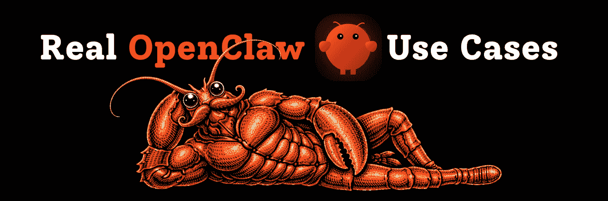
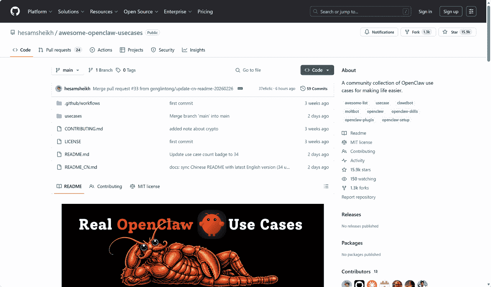

# Openclaw Usecases 应用用例集

> 来源：[https://gotoaiworld.feishu.cn/docx/EpevdpRHtoTdvjxNbkOcHFhNnch](https://gotoaiworld.feishu.cn/docx/EpevdpRHtoTdvjxNbkOcHFhNnch)

https://github.com/hesamsheikh/awesome-openclaw-usecases

Discover ways of how people are really using OpenClaw (previously ClawdBot, MoltBot) in their daily life.

https://github.com/hesamsheikh/awesome-openclaw-usecases

一个针对 OpenClaw（一款本地运行的 AI 助手）的功能插件聚合库。该项目从官方注册表中精选并分类了 5,400 多个技能，旨在通过过滤垃圾信息、重复内容及恶意代码，为用户提供一个高质量且易于检索的资源清单。项目涵盖了从代码开发、自动化工作流到智能家居控制等数十个专业领域，极大扩展了 AI 助手与外部服务交互的能力。

(Say hello on X.)

# Awesome OpenClaw Use Cases

Solv[ing the ](https://github.com/openclaw/openclaw)bottleneck of OpenClaw adaptation: Not skills, but finding ways it can improve your life. This is a community collection of real-life use cases for OpenClaw.

> Warning: OpenClaw skills and third-party dependencies referenced here may have critical security vulnerabilities. Many use cases link to community-built skills, plugins, and external repos that have not been audited by the maintainer of this list. Always review skill source code, check requested permissions, and avoid hardcoding API keys or credentials. You are solely responsible for your own security.

## Social Media

## Creative & Building

## Infrastructure & DevOps

## Productivity

## Research & Learning

## Finance & Trading

## 🤝 Contributing

[We welcome cont](https://github.com/hesamsheikh/awesome-openclaw-usecases/blob/main/CONTRIBUTING.md)ributions! See CONTRIBUTING.md for guidelines.

+   Add a new usecase

+   Improve existing ones

> Please only submit usecases you have already worked with and verified that works (at least for a day). We value real ideas that make our lives actually better, not worse!

> Note: We do not accept use cases related to crypto.

# 精彩的OpenClaw用例

https://github.com/hesamsheikh/awesome-openclaw-usecases/blob/main/README.md

解决OpenClaw适应的瓶颈：不是技能，[而是找到能改善你](https://github.com/openclaw/openclaw)生活的方法。这是一个关于OpenClaw真实应用场景的社区合集。

> 警告：此处提到的OpenClaw技能和第三方依赖可能存在严重的安全漏洞。许多用例链接到社区构建的技能、插件和外部仓库，这些代码未被本列表维护者审核。务必审查技能源代码，检查请求权限，避免硬编码API密钥或凭证。你完全负责自己的安全。

## 社交媒体

## 创意与建设

## 基础设施与DevOps（开发运维）

## 生产力

## 研究与学习

## 金融与交易

https://github.com/hesamsheikh/awesome-openclaw-usecases/blob/main/README.md