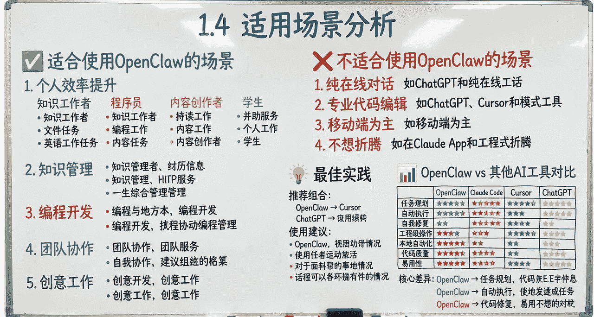

# OpenClaw 基于行业的应用场景分析(企业生产力)

> 来源：[https://gotoaiworld.feishu.cn/docx/R70GdyKzzoMWzwxzRrPc0wPunHd](https://gotoaiworld.feishu.cn/docx/R70GdyKzzoMWzwxzRrPc0wPunHd)

# 一、OpenClaw 核心能力（所有场景的底层逻辑）

+   **本地 AI 主机**：数据不出公司，安全合规

+   **电脑操作自动化**：像人一样点鼠标、敲键盘、打开软件

+   **跨软件协同**：打通 Excel/Word/PPT/ 浏览器 / 企业系统

+   **零代码搭建 Agent**：不用编程，可视化配置

+   **Skills 即插即用**：现成场景模板，一键启用

+   **7×24 小时自动执行**：定时、触发、循环任务

一句话：**OpenClaw = 你的 AI 数字员工，能看**屏幕、会操作软件、懂业务流程、不用休息。

---

# 二、按行业深度展开（超详细版）

## 1）电商 & 跨境电商（最成熟、见效最快）

### 适用企业

淘宝 / 天猫 / 京东 / 拼多多 / 抖音电商 / 亚马逊 / 速卖通 / Shopee 等

### 核心痛点

重复操作多、人工成本高、平台多、数据分散、客服夜班贵

### OpenClaw 可自动化场景

+   **商品管理**

+   自动批量上架、下架、修改价格、修改库存

+   自动生成标题、卖点、描述、关键词优化

+   多平台商品信息同步（淘宝→拼多多→抖音）

+   **订单处理**

+   自动抓单、核对地址、合并订单、打印面单

+   自动同步发货状态、物流跟踪

+   **客服自动化**

+   自动回复：发货时间、运费、退换货、尺寸、库存

+   夜间自动接待，避免流失询盘

+   多语言自动翻译（中英日韩小语种）

+   **营销与数据**

+   自动报名活动、领取优惠券、设置满减

+   自动采集竞品价格、销量、评价、主图

+   自动生成日报 / 周报 / 月报：销售额、转化率、客单价

+   **评论与售后**

+   自动好评引导、自动追评、自动处理售后工单

### 可节省

30%–70% 运营人力，1 人可管过去 3–5 人的店铺量

---

## 2）制造业 / 工厂 / 工贸一体

### 适用企业

装备制造、零部件、五金、塑胶、服装、食品加工

### 核心痛点

报表多、系统多、数据孤岛、生产统计慢、质量难追溯

### OpenClaw 应用场景

+   **生产数据自动采集**

+   自动从设备 / 系统读取产量、合格率、工时

+   自动生成生产日报、班组对比、产能分析

+   **供应链 & 采购**

+   自动比对多家供应商报价、交期、账期

+   自动生成采购单、入库单、对账单

+   **库存 & 仓储**

+   定时盘点库存、低库存预警、呆滞料提醒

+   自动同步 ERP、WMS、Excel 数据

+   **质量检测**

+   自动记录不良品、生成 8D 报告、异常预警

+   自动汇总质检数据，生成趋势图

+   **设备运维**

+   自动记录设备开关机、运行时长、故障次数

+   定时提醒保养、生成维保记录

### 价值

+   减少统计员、文员、数据录入员

+   数据实时、准确、不可篡改

+   老板随时看真实生产情况

---

## 3）商贸 / 批发 / 门店 / 连锁

### 适用

批发市场、区域代理、母婴、建材、美妆、餐饮连锁

### 痛点

对账烦、库存乱、员工业绩难统计、客户管理弱

### OpenClaw 场景

+   **销售自动化**

+   自动统计员工业绩、提成、毛利

+   自动生成对账单、回款提醒、发票登记

+   **库存管理**

+   多门店库存自动同步、调拨自动记录

+   临期商品、滞销品自动预警

+   **客户管理**

+   自动录入客户信息、跟进记录、消费历史

+   生日提醒、复购提醒、活动自动通知

+   **财务对账**

+   自动核对🛰️ / 支付宝 / 银行卡流水

+   自动生成应收应付、利润表、现金流量表

---

## 4）企业通用职能：行政 / HR / 财务 / 运营（全行业通用）

### ① 行政

+   自动整理会议纪要、录音转文字

+   自动发送通知、考勤统计、排班

+   自动报销审核、差旅预订、文件归档

### ② 人力资源 HR

+   自动筛选简历、关键词匹配

+   自动发送面试邀约、面试提醒

+   自动统计考勤、加班、请假

+   自动算工资、社保、个税、生成工资条

+   新员工入职流程自动化：填表→签合同→办工牌

### ③ 财务 / 会计

+   发票 OCR 识别、自动生成凭证

+   银行流水自动对账

+   自动生成三大报表：资产负债、利润、现金流

+   自动申报辅助、税务提醒、合同台账

### ④ 市场 / 运营 / 企划

+   自动搜集行业新闻、竞品动态

+   自动生成周报、月报、活动总结

+   👸号 / 📕 / 抖音内容自动发布

+   数据自动抓取：阅读、点赞、转发、咨询

---

## 5）内容行业 / 自媒体 / 新媒体 / 短视频

### 适用

博主、MCN、企业新媒体、短视频团队

### 场景

+   自动找热点、写选题、列大纲

+   自动写文案、标题、脚本、封面文案

+   自动生成字幕、配背景音乐建议

+   多平台自动发布、定时发布

+   自动抓取播放量、涨粉、评论、生成复盘报告

**一人可顶一个内容团队**

---

## 6）法律服务 / 知识产权 / 合同审核

### 场景

+   合同自动阅读、风险点标出

+   法条、案例自动检索

+   起诉状、答辩状、律师函自动生成

+   商标 / 专利年费自动提醒、侵权监控

+   法律文件自动归档、检索

---

## 7）金融 / 贷款中介 / 财税咨询

### 场景

+   客户资料自动整理、校验

+   报表自动生成、指标自动计算

+   风控规则自动核对、异常提醒

+   合规文件自动生成、留痕存档

---

## 8）教育 / 培训 / 知识付费

### 场景

+   自动整理题库、出卷、批改客观题

+   自动发送开课提醒、作业提醒、回访

+   学员信息自动录入、跟进记录自动保存

+   课程资料自动打包、发送、加密

---

# 三、按职业精准匹配

## 1）老板 / 企业主

+   自动看数据：利润、库存、回款、产能

+   自动监控风险：资金、库存、客户流失

+   自动降本：减少文员、统计、录入岗

+   自动提效：流程标准化、数字员工化

## 2）职场白领

+   行政：少做报表、少发通知、少整理档案

+   HR：少筛简历、少算工资、少核对考勤

+   财务：少录发票、少对账、少做报表

+   运营：少做周报、少搜集数据、少发内容

+   销售：少录客户、少写跟进、少算提成

## 3）创业者 / 自由职业

+   自动接单、自动做方案、自动交付

+   自动做内容、自动引流、自动变现

+   自动管客户、自动记账、自动开票

---

# 四、OpenClaw 最容易卖出去的 10 个 “爆款场景”

1.  自动生成日报 / 周报 / 月报

1.  自动从多系统汇总数据

1.  自动整理 Excel、对账、核对差异

1.  自动客服回复

1.  自动电商上架、改价、同步库存

1.  自动简历筛选 + 面试通知

1.  自动发票识别 + 凭证生成

1.  自动写文案、做 PPT、生成字幕

1.  自动监控竞品、采集信息

1.  自动定时执行重复性任务

# 五、适合使用 OpenClaw 的场景

OpenClaw 核心优势是本地自动化、跨软件操作、任务自动执行，以下场景能最大化发挥其价值：

1.  **个人效率提升**

+   知识工作者：文件整理、知识检索、英语办公任务自动化

+   程序员：本地编程、代码辅助、内容类开发任务

+   内容创作者：持续内容生产、文案 / 脚本 / 素材批量处理

+   学生：学习辅助、个人事务管理、作业 / 论文自动化处理

1.  **知识管理**

+   知识管理者：履历信息结构化、知识库搭建与维护

+   企业服务：HTTP 接口自动化、知识体系全生命周期管理

+   综合管理：个人 / 企业知识库统一归集、检索与更新

1.  **编程开发**

+   本地编程：本地代码编写、调试、版本控制协同

+   工程管理：敏捷开发流程自动化、协作任务流转、代码质量检查

+   插件化开发：与 Cursor 等工具联动，实现 “规划→编码→执行” 全流程自动化

1.  **团队协作**

+   团队服务：跨部门流程自动化、任务分配与进度跟踪

+   自我协作：个人工作流串联、多工具数据互通（如 Excel→PPT→企业🛰️）

+   文档协作：会议纪要自动生成、版本对比、权限管理

1.  **创意工作**

+   创意开发：选题策划、内容框架生成、多模态素材整合

+   创意落地：文案 / 海报 / 脚本批量生成、跨平台内容分发自动化

---

# 六、不适合使用 OpenClaw 的场景

OpenClaw 并非万能工具，以下场景建议选择更专业的替代方案：

1.  **纯在线对话场景**

+   如 ChatGPT 等纯文本对话、在线客服话术生成，无需本地操作的场景，OpenClaw 无明显优势

1.  **专业代码编辑场景**

+   如 ChatGPT、Cursor 等专注于代码生成 / 调试的工具，在代码质量、语法补全上更专业

1.  **移动端为主的场景**

+   核心依赖手机 / 平板操作、无桌面端环境的场景，OpenClaw 无法发挥本地自动化能力

1.  **不想折腾技术配置的场景**

+   如 Claude App 等轻量化工具，OpenClaw 需要一定部署 / 配置成本，不适合追求 “开箱即用” 的用户

---

# 七、最佳实践与工具组合

**推荐组合**：

+   OpenClaw → Cursor：用 OpenClaw 做任务规划与自动化执行，用 Cursor 做专业代码编辑

+   ChatGPT → 复用编辑：用 ChatGPT 做创意 / 文案生成，再用 OpenClaw 做落地执行与格式优化

**使用建议**：

+   优先在需要本地操作、跨软件协同、重复流程自动化的场景使用

+   适合有一定技术基础、愿意配置工作流的用户 / 团队

+   可在多环境（本地 / 云端）部署，实现全场景覆盖

---

#### 📊 OpenClaw vs 其他 AI 工具对比

表格

**核心差异**：

+   OpenClaw 侧重任务规划、本地自动化、自动执行完成任务

+   OpenClaw 强调**代码修复、易用性与本地部署**，数据更安全可控

