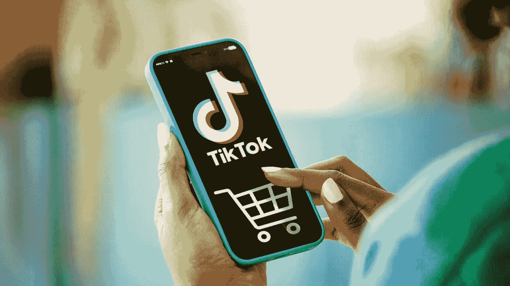

# 新媒体与内容创作行业 OpenClaw 应用场景分析报告

> 来源：[https://gotoaiworld.feishu.cn/docx/AxU9dNUdxovGc0x4Quscc1VYnHc](https://gotoaiworld.feishu.cn/docx/AxU9dNUdxovGc0x4Quscc1VYnHc)

## 一、行业核心概况

**行业定位**：属于内容驱动、流量导向、轻资产运营型服务行业，涵盖自媒体账号运营、品牌新媒体矩阵、内容电商、短视频创作、图文内容产出、直播内容策划、品牌软文推广、知识付费、社群内容运营等细分领域，核心围绕内容生产、流量获取、用户留存、商业变现、品牌口碑传播开展业务，是OpenClaw轻量化落地、快速见效、适配全员使用的典型行业。

**行业核心特性**：内容产出需求量大、重复性文案工作多、平台规则更新快、追热点时效性强、多账号矩阵运营普遍、用户互动响应要求高、内容排版与格式标准化需求强、数据分析与复盘频次高、创意与执行兼顾，部分岗位涉及多平台内容适配与二次创作。

**OpenClaw核心价值**：聚焦替代内容行业内文案撰写、排版编辑、数据统计、互动回复、热点整理等重复性机械工作，实现内容批量产出、多平台适配优化、用户互动自动化、数据复盘一键生成，大幅缩短内容生产周期，降低人力成本，释放创作者精力聚焦创意策划、深度内容打磨、流量变现与品牌策略等高价值工作，单人可高效运营多平台账号矩阵，人均综合提效可达70%以上。

## 二、行业核心部门及对应岗位梳理

新媒体与内容创作行业以**内容生产与账号运营**为核心，配套品牌推广、用户运营、商业变现、内容审核、技术支撑等职能部门，自媒体团队、品牌新媒体部门、MCN机构部门设置略有差异，整体标准核心部门及细分岗位如下：

1.  **内容创作部**：核心部门，负责全品类内容策划、文案撰写、脚本创作、深度内容产出、内容素材整理，是内容生态的核心供给端

1.  **新媒体运营部**：负责全平台账号日常运营、内容发布、流量推广、账号权重维护、粉丝互动、平台规则跟进，覆盖👸号、📕、抖音、快手、B站、🧣、视频号等主流平台

1.  **短视频与直播部**：负责短视频脚本创作、拍摄剪辑辅助、直播内容策划、直播话术准备、直播场控辅助、短视频内容优化与投流配合

1.  **用户与社群运营部**：负责粉丝留存、社群维护、用户互动、评论回复、私域内容推送、用户需求收集、粉丝画像分析

1.  **品牌内容部**：负责品牌软文、宣传文案、公关稿件、活动文案撰写，品牌内容矩阵搭建，品牌口碑维护与舆情监控

1.  **内容审核与优化部**：负责内容合规审核、文案纠错、格式优化、关键词优化、SEO优化、内容数据复盘与优化建议

1.  **商业变现与投放部**：负责内容变现策划、广告文案撰写、投放文案优化、商单对接、合作文案产出、变现数据统计

1.  **设计与视觉辅助部**：配合内容产出做视觉文案配套、海报文案、封面文案、图文排版设计辅助

## 三、分部门分岗位 OpenClaw 应用场景详表（按落地优先级排序）

说明：表格按岗位落地优先级从高到低排列，落地难易度星级越低，上手越快、越适合课堂实操；所有Skill均适配主流新媒体平台，无需定制开发，支持内容一键适配多平台格式，贴合内容创作轻量化、高效率的核心需求。

| 所属部门 | 核心岗位 | 核心价值 | 细分落地场景 | 推荐可用OpenClaw Skill | 落地难易度 |
| --- | --- | --- | --- | --- | --- |
| 新媒体运营部 | 新媒体运营专员/账号运营 | 自动化账号日常运营，多平台同步适配，高效维护账号活跃度 | 1. 多平台内容标题优化、关键词提炼、平台规则适配；2. 内容发布排版自动格式化、分段、表情符号适配；3. 账号后台数据自动统计、日报周报生成；4. 粉丝评论、私信初步自动回复、互动引导；5. 热点话题自动抓取、选题方向推荐、账号日常巡检 | account-operate-auto、title-optimize、content-format、data-statistics、hot-topic-catch | ⭐ 极易 |
| 内容创作部 | 文案编辑/内容撰稿人 | 快速产出标准化文案，减少重复撰写耗时，提升内容产出效率 | 1. 👸号推文、📕笔记、🧣短文、图文文案自动撰写；2. 文案初稿生成、润色优化、纠错改错、文风调整；3. 产品文案、卖点提炼、科普文案、干货内容输出；4. 文案大纲梳理、结构搭建、内容扩写与缩写；5. 节假日文案、活动文案、日常更新文案批量生成 | copy-write-auto、content-polish、outline-build、product-copy、festival-copy | ⭐ 极易 |
| 短视频与直播部 | 短视频编导/直播助理 | 快速产出视听内容脚本，配套话术自动生成，降低拍摄筹备耗时 | 1. 短视频口播脚本、剧情脚本、干货脚本自动撰写；2. 直播开场话术、产品讲解话术、互动话术、逼单话术生成；3. 视频封面文案、标题、字幕文案自动提炼与适配；4. 短视频选题策划、脚本结构优化、口播稿精简；5. 直播流程梳理、场控话术提醒、回放内容摘要 | short-video-script、live-speech、cover-copy、video-topic、live-process | ⭐ 极易 |
| 用户与社群运营部 | 社群运营/粉丝运营 | 自动化粉丝互动与社群维护，提升用户粘性，减少日常互动耗时 | 1. 社群日常问候、互动话题、干货分享内容自动生成；2. 粉丝评论、私信自动礼貌回复、常见问题解答；3. 粉丝需求收集、意见整理、用户画像初步分析；4. 社群活动文案、通知公告自动撰写、推送提醒；5. 粉丝互动数据统计、活跃度分析、留存策略辅助 | community-interact、fans-reply-auto、topic-generate、activity-copy、data-analyze | ⭐ 极易 |
| 内容审核与优化部 | 内容审核专员/SEO优化专员 | 自动审核内容合规性，优化内容曝光度，降低违规风险 | 1. 内容错别字、语法错误、敏感词自动检测与修正；2. 平台合规性审核、违规内容预警、文案风险排查；3. 内容SEO关键词优化、标题排名优化、流量词植入；4. 内容数据复盘、阅读量/播放量低的内容优化建议；5. 内容标签自动匹配、分类整理、合集梳理 | content-audit、sensitive-check、seo-optimize、data-optimize、tag-match | ⭐⭐ 易 |
| 品牌内容部 | 品牌文案/公关文案专员 | 快速产出品牌专业文案，维护品牌调性，提升品牌传播效率 | 1. 品牌软文、宣传通稿、公关稿件自动撰写与润色；2. 品牌活动文案、官宣文案、口碑维护文案生成；3. 舆情监控、负面舆情应对初稿、回应文案撰写；4. 品牌故事、品牌简介、价值主张梳理与优化；5. 行业资讯整理、品牌相关内容二次创作 | brand-copy、pr-release、activity-copy、public-opinion、brand-story | ⭐⭐ 易 |
| 商业变现与投放部 | 商业文案/投放优化专员 | 优化商业文案转化效果，自动统计变现数据，提升商业收益 | 1. 广告文案、商单文案、带货文案自动撰写、转化优化；2. 投放文案标题、描述、落地页文案优化；3. 变现数据自动统计、转化分析、收益报表生成；4. 合作邀约文案、对接话术、商务稿件整理；5. 爆款文案拆解、同类优质内容参考整理 | ad-copy、business-copy、put-optimize、data-statistics、copy-analyze | ⭐⭐⭐ 中等 |
| 设计与视觉辅助部 | 视觉文案/美工助理 | 配套内容产出视觉文案，提升图文视觉效果，辅助设计效率 | 1. 海报文案、封面文案、配图文案自动撰写与适配；2. 图文排版文案、小标题、引导语生成；3. 设计需求文案整理、视觉表达逻辑梳理；4. 表情包文案、短平快传播文案、互动贴纸文案；5. 物料文案校对、格式优化、风格统一 | poster-copy、cover-copy、typeset-copy、design-need、copy-check | ⭐⭐ 易 |
| 内容创作部 | 资深内容创作者/内容主编 | 辅助深度内容策划，把控内容方向，提升内容整体质量 | 1. 深度内容选题策划、专栏大纲、系列内容规划；2. 优质内容初稿审核、润色、风格把控；3. 行业干货、知识付费内容框架搭建、要点梳理；4. 内容团队创作方向指导、文案标准制定；5. 行业趋势分析、爆款逻辑总结、内容策略调整 | deep-content-plan、outline-build、content-control、strategy-make、trend-analyze | ⭐⭐⭐ 中等 |

## 四、行业落地核心总结（教材专用）

> **1. 落地优先级**：新媒体运营、文案编辑、短视频编导、社群运营为最高优先级，均为行业每日高频刚需工作，零基础可快速上手，实操效果直观，适合作为教材核心案例；

> **2. 行业核心亮点**：OpenClaw可直接替代60%以上的重复性内容工作，尤其适合文案撰写、标题优化、互动回复、数据统计等场景，完美适配个人自媒体、中小企业新媒体部、MCN机构等不同主体；

> **3. 实操建议**：优先选取极易、易难度岗位场景，重点演示文案撰写、标题优化、内容排版、评论回复等高频场景，结合📕、👸号、抖音等主流平台实操，突出OpenClaw“快速出稿、多账号运营、降本提效”的核心价值。