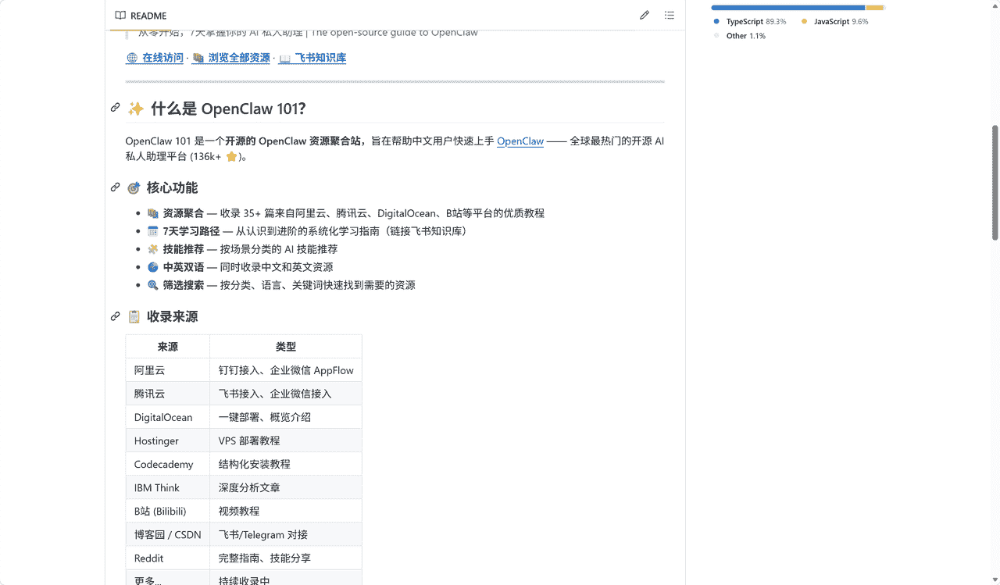

# OpenClaw 101开源资源聚合站

> 来源：[https://gotoaiworld.feishu.cn/docx/QVaPdjTN7oFZoMx4IVRcQhyinGg](https://gotoaiworld.feishu.cn/docx/QVaPdjTN7oFZoMx4IVRcQhyinGg)

OpenClaw 101 — 从零开始，7天掌握你的AI私人助理 | 全网资源聚合站

https://github.com/mengjian-github/openclaw101

openclaw101.dev/

# 🐾 OpenClaw 101

> 从零开始，7天掌握你的 AI 私人助理 | The open-source guide to OpenClaw

[🌐 在线访问 ](https://openclaw101.dev/)· 📚[ 浏览全部资源 ·](https://openclaw101.dev/resources) 📖 [飞书知识库](https://my.feishu.cn/wiki/YkWgwqSchi9xW3kEuZscAm0lnFf)

https://github.com/mengjian-github/openclaw101



---

## ✨ 什么是 OpenClaw 101？

OpenClaw 101 是一个开源的 OpenClaw[ 资源聚合站，旨](https://github.com/openclaw/openclaw)在帮助中文用户快速上手 OpenClaw —— 全球最热门的开源 AI 私人助理平台 (136k+ ⭐)。

### 🎯 核心功能

+   📚 资源聚合 — 收录 35+ 篇来自阿里云、腾讯云、DigitalOcean、B站等平台的优质教程

+   📅 7天学习路径 — 从认识到进阶的系统化学习指南（链接飞书知识库）

+   🧩 技能推荐 — 按场景分类的 AI 技能推荐

+   🌍 中英双语 — 同时收录中文和英文资源

+   🔍 筛选搜索 — 按分类、语言、关键词快速找到需要的资源

### 📋 收录来源

## 🚀 快速开始

# 克隆仓库

git clone https://github.com/mengjian-github/openclaw101.git

cd openclaw101

# 安装依赖

npm install

# 本地开发

npm run dev

# 构建

npm run build

## 📁 项目结构

```
src/
├── app/
│   ├── page.tsx          # 首页
│   ├── resources/
│   │   └── page.tsx      # 资源聚合页
│   ├── layout.tsx        # 全局布局
│   └── globals.css       # 全局样式
├── components/
│   ├── Hero.tsx           # 首屏
│   ├── WhatIs.tsx         # 介绍
│   ├── LearningPath.tsx   # 7天学习路径
│   ├── Skills.tsx         # 技能推荐
│   ├── ResourcesSection.tsx # 首页资源精选
│   ├── Community.tsx      # 社区与贡献
│   ├── Navbar.tsx         # 导航栏
│   └── Footer.tsx         # 页脚
└── data/
    └── resources.ts       # 📚 所有资源数据
```

## 🤝 如何贡献

### 添加新资源

1.  Fork 本仓库

1.  编辑 src/data/resources.ts

1.  按照现有格式添加资源对象：

{title: '资源标题',desc: '一句话描述',url: 'https://...',source: '来源名称',lang: 'zh',  // 'zh' 或 'en'category: 'getting-started',  // 见下方分类featured: false,  // 是否推荐tags: ['标签1', '标签2'],}

### 资源分类

1.  提交 PR，附上简短说明

### 其他贡献方式

+   🐛 报告 Bug — 创[建 Issue](https://github.com/mengjian-github/openclaw101/issues)

+   💡 功能建议 — 创[建 Issue](https://github.com/mengjian-github/openclaw101/issues)

+   🌐 改进翻译 — 欢迎 PR

+   📝 改进内容 — 欢迎 PR

## 🛠 技术栈

+   [Next.js 14](https://nextjs.org/) — React 框架

+   [TypeScript](https://www.typescriptlang.org/) — 类型安全

+   [Tailwind CSS](https://tailwindcss.com/) — 样式框架

+   Cloudflare Pages — 部署托管