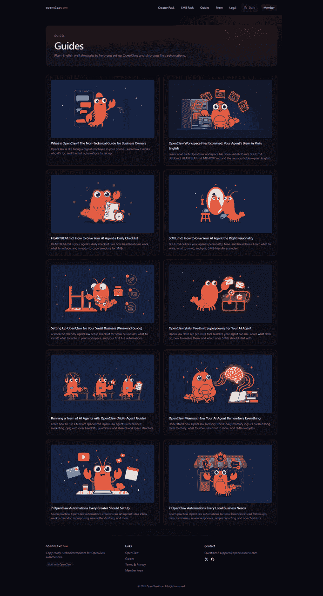

# OpenClaw Workspace Files Explained工作区文件解析

> 来源：[https://gotoaiworld.feishu.cn/docx/TBF2dO0y8osh8Bx1ZhucW9YhnIZ](https://gotoaiworld.feishu.cn/docx/TBF2dO0y8osh8Bx1ZhucW9YhnIZ)

# OpenClaw Workspace Files Explained (AGENTS.md, SOUL.md, HEARTBEAT.md + More)

https://openclawcrew.com/guides/workspace-files

If OpenClaw is a digital employee, the workspace is their office.

Not a metaphorical office. A real folder on disk.

Inside that folder are a few Markdown files that OpenClaw reads to understand:

+   how it should behave

+   what you care about

+   what it should do routinely

+   what it should remember

This guide maps every standard workspace file in plain English, using the official definitions.

## What a workspace is (the office analogy)

Officially: “The workspace is the agent’s home. It is the only working directory used for file tools and for workspace context. Keep it private and treat it as memory.”

Plain English:

+   If the agent needs to read or write a file, it starts here.

+   When you chat with the agent, these files are injected into its context.

+   The workspace is where you store your agent’s rules, tone, and notes.

One important security detail from the official docs:

+   The workspace is the default working directory, not a hard sandbox.

+   Tools resolve relative paths against the workspace, but absolute paths can reach other places on the host unless you enable sandboxing.

If you are a business owner, interpret that as: treat your setup like you would treat a laptop used for work. Use sensible access control and do not store secrets in plain files.

Also: the workspace is separate from ~/.openclaw/, which stores config, credentials, and sessions.

## The quick map (one-screen overview)

Here is the “what is what” map:

+   AGENTS.md: the employee handbook (operating instructions)

+   SOUL.md: the personality + boundaries (tone and guardrails)

+   USER.md: the client card (who you are, what your business does)

+   IDENTITY.md: the name tag (name, vibe, emoji)

+   TOOLS.md: the tool drawer notes (local conventions, device names)

+   HEARTBEAT.md: the daily checklist (small recurring tasks)

+   MEMORY.md (optional): curated long-term memory (private main session only)

+   memory/YYYY-MM-DD.md: daily memory log (one file per day)

+   skills/ (optional): workspace-specific skills (overrides other skills)

+   canvas/ (optional): UI files for node displays (if you use them)

The core idea: if you want a behavior to be consistent, put it in a file.

## AGENTS.md = the employee handbook

### Real-world example: plumber

Your receptionist script should be consistent: - "What's the address?" - "Is water shut off?" - "Is it an emergency leak?" - "Best time window today?"

If those questions live in AGENTS.md, you stop forgetting them when you're busy.

### Real-world example: real estate agent

You want the same intake every time: - buying vs selling - preferred neighborhoods - pre-approval status - timeline

The workspace turns that into a repeatable process instead of a memory game.

## AGENTS.md = the employee handbook

Official definition: Operating instructions for the agent and how it should use memory. Loaded at the start of every session. Good place for rules, priorities, and “how to behave” details.

If SOUL.md is “how to sound,” AGENTS.md is “how to operate.”

### What to put in AGENTS.md (SMB friendly)

+   priorities (what matters most) - do/don’t rules - escalation rules (when to ask you) - approval policy (draft vs send) - how to log important decisions to memory

Here is a small, copy/paste starter:

```
# AGENTS.md (starter)

## Business snapshot (so you do not guess)
- Business: Example Plumbing Co
- Service area: Austin, TX + 20 miles
- Hours: Mon-Fri 8am-6pm
- Emergency calls: Yes, evenings

# AGENTS.md (starter)

## Priorities
1) Protect the business (no risky actions, ask when unsure)
2) Save me time (short drafts, clear next steps)
3) Keep customers happy (warm, professional tone)

## Safety rules
- Never message customers/vendors without my approval.
- Never promise pricing or timelines unless I provide ranges.
- If you are missing details, ask 1-2 questions max.

## How to use memory
- Capture decisions, follow-ups, and commitments in memory/YYYY-MM-DD.md.
- Keep daily notes short and high-signal.
```

### Pro tip

> Treat AGENTS.md like an SOP binder. > If you find yourself correcting the agent twice, that correction belongs in AGENTS.md.

## SOUL.md = the personality + boundaries

Official definition: Persona, tone, and boundaries. Loaded every session.

SOUL.md is your brand voice guide.

It answers:

+   “How should drafts sound?”

+   “What topics are off-limits?”

+   “How short should replies be?”

+   “When must the agent ask for approval?”

A tight SOUL.md makes your drafts feel like you wrote them.

```
# SOUL.md (simple business voice)

Tone:
- Warm, professional, plain English
- Short paragraphs
- Bullets for steps

Boundaries:
- Draft first. Never send externally without approval.
- No legal/medical/financial advice.
- No promises on pricing or timelines.

Formatting rules:
- Start with a 1-line summary.
- Then bullets.
- End with: “Want me to draft the reply?”
```

### Pro tip

> If you run multiple agents, give each a different SOUL.md. > Receptionist voice should be friendly and fast. Ops voice should be checklist-driven.

## USER.md = your “client card”

Official definition: Who the user is and how to address them. Loaded every session.

USER.md is where you write the facts the agent should not have to guess.

Think of it like the card a great assistant keeps on their desk:

+   your business name

+   what you sell

+   your service area

+   hours

+   your preferences (tone, communication style)

A practical USER.md template:

```
# USER.md

## About the business
- Business name: Acme Plumbing
- Services: water heaters, drain clearing, leak repair
- Service area: Austin + 25 miles
- Hours: Mon-Fri 8am-6pm, Sat 9am-1pm

## Brand voice
- Friendly, calm, not salesy
- No slang

## Pricing and policies
- We do not quote exact prices by text. We offer ranges and confirm onsite.
- We ask for address + photos when possible.

## What success looks like
- Faster replies to leads
- Less time rewriting messages
- Weekly summary of what happened
```

## IDENTITY.md = the name tag

Official definition: The agent’s name, vibe, and emoji. Created/updated during the bootstrap ritual.

This file is small but surprisingly useful.

If you run multiple agents, IDENTITY.md helps you keep them distinct:

+   “Front Desk” vs “Marketing” vs “Ops”

+   Different “vibes” so messages don’t blur together

Example:

```
# IDENTITY.md

Name: Hazel
Role: Front Desk Assistant
Vibe: Friendly, efficient, calm under pressure
Emoji: ☎️
```

## TOOLS.md = the tool drawer notes

Official definition: Notes about your local tools and conventions. Does not control tool availability. It is only guidance.

Translation: TOOLS.md is where you write “how things are set up around here.”

Good things to include:

+   what calendar you use

+   CRM name

+   naming conventions

+   units and formats

+   device nicknames (if you have screens/nodes)

Bad things to include:

+   passwords

+   API keys

+   OAuth tokens

Example:

```
# TOOLS.md

## Calendar
- We use Google Calendar.
- Default timezone: America/Chicago.

## CRM
- HubSpot.
- Lead stages: New → Contacted → Scheduled → Won/Lost.

## Communication
- Use short SMS-style drafts.
- Always ask for approval before sending.
```

## HEARTBEAT.md = daily checklist (keep tiny)

Official definition: Optional tiny checklist for heartbeat runs. Keep it short to avoid token burn.

This is one of the highest-leverage files.

HEARTBEAT.md is like the daily opening checklist for a store manager:

+   check inbox

+   check schedule

+   flag urgent items

+   write a quick summary

You do not want essays in HEARTBEAT.md. You want a short routine.

A simple example:

```
# HEARTBEAT.md

1) Check for new leads in the last 24 hours.
   - Draft replies. Do not send.

2) Draft “Today’s priorities” (max 5 bullets).

3) Append decisions + open loops to memory/YYYY-MM-DD.md.

If nothing needs action, reply HEARTBEAT_OK.
```

(There is a full deep dive and template in the HEARTBEAT guide.)

## MEMORY.md + memory/ folder = long-term vs daily memory

Official definitions:

- memory/YYYY-MM-DD.md: Daily memory log (one file per day). Recommended to read today + yesterday.

- MEMORY.md (optional): Curated long-term memory. Only load in the main, private session (not shared/group contexts).

Here is the simplest way to think about it:

- is the daily journal.

- is the company playbook.memory/MEMORY.md

Daily log entries should be short:

+   “Customer asked for X. We promised Y.”

+   “Decision: we no longer offer same-day installs.”

+   “Open loop: follow up with Jenna on quote.”

MEMORY.md should be stable facts:

+   services

+   policies

+   brand voice rules

+   common objections and the best replies

### Pro tip

> Do a weekly “memory cleanup.” > On Friday, skim the week’s daily logs and promote the evergreen stuff into MEMORY.md.

## Optional folders (skills/, canvas/)

From the official docs:

- skills/ (optional): workspace-specific skills. If a skill name collides, workspace skills override managed/bundled skills.

- canvas/ (optional): UI files for node displays (example: ).canvas/index.html

You can ignore these on day one.

## Beginner guardrails (what NOT to put in your workspace)

Do not store:

+   passwords

+   API keys

+   OAuth tokens

+   bank info

+   sensitive customer dumps

Even if you keep your repo private, treat the workspace like internal company notes, not a vault.

## Your first 30-minute setup (practical)

If you want a quick “get it working” plan:

1.  Fill USER.md with the basics (business, hours, voice, policies).

1.  Add 5 rules to AGENTS.md (approval before sending is the big one).

1.  Add a 6-12 line HEARTBEAT.md (tiny checklist).

1.  Start the memory/ habit by writing one entry today.

If you want these files pre-filled with SMB-ready wording, grab the OpenClawCrew Starter Kit ($49). It includes copy/paste templates for AGENTS, SOUL, HEARTBEAT, and memory routines so your agent behaves well on day one.

---

## Before vs After (why these files matter)

Before:

+   You keep re-explaining your hours, your offers, and your "how we handle refunds" policy.

+   The agent sounds different every day.

+   You get outputs that are 70% right and 30% risky.

After:

+   Your workspace becomes a labeled filing cabinet.

+   AGENTS.md is the employee handbook.

+   SOUL.md is the tone guide.

+   HEARTBEAT.md is the daily opening checklist.

+   You correct the agent once, then it stays corrected.

Time saved examples:

+   Real estate agent: 30 minutes per day saved by standardizing follow-up drafts and logging calls.

+   Bakery: fewer back-and-forth messages because order questions are always asked the same way.

+   Fitness coach: weekly client check-ins happen on schedule instead of "when you remember."

## Mini-FAQ

Do I need every file on day one?

No. Start with AGENTS.md, SOUL.md, USER.md, and a tiny HEARTBEAT.md.

Can I have multiple workspaces?

Yes. Think "one workspace per role" when you go multi-agent.

What should I put in USER.md as a local business?

Hours, service area, core services, pricing ranges (if any), and how to handle bookings.

What about a content creator?

Your topics, audience, do-not-say list, and your post formats.

How do I know if a rule belongs in AGENTS.md or SOUL.md?

If it is about behavior and safety, AGENTS.md. If it is about voice and style, SOUL.md.

## Related Guides

- HEARTBEAT.md Deep Dive: - SOUL.md Deep Dive: - OpenClaw Memory Explained:/guides/03-heartbeat-md/guides/04-soul-md /guides/08-memory

## Common Mistakes

1.  Using the workspace like a junk drawer

+   Keep files clean. Short sections. Clear headers.

1.  Putting secrets in plain text

+   No passwords. No API keys. Treat the workspace like a printed binder someone could see.

1.  Writing novels in AGENTS.md

+   You want rules, not a manifesto. If it cannot fit on two screens, trim.

1.  Confusing SOUL.md with marketing copy

+   SOUL.md is instructions, not a website page.

1.  Never updating USER.md

+   If your hours change or you add a service, update USER.md. Otherwise the agent keeps guessing.

https://openclawcrew.com/guides/workspace-files

